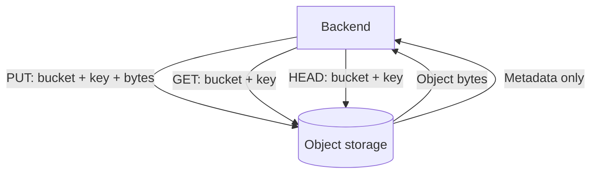
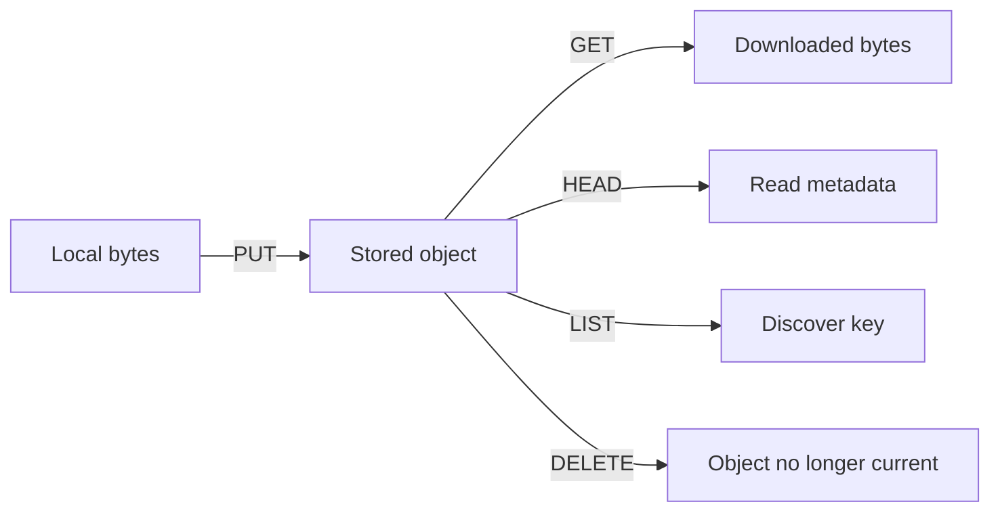
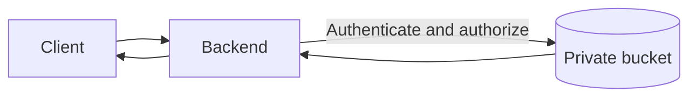
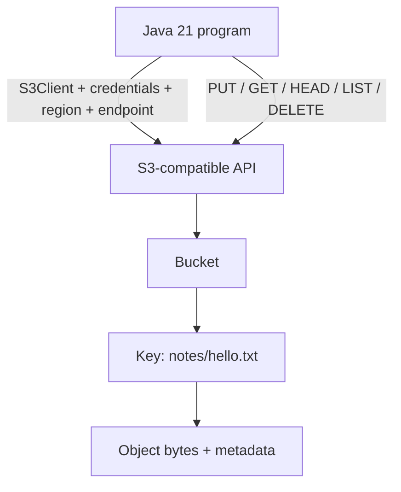

# Amazon S3 and Object Storage — Essential Theory

**Audience:** Beginner to object storage; comfortable with Java 21, Maven, HTTP, and SQL.  
**Scope:** Independent backend-engineering reference; no application or cloud account required.  
**Verified reference versions (13 November 2026):** AWS SDK for Java 2.x **2.57.13** (BOM); Maven Compiler Plugin **3.16.0**; Maven Exec Plugin **3.7.0**. These are pinned examples, not a requirement to chase the newest version for every project.

> **Learning goal:** Understand where object storage fits, what buckets and keys mean, how Amazon S3 works, and how Java performs the five essential operations. Then complete the small, separate exercise document.

## Table of contents

- [1. Storage fundamentals](#1-storage-fundamentals)
- [2. Amazon S3 fundamentals](#2-amazon-s3-fundamentals)
- [3. Using S3 from Java 21](#3-using-s3-from-java-21)
- [4. Important backend engineering concepts](#4-important-backend-engineering-concepts)
- [5. Local development and testing](#5-local-development-and-testing)
- [6. Vocabulary and common misconceptions](#6-vocabulary-and-common-misconceptions)
- [7. Final mental model and checklist](#7-final-mental-model-and-checklist)
- [8. References and version notes](#8-references-and-version-notes)

---

# 1. Storage fundamentals

## 1.1 What does “storage” mean in a backend?

A backend stores information so that it still exists **after a request finishes** and usually **after the program restarts**. This is called **persistence**. Different kinds of storage are optimized for different jobs.

Imagine a document-management service:

- The **document's title, owner, and creation date** are structured facts: a relational database is good at querying and updating them.
- The **entire PDF file** is an arbitrary sequence of bytes: a filesystem or object store is good at holding it.
- A **temporary decoded document** kept only while processing may live in application memory, which is not durable storage.

### Three basic choices

| Option | What is stored? | Strength | Common trade-off |
|---|---|---|---|
| Local filesystem | Files under paths such as `D:\documents\report.pdf` | Very simple on one machine | Disk may be ephemeral, and other servers may not share it |
| Relational database (e.g., PostgreSQL) | Rows and columns; binary files can also be stored using `BYTEA` | Transactions, relational queries, one backup boundary | Large file traffic grows database size and operational burden |
| Object storage (e.g., Amazon S3) | **Objects:** byte content identified by a bucket and key | Durable object APIs, independent scaling, storage-focused features | Network calls, permissions, costs, no shared SQL transaction |

**No option is universally wrong.** A tiny internal system might reasonably use local files or database `BYTEA`; a system with many documents and multiple servers often benefits from object storage.

## 1.2 What is object storage?

**Object storage** is a service that stores complete pieces of data called **objects** and provides operations to put, get, inspect, list, and delete them.

Think of a warehouse:

- **Bucket** = a named warehouse.
- **Key** = an object's assigned label within that warehouse.
- **Object data** = the contents of the package (for example, PDF bytes).
- **Object metadata** = labels that describe the package (for example, content type).



Object storage exists because storing very large numbers of binary files, replicating them, enforcing access rules, and serving them over networks is a specialized task. It need not be implemented inside a relational database or tied to a particular backend host.

## 1.3 What exactly is an object?

An object consists conceptually of:

1. **Data (body):** Any bytes — text, JPEG, ZIP, PDF, serialized content, etc.
2. **Key:** A string chosen to identify the object in a bucket.
3. **Metadata:** Information associated with the object, such as content type and user-defined key/value metadata.
4. **Service-maintained attributes:** Commonly size, last-modified timestamp, and an **ETag**; optionally a version identifier if versioning is enabled.

For example:

```text
Bucket: study-documents
Key:    notes/intro.txt
Body:   Hello from object storage!\n
Content-Type: text/plain; charset=utf-8
Size:   27 bytes (illustrative)
```

**Important distinction:** A key is not the contents; an object with key `notes/intro.txt` could contain text, an image, or anything else. A file extension is a convention, not proof of the content.

## 1.4 Buckets and keys

A **bucket** is a top-level container. An **object key** identifies the object within that bucket.

```text
Bucket: study-documents
  notes/intro.txt
  notes/advanced.txt
  exports/report-2026.pdf

Bucket: project-assets
  logos/primary.png
```

The fundamental address is **(bucket, key)**. If bucket versioning is enabled, a specific historical version may additionally be identified by a **version ID**.

Bucket names have provider-specific naming and uniqueness rules. For an actual S3 bucket, the name must satisfy S3 naming requirements and is not freely interchangeable with a local directory name.

### What are prefixes and “folders”?

Keys are generally strings in a **flat namespace**. The slash (`/`) is often just a character that tools interpret as a folder separator.

```text
notes/intro.txt
notes/advanced.txt
```

The shared prefix is `notes/`. You can ask a listing API to return keys beginning with that prefix. A browser UI may display a `notes` folder, but that doesn't imply real nested directories on a disk.

**Common mistake:** Assuming that renaming `notes/` is an atomic folder rename. In object storage this usually requires copying and/or deleting keys, not renaming a filesystem directory.

## 1.5 Object keys versus local file paths

| Concept | Example | Meaning |
|---|---|---|
| Local path | `D:\study\intro.txt` | File's location on one operating system's filesystem |
| Object key | `notes/intro.txt` | Identifier supplied to the object-storage API |
| Bucket + key | `study-documents` + `notes/intro.txt` | Location of the object inside a store |
| URL | `https://...` | An HTTP address used to access a service; not automatically public or permanent |

Avoid including usernames, email addresses, or secrets in keys: keys can be exposed in logs, diagnostics, and URLs. For user-created content, backend-generated UUID-based keys are often safer than accepting user-controlled paths.

## 1.6 The object lifecycle



- **PUT:** Send bytes to create or replace an object.
- **GET:** Retrieve the body; sometimes request just a byte range.
- **HEAD:** Ask for metadata without downloading the body.
- **LIST:** Ask the service for objects/keys matching criteria, often paginated.
- **DELETE:** Remove the object from the current view (versioning may change the exact effect).

Typical use cases include document archives, backups, media assets, static website resources, log files, data exports, and uploaded user attachments.

**Mental Model — Part 1:** PostgreSQL is a searchable catalog of structured facts; an object store is a warehouse for byte packages addressed by bucket and key. A local path is a host filesystem concept, not a portable object identifier.

---

# 2. Amazon S3 fundamentals

## 2.1 What is Amazon S3?

**Amazon Simple Storage Service (Amazon S3)** is AWS's managed object-storage service. Applications interact with it through APIs and SDKs rather than mounting a normal local disk in the simplest use cases.

S3 manages storage-side infrastructure and exposes features for access control, durability, listing, object versioning, lifecycle management, and multiple storage classes. You still decide the permissions, keys, object handling, and cost controls that fit your application.

## 2.2 Regions and endpoints

An **AWS Region** is a geographic AWS deployment region such as `us-east-1` or `ap-southeast-1`. A bucket is created in a region, and clients should use the correct region for requests and signing.

An **endpoint** is the network address where an S3 API request is sent. For a local S3-compatible server, it might be:

```text
http://127.0.0.1:9000
```

AWS S3 normally resolves an AWS endpoint based on client configuration; the local example needs an explicit `endpointOverride`.

> **Region vs endpoint:** Region tells the client where the service is logically located and helps sign requests; endpoint is the actual HTTP destination. A custom endpoint still requires a region for AWS SDK signing.

## 2.3 Two S3 addressing styles

Object `notes/intro.txt` in bucket `study-documents` can conceptually be addressed as:

```text
Virtual-hosted style: https://study-documents.s3.<region>.amazonaws.com/notes/intro.txt
Path style:          http://127.0.0.1:9000/study-documents/notes/intro.txt
```

With local servers, **path-style access** is often easier because your computer might not resolve a hostname such as `study-documents.localhost` correctly. In Java SDK v2, `.forcePathStyle(true)` explicitly selects path-style addressing. The real URL scheme and hostname depend on the provider and environment.

## 2.4 Basic S3 operations and HTTP

| S3 operation | Typical API / HTTP action | Use case | Watch out for |
|---|---|---|---|
| PUT | `PutObject` / HTTP PUT | Upload a file | Same key can replace a current object unless guarded |
| GET | `GetObject` / HTTP GET | Download bytes | Downloads can be large; avoid blindly buffering |
| HEAD | `HeadObject` / HTTP HEAD | Read size, content type, ETag | Permission-dependent 403/404 errors can be ambiguous |
| LIST | `ListObjectsV2` / HTTP GET with query parameters | Browse keys by prefix | Pagination; list is **not** an HTTP method named LIST |
| DELETE | `DeleteObject` / HTTP DELETE | Delete a key | In a versioned bucket, often adds a delete marker rather than destroying all versions |

You can also list buckets, create buckets, and delete empty buckets; those are bucket-level rather than object-level operations.

### Metadata and `Content-Type`

Consider a text object stored with:

```text
Content-Type: text/plain; charset=utf-8
User metadata: source=learning-demo
```

The `Content-Type` tells consumers how the bytes are intended to be interpreted. It does **not** validate or change the bytes. For example, setting `image/png` does not magically turn text into a PNG.

S3 distinguishes standard/system metadata (for example `Content-Type`) from **user-defined metadata**, which can hold small application-specific text properties. Rich relational queries and relationships normally belong in a database, not in S3 user metadata.

## 2.5 Public versus private access

A **private bucket** denies unauthorized anonymous access. Applications typically use authenticated service credentials or deliberately issued temporary access (such as a presigned URL).



A public bucket/object may be readable by anyone under its public-access policy. Public should be a conscious choice for genuinely public assets, not a default for personal documents.

A valid application login is not enough by itself: the backend must check that the caller is authorized for the specific object before returning it or granting access.

## 2.6 IAM, credentials, and permissions

**IAM** (Identity and Access Management) controls which principals may perform actions on which resources. In AWS S3, common actions include:

- `s3:GetObject`, `s3:PutObject`, `s3:DeleteObject` for object operations.
- `s3:ListBucket` for listing objects in a bucket.
- Bucket-level permissions for creating/listing buckets depend on the operation.

An **access key ID** and **secret access key** identify and authenticate a programmatic caller. The SDK signs requests using the credentials; the secret is not something you should place in source code, screenshots, public repositories, or client/mobile apps.

For real AWS, prefer short-lived credentials supplied by an appropriate identity mechanism and narrowly scoped permissions. The exercise uses obvious **local-only development credentials** for a server bound to your computer, not real AWS credentials.

### A conceptual permission statement

A backend that only reads one prefix does not need unrestricted permissions to list, upload, or delete everything. Think:

```text
Principal: document-reader
Allowed action: GetObject
Allowed resource: documents-bucket/public-documents/*
```

This is a **description**, not copy-paste IAM policy JSON. The exact policy resource ARN and conditions must be designed carefully for a real AWS account.

## 2.7 Presigned URLs

A **presigned URL** temporarily authorizes a specific S3 request, such as GET or PUT, without disclosing the application's AWS credentials to the client.

1. Client asks a trusted backend for access.
2. Backend checks the client's permissions.
3. Backend signs a request for one key and returns a time-limited URL.
4. Client uses that URL to access S3 directly.

**Security caveat:** A presigned URL is effectively a bearer credential. Anyone who obtains a still-valid URL may be able to use it within its restrictions. Use short expirations, protect logs, and avoid storing such URLs as permanent object identifiers.

You do not need to implement presigning in the beginner exercise; simply understand what it solves: letting a client transfer bytes **directly** without handing over long-lived service credentials.

## 2.8 What does “S3-compatible” mean?

An **S3-compatible** service implements a useful subset of S3's API so that many AWS S3 SDK calls work against it. Examples include MinIO and other object-storage providers.

Compatibility does **not** guarantee identical behavior for every feature: bucket creation, versioning, conditional writes, policies, signing, multipart uploads, error shapes, and advanced features can differ. Always verify the specific operations you rely on.

| Amazon S3 | Local S3-compatible server |
|---|---|
| Managed AWS service, region-specific, billed | Runs on your machine/container for study |
| AWS endpoint resolution | Usually uses `endpointOverride(...)` |
| AWS identity and IAM | Provider-specific users/credentials/policies |
| AWS durability and cloud availability | Only as durable as your local Docker volume and machine |
| S3-specific feature semantics | Test compatibility feature by feature |

**Mental Model — Part 2:** Amazon S3 implements object storage as bucket + key + bytes + metadata, controlled by API operations and permissions. S3-compatible software speaks much of the same API, but it is not necessarily a byte-for-byte clone of AWS behavior.

---

# 3. Using S3 from Java 21

## 3.1 What is AWS SDK for Java v2?

A **software development kit (SDK)** is a library that hides much of the raw HTTP and request-signing detail behind Java methods. Instead of constructing and signing HTTP requests manually, you use typed Java request objects.

For example:

```java
s3.putObject(putRequest, RequestBody.fromString("Hello S3"));
```

The SDK builds the HTTP request, signs it using configured credentials, sends it, and parses the response. You still control bucket names, object keys, permissions, error handling, and lifecycle.

This guide uses **AWS SDK for Java 2.x**, which is distinct from the older 1.x API (`AmazonS3`).

## 3.2 Maven dependency management with the BOM

A **BOM (Bill of Materials)** keeps multiple AWS SDK modules on compatible versions. It does not add the modules by itself: you still declare the `s3` dependency.

A standalone Java 21 `pom.xml` can use:

```xml
<project xmlns="http://maven.apache.org/POM/4.0.0"
         xmlns:xsi="http://www.w3.org/2001/XMLSchema-instance"
         xsi:schemaLocation="http://maven.apache.org/POM/4.0.0 https://maven.apache.org/xsd/maven-4.0.0.xsd">
  <modelVersion>4.0.0</modelVersion>
  <groupId>edu.example</groupId>
  <artifactId>s3-learning</artifactId>
  <version>1.0-SNAPSHOT</version>

  <properties>
    <maven.compiler.release>21</maven.compiler.release>
    <project.build.sourceEncoding>UTF-8</project.build.sourceEncoding>
    <aws.sdk.version>2.57.13</aws.sdk.version>
  </properties>

  <dependencyManagement>
    <dependencies>
      <dependency>
        <groupId>software.amazon.awssdk</groupId>
        <artifactId>bom</artifactId>
        <version>${aws.sdk.version}</version>
        <type>pom</type>
        <scope>import</scope>
      </dependency>
    </dependencies>
  </dependencyManagement>

  <dependencies>
    <dependency>
      <groupId>software.amazon.awssdk</groupId>
      <artifactId>s3</artifactId>
    </dependency>
  </dependencies>

  <build>
    <plugins>
      <plugin>
        <groupId>org.apache.maven.plugins</groupId>
        <artifactId>maven-compiler-plugin</artifactId>
        <version>3.16.0</version>
      </plugin>
      <plugin>
        <groupId>org.codehaus.mojo</groupId>
        <artifactId>exec-maven-plugin</artifactId>
        <version>3.7.0</version>
      </plugin>
    </plugins>
  </build>
</project>
```

- `dependencyManagement` manages SDK versions.
- `s3` provides the S3 client and S3 model types.
- `maven.compiler.release=21` selects Java 21 language/API compatibility.
- The Exec plugin makes it easy to run the tiny exercise from Maven.

**Common mistake:** Adding SDK components at different versions. Use the BOM to keep them aligned.

## 3.3 `S3Client` and constructing a client

`S3Client` is the **synchronous** Java SDK client for S3 operations. Synchronous means the calling thread waits for the operation to complete or fail.

For a local MinIO server, assuming local-only credentials are available in the environment:

```java
import java.net.URI;
import software.amazon.awssdk.auth.credentials.DefaultCredentialsProvider;
import software.amazon.awssdk.regions.Region;
import software.amazon.awssdk.services.s3.S3Client;

S3Client s3 = S3Client.builder()
    .region(Region.US_EAST_1)
    .endpointOverride(URI.create("http://127.0.0.1:9000"))
    .forcePathStyle(true)
    .credentialsProvider(DefaultCredentialsProvider.create())
    .build();
```

What each method does:

1. `S3Client.builder()` starts a configurable client builder.
2. `.region(...)` supplies a region for request signing (even when using a custom endpoint).
3. `.endpointOverride(...)` points requests to **local** object storage, not AWS.
4. `.forcePathStyle(true)` gives URLs like `/bucket/key`, useful with local endpoints.
5. `.credentialsProvider(...)` asks the SDK to find credentials; with the default chain, environment variables are among the supported sources.
6. `.build()` creates the client.

For actual AWS S3, you generally **omit** the local endpoint override and path-style setting, and configure the actual AWS region and credentials securely.

### Credentials and provider chains

For the local exercise, PowerShell can set:

```powershell
$env:AWS_ACCESS_KEY_ID = 'localadmin'
$env:AWS_SECRET_ACCESS_KEY = 'local-only-password-123'
```

These are intentionally fake, local-only values configured to match the local server. Do **not** reuse them as real AWS keys. The default chain also supports other sources, including configured profiles and environment-based identities.

Avoid committing secrets to `pom.xml` or Java files.

## 3.4 A complete end-to-end Java example

This class performs create/check bucket → put → head → get → delete → verify; it assumes the **local server and environment from the exercise document are already running**.

```java
package edu.example.s3;

import java.net.URI;
import java.nio.charset.StandardCharsets;
import software.amazon.awssdk.auth.credentials.DefaultCredentialsProvider;
import software.amazon.awssdk.core.ResponseBytes;
import software.amazon.awssdk.core.sync.RequestBody;
import software.amazon.awssdk.regions.Region;
import software.amazon.awssdk.services.s3.S3Client;
import software.amazon.awssdk.services.s3.model.CreateBucketRequest;
import software.amazon.awssdk.services.s3.model.DeleteObjectRequest;
import software.amazon.awssdk.services.s3.model.GetObjectRequest;
import software.amazon.awssdk.services.s3.model.GetObjectResponse;
import software.amazon.awssdk.services.s3.model.HeadObjectRequest;
import software.amazon.awssdk.services.s3.model.HeadObjectResponse;
import software.amazon.awssdk.services.s3.model.PutObjectRequest;
import software.amazon.awssdk.services.s3.model.S3Exception;

public final class S3QuickTour {
    private static final String BUCKET = "s3-study";
    private static final String KEY = "notes/hello.txt";

    public static void main(String[] args) {
        try (S3Client s3 = S3Client.builder()
                .region(Region.US_EAST_1)
                .endpointOverride(URI.create("http://127.0.0.1:9000"))
                .forcePathStyle(true)
                .credentialsProvider(DefaultCredentialsProvider.create())
                .build()) {

            boolean bucketExists = s3.listBuckets().buckets().stream()
                    .anyMatch(bucket -> BUCKET.equals(bucket.name()));
            if (!bucketExists) {
                s3.createBucket(CreateBucketRequest.builder()
                        .bucket(BUCKET).build());
            }

            String text = "Hello from Java and object storage!";
            s3.putObject(
                    PutObjectRequest.builder()
                            .bucket(BUCKET)
                            .key(KEY)
                            .contentType("text/plain; charset=utf-8")
                            .build(),
                    RequestBody.fromString(text, StandardCharsets.UTF_8)
            );

            HeadObjectResponse metadata = s3.headObject(
                    HeadObjectRequest.builder()
                            .bucket(BUCKET).key(KEY).build()
            );
            System.out.println("Content type: " + metadata.contentType());
            System.out.println("Size: " + metadata.contentLength());

            ResponseBytes<GetObjectResponse> downloaded = s3.getObjectAsBytes(
                    GetObjectRequest.builder()
                            .bucket(BUCKET).key(KEY).build()
            );
            System.out.println("Downloaded: " + downloaded.asUtf8String());

            s3.deleteObject(DeleteObjectRequest.builder()
                    .bucket(BUCKET).key(KEY).build());

            try {
                s3.headObject(HeadObjectRequest.builder()
                        .bucket(BUCKET).key(KEY).build());
                throw new IllegalStateException("Object unexpectedly exists");
            } catch (S3Exception ex) {
                if (ex.statusCode() != 404) {
                    throw ex;
                }
                System.out.println("Verified: object no longer exists");
            }
        }
    }
}
```

**Walkthrough:**

1. A single `S3Client` manages connections and signs requests; try-with-resources closes it.
2. `listBuckets()` checks for the named local bucket; `createBucket()` creates it only if absent. In real cloud systems, bucket creation is usually a separate administrative step; listing all buckets requires its own permission.
3. `PutObjectRequest` describes **where** and **what metadata**; `RequestBody` supplies the **bytes**.
4. `headObject()` retrieves object metadata without downloading the body.
5. `getObjectAsBytes()` downloads all content into memory; this is appropriate only because the example text is tiny.
6. `deleteObject()` requests removal; a following `headObject()` produces a 404 on the local server, verifying the object isn't available at that key.
7. The code distinguishes an expected 404 from other errors; a generic failure should not be mistaken for “missing object.”

**Important:** `getObjectAsBytes()` is not appropriate for arbitrarily large files because it buffers the entire response.

## 3.5 File-based uploads and downloads

For a real local file, avoid unnecessary conversion to an intermediate byte array:

```java
import java.nio.file.Path;
import software.amazon.awssdk.core.sync.RequestBody;
import software.amazon.awssdk.core.sync.ResponseTransformer;
import software.amazon.awssdk.services.s3.model.GetObjectRequest;
import software.amazon.awssdk.services.s3.model.PutObjectRequest;

// Assumes an existing S3Client named s3 and an existing bucket.
Path input = Path.of("sample.txt");
Path output = Path.of("downloaded.txt");

s3.putObject(
    PutObjectRequest.builder().bucket("s3-study")
        .key("notes/sample.txt").contentType("text/plain").build(),
    RequestBody.fromFile(input)
);

s3.getObject(
    GetObjectRequest.builder().bucket("s3-study")
        .key("notes/sample.txt").build(),
    ResponseTransformer.toFile(output)
);
```

For incremental reading, you can instead call `s3.getObject(request)` and close its `ResponseInputStream<GetObjectResponse>` with try-with-resources. Streams require careful closing so network connections and other resources are released.

## 3.6 Exceptions and failure handling

An S3 operation is a **network call**. Do not assume it is as predictable as accessing an in-process Java collection.

| Problem | What you may observe | What to do |
|---|---|---|
| Key missing on GET | `NoSuchKeyException` or an S3 error with 404 | Decide whether “not found” is normal; do not fabricate content |
| Key missing on HEAD | Often `S3Exception` with HTTP 404 | Treat 403 differently; permissions can affect visibility |
| No permission | HTTP 403 `AccessDenied` through an S3 exception | Check identity and access rules |
| Bucket missing / wrong region | Bucket-specific error, redirect, or request failure | Verify bucket, endpoint, region |
| Local server not running | SDK client/network exception | Check Docker and URL/port |
| Timeout / transient network failure | SDK client exception or service-side error | Decide if retry is safe; don't assume the request never succeeded |
| Invalid credentials/signature | 403/signature-related service response | Check env vars, region, clock, endpoint |

Two broad types to know:

- **`S3Exception`**: The service responded with an S3-specific error and status code.
- **`SdkClientException`**: The SDK failed on the client side, often because it could not connect, could not resolve credentials, or encountered a transport problem.

For a production system, include useful logs without logging secrets, large object bodies, or presigned query strings.

## 3.7 Synchronous and asynchronous clients

- `S3Client` is synchronous: the calling thread waits for the operation to finish.
- `S3AsyncClient` offers asynchronous APIs (typically futures); it can help with concurrent requests and nonblocking integrations, but introduces lifecycle and error-handling complexity.

Start with `S3Client`. Understand PUT, GET, HEAD, and DELETE before learning async transfers or multipart upload optimization.

**Mental Model — Part 3:** `S3Client` is your Java-speaking courier. The request object tells it **where** to deliver or retrieve; the request body or response stream carries the **bytes**. The SDK signs and transmits HTTP requests, but you still handle security, errors, resources, and object lifecycles.

---

# 4. Important backend engineering concepts

## 4.1 S3 is not a relational database

In PostgreSQL, you query rows, join related tables, enforce relational constraints, and group SQL statements into transactions. In S3, you normally look up an object by bucket + key and retrieve its bytes.

| Question | PostgreSQL | S3 |
|---|---|---|
| “Find all documents owned by user X and sorted by date” | Natural SQL query | Normally needs separate database/index metadata |
| “Download the bytes for document ID X” | Possible via `BYTEA` | Natural GET by object key |
| “Atomically change two related records” | Transaction | No general cross-object SQL transaction |
| “Store 100,000 binary documents” | Possible, with DB load/backup implications | Common object-storage use case |

A frequent backend design is: **database stores business metadata and the object key; object storage stores the bytes**.

```text
Database row: id=doc-7, title="Notes", object_key="documents/doc-7.txt"
Object store:  bucket=study-documents, key="documents/doc-7.txt", body=<text bytes>
```

But do not assume every application needs this separation. Strong single-transaction requirements and low volume can justify storing binary values in the database.

## 4.2 Why local filesystem paths are not always portable

Imagine two backend instances:

```text
Instance A: C:\uploads\report.pdf exists
Instance B: C:\uploads\report.pdf does not exist
```

A database row containing only `C:\uploads\report.pdf` is tied to a particular machine/volume. If instances scale horizontally or containers restart with ephemeral disks, the path may not be available. With shared object storage, multiple instances can address the same `(bucket, key)`.

## 4.3 Generate safe object keys

Don't treat user-provided filenames as trustworthy storage identifiers. A simple approach is:

```java
import java.util.UUID;

String key = "documents/" + UUID.randomUUID() + ".txt";
```

Using new keys for new content also avoids accidental overwrites and makes caching/lifecycle easier. Store the original display filename separately if the product genuinely needs it; do not rely on it as a unique identifier.

Object keys are **identifiers**, not access permissions. Knowing a key should not grant unauthorized access to a private bucket.

## 4.4 Overwriting, versioning, and conditional writes

A normal `PutObject` with an existing key can replace its current contents (in an unversioned bucket). If versioning is enabled, S3 may keep previous object versions, subject to lifecycle and permissions.

To prevent accidentally overwriting an existing key, S3 supports a conditional PUT:

```java
PutObjectRequest request = PutObjectRequest.builder()
    .bucket("study-documents")
    .key("notes/new.txt")
    .ifNoneMatch("*")
    .contentType("text/plain")
    .build();
```

`If-None-Match: *` means **only write if no current object exists at that key**. If the condition fails, Amazon S3 commonly returns HTTP **412 Precondition Failed**. In concurrent cases, a **409 Conflict** can also occur. Check compatibility before relying on this with an S3-compatible implementation.

**Important:** Checking existence with HEAD and then PUT is *not* the same atomic guarantee: another client might create the object between those calls.

## 4.5 Network failures, retry ambiguity, and idempotency

Suppose Java uploads `notes/report.txt`. The server stores the bytes successfully, but the response is lost. Java sees a timeout.

Was the object stored? **Possibly yes.** A timeout does not prove failure at the remote end.

- Retrying a deterministic PUT to the same key with the same bytes may be acceptable in many situations, but consider overwrites and versioning.
- A fresh random key on every retry can create duplicate objects.
- Retrying DELETE is often harmless for a simple unversioned current object; with versioning and auditing, its semantics deserve extra thought.
- Automatic SDK retries may occur. Understand whether an operation is safe to repeat before adding more retries blindly.

**Idempotency** means repeating the same logical request has the same intended effect as doing it once. It does not imply that every physical HTTP call happens only once.

For applications where a retry must not create multiple logical records, store a stable operation ID and make the relevant writes conditional or idempotent. That advanced coordination is beyond the small exercise.

## 4.6 Object existence and HEAD

`HEAD` asks for metadata without transferring the object body, so it can be cheaper than downloading a large object merely to inspect its size.

```java
try {
    var head = s3.headObject(r -> r.bucket("s3-study").key("notes/hello.txt"));
    System.out.println(head.contentLength());
} catch (S3Exception e) {
    if (e.statusCode() == 404) {
        System.out.println("Object not found");
    } else {
        throw e;
    }
}
```

An existence check only tells you about a particular point in time; the object could be modified or deleted immediately afterward. HTTP 403 also cannot automatically be interpreted as “does not exist.”

## 4.7 Why S3 is not part of a PostgreSQL transaction

Consider:

```text
Step 1: PUT object to S3          -> success
Step 2: INSERT metadata into DB   -> fails
Step 3: PostgreSQL ROLLBACK       -> DB undone; S3 object still exists
```

`@Transactional` or `TransactionTemplate` ordinarily manage the database transaction, **not** S3 API calls. The reverse is also possible: the database points to an object that was never successfully uploaded.

This is a **cross-system consistency** problem. At a foundational level, know three responses:

1. Choose an operation order with deliberate failure handling.
2. Record unfinished work and retry or compensate when practical.
3. Run periodic cleanup/reconciliation for orphaned or missing objects if needed.

There is no magical `ROLLBACK S3` merely because PostgreSQL rolled back. Detailed outbox/queue designs are beyond this course.

## 4.8 Durability, consistency, and access are different properties

- **Durability:** Likelihood that stored data survives infrastructure failures.
- **Availability:** Whether the service is reachable and serving requests now.
- **Consistency:** What a reader observes after writes and deletes.
- **Authorization:** Who may perform an operation.

Modern **Amazon S3** provides **strong read-after-write consistency** for object PUT/DELETE and subsequent GET/LIST operations; therefore, don't teach “S3 is always eventually consistent” as a blanket rule. This still does not imply a single transaction across S3 and PostgreSQL, and it does not mean every S3-compatible provider has identical guarantees.

## 4.9 Basic costs and trade-offs

Even when object-storage pricing is simple, total cost has several dimensions:

| Cost dimension | What drives it? | Practical response |
|---|---|---|
| Stored bytes | Number/size of objects, previous versions | Keep useful data; remove unnecessary copies |
| Requests | PUT/GET/LIST and other operations | Avoid needless polling and redundant downloads |
| Data transfer | Bytes delivered, destination and network route | Cache and serve the right-sized representation |
| Retrieval/storage class | Storage class and access pattern | Choose based on actual access frequency |
| Operations | Monitoring, permissions, backup/lifecycle policies | Keep configuration understandable and tested |

For this course, **do not create real AWS resources**. A local Docker container is enough to practice the core request model without cloud bills.

**Mental Model — Part 4:** A database transaction owns its database; S3 owns its objects. Objects have stable identifiers, but requests can time out or be repeated. Design keys, permissions, checks, and retries deliberately, even before building more complex systems.

---

# 5. Local development and testing

## 5.1 Why use local S3-compatible storage?

A local server allows you to practice real SDK request shapes without an AWS account, cloud charges, or production credentials. For this guide the preferred teaching service is **MinIO**, run as a Docker container.

Other S3-compatible local servers or mocks exist, but MinIO's visible bucket/object model makes it especially useful for learning. Use a documented, pinned image tag for reproducibility, since `latest` may change.

## 5.2 Running MinIO with Docker on Windows

In PowerShell, with Docker Desktop running:

```powershell
docker run -d `
  --name s3-study `
  -p 127.0.0.1:9000:9000 `
  -p 127.0.0.1:9001:9001 `
  -e MINIO_ROOT_USER=localadmin `
  -e MINIO_ROOT_PASSWORD=local-only-password-123 `
  -v s3-study-data:/data `
  quay.io/minio/minio:RELEASE.2025-09-06T17-38-46Z `
  server /data --console-address ":9001"
```

- `9000` is the S3 API endpoint; `9001` is the MinIO browser console.
- `-v s3-study-data:/data` uses a **named Docker volume**, so data normally survives stopping/recreating the container as long as the volume remains.
- `127.0.0.1` limits published port access to the local computer (subject to Docker networking behavior).
- The values above are deliberately **local-only sample credentials**, never AWS credentials.

Console: <http://127.0.0.1:9001> — sign in with `localadmin` / `local-only-password-123`.  
API: <http://127.0.0.1:9000> — use this in `endpointOverride`, not the console port.

```powershell
docker ps --filter name=s3-study
docker logs --tail 30 s3-study
docker stop s3-study
docker start s3-study
```

The separate exercise provides the exact project commands and a small full Java solution.

## 5.3 Endpoint overrides and path-style access

A local SDK client needs to know:

```text
Endpoint:    http://127.0.0.1:9000
Region:      us-east-1 (used for signing in the local example)
Credentials: matching local MinIO user/password
Addressing:  path-style
```

If `.forcePathStyle(true)` is omitted, the SDK might attempt virtual-host addressing instead, which often fails on a simple localhost configuration.

## 5.4 What local tests prove — and what they don't

| What local tests can establish | What they do not establish |
|---|---|
| Your Java SDK request construction and local connectivity | Real AWS IAM, networking, region behavior, or billing |
| Basic bucket/object put/get/head/delete behavior | All advanced S3 compatibility features |
| Application logic for missing objects and normal errors | AWS's real availability, durability, and operational limits |
| Simple retries and content checks | Every production race, timeout, permissions, or recovery scenario |

To learn the basics, one small local exercise is ideal. To verify provider-specific production behavior, you eventually need tests against that provider under appropriate conditions, but **not** for this beginner exercise.

**Mental Model — Part 5:** MinIO is a practice warehouse on your own machine. You can learn the same bucket/key/SDK vocabulary locally, while remembering that real Amazon S3 has cloud-specific permissions and operational behavior.

---

# 6. Vocabulary and common misconceptions

| Term | Simple definition |
|---|---|
| Object | Complete stored byte content with key and metadata |
| Bucket | Named container of objects |
| Key | Object identifier within a bucket |
| Prefix | Beginning of a key, often used like a virtual folder |
| S3 endpoint | HTTP destination for S3 API requests |
| Region | Geographic AWS deployment location and signing configuration |
| `Content-Type` | Metadata describing the intended media type |
| `PUT` | Upload/create or replace object bytes |
| `GET` | Download object bytes |
| `HEAD` | Retrieve metadata without the body |
| `LIST` | Enumerate object keys using S3 API (not a standard HTTP LIST verb) |
| `DELETE` | Remove current object view; versioning affects details |
| IAM | AWS identity and access-control system |
| Credential provider | SDK component that supplies signing credentials |
| Presigned URL | Time-limited URL authorizing a specific signed operation |
| ETag | Server-provided entity tag used as an HTTP validator; **not always an MD5 checksum** |
| Idempotency | Repeated logical requests produce the intended same effect |
| S3-compatible | Implements useful S3 API behavior; may differ in advanced details |

### Frequently confused ideas

- **Bucket ≠ folder.** Buckets are containers; “folders” are usually prefix-based UI views.
- **Key ≠ public URL.** An object may be private even if its key is known.
- **MIME type ≠ validation.** `Content-Type: image/png` doesn't prove the object contains a valid PNG.
- **ETag ≠ guaranteed MD5.** Treat ETag as a validator, not a universal checksum.
- **Successful PUT ≠ successful database INSERT.** They are independent operations.
- **Timeout ≠ proven failure.** The remote server may have completed the operation.
- **S3-compatible ≠ AWS in every detail.** Test the features you actually use.

---

# 7. Final mental model and checklist



You understand the core S3 mindset if you can explain:

- [ ] Why a document's bytes and its SQL metadata might live in different places.
- [ ] The difference between a **bucket**, **object**, **key**, and **prefix**.
- [ ] What PUT, GET, HEAD, LIST, and DELETE do.
- [ ] Why keys are not local filesystem paths or access credentials.
- [ ] How the AWS SDK chooses an endpoint, region, and credentials.
- [ ] Why local path-style addressing may be necessary.
- [ ] Why SDK network calls can time out or be repeated.
- [ ] Why a PostgreSQL rollback does **not** undo an S3 write.
- [ ] What local MinIO tests can prove, and what they cannot.

**Next step:** Complete `Amazon_S3_and_Object_Storage_Exercise.md`. It deliberately uses one Java class, one text object, and one local bucket — no REST API, no cloud account, and no extra architecture.

---

# 8. References and version notes

The technical APIs, client configuration, and local-server syntax in this guide were cross-checked against documentation available on **13 November 2026**:

1. [AWS — Set up a Maven project for SDK for Java 2.x](https://docs.aws.amazon.com/sdk-for-java/latest/developer-guide/setup-project-maven.html)
2. [AWS — Java S3 examples](https://docs.aws.amazon.com/sdk-for-java/latest/developer-guide/java_s3_code_examples.html)
3. [AWS — S3 clients and path-style access](https://docs.aws.amazon.com/sdk-for-java/latest/developer-guide/examples-s3.html)
4. [AWS — Configure endpoints](https://docs.aws.amazon.com/sdk-for-java/latest/developer-guide/endpoint-config.html)
5. [AWS — Default credentials provider chain](https://docs.aws.amazon.com/sdk-for-java/latest/developer-guide/credentials-chain.html)
6. [AWS — Conditional writes and If-None-Match](https://docs.aws.amazon.com/AmazonS3/latest/userguide/conditional-writes.html)
7. [AWS — S3 consistency model](https://docs.aws.amazon.com/AmazonS3/latest/userguide/Welcome.html)
8. [MinIO — Docker guide](https://github.com/minio/minio/blob/master/docs/docker/README.md)
9. [MinIO — Example Compose file with pinned container image](https://github.com/minio/minio/blob/master/docs/orchestration/docker-compose/docker-compose.yaml)
10. [Maven Central listing — AWS SDK BOM 2.57.13](https://mvnrepository.com/artifact/software.amazon.awssdk/bom/2.57.13)
11. [Maven Central listing — Maven Compiler Plugin](https://mvnrepository.com/artifact/org.apache.maven.plugins/maven-compiler-plugin/versions)
12. [Maven Central listing — Maven Exec Plugin](https://mvnrepository.com/artifact/org.codehaus.mojo/exec-maven-plugin/versions)

**Reproducibility note:** Pinned versions are an explicit snapshot; you can update versions later after checking compatibility. The Java/Docker sequence was checked for internal consistency, but an end-to-end Docker + Maven run cannot be claimed without executing it on your machine.
