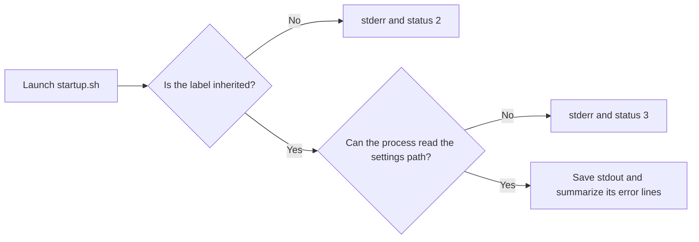

# Linux Fundamentals — Exercises and Solutions

## How to Use This Document

Read each exercise's linked theory, predict the result, and try the task before opening its solution. Start with the foundations and work through all three levels. Where output varies by machine, compare its structure with the expected result. If you get stuck, keep the exact error and identify one fact you could check next.

## Practice Environment Setup

Use **Ubuntu Bash** in WSL2. Windows setup commands and first-launch instructions are in [Theory Part 2](Linux_Theory.md#part-02). All workbook commands use Bash, except keyboard actions and editor instructions. Work as your normal Linux user. The Java exercise uses Linux JDK 21, and the SSH exercise has an offline alternative. See [Theory Part 10](Linux_Theory.md#part-10) if a utility you want to use is missing.

Before starting an exercise, create a fresh folder under the shared lab parent. This example is for exercise 01. Change the number for each exercise, or use `final` for the challenge. `mktemp` prints a new path every time, which lets you repeat a lab without disturbing earlier work.

```bash
mkdir -p -- "$HOME/linux-learning-lab"
mktemp -d -- "$HOME/linux-learning-lab/ex-01.XXXXXX"
```

Copy the printed absolute path. Run `cd --` followed by that path in double quotes, then run `pwd`. Save this path if you need a second tab. Each exercise starts at the top of its own folder unless it says otherwise. Run any given setup in **Prerequisites** once per fresh folder. In Part B, **Recipe** blocks assume that setup is in place. If a previous attempt changed it, use a new folder and repeat the setup.

## Exercise Safety Rules

- Keep the lab under your Linux home so Unix permissions behave as shown. Check `pwd` before writing files, changing modes, or cleaning up.
- Use only the disposable input provided or files you create for the task. Stop only your own lab processes after verifying their identities. The workbook tasks use regular user privileges.
- Keep useful lab output for review. To remove a finished lab, first stop any commands it started and restore any blocked directory permissions. From `"$HOME/linux-learning-lab"`, use `ls -ld --` to verify the exact generated child name, then use `rm -ri --` on that same child. For example, if your recorded child really is `ex-01.A1b2C3`, the target would be `./ex-01.A1b2C3`. Review the prompts and avoid wildcards.

<a id="exercises"></a>

# Part A — Exercises

## Level 1 — Foundations

### LINUX-EX-01 — Navigate from a known location

**Difficulty** · Level 1  
**Related theory** · [Part 2 — WSL2](Linux_Theory.md#part-02), [Part 3 — Filesystem](Linux_Theory.md#part-03), [Part 4 — Terminal commands](Linux_Theory.md#part-04), [Part 8 — Command substitution](Linux_Theory.md#part-08)

**Learning objective**  
Use absolute and relative paths and verify where your shell is operating.

**Scenario**  
You opened an Ubuntu tab before preparing a workspace and need to orient yourself without relying on the prompt.

**Prerequisites**  
Your fresh exercise folder in Ubuntu Bash. No starter files.

**Task**  
Record your starting path. Build the hierarchy `project/config` in the exercise directory. Enter `config` using a relative path, go up one directory, return to the previous directory, then use an absolute path to return to the exercise root. Inspect the `config` directory entry from there.

**Expected result**  
You can show the location after each move. Your final working directory is the recorded exercise root. The detailed listing includes the `project/config` directory itself.

**Self-check**  
What starting point does Bash use for `project/config`? What happens to your current directory after a failed change?

**Cleanup**  
Keep the tree or remove the two empty directories from the bottom up.

### LINUX-EX-02 — Copy, rename, and retain the source

**Difficulty** · Level 1  
**Related theory** · [Part 3 — Filesystem](Linux_Theory.md#part-03), [Part 4 — Terminal commands](Linux_Theory.md#part-04)

**Learning objective**  
Copy and rename files with spaces in their names, and find a dotfile.

**Scenario**  
You want a publishable copy of a private draft while retaining the original.

**Prerequisites**  
Prepare the disposable incoming file.

```bash
mkdir -- incoming
printf '%s\n' 'Release checklist draft' > 'incoming/launch notes.txt'
```

**Task**  
Create a `publish` folder. Copy the draft into it as `draft.txt` and rename that copy to `release.txt`. Create an empty hidden marker named `.reviewed` inside `publish`. Verify the draft still exists in `incoming` and list the two entries in `publish`.

**Expected result**  
Both `incoming/launch notes.txt` and `publish/release.txt` contain the same line. The publish directory contains `release.txt` and `.reviewed`. The temporary `draft.txt` name is gone.

**Self-check**  
Why did the incoming draft survive? Why might a normal listing hide the marker?

**Cleanup**  
Use the lab cleanup procedure for this child folder after comparing the files.

### LINUX-EX-03 — Read a log in three ways

**Difficulty** · Level 1  
**Related theory** · [Part 3 — File metadata](Linux_Theory.md#part-03), [Part 4 — Reading and inspecting files](Linux_Theory.md#part-04)

**Learning objective**  
Choose a tool for a preview, a last line, or interactive browsing.

**Scenario**  
A teammate asks whether the application's last startup reached its ready message and which warning occurred first.

**Prerequisites**  
Create a synthetic log. Use `less` if available. The short sample can be read with `cat` as a fallback.

```bash
printf '%s\n' 'INFO opening' 'WARN cached data in use' \
    'ERROR retry scheduled' 'INFO ready' > startup.log
```

**Task**  
Display the first two lines and the last line in separate commands. Find the warning interactively with a pager when available. Show the file size and name using a metadata command.

**Expected result**  
Your preview ends in `WARN cached data in use`, and your final-line command shows `INFO ready`. You can point to the warning and report a size in bytes.

**Self-check**  
Why is a pager more suitable than printing an entire large text log? Does the metadata size count lines or bytes?

**Cleanup**  
Exit the pager before leaving the folder. The sample log can be removed with the exercise folder.

### LINUX-EX-04 — Find files by name and inspect their contents

**Difficulty** · Level 1  
**Related theory** · [Part 3 — Paths and hidden names](Linux_Theory.md#part-03), [Part 4 — Inspect and locate files](Linux_Theory.md#part-04)

**Learning objective**  
Limit a search by path, depth, and type, then inspect a misleading extension.

**Scenario**  
You need current logs near a project root. You also found a `.bin` file with an uncertain format.

**Prerequisites**  
Prepare the test tree. Use `file` for classification if available.

```bash
mkdir -p -- logs/archive misc
touch -- logs/api.log logs/.hidden.log logs/archive/old.log
printf '%s\n' 'This is a plain-text note.' > misc/report.bin
```

**Task**  
Find all regular files ending in `.log` at most two levels below the exercise root. Then classify `misc/report.bin` from its contents. If `file` is unavailable, inspect the provided file with a text reader and compare with its known fixture contents.

**Expected result**  
Find both `./logs/api.log` and `./logs/.hidden.log` in any order. The search skips `./logs/archive/old.log`. The `.bin` sample is plain text.

**Self-check**  
Why are quotes important around a wildcard passed to the search command? Why does the hidden log still match?

**Cleanup**  
Remove only the generated exercise tree if you no longer need it.

### LINUX-EX-05 — Predict what survives a removed name

**Difficulty** · Level 1  
**Related theory** · [Part 3 — Inodes and links](Linux_Theory.md#part-03), [Part 4 — File inspection](Linux_Theory.md#part-04)

**Learning objective**  
Distinguish hard links from symbolic links using metadata and a controlled removal.

**Scenario**  
Two shortcuts appear to open the same configuration. You want to predict what happens if the original name is removed.

**Prerequisites**  
Create one disposable source file.

```bash
printf '%s\n' 'mode=training' > settings.txt
```

**Task**  
Create a hard link named `retained.txt` and a symbolic link named `current.txt` to `settings.txt`. Compare inode numbers and the original file's hard-link count. Predict the outcome, remove only `settings.txt`, and test both remaining names.

**Expected result**  
The hard link and the original name share an inode and initially have link count `2`. After removal, `retained.txt` still reads `mode=training`. `current.txt` is listed as a link and fails to open its target.

**Self-check**  
Why is `retained.txt` still readable? Which directory supplies the starting point for a relative symbolic link target?

**Cleanup**  
Remove the two remaining lab names or the verified exercise directory.

### LINUX-EX-06 — Look up what Bash will run

**Difficulty** · Level 1  
**Related theory** · [Part 1 — Command execution](Linux_Theory.md#part-01), [Part 4 — Discover commands](Linux_Theory.md#part-04)

**Learning objective**  
Distinguish builtin resolution from an executable search and use command help.

**Scenario**  
An external lookup gives you a path for `ls` but gives no useful path for `cd` on a typical Ubuntu installation.

**Prerequisites**  
An Ubuntu Bash tab. `which` and the manual pager are optional if missing.

**Task**  
Ask Bash how it resolves `cd` and `ls`. Compare the `ls` result with an executable search. Use help to find the `ls` option that lists a directory entry itself.

**Expected result**  
You identify `cd` as a builtin and report an executable path for `ls`, possibly with aliases or additional paths. You can demonstrate the option on the exercise directory.

**Self-check**  
Why must `cd` change the shell's own state? Why can Bash and an external executable lookup give different reports about `ls`?

**Cleanup**  
Quit any help pager. No exercise files need cleaning.

### LINUX-EX-07 — Create private defaults for one task

**Difficulty** · Level 1  
**Related theory** · [Part 5 — Permissions and umask](Linux_Theory.md#part-05), [Part 4 — File inspection](Linux_Theory.md#part-04)

**Learning objective**  
Predict modes for newly created files and directories using an isolated umask.

**Scenario**  
You are creating throwaway local settings that should be readable and writable by the owner.

**Prerequisites**  
A fresh lab folder on the Linux filesystem and a normal user.

**Task**  
Record your current umask. In a subshell, set a mask that excludes group and others from new entries. Create `private` and an empty `private/settings.txt`. Inspect the two modes after the block and verify your shell's original umask is unchanged.

**Expected result**  
The directory has mode `700` and the file `600`. Your shell retains its original umask.

**Self-check**  
Why does the default file mode omit execute permission? Does changing umask change existing modes?

**Cleanup**  
Keep the private sample or remove the exercise folder. The subshell already discarded its temporary mask setting.

### LINUX-EX-08 — Inspect a package before changing anything

**Difficulty** · Level 1  
**Related theory** · [Part 10 — APT](Linux_Theory.md#part-10)

**Learning objective**  
Read local package information and distinguish a simulation from a real upgrade.

**Scenario**  
You need to confirm the shell is installed as a package and understand what APT would do during an upgrade.

**Prerequisites**  
Ubuntu with APT and Bash. Use the local indexes already present.

**Task**  
Confirm that the `bash` package is installed. Inspect its package details and find the version field. Simulate an upgrade without applying changes. Explain whether your simulation refreshed the package indexes.

**Expected result**  
You can identify an installed Bash package, a version shown by APT, and the proposed upgrade result or count. No installed software changes.

**Self-check**  
How does `apt update` differ from `apt upgrade`? Why can package metadata be outdated?

**Cleanup**  
None. All actions are read-only or simulated.

## Level 2 — Practical Application

### LINUX-EX-09 — Save successful output and errors separately

**Difficulty** · Level 2  
**Related theory** · [Part 6 — Streams and redirection](Linux_Theory.md#part-06), [Part 7 — Exit status](Linux_Theory.md#part-07)

**Learning objective**  
Route two output descriptors and capture a failing command's status.

**Scenario**  
A command lists one input and reports that another is missing. Results belong in one report and diagnostics in another.

**Prerequisites**  
Create only the existing input. Leave `missing.txt` absent.

```bash
touch -- present.txt
```

**Task**  
Use one listing invocation with both file operands. Save its stdout in `list.out` and its stderr in `list.err`. Record its status as soon as it returns, then append a one-line review note to `list.out`.

**Expected result**  
`list.out` lists `present.txt` and contains the review note. `list.err` names `missing.txt`. The listing status is nonzero.

**Self-check**  
Which descriptor holds diagnostics? Which output operator would discard the successful listing when adding the note?

**Cleanup**  
Keep the two output files if you want to compare them during review.

### LINUX-EX-10 — Summarize repeated errors

**Difficulty** · Level 2  
**Related theory** · [Part 6 — Text processing and pipelines](Linux_Theory.md#part-06)

**Learning objective**  
Compose a filter, a grouping stage, and a reporting stage.

**Scenario**  
You want an incident summary with a count for each error message, while keeping the report visible on screen.

**Prerequisites**  
Create a log in which identical errors are separated.

```bash
printf '%s\n' 'INFO start' 'ERROR db busy' 'WARN retrying' \
    'ERROR request denied' 'ERROR db busy' 'INFO ready' > app.log
```

**Task**  
Show the error lines, then build a pipeline that groups identical error text and counts occurrences. Print the grouped report and save it as `error-counts.txt` in the same pipeline. Verify the total number of error lines separately.

**Expected result**  
The report has two occurrences of `ERROR db busy` and one of `ERROR request denied`, with no info or warning lines. The total is `3`.

**Self-check**  
Why does grouping need to happen before `uniq`? Which stage both displays and saves the report?

**Cleanup**  
Keep or remove the sample log and generated report with the exercise folder.

### LINUX-EX-11 — Choose group read and traversal permissions

**Difficulty** · Level 2  
**Related theory** · [Part 5 — Users, groups, and permissions](Linux_Theory.md#part-05), [Part 8 — Command substitution](Linux_Theory.md#part-08)

**Learning objective**  
Use your actual Linux group to model shared access with specific directory and file bits.

**Scenario**  
You are preparing a proposed layout for a shared notes folder. An authorized group should be able to list and read notes, while only the owner can edit them. The outer practice folder stays private, so you can inspect the proposed modes with one account.

**Prerequisites**  
Prepare the proposed layout.

```bash
mkdir -- shared
printf '%s\n' 'Review notes' > shared/notes.txt
```

**Task**  
Find your effective username and current group. Set that group on both sample paths. Give the group read and traversal on the directory and read on the file. Preserve owner access and give others no access. Inspect the resulting ownership and modes.

**Expected result**  
The directory is `750` and the text file `640`. Both show your selected group. The owner can read the file.

**Self-check**  
Why does the directory need group `x` while the text file does not? Can a matching group let a caller override restrictive owner bits?

**Cleanup**  
Leave the outer practice folder private. Clean up only the exercise tree.

### LINUX-EX-12 — Pass a value to another process

**Difficulty** · Level 2  
**Related theory** · [Part 8 — Variables and quoting](Linux_Theory.md#part-08)

**Learning objective**  
Observe a shell-only assignment, an exported value, and a one-command override.

**Scenario**  
A command needs a label containing a space. You want to test it without changing your usual shell environment.

**Prerequisites**  
Use a subshell and the disposable name `LAB_RELEASE`.

**Task**  
Make sure the name begins unset within your subshell. Assign `QA sandbox` without exporting it. Show what Bash sees and what `printenv` sees. Export it, then override the value to `one run` for a single process. Check the exported value again within the subshell.

**Expected result**  
Only Bash can see the initial assignment. After export, the child sees `QA sandbox` as one value. The override prints `one run`, and the next child again sees `QA sandbox`.

**Self-check**  
What does single-quoting `$LAB_RELEASE` print when passed as text to `printf`? Can a change in the parent shell alter a child already running?

**Cleanup**  
Exit the subshell block. No outer variable changes are needed.

### LINUX-EX-13 — Inspect and stop your child process

**Difficulty** · Level 2  
**Related theory** · [Part 7 — Processes, jobs, and signals](Linux_Theory.md#part-07)

**Learning objective**  
Map a shell job to a PID and request termination deliberately.

**Scenario**  
A long-running test launched from your terminal needs to be stopped while other processes are running on the machine.

**Prerequisites**  
An interactive Bash tab. Use a disposable `sleep` command with a duration of five minutes so it exits on its own if left alone.

**Task**  
Start `sleep` as a background job and save its PID immediately. Find it in Bash's job table and in a process listing. Compare its parent with your shell PID. Send TERM only to the verified child, and collect the exit status.

**Expected result**  
You can match the job, PID, and parent. The child disappears after termination and `wait` records how it ended. If it expired naturally, report that instead.

**Self-check**  
How is a Bash job number different from a PID? Why should you try TERM before KILL?

**Cleanup**  
Confirm your own child has ended before closing the tab.

### LINUX-EX-14 — Run the same JAR from two directories

**Difficulty** · Level 2  
**Related theory** · [Part 7 — Minimal Java JAR](Linux_Theory.md#part-07), [Part 8 — Environment](Linux_Theory.md#part-08), [Part 10 — Java setup](Linux_Theory.md#part-10), [Part 13 — Java launch context](Linux_Theory.md#part-13)

**Learning objective**  
Show that the JAR, working directory, and inherited environment are independent inputs.

**Scenario**  
Two launchers use the same backend artifact but run from different directories and pass different labels.

**Prerequisites**  
Linux JDK 21 with `java`, `javac`, and `jar`. Use a standalone class. You can defer this exercise until the JDK is available.

**Task**  
Write a class named `RunContext` that prints the process working directory and the value of `LAB_RUN_LABEL`. Build `application.jar` with that class as its entry point. Run it from the exercise root with label `first run`. Run the same archive from a child directory named `runner` with label `second run`, without permanently changing directories or exporting a variable in the parent shell.

**Expected result**  
The first program prints the exercise root and `first run`. The second prints a path ending in `/runner` and `second run`. Both use the same archive and exit successfully.

**Self-check**  
Does `java -jar` switch the working directory to the archive's directory? Why is execute permission on the archive unnecessary?

**Cleanup**  
Remove the generated class, JAR, and `runner` directory with the verified exercise folder when finished.

### LINUX-EX-15 — Write a script that counts lines by file

**Difficulty** · Level 2  
**Related theory** · [Part 6 — Input redirection](Linux_Theory.md#part-06), [Part 12 — Bash scripting](Linux_Theory.md#part-12)

**Learning objective**  
Combine arguments, a function, a loop, and explicit error handling.

**Scenario**  
You repeatedly count lines across application logs and want a command that handles filenames containing spaces.

**Prerequisites**  
Prepare two small logs.

```bash
printf '%s\n' 'first' 'second' > 'first log.txt'
printf '%s\n' 'ready' > second.log
```

**Task**  
Write `count-logs.sh` with a Bash shebang. Define a function that checks and counts a single readable regular file. Loop over one or more filenames and print `NAME: N lines` for each. A run with no arguments should write usage to stderr and exit `2`. An unreadable or missing input should print a diagnostic and exit `3`. Check syntax and run all three cases.

**Expected result**  
A successful run prints `first log.txt: 2 lines` and `second.log: 1 lines` and returns `0`. No arguments return `2`. A missing file returns `3`. The script can be launched directly.

**Self-check**  
Why use `"$@"` to iterate? Why redirect the file into `wc` if you plan to format the filename yourself?

**Cleanup**  
Keep the script for review or remove it with the generated folder.

### LINUX-EX-16 — Follow a log and check storage context

**Difficulty** · Level 2  
**Related theory** · [Part 6 — Appending output](Linux_Theory.md#part-06), [Part 9 — Logs and disk usage](Linux_Theory.md#part-09)

**Learning objective**  
Observe an active file log and distinguish filesystem capacity from directory usage.

**Scenario**  
A service's startup appears to pause. You want to watch its file log and check whether the underlying disk is constrained.

**Prerequisites**  
Two Bash tabs. In both tabs, start from the same exercise directory. Set up the file once.

```bash
printf '%s\n' 'INFO starting' 'INFO waiting' > worker.log
```

**Task**  
In one tab, show only the last existing line and follow additions. In the other, append `INFO ready`. Stop watching and report available space and inode counts for the backing filesystem, and disk usage of the exercise tree.

**Expected result**  
The watcher first shows `INFO waiting` and subsequently `INFO ready`. The existing startup entries remain in the file. You can explain which output represents the mount and which represents only the lab folder.

**Self-check**  
Why append in the second tab? Does stopping the viewer stop the process that wrote a log?

**Cleanup**  
Stop the watcher with Ctrl+C, then remove only the sample exercise tree if desired.

## Level 3 — Troubleshooting

### LINUX-EX-17 — A readable file has an unreachable path

**Difficulty** · Level 3  
**Related theory** · [Part 5 — Directory permissions](Linux_Theory.md#part-05), [Part 14 — Permission denied](Linux_Theory.md#part-14)

**Learning objective**  
Identify which path component blocks access and repair only that component.

**Scenario**  
Your application reads a private configuration. Someone hardened the directory and the application can no longer reach the file.

**Prerequisites**  
Run as your normal Linux user. This setup creates a readable file, then changes its parent directory.

```bash
mkdir -- config
printf '%s\n' 'mode=safe' > config/settings.txt
chmod 600 config/settings.txt
chmod 600 config
```

**Task**  
Inspect the directory and attempt to list its names and open the settings file. Diagnose the earliest inaccessible path component. Restore just the bit the owner needs to look up the file. Verify that the file remains private.

**Expected result**  
An initial file read fails with a permission error. After the targeted change, the same read prints `mode=safe`. The file keeps mode `600` and the directory gains owner traversal.

**Self-check**  
Why can you see a filename in this directory while the read fails? Why would granting more permission on the file alone fail to fix it?

**Cleanup**  
Restore owner traversal before using the exercise folder cleanup.

### LINUX-EX-18 — Repair a broken relative symbolic link

**Difficulty** · Level 3  
**Related theory** · [Part 3 — Relative paths and links](Linux_Theory.md#part-03), [Part 14 — No such file or directory](Linux_Theory.md#part-14)

**Learning objective**  
Trace a stored link target from the proper starting directory.

**Scenario**  
A release's configuration exists, but the run directory's convenience link is broken.

**Prerequisites**  
Set up the file and the broken link.

```bash
mkdir -p -- release/config run
printf '%s\n' 'mode=review' > release/config/settings.ini
ln -s -- release/config/settings.ini run/current.ini
```

**Task**  
Verify the real file and inspect the link's stored text. Explain which path the link tries to resolve. Replace only the link with one using the correct relative target. Confirm it works both from the exercise root and from `run`.

**Expected result**  
Both reads through `current.ini` print `mode=review`. The real configuration file and the two directories remain intact.

**Self-check**  
Why did creating the first link succeed even with a wrong target? Why does changing the caller's directory leave a link's stored relative target interpretation unchanged?

**Cleanup**  
Remove the verified lab tree after the two reads.

### LINUX-EX-19 — Diagnose a missing environment variable

**Difficulty** · Level 3  
**Related theory** · [Part 8 — Inherited values](Linux_Theory.md#part-08), [Part 12 — Bash tests](Linux_Theory.md#part-12), [Part 14 — Missing environment variable](Linux_Theory.md#part-14)

**Learning objective**  
Prove that a variable visible in a shell can still be absent from a new process.

**Scenario**  
A worker's startup check expects a release label. Your prompt can display the label, but the worker still rejects the launch.

**Prerequisites**  
Create a self-contained check. This fixture runs through `bash`.

```bash
cat > check-env.sh <<'BASH'
#!/usr/bin/env bash
if [[ -z "${LAB_LAUNCH_ZONE:-}" ]]; then
    printf '%s\n' 'ERROR LAB_LAUNCH_ZONE is required' >&2
    exit 2
fi
printf 'INFO ready in %s\n' "$LAB_LAUNCH_ZONE"
BASH
```

**Task**  
In a subshell, clear any previous `LAB_LAUNCH_ZONE` and assign `west sandbox` as a shell variable. Reproduce the failure and capture stderr and status. Check what a child actually gets. Supply the label to just the next launch and confirm the check succeeds without exporting it for the next child.

**Expected result**  
The first script run returns `2` and leaves a diagnostic in a file. The corrected run prints `INFO ready in west sandbox`, and the next unmodified child still does not receive the label.

**Self-check**  
Why can Bash display the value on the first attempt? What would be different if you exported it in the subshell?

**Cleanup**  
Leave the subshell and keep the failure log for comparison, or remove the generated folder.

### LINUX-EX-20 — Diagnose a worker that exits during startup

**Difficulty** · Level 3  
**Related theory** · [Part 7 — Child process status](Linux_Theory.md#part-07), [Part 12 — Checking failures](Linux_Theory.md#part-12), [Part 13 — Launch context](Linux_Theory.md#part-13), [Part 14 — Unexpected exit](Linux_Theory.md#part-14)

**Learning objective**  
Connect a failed background launch to an exit status, a diagnostic, and a reproducible correction.

**Scenario**  
The shell gives you a PID for a worker, but it is gone before you can inspect it.

**Prerequisites**  
Create the worker fixture. Leave its input absent on the first run.

```bash
cat > worker.sh <<'BASH'
#!/usr/bin/env bash
printf '%s\n' 'INFO starting'
if ! settings=$(cat -- input/worker.conf); then
    printf '%s\n' 'ERROR configuration read failed' >&2
    exit 4
fi
printf 'INFO ready (%s)\n' "$settings"
exec sleep 90
BASH
```

**Task**  
Launch the worker in the background with stdout and stderr captured separately. Obtain the actual worker status from the launching shell. Use the log and current directory to identify the required path, place the disposable line `mode=sample` there, and rerun with different output filenames. Confirm the repaired run reaches readiness and stop only its process.

**Expected result**  
The first run returns `4` and names the missing input in its diagnostics. The second run emits `INFO ready (mode=sample)` and stays alive long enough to inspect it. The original failure evidence is still available.

**Self-check**  
Why was seeing a PID insufficient to establish readiness? How does `exec sleep 90` affect the repaired worker's PID?

**Cleanup**  
Stop and collect your repaired child before removing the folder. It also expires on its own after 90 seconds.

### LINUX-EX-21 — Repair output redirection order

**Difficulty** · Level 3  
**Related theory** · [Part 6 — Descriptor duplication](Linux_Theory.md#part-06)

**Learning objective**  
Explain and correct why one stream escapes an attempted combined log.

**Scenario**  
A colleague expects both output streams in a file, but a missing-file diagnostic remains on screen.

**Prerequisites**  
Create the existing file and reproduce the problem. Leave `absent.txt` absent.

```bash
touch -- existing.txt
ls -- existing.txt absent.txt 2>&1 > first.log
```

**Task**  
Inspect `first.log` and explain the order of descriptor changes. Run the same listing with a corrected combined destination named `combined.log`. Verify that both filenames appear in the new file.

**Expected result**  
`first.log` contains the existing filename. `combined.log` contains the existing filename and the diagnostic for `absent.txt`. The command still reports failure because an operand is missing.

**Self-check**  
At the instant `2>&1` runs in the broken example, where is descriptor `1` pointing? Why might message order within a combined log vary?

**Cleanup**  
Preserve the two files long enough to compare them before removing the lab.

### LINUX-EX-22 — Fix a script with two independent problems

**Difficulty** · Level 3  
**Related theory** · [Part 5 — Execute permission](Linux_Theory.md#part-05), [Part 8 — Quoting](Linux_Theory.md#part-08), [Part 12 — Script execution](Linux_Theory.md#part-12), [Part 14 — File is not executable](Linux_Theory.md#part-14)

**Learning objective**  
Diagnose a permission failure and then a separate argument expansion failure.

**Scenario**  
A script works neither as a command nor when run with Bash against a spaced filename.

**Prerequisites**  
Prepare the broken script and one fixture file.

```bash
cat > preview.sh <<'BASH'
#!/usr/bin/env bash
if [[ $# -eq 1 ]]; then
    head -n 1 -- $1
fi
BASH
chmod 600 preview.sh
printf '%s\n' 'INFO ready' 'INFO update' > 'two words.log'
```

**Task**  
Try direct execution and inspect the script mode. Test the same argument through Bash. Correct the owner mode and only the faulty argument expansion, check syntax, and verify direct execution.

**Expected result**  
The fixed command prints just `INFO ready`. The script remains private to your account.

**Self-check**  
Why did running through `bash` bypass the first failure? Why could `bash -n` pass while the argument handling was still wrong?

**Cleanup**  
Keep the fixed script or remove the exercise folder after checking it.

### LINUX-EX-23 — Wait for a child in the shell that started it

**Difficulty** · Level 3  
**Related theory** · [Part 7 — Parent processes, jobs, and wait](Linux_Theory.md#part-07), [Part 14 — Process troubleshooting](Linux_Theory.md#part-14)

**Learning objective**  
Distinguish the ability to see a PID from the ability to collect its exit status.

**Scenario**  
You can find a background process in either Bash tab, but the second tab refuses to wait for it.

**Prerequisites**  
Two interactive Bash tabs, called A and B. Use A to start a disposable five-minute `sleep`.

**Task**  
Save the child's PID in A and copy its numeric value to B. Show the process in both tabs and compare its PPID to the shell PIDs. Try to wait for it from B. Return to A, verify the target, request TERM, and wait there.

**Expected result**  
B can see the child when it is running, but Bash reports it is not a child of B and returns `127` from `wait`. In A, `wait` returns the actual child's status after it ends.

**Self-check**  
What observation proves which tab owns the child? Which shell may collect its status?

**Cleanup**  
Confirm the child has ended before closing A.

### LINUX-EX-24 — Check an SSH destination offline

**Difficulty** · Level 3  
**Related theory** · [Part 11 — SSH and host trust](Linux_Theory.md#part-11), [Part 6 — Filtering output](Linux_Theory.md#part-06)

**Learning objective**  
Review intended SSH settings without opening a remote session.

**Scenario**  
A lab handoff specifies user `reviewer` at `lab.example`, port `2222`. The old notes say `release-old@staging-old.example` on port `22`. All names are fictional.

**Prerequisites**  
Use the OpenSSH client if present. Otherwise, write a command from the theory, predict its fields, and compare with the solution. No remote host or key is needed.

**Task**  
Construct an offline preview of the intended SSH settings that ignores your usual client configuration. Show just the user, hostname, and port fields. Explain how you would verify a fingerprint if a real authorized server reported a changed host key.

**Expected result**  
The preview identifies `reviewer`, `lab.example`, and `2222`. You can explain which evidence you would use before trusting a real server.

**Self-check**  
Which option previews settings without connecting? Is a user's login public key the same as the server's host key?

**Cleanup**  
None. The preview writes no trust or configuration files.

## Final Mini Challenge — Restore a local startup and write a support report

**Difficulty** · Level 3  
**Related theory** · [Part 5 — Permissions](Linux_Theory.md#part-05), [Part 6 — Streams](Linux_Theory.md#part-06), [Part 8 — Environment](Linux_Theory.md#part-08), [Part 12 — Scripts](Linux_Theory.md#part-12), [Part 13 — Launch context](Linux_Theory.md#part-13), [Part 14 — Troubleshooting](Linux_Theory.md#part-14)

**Learning objective**  
Recover a launch from two distinct failures and produce a reproducible error summary.

**Scenario**  
You are preparing a support handoff for a backend. The local startup simulation uses the same environment and file checks as a typical application process.

**Prerequisites**  
In the fresh challenge folder, create the fixture. The `600` directory mode is intentional.

```bash
mkdir -- config logs
printf '%s\n' 'mode=review' > config/settings.txt
chmod 600 config/settings.txt
chmod 600 config
printf '%s\n' 'INFO warming up' 'ERROR retry budget' 'WARN delayed' \
    'ERROR downstream busy' 'ERROR retry budget' 'INFO complete' > logs/sample.log
cat > startup.sh <<'BASH'
#!/usr/bin/env bash
if [[ -z "${LAB_SUPPORT_LABEL:-}" ]]; then
    printf '%s\n' 'ERROR LAB_SUPPORT_LABEL is required' >&2
    exit 2
fi
if [[ ! -r config/settings.txt ]]; then
    printf '%s\n' 'ERROR cannot read config/settings.txt' >&2
    exit 3
fi
printf 'INFO started %s\n' "$LAB_SUPPORT_LABEL"
cat -- logs/sample.log
BASH
```

**Task**  
Confirm your identity and working directory. Launch once without the required environment value and again with `support lab` supplied only to the command. Save stdout, stderr, and each exit status separately for both failures. Fix only the directory access bit responsible for the second failure. Rerun with new output files. From the successful stdout, produce a visible and saved count of each distinct `ERROR` line in `error-summary.txt`.

**Expected result**  
The failures return `2` and `3` respectively. The repaired launch returns `0`, includes `INFO started support lab`, and has empty stderr. The report counts `ERROR retry budget` twice and `ERROR downstream busy` once. The original diagnostics are preserved.

**Self-check**  
How can the repaired launch exit successfully while its stdout includes lines beginning with `ERROR`? What two observations prove your permissions fix was narrower than giving everyone access?

**Cleanup**  
Keep the outputs as evidence for the readiness assessment. When finished, remove only the verified challenge folder.

<a id="solutions"></a>

# Part B — Complete Solutions and Explanations

Each recipe starts inside the fresh exercise folder with the stated prerequisites already applied. Example output gives you a check on behavior. Exact paths, identities, dates, and diagnostic wording can vary.

## Solution — LINUX-EX-01

**Recipe**

```bash
pwd
start_dir=$(pwd)
mkdir -p -- project/config
cd -- project/config
pwd
cd ..
pwd
cd -
pwd
cd -- "$start_dir"
pwd
ls -ld -- project/config
```

`$(pwd)` captures the initial absolute path. `mkdir -p` creates both missing directories. The working directory sequence is the lab root, `project/config` under it, `project`, `project/config` again, and the lab root. `cd -` itself prints the destination and `ls -ld` prints a line beginning with `d` for the directory entry. You can also paste the first `pwd` result in quotes instead of storing it, or use `cd ../..` for the final return if you are still inside `config`.

A common mistake is repeating `cd project/config` after already entering `project`. The path would then start in `project`. Check `pwd` as soon as a directory change fails.

**Self-check.** Bash uses its current working directory as the starting point for a relative path. A failed `cd` leaves that directory unchanged.

## Solution — LINUX-EX-02

**Recipe**

```bash
mkdir -- publish
cp -i -- 'incoming/launch notes.txt' publish/draft.txt
mv -i -- publish/draft.txt publish/release.txt
touch -- publish/.reviewed
ls -l -- 'incoming/launch notes.txt'
ls -la -- publish
cat -- 'incoming/launch notes.txt' publish/release.txt
```

`-i` would ask before overwriting an existing destination. In a fresh folder both destinations are new. The publish listing includes `.reviewed` and `release.txt`, plus the standard `.` and `..` entries. `cat` prints the same draft line twice. The rename changed a name for the copy inside `publish`.

Without quotes, Bash splits `incoming/launch notes.txt` into two arguments. If the goal were to publish immediately, `cp -i` could copy directly to `publish/release.txt` and skip the intermediate draft name.

**Self-check.** `cp` made a separate copy, and `mv` operated on that copy. Names beginning with a dot are omitted from the ordinary listing. `ls -a` includes them.

## Solution — LINUX-EX-03

**Recipe**

```bash
head -n 2 -- startup.log
tail -n 1 -- startup.log
stat -c '%s %n' -- startup.log
less -N -- startup.log
```

`-n` sets the number of lines each preview prints. Expect the first two lines ending in the warning, then the last line `INFO ready`. `stat -c` selects a format, with `%s` for bytes and `%n` for the name. The fixture has `70` bytes including its newlines. In `less`, `-N` shows line numbers. Type `/WARN`, press Enter, then press `q` when you have observed the warning on line 2. If you lack the pager, `cat -n -- startup.log` is small enough to inspect here.

An unrestricted `cat` on a large log can bury the line you want in terminal scrollback. `head` and `tail` each select one end of the file.

**Self-check.** The pager lets you search and inspect sections without dumping the whole log into the terminal. The metadata size counts bytes.

## Solution — LINUX-EX-04

**Recipe**

```bash
find . -maxdepth 2 -type f -name '*.log' -print
file -b -- misc/report.bin
```

From depth 0 at `.`, both direct files inside `logs` are at depth 2. `-type f` selects regular files, and `-name` checks the last path component. The expected set is `./logs/api.log` and `./logs/.hidden.log`. `file -b` gives a description such as `ASCII text` without a filename prefix. If `file` is missing, `head -n 1 -- misc/report.bin` confirms the sample's readable contents.

A search from `logs` would assign different depths. Quote `'*.log'` so results stay independent of filenames already present at the prompt's current location.

**Self-check.** Bash could expand an unquoted wildcard and change the arguments to `find`. `find` examines dot-prefixed entries too, and its `-name` pattern matches the hidden log.

## Solution — LINUX-EX-05

**Recipe**

```bash
ln -- settings.txt retained.txt
ln -s -- settings.txt current.txt
ls -li -- settings.txt retained.txt current.txt
stat -c '%i %h %n' -- settings.txt retained.txt
rm -- settings.txt
cat -- retained.txt
ls -l -- current.txt
cat -- current.txt
```

`ln` creates a second name for the same object by default. `-s` sets up a symbolic link. `ls -i` displays the inode, and `stat` reports the inode (`%i`) and link count (`%h`). Expect matching inode numbers and count `2` for the hard-linked names. After `rm` removes the disposable original, `retained.txt` still holds the data and its count is `1`. `ls -l` prints the stored target, and the final `cat` reports a missing file.

Check the exact name you remove. Recreating a new `settings.txt` later would make `current.txt` resolve again, while `retained.txt` would still name the old object.

**Self-check.** `retained.txt` is another directory entry pointing to the same inode. `current.txt` resolves a relative target from its own containing directory.

## Solution — LINUX-EX-06

**Recipe**

```bash
type cd
type -a ls
which ls
ls --help
ls -ld -- .
```

`type cd` reports a Bash builtin. `type -a ls` may show an alias and executable paths. `which ls` normally prints a path such as `/usr/bin/ls`. In `ls --help`, look for `-d` or `--directory`. With `-l` as well, the last command gives the mode and other metadata for `.`, the directory entry. You can use `man 1 ls` as another reference. If `which` is missing, the executable lines in `type -a ls` still show where the external file lives.

An executable path returned by the external lookup describes only that lookup. An alias or function can change what Bash uses when you type the name.

**Self-check.** A separate process changing its working directory would affect only itself. `cd` changes the calling shell's directory. `type -a` knows about shell-level names, while `which` searches executable paths.

## Solution — LINUX-EX-07

**Recipe**

```bash
umask
(
    umask 077
    mkdir -- private
    touch -- private/settings.txt
)
stat -c '%a %n' -- private private/settings.txt
umask
```

The first and last umask outputs should match. Expect `700 private` and `600 private/settings.txt`. `077` clears all group and other bits from the default requests. The parentheses keep the mask change in the child shell. For two entries whose modes you want to set explicitly after creation, `chmod 700 private` and `chmod 600 private/settings.txt` are another option.

Use new paths for this experiment. Reusing an existing file with `touch` changes its timestamps and leaves its mode in place.

**Self-check.** Ordinary file creation requests read and write bits without execute. Umask removes bits during creation, so existing objects keep their current modes.

## Solution — LINUX-EX-08

**Recipe**

```bash
apt list --installed bash
apt show bash
apt -s upgrade
```

Look for an installed `bash` entry and `Version:` in the details. The available candidate described by `apt show` can differ from the installed version in the list. `-s` simulates upgrades and shows what APT would do using its current view, which may include a plan with zero updates. Current indexes and configured software sources affect the plan.

Keep `-s` for this task and run as your regular user. `apt list --upgradable` is also a useful shortlist, while the simulation shows the wider proposed operation.

**Self-check.** `apt update` refreshes repository indexes. `apt upgrade` applies eligible updates to installed software. A simulation does neither. Metadata may be outdated if it has not been refreshed since repository changes.

## Solution — LINUX-EX-09

**Recipe**

```bash
ls -- present.txt missing.txt > list.out 2> list.err
listing_status=$?
printf '%s\n' 'reviewed listing' >> list.out
cat -- list.out
cat -- list.err
printf 'listing status=%s\n' "$listing_status"
```

`>` connects stdout to `list.out` and `2>` opens a separate file for stderr. `list.out` contains `present.txt` and `reviewed listing` on separate lines. `list.err` contains a missing-file diagnostic naming `missing.txt`. GNU `ls` typically returns `2` when it cannot access a file named as an operand. The variable preserves that status over later successful commands.

Capture `$?` before reading or appending to the output. Those actions each supply their own status. An explicit `1> list.out` would route stdout in the same way as `> list.out`.

**Self-check.** Diagnostics use descriptor `2`. A fresh `> list.out` truncates the file, so append the note with `>>`.

## Solution — LINUX-EX-10

**Recipe**

```bash
grep -n -F -- 'ERROR ' app.log
grep -F -- 'ERROR ' app.log | LC_ALL=C sort | uniq -c | tee error-counts.txt
grep -F -- 'ERROR ' app.log | wc -l
```

`-F` treats the pattern literally, and `-n` in the first check identifies lines `2`, `4`, and `5`. For the report omit `-n` so repeated message lines stay identical. The pipeline groups the results and shows `2 ERROR db busy` and `1 ERROR request denied`, with leading padding from `uniq -c`. `tee` also writes those lines to `error-counts.txt`. The final command prints `3`. If you need only a saved report, the final counting stage can redirect its stdout directly to a file.

Jumping straight from `grep` to `uniq -c` would report the separated `db busy` lines as distinct runs. Including line numbers would also make duplicate text differ.

**Self-check.** Sorting brings equal lines together so `uniq` can count them as one run. `tee` both displays and saves the report.

## Solution — LINUX-EX-11

**Recipe**

```bash
whoami
id
current_group=$(id -gn)
chgrp -- "$current_group" shared shared/notes.txt
chmod 750 shared
chmod 640 shared/notes.txt
stat -c '%A %a %U:%G %n' -- shared shared/notes.txt
cat -- shared/notes.txt
```

`id -gn` selects the current group name. The owner can use `chgrp` for a group they belong to. The fixture may already be owned by that group, in which case the result is the same group. Expect `drwxr-x--- 750` for the directory and `-rw-r----- 640` for the file. `cat` prints `Review notes`. Equivalent symbolic modes are `u=rwx,g=rx,o=` and `u=rw,g=r,o=` respectively.

Remember the whole path when modeling another user's access. The private outer exercise directory remains an independent access check.

**Self-check.** Group execute grants lookup through the directory, and group read permits reading the text file. When a process owns a file, Linux uses the owner triplet in the ordinary mode-bit check.

## Solution — LINUX-EX-12

**Recipe**

```bash
(
    unset LAB_RELEASE
    LAB_RELEASE='QA sandbox'
    printf 'Bash sees <%s>\n' "$LAB_RELEASE"
    printenv LAB_RELEASE
    printf 'printenv status=%s\n' "$?"
    export LAB_RELEASE
    printenv LAB_RELEASE
    env LAB_RELEASE='one run' printenv LAB_RELEASE
    printenv LAB_RELEASE
)
```

`printf` sees `QA sandbox` from expansion in Bash. The first `printenv` emits no value and returns `1`. After `export`, the next three values are `QA sandbox`, `one run`, and `QA sandbox`. The temporary assignment applies only to the process started by `env`. You can instead write `LAB_RELEASE='one run' printenv LAB_RELEASE` for the same one-command test.

Use double quotes for the initial `printf` so the value remains one argument. Resetting the name inside the subshell ensures any inherited export marking does not affect the example.

**Self-check.** Single quotes around `$LAB_RELEASE` print its spelling literally. The child receives a value at launch, so later parent changes leave an already running child's environment as it was.

## Solution — LINUX-EX-13

**Recipe**

```bash
sleep 300 &
sleep_pid=$!
printf 'shell=%s child=%s\n' "$$" "$sleep_pid"
jobs -l
ps -p "$sleep_pid" -o pid,ppid,stat,args
```

Use the displayed command and parent to verify the child. If it has already expired, skip the signal and collect the status. Otherwise, continue in the same tab.

```bash
kill -TERM "$sleep_pid"
wait "$sleep_pid"
sleep_status=$?
printf 'child status=%s\n' "$sleep_status"
ps -p "$sleep_pid" -o pid,ppid,stat,args
```

The first `ps -p` selects the saved PID. The list normally shows `sleep 300` with your shell as PPID and a state starting with `S`. After signaling and waiting, Bash ordinarily reports `143` and the last `ps` has no process row. If the child expired naturally, expect status `0`. `pgrep -a -P "$$" -x sleep` can help locate the process, while the recorded ID selects the intended instance.

Avoid copying a sample PID or signaling every process with the same name. Save `$!` immediately after starting the job.

**Self-check.** Bash assigns job numbers within its own job table. The kernel assigns PIDs visible to process tools. TERM allows a program to handle shutdown and release resources.

## Solution — LINUX-EX-14

Save as `RunContext.java`.

```java
import java.nio.file.Path;

public class RunContext {
    public static void main(String[] args) {
        System.out.println("WORKDIR=" + Path.of("").toAbsolutePath());
        System.out.println("LABEL=" + System.getenv("LAB_RUN_LABEL"));
    }
}
```

**Recipe**

```bash
javac RunContext.java &&
    jar --create --file application.jar --main-class RunContext RunContext.class
```

After a successful build, run both launches.

```bash
LAB_RUN_LABEL='first run' java -jar application.jar
printf 'first status=%s\n' "$?"
mkdir -- runner
(
    cd -- runner || exit 1
    LAB_RUN_LABEL='second run' java -jar ../application.jar
)
printf 'second status=%s\n' "$?"
pwd
```

`--main-class` writes the entry-point name into the archive manifest. Both runs print status `0`. The first output has the exercise root and `LABEL=first run`. The second has the root plus `/runner` and `LABEL=second run`. The prefix assignment reaches Java, and the subshell confines the directory change. You could use the same absolute JAR path in both launches.

Using `java -jar application.jar` from inside `runner` would look for a different file. `../application.jar` identifies the same archive from that location.

**Self-check.** The process inherits the launcher's working directory. The `java` launcher executes and reads the archive, so the archive needs read access and a reachable path.

## Solution — LINUX-EX-15

**Recipe**

```bash
cat > count-logs.sh <<'BASH'
#!/usr/bin/env bash

count_file() {
    local path=$1
    local count

    if [[ ! -f "$path" || ! -r "$path" ]]; then
        printf 'Cannot read log: %s\n' "$path" >&2
        return 3
    fi
    if ! count=$(wc -l < "$path"); then
        printf 'Could not count lines in %s\n' "$path" >&2
        return 3
    fi
    printf '%s: %s lines\n' "$path" "$count"
}

if [[ $# -eq 0 ]]; then
    printf 'Usage: %s LOG [LOG ...]\n' "$0" >&2
    exit 2
fi

for path in "$@"; do
    count_file "$path" || exit "$?"
done
BASH
```

```bash
bash -n count-logs.sh &&
    chmod u+x count-logs.sh &&
    ./count-logs.sh 'first log.txt' second.log
printf 'success status=%s\n' "$?"
./count-logs.sh
printf 'usage status=%s\n' "$?"
./count-logs.sh missing.log
printf 'missing-file status=%s\n' "$?"
```

`wc -l < "$path"` reads from stdin, so its output is a count alone. The substitution captures that count after `wc` succeeds. The loop stops when the first input fails and preserves the function's status. Look for `first log.txt: 2 lines` and `second.log: 1 lines` with status `0`, then a usage message with `2` and a missing-file diagnostic with `3`.

An unquoted `$@` can split one filename, costing you the original argument boundary. A successful `bash -n` checks parsing, so follow it with real input tests.

**Self-check.** `"$@"` expands to each original filename as its own argument. Input redirection gives `wc` no filename operand, leaving the script to print the name in its own format.

## Solution — LINUX-EX-16

**First tab.** In the exercise folder, start the watcher.

```bash
pwd
tail -n 1 -f -- worker.log
```

**Second tab.** Change to the absolute path printed by the first tab, confirm with `pwd`, and append the event.

```bash
printf '%s\n' 'INFO ready' >> worker.log
```

`-n 1` selects only the last existing line. `-f` waits for more data. Expect `INFO waiting` and then `INFO ready`. Press **Ctrl+C** in the first tab. Check the preserved lines and run the disk commands from either tab, still inside the exercise directory.

```bash
cat -- worker.log
df -h .
df -i .
du -sh -- .
```

`cat` should print three lines. `df -h` gives filesystem byte capacity, `df -i` gives inode availability where supported, and `du -sh` gives a human-readable summary of allocated usage for this folder. Values depend on your machine. A common mistake is using `>` and truncating the existing sample. If a real log is rotated by rename and creation, try `tail -F` to follow the name.

**Self-check.** Append preserves the existing log entries for diagnosis. Stopping the viewer ends its read operation. A separate writer keeps its own lifecycle.

## Solution — LINUX-EX-17

**Recipe**

```bash
id
ls -ld -- config
ls -1 --color=never -- config
cat -- config/settings.txt
chmod u+x config
ls -ld -- config
stat -c '%a %n' -- config/settings.txt
cat -- config/settings.txt
```

`ls -ld` shows `drw-------` initially. `ls -1` with color disabled can list `settings.txt` using directory read permission. The first `cat` fails on traversal. `chmod u+x` adds only owner search permission to that directory. It becomes `drwx------` and `stat` shows `600 config/settings.txt`. The second `cat` prints `mode=safe`.

A broad permission change would hide which bit solved the problem. Check that you are the owner and that the test is running as a regular user. In an equivalent server setup, inspect every parent directory along the requested path.

**Self-check.** Directory `r` gives access to the names. Directory `x` enables lookup of those names. The kernel has to reach the file before its own permissions can allow reading.

## Solution — LINUX-EX-18

**Recipe**

```bash
pwd
ls -l -- release/config/settings.ini run/current.ini
cat -- run/current.ini
rm -- run/current.ini
ln -s -- ../release/config/settings.ini run/current.ini
ls -l -- run/current.ini
cat -- run/current.ini
(
    cd -- run || exit 1
    cat -- current.ini
)
```

The first listing shows `run/current.ini -> release/config/settings.ini`. Opening it tries `run/release/config/settings.ini`, which is absent. `rm` removes just the verified link entry. The new target starts with `..`, so it goes from `run` back to the lab root before following `release/config/settings.ini`. Both reads print `mode=review`. An absolute link target would also work locally. The relative version remains valid if you move the whole tree together.

Keep the destination name `run/current.ini` distinct from the real settings path when removing the broken entry. Changing where you type `cat` can change how your command reaches the link, but the stored target starts from the link's own directory.

**Self-check.** A symbolic link stores pathname text, so creation can succeed before its target exists. For a relative target, lookup continues from the directory holding the link regardless of the caller's starting point.

## Solution — LINUX-EX-19

**Recipe**

```bash
(
    unset LAB_LAUNCH_ZONE
    LAB_LAUNCH_ZONE='west sandbox'
    printf 'Shell label=<%s>\n' "$LAB_LAUNCH_ZONE"

    bash check-env.sh > first.out 2> first.err
    printf 'first status=%s\n' "$?"
    cat -- first.err
    printenv LAB_LAUNCH_ZONE
    printf 'initial printenv status=%s\n' "$?"

    env LAB_LAUNCH_ZONE="$LAB_LAUNCH_ZONE" bash check-env.sh
    printf 'retry status=%s\n' "$?"
    printenv LAB_LAUNCH_ZONE
    printf 'next printenv status=%s\n' "$?"
)
```

The first launch returns `2` and writes `ERROR LAB_LAUNCH_ZONE is required` into `first.err`. Each `printenv` returns `1` because that command inherits no release label. Bash expands `"$LAB_LAUNCH_ZONE"` into the argument passed to `env`, which supplies it to just the repaired run. This yields `INFO ready in west sandbox` and status `0`.

The presence of a value in an expansion only proves the current shell knows it. The `NAME="$NAME" COMMAND` prefix is another one-command solution. A different Bash tab has its own environment.

**Self-check.** The parent expands the value before `printf` runs. Exporting it in the subshell would pass the value to each later child from that subshell, with no change to the original shell outside the parentheses.

## Solution — LINUX-EX-20

**Recipe**

```bash
bash worker.sh > first.out 2> first.err &
failed_pid=$!
wait "$failed_pid"
failed_status=$?
printf 'startup status=%s\n' "$failed_status"
pwd
cat -- first.out first.err
```

Expect `startup status=4` and `INFO starting` followed by diagnostics naming `input/worker.conf`. `wait` returns the child's status rather than the status of submitting the job. The file path is relative to the working directory printed by `pwd`.

```bash
mkdir -- input
printf '%s\n' 'mode=sample' > input/worker.conf
bash worker.sh > retry.out 2> retry.err &
worker_pid=$!
```

Give the worker a moment to start, then check the retry.

```bash
ps -p "$worker_pid" -o pid,ppid,stat,args
tail -n 5 -- retry.out
cat -- retry.err
```

Look for `INFO ready (mode=sample)`, empty stderr, and a child running `sleep 90` under the same PID. Once you have verified it in the launching shell, stop it and collect the status.

```bash
kill -TERM "$worker_pid"
wait "$worker_pid"
printf 'retry termination status=%s\n' "$?"
```

Expect `143` when TERM ended `sleep`. If it already finished, skip the signal and expect `0` from `wait`. Reusing `first.out` and `first.err` for the repaired run would overwrite the evidence. You can also reproduce the first failure in the foreground and read `$?` directly.

**Self-check.** A PID shows the process was created, and readiness depends on successful startup steps. `exec` replaces the running Bash program with `sleep` while preserving the PID.

## Solution — LINUX-EX-21

**Recipe**

```bash
cat -- first.log
ls -- existing.txt absent.txt > combined.log 2>&1
listing_status=$?
cat -- combined.log
printf 'listing status=%s\n' "$listing_status"
```

`first.log` should contain just `existing.txt`. After routing stdout to `combined.log`, `2>&1` copies the new destination. The file now contains `existing.txt` and a diagnostic naming `absent.txt`, commonly with status `2` from `ls`. Redirecting to a new file preserves `first.log` for comparison. For diagnosis you could instead use `> list.out 2> list.err` to retain each stream's identity.

Read the redirects from left to right. Putting `2>&1` first copies the terminal endpoint and does not update when stdout subsequently moves.

**Self-check.** In the first command descriptor `1` is still the original stdout, usually the terminal. A program can buffer output differently across descriptors, so a shared destination can receive messages in a different order from the operations that produced them.

## Solution — LINUX-EX-22

**Recipe**

```bash
./preview.sh 'two words.log'
ls -l -- preview.sh
bash -n preview.sh
bash preview.sh 'two words.log'
```

The first command fails with a permission error and the mode is `-rw-------`. `bash -n` passes because the original is valid Bash syntax. Executing it with `bash` exposes the next issue. `head` receives `two` and `words.log` separately and reports missing operands by name.

Replace the script with this version, which keeps the argument quoted.

```bash
cat > preview.sh <<'BASH'
#!/usr/bin/env bash
if [[ $# -eq 1 ]]; then
    head -n 1 -- "$1"
fi
BASH
bash -n preview.sh &&
    chmod u+x preview.sh &&
    ./preview.sh 'two words.log'
stat -c '%a %n' -- preview.sh
```

`"$1"` preserves the original argument as a single path, and `head -n 1` prints only `INFO ready`. Owner execute changes the sample from `600` to `700`. You can make the same edit in an editor and save with LF. Adding an execute bit alone leaves the spaced filename problem in place.

**Self-check.** In `bash preview.sh`, Bash executes and reads the script as input, so script read permission is sufficient there. `bash -n` checks grammar. The faulty unquoted expansion occurs during execution with a real argument.

## Solution — LINUX-EX-23

**Tab A**

```bash
sleep 300 &
lab_pid=$!
printf 'tab A shell=%s child=%s\n' "$$" "$lab_pid"
ps -p "$lab_pid" -o pid,ppid,args
```

**Tab B.** Replace `PID_FROM_TAB_A` with the numeric child PID printed in A.

```bash
other_pid=PID_FROM_TAB_A
printf 'tab B shell=%s\n' "$$"
ps -p "$other_pid" -o pid,ppid,args
wait "$other_pid"
printf 'tab B wait status=%s\n' "$?"
```

Both `ps` invocations can display the same process. Its `PPID` equals the shell PID printed in A. `wait` in B reports that the PID is outside its children and returns `127`. `ps` obtains a system process snapshot, while `wait` collects a child result belonging to the invoking shell.

**Back in tab A.** Verify the child still shows the original PID, PPID and command. Signal it only after that check. If it has expired, use just `wait` and the status print.

```bash
ps -p "$lab_pid" -o pid,ppid,args
```

```bash
kill -TERM "$lab_pid"
wait "$lab_pid"
printf 'tab A wait status=%s\n' "$?"
```

Expect `143` if TERM ended it, or `0` if it completed naturally. Using B to monitor a shared log is fine. Keep A open when you need the original child's exit status.

**Self-check.** The child's PPID matches A's `$$` while it is running. The launching Bash in A can collect its status with `wait`.

## Solution — LINUX-EX-24

**Recipe**

```bash
ssh -G -F /dev/null -T -p 2222 -l reviewer lab.example |
    grep -E -- '^(user|hostname|port) '
```

Expect these settings.

```text
user reviewer
hostname lab.example
port 2222
```

`-G` prints the effective settings. `-F /dev/null` supplies an empty configuration so your usual aliases or defaults cannot interfere. `-T` disables terminal allocation. `-p` and `-l` select the port and login user. The anchored pattern keeps only lines starting with the three field names. You can also specify `reviewer@lab.example` instead of using `-l reviewer`.

On a real authorized host, verify the fingerprint supplied by your lab VM console or administrator before accepting a change. A common mistake is treating a valid client login key as evidence of the remote machine's identity.

**Self-check.** `-G` previews settings without connecting. The server has a host key for its identity, and your login key authenticates your account to the server.

## Final Mini Challenge Solution



Each launch stops at its first failed startup check. Supplying the label makes the directory problem visible on the next attempt.

**Record both failures.** Run in the challenge folder with the supplied fixture.

```bash
pwd
whoami
id

env -u LAB_SUPPORT_LABEL bash startup.sh > launch-1.out 2> launch-1.err
printf '%s\n' "$?" > launch-1.status

LAB_SUPPORT_LABEL='support lab' bash startup.sh > launch-2.out 2> launch-2.err
printf '%s\n' "$?" > launch-2.status

cat -- launch-1.status launch-1.err
cat -- launch-2.status launch-2.err
ls -ld -- . config
```

The first child lacks the label because `env -u` removes it for that execution. It returns `2` and writes the label diagnostic to stderr. The second has the label through its prefix assignment and goes on to the file check. It returns `3` because `config` is missing owner traversal. Capture each status before doing any other work. Both stdout files should be empty.

**Repair and verify.**

```bash
chmod u+x config
stat -c '%A %a %n' -- config config/settings.txt
LAB_SUPPORT_LABEL='support lab' bash startup.sh > launch-3.out 2> launch-3.err
printf '%s\n' "$?" > launch-3.status
cat -- launch-3.status
head -n 1 -- launch-3.out
wc -c < launch-3.err
```

The private modes should be `700` for the directory and `600` for the file. The three final checks print `0`, `INFO started support lab`, and `0` bytes of stderr. The working directory and caller are the same as in the failing runs. The changed directory bit accounts for the different result.

**Make the support report.**

```bash
grep -E -- '^ERROR ' launch-3.out | LC_ALL=C sort | uniq -c | tee error-summary.txt
```

The report shows `1 ERROR downstream busy` and `2 ERROR retry budget` with leading count padding. `^` anchors the match at the start of the line. The pipeline sorts equal messages together, counts them, then displays and saves the report. Using `grep -F -- 'ERROR '` also works for this particular fixture. Keep `launch-1.err` and `launch-2.err` separate from the historical error lines copied into `launch-3.out`. Overwriting the original logs during the retry would prevent this comparison.

**Self-check.** The repaired command succeeded in starting and reading the supplied log. Text copied from that log describes earlier events in the fixture. `stat` shows the file stayed `600` and the directory moved from `600` to `700`, so only owner traversal was added.

# Self-Assessment

## Skills Checklist

- [ ] I can use `pwd` and a detailed listing to explain the exact path a command is about to use.
- [ ] I can tell whether a file is copied, moved, hard-linked, or reached through a symbolic link.
- [ ] I can explain and demonstrate directory traversal, owner and group access, and private creation modes.
- [ ] I can separate stdout and stderr, preserve an exit status, and build a counting pipeline.
- [ ] I can identify a child process, explain why it belongs to its parent, and stop it safely.
- [ ] I can run a small Java JAR with a controlled environment and working directory.
- [ ] I can explain a script's arguments and demonstrate a success path and a failure path.
- [ ] I can choose a file log or journal for investigation, explain `df` versus `du`, and preview an SSH target.

## Common Beginner Mistakes

| Mistake | Check to build into your routine |
| --- | --- |
| Guessing where a path starts | Record `pwd` and inspect the path from there. Resolve a link's target from the link's directory. |
| Adding broad permissions after one failure | Identify the caller and the first inaccessible component. Change only the relevant bit. |
| Treating any printed value as exported | Check a child process's environment with `printenv NAME`. |
| Checking `$?` after another command | Save it immediately. Use `wait` from the launching shell for a child you started asynchronously. |
| Losing a useful error when retrying | Use separate stdout and stderr and give retries new filenames. |
| Assuming syntax checks cover all inputs | Run the script with a spaced argument, a valid file, and a missing file. |

## Readiness for Networking Fundamentals

Try one unfamiliar Level 3 exercise and the final challenge without reading the recipes. For each fault, write down the symptom, the exact observation that localized the cause, the smallest change that fixed it, and the verification result. Then explain which host, user, and process would perform the same operation in an SSH session. You are ready to move on when you can repeat the diagnosis using help or the theory, explain why the corrected run works, and identify what evidence you would collect if it failed again. [Theory readiness checklist](Linux_Theory.md#readiness-checklist)

## Key Takeaways

- Check location and identity early. Preserve the error and status from the same attempt.
- Treat a log destination, environment, and working directory as inputs to a launch.
- Verify a repair by rerunning the original operation and comparing the result.
