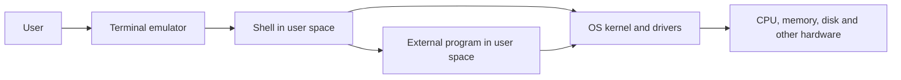
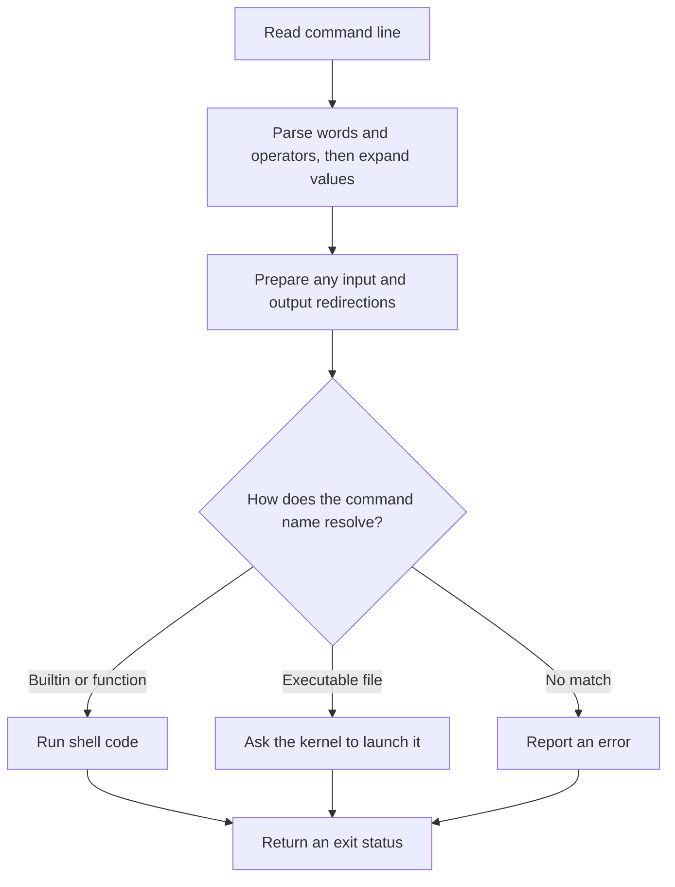
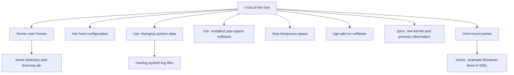
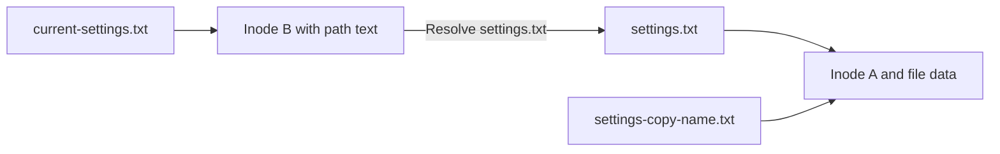
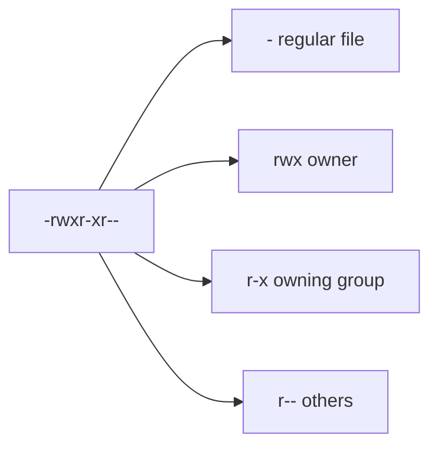
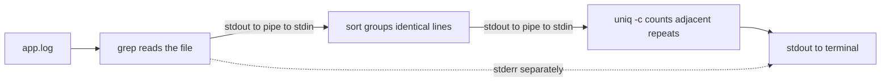
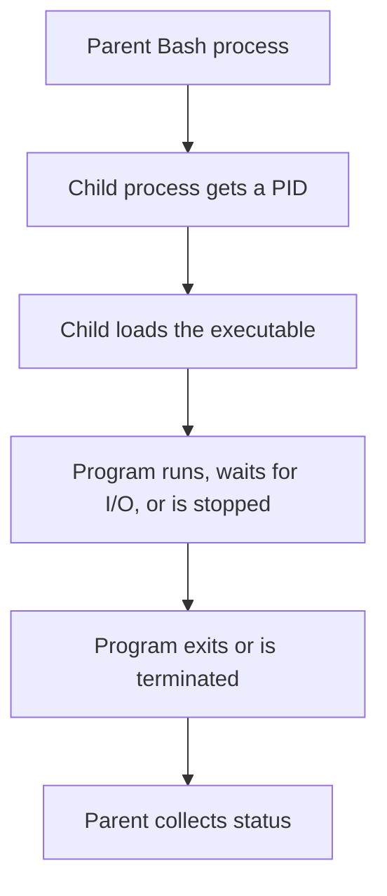
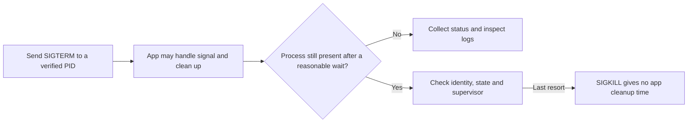
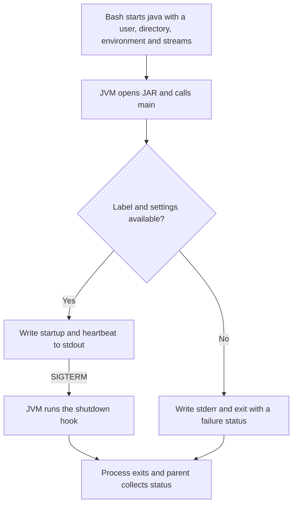

# Linux Fundamentals — Theory

## Course Overview

When you run a backend on Linux, the machine sees an executable, a user identity, open files, and a process. Spring Boot can explain what the application intends to do. Linux tells you whether the process can start, what resources it can access, where its output goes, and how it shuts down. You can learn those concepts with ordinary files and small programs before bringing in a framework.

Work through the chapters in order. Predict what each example will do, run it in a fresh practice directory when instructed, and explain the result in your own words. Use [the companion exercises](Linux_Exercises_and_Solutions.md) to practice without seeing the commands first. Output blocks show representative results. Your username, timestamps, process IDs, and installed versions will vary.

## Learning Objectives

By the end, you should be able to:

- Explain how a terminal, shell, kernel, and distribution fit together, and work comfortably in Ubuntu on WSL2.
- Navigate files, inspect metadata, and reason about access using ownership and permissions.
- Compose commands using streams, redirection, and pipes, and interpret their exit statuses.
- Inspect and stop processes, understand what a service manager adds, and find the relevant logs.
- Install a package deliberately, explain how SSH verifies a server, and write a small Bash script.
- Build and supervise a Java 21 JAR locally, then diagnose typical Linux-side failures.

## Prerequisites and Environment Setup

Use Windows 11, Ubuntu on WSL2, and a terminal such as Windows Terminal or the integrated terminal in VS Code. Part 2 walks through installation. Basic exercises use the Bash and GNU tools shipped with Ubuntu. The Java examples use a **Linux JDK 21**, which you can install when you reach Part 10. Most chapters work without it. The service-manager examples have a process-and-logs equivalent. The SSH lab can run without a server.

Run code labeled **Windows PowerShell** in a Windows terminal. Run code labeled **Ubuntu Bash** in your Ubuntu session. Paste the commands only. Printed output, explanatory placeholders, and prompts are separate from what you type. Stop and read any unexpected error before continuing with commands that assume success.

Start each chapter's local example in a fresh folder when it creates files. These **Ubuntu Bash** commands make a dedicated parent under your home directory and print a new, empty child path. `mktemp -d` replaces the trailing `X` characters with a unique suffix.

```bash
mkdir -p -- "$HOME/linux-learning-lab"
mktemp -d -- "$HOME/linux-learning-lab/theory.XXXXXX"
```

Run `cd --` followed by the printed path in quotes, then run `pwd` to confirm your location. `"$HOME"` expands to your Linux user's home directory. Quotes keep a path with spaces together, and `--` marks the end of options for these commands. Part 4 introduces the commands and Part 8 explains the quoting. Keep practice files for review or remove just the verified child folder using the interactive procedure in the workbook.

## Contents

| | |
| --- | --- |
| [1. Introduction to Linux](#part-01) | [8. Environment Variables and Shell Behavior](#part-08) |
| [2. Linux on Windows 11 with WSL2](#part-02) | [9. Processes, Services, and Logs](#part-09) |
| [3. Linux Filesystem](#part-03) | [10. Package Management](#part-10) |
| [4. Essential Terminal Commands](#part-04) | [11. SSH and Remote Linux Access](#part-11) |
| [5. Users, Groups, and Permissions](#part-05) | [12. Introduction to Bash Scripting](#part-12) |
| [6. Input, Output, Pipes, and Redirection](#part-06) | [13. Linux for Java Backend Deployment](#part-13) |
| [7. Linux Processes](#part-07) | [14. Linux Troubleshooting](#part-14) |

## Study Priority Overview

| Part | Topic | Priority | Recommended Study Approach | Why |
| --- | --- | --- | --- | --- |
| [Part 1](#part-01) | Introduction to Linux | ★★★☆☆ (3/5) — Medium | Explain the shell and kernel boundary | Distinguish shell errors from OS and application errors. |
| [Part 2](#part-02) | Linux on Windows 11 with WSL2 | ★★★☆☆ (3/5) — Medium | Verify your practice environment once | Keep the shell, distro, and filesystem straight. |
| [Part 3](#part-03) | Linux Filesystem | ★★★★☆ (4/5) — High | Practice path resolution and mounts | Prevent wrong-directory and missing-file failures. |
| [Part 4](#part-04) | Essential Terminal Commands | ★★★★☆ (4/5) — High | Practice file and executable inspection | Find the actual artifact, executable, and logs. |
| [Part 5](#part-05) | Users, Groups, and Permissions | ★★★★★ (5/5) — Critical | Diagnose access as the service user | Protect config and data while fixing access. |
| [Part 6](#part-06) | Input, Output, Pipes, and Redirection | ★★★★☆ (4/5) — High | Capture logs and detect pipeline failures | Use the right stream and status in CI and diagnosis. |
| [Part 7](#part-07) | Linux Processes | ★★★★★ (5/5) — Critical | Inspect and stop a process safely | Connect JVM and container exits to actual process state. |
| [Part 8](#part-08) | Environment Variables and Shell Behavior | ★★★★★ (5/5) — Critical | Practice inheritance and quoting | Find settings that never reached the launched process. |
| [Part 9](#part-09) | Processes, Services, and Logs | ★★★★★ (5/5) — Critical | Inspect service state and recent logs | Find failures under the real supervisor and account. |
| [Part 10](#part-10) | Package Management | ★★★☆☆ (3/5) — Medium | Verify packages and install only what you need | Avoid changing a host when the right runtime already exists. |
| [Part 11](#part-11) | SSH and Remote Linux Access | ★★★★☆ (4/5) — High | Verify remote identity and practice a login | Reach the right server and account during manual deployment. |
| [Part 12](#part-12) | Introduction to Bash Scripting | ★★★★☆ (4/5) — High | Write and test a small fail-safe script | Make CI checks distinguish failure from an empty result. |
| [Part 13](#part-13) | Linux for Java Backend Deployment | ★★★★★ (5/5) — Critical | Run and deliberately break the JAR | Prove startup, settings, and shutdown under the intended launch context. |
| [Part 14](#part-14) | Linux Troubleshooting | ★★★★★ (5/5) — Critical | Diagnose and prove recovery | Fix a specific Linux failure without changing unrelated settings. |

## Recommended Study Strategy

Start with Parts 1–2 so you can tell which shell and filesystem you are using. Verify WSL2 once and skim the setup recovery cases that do not apply. Work through paths and terminal commands in Parts 3–4 before testing permissions in Part 5. Use Part 6 to capture the evidence you will need for the process, environment, and service labs in Parts 7–9.

Practice Parts 5, 7–9, and 13–14 until you can explain and repair a failure from the service's own context. Focus your time in Parts 3–4 and 6 on finding paths, inspecting files, and collecting logs. Read Part 10 when you need the Linux JDK for Part 13. Practice the remote identity checks in Part 11 before your first AWS or VM login, and do the failure cases in Part 12 before writing CI shell steps.

Defer inode bookkeeping, broad package maintenance, and custom systemd tuning until needed. Carry your process and signal model into Docker's lifecycle lab and your export and quoting skills into the configuration course. There, concentrate on what the container and the JVM add to the launch. [Docker lifecycle](../03_Docker/Docker_Theory.md#docker-05) · [Windows and Java environment variables](../04_Application_Configuration/Application_Configuration_Theory.md#config-03)

<a id="part-01"></a>

## Part 1 — Introduction to Linux

**Study Priority: ★★★☆☆ (3/5) — Medium**

**Why it matters:** Knowing which shell interprets a command and which kernel runs it prevents mistakes when moving between PowerShell, WSL, and a server.

**Recommended study depth:** Learn the model, then identify one builtin and one external command with `type`.

**Focus on:** Terminal versus shell, kernel versus distribution, command lookup through `PATH`, and exit status.

**Can defer:** Linux history and detailed comparisons of distribution families.

### What the operating system does

Imagine a Java API and a database running together. Both want CPU time, memory, and access to files. If they could each change any address or write directly to any disk block, a bug in one could damage the other. An **operating system** provides common interfaces and coordinates access to those resources. Its **kernel** runs with special privileges. It schedules programs, manages memory, enforces many access rules, and controls hardware through drivers.

A program in **user space** can ask the kernel to open a file or create a process through a **system call**. Libraries usually wrap these calls. For example, Java's `Files.readString` eventually relies on native code and operating system facilities to open and read the file. The boundary lets the kernel enforce permissions regardless of which language the caller uses.

Linux is the kernel Linus Torvalds began developing in 1991. It started as a personal project to explore operating-system development and build a Unix-like system for his 386 PC. Unix provided a model for processes, users, paths, and small tools that can be composed. Developers could study and modify Linux, and it grew into a collaborative, open-source kernel. In everyday conversation, **Linux** often also means a complete operating system built around that kernel. [An early contributor's account](https://lwn.net/Articles/928581/), [Linux kernel documentation](https://docs.kernel.org/admin-guide/README.html)

A **distribution** packages a kernel with user-space tools, libraries, a package manager, install images, and update policies. Debian is a distribution. Ubuntu is a separate distribution derived from Debian and also uses APT. Fedora uses a different package ecosystem, and distributions such as Red Hat Enterprise Linux emphasize a different support and release model. Commands like `cd` and `ls` carry over widely, while package names, installed versions, default shells, and service configuration can differ. In WSL2, Microsoft supplies the kernel independently of the Ubuntu user-space packages.

Windows also has a kernel, user-space programs, permissions, and processes. Linux has familiar Unix conventions such as a filesystem starting at `/`, file descriptors for I/O, and shell pipelines. Servers often run Linux because of its software ecosystem, distribution support, scriptable administration, and tooling for operating unattended over remote connections. Both Linux and Windows can run graphical desktops and command-line tools.

### Terminal, shell, and kernel

A **graphical user interface (GUI)** presents windows and buttons. A **command-line interface (CLI)** accepts text instructions. A **terminal emulator** such as Windows Terminal displays text and carries input to and output from a session. A **shell** reads command text, interprets its grammar, and runs the requested work. **Bash**, the Bourne Again Shell, is one such program. PowerShell is another shell with its own syntax and conventions.



1. You type `ls /tmp` in the terminal.
2. The terminal passes those characters to Bash and displays characters sent back to it.
3. Bash parses the line, finds `ls`, and arranges for it to run with `/tmp` as an argument.
4. The running `ls` asks the kernel for directory information. The kernel can satisfy the request from memory or through a filesystem driver and storage device.
5. `ls` writes text to its output stream. With no redirection, that text returns to the terminal.

Think of the terminal as the channel, Bash as the interpreter, and the kernel as the layer that mediates operations on system resources. In WSL2 the Linux kernel sees virtual hardware and integration interfaces provided by Windows. When you run a command from an editor's terminal, the editor provides the terminal interface and the shell still determines the command syntax.

### How Bash executes a command

A **command** is an instruction, often a command name followed by words passed as arguments. An **option** changes behavior and an **operand** is usually the thing to act on. In `ls -l /tmp`, `-l` asks for a detailed listing and `/tmp` selects the directory. Spaces and quotes determine word boundaries. Square brackets in a manual usually mark optional syntax. You omit the brackets when typing an optional argument.



This diagram shows a simple foreground command. Bash can expand aliases as it reads the line. It resolves functions and builtins itself, and searches directories in `PATH` for external command names without a slash. A name such as `./report.sh` specifies a path directly. An **exit status** is a small integer that tells the caller how the command ended, usually `0` for success. Background commands and pipelines add details covered in Parts 6 and 7.

Try these once Ubuntu is open.

```bash
type cd
type ls
pwd
ls -d /tmp
```

`type cd` reports a shell builtin because changing the current directory must change Bash's own state. `type ls` might report an alias on Ubuntu, such as one that enables color. The underlying external command is still available. `ls -d /tmp` lists the directory itself and commonly prints `/tmp`. A successful command can be silent, as `cd` usually is.

**Remember.** Identify the active shell before choosing a syntax. A terminal tab can host either Bash or PowerShell, and an application makes requests through operating-system interfaces.

<a id="part-02"></a>

## Part 2 — Linux on Windows 11 with WSL2

**Study Priority: ★★★☆☆ (3/5) — Medium**

**Why it matters:** The local Ubuntu setup makes the exercises repeatable and explains why Windows and Linux paths or permissions can behave differently.

**Recommended study depth:** Verify your installed distribution and run the path checks once. Use the install steps if Ubuntu is missing.

**Focus on:** WSL2 distribution and shell selection, Linux home versus `/mnt/c`, LF line endings, and normal user access.

**Can defer:** Installation recovery for errors you do not encounter and comparisons with conventional VMs.

### Why WSL2 fits this lab

You need Linux semantics for files, permissions, and processes while keeping your Windows tools. **Windows Subsystem for Linux (WSL)** integrates Linux distributions with Windows. WSL1 translates Linux system calls to Windows facilities. WSL2 runs a real Linux kernel in a lightweight, managed virtual machine. Your Ubuntu distribution supplies its packages, accounts, and filesystem. The VM lifecycle, access to Windows files, and networking integration remain tied to Windows. [Microsoft's comparison of WSL versions](https://learn.microsoft.com/en-us/windows/wsl/compare-versions)

| Environment | Who controls the boot and lifecycle | Use for this course |
| --- | --- | --- |
| Ubuntu on WSL2 | Windows manages the VM and launches distributions on demand. | Run everyday shell, filesystem, permissions, and Java labs. Check PID 1 before using systemd. |
| Ubuntu in a conventional VM | A hypervisor presents virtual hardware. You boot, configure, and shut down the guest OS. | Practice a server-like boot, persistent services, or an SSH connection to a machine you administer. |
| Native Ubuntu or a Linux server | The operating system boots on the machine or its assigned virtual hardware. | Observe the actual host's service lifecycle, disks, and accounts. A server can outlive your terminal session and client computer. |

### Install or reuse Ubuntu

1. In **Windows PowerShell**, inspect the installed distributions.

   ```powershell
   wsl --list --verbose
   ```

   If your Ubuntu already appears with `VERSION` `2`, use its exact `NAME` and go to step 3. A distribution named `docker-desktop` serves Docker Desktop and has a separate purpose from your Ubuntu session.

2. If you need Ubuntu, open **Windows PowerShell as Administrator** and run the installation. This may enable Windows features, download WSL and the distribution, and request a reboot. Save your work before rebooting.

   ```powershell
   wsl --install -d Ubuntu
   ```

   If WSL prints usage or the name is unavailable, run `wsl --list --online` in PowerShell and use an Ubuntu name from the list. The examples use Ubuntu 24.04 LTS as a baseline. If you choose a release-specific name such as `Ubuntu-24.04`, use that name in subsequent commands. A download stuck at `0.0%` can often be retried with `wsl --install --web-download -d Ubuntu`. [Microsoft's WSL installation guide](https://learn.microsoft.com/en-us/windows/wsl/install)

3. Open ordinary **Windows PowerShell** after reboot if needed. Verify and launch Ubuntu. Replace `Ubuntu` if your installed name differs.

   ```powershell
   wsl --list --verbose
   wsl --distribution Ubuntu
   ```

   If an existing Ubuntu shows `VERSION` `1`, convert it with `wsl --set-version Ubuntu 2` from PowerShell. Close work in that distribution and back up important files first. Conversion can take time and changes how WSL runs that distribution. [Microsoft's WSL command reference](https://learn.microsoft.com/en-us/windows/wsl/basic-commands)

4. On first launch, create a Linux username and password when prompted. Password entry normally displays no characters. This Linux username and password belong to that distribution and can differ from your Windows credentials. Keep the normal user as your daily identity. Ubuntu commonly grants this first user permission to run administrative commands through `sudo`.

5. In **Ubuntu Bash**, check the environment and go to your Linux home.

   ```bash
   cat /etc/os-release
   uname -r
   whoami
   cd ~
   pwd
   ```

   `/etc/os-release` should identify Ubuntu. `uname -r` prints the Linux kernel release, often with a WSL-related suffix here. `whoami` should print your Linux username, and `pwd` usually shows `/home/` followed by that name. WSL launched from PowerShell may initially start in the Linux view of your Windows working directory. `cd ~` makes the location explicit.

Windows elevation authorizes Windows-level setup. Ubuntu `sudo` authorizes specific Linux operations inside your distribution. Opening your Windows terminal as Administrator is unnecessary for normal Bash practice.

### Work across the two filesystems

Ubuntu exposes Windows drives under `/mnt` by default. From **Ubuntu Bash**, `ls -d /mnt/c/Windows` should ordinarily print the mounted Windows directory. If your Ubuntu session has Windows executable interoperability enabled, you can run the following from your Linux home to open that directory in File Explorer.

```bash
cd ~
explorer.exe .
```

You can also enter `\\wsl.localhost\Ubuntu\home` or `\\wsl$\Ubuntu\home` in File Explorer, using your installed distribution name. Keep these labs in the Linux home under `~/linux-learning-lab`. Windows-mounted paths can have different case, performance, ownership, and permission behavior. Use the supported WSL path or VS Code's WSL connection to edit Linux files from Windows. Direct edits to WSL's backing storage bypass that interface. [Microsoft's cross-filesystem guide](https://learn.microsoft.com/en-us/windows/wsl/filesystems)

In **Windows PowerShell**, `Get-Location` reports a Windows working directory. In **Ubuntu Bash**, `pwd` reports a Linux working directory. The same terminal window can switch between the two when you start WSL or type `exit` in the Ubuntu shell. When editing a Bash script, save with LF line endings. CRLF can leave a stray carriage return in the interpreter line.

### Diagnose setup problems

| Symptom | Check and recovery |
| --- | --- |
| `wsl --install` is unrecognized | Check `wsl --status` or `wsl --version` in PowerShell, apply Windows updates as appropriate, and follow Microsoft's current installation steps. `wsl --update` updates WSL. |
| Installation reports a virtualization error, such as `0x80370102` | Confirm virtualization is enabled in firmware and that Windows has Virtual Machine Platform enabled. Changes to firmware or Windows features require permission on that machine and can require a reboot. |
| Ubuntu closes or opens in an unexpected distribution | Run `wsl --list --verbose` and use `wsl --distribution` with the exact installed name. |
| Ubuntu is open but `pwd` starts with `/mnt/c` | Run `cd ~`. Check `pwd` before creating files or practicing permissions. |
| `sudo` asks for a password that does not appear as you type | Enter the Linux account password and press Enter. See Microsoft's account setup and recovery instructions if you have forgotten it. |
| `systemctl` says systemd is unavailable | Check PID 1 as shown in Part 9. You can continue with file logs and process commands. |

If this is a managed device, follow its virtualization and software-install rules. Avoid unregistering a distribution as a troubleshooting shortcut because it deletes that distribution and its data. [Microsoft's WSL troubleshooting guide](https://learn.microsoft.com/en-us/windows/wsl/troubleshooting), [Ubuntu account setup and recovery in WSL](https://learn.microsoft.com/en-us/windows/wsl/setup/environment#set-up-your-linux-username-and-password)

**Remember.** Confirm the distro, WSL version, shell, and path before choosing commands. Linux home is the reliable place to practice Unix file permissions.

<a id="part-03"></a>

## Part 3 — Linux Filesystem

**Study Priority: ★★★★☆ (4/5) — High**

**Why it matters:** Working directory and mount paths determine whether a deployed JAR finds its settings, data, and logs.

**Recommended study depth:** Predict and verify how a relative path resolves from two directories. Examine one broken symlink.

**Focus on:** Absolute and relative paths, case sensitivity, mounted paths, and the roles of `/etc`, `/var/lib`, and `/var/log`.

**Can defer:** Inode numbering, link-count details, and access-time policy.

### One tree and a location inside it

Suppose an application reports that `settings.txt` is missing even though you can see the file in your editor. A file is a named object that can hold bytes. A directory associates names with filesystem objects. A **path** tells Linux which names to follow to an object. The process's **current working directory** supplies the starting point for a relative path.

An **absolute path** begins with `/`, the root of the directory tree. A **relative path** starts from the current working directory, as in `config/settings.txt`. `.` means the current directory, `..` its parent, and Bash expands an unquoted initial `~` into a home path. `/` is the root directory, `root` is the administrative user, and `/root` is normally that user's home.

For a Bash session whose `pwd` is `/home/learner/demo`, these resolve to the same file.

```text
config/settings.txt
./config/settings.txt
/home/learner/demo/config/settings.txt
```

On Linux a path uses forward slashes, and native Linux filesystems normally distinguish `Report.txt` from `report.txt`. Windows typically uses drive letters, backslashes, and case-insensitive name lookup. Linux exposes additional filesystems by **mounting** them at directories in the same tree. A directory under `/mnt/c` can therefore follow different rules from one under `/home`. A leading dot makes a name hidden by convention, so `ls -a` displays `.bashrc` and other dotfiles. The dot convention affects listing defaults without restricting access.



The tree gives a program a consistent namespace even when entries are backed by different filesystems. `/etc` often holds machine-specific configuration, `/usr/bin` packaged commands, `/var/lib` persistent application or system state, and `/var/log` traditional log files. On modern Ubuntu `/bin` commonly links to `/usr/bin`. `/tmp` is shared, and its contents may be cleaned. `/proc` is virtual. Reading a file there asks the kernel for a current view, such as process state. A service's configuration, data, and logs can live in separate places with different access rules. [Linux kernel documentation for procfs](https://docs.kernel.org/filesystems/proc.html)

### Names, metadata, inodes, and links

**Metadata** describes an object. It includes the type, size, owner, permission bits, and timestamps. A file's modification time describes content changes. Its change time records metadata or content changes. Linux access-time updates can be limited by the filesystem's mount policy. An **inode** is the filesystem record that identifies the object, stores its metadata, and describes how to locate its data. An inode number identifies an object within a filesystem. A directory entry associates a filename with it.



A **hard link** is another directory entry for the same inode. Edits through either name change the same data. Removing one name leaves the other. Once the last hard link is removed, the filesystem can reclaim the data after any processes holding the file open close it. Use hard links within one filesystem for regular files. A **symbolic link** is a file of its own containing a target path. A relative target is interpreted from the link's containing directory. A symbolic link can point across filesystems or to a directory, and it becomes dangling if the target path stops resolving.

In a fresh lab directory, try the following. `printf` writes a line, and `>` sends it to a file. Part 6 explains both in context.

```bash
printf '%s\n' 'mode=learning' > settings.txt
ln -- settings.txt settings-copy-name.txt
ln -s -- settings.txt current-settings.txt
ls -li -- settings.txt settings-copy-name.txt current-settings.txt
stat -c '%i %h %n' -- settings.txt settings-copy-name.txt
rm -- settings.txt
cat -- settings-copy-name.txt
ls -l -- current-settings.txt
```

`ln TARGET LINK` creates the second hard link, and `ln -s` creates the symbolic link. `ls -i` prints inode numbers. `stat` prints the inode number, hard-link count, and name in this format. Before `rm`, the two hard-linked names share a number and have a link count of `2`. After `rm`, `cat` still prints `mode=learning` through the surviving name. The symbolic link is still listed as `current-settings.txt -> settings.txt`. Reading it now fails because `settings.txt` is absent.

**Remember.** Identify the starting directory for a relative path, and distinguish the object from the name you use to reach it. A JAR's location and the Java process's working directory are separate inputs.

<a id="part-04"></a>

## Part 4 — Essential Terminal Commands

**Study Priority: ★★★★☆ (4/5) — High**

**Why it matters:** These commands let you inspect an unfamiliar host, locate configuration and logs, and handle deployment files safely.

**Recommended study depth:** Practice navigating, finding, and inspecting files in a scratch directory. Use help for flags you need.

**Focus on:** `pwd`, `ls`, `cd`, `find`, `stat`, `tail`, safe `cp` and `mv`, and `type` to identify the executable.

**Can defer:** Memorizing command switches and detailed classification output from `file`.

You have just opened a terminal in an unfamiliar project. Orient yourself before moving or removing anything. The examples below continue in the same fresh lab directory for this chapter. Ubuntu user setups may omit `less`, `file`, or `man` on minimal images. Part 10 covers how to install an individual utility if needed.

### Locate and navigate

- `pwd [-P]` prints the working directory. Use `pwd -P` to see the physical path with symbolic directory links resolved. This is useful when a friendly path points into a different location.
- `ls [OPTION]... [PATH]...` lists directory contents by default. `-l` shows detail, `-a` includes dotfiles, `-h` makes sizes easier to read with `-l`, and `-d` shows the given directory entry. Combine short options as `ls -lah`.
- `cd [DIRECTORY]` changes the shell's working directory. `cd` with no argument goes home, `cd ..` moves up, `cd -` returns to the previous directory and prints its path, and `cd -P` follows the physical path.

```bash
pwd
ls -lah
mkdir -p -- 'reports/archive'
cd -- reports
pwd
ls -ld -- archive
cd ..
```

The second `pwd` ends in `/reports`. `ls -ld` starts its detailed line with `d` for directory. A relative path such as `archive` works from `reports`. From your original directory the same target is `reports/archive`. If `cd` fails, the working directory remains where it was. Check `pwd` before issuing a command that assumes the move succeeded.

### Create, copy, rename, and remove

`mkdir [OPTION]... DIRECTORY...` creates directories. `-p` creates missing parents and accepts an already existing directory. Use `touch [-c] FILE...` to update modification and access times and create an empty file if needed. `-c` skips creation. Touching an existing file preserves its data. Here `--` ends option parsing, and quotes keep spaced names intact.

```bash
mkdir -- inbox
touch -- 'inbox/first report.txt' .lab-note
cp -i -- 'inbox/first report.txt' 'reports/draft.txt'
mv -i -- 'reports/draft.txt' 'reports/final.txt'
cp -r -- reports reports-backup
ls -a -- .
```

`cp [OPTION]... SOURCE DESTINATION` copies data. `-r` copies a directory tree, and `-i` asks before replacing an existing destination. `mv [OPTION]... SOURCE DESTINATION` moves or renames an entry and has the same `-i` option. A move within a filesystem normally changes directory entries while keeping the underlying inode. Moving across filesystems generally copies and then removes the source. If the destination already exists as a directory, these commands usually put the source inside it. Check the destination before assuming it will be created with the requested name.

`rmdir [OPTION]... DIRECTORY...` removes an empty directory. `-v` reports each removal. `rm [OPTION]... FILE...` removes file entries, and `-i` asks before each removal. `-r` descends into a directory tree. A shell removal usually bypasses a graphical trash bin. Use `rmdir` for empty folders and prefer an explicit reviewed file list over a wildcard for `rm`.

```bash
rmdir -v -- reports/archive
ls -l -- 'inbox/first report.txt'
rm -i -- 'inbox/first report.txt'
rmdir -- inbox
```

If you confirm the prompt, `inbox` is empty and `rmdir` succeeds. If you decline, `rmdir` reports that the directory is nonempty. `reports-backup` is independent and still contains the archived directory.

### Read text with the right tool

Create a small file to compare these tools. Repeat `echo "text"` to print a short label to the terminal. `echo -n` omits the newline in Bash, but option and backslash behavior can vary among implementations. `printf '%s\n'` has predictable formatting when printing arbitrary text.

```bash
printf '%s\n' 'INFO starting' 'WARN retrying' 'INFO ready' > status.log
echo "Recent activity"
cat -n -- status.log
head -n 2 -- status.log
tail -n 1 -- status.log
less -- status.log
```

- `cat [OPTION]... [FILE]...` concatenates files to standard output, or reads input with no filename. `-n` numbers every line. It is convenient for small files. A large or binary file can flood or garble a terminal.
- `head [-n COUNT] FILE` reads the beginning, and `tail [-n COUNT] FILE` reads the end. Each defaults to ten lines. Here `head` shows the first two entries and `tail` shows `INFO ready`. `tail -f` follows appended output and is covered in Part 9.
- `less [OPTION]... FILE` opens an interactive pager. Scroll with the arrow keys, type `/WARN` followed by Enter to search, `n` to repeat, and `q` to quit. `less -N FILE` shows line numbers.

### Inspect and locate files

`file [-b] PATH...` guesses what a file contains based on its metadata and contents. `-b` prints the classification without the filename. `stat [OPTION]... PATH...` shows metadata such as mode, owner, size, inode, and timestamps. `-c FORMAT` selects fields, and `-L` follows a symbolic link to inspect its target.

`find STARTING_PATH [TEST]... [ACTION]` walks a directory tree. `-maxdepth N` bounds the descent from the starting path. `-type f` matches regular files, `-type d` directories, and `-name PATTERN` matches a basename. `-print` prints the resulting paths. Quotes around `'*.log'` keep Bash from expanding the wildcard before `find` can interpret it.

```bash
file -b -- status.log
stat -c '%A %U:%G %s %n' -- status.log
find . -maxdepth 2 -type f -name '*.log' -print
```

You should see a text classification, a mode string and ownership followed by the size and filename, and the path `./status.log`. Filename extensions are conventions. They have limited value when a downloaded file or a script behaves differently from what its name suggests.

### Discover commands and read help

`type NAME` reports what Bash would use, including aliases, functions, builtins, and external executables. `type -a NAME` lists known matches in lookup order. The external `which NAME` searches `PATH` and typically prints the first executable path. Some implementations offer `-a` for all executable matches. Its result does not describe Bash's own builtins or aliases. `command -v NAME` is a useful Bash check when a script needs to know whether a name resolves.

```bash
type -a ls
type cd
which ls
help cd
ls --help
man 1 ls
```

The path is commonly `/usr/bin/ls`, and `type cd` identifies a builtin. `man [SECTION] NAME` opens a manual page. `1` selects user commands, `man -k KEYWORD` searches installed summaries, and `q` leaves the pager. Many Ubuntu programs support `--help` for syntax and options. Shell builtins have Bash's `help NAME`, and other programs may use their own help options. If a manual page is unavailable on a minimal installation, `--help` often suffices for a quick lookup.

**Remember.** Verify the current directory, inspect the target, and use the help for the command that Bash actually resolves. Prefer narrow paths before operations that move or remove files.

<a id="part-05"></a>

## Part 5 — Users, Groups, and Permissions

**Study Priority: ★★★★★ (5/5) — Critical**

**Why it matters:** A service can fail to read settings or write data even when your login can reach the same path. Broad permission fixes create exposure.

**Recommended study depth:** Reproduce a denied access and restore only the access required by the intended identity.

**Focus on:** Service UID/GID, owner and group selection, directory traversal, `chmod`, `umask`, and least-privilege `sudo`.

**Can defer:** Advanced ACLs, capabilities, and special mode policies beyond recognizing their role.

### Identity and access

Imagine a Java process needs to read its settings while only an administrator can change them. Linux assigns a process a user identity. A Linux **account** associates a username with a numeric user ID (UID) and other information such as a home directory and login shell. `root` has UID `0` and usually has broad administrative powers. A normal user has narrower access. A service can have its own account so its permissions and files are independent of a developer's account.

A **group** has a numeric group ID (GID). An account has a primary group and may belong to supplementary groups. A filesystem object records an owning UID and GID. Linux compares those with the process credentials when evaluating access. In everyday sessions these are your login user and groups. Run the following in Ubuntu Bash.

```bash
whoami
id
id -gn
```

`whoami` prints the effective username, which is the identity normally used for access checks. `id [USER]` gives IDs and group memberships. With no argument it describes the current process's identity. `-g` selects the effective, normally primary, group ID and `-n` requests the name instead of the number. Group membership changes may require a new login or service restart to reach existing processes.

### How mode bits work

Look at a detailed listing such as `-rwxr-xr--`. Its first character is the type (`-` for a regular file, `d` for a directory, `l` for a symbolic link). The next nine bits form three triplets.



For ordinary mode-bit evaluation, Linux uses the owner triplet if the process is the owner. Otherwise it uses the group triplet if the process belongs to the file's owning group. Otherwise it uses the others triplet. The triplets describe three alternatives. For example, if you own a file with mode `004`, the owner bits are empty, so you cannot read it through the ordinary check even though others have read permission. In servers, extra mechanisms such as access-control lists, capabilities, and read-only mounts can also affect the outcome. Start with ownership, mode bits, and the complete path.

| Bit | For a regular file | For a directory |
| --- | --- | --- |
| `r` | Read the bytes. | Read the list of entry names. |
| `w` | Modify or truncate the file contents. | Change entries, usually together with `x`. |
| `x` | Run the file as a program if its format and environment permit it. | Traverse the directory to look up a named entry or enter it. |

Think of `r` on a directory as seeing its index and `x` as being allowed to reach an item by name. Reading `config/settings.txt` requires search permission (`x`) on each enclosing directory and read permission on the file. A directory can permit lookup by name without allowing the caller to list all names. Creating a new logfile requires write and search access to its parent. Appending to an existing logfile also requires write access to that file. Removing a file is a change to its parent directory entry, so the parent's permissions matter. Special policies, such as the sticky bit typically used on shared `/tmp`, can further constrain removal.

### Change permissions and ownership

In octal notation, `r` is `4`, `w` is `2`, and `x` is `1`. Add the bits you want in each triplet. `755` means owner `rwx`, group `r-x`, and others `r-x`. `644` is owner `rw-` and everyone else's `r--`. `700` grants all three bits only to the owner. Directory mode `700` is useful for a private workspace, while file mode `600` gives the owner read/write access without adding execute permission.

`chmod MODE PATH...` sets permissions. Numeric modes set the three ordinary triplets explicitly. A symbolic change such as `u+x` adds a bit, `g-w` removes a bit, and `o=r` sets the others triplet. `u` means owner, `g` group, `o` others, and `a` all three. In a fresh chapter folder, make and inspect a disposable configuration.

```bash
mkdir -- config
printf '%s\n' 'mode=training' > config/settings.txt
chmod 750 config
chmod 640 config/settings.txt
chgrp -- "$(id -gn)" config/settings.txt
ls -ld -- config
stat -c '%A %a %U:%G %n' -- config/settings.txt
cat -- config/settings.txt
```

The directory mode should show `drwxr-x---`, and the file should show `-rw-r----- 640` with your user and group. `chgrp GROUP PATH...` changes the owning group. A normal owner can usually set it to a group they belong to. `$(id -gn)` gets your current group name for the command, with substitution explained in Part 8. `chown OWNER[:GROUP] PATH...` changes the owner and optionally the group. Changing a file to another owner normally requires an administrator. The form `sudo chown -- APP_USER:APP_GROUP settings.txt` illustrates syntax for an administrator who has verified the actual identities and the file. You can do this lab with your own account and `chgrp` alone.

Now block only the directory lookup and restore it immediately after the observation. Run as your normal Linux user.

```bash
chmod u-x config
ls -1 --color=never -- config
cat -- config/settings.txt
chmod u+x config
cat -- config/settings.txt
```

The listing can show `settings.txt` because the directory is readable. The first `cat` should report `Permission denied`. The restored traversal bit lets the second `cat` read `mode=training`. The file's mode stayed `640` throughout. If a Java process has a different UID, evaluate that UID's path access before editing permission bits.

### Default permissions and least privilege

The **umask** removes permission bits from the mode requested for new objects. A typical new regular file starts from `666` and a typical directory from `777`. A umask of `027` clears group write and all others bits, yielding `640` and `750` respectively for those defaults. It is a bit mask, and existing files are unaffected. Some applications request more restrictive modes themselves.

```bash
umask
(
    umask 027
    touch -- mask-file.txt
    mkdir -- mask-directory
    stat -c '%a %n' -- mask-file.txt mask-directory
)
umask
```

Parentheses run the commands in a **subshell**, a child shell context whose setting changes stay local to the block. In a fresh folder on the Linux filesystem, expect `640 mask-file.txt` and `750 mask-directory`, with the original umask printed before and after.

`sudo COMMAND` runs a specific command under an authorized identity, usually root. Policy decides who may use it and whether to prompt for the invoking user's password. **Least privilege** means giving a task only the access it needs. If a Java service cannot read a settings file, compare the service's identity with `ls -ld` on the enclosing directories and `stat` on the file. Grant the required group read or traversal permission where appropriate. If the service must write logs, give its identity access to its designated logging directory. A broad mode like `777` or permanently running the application through `sudo` introduces access that the application does not need.

**Remember.** For every failure ask who is acting, which permission class applies, and which operation each path component must allow.

<a id="part-06"></a>

## Part 6 — Input, Output, Pipes, and Redirection

**Study Priority: ★★★★☆ (4/5) — High**

**Why it matters:** Shell and CI output can look successful while an earlier pipeline stage failed or the diagnostic went to stderr.

**Recommended study depth:** Redirect both streams separately, filter a log, and reproduce a failed pipeline with a plausible count.

**Focus on:** `stdout`, `stderr`, `2>&1` order, `grep`, `tee`, and the pipeline exit status.

**Can defer:** Extra `sort`, `uniq`, and `wc` modes beyond the log exercise.

### Three streams available when a program starts

A log tool may print matching lines and also need to report an unreadable file. If it put both kinds of output in one stream, a downstream command could treat an error as a result. By convention programs start with three numbered **file descriptors**, handles in a process that refer to open I/O endpoints.

| Descriptor | Conventional name | Interactive default |
| --- | --- | --- |
| `0` | Standard input (`stdin`) | Terminal input |
| `1` | Standard output (`stdout`) | Terminal display |
| `2` | Standard error (`stderr`) | Terminal display, with a separate descriptor |

In Java, `System.in`, `System.out`, and `System.err` correspond to those roles. Bash can connect the descriptors to files or pipes before the program starts. The program can then use the same I/O calls whether the output goes to a terminal or a file.

### Redirect descriptors explicitly

Run these in a fresh folder. `printf FORMAT ARGUMENT...` formats output. Here `%s\n` prints a string followed by a newline for each argument. `> FILE` opens a file for writing and truncates existing contents, `>> FILE` opens it for appending, and `< FILE` opens it as input.

```bash
printf '%s\n' 'INFO starting' 'ERROR database timeout' > app.log
printf '%s\n' 'WARN retrying' 'ERROR database timeout' 'INFO ready' >> app.log
wc -l < app.log
ls -- app.log missing.log > listing.out 2> listing.err
cat -- listing.out listing.err
```

There are five newline-terminated lines, so `wc -l` prints `5`. `ls` prints `app.log` to descriptor `1` and reports the missing operand on descriptor `2`. The two messages land in different files. A redirection can create or truncate its output file even if the command subsequently fails. `sort app.log > app.log` would empty the input before `sort` has a chance to read it. Use a distinct destination.

Bash applies redirections left to right. `2>&1` makes descriptor `2` refer to the endpoint that descriptor `1` points to at that moment.

```bash
ls -- app.log missing.log > combined.log 2>&1
ls -- app.log missing.log 2>&1 > only-stdout.log
cat -- combined.log
cat -- only-stdout.log
```

In the first command, stdout points at `combined.log` by the time stderr copies it. In the second, stderr copies the original stdout, usually your terminal, before stdout is redirected to `only-stdout.log`. Output ordering inside a combined file can vary with program buffering. In many environments `/dev/null` acts as a discard destination, but keep errors available during diagnosis.

### Connect commands with a pipe

`LEFT | RIGHT` connects stdout of the left command to stdin of the right through a kernel-managed buffer. Bash can run the stages concurrently. If the buffer fills, the writer may wait for the reader. The reader sees end-of-file after all write ends close. Standard error normally stays separate.



The arrows show where bytes go. The commands do not need to know about each other's implementation. Start with just the filter, then add a stage when you know what the previous stage emits.

```bash
grep -n -F -- 'ERROR' app.log
grep -F -- 'ERROR' app.log | sort | uniq -c
grep -F -- 'ERROR' app.log | wc -l
grep -F -- 'ERROR' app.log | tee error-lines.log
```

The first command prints matching lines `2` and `4`. The counting pipeline prints `2 ERROR database timeout` with leading spacing. `wc -l` prints `2`. The `tee` command prints both entries and saves those same entries in `error-lines.log`.

- `grep [OPTION]... PATTERN [FILE]...` selects lines. `-F` uses literal text and `-n` adds line numbers. `-i` ignores case, `-v` selects nonmatches, and `-E` enables extended regular expressions such as `'^(ERROR|WARN)'`. Quote patterns so Bash passes them intact. With no file operand, `grep` reads stdin. For ordinary GNU `grep`, status `0` means a match, `1` means no match, and `2` means an error.
- `sort [OPTION]... [FILE]...` orders text lines according to locale by default. `-r` reverses ordering, `-n` compares leading numeric values, and `-u` emits one line per equal sort key. `LC_ALL=C sort` asks for a predictable byte-oriented locale just for that command.
- `uniq [OPTION]... [INPUT]` processes neighboring identical lines. `-c` reports the count of each run. Sort first when you want all identical lines together. Skip sorting when you want to keep the original run boundaries.
- `wc [OPTION]... [FILE]...` counts newline characters with `-l`, words with `-w`, and bytes with `-c`. A last line without a newline adds no count to `-l`. Input from a file operand usually includes its name in the output. With one redirected stdin source, you get the count alone.
- `tee [-a] FILE...` copies stdin both to stdout and to the named files. By default it replaces each file's contents. `-a` appends. This is useful when you want to watch a stage and save its output.

By default, Bash reports the status of the final command in a pipeline. `grep -F -- 'ERROR' missing.log | wc -l` can print `0` while `grep` reports an error and `wc` exits successfully. Check each stage or enable `pipefail` for a script that needs to detect upstream failures, as shown in Part 12. A meaningful count and a successful run are separate questions.

**Remember.** Trace descriptors from left to right, and distinguish received data from diagnostic output. Think through how a command fails before building on its output.

<a id="part-07"></a>

## Part 7 — Linux Processes

**Study Priority: ★★★★★ (5/5) — Critical**

**Why it matters:** The process model explains startup exits, graceful JVM stops, and how a container's main process controls its lifecycle.

**Recommended study depth:** Launch a child, verify its PID and owner, request TERM, and inspect the result with `wait`.

**Focus on:** PID and PPID, inherited launch context, `ps`, exit status, and TERM versus KILL.

**Can defer:** Interactive job-control shortcuts and uncommon process states after you can inspect and stop a verified process.

### From program on disk to running instance

You can start the same JAR twice and stop one instance while the other keeps running. A **program** is instructions stored on disk. A **process** is one running instance with an identity, its own virtual address space, open files, and execution state. A class versus object is a loose analogy for template versus instance. A Linux process can contain many Java objects and threads, and the operating system manages the process independently of the Java type system.

The kernel assigns a **process ID (PID)** to identify a process while it exists. A child has a **parent process ID (PPID)**, observable with `ps`. To run an external command, Bash commonly starts a child through a fork-like operation. That child executes the requested program, replacing its own program image while keeping its PID. It can inherit the working directory, exported environment, and prepared file descriptors. The kernel schedules runnable threads, tracks resources, and records how the process ends. Certain shell contexts can optimize away the extra child, and builtins can run in the original shell.



A running process spends much of its lifetime waiting for CPU time or I/O. A **stopped** process is suspended and can resume. A **zombie** is an exited child whose status the parent has yet to collect. Once the status is collected, the kernel can reuse the PID. Treat old PID values as stale until you verify the current process.

### Foreground, background, and job control

A **foreground job** occupies an interactive terminal while Bash waits. A **background job** lets Bash return a prompt while the job runs. A job can contain one process or a pipeline. Bash maintains a separate job table per shell. It can move a job between foreground and background.

Try this command by itself in interactive Ubuntu Bash.

```bash
sleep 60
```

While `sleep` is running, press **Ctrl+Z** to suspend the foreground job. `jobs -l` lists its job number, PID, and stopped state. Type `bg %+` to resume the current job in the background, then `fg %+` to bring it back. Press **Ctrl+C** to send `SIGINT` to the foreground job. `%+` refers to Bash's current job and `%N` to the displayed job number `N`. The terminal directs these keystrokes at the foreground process group. Running a command with `&` starts it in the background immediately. Background jobs that try to read from the terminal may be stopped by job control, so use a file as stdin or `/dev/null` when they need no input.

### Inspect a process before acting

```bash
sleep 300 &
demo_pid=$!
printf 'Shell PID=%s, sleep PID=%s\n' "$$" "$demo_pid"
jobs -l
ps -p "$demo_pid" -o pid,ppid,stat,etime,args
pgrep -a -P "$$" -x sleep
```

`$!` is the PID of Bash's most recently started background command, and `$$` is the PID of your current interactive Bash. Save `$!` immediately. `ps -p PID` selects a process and `-o` chooses fields. The `PPID` should match the shell PID. A sleeping `sleep` usually shows a state starting with `S` in `STAT`. `ps -ef` shows a system-wide snapshot with parent and command information. `top` refreshes process and resource usage interactively. Use `top -p "$demo_pid"` to filter to the demo and `q` to quit. For `pgrep [OPTIONS] PATTERN`, `-x` matches the whole process name, `-P` narrows the parent, and `-a` displays PID and command line. There can be multiple matching processes even with an exact name.

### Signals and status

A **signal** is an asynchronous notification sent to a process. `kill -TERM PID` requests termination by sending `SIGTERM`. A process can handle TERM, finish work, flush output, and exit. `SIGKILL` forces the kernel to end the process without giving it a cleanup handler. Use it only after confirming the target and giving the program time to stop. If a thread is stuck in certain kernel waits, even KILL may not take effect immediately. A successful `kill` reports that the signal request succeeded.



Use the same Bash session that started `sleep`.

```bash
ps -p "$demo_pid" -o pid,ppid,args
kill -TERM "$demo_pid"
wait "$demo_pid"
demo_status=$?
printf 'sleep exit status=%s\n' "$demo_status"
```

If the PID has already disappeared, skip `kill` and collect its status with `wait`. `wait PID` waits for a child of this shell and returns its status. A normal background `sleep` terminated by TERM typically produces `143` in Bash (`128 + 15`). If it finished before the signal, it returns `0`. Bash commonly reports `127` for a missing command and `126` for one that was found but could not be executed. Programs choose their own ordinary failure codes. Capture `$?` immediately, because the next command replaces it. In particular, the status from launching an asynchronous command and the eventual process status are separate.

`pkill -TERM [OPTIONS] PATTERN` signals every match. Before using it, preview the same selection with `pgrep` and verify the expected number of matches. For example, `pgrep -a -P "$$" -x sleep` previews `pkill -TERM -P "$$" -x sleep`. Use this only in a shell where every matching child is a disposable lab job. A specific verified PID gives finer control.

`nohup COMMAND [ARGUMENT]...` launches a program that ignores `SIGHUP`, a signal that can accompany terminal hangup. GNU `nohup` redirects terminal output to `nohup.out` if you have not redirected it. It does not background the program by itself. `nohup sleep 120 > hold.log 2>&1 &` illustrates the combination. The short `sleep` expires on its own, and `$!` lets you locate and stop it earlier. `nohup` adds no health check or restart policy. It cannot keep a process alive when the distribution or its host shuts down.

### Run a minimal Java JAR

In a fresh lab directory with the Linux JDK 21, save this as `HelloLinux.java`. Part 10 shows how to check or install the JDK.

```java
public class HelloLinux {
    public static void main(String[] args) {
        System.out.println("Hello from PID " + ProcessHandle.current().pid());
    }
}
```

```bash
javac HelloLinux.java &&
    jar --create --file application.jar --main-class HelloLinux HelloLinux.class &&
    java -jar application.jar
```

`javac` compiles source into a class file. `jar` packages it and writes a `Main-Class` entry in the manifest. Bash continues across a line ending in `&&` and runs the next command only if the previous one succeeded. With `java -jar application.jar`, Linux runs the Java launcher. The JVM opens the JAR, loads the entry point, and invokes `main`. The JAR is read as data, so it needs read access and path traversal, while `java` itself needs execute access. Expect `Hello from PID` followed by a number. The program exits quickly, so it may be gone by the time you run `ps`. Part 13 uses a long-running program you can inspect. [JDK 21 Java launcher](https://docs.oracle.com/en/java/javase/21/docs/specs/man/java.html)

**Remember.** Identify the process and its parent, inspect the command line, and let it stop cleanly before considering force.

<a id="part-08"></a>

## Part 8 — Environment Variables and Shell Behavior

**Study Priority: ★★★★★ (5/5) — Critical**

**Why it matters:** Spring Boot, shell scripts, and CI can each receive a different environment even when a variable looks correct at your prompt.

**Recommended study depth:** Prove what a fresh child inherits. Repeat with an unexported value, a one-command override, and a value with spaces.

**Focus on:** `export`, per-command inputs, `PATH`, quoting, and the actual service or script launcher.

**Can defer:** Memorizing Bash startup file order beyond knowing when an interactive file is read.

### What gets inherited

Suppose your terminal prints an application label but the Java process says the label is missing. A **shell variable** is a named value inside Bash. An **environment variable** is a name/value string available in a process's environment. When Bash launches an external program, exported variables are included in its environment. The child inherits values as they were at launch. Later edits in your interactive shell do not change the child's copy. A Java local variable is scoped inside Java code, while environment variables cross process creation boundaries and can be read with `System.getenv("NAME")`.

```bash
unset LAB_LABEL
LAB_LABEL='local practice'
printf 'Bash sees %s\n' "$LAB_LABEL"
printenv LAB_LABEL
printf 'printenv status=%s\n' "$?"
export LAB_LABEL
printenv LAB_LABEL
env LAB_LABEL='single command' printenv LAB_LABEL
printenv LAB_LABEL
unset LAB_LABEL
```

Assignment has no spaces around `=`. Before `export`, Bash prints `local practice` when it expands the variable, but the first external `printenv` prints nothing and returns `1`. After `export`, `printenv` sees the value. `env NAME=VALUE COMMAND` supplies an override just for that command, and `env -u NAME COMMAND` removes a variable from that child's environment. Neither changes the invoking shell's value. The last `printenv` still prints `local practice`. `export NAME=VALUE` assigns and exports in one step. For a single external command, `NAME=VALUE COMMAND` is also a temporary environment assignment.

`HOME` is your home path. `PATH` is a colon-separated list of directories Bash uses to locate executable commands. Compare these without printing the whole environment.

```bash
printenv HOME
printenv PATH
type -a ls
```

If an executable is in your current directory, use `./name` to name that path directly. Leaving `.` out of `PATH` helps avoid executing a file placed in an untrusted working directory. A custom utility directory, when you have deliberately created it, can be appended with `export PATH="$PATH:$HOME/bin"`. A directory earlier in `PATH` takes precedence during the search for external executables. Don't replace the rest of `PATH` accidentally or add writable directories you do not trust. Other tools may read environment variables too. Inspect only the names needed for the problem.

### Expansion, quoting, and substitution

Bash interprets syntax before the program sees any arguments. `$VAR` and `${VAR}` expand a variable. Braces mark the boundary in a name such as `"${LAB_NAME}.log"`. Double quotes allow expansion and keep its result as one argument. Single quotes preserve every character literally inside them. An unquoted variable expansion can split on whitespace and can undergo **pathname expansion**, in which patterns such as `*.txt` become matching names. A backslash can quote one character. `$(COMMAND)` runs a command and substitutes its stdout with trailing newlines removed. Double-quote the substitution when it should be one argument.

```bash
LAB_NAME='release candidate'
printf 'double quotes give <%s>\n' "$LAB_NAME"
printf 'single quotes give <%s>\n' '$LAB_NAME'
printf 'escaped dollar gives <%s>\n' "\$LAB_NAME"
printf 'unquoted words give <%s>\n' $LAB_NAME
log_name="${LAB_NAME}.log"
printf 'log name is <%s>\n' "$log_name"
here=$(pwd)
printf 'working directory is <%s>\n' "$here"
printf 'missing or empty value becomes <%s>\n' "${LAB_UNSET:-fallback}"
```

The unquoted example produces two formatted lines, one for `release` and one for `candidate`. The single-quoted and escaped examples each print the literal `$LAB_NAME`. `${NAME:-fallback}` supplies a fallback when `NAME` is unset or empty. A common mistake is writing `"~/demo"`. Bash expands tilde at the beginning of an unquoted word, so use `~/demo` or `"$HOME/demo"`.

### Sessions and startup files

An **interactive shell** reads commands from you and usually displays a prompt. A **non-interactive shell** often executes a script. A **login shell** follows a particular startup sequence regardless of whether it is interactive. Bash typically reads `/etc/profile` and then the first readable file among `~/.bash_profile`, `~/.bash_login`, and `~/.profile` for a login shell. Interactive non-login Bash reads `~/.bashrc`, with Ubuntu also supporting system-wide initialization. Ubuntu's default `~/.profile` typically sources `~/.bashrc` for Bash. Ordinary non-interactive scripts generally do not use your interactive `.bashrc`. Service managers can launch an executable directly without Bash startup at all.

An assignment typed at the prompt is temporary. Put a deliberate personal interactive setting in `~/.bashrc` if that is the startup file your shell reads. Open a new tab to test, and remove that line to reverse it. `source ~/.bashrc` executes that file in the current shell, so use it only for a file you trust. For a script or service, establish needed values in the environment of its actual launcher. Later application configuration lessons can build on this process rule. [GNU Bash startup files](https://www.gnu.org/software/bash/manual/html_node/Bash-Startup-Files.html)

**Remember.** Check the environment of the command that consumes the value. Quote paths and expanded values unless you intentionally want Bash to split or match them.

<a id="part-09"></a>

## Part 9 — Processes, Services, and Logs

**Study Priority: ★★★★★ (5/5) — Critical**

**Why it matters:** A supervised service has its own identity, working directory, and restart policy. Its recent logs show why a start or recovery failed.

**Recommended study depth:** Inspect one supervised service or use the file-log equivalent. Correlate the launch, status, and first error.

**Focus on:** PID 1, `systemctl status`, start versus enable, `journalctl`, `tail -f`, and disk capacity checks.

**Can defer:** Changing WSL boot settings if the equivalent exercise works, and custom unit tuning.

### Why supervise a process?

A backend often needs to start without a terminal, run under a chosen account, and leave a record when it fails. A **daemon** is a long-running process that provides a function in the background. A **service** is a managed task with a defined lifecycle. One service can contain several processes, and some services perform a short task and exit.

On many Linux servers, **systemd** starts as PID `1`. It brings up the system and manages named resources called **units**. A `.service` unit describes how to run a service. Its configuration can set the executable and arguments, identity, working directory, startup order, and restart policy. Systemd tracks the processes in a unit as a group. This helps it supervise and stop the service even when the original developer terminal has gone away.

### Find out what is running

From **Ubuntu Bash**, check the process with PID 1 before using a system manager.

```bash
ps -p 1 -o pid,comm,args
```

If `COMMAND` or `ARGS` identifies `systemd`, try the following read-only commands. A `degraded` state means one or more units have failed. It can coexist with a working manager.

```bash
systemctl status --no-pager
systemctl list-units --type=service --no-pager
systemctl --failed --no-pager
```

These list the manager's overall status, currently loaded service units, and failed units. For a specific unit, `systemctl status UNIT` provides summary state, the main PID when active, and recent log lines when accessible. `systemctl is-active UNIT` has a short output and reports active state through its exit status as well. Check the journal for older startup attempts.

| Operation on a verified unit | Effect |
| --- | --- |
| `systemctl start UNIT` | Ask the manager to start it now. |
| `systemctl stop UNIT` | Ask the manager to stop it. For a typical service it sends TERM and can escalate after a configured timeout. |
| `systemctl restart UNIT` | Stop and start it, or start it if it was inactive. Existing work may be interrupted. |
| `systemctl enable UNIT` | Set up startup through the unit's install configuration when applicable. Adding `--now` also starts it now. |
| `systemctl disable UNIT` | Remove those startup links. Adding `--now` also stops it now. |

These are command forms. Replace `UNIT` only with a service you administer. Changing a system unit usually requires `sudo` or equivalent authorization. Use `--user` for units belonging to your user manager, ordinarily without `sudo`. A configured `Restart=on-failure` can bring a service back with a new PID after certain failures. A deliberate `systemctl stop` suppresses automatic restart for that stop. When diagnosing a supervised service, operate on the unit so the supervisor can apply its policy. [systemctl reference](https://www.freedesktop.org/software/systemd/man/latest/systemctl.html)

### A disposable systemd example

Run `systemctl --user list-units --type=service --no-pager` first. Use this example only when the user manager is available. Run it in a fresh theory folder. The unit name uses that folder's unique basename. `systemd-run` creates a temporary unit with no persistent unit file. Its command writes one line and replaces the command shell with a short `sleep` using the `exec` builtin. The unit has a two-minute safety limit even if you leave it running.

```bash
lab_unit="linux-learning-$(basename -- "$PWD").service"
systemd-run --user --unit="$lab_unit" --property=RuntimeMaxSec=2min \
    /usr/bin/bash -c '
        echo "INFO supervised lab started"
        exec sleep 90
    '
systemctl --user status --no-pager "$lab_unit"
journalctl --user -u "$lab_unit" -n 10 --no-pager
systemctl --user stop "$lab_unit"
```

`basename` extracts the last component of a path, and Bash removes the trailing newline from its output during substitution. While `sleep` runs, expect `Active: active (running)`. With a readable user journal, the message `INFO supervised lab started` should appear. After stopping, the unit may show as inactive or it may be unloaded. A missing user bus, no visible journal, or PID 1 other than systemd is a reason to use the file-log example below. [systemd-run reference](https://www.freedesktop.org/software/systemd/man/latest/systemd-run.html)

### Where to look for messages

**Application logs** describe events the application knows about, such as startup, requests, or errors. **System logs** describe events from the OS and system services. A **journal** stores messages and metadata such as timestamp, unit, and PID. When configured to send a service's stdout and stderr to the journal, the service manager and `systemd-journald` make those streams available through `journalctl`.

`journalctl -u UNIT -n 30 --no-pager` selects the last 30 entries for a unit. Add `-b` for the current boot, `--since '15 minutes ago'` to narrow the time window, or `-f` to follow new entries. Use `--user` for the user journal when available. **Ctrl+C** stops following. Your account can read only authorized journal entries. User-journal availability and persistence vary, so an empty result alone does not prove nothing ran. Check unit state, time range, and log destination. [journalctl reference](https://www.freedesktop.org/software/systemd/man/latest/journalctl.html)

For a file-based equivalent, create a sample log in a fresh folder. In the first Bash tab run the following. Use **Ctrl+C** to exit the watcher after observing the new line.

```bash
pwd
printf '%s\n' 'INFO starting' > watch.log
tail -n 3 -f -- watch.log
```

In a second Bash tab, `cd` to that exact printed path and confirm with `pwd`. Append a line.

```bash
printf '%s\n' 'WARN sample retry' >> watch.log
```

The first tab prints the old startup line and then the new one. `tail -f` on a regular file normally follows the opened file descriptor. If a logger rotates a file by renaming and recreating it, `tail -F` retries and follows the filename. For either journal or file logs, read timestamps and find the earliest relevant error. Relate it to the specific launch attempt, because an old error can remain after a fix.

### Check where disk space goes

`df` reports filesystem capacity. `du` walks paths and totals their disk usage. If the application reports `No space left on device`, begin with the filesystem that contains the affected work.

```bash
df -h .
df -i .
du -sh -- .
```

`df -h .` shows available bytes on the filesystem that holds the current directory, in human-readable units. `df -i .` shows available inodes on filesystems that report them. You can run out of file slots while bytes remain. `du -sh -- .` summarizes how much space the current tree occupies. The totals answer different questions. For example, an unlinked file held open by a running process can still occupy disk space while being invisible to a directory walk.

### WSL2 and a server have different lifecycles

Recent WSL supports systemd and some Ubuntu images enable it by default. Use the PID 1 check for your installation. If you want to enable it, check `wsl --version` from **Windows PowerShell** and confirm your Ubuntu distribution includes the `systemd` and `systemd-sysv` packages. Consult Microsoft's instructions for older WSL releases or minimal images. In **Ubuntu Bash**, an authorized user can use `sudoedit /etc/wsl.conf` to add `systemd=true` under `[boot]`, preserving existing settings. Save prior settings so you can restore them. The relevant fragment is as follows.

```ini
[boot]
systemd=true
```

After saving all work in WSL, Microsoft's procedure uses `wsl --shutdown` from PowerShell. It stops all running distributions and the WSL2 VM, including a Docker Desktop WSL backend if it is active. Relaunch Ubuntu and check PID 1. To reverse the change, restore the previous setting and restart WSL the same way. If you do not want to change WSL settings, use the process and file-log lab or an Ubuntu VM that boots with systemd. On a conventional server, closing a client terminal generally leaves supervised services running. WSL's distributions and services depend on the Windows-managed lifecycle. [Microsoft's systemd on WSL guide](https://learn.microsoft.com/en-us/windows/wsl/systemd)

**Remember.** Identify the supervisor, the process, and the log destination. Look at the failing attempt and the filesystem that contains its files.

<a id="part-10"></a>

## Part 10 — Package Management

**Study Priority: ★★★☆☆ (3/5) — Medium**

**Why it matters:** You may need a Linux JDK or a diagnostic utility for a manual deployment. Read the proposed package changes before applying them.

**Recommended study depth:** Check which Java is installed and distinguish an index refresh from a package install or upgrade.

**Focus on:** `type -a`, Java version checks, `apt show`, trusted repositories, and reviewing the install plan.

**Can defer:** Routine system-wide upgrades and removal details until you manage the host.

You need a Linux JDK for a Java lab. Downloading a binary by hand would leave you responsible for its version, dependencies, files, and updates. A **package** bundles software and metadata such as version and dependencies. A **repository** publishes packages and indexes. Ubuntu's package manager, **APT**, consults enabled repositories and computes which packages and dependencies need to change. APT authenticates repository metadata and checks packages against it. Choose trusted repositories because installed packages can make system-wide changes. [Ubuntu Server package-management documentation](https://ubuntu.com/server/docs/how-to/software/package-management/)

### Inspect first, then decide what to change

These **Ubuntu Bash** commands inspect local package information and usually need no elevation.

```bash
apt list --installed bash
apt show bash
apt -s upgrade
```

The first should show Bash as installed. `apt show PACKAGE` reports details such as version, dependencies, and package description from the available metadata. `apt list PATTERN` lists candidates matching a name or pattern. `--installed` limits it to installed packages and `--upgradable` lists installed packages that have newer candidates in the indexes. `-s` simulates the requested operation without applying it. A stale index can make both inspections and simulations outdated.

| Command form in Ubuntu Bash | Intended action |
| --- | --- |
| `sudo apt update` | Refresh the local package indexes from configured sources. Installed package versions stay as they were. |
| `sudo apt install PACKAGE` | Install or upgrade the named package as needed and resolve its dependencies. Review the proposed changes before confirming. |
| `sudo apt upgrade` | Upgrade installed software using the known candidates. Dependencies can be added. An upgrade that requires removing installed packages is held back by this command. |
| `sudo apt remove PACKAGE` | Remove the named package, normally keeping package-managed configuration files. See the proposed removals because other packages may depend on it. |

An index refresh is like getting the new catalog. An upgrade applies changes from it. When performing maintenance on a system you administer, review the plan and account for potential service restarts. The exercises require no system-wide upgrade. If you intentionally install a missing utility for this course, you can later remove just that package if nothing else needs it. Removing a package may leave dependencies and files it created outside the package manager's records.

### Prepare Java only when you need it

In **Ubuntu Bash**, run these after checking that `java`, `javac`, and `jar` resolve to Linux executables with `type -a`.

```bash
java -version
javac -version
jar --version
```

A Java runtime can run a compatible JAR. A **Java Development Kit (JDK)** also includes the compiler and archive tools. If the Linux tools already report version 21, continue. On Ubuntu 24.04 LTS, these **sudo** commands refresh the indexes and install the headless JDK if you need it. A Windows-installed JDK is a separate installation.

```bash
sudo apt update
apt show openjdk-21-jdk-headless
sudo apt install openjdk-21-jdk-headless
```

Check the three versions again afterward. A version may already exist alongside the new one. Use the Linux JDK 21 installation's executables if the default points elsewhere. If a release cannot find this package, check the Ubuntu release and enabled repositories. Use Ubuntu's supported packages or an official JDK distribution. Optional tools such as `less`, `file`, and `openssh-client` can be installed by name with the same procedure if missing. Only install tools you plan to use.

**Remember.** Check the software already available, read APT's change list, and distinguish a catalog refresh from a system upgrade.

<a id="part-11"></a>

## Part 11 — SSH and Remote Linux Access

**Study Priority: ★★★★☆ (4/5) — High**

**Why it matters:** Manual AWS or VM deployment often starts with remote access. Server verification and user authentication are separate failure points.

**Recommended study depth:** Walk through `ssh -G` and practice a trusted login or an authorized lab transfer when a host is available.

**Focus on:** Host fingerprint versus login key, username and endpoint, private-key handling, and identifying the remote working directory.

**Can defer:** Detailed interactive SFTP commands if a verified SSH login and one transfer meet your needs.

### Connect from a terminal you already understand

A Linux server may sit in another room with no local display. **Secure Shell (SSH)** creates an encrypted connection that can carry a shell session, remote command, or file transfer. Your `ssh` program is the **client**. The other host runs an SSH **server**, commonly `sshd`. The server needs to be listening on a reachable address, usually on TCP port `22`. A port is a numbered endpoint for a transport protocol. Once you log in, commands run on that remote machine with that account's permissions. Run `hostname` and `pwd` to orient yourself when switching between machines.

There are two identities to verify. The server's **host key** identifies the server to the client. Your password or SSH login key identifies you to the server. These checks protect different sides of the connection.

| Question | What to verify |
| --- | --- |
| Is this the intended server? | Compare the host key fingerprint with the value supplied over a trusted channel, such as an administrator or the console of a VM you control. OpenSSH records trusted hosts in `~/.ssh/known_hosts` by default. |
| Is this user authorized? | The server may accept a password or verify that the client possesses a private key corresponding to a public key authorized for the target account, often in its `~/.ssh/authorized_keys`. |

A **key pair** contains a public and a private key. The public key can be shared with the administrator of the authorized account. Keep the private key on the client in a private location. With public-key authentication the client proves possession through a signature. A **passphrase** encrypts the private key on disk and can be different from a server login password. If a saved host key changes, stop and verify the change through the trusted channel. Reinstalling a lab VM can legitimately regenerate keys, and a wrong destination can cause the same symptom. Keep the client verification in place while you investigate.

### Read the syntax and practice offline

`ssh [OPTIONS] USER@HOST` opens a remote session. `-p PORT` sets a different port and `-i PATH` selects an identity file. The following are examples for an authorized lab host. `lab.example` and `learner` are placeholders. For a real run, use the username, address, and port from a VM you control or from its administrator. Use a normal account and verify its host fingerprint before accepting it. Type `exit` to leave the remote shell.

```bash
ssh learner@lab.example
ssh -p 2222 -i ./learning-key learner@lab.example
```

If you want a throwaway key pair for a lab VM, run `ssh-keygen -t ed25519 -f ./learning-key -C 'linux-lab'` in a fresh private practice folder. `-t` selects the key type, `-f` chooses the file, and `-C` adds a description. Use a passphrase you can remember and enter it only at the prompt. Your administrator must authorize `learning-key.pub` for the remote account before the second command can work. Remove the test files when finished and remove the corresponding public-key authorization if you added it to a lab account. Use `ssh-keygen -lf KEYFILE` to display a key fingerprint. On a VM you own, you can compare against the fingerprint of the corresponding host public key from the VM console.

For a no-server simulation in **Ubuntu Bash**, ask OpenSSH to print the settings it would apply. `-G` prints configuration and exits. `-F /dev/null` isolates the example from your usual client configuration, `-T` disables terminal allocation, and `-l` specifies the login user separately.

```bash
ssh -G -F /dev/null -T -p 2222 -l learner lab.example |
    grep -E -- '^(user|hostname|port) '
```

Expect lines with `user learner`, `hostname lab.example`, and `port 2222`. This exercises argument interpretation without opening a connection, asking for credentials, or saving a host key. If the OpenSSH client is missing, you can read the command and predict those three fields without installing anything. [OpenSSH client reference](https://man.openbsd.org/ssh)

### Transfer files

`scp SOURCE DESTINATION` copies files between hosts. A colon after `USER@HOST` introduces a remote path. Modern OpenSSH uses the SFTP protocol over SSH for `scp` by default. The first transfer below uploads a local file to the remote home. The second downloads a remote file to a different local name. These illustrative commands need an existing local `note.txt`, a reachable lab server, and remote file permissions.

```bash
scp -P 2222 ./note.txt learner@lab.example:received-note.txt
scp -P 2222 learner@lab.example:received-note.txt ./downloaded-note.txt
sftp -P 2222 learner@lab.example
```

`scp` and `sftp` use uppercase `-P` for port, while `ssh` uses lowercase `-p`. For interactive `sftp`, these commands go at the **SFTP prompt**. `pwd` and `ls` refer to the remote machine, `lpwd` refers to the local directory, `put` uploads, and `get` downloads. Choose fresh filenames on both sides to avoid replacing files.

```text
lpwd
pwd
ls
put ./note.txt received-note.txt
get received-note.txt ./downloaded-note.txt
bye
```

A login test and a transfer can fail at different points. A connection failure comes before authentication. A host verification problem concerns the server identity. `Permission denied (publickey)` usually means login authentication failed, while a permission error after login can come from a remote file or directory. Keep credentials private and restrict practice to authorized hosts. You can use the offline simulation until you have a trusted local VM with SSH configured. [OpenSSH scp reference](https://man.openbsd.org/scp), [OpenSSH sftp reference](https://man.openbsd.org/sftp)

**Remember.** Identify the host and remote account before running a command or transferring a file. Verify the server as well as authenticating the user.

<a id="part-12"></a>

## Part 12 — Introduction to Bash Scripting

**Study Priority: ★★★★☆ (4/5) — High**

**Why it matters:** Shell checks in GitHub Actions must stop on real failures and report evidence when paths or inputs are wrong.

**Recommended study depth:** Run the log-scanning script against a match, no match, and a missing path. Test a path with spaces.

**Focus on:** Shebang and LF, `"$@"`, explicit error handling, `pipefail`, and clear stderr and exit codes.

**Can defer:** Extra control-flow forms and detailed tracing once you can diagnose common script failures.

### Turn a repeated check into a command

If you repeatedly search two application logs for errors, the manual commands are easy to mistype. A **shell script** is a text file containing commands and control flow. Bash reads it in order. A script can handle uniform checks without remembering each command, and callers can use its exit status to decide what to do next. Shell is useful for composing tools and working with files. For complex data structures or application logic, a general-purpose language may make behavior easier to express and test.

In a fresh folder, save the following as `scan-log.sh`. You can paste this whole block into Bash. The quoted delimiter in `<<'BASH'` starts a **here-document**, which sends the intervening literal lines to `cat` without expanding variables in them. The line containing just `BASH` ends it. The redirection to `scan-log.sh` creates the script in the current folder.

```bash
cat > scan-log.sh <<'BASH'
#!/usr/bin/env bash

scan_log() {
    local path=$1
    local grep_status

    if [[ ! -f "$path" || ! -r "$path" ]]; then
        printf 'Cannot read log: %s\n' "$path" >&2
        return 3
    fi

    printf 'Scanning %s\n' "$path"
    if grep -n -F -- 'ERROR' "$path"; then
        return 0
    else
        grep_status=$?
    fi

    if [[ $grep_status -eq 1 ]]; then
        printf 'No ERROR lines\n'
        return 0
    fi

    printf 'Search failed for %s (grep status %s)\n' "$path" "$grep_status" >&2
    return 4
}

if [[ $# -eq 0 ]]; then
    printf 'Usage: %s LOG [LOG ...]\n' "$0" >&2
    exit 2
fi

for log in "$@"; do
    scan_log "$log" || exit "$?"
done
BASH
```

- `#!` as the first two bytes introduces the **shebang**, the interpreter directive for direct execution. `/usr/bin/env bash` finds Bash using `PATH`. Keep the file in LF format. `chmod u+x scan-log.sh` lets the owner use `./scan-log.sh`. `bash scan-log.sh` asks Bash to read the file and works when the file is readable even if execute permission is absent.
- `$0` is the invocation name, `$1` the first argument, and `$#` the argument count. `"$@"` expands to all arguments while preserving each boundary. `local` scopes a variable to the function. Braces enclose the function body.
- `if COMMAND; then ... else ... fi` tests a command's exit status. A successful command enters the `then` branch. Bash's `[[ ... ]]` evaluates conditional expressions. `-f` checks for a regular file, `-r` for readability, and `-z` for an empty string. `-eq` and `-ne` compare integers for equality and inequality. `!` negates a test, and `||` means logical OR inside the brackets.
- `for NAME in WORDS; do ... done` repeats a block for each word. This loop takes one path at a time. Outside the brackets, `ACTION || RECOVERY` runs the right-hand command only if the left-hand command fails. `return` ends a function while `exit` ends the script process. `>&2` sends a diagnostic to stderr by making stdout refer to that endpoint.
- For this script, no matches are a normal outcome, so it translates `grep` status `1` into success. Missing files and search errors have explicit failure codes. Distinguish these cases rather than continuing as though a failed read produced a valid empty result.

```bash
printf '%s\n' 'INFO starting' 'ERROR retry budget used' > 'today log.txt'
printf '%s\n' 'INFO ready' > healthy.log
bash -n scan-log.sh &&
    chmod u+x scan-log.sh &&
    ./scan-log.sh 'today log.txt' healthy.log
./scan-log.sh missing.log
printf 'status=%s\n' "$?"
```

The first file yields a line beginning with `2:ERROR`. The second yields `No ERROR lines`. The missing file emits a diagnostic and returns `3`. `bash -n` checks syntax without running the commands. Passing syntax checks still leaves runtime behavior and permissions to test. `bash -x scan-log.sh ...` traces expanded commands for disposable examples. Trace output can expose argument values, so use it with care.

### Handle failures deliberately

Check a command before consuming its output or acting on a path it computed. `cd -- "$destination" || exit 1` prevents later file operations from running in the wrong directory in a script. An assignment such as `if content=$(cat -- "$path"); then ... fi` tests the status of the substitution, so the `then` branch can use the captured text after a successful read. `&&` can also make a sequence conditional on success. `set -o pipefail` makes a pipeline return the rightmost nonzero status if any stage fails. Use a subshell for a scoped test.

```bash
(
    set -o pipefail
    grep -F -- 'ERROR' missing.log | wc -l
    printf 'pipeline status=%s\n' "$?"
)
```

The count can still be `0`, but the pipeline status should be `2` for this missing file. The setting changes status reporting and does not undo output already written. Bash's automatic error-exit rules have exceptions for conditions and pipelines. In short scripts, explicit checks make the intended behavior visible, especially when a status such as `grep`'s `1` is expected.

A script can fail if the executable bit is absent, the interpreter in the shebang is missing, or line endings are CRLF. `file -- scan-log.sh` can report script type and CRLF. `cat -A -- scan-log.sh | head -n 1` displays a trailing carriage return as `^M` where present. Save with LF in your editor and rerun `bash -n`. Quote filenames containing spaces and use `"$@"` instead of expanding arguments as unquoted words. Test a normal input, an empty result, and a missing input.

**Remember.** Define a script's arguments and status contract, then test it with a filename containing spaces and a controlled failure.

<a id="part-13"></a>

## Part 13 — Linux for Java Backend Deployment

**Study Priority: ★★★★★ (5/5) — Critical**

**Why it matters:** This lab combines every Linux input that can make the same JAR work in your terminal and fail under a deployment launcher.

**Recommended study depth:** Run the JAR, induce the missing variable and wrong directory failures, then stop it cleanly and verify the log.

**Focus on:** Actual launcher identity, cwd, external config, stdout and stderr, and the JVM's TERM handling.

**Can defer:** Repeating Java compilation mechanics you already know after the first successful build.

Your JAR builds locally. How do you establish that the process started under the intended identity, read the right files, and stopped cleanly? This lab ties those questions together with a Java 21 program that reads one setting and emits a heartbeat. It has no external libraries or network listener.

### Build a standalone application

Open a fresh Linux practice folder. Confirm `pwd` and `whoami`. Save the following file as `LabPulse.java` there.

```java
import java.io.IOException;
import java.nio.file.Files;
import java.nio.file.Path;

public class LabPulse {
    public static void main(String[] args) throws InterruptedException {
        String label = System.getenv("LAB_APP_LABEL");
        if (label == null || label.isBlank()) {
            System.err.println("ERROR LAB_APP_LABEL is required");
            System.exit(2);
            return;
        }

        Path settings = Path.of("settings.txt").toAbsolutePath();
        String mode;
        try {
            mode = Files.readString(settings).strip();
        } catch (IOException exception) {
            System.err.println("ERROR cannot read " + settings + ": " + exception.getMessage());
            System.exit(3);
            return;
        }

        Runtime.getRuntime().addShutdownHook(new Thread(() ->
                System.out.println("INFO stopped " + label)));
        System.out.println("INFO started " + label + " setting=" + mode);
        System.out.println("INFO working directory " + Path.of("").toAbsolutePath());

        while (true) {
            Thread.sleep(2_000);
            System.out.println("INFO heartbeat " + label);
        }
    }
}
```

The program checks an inherited value, opens a path relative to its working directory, and exits early with a different status for each failure. After successful initialization it installs a **shutdown hook**, a Java thread registered to run during an orderly JVM shutdown. On a typical HotSpot JVM, TERM lets this hook run. Forced termination with KILL gives it no chance to execute. The lab hook logs a message, while a real backend may need to stop accepting requests and close resources. [Java 21 shutdown sequence](https://docs.oracle.com/en/java/javase/21/docs/api/java.base/java/lang/Runtime.html#addShutdownHook(java.lang.Thread))

```bash
printf '%s\n' 'mode=practice' > settings.txt
chmod 600 settings.txt
mkdir -- classes
javac -d classes LabPulse.java &&
    jar --create --file application.jar --main-class LabPulse -C classes .
ls -l -- settings.txt application.jar
```

`javac -d classes` directs class files to `classes`. For this `jar` command, `-C classes .` adds the contents of that directory at the archive root. The manifest identifies `LabPulse` as the entry point. The settings file stays outside the archive and is readable only by its owner in the ordinary mode-bit check. [JDK 21 jar reference](https://docs.oracle.com/en/java/javase/21/docs/specs/man/jar.html)

### Launch, observe, and stop

Start the JAR in this same directory. The assignment sets `LAB_APP_LABEL` just for the Java command. Redirect stdout and stderr separately so you can obtain startup errors even if the app exits immediately.

```bash
LAB_APP_LABEL='theory lab' java -jar application.jar > app.log 2> app.err &
app_pid=$!
printf 'Launched PID %s\n' "$app_pid"
```

After allowing the JVM a moment to start, inspect it.

```bash
ps -p "$app_pid" -o pid,ppid,user,stat,args
tail -n 5 -- app.log
cat -- app.err
```

The command field should contain `java -jar application.jar` and the user should match your `whoami`. Inspect the expected startup line before trying a shutdown. `tail -f -- app.log` lets you watch additional heartbeats. Press **Ctrl+C** to stop the foreground watcher. The background Java process continues. Example log output follows.

```text
INFO started theory lab setting=mode=practice
INFO working directory /home/learner/linux-learning-lab/theory.A1b2C3
INFO heartbeat theory lab
```

If the process already exited, read `app.err` and use `wait "$app_pid"` in the launching shell to collect its status. If the process is present and the PID and command still match the Java child you launched, request termination from that same shell.

```bash
kill -TERM "$app_pid"
wait "$app_pid"
app_status=$?
printf 'Java exit status=%s\n' "$app_status"
grep -F -- 'INFO stopped theory lab' app.log
```

Expect the hook's message in `app.log`. HotSpot commonly reports `143` after TERM here. An exit status and a log message answer different questions, so check both. The state progresses from an executable on disk to a JVM and then to a collected process status.



### Make two failures on purpose

Keep the logs from the successful run. First remove the required value from just one launch.

```bash
env -u LAB_APP_LABEL java -jar application.jar > missing-label.out 2> missing-label.err
printf 'status=%s\n' "$?"
cat -- missing-label.err
```

Expect status `2` and `ERROR LAB_APP_LABEL is required`. The same executable can behave differently with a different inherited environment.

Next keep the JAR reachable but change the working directory for one launch. The subshell preserves your original directory.

```bash
mkdir -- elsewhere
(
    cd -- elsewhere || exit 1
    LAB_APP_LABEL='wrong directory demo' java -jar ../application.jar
)
printf 'status=%s\n' "$?"
```

Expect status `3` and a diagnostic naming the attempted `elsewhere/settings.txt` path. The JAR path was valid and the program ran far enough to report the missing file. A process resolves a relative configuration file from its current working directory, even when the JAR is in a different folder.

### Connect this to a server

A service manager supplies the inputs you entered by hand. `ExecStart` chooses the executable and arguments. `WorkingDirectory` establishes the path context. `User` selects the account for a system service. The manager can supply the environment and route logs to the journal. A restart policy affects what happens after a failure, and the manager can record multiple attempts. Inspect the service's actual account, directory, logs, and exit result when a supervised launch behaves differently from an interactive test.

On a server you administer remotely, use an authorized SSH login and confirm the host and working directory first. Compare the verified JAR path, the real launch context, and the settings the process can read. This lab already exercises the same Linux questions locally.

**Remember.** A deployment artifact is one input. Establish the identity, working directory, environment, and I/O destinations for the actual launch.

<a id="part-14"></a>

## Part 14 — Linux Troubleshooting

**Study Priority: ★★★★★ (5/5) — Critical**

**Why it matters:** A repeatable investigation limits the blast radius when the wrong account, path, environment, log target, or disk state prevents deployment.

**Recommended study depth:** Reproduce several common failures and confirm recovery with the same check that originally failed.

**Focus on:** Exact command and exit status, `id` and path permissions, `ps`, targeted logs, and `df` versus `du`.

**Can defer:** Reproducing rare kernel-wait or filesystem capacity edge cases until the evidence points there.

An application that worked yesterday exits immediately today. Before changing anything, find out which layer reported the failure. Record the exact command, time, and error. Capture the exit status immediately after a foreground command, or use `wait` for a child job. Gather context with `pwd`, `whoami`, `id`, and relevant logs. Change one variable at a time, then rerun the same check. Keep the failing output when the next run might overwrite it.

Use the following investigations on the relevant process or narrow file path. Replace sample names with verified names from your lab.

### Command not found

**Symptom and causes.** Bash reports `command not found`, often with status `127`. The spelling may be wrong, the package may be absent, or the executable's directory may be missing from `PATH`.

**Investigate and fix.** Use `type -a java`, `command -v java`, and `printenv PATH`. If the file is a local script, inspect it with `ls -l -- ./tool.sh` and run it explicitly with `./tool.sh` once its contents and mode are understood. If Ubuntu lacks the CLI, look for the expected package with `apt show`. If you have both Windows and Linux tooling, check which executable the command resolves to before reinstalling.

### Permission denied

**Symptom and causes.** The file exists, but a command cannot read, write, execute, or traverse the path. The current process may belong to a different user or group, or a parent directory may lack traversal.

**Investigate and fix.** Compare `id` with `ls -ld -- . config` and `stat -c '%A %U:%G %n' -- config/settings.txt`. Evaluate the proper triplet and check each parent along the path. Restore only the needed mode bit or authorized group access. For a service, check the service account as well as yours. If the mode looks correct, consider additional access rules or whether the filesystem is mounted read-only.

### No such file or directory

**Symptom and causes.** A wrong relative path, a case mismatch, a missing parent, or a broken symbolic link can all produce this error. For a script that does exist, a missing shebang interpreter can produce a similar message.

**Investigate and fix.** Use `pwd`, `ls -ld -- config`, `ls -la -- config`, and `ls -l -- current-settings.txt`. If the link points to a missing relative target, resolve that target starting in the link's directory. Use the correct spelling, re-create the intended link in the practice folder, or select the valid path. If the script exists, inspect its first line and line endings.

### Application unexpectedly exits

**Symptom and causes.** The foreground prompt returns early or `ps -p "$app_pid"` no longer lists the Java process. The app may have completed, failed startup checks, thrown an exception, or received a signal.

**Investigate and fix.** Capture `$?` immediately for a foreground run, or use `wait "$app_pid"` in the shell that launched it. Read `tail -n 30 -- app.log` and `cat -- app.err`, or use `systemctl status UNIT` and `journalctl -u UNIT -n 30 --no-pager` for a supervised run. Interpret the status alongside the first relevant error and the launch timestamp. Fix the specific input or exception, then verify the app stays up. If the process was intended to do one job and exit, a normal status may be the expected outcome.

### Process does not stop

**Symptom and causes.** A signal is rejected, a process stays in the list, or a supervisor starts a replacement. You might have the wrong PID or insufficient permission. Cleanup can take time, and some kernel waits delay termination.

**Investigate and fix.** Run `ps -p "$app_pid" -o pid,ppid,user,stat,args` both before and after a verified TERM request. Compare its PID, PPID, command, and logs with the launch context. A new PID suggests a replacement. State `Z` means the process has exited and its parent needs to collect the result. For your managed unit, stop the unit through `systemctl` with the proper scope and authorization. Give cleanup time. Escalate to `kill -KILL "$app_pid"` only for a verified, still-running disposable process as a last resort.

### File is not executable

**Symptom and causes.** `./check.sh` reports `Permission denied` or an interpreter error. A script needs appropriate mode bits and a usable interpreter. CRLF line endings can break the interpreter path, and a mount can disallow execution.

**Investigate and fix.** Inspect `ls -l -- check.sh`, `file -- check.sh`, `cat -A -- check.sh | head -n 1`, and `bash -n check.sh`. If the contents are trusted and the owner execute bit is missing, apply `chmod u+x check.sh`. If there is a `^M` at the end of the shebang, save with LF. `bash check.sh` is a diagnostic for a readable Bash script. A JAR is launched through `java -jar`, so check its readability and the Java executable instead of making the JAR executable.

### Wrong working directory

**Symptom and causes.** An application finds its JAR but looks for `settings.txt` in the wrong place. The terminal, editor, or service launched it with a different directory.

**Investigate and fix.** Check `pwd` and `ls -l -- settings.txt` before launch. Inspect the absolute attempted path in the error. For a running process you own, `ls -l -- "/proc/$app_pid/cwd"` can show the kernel's view of its directory. For a service you administer, `systemctl show -p WorkingDirectory UNIT` reports the configured property. Start from the intended directory, configure the launcher, or provide an explicit settings path if the app supports one.

### Missing environment variable

**Symptom and causes.** The application reports a required value as missing even though `printf '%s\n' "$LAB_APP_LABEL"` looks correct in one tab. The value may be a shell-only variable, or the process may have been launched by another session or manager.

**Investigate and fix.** Check the disposable variable with `printenv LAB_APP_LABEL` in the launch shell. An absent value with status `1` means that command did not receive it. Set a one-command environment or export the value before launch. For a service, set the value through its launcher and perform the appropriate restart. Avoid printing a real process's full environment to diagnose one value.

### No space left on device

**Symptom and causes.** A write fails while creating a file, appending a log, or installing a package. The relevant filesystem may have exhausted bytes or available inodes.

**Investigate and fix.** Run `df -h .` and `df -i .` from the affected directory. Use `du -sh -- .` to estimate space used by that tree, and inspect specific subdirectories if needed. Compare the mount with the application's output path. If `df` is full and `du` accounts for much less, consider unrelated directories, reserved space, or deleted files still held open. Remove only identified disposable files after review or ask the administrator to address capacity or retention. On WSL, consider available space on the Windows drive backing the distribution too.

### Cannot read an application log

**Symptom and causes.** `tail` reports a missing or unreadable file, or stops showing new lines. The log may be elsewhere, written to stderr or the journal, rotated, or restricted to a different account.

**Investigate and fix.** Verify the launch redirections and `pwd`. Use `ls -ld` and `stat` on the actual path, or query `journalctl -u UNIT -n 30 --no-pager` when that is the destination. Check whether the service is still active and emits any messages. Follow a rotating filename with `tail -F` if appropriate. Use an authorized account or request the minimal log-reading permission.

### Java cannot access a required file

**Symptom and causes.** A Java exception or diagnostic names a configuration or output file. `NoSuchFileException` often points to path resolution. `AccessDeniedException` points toward access policy. A disk or mount error can also cause an I/O failure.

**Investigate and fix.** Start with the complete path and working directory reported by the application. Compare `ps -p "$app_pid" -o user,args` for a live process with each component's `ls -ld` or `stat` output. Use a simple `cat` as the same identity for a safe read test when you are authorized to see the file. For a write failure, distinguish creation in the parent directory from appending to an existing file. Verify the path and adjust only the relevant account's access, then try the original launch again.

**Remember.** Preserve evidence. Check the exact identity, path, environment, and process state before changing permissions, packages, or services.

## Linux Command Cheat Sheet

These command forms are reminders after the chapters. In Bash examples, substitute paths and PIDs you have confirmed.

| Need | Command form |
| --- | --- |
| Orient and inspect a directory | `pwd -P`, `ls -lah -- PATH`, `cd -- DIRECTORY` |
| Create or move files | `mkdir -p -- DIRECTORY`, `touch -- PATH`, `cp -i -- SRC DST`, `mv -i -- SRC DST` |
| Remove a verified entry | `rmdir -- DIRECTORY` for an empty directory, `rm -i -- FILE` for a file |
| Inspect a file or find it | `file -- PATH`, `stat -- PATH`, `find . -type f -name '*.log' -print` |
| Read and filter text | `less -- FILE`, `head -n 5 -- FILE`, `tail -n 10 -- FILE`, `grep -n -F -- 'TEXT' FILE` |
| Discover a command | `type -a NAME`, `man 1 NAME`, `NAME --help`, `help NAME` for a Bash builtin |
| Explain access | `id`, `whoami`, `ls -ld -- DIRECTORY`, `stat -c '%A %a %U:%G %n' -- PATH` |
| Adjust owned files | `chmod u+x SCRIPT`, `chmod 640 FILE`, `chgrp -- GROUP FILE` |
| Inspect and stop a child | `ps -p "$app_pid" -o pid,ppid,user,stat,args`, `kill -TERM "$app_pid"`, `wait "$app_pid"` |
| Inspect inherited values | `printenv NAME`, `env NAME=VALUE COMMAND` |
| Inspect service logs and disk usage | `journalctl -u UNIT -n 30 --no-pager`, `tail -f -- FILE`, `df -h .`, `du -sh -- .` |
| Check Bash syntax or package information | `bash -n SCRIPT`, `apt show PACKAGE`, `apt list --installed PACKAGE` |
| Open an authorized remote session | `ssh -p PORT USER@HOST` |
| Inspect WSL from Windows PowerShell | `wsl --list --verbose` |

## Glossary

| Term | Meaning in this course |
| --- | --- |
| Absolute path | Path starting at `/`. A relative path starts in the current working directory. |
| Builtin | Command Bash implements itself, such as `cd`. |
| Daemon | Background process that provides a function over time. |
| Distribution | Packaged Linux operating system with tools, libraries, and a software maintenance policy. |
| Environment | Named string values provided to a process, typically inherited at launch. |
| Exit status | Number the caller can inspect after a command completes. |
| File descriptor | Number identifying an open I/O endpoint within a process. |
| Hard link | A directory entry naming an inode that may also have other names. |
| Host key | SSH key used by the server to prove its identity. |
| Inode | Filesystem record identifying an object and describing its metadata and data. |
| Journal | Store of service and other system messages managed by journald on systemd systems. |
| Kernel | Privileged operating-system component that manages resources and mediates access. |
| Mount | Attachment of a filesystem at a location in the directory tree. |
| PID and PPID | A process identifier and its parent's identifier. |
| Pipe | Kernel-managed channel used to pass bytes between commands. |
| Process | Running program instance with execution state, credentials, and resources. |
| Repository | Source of packages and the metadata used to find and verify them. |
| Shell | Program that interprets command text. Bash is a shell. |
| Signal | Asynchronous notification delivered to a process. |
| Symbolic link | Filesystem object containing a target pathname. |
| Terminal | Input and display interface connected to a shell or another program. |
| UID and GID | User identifier and group identifier used in permission checks. |
| Unit | Named resource managed by systemd, such as a service. |
| Umask | Bits removed from default permissions at object creation. |
| WSL2 | Windows-managed Linux environment running a real Linux kernel in a lightweight VM. |

## Readiness Checklist

- [ ] Given an unfamiliar terminal, I can identify its shell and determine the current directory before touching files.
- [ ] I can predict whether a normal process can reach, read, or change a given file from its ownership and path permissions.
- [ ] I can direct stdout and stderr to different files, explain the order of `2>&1`, and check a pipeline's result.
- [ ] I can launch a child process, identify it with `ps`, and explain its exit status or signal.
- [ ] I can show the difference between a Bash variable and a value inherited by a new Java process.
- [ ] I can decide whether to inspect a file log or a service journal, and whether to use `df` or `du`.
- [ ] I can verify a lab SSH host key and explain which account and filesystem a remote command would use.
- [ ] I can reproduce and diagnose one broken JAR launch using the error, status, and launch context.

### Before Networking Fundamentals

You should be comfortable with a local shell, file and process ownership, program arguments, and reading diagnostic output. You should be able to distinguish a program running locally from a shell on another host. For the next course, start with the idea that a running process can open a communication endpoint. Bring the habit of checking the host, process, and message before guessing at the cause.

## Key Takeaways

- Linux provides the process, files, credentials, and I/O that every application runs with.
- Relative paths depend on the caller's working directory. File access depends on the process identity and every directory along the path.
- Shell composition makes data flow visible. A pipeline's output and its exit status both matter.
- Process ownership, a managed service, and a log destination describe different parts of a launch.
- A repeatable diagnosis starts with the exact command and error and ends with a check that the original operation now succeeds.

Apply these ideas in [Part A of the workbook](Linux_Exercises_and_Solutions.md#exercises).
