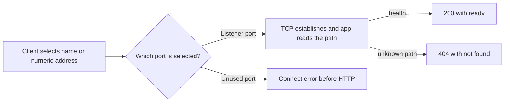

# Networking Fundamentals — Exercises and Solutions

## How to Use This Document

Work through Part A before opening Part B. For a reading exercise, write down the source, destination, and stage of the exchange. For a terminal exercise, predict the outcome, run the check, and keep the result from that exact attempt. Use the [theory chapters](Networking_Theory.md) when you need a command or a mental model. Part B uses the same exercise order.

<a id="practice-environment"></a>

## Practice Environment

Use **Windows PowerShell** or **Ubuntu Bash in WSL2**. Pick one OS for both the client and server in each runnable lab unless the exercise specifically discusses both environments. If Ubuntu is unavailable, the Windows commands and provided Linux output examples let you complete the workbook. Commands marked `powershell` call Windows tools. Commands marked `bash` call Linux tools, except where shared Java commands are explicitly identified.

Create a new working directory for the lab files. This **Ubuntu Bash** snippet builds a parent and prints a fresh child directory. Enter the printed path with `cd` in quotes.

```bash
mkdir -p -- "$HOME/networking-learning-lab"
mktemp -d -- "$HOME/networking-learning-lab/net.XXXXXX"
```

This is the **Windows PowerShell** equivalent. Use `Set-Location` with the printed path in quotes.

```powershell
$netLabParent = Join-Path $env:LOCALAPPDATA 'networking-learning-lab'
New-Item -ItemType Directory -Path $netLabParent -Force | Out-Null
$netLab = New-Item -ItemType Directory -Path (Join-Path $netLabParent ([guid]::NewGuid().ToString('N')))
$netLab.FullName
```

- **HTTP fixture.** Copy `HttpLab.java` from the theory, compile it with Java 21, and start it as described there. The default exercises use `127.0.0.1:18080`. A basic static exercise may use Python if it is already installed. The Java fixture provides `/health`, `/go`, `/slow`, and controlled `404` responses. [HTTP fixture and launch commands](Networking_Theory.md#http-lab)
- **TCP fixture.** Copy and compile `LineServer.java` and `LineClient.java`. Run these as two processes in the same OS, normally at `127.0.0.1:19090`. This server accepts only one connection, so use the accompanying client for the actual exchange. [TCP fixture and launch commands](Networking_Theory.md#tcp-lab)
- **Client tab.** Keep the server visible in a separate terminal. Use `curl` on Ubuntu and `curl.exe` on Windows. Use the direct loopback option shown in the theory so a configured proxy cannot change the experiment. [Diagnostic commands](Networking_Theory.md#net-14)

## Safety and Reproducibility

- Use the supplied loopback fixtures and a normal user account. Check that the intended ports are unused before starting or testing them. The examples use `18081` or `19091` for an intentionally closed TCP port. If a port is occupied, use a different verified unused port throughout that exercise and leave the other process alone.
- Use mock outputs for remote routing, certificate, and cross-network problems. Address and DNS outputs can contain private details. Keep actual machine-specific values local and redact them if you share results.
- The workbook requires no router, firewall, hosts-file, DNS record, or TLS trust-store changes. Real network changes require authorization. Packet capture is optional background material in the theory.
- Stop a running lab in its own terminal with **Ctrl+C**. The one-connection TCP lab normally exits on its own after the exchange. Keep lab files for review or remove just the verified practice folder when finished.

<a id="exercises"></a>

# Part A — Exercises

## Level 1 — Networking Foundations

### NET-EX-01 — Identify an interface and its addresses

**Difficulty** · Level 1  
**Related theory** · [Part 1 — Interfaces](Networking_Theory.md#net-01), [Part 3 — IP addresses](Networking_Theory.md#net-03), [Part 14 — Diagnostics](Networking_Theory.md#net-14)

**Learning objective**  
Read the interface, address, address family, and prefix as separate fields.

**Scenario**  
You need to identify loopback and a possible LAN or virtual adapter before diagnosing a local service.

**Prerequisites**  
Ubuntu Bash or Windows PowerShell. Use the representative output in Part 3 for a missing environment.

**Task**

1. List local interfaces and their addresses with one of the supported tools.
2. Identify an IPv4 loopback line and, if present, an IPv6 loopback result.
3. Pick one non-loopback address and record its interface, family, and prefix length. If none is assigned, report that fact.

**Expected result**  
You can point to the loopback interface and distinguish it from an adapter with a private, public, or virtual network address.

**Self-check**  
Can one interface have both IPv4 and IPv6 addresses? Does a hostname alone tell you which interface a route will use?

**Cleanup**  
None. The inspection is read-only.

### NET-EX-02 — Classify localhost, wildcard, and network addresses

**Difficulty** · Level 1  
**Related theory** · [Part 3 — Address scope and binding](Networking_Theory.md#net-03)

**Learning objective**  
Determine which values are names, concrete destinations, and bind selectors.

**Scenario**  
A service handoff includes `localhost`, `127.0.0.1`, `::1`, `0.0.0.0`, `172.20.8.9`, `198.51.100.20`, and an address the provider specifically assigned for global routing.

**Prerequisites**  
The listed values. No probes are needed.

**Task**

1. Classify each value by its role or scope.
2. Explain which values you can use for a client running in the same network stack.
3. Explain what address information an authorized client on another machine needs when the server says it is bound to `0.0.0.0`.

**Expected result**  
Your explanation distinguishes loopback, wildcard bind, private scope, documentation scope, and the provider-assigned public endpoint.

**Self-check**  
Can `localhost` resolve to more than one address? Does a public IP guarantee that an HTTP server can answer?

**Cleanup**  
None.

### NET-EX-03 — Find the boundaries of a /27 subnet

**Difficulty** · Level 1  
**Related theory** · [Part 4 — IPv4 masks and CIDR](Networking_Theory.md#net-04)

**Learning objective**  
Use binary masking to calculate a network and its usable address range.

**Scenario**  
An interface has `192.168.50.84/27`. You need to tell whether two other interfaces are in that range.

**Prerequisites**  
Paper or a text editor.

**Task**

1. Derive the mask and write the last octet of both the address and mask in binary.
2. Calculate the network, broadcast, and usable address range with the conventional rules.
3. Apply the same mask to `192.168.50.70` and `192.168.50.96` and compare the prefixes.

**Expected result**  
Your answer shows the bits used, the range boundaries, and a reason for each same-subnet decision.

**Self-check**  
What changes when all host bits are set to `1`? Why is comparing three octets insufficient here?

**Cleanup**  
None.

### NET-EX-04 — Mask a third octet and handle special prefixes

**Difficulty** · Level 1  
**Related theory** · [Part 4 — Non-octet prefixes and special cases](Networking_Theory.md#net-04)

**Learning objective**  
Apply prefix reasoning when the boundary crosses an octet and recognize single-host and point-to-point cases.

**Scenario**  
A lab records `172.21.53.9/20`, a point-to-point prefix `192.0.2.10/31`, a host route `192.0.2.15/32`, and IPv6 `2001:db8:5:4::1/64`.

**Prerequisites**  
The given values. The addresses are worksheet data.

**Task**

1. Derive the `/20` mask, network, broadcast, and conventional usable host count.
2. Compare `172.21.62.240` and `172.21.64.2` with the `/20` prefix.
3. List the `/31` point-to-point addresses, explain what the `/32` represents, and write the IPv6 prefix.

**Expected result**  
You account for all 12 host bits in the `/20` and explain how each other prefix is interpreted.

**Self-check**  
Why would applying the ordinary subtract-two rule to the point-to-point link give the wrong conclusion?

**Cleanup**  
None.

### NET-EX-05 — Trace a next hop and a NAT reply

**Difficulty** · Level 1  
**Related theory** · [Part 5 — Layer 2 and Layer 3 delivery](Networking_Theory.md#net-05), [Part 6 — Routing and NAT](Networking_Theory.md#net-06)

**Learning objective**  
Choose a route, identify the local link receiver, and track an address translation.

**Scenario**  
A worksheet describes a laptop at `192.168.50.10` with this table.

| Prefix | Delivery |
| --- | --- |
| `192.168.50.0/24` | Local Ethernet |
| `198.51.100.20/32` | Via `192.168.50.253` |
| `198.51.100.0/24` | Via `192.168.50.254` |
| `0.0.0.0/0` | Via `192.168.50.1` |

**Prerequisites**  
Use the table as data. The default router maps a connection's source `192.168.50.10:53124` to `203.0.113.9:41002`.

**Task**

1. Select a route for `192.168.50.18`, `198.51.100.20`, `198.51.100.60`, and `203.0.113.5`.
2. Identify whose MAC address the laptop needs in each case. State which IP goes in the packet destination field.
3. For a connection to `203.0.113.5:443`, write the endpoints seen by the web server and the destination after reverse translation of the reply.

**Expected result**  
Each next hop follows from the most specific match. You keep the local frame receiver and remote IP destination distinct and reverse the given mapping.

**Self-check**  
Why does the laptop ask ARP for a router's MAC for remote traffic? Which additional mechanism decides whether translated traffic is permitted?

**Cleanup**  
None. No route or NAT changes are made.

### NET-EX-06 — Read listening and established endpoints

**Difficulty** · Level 1  
**Related theory** · [Part 7 — Sockets and ports](Networking_Theory.md#net-07)

**Learning objective**  
Explain which endpoint fields distinguish simultaneous TCP connections.

**Scenario**  
A TCP web server listens on `192.168.1.20:8080`. Clients `192.168.1.10:53124` and `192.168.1.11:53124` both connect.

**Prerequisites**  
The addresses above.

**Task**

1. Write the local and remote endpoints as seen by the server for both connections.
2. Label the source and destination ports as seen in a reply to the second client.
3. Explain what changes if the first client opens a second simultaneous connection to the same server.

**Expected result**  
You identify one listener and distinct established sockets without requiring extra server ports.

**Self-check**  
Who usually chooses the temporary client port? Can a UDP socket use the same numeric server port independently?

**Cleanup**  
None.

### NET-EX-07 — Choose a transport and explain message boundaries

**Difficulty** · Level 1  
**Related theory** · [Part 8 — TCP reliability](Networking_Theory.md#net-08), [Part 9 — UDP and QUIC](Networking_Theory.md#net-09)

**Learning objective**  
Use reliability, ordering, and timing requirements to explain transport choices.

**Scenario**  
A product transfers files and also transmits live audio. A teammate expects one TCP read for each write and says DNS must use UDP.

**Prerequisites**  
The TCP and UDP comparison chapter.

**Task**

1. Choose a plausible transport strategy for each service and explain how it handles missing data.
2. Sketch two valid read patterns for TCP writes of `AB` and `CD`. Compare that with two UDP sends.
3. Explain how conventional DNS might use more than one transport and where HTTP/3 fits.

**Expected result**  
You describe stream ordering and datagram boundaries separately, and justify your decisions by the application requirements.

**Self-check**  
What does an acknowledgement of five TCP bytes establish? Who still decides whether a whole file was accepted?

**Cleanup**  
None.

### NET-EX-08 — Interpret a URL before sending it

**Difficulty** · Level 1  
**Related theory** · [Part 11 — HTTP URL components](Networking_Theory.md#net-11), [Part 12 — HTTPS](Networking_Theory.md#net-12)

**Learning objective**  
Separate naming, transport selection, and the HTTP request target.

**Scenario**  
An example client is given `https://api.course.example:8443/v1/items?limit=3#row`.

**Prerequisites**  
Read the URL as text. The host is fictional.

**Task**

1. Label all six URL components.
2. Write the hostname to resolve, connection port, and direct HTTP request target.
3. Describe what must be checked before sending HTTP over a new HTTPS connection.

**Expected result**  
You explain the role of the explicit port and which URL portion is only for the client.

**Self-check**  
Which port would HTTPS normally use if the explicit port were absent? Does the path change the endpoint port?

**Cleanup**  
None.

### NET-EX-09 — Read DNS records and cache lifetime

**Difficulty** · Level 1  
**Related theory** · [Part 10 — DNS records, TTL, and failures](Networking_Theory.md#net-10)

**Learning objective**  
Trace an alias and interpret a record type and answer status.

**Scenario**  
You have this fictional successful record set, followed by a separate `NXDOMAIN` report for `wrong.course.example.`.

```text
www.course.example.  60   IN  CNAME  api.course.example.
api.course.example.  120  IN  A      192.0.2.20
api.course.example.  120  IN  AAAA   2001:db8::20
course.example.      900  IN  MX     10 mail.course.example.
course.example.      900  IN  NS     ns1.course.example.
```

**Prerequisites**  
The supplied record set. No network access is needed.

**Task**

1. Follow `www` to the possible IPv4 and IPv6 destinations.
2. Identify which rows describe mail handling and authority, and read one TTL.
3. Contrast `NXDOMAIN` with an existing name that has no record of a requested type.

**Expected result**  
You can select candidate addresses without confusing the mail or name server records with them.

**Self-check**  
Could two clients see different answers while a change propagates through caches? What does a DNS answer establish about TCP reachability?

**Cleanup**  
None.

## Level 2 — Applied Networking

### NET-EX-10 — Inspect the route without sending a probe

**Difficulty** · Level 2  
**Related theory** · [Part 6 — Route selection](Networking_Theory.md#net-06), [Part 14 — Route tools](Networking_Theory.md#net-14)

**Learning objective**  
Read the outgoing interface, next hop, and source selection from local state.

**Scenario**  
You are comparing the route tables Windows and Ubuntu use before any traffic is sent.

**Prerequisites**  
Use one or both shells. In a Windows-only session use this representative Ubuntu result for the route lookup.

```text
198.51.100.20 via 192.168.1.1 dev eth0 src 192.168.1.10
```

**Task**

1. Inspect the default routes from your current shell.
2. With Ubuntu available, ask the kernel how it would route `198.51.100.20` without probing the destination. Otherwise, read the given output.
3. Record which field identifies the gateway and which identifies the selected source.
4. Explain why the host and guest can show different results.

**Expected result**  
You can identify a next hop and outgoing interface or explain an absent route. You can account for the selected source in the sample.

**Self-check**  
Does a route decision prove the destination can reply? Why would a connected route often have no `via` field?

**Cleanup**  
None. All operations read local state.

### NET-EX-11 — Start and verify a loopback HTTP listener

**Difficulty** · Level 2  
**Related theory** · [Part 7 — Binding](Networking_Theory.md#net-07), [Part 14 — Sockets and curl](Networking_Theory.md#net-14), [Part 15 — HTTP fixture](Networking_Theory.md#http-lab)

**Learning objective**  
Tie a listening socket to an HTTP response from a known application.

**Scenario**  
Before investigating a backend, you want a known-good local HTTP request.

**Prerequisites**  
The Java HTTP fixture and two tabs in one OS. The optional Python static server can serve `/ready.txt` instead of `/health`.

**Task**

1. Check the lab port, then start the fixture bound to IPv4 loopback.
2. Find the listener by its exact port and check the local address.
3. From the client tab, request the health resource and show the HTTP status, headers, and body.

**Expected result**  
The socket inspection points to IPv4 loopback on your lab port. The HTTP check returns `200` and `ready`.

**Self-check**  
What does the listening row establish? What additional evidence does the HTTP response supply?

**Cleanup**  
Stop the fixture with Ctrl+C in its server tab.

### NET-EX-12 — Inspect a redirect and its final response

**Difficulty** · Level 2  
**Related theory** · [Part 11 — Headers, redirects and content types](Networking_Theory.md#net-11), [Part 14 — curl flags](Networking_Theory.md#net-14)

**Learning objective**  
Read HTTP headers and distinguish a redirect from its follow-up response.

**Scenario**  
A client gets a response for `/go` and you need to explain how it eventually receives the health result.

**Prerequisites**  
The running Java HTTP fixture. Use either shell.

**Task**

1. Request `/go` and print the first response headers without following the redirect.
2. Repeat with redirects enabled and inspect both response header sections.
3. Record the first status and location and the final status, media type, and body.

**Expected result**  
The initial request returns `302` with a path in `Location`. Following it returns a second response with `200` and the health text.

**Self-check**  
What is the difference between `Accept` and `Content-Type`? Why use a GET with displayed headers for this fixture?

**Cleanup**  
Stop the lab server when finished.

### NET-EX-13 — Observe both sides of an established connection

**Difficulty** · Level 2  
**Related theory** · [Part 7 — Connected sockets](Networking_Theory.md#net-07), [Part 8 — TCP states](Networking_Theory.md#net-08), [Part 14 — Established socket tools](Networking_Theory.md#net-14)

**Learning objective**  
Match a client's temporary port to a server socket while a request is live.

**Scenario**  
A delayed request appears idle in the client. You want to verify that TCP is already established.

**Prerequisites**  
The running Java HTTP fixture and its `/slow` route. In Windows, prepare another tab for the connection inspection.

**Task**

1. Start a request to `/slow` with enough total time for the fixture's delay.
2. While the request is pending, inspect established rows whose local or peer port matches the lab.
3. Identify the temporary port and how the endpoints appear from the client and server sides.

**Expected result**  
At least one established row appears during the request. The server end uses the lab port, and the client uses a temporary port. The request eventually prints `slow response`.

**Self-check**  
Why might the rows disappear before you inspect a normal `/health` request? What do established rows establish about HTTP success?

**Cleanup**  
Allow the request to finish and stop the lab server.

### NET-EX-14 — Compare system resolution and a DNS answer

**Difficulty** · Level 2  
**Related theory** · [Part 10 — System resolution and DNS](Networking_Theory.md#net-10), [Part 14 — Lookup tools](Networking_Theory.md#net-14), [Part 15 — Java lookup](Networking_Theory.md#net-15)

**Learning objective**  
Read a local hostname result and distinguish it from direct DNS evidence.

**Scenario**  
You want to know why Java can resolve localhost without a successful Internet connection.

**Prerequisites**  
One supported shell. The direct DNS query is optional. Use the representative record in Part 10 if a DNS resolver is unavailable. Java's `LookupLocal` example is optional.

**Task**

1. Ask the system to resolve `localhost` and label the address family returned.
2. Inspect a DNS response for its status, record type, address, and TTL. Use the supplied sample or the authorized optional public example from the theory.
3. Explain why the first result may come from local configuration.

**Expected result**  
You can record a loopback candidate and identify which evidence came from a resolver response.

**Self-check**  
Why might two lookup tools or a JVM show different name results? Can a TTL tell you whether the endpoint is listening?

**Cleanup**  
None. If you ran the Java example it exits by itself.

### NET-EX-15 — Exchange a line on a Java TCP connection

**Difficulty** · Level 2  
**Related theory** · [Part 7 — Endpoints](Networking_Theory.md#net-07), [Part 8 — Stream framing](Networking_Theory.md#net-08), [Part 15 — Java TCP lab](Networking_Theory.md#tcp-lab)

**Learning objective**  
Use two local processes to observe a listening socket, client endpoint, and application message.

**Scenario**  
You want to see what a server and client know about a connection before adding HTTP.

**Prerequisites**  
Java 21, the two TCP fixture source files, a free port, and separate tabs in the same OS.

**Task**

1. Compile and start the server. Record its listening endpoint.
2. Run the matching client. Compare the client prints with the peer endpoint the server sees.
3. Identify the application message framing and the expected reply.

**Expected result**  
The client prints `ACK hello network`. Its local endpoint matches the server's printed peer and the server exits after the exchange.

**Self-check**  
Why does the server need `accept()` as well as a bound listener? What could happen if the client wrote the text without a newline or a flush?

**Cleanup**  
The server normally exits on its own. If waiting for a client, stop it with Ctrl+C.

### NET-EX-16 — Read Java HTTP responses for two paths

**Difficulty** · Level 2  
**Related theory** · [Part 11 — HTTP responses](Networking_Theory.md#net-11), [Part 15 — Java HTTP client](Networking_Theory.md#net-15)

**Learning objective**  
Recognize HTTP error responses as completed application-protocol exchanges.

**Scenario**  
A developer expects Java's HTTP client to throw an exception for every unsuccessful HTTP status.

**Prerequisites**  
Running Java HTTP fixture, JDK 21, and `LabHttpClient.java` from Part 15.

**Task**

1. Compile the client and call the health path.
2. Run it for an unknown path on the same server.
3. Compare the response status and body and explain which calls succeeded at the transport level.

**Expected result**  
Both runs print an HTTP status and body. One reports `200` and the other `404`.

**Self-check**  
How does an HTTP `404` differ from a connection refusal in Java? Which component interprets the HTTP route?

**Cleanup**  
Stop the fixture with Ctrl+C.

### NET-EX-17 — Choose an ICMP, TCP, or HTTP check

**Difficulty** · Level 2  
**Related theory** · [Part 7 — TCP endpoints](Networking_Theory.md#net-07), [Part 14 — Windows and Ubuntu tools](Networking_Theory.md#net-14)

**Learning objective**  
Explain which layer each successful or failed diagnostic actually tested.

**Scenario**  
Someone says that a ping response proves a local API is healthy.

**Prerequisites**  
A running Java HTTP fixture. Use the commands for its OS. When you have only one OS, compare the other shell's recipe after attempting yours.

**Task**

1. Probe IPv4 loopback with a bounded ping.
2. Establish evidence for TCP either with Windows's TCP probe or the connect phase in a verbose HTTP client trace.
3. Request an unknown HTTP path on the same endpoint and interpret the final status.

**Expected result**  
You separate the ICMP observation, the TCP outcome, and the `404` response. A missing ICMP response by itself leaves the other checks necessary.

**Self-check**  
Does the Windows TCP probe check the URL path? Can a host return `404` even when its firewall permits the connection?

**Cleanup**  
End the fixture in its own terminal.

### NET-EX-18 — Try a fictional hostname with a one-command address mapping

**Difficulty** · Level 2  
**Related theory** · [Part 10 — Naming versus connecting](Networking_Theory.md#net-10), [Part 11 — HTTP host and path](Networking_Theory.md#net-11), [Part 14 — curl address mapping](Networking_Theory.md#net-14)

**Learning objective**  
Keep a URL hostname while explicitly selecting the local address for one request.

**Scenario**  
You want to use `review.course.invalid` as an HTTP name for a local experiment without editing any system files.

**Prerequisites**  
The Java HTTP fixture on IPv4 loopback and curl in the same OS. The name is fictional.

**Task**

1. Request the `/health` URL with the fictional name and a request-local address mapping to the loopback listener.
2. Show which address the client connected to and the HTTP authority sent.
3. Compare the response with a direct numeric-address request.

**Expected result**  
Both requests reach the local service. The named request connects to loopback and sends the fictional name and lab port in the HTTP `Host` header.

**Self-check**  
Does this change what another process resolves? If the URL used HTTPS, which name would certificate verification use?

**Cleanup**  
Stop the fixture. The temporary mapping ends with the curl command.

## Level 3 — Troubleshooting

### NET-EX-19 — Find a wrong port on a running server

**Difficulty** · Level 3  
**Related theory** · [Part 7 — Listening sockets](Networking_Theory.md#net-07), [Part 18 — Refusal and wrong ports](Networking_Theory.md#net-18)

**Learning objective**  
Diagnose a refusal by comparing the requested endpoint with the actual listener.

**Scenario**  
The server terminal says the lab started, but the client attempted `http://127.0.0.1:18081/health` and could not connect.

**Prerequisites**  
The running Java HTTP fixture. Verify that `18081` is unused, or choose a different unused port for the bad attempt. Keep any pre-existing listeners intact.

**Task**

1. Reproduce the wrong-port call with a short time limit and capture the client outcome.
2. Check the listening rows for both ports.
3. Use that evidence to correct the URL and request the same path again.

**Expected result**  
The bad attempt normally reports refusal and no HTTP response. The listener explains the difference, and the corrected request returns `200`.

**Self-check**  
Why can there be a running server and a refused connection at the same time? Does the server handle the path in the failed attempt?

**Cleanup**  
Stop the lab and keep the diagnostic outputs for comparison if useful.

### NET-EX-20 — Diagnose an unexpected bind address

**Difficulty** · Level 3  
**Related theory** · [Part 3 — Loopback and address families](Networking_Theory.md#net-03), [Part 7 — Binding](Networking_Theory.md#net-07), [Part 18 — Loopback and family](Networking_Theory.md#net-18)

**Learning objective**  
Recognize why a service which works on one loopback address can fail on the other.

**Scenario**  
A colleague uses `http://[::1]:18080/health` and gets no HTTP response. The fixture is running with IPv4 loopback selected.

**Prerequisites**  
The Java HTTP fixture. Before trying IPv6, verify the port has no unrelated listener on that family. If IPv6 is disabled, use the listener and trace reasoning to explain the supplied failure.

**Task**

1. Inspect the exact local address and port of the service.
2. Compare the IPv6 and IPv4 URLs at that port using short client deadlines.
3. Restore a working client URL without broadening the server bind.

**Expected result**  
The intended lab responds over IPv4. The IPv6 attempt fails to connect when there is no IPv6 listener, or reports that the family is unavailable.

**Self-check**  
Why do brackets appear in the IPv6 URL? Would a firewall allow rule make this experiment's IPv4 socket accept an IPv6 loopback connection?

**Cleanup**  
Stop the fixture with Ctrl+C.

### NET-EX-21 — Separate a route error from a connectivity error

**Difficulty** · Level 3  
**Related theory** · [Part 11 — Status and methods](Networking_Theory.md#net-11), [Part 18 — HTTP 404](Networking_Theory.md#net-18)

**Learning objective**  
Prove that a failed HTTP operation can still have a successful transport underneath.

**Scenario**  
A monitor calls `/healthz` and reports that the service is unreachable.

**Prerequisites**  
The running Java HTTP fixture.

**Task**

1. Send a GET to the reported path and capture status, headers, and body.
2. Keep the same address and port and check the known health route.
3. Explain the smallest correction and which layers already worked.

**Expected result**  
One request returns `404` and the other `200` on the same endpoint. Your diagnosis explains why both reached an HTTP server.

**Self-check**  
Does curl's default process exit status identify every HTTP error? What would you expect to see if TCP itself could not establish a connection?

**Cleanup**  
Stop the fixture.

### NET-EX-22 — Compare failed name lookup with a resolved name on a closed port

**Difficulty** · Level 3  
**Related theory** · [Part 10 — DNS failures](Networking_Theory.md#net-10), [Part 14 — Diagnostics](Networking_Theory.md#net-14), [Part 18 — DNS and connectivity](Networking_Theory.md#net-18)

**Learning objective**  
Point to the observation that a client passed or failed name resolution.

**Scenario**  
Attempt A has this supplied evidence for a fictional name. Attempt B uses `localhost` and an unused TCP port.

```text
DNS status: NXDOMAIN for wrong.course.invalid.
curl: (6) Could not resolve host: wrong.course.invalid
```

**Prerequisites**  
One shell, curl, and an unused local port such as `18081`. Use the supplied evidence for A. Test B only if the IPv4 system lookup returns a loopback candidate and no non-loopback destinations.

**Task**

1. Identify why A could not start a connection.
2. Show a local IPv4 lookup for B and its first attempted endpoint in the client trace. If live testing is unavailable, explain the expected trace.
3. Compare the first failure in A with the one in B.

**Expected result**  
You can distinguish lookup failure from successful local resolution followed by inability to connect.

**Self-check**  
Which observation shows TCP was attempted in B? Would repeating the DNS lookup open the closed port?

**Cleanup**  
None. No server or DNS record is created.

### NET-EX-23 — Reason about a TCP connect timeout from evidence

**Difficulty** · Level 3  
**Related theory** · [Part 6 — Routes](Networking_Theory.md#net-06), [Part 8 — TCP connection failures](Networking_Theory.md#net-08), [Part 13 — Filtering](Networking_Theory.md#net-13), [Part 18 — Troubleshooting](Networking_Theory.md#net-18)

**Learning objective**  
Distinguish explicit rejection from a connect deadline without guessing which device dropped traffic.

**Scenario**  
A support ticket contains two illustrative client traces. Both are supplied data.

```text
A: Trying 127.0.0.1:18081
   Failed to connect: Connection refused
B: Trying 198.51.100.20:443
   Timed out while connecting
```

**Prerequisites**  
Use the traces as written. No remote probe is needed.

**Task**

1. Classify the failure stage in each trace.
2. List the first two checks for each case, including a local route observation for B from the caller's environment.
3. Explain why the timeout alone does not justify changing a firewall or retrying an application request.

**Expected result**  
You can give independent hypotheses and say what evidence would distinguish them.

**Self-check**  
Did either trace show an HTTP error status? Why is a firewall only one possible cause of B?

**Cleanup**  
None.

### NET-EX-24 — Diagnose a timeout after connection

**Difficulty** · Level 3  
**Related theory** · [Part 8 — Connection timing](Networking_Theory.md#net-08), [Part 14 — Verbose curl](Networking_Theory.md#net-14), [Part 15 — Timeouts and the delayed route](Networking_Theory.md#http-lab)

**Learning objective**  
Locate a deadline after TCP completes and validate a controlled correction.

**Scenario**  
A client says the network is down because a request to `/slow` timed out. The fixture intentionally delays the response.

**Prerequisites**  
The Java HTTP fixture and curl. Keep the server tab visible.

**Task**

1. Run the request with both a connection limit and a total deadline shorter than the fixture delay, showing the connection trace.
2. Identify the last stage confirmed by the trace and capture the exit code.
3. Allow the first handler to finish, then retry this read-only request with enough total time to obtain a response.

**Expected result**  
The first call shows a successful connection and a timeout without response headers. The second returns `200` and `slow response`.

**Self-check**  
Why is increasing only the connect timeout insufficient for this example? Why might a similar retry be unsafe for a state-changing request?

**Cleanup**  
Allow outstanding lab work to finish or stop the server in its own tab.

### NET-EX-25 — Diagnose a simulated database endpoint

**Difficulty** · Level 3  
**Related theory** · [Part 7 — Port selection](Networking_Theory.md#net-07), [Part 15 — TCP lab and JDBC](Networking_Theory.md#net-15), [Part 16 — Database flow](Networking_Theory.md#net-16)

**Learning objective**  
Separate a wrong database destination from a database login or SQL error.

**Scenario**  
The worksheet says `jdbc:postgresql://127.0.0.1:19091/labdb`. Use the Java line server as a mock endpoint expected to listen at `19090`. It speaks the course's line protocol.

**Prerequisites**  
Two Java TCP lab files and two tabs in one OS. Verify that the intentionally wrong port is unused. The exercise has no real database or credentials.

**Task**

1. Start the mock listener. Compare its printed endpoint with the worksheet.
2. Use the line client to reproduce connecting to the wrong port, then use the verified port.
3. Correct the worksheet endpoint and explain what a real PostgreSQL `password authentication failed` message would establish beyond TCP.

**Expected result**  
The wrong port has no matching mock listener. The correct one produces an ACK. You can place an authentication error and an SQL error later in the real database exchange.

**Self-check**  
Why check from the backend's environment in a real incident? Does receiving the mock ACK prove a PostgreSQL login succeeded?

**Cleanup**  
The mock exits after accepting one client. Use Ctrl+C if it is still waiting.

### NET-EX-26 — Read a TLS verification failure

**Difficulty** · Level 3  
**Related theory** · [Part 12 — Certificates and TLS](Networking_Theory.md#net-12), [Part 18 — TLS troubleshooting](Networking_Theory.md#net-18)

**Learning objective**  
Tell hostname verification and issuer trust failures apart.

**Scenario**  
A support case has two redacted test records. They show a connected transport and a failed TLS verification step.

```text
A: URL https://api.course.example/health
   Peer certificate SAN contains web.course.example
   Verification failed: hostname mismatch
B: URL https://api.course.example/health
   Verification failed: unable to get local issuer certificate
```

**Prerequisites**  
The supplied records only. No live HTTPS configuration is required.

**Task**

1. Diagnose the specific checks indicated by A and B.
2. Decide which information the service owner should verify next, including which endpoint terminates TLS.
3. Explain why application credentials would not fix either failure.

**Expected result**  
You describe a correct-name check and a chain-to-trust check as separate requirements. Your corrections preserve verification.

**Self-check**  
When could a wrong clock cause a certificate error? How does HTTP `401` differ from these failures?

**Cleanup**  
None.

### NET-EX-27 — Locate localhost in a WSL2 handoff

**Difficulty** · Level 3  
**Related theory** · [Part 3 — Loopback](Networking_Theory.md#net-03), [Part 17 — WSL2 modes](Networking_Theory.md#net-17), [Part 18 — Cross-environment checks](Networking_Theory.md#net-18)

**Learning objective**  
Explain a difference between Windows and Ubuntu using the caller's networking environment.

**Scenario**  
A Windows Java server answers locally. An Ubuntu client on WSL2 in default NAT mode has the evidence below. These are representative observations.

```text
Windows listener: 127.0.0.1:18080  Listen
Windows request to 127.0.0.1:18080/health: HTTP 200
Ubuntu socket list: no listener at port 18080
Ubuntu request to 127.0.0.1:18080/health: connection refused
Ubuntu IPv4 default route: via 172.24.0.1 dev eth0
```

**Prerequisites**  
Use the supplied case. If you have Ubuntu on WSL2, you can optionally inspect your own environment with read-only commands.

**Task**

1. Identify the listener's stack and which stack each localhost request reaches.
2. Explain why using the Windows-side gateway address does not automatically fix a loopback-only Windows listener.
3. Decide how to obtain a known-working local test, and describe how mirrored mode might change a later test.

**Expected result**  
You can explain the observations without changing the lab bind or the firewall. You test a same-environment baseline before drawing conclusions about forwarding.

**Self-check**  
Can Windows and WSL2 show different listener tables? Why should you state the direction of a cross-boundary test?

**Cleanup**  
None for the supplied case. Stop any fixture you started for the optional check.

## Final Integrated Mini Challenge — Trace a healthy request and two failures

**Difficulty** · Level 3  
**Related theory** · [Part 7 — Endpoints](Networking_Theory.md#net-07), [Part 11 — HTTP status](Networking_Theory.md#net-11), [Part 14 — Diagnostic commands](Networking_Theory.md#net-14), [Part 15 — HTTP fixture](Networking_Theory.md#http-lab), [Part 18 — Troubleshooting](Networking_Theory.md#net-18)

**Learning objective**  
Produce a short handoff that proves how far four local requests progressed.

**Scenario**  
A teammate needs evidence that a local backend can receive HTTP, including a case where the network works and the route fails, and one where connection never completes.

**Prerequisites**  
Java 21, curl, the Java HTTP fixture, and two tabs in the same OS. Choose a loopback lab port and a different verified unused port. Use the fictional name `api-lab.invalid` for one command.

**Task**

1. Start and identify your listener by address, protocol, and port.
2. Request the healthy resource using the numeric IPv4 endpoint and then with a one-command mapping of `api-lab.invalid`.
3. Request an unknown path on the correct endpoint. Then attempt the health path on the verified unused port.
4. Record the attempted endpoint, connection observation, HTTP status or client error, and conclusion for each request.

**Expected result**  
You have evidence of two `200` responses, a `404` response, and a connection failure before HTTP. You can explain which changes affected naming, endpoint selection, and application routing.

**Self-check**  
Why can the `404` and `200` responses use the same listener? What result would a TCP-only test miss?

**Cleanup**  
Stop the lab with Ctrl+C and keep only the disposable notes you want to review.

<a id="solutions"></a>

# Part B — Complete Solutions

Run the recipe for your chosen shell. The HTTP and TCP fixture source and startup commands are part of the theory. The recipes refer to those shared examples so the same code serves every exercise. Use your verified port if you changed it. Treat output as representative unless the solution describes a deterministic property of the supplied fixture.

## Solution — NET-EX-01

**Ubuntu Bash**

```bash
ip -br addr
ip addr show dev lo
```

**Windows PowerShell**

```powershell
ipconfig
Get-NetIPAddress | Format-Table InterfaceAlias, AddressFamily, IPAddress, PrefixLength
```

`-br` condenses the Linux listing to one row per interface. The detailed loopback listing commonly has `127.0.0.1/8` and `::1/128` on `lo`. In PowerShell, filter your attention to the `IPAddress` and `PrefixLength` columns. Windows may show a loopback pseudo-interface and adapters with labels such as Wi-Fi or a virtual Ethernet adapter. An illustrative non-loopback row is `eth0 192.168.1.20/24`. That reports interface `eth0`, IPv4 address `192.168.1.20`, and prefix length `24`. A link marked up can still lack an assigned address.

**Self-check.** One interface can have addresses in both families and several addresses in one family. A hostname supplies candidates after resolution. The routing table and chosen candidate determine the route and interface.

## Solution — NET-EX-02

| Given value | Classification and use |
| --- | --- |
| `localhost` | Special hostname that generally resolves to local loopback addresses. |
| `127.0.0.1` | Specific IPv4 loopback destination within the caller's stack. |
| `::1` | Specific IPv6 loopback destination. Use brackets when a URL contains this literal. |
| `0.0.0.0` | IPv4 wildcard when a server binds. Select a concrete address for a client URL. |
| `172.20.8.9` | Private IPv4. It falls inside `172.16.0.0/12`. |
| `198.51.100.20` | Reserved documentation address. Use it as worksheet data. |
| Provider's globally routable assignment | Public endpoint address provided to the service. Actual reachability still depends on routes, filters, and the listener. |

A local client can choose `localhost` or the numeric loopback address that matches the listener. For an authorized client elsewhere, give a reachable concrete IP or a hostname that resolves to it, with the port and scheme. A wildcard bind can include the local address at that endpoint. Confirm routing and access separately.

**Self-check.** `localhost` can yield both IPv4 and IPv6 candidates. Public addressing makes global routing possible. Successful HTTP still requires a reachable and functioning endpoint.

## Solution — NET-EX-03

The first 24 bits fill three octets. To reach `/27`, set three more high bits in the last octet. That gives mask `255.255.255.224` and five host bits.

```text
84         01010100
224 mask   11100000
AND        01000000 = 64
Last       01011111 = 95
70 AND 224 01000000 = 64
96 AND 224 01100000 = 96
```

The network is `192.168.50.64` and broadcast is `192.168.50.95`. The usable range is `192.168.50.65` through `192.168.50.94`, or `2^5 - 2 = 30` addresses. `.70` shares the `.64/27` prefix and `.96` is the start of the next prefix. You can cross-check using a block size of `256 - 224 = 32`. The block containing `84` starts at the multiple of `32` immediately before it, `64`.

**Self-check.** All host bits set to `1` give the broadcast address in this conventional subnet. The first three octets are only 24 of the 27 needed prefix bits.

## Solution — NET-EX-04

The mask is `255.255.240.0`. For the third octet, `53` is `00110101`. AND with `11110000` gives `00110000`, or `48`. Setting the four low bits produces `00111111`, or `63`. The fourth octet is entirely host bits.

| Input | Result |
| --- | --- |
| `172.21.53.9/20` | Network `172.21.48.0`, broadcast `172.21.63.255`, and `2^12 - 2 = 4094` conventional hosts from `172.21.48.1` to `172.21.63.254`. |
| `172.21.62.240` | Matches the prefix because `62` is inside `48–63`. |
| `172.21.64.2` | In the next block, starting at `172.21.64.0`. |
| `192.0.2.10/31` | Point-to-point endpoints `192.0.2.10` and `192.0.2.11`. |
| `192.0.2.15/32` | A route for precisely one IPv4 address. |
| `2001:db8:5:4::1/64` | Prefix `2001:db8:5:4::/64`. The first four groups make 64 bits. |

A common calculation error is to adjust only the last octet. Here the third octet changes at each block boundary as well.

**Self-check.** The two addresses in a `/31` are used as endpoints on the specified point-to-point link, where the normal network and broadcast reservation convention does not apply.

## Solution — NET-EX-05

| Destination IP stays in the original packet | Winning route | Address whose MAC is needed locally |
| --- | --- | --- |
| `192.168.50.18` | Connected `/24` | `192.168.50.18` |
| `198.51.100.20` | Exact `/32` | `192.168.50.253` |
| `198.51.100.60` | `198.51.100.0/24` | `192.168.50.254` |
| `203.0.113.5` | Default `/0` | `192.168.50.1` |

A `/32` is more specific than the matching `/24`. For the default route case, the laptop initially sends from `192.168.50.10:53124` to `203.0.113.5:443`. The web server sees `203.0.113.9:41002 → 203.0.113.5:443` after translation. Its reply goes to `203.0.113.9:41002`. The router finds the mapping and delivers it internally to `192.168.50.10:53124`.

Do not substitute the gateway IP for the remote IP in the original packet. The gateway is the receiver of the local Ethernet frame and forwards the packet onward.

**Self-check.** ARP can supply the locally reachable next hop's MAC. The firewall's policy decides whether the flow is allowed separately from the address mapping.

## Solution — NET-EX-06

The listener has local endpoint `192.168.1.20:8080`. Connection A has server local `192.168.1.20:8080` and peer `192.168.1.10:53124`. Connection B has the same local endpoint and peer `192.168.1.11:53124`. A reply to B uses source port `8080` and destination port `53124`. Both tuples are distinct because the remote IPs differ.

A second simultaneous connection from A's same IP to the same server endpoint needs another source port, for example `53125`. The bound server socket continues accepting connections at `8080`. Avoid counting each established connection as a new listening port.

**Self-check.** The client OS normally chooses an ephemeral local port if the client does not bind one. UDP uses its own port namespace, so a UDP service can use numeric port `8080` independently.

## Solution — NET-EX-07

Use reliable transport for a file, for example TCP with a higher-level file protocol and an application integrity check. The file requires all bytes. A live audio app could use UDP with sequence and timing information, accepting an occasional gap to keep playout timely. A protocol above UDP can add selective recovery or buffering. Application requirements drive the choice.

TCP writes of `AB` then `CD` can be read as `ABCD` in one read or as `A`, then `BC`, then `D`. The delivered bytes remain ordered. Separate UDP sends of `AB` and `CD` retain their datagram boundaries when both are received with sufficient buffer space, but may arrive in either order. A message delimiter or length field belongs to the application when it uses TCP.

Conventional DNS can use both UDP and TCP. A truncated UDP response often prompts a TCP retry. HTTP/3 uses QUIC over UDP. QUIC supplies features such as reliable delivery within streams instead of expecting raw UDP to provide them.

**Self-check.** A TCP acknowledgement identifies the next contiguous byte position the receiver expects. The peer application checks whether the complete file was accepted, and can send a distinct application confirmation.

## Solution — NET-EX-08

| Component | Value |
| --- | --- |
| Scheme | `https` |
| Hostname | `api.course.example` |
| Port | `8443` |
| Path | `/v1/items` |
| Query | `limit=3` |
| Fragment | `row` |

Resolve `api.course.example`, then try a candidate address at `8443`. For a new HTTPS connection over TCP, establish transport and verify the TLS peer for `api.course.example` before relying on the protected connection. With HTTP/3, QUIC integrates the TLS handshake. A direct HTTP request uses `/v1/items?limit=3` as the request target in HTTP/1.1. The authority includes the explicit port, and the fragment is interpreted on the client side.

**Self-check.** The HTTPS default port is `443`. The path selects the application resource after the client chooses the endpoint from the scheme, host, and port.

## Solution — NET-EX-09

`www.course.example.` is a CNAME pointing to `api.course.example.`. Its address records give `192.0.2.20` for IPv4 and `2001:db8::20` for IPv6. The `MX` row designates `mail.course.example.` with preference `10` for mail. `NS` lists a server responsible for the zone. Follow the address records for the requested web hostname rather than using the mail host or name server.

In the supplied answer the alias's TTL is 60 seconds and each address TTL is 120 seconds. The TTL values apply to their respective records and readers may be seeing a remaining cache lifetime. `NXDOMAIN` means the resolver reports the name absent. A name can exist and still have no `AAAA` record, in which case a successful lookup can have no address of that type.

**Self-check.** Different cache states or resolver views can produce different answers. The answer gives candidate destinations and does not test TCP connectivity.

## Solution — NET-EX-10

**Ubuntu Bash**

```bash
ip route show default
ip route get 198.51.100.20
```

**Windows PowerShell**

```powershell
Get-NetRoute -DestinationPrefix '0.0.0.0/0' |
    Format-Table InterfaceAlias, NextHop, RouteMetric
```

`ip route get` asks for route selection without sending to `198.51.100.20`. In the sample, the next hop is `192.168.1.1` after `via`, the interface is `eth0` after `dev`, and the source is `192.168.1.10` after `src`. PowerShell lists Windows default route candidates by interface, next hop, and metric. If the machine is offline or has no matching route, record the absence. Windows and WSL2 can each make a decision using their own interfaces and route table.

Do not infer the exact outgoing interface for every destination from the first default line. Look for a more specific match and account for policy or competing routes where relevant.

**Self-check.** A route is a forwarding decision. It does not test the destination or return path. A connected route uses the destination itself as the next neighbor, so it may simply name the local interface.

## Solution — NET-EX-11

Check the port and, after starting the server, repeat the same command to see its listener. Run the form for your OS.

**Ubuntu Bash**

```bash
ss -ltn 'sport = :18080'
```

**Windows PowerShell**

```powershell
Get-NetTCPConnection -State Listen -LocalPort 18080 -ErrorAction SilentlyContinue |
    Format-Table LocalAddress, LocalPort, State, OwningProcess
```

If a matching listener is already present, choose a different lab port. In the directory with the [theory's HttpLab.java source](Networking_Theory.md#http-lab), run these commands in **either shell** and wait for the listening line.

```bash
javac --add-modules jdk.httpserver HttpLab.java
java --add-modules jdk.httpserver HttpLab 18080 127.0.0.1
```

In the other tab, inspect the listener and send a GET.

```bash
curl --noproxy '*' --max-time 3 -i http://127.0.0.1:18080/health
```

```powershell
curl.exe --noproxy '*' --max-time 3 -i http://127.0.0.1:18080/health
```

A typical TCP listening row has local endpoint `127.0.0.1:18080` and state `LISTEN` or `Listen`. An IPv4-mapped form can also describe that address. `-i` displays HTTP headers with the body. Expect status `200`, a content type beginning with `text/plain`, and `ready`. If you used the Python recipe for a served `ready.txt`, request `/ready.txt` instead. A bare `localhost` could try a different address family, so use the numeric destination to test this exact bind.

**Self-check.** The row confirms a local TCP listener. The response confirms that a client reached an HTTP endpoint and the requested path returned the known fixture body.

## Solution — NET-EX-12

**Ubuntu Bash**

```bash
curl --noproxy '*' --max-time 3 -i http://127.0.0.1:18080/go
curl --noproxy '*' --max-time 3 -i -L -H 'Accept: text/plain' http://127.0.0.1:18080/go
```

**Windows PowerShell**

```powershell
curl.exe --noproxy '*' --max-time 3 -i http://127.0.0.1:18080/go
curl.exe --noproxy '*' --max-time 3 -i -L -H 'Accept: text/plain' http://127.0.0.1:18080/go
```

The first command stops after `302` and prints `Location: /health`. With `-L` the client requests the destination. The header display includes `302` followed by `200`, with the final content type `text/plain; charset=utf-8` and body `ready`. Header names may appear in a different case. `-H` sends the specified request header. This fixture serves plain text for the successful GET regardless of that preference. A real service can select a representation accordingly. For a separate check, copy the `Location` path onto the same authority and request it directly.

**Self-check.** `Accept` describes what the client can consume and `Content-Type` describes what was sent. `-i` displays headers for the GET, while `-I` would send HEAD, which the fixture rejects with `405`.

## Solution — NET-EX-13

With the server running, paste this in an **Ubuntu Bash** client tab as a single block.

```bash
curl --noproxy '*' --max-time 8 http://127.0.0.1:18080/slow &
request_pid=$!
sleep 1
ss -tn state established '( sport = :18080 or dport = :18080 )'
wait "$request_pid"
```

`&` starts curl in the background. The one-second wait leaves time for connection setup before the roughly five-second handler completes. `sport` and `dport` match the local and peer port fields respectively. `wait` collects this curl process's status and keeps the tab from finishing before the response.

For **Windows PowerShell**, prepare the following in a separate observer tab and run it once before starting the request so the cmdlet is loaded. Run it again as soon as the client starts.

```powershell
Get-NetTCPConnection -State Established -ErrorAction SilentlyContinue |
    Where-Object { $_.LocalPort -eq 18080 -or $_.RemotePort -eq 18080 } |
    Format-Table LocalAddress, LocalPort, RemoteAddress, RemotePort, State
```

From the Windows client tab run this request.

```powershell
curl.exe --noproxy '*' --max-time 8 http://127.0.0.1:18080/slow
```

For one connection you may see local port `18080` with a temporary peer port, and another row with those ports reversed. Both endpoints are loopback. If you missed the window, let the request finish and repeat. `TIME-WAIT` after a request relates to closure. The live application's result is `slow response`.

**Self-check.** A fast health check may close before a snapshot. An established socket confirms transport state. The HTTP result still depends on message processing.

## Solution — NET-EX-14

**Ubuntu Bash**

```bash
getent hosts localhost
getent ahostsv4 localhost
```

**Windows PowerShell**

```powershell
Resolve-DnsName -Name localhost -Type A
```

Look for `::1` or `127.0.0.1` from the system lookup and `127.0.0.1` when requesting IPv4 on a normally configured machine. The Linux IPv4 tool may display the same address with several socket types. The local name can work through the hosts file and operating-system lookup rules.

For the separate DNS evidence, use the supplied response in [Part 10](Networking_Theory.md#net-10). It has status `NOERROR`, type `A`, address `192.0.2.20`, and remaining TTL `120` seconds. If you choose the optional configured resolver check, use the chapter's explicit DNS query commands. A successful lookup for a public example name need not have those sample values. The local output and the direct answer can represent different resolution paths. Java's `java LookupLocal.java` is another way to inspect what one client runtime can use.

**Self-check.** Tools may use different address families, local sources, DNS views, or caches. TTL governs cached name data. It gives no evidence that a TCP listener exists.

## Solution — NET-EX-15

Save both classes from [the Java TCP lab](Networking_Theory.md#tcp-lab). In **either shell**, compile them and start the server on your chosen port. A port argument of `0` is an alternative when you want the OS to choose an available port.

```bash
javac LineServer.java LineClient.java
java LineServer 19090
```

From the second tab, in the same directory and OS, run this with the listener's actual port.

```bash
java LineClient 19090
```

The client prints its local endpoint, the server destination, and `ACK hello network`. The server prints the client's temporary endpoint beside `hello network`. It exits after the exchange and closes the listener. The `connect` call establishes a TCP connection. The reader interprets newline as the application delimiter. Avoid a separate live connectivity probe against this one-connection server, because the probe would consume its connection.

**Self-check.** `accept()` returns the connected socket that the program can read and write. A missing newline or a buffered write can leave the peer waiting for a full line until its read timeout.

## Solution — NET-EX-16

With `HttpLab` running, save `LabHttpClient.java` from [the Java chapter](Networking_Theory.md#net-15). Run these commands in **either shell**.

```bash
javac LabHttpClient.java
java LabHttpClient 18080 /health
java LabHttpClient 18080 /missing
```

The client prints `HTTP 200` and `ready` for the first request, then `HTTP 404` and `not found` for the second. The two command arguments supply the port and path. `client.send(...)` returns a response for both requests because an HTTP endpoint answered. The client can use the status to choose how to handle an error response. For an independent comparison, use curl with `-i` against the same paths.

**Self-check.** A refusal prevents Java from getting an HTTP response and can raise a connection exception. A `404` is an HTTP response. The server's HTTP handler or framework interprets the request target after receiving it.

## Solution — NET-EX-17

**Ubuntu Bash**

```bash
ping -c 2 127.0.0.1
curl --noproxy '*' --connect-timeout 1 --max-time 3 -v -i http://127.0.0.1:18080/missing
```

**Windows PowerShell**

```powershell
ping.exe -n 2 127.0.0.1
Test-NetConnection -ComputerName 127.0.0.1 -Port 18080
curl.exe --noproxy '*' --connect-timeout 1 --max-time 3 -i http://127.0.0.1:18080/missing
```

In typical loopback output, ping shows ICMP echo replies. It uses no application port. The Linux verbose trace shows a connection to `127.0.0.1` at `18080`. In Windows `TcpTestSucceeded` should be `True`. The HTTP response in both environments has status `404`. The numeric endpoint and lab listener were reachable, and the fixture rejected the requested path by returning a normal HTTP response.

**Self-check.** `Test-NetConnection -Port` performs a TCP connection check with no URL path. A permitted connection can carry a `404` when the application has no matching resource.

## Solution — NET-EX-18

**Ubuntu Bash**

```bash
curl --noproxy '*' --max-time 3 -v -i \
    --resolve 'review.course.invalid:18080:127.0.0.1' \
    http://review.course.invalid:18080/health
curl --noproxy '*' --max-time 3 -i http://127.0.0.1:18080/health
```

**Windows PowerShell**

```powershell
curl.exe --noproxy '*' --max-time 3 -v -i --resolve 'review.course.invalid:18080:127.0.0.1' http://review.course.invalid:18080/health
curl.exe --noproxy '*' --max-time 3 -i http://127.0.0.1:18080/health
```

The first trace shows curl using `127.0.0.1` for the named destination and sending `Host: review.course.invalid:18080` in HTTP/1.1. The second URL puts the literal address into that role. Expect status `200` and `ready` on both because the local handler uses the path. Keep the hostname and port in `--resolve` identical to those in the URL. A port mismatch misses the provided mapping.

**Self-check.** The mapping applies to the one curl command. HTTPS certificate verification would still require the expected identity for the URL hostname.

## Solution — NET-EX-19

With the server running, use the inspection in your OS and confirm that `18081` is unused. If it is occupied, pick a different verified unused port before the bad request.

**Ubuntu Bash**

```bash
ss -ltn 'sport = :18080'
ss -ltn 'sport = :18081'
```

**Windows PowerShell**

```powershell
Get-NetTCPConnection -State Listen -LocalPort 18080,18081 -ErrorAction SilentlyContinue |
    Format-Table LocalAddress, LocalPort, State
```

Then compare the two connections.

```bash
curl --noproxy '*' --connect-timeout 1 --max-time 3 -v http://127.0.0.1:18081/health
printf 'curl status=%s\n' "$?"
curl --noproxy '*' --max-time 3 -i http://127.0.0.1:18080/health
```

```powershell
curl.exe --noproxy '*' --connect-timeout 1 --max-time 3 -v http://127.0.0.1:18081/health
"curl status=$LASTEXITCODE"
curl.exe --noproxy '*' --max-time 3 -i http://127.0.0.1:18080/health
```

The first trace attempts `:18081` and typically reports refusal and curl code `7`. The numeric exit code alone can cover other connect errors, so read the message too. The second returns `200`. The URL port, rather than the host or path, was the input that changed. Another valid test is to compare the Windows TCP probe on the verified lab port and the verified unused port.

**Self-check.** The server is listening on one endpoint while the failed attempt targeted another. The failed connect provides no HTTP request to handle.

## Solution — NET-EX-20

Run the same-port inspection from NET-EX-11 while `HttpLab` is bound to `127.0.0.1`. Verify that no other listener matches IPv6 loopback at the port. An IPv4-mapped display of `127.0.0.1` refers to the IPv4 endpoint in this case.

**Ubuntu Bash**

```bash
ss -ltn 'sport = :18080'
curl --noproxy '*' --connect-timeout 1 --max-time 3 -v 'http://[::1]:18080/health'
curl --noproxy '*' --max-time 3 -i http://127.0.0.1:18080/health
```

**Windows PowerShell**

```powershell
Get-NetTCPConnection -State Listen -LocalPort 18080
curl.exe --noproxy '*' --connect-timeout 1 --max-time 3 -v 'http://[::1]:18080/health'
curl.exe --noproxy '*' --max-time 3 -i http://127.0.0.1:18080/health
```

With IPv6 available and no matching listener, the first request ordinarily reports a refusal. On a system without IPv6 connectivity the error can indicate an unavailable family or path. The IPv4 request reaches the fixture and returns `200`. Use this successful IPv4 URL for the required lab. A separate loopback-only experiment could restart the fixture on `::1` and test the IPv6 URL on a system with IPv6 support.

**Self-check.** Brackets delimit the IPv6 literal so its colons are distinct from the colon that introduces a port. A firewall allow rule changes filtering. It cannot add a listening endpoint in the other family.

## Solution — NET-EX-21

**Ubuntu Bash**

```bash
curl --noproxy '*' --max-time 3 -i http://127.0.0.1:18080/healthz
printf 'curl status=%s\n' "$?"
curl --noproxy '*' --max-time 3 -i http://127.0.0.1:18080/health
```

**Windows PowerShell**

```powershell
curl.exe --noproxy '*' --max-time 3 -i http://127.0.0.1:18080/healthz
"curl status=$LASTEXITCODE"
curl.exe --noproxy '*' --max-time 3 -i http://127.0.0.1:18080/health
```

Expect `404` and `not found` for `/healthz`, normally with curl exit code `0`. `/health` returns `200` and `ready`. The status line printed by `-i` and known fixture body identify the application response. Correct the monitor path. Changing DNS, port, or firewall settings would leave the path unchanged.

**Self-check.** Curl can complete the transfer and exit `0` after an HTTP error response. If TCP fails before any HTTP response, expect a connect error and no HTTP status line.

## Solution — NET-EX-22

Attempt A failed during name resolution. A negative DNS result and curl's `Could not resolve host` show that curl had no candidate destination to connect to.

First verify the localhost result and unused port for B.

**Ubuntu Bash**

```bash
getent ahostsv4 localhost
ss -ltn 'sport = :18081'
```

**Windows PowerShell**

```powershell
Resolve-DnsName -Name localhost -Type A
Get-NetTCPConnection -State Listen -LocalPort 18081 -ErrorAction SilentlyContinue
```

If the addresses are IPv4 loopback and the port is unused, run the local request. Otherwise use the expected trace as a worksheet.

```bash
curl --noproxy '*' -4 --connect-timeout 1 --max-time 3 -v http://localhost:18081/health
```

```powershell
curl.exe --noproxy '*' -4 --connect-timeout 1 --max-time 3 -v http://localhost:18081/health
```

Expect a line like `Trying 127.0.0.1:18081` followed by a connect failure, usually a refusal. `-4` keeps the test on the family whose lookup you checked. That trace reaches the connection phase after resolution. If you wanted to compare with a successful named HTTP call, use the fixture's verified listener port and the same family from the same OS.

**Self-check.** `Trying ...` identifies a concrete destination after lookup. Another query can refresh name information, but it cannot create a socket on the unused port.

## Solution — NET-EX-23

A got an explicit refusal during TCP establishment. Check the port and family used, then inspect the corresponding endpoint in the server's local socket table. An absent listener on that endpoint fits A. An explicit filtering rejection can look similar.

B timed out during TCP establishment. First verify route selection from the caller, then check authorized evidence for the destination's listener, the return path, or a drop. The following **Ubuntu Bash** command illustrates a route lookup only. It sends no probe.

```bash
ip route get 198.51.100.20
```

In **Windows PowerShell**, look at the matching route and any relevant default candidate using `Get-NetRoute`. A selected route says where the system would send traffic. For the supplied case, a remote endpoint could be down or unreachable in one direction. A filtering decision requires its own supporting evidence. Changing policy or retrying a state-changing application operation based on a single timeout can alter unrelated behavior.

**Self-check.** Neither trace contains an HTTP response status. Silent filtering, routing problems, an unavailable server, and missing return connectivity can all leave the client waiting without establishing TCP.

## Solution — NET-EX-24

**Ubuntu Bash**

```bash
curl --noproxy '*' --connect-timeout 1 --max-time 2 -v -i http://127.0.0.1:18080/slow
printf 'curl status=%s\n' "$?"
sleep 5
curl --noproxy '*' --connect-timeout 1 --max-time 8 -i http://127.0.0.1:18080/slow
```

**Windows PowerShell**

```powershell
curl.exe --noproxy '*' --connect-timeout 1 --max-time 2 -v -i http://127.0.0.1:18080/slow
"curl status=$LASTEXITCODE"
Start-Sleep -Seconds 5
curl.exe --noproxy '*' --connect-timeout 1 --max-time 8 -i http://127.0.0.1:18080/slow
```

The trace shows `Connected to` or `Established connection to`, depending on curl version, and a GET for `/slow` before curl times out with status `28`. No headers arrived in the two-second total window. The fixture's handler can keep processing after the client gives up. The pause lets that first attempt finish. The second request has room for the known delay and returns `200` with `slow response`. For another comparison, the Java HTTP client has a two-second request limit and can time out on this route too.

**Self-check.** TCP already connected inside its limit. The total operation limit expired while waiting for HTTP. A state-changing call might finish after the client stops waiting, and repeating it could duplicate the action.

## Solution — NET-EX-25

Confirm both ports before starting. In **Ubuntu Bash** use `ss -ltn 'sport = :19090'` and `ss -ltn 'sport = :19091'`. In **Windows PowerShell** use `Get-NetTCPConnection -State Listen -LocalPort 19090,19091 -ErrorAction SilentlyContinue`. Use new available lab ports if needed.

Compile and start the mock in **either shell** with the two source files from [the TCP lab](Networking_Theory.md#tcp-lab).

```bash
javac LineServer.java LineClient.java
java LineServer 19090
```

In a second tab of the same OS, run these clients.

```bash
java LineClient 19091
java LineClient 19090
```

The first typically throws a connection exception for the unused port and leaves the mock waiting on `19090`. The second receives `ACK hello network` and the mock exits. In the worksheet, change the port to produce `jdbc:postgresql://127.0.0.1:19090/labdb` for the illustrated endpoint. The mock checks only the endpoint and the test line protocol. A real deployment should use the actual approved PostgreSQL endpoint and configured port. An authentication error from PostgreSQL shows that the driver reached a database server and progressed to database startup. An SQL execution error arises later in a database session. Avoid probing the correct mock port with a different client before the solution, because it accepts only one connection.

**Self-check.** The backend's network environment controls its DNS, routes, and loopback. The ACK is the mock's reply, so PostgreSQL authentication is a separate event in a real database connection.

## Solution — NET-EX-26

In A, the URL requires a certificate valid for `api.course.example`. The supplied SAN identifies `web.course.example`. Ask the owner to verify the intended URL and which certificate the TLS endpoint selects, including the proxy if it terminates TLS. An authorized correction would make the intended certificate and name agree.

In B, the client could not build a trusted issuer path. Check whether the correct server gave the complete required intermediate chain and whether the client uses the approved trust anchors for that service. Some tools use different trust stores, so use the one used by the failing client. Correct the chain, endpoint selection, or approved trust configuration as the evidence indicates.

**Self-check.** A wrong clock can place the current time outside the certificate's validity period. HTTP `401` is a response about application credentials after the transport exchange. Credentials cannot repair a hostname or trust-chain problem during TLS.

## Solution — NET-EX-27

In the supplied case Windows has the `127.0.0.1` listener. The Windows request reaches it. The Ubuntu request in default NAT mode addresses Linux loopback, where the snapshot shows no matching listener. The gateway address indicates the Windows side of the virtual link in the example, but a server bound to Windows loopback does not thereby listen on that interface.

For a known-working test, run the client and lab server in Windows. Alternatively run both in Ubuntu and inspect the Linux listener. These optional read-only commands help confirm direction and scope if you have WSL2.

```powershell
wsl --list --verbose
Get-NetTCPConnection -State Listen -LocalPort 18080 -ErrorAction SilentlyContinue
```

```bash
ip route show default
ss -ltn 'sport = :18080'
```

In mirrored mode, a supported IPv4 loopback path can allow Linux to reach a Windows service. Still verify the address family, endpoint, and mode, and use the documented limitations. Treat each direction as a separate test. A working Windows-to-WSL path does not establish that the reverse direction uses the same mechanism.

**Self-check.** The Windows and Linux tools describe the networking state of their own environments. The direction determines whose loopback and which available integration path the caller uses.

## Final Integrated Mini Challenge Solution

Check the two ports in the OS running the server.

```bash
ss -ltn 'sport = :18080'
ss -ltn 'sport = :18081'
```

```powershell
Get-NetTCPConnection -State Listen -LocalPort 18080,18081 -ErrorAction SilentlyContinue |
    Format-Table LocalAddress, LocalPort, State, OwningProcess
```

Use vacant ports and leave any existing service alone. With the [HTTP fixture source](Networking_Theory.md#http-lab) in your practice directory, start the listener in **either shell**.

```bash
javac --add-modules jdk.httpserver HttpLab.java
java --add-modules jdk.httpserver HttpLab 18080 127.0.0.1
```

Verify the listening line and repeat the inspection. From the client tab run the matching recipe, keeping the initially unused port unused.

**Ubuntu Bash**

```bash
curl --noproxy '*' --max-time 3 -i http://127.0.0.1:18080/health
curl --noproxy '*' --max-time 3 -v -i \
    --resolve 'api-lab.invalid:18080:127.0.0.1' \
    http://api-lab.invalid:18080/health
curl --noproxy '*' --max-time 3 -i http://127.0.0.1:18080/unknown
curl --noproxy '*' --connect-timeout 1 --max-time 3 -v http://127.0.0.1:18081/health
printf 'curl status=%s\n' "$?"
```

**Windows PowerShell**

```powershell
curl.exe --noproxy '*' --max-time 3 -i http://127.0.0.1:18080/health
curl.exe --noproxy '*' --max-time 3 -v -i --resolve 'api-lab.invalid:18080:127.0.0.1' http://api-lab.invalid:18080/health
curl.exe --noproxy '*' --max-time 3 -i http://127.0.0.1:18080/unknown
curl.exe --noproxy '*' --connect-timeout 1 --max-time 3 -v http://127.0.0.1:18081/health
"curl status=$LASTEXITCODE"
```

| Attempt | Endpoint used | Evidence and conclusion |
| --- | --- | --- |
| Direct health | `127.0.0.1:18080` | `200`, `Content-Type` and `ready`. HTTP worked using the numeric destination. |
| Named health | `127.0.0.1:18080` | Verbose endpoint and HTTP `Host: api-lab.invalid:18080`, then `200`. The mapping changed the source of address information for this one command. |
| Unknown path | `127.0.0.1:18080` | `404` and `not found` on the same service. Application routing explains the difference. |
| Unused port | `127.0.0.1:18081` | A connect error, typically refusal and curl status `7`. There is no HTTP response to interpret. |



The diagram shows where the two deliberate changes act. The port decides which socket is reached. A path is interpreted after that socket has delivered request bytes. The named test preserves the HTTP hostname while selecting the same local address. When you combine `-v` and `-i`, a response header can appear in both the trace and the response display. A line prefixed with `<` belongs to the trace. Keep the **curl exit code and HTTP status** separate in the handoff.

**Self-check.** The application can return different statuses for paths handled on the same endpoint. A TCP-only check would find the listener but would miss the missing route and its `404`.

# Self-Assessment

## Skills Checklist

- [ ] I can identify an interface and its address scope in an unfamiliar output.
- [ ] I can calculate a subnet and trace the next hop, local frame destination, and NAT reply.
- [ ] I can distinguish listening endpoints, established connections, and a client's ephemeral port.
- [ ] I can explain TCP stream framing, UDP datagram boundaries, and application retries.
- [ ] I can distinguish a DNS lookup, a TCP connection, a TLS verification check, and an HTTP response.
- [ ] I can run the Java socket and HTTP labs and read the resulting status, response, and endpoint evidence.
- [ ] I can determine which stack localhost refers to in a Windows, WSL2, or container scenario.

## Common Mistakes

| Mistake | Better check |
| --- | --- |
| Trying to reach `0.0.0.0` from a client | Read it as a wildcard bind and use a verified concrete destination. |
| Treating a port alone as a complete endpoint | Record transport, IP family, address, and port. |
| Using ping as proof that a web app works | Check the relevant TCP connection and HTTP result. |
| Treating DNS success as service health | Check the chosen address, listener, and application response. |
| Assuming every timeout occurs during connect | Find the last completed stage in the trace. |
| Treating HTTPS as permission to perform an action | Check certificate validation and the application's authorization separately. |
| Assuming localhost is shared across environments | Identify the caller's stack and any forwarding path. |

## Self-Assessment Questions

1. A client gets `404` from its usual URL. What evidence would show whether a proxy or the expected backend produced it?
2. A PostgreSQL connection from your laptop works while the backend fails. Which name and socket checks would you repeat from the backend's environment?
3. A name has both A and AAAA records. How would you tell if a failed client attempted an address family the listener does not support?
4. In the final challenge, which operations would still work if the system's configured DNS resolver were unavailable? Why?

## Readiness for Docker Fundamentals

Repeat the final challenge independently with a different free lab port. Explain the four results in terms of the caller, selected endpoint, listener, and HTTP handler. Given a diagram with separate network namespaces, point to what localhost means in each and describe which endpoint a host client would need. You are ready to proceed when your explanation uses evidence from the correct environment and you can say which diagnostic would test the next unverified boundary. [Theory readiness checklist](Networking_Theory.md#readiness-checklist)

## Key Takeaways

- Start with the exact caller, endpoint, and protocol.
- A reply from one layer proves progress only through the stages it used.
- Change one input, rerun the same test, and keep evidence of what changed.
