# Networking Fundamentals — Theory

## Course Overview

A request to `http://localhost:8080/api/v1/garments` can fail before the first HTTP byte is sent. It can also reach the application and come back with a perfectly valid HTTP error. Learning to locate that boundary lets you investigate a backend without changing several settings at once.

This course follows a message from two directly connected computers to a backend, a database, and an external API. Each chapter introduces the mechanism before the tools used to observe it. Work through the chapters in order, then apply them in the [companion exercise workbook](Networking_Exercises_and_Solutions.md).

## Learning Objectives

- Explain what Ethernet, IP, TCP, UDP, DNS, HTTP, and TLS each contribute to communication.
- Calculate an IPv4 subnet, choose a route in a simple routing table, and trace local delivery, routed delivery, and NAT.
- Explain how a listener on one port serves many clients and how Linux and Windows expose the relevant endpoints.
- Run a local TCP and HTTP conversation in Java 21, then identify which stage failed from the evidence.
- Reason about database connections, timeouts, firewalls, and different meanings of localhost before studying deployment.

## Prerequisites and Environment

You should be able to open a terminal, navigate to a directory, inspect a process, and stop a foreground command. The [Linux Fundamentals course](../01_Linux/Linux_Theory.md) covers those skills and Ubuntu setup. Use Windows 11 PowerShell and, when available, Ubuntu on WSL2. Java labs use a Java 21 JDK on the operating system that runs them. A Windows JDK and a Linux JDK are separate installations. Spring Boot and PostgreSQL examples explain real application behavior, while the runnable labs work with the JDK alone.

Run fences marked `powershell` in **Windows PowerShell** and fences marked `bash` in **Ubuntu Bash**. Java commands explicitly shared by both shells look the same. Run a lab's client and server in the same OS first. The runnable servers bind to loopback, so they can be exercised without accepting requests from the LAN. Stop a foreground lab server with **Ctrl+C** and use a fresh practice directory for its files. If a numbered lab port is already occupied, leave its process alone and use another verified free port throughout the lab. [Practice directory setup](Networking_Exercises_and_Solutions.md#practice-environment)

Addresses in worked examples and command outputs are illustrative. IPv4 blocks `192.0.2.0/24`, `198.51.100.0/24`, and `203.0.113.0/24`, and IPv6 `2001:db8::/32`, are reserved for documentation. In this course, addresses in them stand for endpoints in diagrams or route lookups. Lab connection probes use loopback. An optional DNS lookup uses your configured resolver and has an offline alternative. Hostnames under `.example` and `.invalid` in lab fixtures are fictional. [IPv4 documentation blocks, RFC 5737](https://www.rfc-editor.org/rfc/rfc5737.html), [IPv6 documentation block, RFC 3849](https://www.rfc-editor.org/rfc/rfc3849.html)

## Contents

| Foundations | Protocols and application behavior |
| --- | --- |
| [1. Introduction](#net-01) | [10. DNS](#net-10) |
| [2. OSI and TCP/IP](#net-02) | [11. HTTP](#net-11) |
| [3. IP addresses and interfaces](#net-03) | [12. HTTPS and TLS](#net-12) |
| [4. Subnets and CIDR](#net-04) | [13. Firewalls](#net-13) |
| [5. Ethernet and neighbors](#net-05) | [14. Diagnostic tools](#net-14) |
| [6. Routing and NAT](#net-06) | [15. Java and Spring Boot](#net-15) |
| [7. Ports and sockets](#net-07) | [16. End-to-end flows](#net-16) |
| [8. TCP](#net-08) | [17. WSL2 and Docker preview](#net-17) |
| [9. UDP](#net-09) | [18. Troubleshooting](#net-18) |

<a id="net-01"></a>

## Part 1 — Introduction to Computer Networking

### Start with two computers

Suppose computer A needs the current temperature from computer B. They have a cable between them, but the cable alone provides no agreement about which bits begin a message or whether `25` means Celsius, Fahrenheit, or an error. The computers need a way to transmit signals, an agreed structure for interpreting them, and programs that know what to do with the result.

A **computer network** connects devices so they can exchange information and share resources. A **network interface** is where an operating system sends or receives network traffic, such as an Ethernet adapter, Wi-Fi adapter, or software-created interface. **Data transmission** encodes bits as signals across media such as copper, fiber, or radio. A **protocol** specifies message formats and rules for responding to them. Both programs can be implemented independently if they follow the same rules.

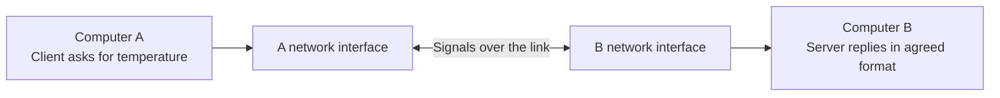

The client program starts the request. A's interface sends data over the link, and B's interface receives it. B's server interprets the request and sends a reply through the same link. **Client** and **server** describe roles in a conversation. B can serve temperature readings and also act as a client when it synchronizes its clock. In **peer-to-peer** designs, participants may both offer and consume the same service.

Real senders usually split data into smaller units so many conversations can share a link and receivers can process data as it arrives. **Packet** is a common general term for a unit of transmitted data and is used more specifically for an IP packet in this course. An Ethernet **frame** carries bytes across an Ethernet link or switched Ethernet network. Several frames may carry the pieces of a single application response.

### From one link to many networks

| Term | Scope and purpose | Example |
| --- | --- | --- |
| LAN | A local area network connecting devices in a limited area or administrative segment. | A home or classroom network. |
| WAN | A wide area network linking sites across a wider geographic area, often using provider infrastructure. | A link between two offices. |
| Internet | Interconnected networks that exchange traffic using IP. | A provider connects a home network to networks operated by other organizations. |
| Web | A system of resources addressed by URLs and accessed using HTTP and HTTPS. | A browser retrieves a page or a REST client requests JSON. |

A wired Ethernet link carries signals over a cable. Wi-Fi uses shared radio channels and its own rules to access the medium. A home device may combine a Wi-Fi access point, switch, and router in one box. Those are still distinct jobs. The Internet also carries applications such as email and SSH. A Web application can run within a private network or on a single machine.

| Device | What it decides | Typical use |
| --- | --- | --- |
| Switch | Which local link should carry an Ethernet frame based on a link-layer address. | Connect several computers within the same Ethernet LAN. |
| Router | Which next network or hop should receive an IP packet based on its destination IP address. | Forward traffic from the home LAN toward the provider. |

### Describe performance with the right measurement

| Measure | Question it answers | Backend significance |
| --- | --- | --- |
| Bandwidth | How many bits per second can the link carry under stated conditions? | Sets an upper bound on how quickly a large transfer can cross the link. |
| Throughput | How much data actually moves per second? | Protocol overhead, loss, congestion, and the server can reduce measured throughput. |
| Latency | How much time elapses for data to travel? Is the measurement one-way or round trip? | Calls that must wait for several round trips can feel slow with little data. |
| Jitter | How much does delay vary between packets? | A live voice receiver may need a buffer to play audio smoothly. |
| Packet loss | What fraction of sent packets fails to arrive at the observation point? | Can trigger retransmission or noticeable gaps, depending on the transport. |

For an illustrative calculation, `10 MB` is `80 Mbit` using decimal units. A `100 Mbit/s` link could serialize that amount in `0.8 s` at full rate. Travel time, waiting in queues, other traffic, and protocol overhead affect the actual transfer. A tiny database query can be sensitive to round-trip latency even if the same link has room for a large backup.

**Key takeaways.** A link transports bits. Protocols give those bits meaning. Identify whether a problem concerns the time to start a conversation, the rate while it runs, or missing data along the way.

<a id="net-02"></a>

## Part 2 — OSI and TCP/IP Models

### Why software divides the work

The same HTTP client can work over Ethernet or Wi-Fi. That is possible because a lower layer handles the link while the client uses a stable interface to request transmission. A **layer** groups responsibilities and offers a service to the layer above it. Thinking in layers also helps you locate failures. The evidence for a missing route differs from the evidence for an HTTP response that rejects a request.

The **OSI model** is a seven-layer reference model. The **TCP/IP model** describes the Internet stack more directly. It is often shown as four layers, or as five if the link layer is split into data link and physical. Real protocols and applications can combine functions across these boundaries.

| OSI layer | Main responsibility | Approximate TCP/IP layer and examples |
| --- | --- | --- |
| 7 Application | Define messages for an application task. | Application, including HTTP and DNS. |
| 6 Presentation | Represent data in a form peers can interpret, including encoding and some cryptography functions. | Usually grouped into application or a library. JSON encoding is an example of the function. |
| 5 Session | Organize and manage a conversation across exchanges. | Often implemented in application protocols or libraries. |
| 4 Transport | Move data between application endpoints and define properties such as delivery and ordering. | Transport, such as TCP and UDP. |
| 3 Network | Address and forward packets between networks. | Internet, such as IPv4 and IPv6. |
| 2 Data link | Move frames over the local link or switched segment. | Link, such as Ethernet framing or Wi-Fi. |
| 1 Physical | Transmit signals. | Link in the four-layer model. Physical is separate in the five-layer model. |

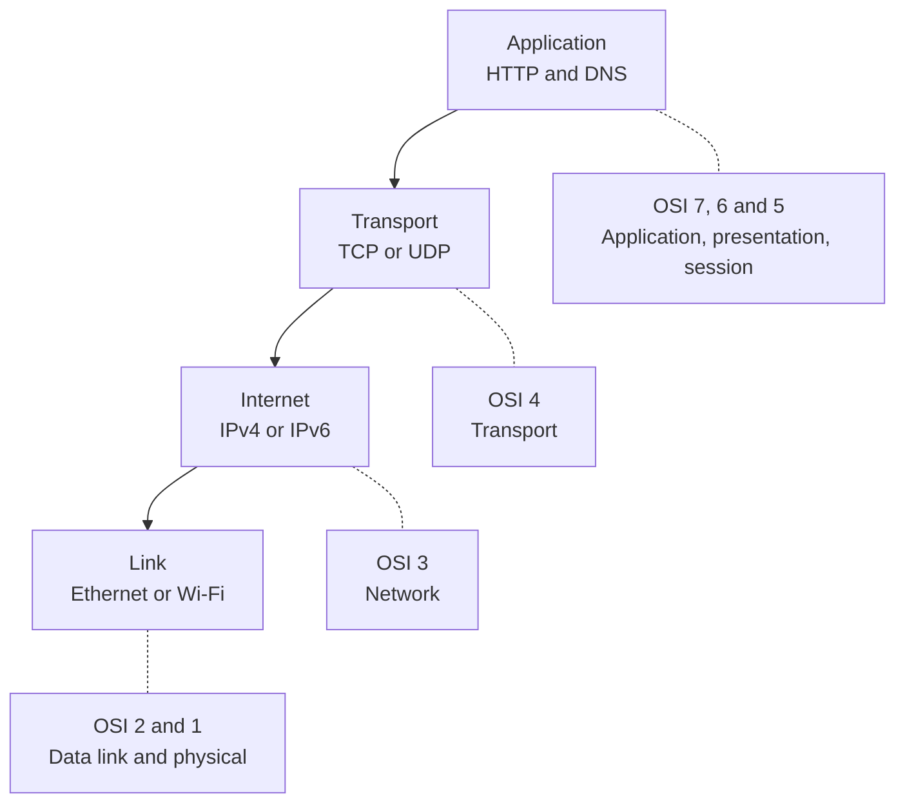

The solid arrows show the common four-layer TCP/IP view. Dotted lines relate those responsibilities to OSI. For HTTPS over TCP, TLS sits between HTTP and TCP and handles protected communication. HTTP/3 uses QUIC, which integrates TLS handshake machinery while supplying transport features over UDP. DNS is an application protocol with several transport choices. A model is more useful when it explains these combinations than when it assigns everything a rigid number. [Internet host layers, RFC 1122](https://www.rfc-editor.org/rfc/rfc1122.html), [QUIC transport, RFC 9000](https://www.rfc-editor.org/rfc/rfc9000.html)

### Encapsulation and a worked HTTP request

A **header** is structured information accompanying data, such as a destination or length. The data a layer carries for another layer is its **payload**. **Encapsulation** packages a payload with a layer's own information. A receiver performs **decapsulation** when it interprets that information and passes the payload onward.

```mermaid
flowchart LR
    HTTPA["Sender HTTP request bytes"] --> TA["TCP header + part of byte stream"]
    TA --> IA["IP header + TCP segment"]
    IA --> LA["Ethernet header + IP packet + trailer"]
    LA --> Wire["Signals on one link"]
    Wire --> LB["Receive frame and check link information"]
    LB --> IB["Read IP information"]
    IB --> TB["Deliver ordered bytes to the TCP socket"]
    TB --> HTTPB["Receiver parses the HTTP request"]
```

1. A client creates an HTTP message such as `GET /health` with headers. Assume the TCP connection is already established.
2. TCP takes the message's bytes as part of a stream and sends them in one or more **segments**. A TCP header includes the source and destination ports and information about the stream position.
3. IP carries each segment to a destination IP address. Ethernet can carry that packet to a neighbor on the current link. Its trailer includes an error check for the frame.
4. At each router, the outgoing link gets its own frame. The destination host processes IP, passes the payload to TCP, and TCP makes ordered bytes available to the receiving application.
5. The HTTP implementation uses HTTP framing to find such things as the end of the headers or the length of the body. It can then dispatch `/health` and send response bytes down its own stack.

A single HTTP request can occupy several TCP segments. A segment can also carry bytes from more than one application write. Loopback communication uses the local networking stack with no physical wire. A packet capture on one link shows that link's view and may differ from what an application sees after reassembly. Part 8 explains why.

**Key takeaways.** Use the stack as a map of responsibilities. Links carry frames, IP routes packets, the transport delivers data to an endpoint, and HTTP defines the conversation the backend understands.

<a id="net-03"></a>

## Part 3 — IP Addresses and Network Interfaces

### Addresses tell the stack where traffic belongs

If your laptop is connected to both Wi-Fi and a virtual network, on which one should it send a request? An **IP address** identifies an interface or logical endpoint at the Internet layer. Hosts often have several interfaces and several addresses per interface. An address can change when a laptop moves, be reassigned when a lease expires, or be shared externally by many devices through NAT. A router forwards toward a destination address using the routes available to it.

**IPv4** has 32-bit addresses written as four decimal **octets**, each `0–255`, such as `192.168.1.20`. **IPv6** has 128-bit addresses written in hexadecimal groups separated by colons. In IPv6, omit leading zeros in a group and compress one consecutive run of zero groups with `::`. For example, `2001:0db8:0000:0000:0000:0000:0000:0020` can be written as `2001:db8::20`. Both protocol families can run on the same host. Square brackets distinguish an IPv6 literal from a following port in a URL, as in `http://[::1]:18080/health`. [IPv6 addressing, RFC 4291](https://www.rfc-editor.org/rfc/rfc4291.html)

### Destination addresses, names, and bind addresses

A **hostname** is a name that software can look up or that a system uses to identify itself. A lookup can return more than one IP address, and several names can lead to the same address. An IP address is what the stack uses after picking a destination. A **bind address** is the local address a server asks the OS to listen on.

| Value | How to read it | Practical consequence |
| --- | --- | --- |
| `localhost` | Special hostname for this networking environment. May yield IPv4 `127.0.0.1`, IPv6 `::1`, or both in an order chosen by the resolver and client. | Check whether the server is listening in the family the client tries. |
| `127.0.0.1` | Common IPv4 loopback address. The whole `127.0.0.0/8` block is reserved for loopback. | The connection stays in the local networking stack. |
| `::1` | IPv6 loopback address. | Matches an IPv6 listener on local loopback. |
| `0.0.0.0` | Unspecified IPv4 address. As a listener binding it means any local IPv4 address. | Clients use a specific reachable IP address or hostname as the destination. |
| `192.168.1.20` | Private IPv4 address. | Reachability depends on local or private routes and policy. |
| Globally routable public IP | Address intended for routing on the public Internet. | It may still be unreachable because of routing policy, filters, or lack of a listener. |

The IPv4 private ranges are `10.0.0.0/8`, `172.16.0.0/12`, and `192.168.0.0/16`. Different private networks can reuse them. Other special-purpose ranges include loopback, link-local, and documentation blocks. IPv6 uses link-local addresses from `fe80::/10` on a single link and has **unique local addresses**, commonly starting with `fd`, for private routing. An IPv6 wildcard bind uses `::`. Whether such a socket also accepts IPv4 depends on the OS and socket settings. Check the concrete listener and try the intended address family. [Private IPv4 addresses, RFC 1918](https://www.rfc-editor.org/rfc/rfc1918.html), [IANA IPv4 special-purpose registry](https://www.iana.org/assignments/iana-ipv4-special-registry/iana-ipv4-special-registry.xhtml), [IPv6 unique local addresses, RFC 4193](https://www.rfc-editor.org/rfc/rfc4193.html)

`0.0.0.0/0` in a routing table is an IPv4 **default prefix** that matches any destination. It plays a different role from the `0.0.0.0` socket binding. Likewise, a private LAN address and a loopback address can belong to one laptop while having different reachability.

### Who assigns the address?

A **static** assignment is configured deliberately and stays until changed. A **dynamic** assignment is supplied automatically, often for a limited **lease**. In a typical IPv4 LAN, **DHCP** lets a new client discover servers, receive an offer, request an offered lease, and receive an acknowledgment. That lease can include an address, subnet mask, default gateway, and DNS resolver. A DHCP reservation can associate a particular client with a predictable address. IPv6 hosts can derive addresses from router advertisements through stateless address autoconfiguration and can use DHCPv6 in networks that provide it.

In **Ubuntu Bash**, use `ip -br addr` for a compact interface and address listing. In **Windows PowerShell**, use `Get-NetIPAddress`. Read the interface and address together. The following Linux lines are representative.

```text
lo       UNKNOWN        127.0.0.1/8 ::1/128
eth0     UP             192.168.1.20/24
```

`lo` is loopback. `UNKNOWN` here is a link operational-state label and is normal for loopback. `eth0` has a separate address and prefix. Your machine may show more addresses, other interface names, or virtual adapters. The prefix after the slash is the subject of Part 4.

**Key takeaways.** Treat an address as an endpoint in a networking environment. Resolve names, distinguish address families, and read the listening address before assuming that a client can reach a process.

<a id="net-04"></a>

## Part 4 — Subnets and CIDR

### Divide an address into prefix and host bits

When a host sends to `192.168.10.120`, should it deliver directly or go through a router? The **subnet** describes a range with a shared leading bit pattern. A **prefix length** tells how many bits form that pattern. **CIDR** (Classless Inter-Domain Routing) represents an address and a prefix with a suffix such as `/24`. For an IPv4 `/24`, the first 24 bits are the network portion and the remaining eight are available to distinguish addresses inside that subnet.

A **subnet mask** has a `1` in each prefix position and a `0` in each host position. Apply bitwise **AND** to the address and mask, keeping a `1` only if both bits are `1`. The result is the network address. To find the last address in the block, fill all host positions with `1`. On a conventional IPv4 subnet that last address is the **directed broadcast address**. Its first and last addresses are conventionally reserved, so `2^(32 - prefix) - 2` gives the usable host count for those ordinary subnets. Usable means assignable by this calculation. A real network may reserve more addresses.

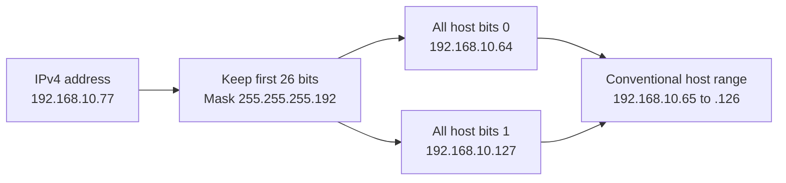

The two endpoints delimit the block. The address `.77` fits into its six host bits. The same method works when the prefix cuts through any of the four octets. [CIDR and prefix notation, RFC 4632](https://www.rfc-editor.org/rfc/rfc4632.html)

### Worked example 1 — A division inside the last octet

For `192.168.10.77/26`, the first three octets are all network bits. The mask keeps the two high bits of the last octet.

```text
77 decimal      01001101
192 mask        11000000
AND result      01000000  = 64
Host bits all 1 01111111  = 127
```

There are `32 - 26 = 6` host bits and `2^6 = 64` total addresses. The block runs from `192.168.10.64` to `192.168.10.127`, with `.65` to `.126` usable. To compare `.120` and `.130` with `.77`, apply the same mask to each. `120` is `01111000` and masks to `64`. `130` is `10000010` and masks to `128`, so it is in the next `/26`. Comparing the printed first three octets alone would give the wrong result.

### Worked example 2 — A division inside the third octet

For `172.16.35.200/20`, keep the first two octets and the high four bits of the third. The mask is `255.255.240.0`.

```text
35 decimal      00100011
240 mask        11110000
AND result      00100000  = 32
Host bits all 1 00101111  = 47
```

The fourth octet is entirely host bits. The network is `172.16.32.0` and broadcast is `172.16.47.255`. The 12 host bits give 4,096 addresses and 4,094 conventional usable addresses from `172.16.32.1` to `172.16.47.254`. `172.16.47.8` matches the prefix. `172.16.48.1` begins the next block because the third-octet block size is `256 - 240 = 16`.

### Worked example 3 — Octet-aligned and special prefixes

| Example | Mask | How to reason about it |
| --- | --- | --- |
| `10.44.3.8/8` | `255.0.0.0` | Network `10.0.0.0`. All addresses beginning with `10` share the prefix. |
| `10.44.3.8/16` | `255.255.0.0` | Network `10.44.0.0`. `10.44.255.250` matches and `10.45.0.1` falls outside it. |
| `192.168.5.7/24` | `255.255.255.0` | Network `192.168.5.0`, broadcast `192.168.5.255`, conventional host range `.1–.254`. |
| `192.0.2.10/31` on a point-to-point link | `255.255.255.254` | The block comprises `.10` and `.11`. Both can be endpoint addresses in this specified case. |
| `192.0.2.10/32` | `255.255.255.255` | A prefix for exactly one address, useful as a host route. |

The usual subtract-two rule does not describe a `/31` point-to-point link or a `/32` route. The default route `0.0.0.0/0` also serves a routing purpose rather than describing one ordinary connected LAN. [IPv4 point-to-point prefixes, RFC 3021](https://www.rfc-editor.org/rfc/rfc3021.html)

An IPv6 prefix uses the same leading-bit idea. For `2001:db8:100:2::25/64`, the first four 16-bit groups are the prefix `2001:db8:100:2::/64`. `2001:db8:100:2::80` matches and `2001:db8:100:3::80` falls outside it. `/128` selects one address. IPv6 has no broadcast address. Some IPv6 tasks that would use broadcast in IPv4 use multicast, which delivers to a particular group.

### Connect the calculation to routing

Assigning an address and prefix to an interface commonly creates a **connected route** for that prefix. A host uses the routing table to choose whether to reach the destination on the local link or to reach a router first. With inconsistent masks the two sides can make different decisions. When comparing addresses in exercises, use the specified mask, then ask what route the actual host would select.

**Key takeaways.** The slash tells you how many leading bits matter. Mask both addresses with the same prefix to compare them, and use the routing table to see how the host will deliver traffic.

<a id="net-05"></a>

## Part 5 — MAC Addresses, Ethernet, ARP and Neighbor Discovery

### IP finds the destination network. Ethernet finds the next receiver.

Host A knows that it wants to send an IP packet to B. If both are on the same Ethernet LAN, A still needs the destination address for the Ethernet frame. A **MAC address** identifies an interface at the Ethernet link layer. A common representation is six hexadecimal bytes, as in `02:00:00:00:00:0a`. Interfaces can have hardware-assigned or software-assigned addresses. Ethernet frames carry source and destination MAC addresses, a type identifying the payload protocol, the payload, and an error-detection trailer.

| Address | Scope and purpose | Who uses it at this point? |
| --- | --- | --- |
| MAC address | Delivers an Ethernet frame to a receiver on the current link or switched LAN. | The interfaces and switches on that LAN. |
| IP address | Identifies the Internet-layer destination and supports forwarding across routes. | The sending host, routers on the path, and the receiving host. |

A switch learns which switch port a source MAC arrived on. It can use that information to forward a later frame for that MAC only toward that port. Broadcast and unknown-destination forwarding may reach multiple ports in the same segment. The switch makes this decision at **Layer 2**. A router chooses a next hop from the IP destination at **Layer 3**, and encapsulates the packet for its outgoing link. The next frame usually has a different source and destination MAC pair.

### Discover the receiver for this link

**ARP** (Address Resolution Protocol) obtains a link-layer address for an IPv4 neighbor. Suppose A is `192.168.1.10/24` and B is `192.168.1.20/24` on the same Ethernet segment. If A has no suitable cached mapping, it broadcasts an ARP request asking who has B's IPv4 address. B normally replies directly with its MAC address. A caches the mapping for a limited period, then sends the IP packet in a frame addressed to B.

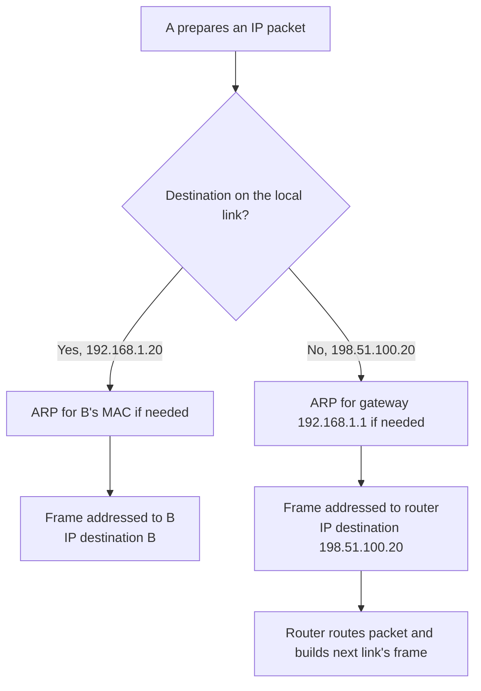

In the routed case, A resolves the **gateway's** link-layer address even though the IP header still names the remote destination. The router decapsulates, looks up the next hop, decrements IPv4 TTL or IPv6 Hop Limit, and sends the packet in a new frame or other link-layer format. TTL and Hop Limit bound how far a packet can travel if there is a routing loop. Failure to discover the local next hop can prevent delivery even when the destination IP and routing table look correct. [ARP, RFC 826](https://www.rfc-editor.org/rfc/rfc826.html)

IPv6 uses **Neighbor Discovery**, carried in ICMPv6 messages. A host normally uses a targeted multicast Neighbor Solicitation followed by a Neighbor Advertisement to obtain a next hop's link-layer address. Neighbor Discovery also supports learning about routers and checking neighbor reachability. The same mental model applies to Ethernet delivery. First choose the next hop. Then find its link-layer address. [IPv6 Neighbor Discovery, RFC 4861](https://www.rfc-editor.org/rfc/rfc4861.html)

**Key takeaways.** On a local subnet, deliver to the destination's link-layer address. For a remote subnet, deliver this hop's frame to the gateway while carrying the remote destination in the IP header.

<a id="net-06"></a>

## Part 6 — Routing, Gateways and NAT

### Select the next hop

Your laptop knows the IP address of a remote site but has no direct link to it. **Routing** chooses where to send a packet next. Each host or router uses a **routing table** with destination prefixes and instructions for matching destinations. A route can specify an outgoing interface and a **next hop**, a reachable neighbor that will forward the packet. A connected route generally sends straight to the destination on its link. A **default gateway** is a next hop used by a default route when no more specific route applies.

Here is a simplified IPv4 table for `192.168.1.10`. These rows are data for reasoning, and no route changes are needed.

| Prefix | What to do |
| --- | --- |
| `192.168.1.0/24` | Deliver on the local LAN through `eth0`. |
| `198.51.100.20/32` | Use gateway `192.168.1.253`. |
| `198.51.100.0/24` | Use gateway `192.168.1.254`. |
| `0.0.0.0/0` | Use default gateway `192.168.1.1`. |

1. `192.168.1.20` matches both `/24` and the default. The `/24` wins, so look for the host on the LAN.
2. `198.51.100.20` matches `/32`, `/24`, and the default. The `/32` wins and the local next hop is `192.168.1.253`.
3. `198.51.100.30` matches the documentation subnet route and the default. Choose `192.168.1.254`.
4. `203.0.113.50` matches only the default. Choose `192.168.1.1`.

**Longest-prefix matching** chooses the matching route with the most prefix bits in the selected routing table. Real operating systems can use policy to choose tables and metrics or other criteria to choose among routes of the same specificity. A route decision tells you where the stack would send a packet. It does not prove the next hop is reachable or the destination is accepting connections.

### Why many home devices can share one public address

Suppose a home laptop has the private address `192.168.1.10` and connects to the illustrative public web server `198.51.100.20`. Private addresses can be reused by different households, so they are generally unsuitable as return addresses on the public Internet. **Network Address Translation (NAT)** rewrites addresses as a packet crosses a device. **Source NAT** changes the source address. **Port Address Translation (PAT)** commonly changes both the source address and transport port so one external address can represent many conversations. A port is a transport-layer number, introduced in detail in Part 7.

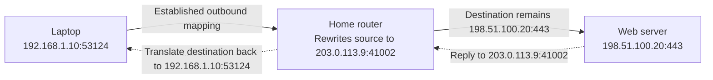

1. The laptop chooses its default route and sends a frame to the home router. Its packet has source `192.168.1.10:53124` and destination `198.51.100.20:443` in this illustrative connection.
2. The router chooses an outbound route, records a translation for this conversation, and forwards the packet with source `203.0.113.9:41002`. The web server receives traffic from that translated endpoint.
3. The server replies to the source it saw. The reply reaches the router, which finds the existing mapping, restores the private destination, and forwards it to the laptop.
4. The mapping persists while the router tracks the flow. A reset or expired mapping can interrupt later replies. Other devices can use different mappings on the same external address.

**Destination NAT** changes the destination. A **port forward** can be modeled as a destination translation from a chosen external address and port to an internal address and port. The return direction needs the corresponding reverse translation. An upstream NAT or missing route can still prevent a public connection. Use this reasoning for diagrams. Home routers and real network policies need no changes for this course. [Traditional NAT and port translation, RFC 3022](https://www.rfc-editor.org/rfc/rfc3022.html)

| Mechanism | Decision | Example |
| --- | --- | --- |
| Routing | Which path or next hop will receive this packet? | Send an off-subnet packet to a gateway. |
| NAT | Which source or destination fields should be translated? | Map an internal source and port to an external one. |
| Firewall | Is this traffic permitted to cross the boundary? | Allow a web request and deny direct inbound database connections. |

Home routers often perform all three functions. Existing NAT mappings influence what can be translated in the reverse direction. A filtering policy still determines allowed traffic, including traffic between hosts that require no translation.

**Key takeaways.** Find the most specific route, identify the next hop, and trace the reply. Track translated endpoints on both sides of a NAT boundary when diagnosing traffic.

<a id="net-07"></a>

## Part 7 — Ports and Sockets

### One host can serve several applications

A host can run a web app and a database on the same IP address. **Ports** let TCP and UDP identify which endpoint on that host should receive traffic. A port number is an unsigned 16-bit value from `0` to `65535`. TCP and UDP have different port namespaces. A process can listen on TCP `53` while another uses UDP `53`. A port number is a convention or configuration, so it does not prove which program or protocol is running there.

| IANA range | Role |
| --- | --- |
| `0–1023` | System or well-known range. Port `0` is reserved in the registry and has a special socket API meaning when binding. |
| `1024–49151` | User or registered range, available for registered service assignments. |
| `49152–65535` | Dynamic or private range in the IANA registry. |

When a client creates a connection without explicitly selecting a local port, the OS typically chooses a temporary **ephemeral port** from a configurable range. The local range need not equal the IANA dynamic range. Binding to port `0` in the Java server examples explicitly asks the OS to choose an available port. Some systems restrict who can bind to low-numbered ports, so the labs use higher ones. [IANA service and port registry](https://www.iana.org/assignments/service-names-port-numbers/service-names-port-numbers.xhtml)

### What the OS actually keeps

An **endpoint address** combines an IP address with a port for a given transport. A **socket** is an OS-managed communication object a program can use. It has attributes such as its local address, transport protocol, buffers, and state. A TCP socket can be bound without a peer, listening for new connections, or associated with a specific peer after connection establishment.

| Concept | What it identifies | Example |
| --- | --- | --- |
| IP address | A destination or source at the Internet layer. | `192.168.1.20` |
| Port | A numeric selector in a transport protocol. | TCP `8080` |
| Endpoint | A transport address usable as a local or peer endpoint. | TCP `192.168.1.20:8080` |
| Listening socket | A local object accepting new TCP connections. | One listener at `192.168.1.20:8080`. |
| Established TCP socket | One side of a live connection, with an associated local and peer endpoint. | Local `192.168.1.20:8080`, peer `192.168.1.10:53124`. |

### Work through one incoming connection

```text
Client: 192.168.1.10:53124
Server: 192.168.1.20:8080
Transport: TCP
```

1. The server calls **bind** to select the local address and port, then **listen** to signal that new TCP connections should be accepted there. A wildcard such as `0.0.0.0` uses all local IPv4 addresses. An explicit `127.0.0.1` selects loopback only.
2. The client connects to `192.168.1.20:8080`. In this example the kernel selects source IP `192.168.1.10` and local port `53124`. The request direction has source port `53124` and destination port `8080`. Replies reverse the endpoint roles.
3. The OS carries out the TCP handshake. The server calls **accept** to obtain a new connected socket. Pending connections can wait in a bounded queue while the server gets to them. TCP details and queues vary with the OS.
4. In this network stack, established TCP conversations are distinguished by the four values local IP, local port, remote IP, and remote port. When discussing multiple transport protocols together, add the protocol to form a **five-tuple**. Several connections can share the server's local port because their peers differ.

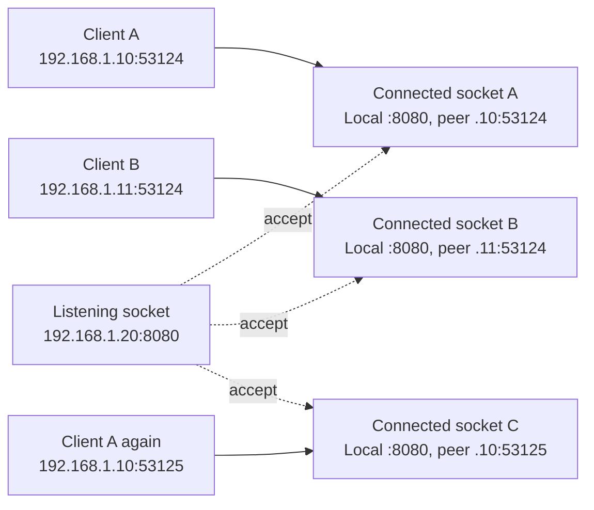

The three connections have distinct peer endpoints even though they share one server port. Spring Boot's embedded server can work with multiple connected sockets and may serve several HTTP requests on each connection. OS and application resources still limit concurrency.

A **port conflict** occurs when a program asks for a local address and port combination the OS will not allow it to bind. For example, a second ordinary TCP listener generally cannot claim an endpoint already in use. A wildcard listener can overlap a more specific binding. When a Java program reports `BindException: Address already in use`, inspect the listening address as well as the port. Use a different free lab port and update the client. Another program's listener is useful evidence and should be left running.

| Port | Common use |
| --- | --- |
| `22/TCP` | SSH |
| `53/UDP` and `53/TCP` | Conventional DNS |
| `80/TCP` | HTTP |
| `443/TCP` and often `443/UDP` | HTTPS over TCP and HTTP/3 over QUIC, respectively |
| `5432/TCP` | Default PostgreSQL server port |
| `8080/TCP` | Common development HTTP port and Spring Boot's usual standalone HTTP default |

**Key takeaways.** An application listens on a local address and port. A TCP connection has both a local and remote endpoint, so many clients can share one listener.

<a id="net-08"></a>

## Part 8 — TCP

### Coordinate before exchanging bytes

Imagine sending a file over a path where packets can arrive late, out of order, or be lost. **Transmission Control Protocol (TCP)** supplies an ordered, reliable byte stream in each direction while the connection is usable. The endpoints exchange control information and keep state about what has arrived. The application can send bytes without implementing retransmission itself.

TCP's **three-way handshake** establishes connection state and synchronizes initial sequence numbers. **Sequence numbers** track positions in the byte stream. An **acknowledgment** gives the next sequence number the receiver expects in the contiguous stream.

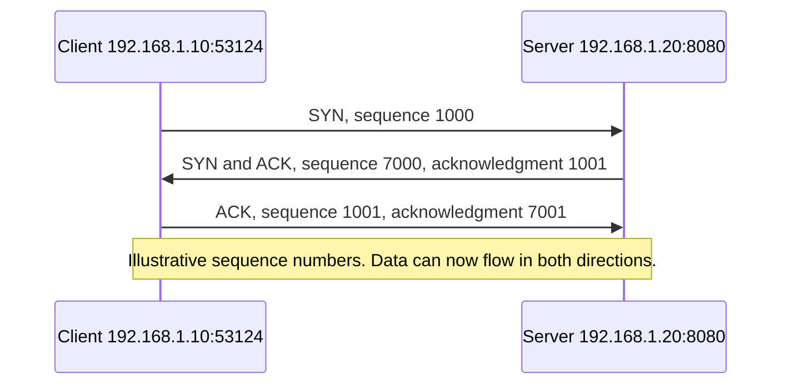

The client proposes sequence `1000` with `SYN`. The server acknowledges it and proposes `7000`. The client acknowledges that value. SYN takes one sequence position, so each side starts sending data after its own initial SYN position. TCP also negotiates options in this exchange. A real handshake picks sequence numbers independently. If a handshake packet is lost, an endpoint can retransmit, and if connection establishment still does not complete the attempt can time out. [TCP specification, RFC 9293](https://www.rfc-editor.org/rfc/rfc9293.html)

### Recover from lost or reordered segments

After the handshake, suppose the client sends five bytes starting at `1001`. If all five arrive in order, the peer can acknowledge `1006`. If bytes at `1001–1005` are missing while bytes from `1006` arrive, the next expected position remains `1001`. TCP can buffer later bytes, and the sender can retransmit missing data based on time and other loss signals. Options such as selective acknowledgments can also identify later data that arrived. The receiver delivers a contiguous stream to the application and avoids delivering duplicated retransmitted bytes as new bytes.

Two limits keep this process practical.

- **Flow control** prevents overrunning the receiver. The receiver advertises how much space it has for more data.
- **Congestion control** manages how much a sender puts into the shared network. A sender responds to signs such as loss or explicit congestion signals and adjusts its in-flight data.

Treat TCP like a numbered stream of bytes with two independent directions. If a sender writes `HELLO` in one call, a receiver may read `HE` and then `LLO`, or receive those bytes together with later data. TCP preserves byte order and the application defines message boundaries. A line protocol can use newline delimiters. An HTTP implementation uses framing rules appropriate to the HTTP version. An acknowledgement means the peer TCP stack received bytes. It cannot tell you whether the application committed a database transaction.

### Close a connection or identify how it failed

`FIN` means a peer has finished sending in one direction. The other direction can remain open. A peer acknowledges the FIN, and the other side can send its own FIN when it finishes. Like SYN, FIN consumes one sequence position. `RST` signals a reset. It ends or rejects a connection abruptly, and an application may see `Connection reset` if an active peer or a middlebox sends one.

| State commonly seen in tools | What it tells you |
| --- | --- |
| `LISTEN` | A server socket awaits new connections. |
| `SYN-SENT` or `SYN-RECV` | A handshake is in progress. |
| `ESTAB` or `ESTABLISHED` | The stack has an established connection. |
| `FIN-WAIT-1` or `FIN-WAIT-2` | This side initiated closure and is waiting for a related acknowledgment or peer close. |
| `CLOSE-WAIT` | The peer ended its sending direction. The local application has yet to close as needed. |
| `LAST-ACK` | This side sent its FIN after the peer's and is awaiting the final acknowledgement. |
| `TIME-WAIT` | The stack keeps state briefly after closing to handle delayed segments and a possible repeated FIN. |

| Early failure | Typical evidence | First useful check |
| --- | --- | --- |
| Connection refused | Fast, explicit rejection, often a TCP reset in response to SYN when no matching listener exists. A filter can also actively reject. | Verify the address family, endpoint, and listening socket on the destination. |
| Connection timeout | Establishment did not complete within the caller's limit. Drops, filtering, an unavailable host, or a broken return path are possible. | Identify which endpoint was attempted and check routing, reachability, and authorized firewall evidence. |
| Connection reset after establishment | The connection existed and was subsequently terminated abruptly. | Check where the exchange stopped and consult peer or proxy logs. |

An application can impose a shorter deadline than the OS's retransmission schedule. A timeout while waiting for a reply can also occur on an already established connection. At that point the request may have been processed even if the response has not arrived. Retrying an HTTP POST can create a second operation. TCP retransmits stream bytes within a connection. Application retries need their own rules to avoid unintended duplicate effects.

**Key takeaways.** TCP establishes state, delivers ordered bytes, and reports transport outcomes. Use the handshake, the established state, and the application's response as separate pieces of evidence.

<a id="net-09"></a>

## Part 9 — UDP

### Send an independent datagram

A voice call often benefits from playing the next available audio packet when a previous one is too late. **User Datagram Protocol (UDP)** carries discrete messages called **datagrams**. An application can send a datagram without a transport handshake. An IP packet carries it with a header containing source port, destination port, length, and checksum. The checksum helps detect corruption. It does not request another copy.

A successful receive gives the application one datagram's data, subject to its receive buffer size. If a buffer is too small, a datagram can be truncated or handled as an error depending on the API. UDP itself has no guarantee that datagrams arrive, arrive once, or arrive in the sending order. An application may add sequence numbers, recovery, or its own handshake where the job requires it. A connected UDP socket in an API can select a default peer for sending and filtering without starting a TCP-style connection.

| Property | TCP | UDP |
| --- | --- | --- |
| Reliability | Acknowledgments and retransmissions provide reliable delivery while the connection holds. | Best-effort delivery. An application or higher protocol can add recovery. |
| Ordering | Delivers bytes to the application in order. | Datagrams can arrive in a different order, be duplicated, or be lost. |
| Connection setup | Handshake establishes transport state. | UDP sends datagrams directly. A higher protocol can set up its own connection. |
| Message boundaries | Byte stream. Applications define and parse boundaries. | One datagram is one transport message. |
| Common uses | HTTP/1.1 and HTTP/2, SSH, PostgreSQL. | Conventional small DNS exchanges, some real-time media, QUIC. |

DNS often sends a query over UDP, where the client can time out and retry. A UDP response marked truncated can prompt retry over TCP. DNS implementations also use TCP directly and may use encrypted transports. A video conference may value timely delivery more than resending a stale frame, while many prerecorded streaming services use HTTP and reliable transport. A sender still needs to manage the load it puts on the network. UDP has no universal speed advantage. [UDP specification, RFC 768](https://www.rfc-editor.org/rfc/rfc768.html), [DNS over TCP requirements, RFC 7766](https://www.rfc-editor.org/rfc/rfc7766.html)

**QUIC** runs over UDP and provides connection setup, encrypted communication using TLS 1.3 machinery, congestion control, and reliable ordered delivery within its streams. Multiple streams in a single connection allow loss affecting one stream to avoid the TCP-style requirement to deliver earlier bytes for all streams first. Shared congestion and application dependencies can still affect other streams. **HTTP/3** maps HTTP over QUIC. Choosing UDP as a carrier gives QUIC room to implement its own behavior. [QUIC transport, RFC 9000](https://www.rfc-editor.org/rfc/rfc9000.html), [HTTP/3, RFC 9114](https://www.rfc-editor.org/rfc/rfc9114.html)

**Key takeaways.** UDP gives applications datagrams with few guarantees. Choose a transport based on how the application should handle timing, recovery, and message boundaries.

<a id="net-10"></a>

## Part 10 — DNS

### Give a service a name independent of its address

If a backend moved to another address, every client would need a new configuration if it only knew the old IP. The **Domain Name System (DNS)** is a distributed database that lets names point to service information. A **domain name** has dot-separated labels in a hierarchy. A **hostname** is a name used for a host or endpoint. Some domain names name services or zones without naming a single physical machine.

DNS divides administration into **zones**. An **authoritative server** serves records for a zone under its authority. A **resolver** looks up answers on behalf of software. A device commonly sends a query through its system resolver to a **recursive resolver**, which finds an answer, follows referrals, forwards the query to another resolver, or answers from cache. The top of the hierarchy is the root. A **top-level domain (TLD)** such as `com` is one level below it.

| Record type | What the data says | Illustrative record |
| --- | --- | --- |
| `A` | One IPv4 address for this name. | `api.course.example. → 192.0.2.20` |
| `AAAA` | One IPv6 address for this name. | `api.course.example. → 2001:db8::20` |
| `CNAME` | This name is an alias for another name. | `www.course.example. → api.course.example.` |
| `MX` | Mail for this domain should be sent to the listed host, with an associated preference. | `course.example. → 10 mail.course.example.` |
| `NS` | Name servers responsible for a zone. | `course.example. → ns1.course.example.` |

The trailing dot represents the root and makes the example name absolute. Clients typically use the A or AAAA records for a direct IP connection. A CNAME supplies another name to resolve. Multiple address records can let a service use several servers or support several address families. Resolvers can get different answers because of location, split internal and external DNS views, changes, or different cache lifetimes.

### Trace a cold lookup for example.com

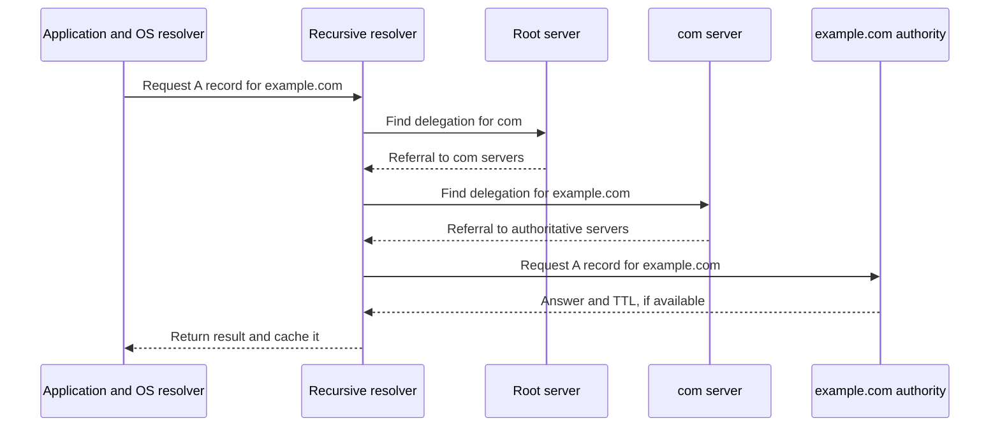

The recursion is from the application's point of view. The recursive resolver sends the follow-up questions in this simplified example. Referral information directs it to servers closer to the answer. Real deployments may forward to an upstream resolver, have referrals cached, and issue separate A and AAAA queries. A **time to live (TTL)** gives a cache a lifetime, usually expressed in seconds, for reusing a result. Resolvers may cache negative answers as well. If a record was recently changed, some callers can still see an older answer while a valid cache entry remains. [DNS architecture, RFC 1034](https://www.rfc-editor.org/rfc/rfc1034.html)

### Compare what the application sees with what DNS says

Before sending a DNS query, a host may use a local hosts file or cache. Linux commonly checks `/etc/hosts` through its name service configuration. Windows commonly uses `C:\Windows\System32\drivers\etc\hosts` and its DNS client facilities. Some applications do their own resolution or caching. Changing system files is unnecessary for these examples.

**Ubuntu Bash** can compare the system lookup and a direct query to a configured DNS resolver.

```bash
getent hosts localhost
getent ahostsv4 localhost
```

Look for a loopback address. The first command may report IPv6 or IPv4, and the second asks for IPv4 results and may show several socket types for the same address. `getent` follows system lookup rules. The following **optional** example sends a conventional DNS query if `dig` is installed and a DNS resolver is available.

```bash
dig +time=2 +tries=1 +noall +comments +answer example.com. A
```

The output has a status and possibly one or more answers. Query `AAAA` to see IPv6 candidates or add `+tcp` to ask `dig` to use TCP. For systems without `dig`, `nslookup -type=A example.com.` is a possible substitute when installed. In **Windows PowerShell**, inspect local resolution first. The second command is similarly optional and uses DNS while skipping the hosts file.

```powershell
Resolve-DnsName -Name localhost -Type A
Resolve-DnsName -Name example.com. -Type A -DnsOnly -NoHostsFile
```

Review the name, type, and address. If an optional query cannot run, use this representative answer for the unrelated fictional name `api.course.example.` to read the fields. The order is name, remaining TTL, class, type, and data.

```text
;; ->>HEADER<<- opcode: QUERY, status: NOERROR
api.course.example.  120  IN  A  192.0.2.20
```

| Observation | Interpretation |
| --- | --- |
| `NOERROR` with an address | A resolver supplied a candidate destination for the requested name and type. |
| `NOERROR` without the requested data | The name may exist without a record of that type. Check whether you queried A or AAAA. |
| `NXDOMAIN` | The resolver reports that this name does not exist in the view it consulted. Check spelling, DNS view, and negative caching. |
| `SERVFAIL` | The resolver could not complete or validate an answer. Upstream failure or validation problems can cause it. |
| Timeout | The tool received no usable DNS response within its deadline. Check the configured resolver's reachability and scope. |

| Mechanism | What it returns | Where it fits |
| --- | --- | --- |
| DNS | Name records such as address candidates. | Usually before connecting, unless the address is already known. |
| HTTP | A response for an application request. | After the client reaches an HTTP-speaking endpoint on the selected transport. |

Conventional DNS can use UDP or TCP, commonly port `53`. **DNS over TLS** and **DNS over HTTPS** carry DNS messages inside encrypted transports. The use of HTTPS in the latter protects the DNS exchange. Its payload is still about DNS records. A valid address answer gives the client somewhere to try. Routing, the port, the listener, TLS, and the application must still work.

**Key takeaways.** Determine which name, record type, and resolver view the caller used. Test the eventual service separately from the name lookup.

<a id="net-11"></a>

## Part 11 — HTTP Fundamentals

### Turn bytes into a request the server can route

A TCP socket can deliver bytes, but it gives the application no built-in idea of a URL, a JSON document, or an error status. **Hypertext Transfer Protocol (HTTP)** defines what a client requests and how a server reports the outcome. A server or an intermediary can generate the HTTP response. Spring Boot's HTTP server processes the protocol before Spring MVC selects a controller.

A **URI** identifies a resource. A **URL** describes how to locate or access one. For `http://localhost:8080/api/v1/garments?color=blue#details`, read each piece independently.

| Component | Value | Function |
| --- | --- | --- |
| Scheme | `http` | Specifies how to access the resource. `https` adds transport protection. |
| Hostname | `localhost` | Identifies the host to resolve and the HTTP authority to use. |
| Port | `8080` | Overrides the default endpoint port of the scheme. Defaults are `80` for HTTP and `443` for HTTPS. |
| Path | `/api/v1/garments` | Identifies a resource or route at the HTTP server. |
| Query | `color=blue` | Adds parameters or other data interpreted by the server. |
| Fragment | `details` | Used by the client. The fragment itself is excluded from the HTTP request target. |

In a direct HTTP/1.1 exchange, an illustrative request and response can look like this.

```http
GET /api/v1/garments?color=blue HTTP/1.1
Host: localhost:8080
Accept: application/json

```

```http
HTTP/1.1 200 OK
Content-Type: application/json
Content-Length: 12

{"items":[]}
```

The request line contains method, request target, and protocol version. A **header** supplies metadata such as the requested response media type. A blank line ends the HTTP/1.1 header section. An optional request body carries representation bytes, for example JSON sent with `Content-Type: application/json`. The response gives a status, headers, and a body when its semantics allow one. The printed JSON in this example counts 12 bytes without a trailing newline. HTTP/2 and HTTP/3 encode messages as frames while retaining the same method and status semantics. [HTTP semantics, RFC 9110](https://www.rfc-editor.org/rfc/rfc9110.html)

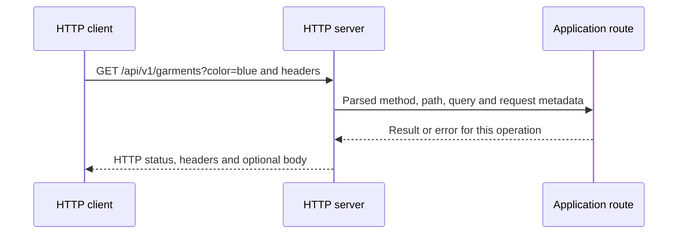

The diagram begins once an HTTP-capable connection exists. A `404` response proves some HTTP endpoint answered the request. It may be the requested service or an intermediary. Check response headers, path, and service logs to learn who answered.

### Methods describe the intended effect

A **safe** method asks for a read-only effect on the resource. The server can still log the request or collect metrics. An **idempotent** method has the same intended effect after one or several identical requests. Its responses can still differ.

| Method | Practical example | Safety and retry semantics |
| --- | --- | --- |
| `GET` | List garments at `/api/v1/garments`. | Safe and idempotent. |
| `HEAD` | Ask for the metadata associated with a GET. | Safe and idempotent. No response content is sent for HEAD. |
| `POST` | Submit a new garment or start a job. | Usually not idempotent. Retrying after losing the response can duplicate a side effect unless the API has a deduplication contract. |
| `PUT` | Store a complete representation at known `/api/v1/garments/42`. | Idempotent by definition. Repeating a full replacement has the same intended effect. |
| `PATCH` | Apply a partial change to garment 42. | The patch format and operation determine whether it is idempotent. Setting a field to a value and incrementing a counter have different effects. |
| `DELETE` | Remove garment 42. | Idempotent in intended effect. An initial success and a later `404` are compatible with that effect. |
| `OPTIONS` | Ask about supported communication options. | Safe and idempotent. |

Choosing a method in Postman selects the HTTP operation. It does not prescribe the server implementation. A Spring MVC route can be selected by both method and path, and an existing path may reject a method with `405`.

### Interpret the response before changing network settings

| Status | What the server communicates | Backend example |
| --- | --- | --- |
| `200 OK` | The request succeeded. | Return a list or an updated representation. |
| `201 Created` | The request created a resource. | A POST creates an item and can advertise its location with `Location`. |
| `202 Accepted` | The server accepted the request for processing. | A job is queued. Completion needs separate confirmation. |
| `204 No Content` | The request succeeded and has no response content. | Delete a record or confirm an update without a body. |
| `400 Bad Request` | The server considers the request invalid. | Malformed input or a validation failure under the API's contract. |
| `401 Unauthorized` | Valid authentication credentials are needed. | Missing credentials. The status includes a `WWW-Authenticate` challenge. |
| `403 Forbidden` | The server understood the request and refuses it. | The authenticated user lacks the needed permission. |
| `404 Not Found` | The target resource was not found or its existence is undisclosed. | Unknown route or missing item. |
| `409 Conflict` | The request conflicts with the current resource state. | An incompatible update or unique constraint surfaced by the API. |
| `500 Internal Server Error` | An unexpected server condition prevented fulfillment. | Inspect the failing request and server logs. |

`3xx` redirects such as `302` can include a `Location` for the next request. Decide whether you want to inspect the first response or follow the redirect. A `304 Not Modified` is a cache validation result rather than a redirect to another resource. A reverse proxy can return `502` for an invalid upstream response or `504` when an upstream response is late. These are HTTP statuses. DNS failure, refusal, and a TLS validation error can instead stop the client before it receives any HTTP status.

### Connections, application state, and HTTP versions

An HTTP request carries its own method and target. **Stateless HTTP** means the protocol does not require a particular prior request on the same connection to interpret its semantics. A server can maintain application state in a database or session. A **cookie** is a small value a server asks a user agent to store using `Set-Cookie`. The agent sends applicable cookies on later requests in `Cookie`. An application can use a cookie to associate a request with a session. A new TCP connection does not automatically log the user out.

| Mechanism | What persists |
| --- | --- |
| TCP connection state | Transport peer endpoints, stream positions, buffers, and close state. |
| HTTP connection reuse | The transport is reused for later requests or multiple concurrent HTTP streams. |
| Application state | Resource data, login sessions, and authorization decisions managed by the application. |

| Version | Common transport | Connection use |
| --- | --- | --- |
| HTTP/1.1 | TCP, with TLS for HTTPS. | Normally persistent. Multiple exchanges can use one TCP connection. |
| HTTP/2 | TCP, commonly with TLS on the Web. | Multiple streams can share one connection. Lost TCP bytes can delay delivery across streams. |
| HTTP/3 | QUIC over UDP with TLS integrated. | Multiple QUIC streams share a connection while maintaining separate delivery within streams. |

**Content negotiation** lets a client indicate what it can accept, for example `Accept: application/json`. `Content-Type` describes the representation sent. A **cache** may reuse a stored HTTP response according to freshness and reuse rules. `Cache-Control: max-age=60` is a freshness instruction. `no-store` asks caches not to store the response. `no-cache` permits storage with validation before reuse. With an `ETag` validator, a client can send `If-None-Match` and receive `304` when the cached representation is still usable. `Vary: Accept` tells a cache that different `Accept` values can select different representations. [HTTP caching, RFC 9111](https://www.rfc-editor.org/rfc/rfc9111.html)

Clients can time out during connection establishment or after the server has received the request. Recording the HTTP status when present and the client error when absent clarifies which stage completed. Use `curl -i` to display response headers and the body, `-v` to see connection detail, and `-L` to follow redirects when needed. Try the following after starting the [local HTTP lab](#http-lab) on port `18080`.

```bash
curl --noproxy '*' --max-time 3 -i http://127.0.0.1:18080/health
```

In PowerShell, use `curl.exe` with the same arguments. `--noproxy '*'` makes these loopback probes direct even when a proxy is configured. The local lab returns `200`, a text content type, and `ready`. Avoid using curl's successful process exit alone as evidence of a `2xx` response. By default, curl may exit successfully after receiving a `404` because the transfer itself succeeded. [curl manual](https://curl.se/docs/manpage.html)

**Key takeaways.** Once you have an HTTP response, investigate method, path, headers, and status. Decide separately whether the transport worked and whether the application fulfilled the request.

<a id="net-12"></a>

## Part 12 — HTTPS and TLS

### Protect the path between the peers

Ordinary HTTP over TCP sends application bytes without transport encryption. Someone able to read or change traffic along the path can see or alter it. **Transport Layer Security (TLS)** protects a channel using cryptography. **HTTPS** is HTTP carried over a protected transport, such as HTTP over TLS and TCP or HTTP/3 over QUIC with TLS integrated. Protection depends on correctly authenticating the peer and maintaining sound endpoints and configuration.

- **Confidentiality** makes protected application data unreadable to an observer without the keys.
- **Integrity** lets a receiver detect modification of protected data.
- **Authentication** gives the client evidence of the server's identity. Optional mutual TLS can also authenticate a client certificate.

A server **certificate** binds identifiers such as DNS names to a public key within a validity period. A **Certificate Authority (CA)** signs certificates or signs intermediate issuers. A client builds a **certificate chain** from the leaf certificate through any intermediates to a trust anchor it already trusts. The client also verifies that the expected hostname matches an appropriate certificate identity, typically a DNS name in **Subject Alternative Name (SAN)**. Accessing an HTTPS URL using a literal IP generally requires an IP identity in the certificate. A correct chain and the correct hostname are both required. [Service identity verification, RFC 9525](https://www.rfc-editor.org/rfc/rfc9525.html)

### A normal full TLS 1.3 handshake over TCP

Assume DNS supplied an address and the TCP handshake already succeeded. The diagram omits resumption, early data, client certificates, and retry cases.

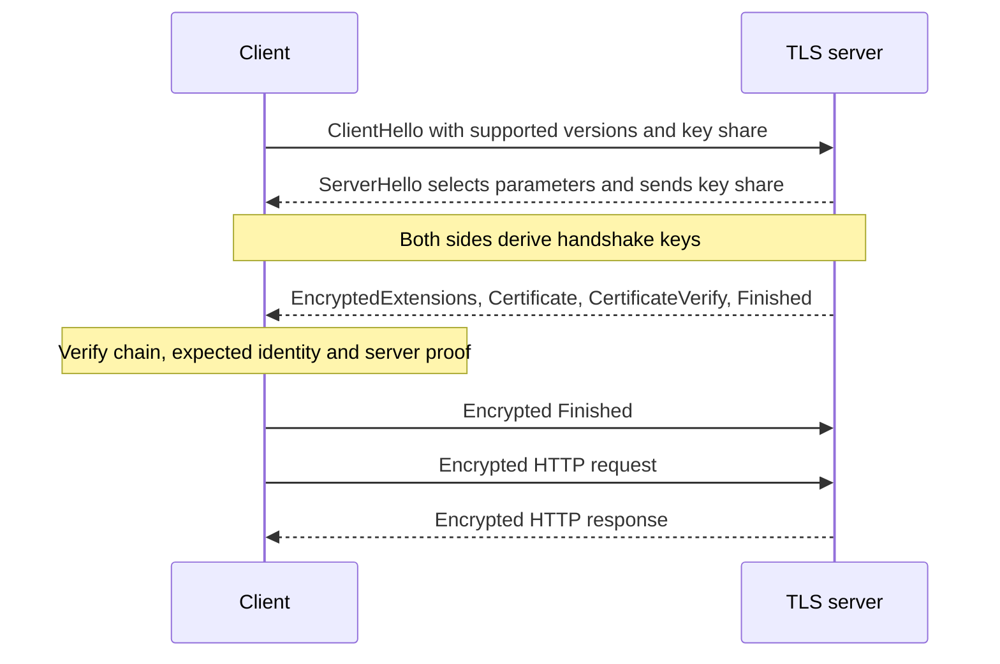

1. The client offers cryptographic options and a public key share. It often sends the hostname in **Server Name Indication (SNI)** so a server hosting several names can select a certificate. The peers may also negotiate the application protocol using **ALPN**.
2. The server selects parameters and sends its public key share. In a typical full handshake, ephemeral key agreement lets both sides derive shared secrets without sending those secrets across the wire.
3. With handshake protection in place, the server supplies its certificate chain and signs handshake data in `CertificateVerify` to prove it holds the corresponding private key. `Finished` authenticates the handshake transcript. The client checks proof, chain, expected name, and validity before relying on the connection.
4. The peers derive **symmetric** traffic keys and use authenticated encryption for application data. Public-key cryptography helps establish trust and keys. Symmetric cryptography then protects bulk data efficiently.

This describes TLS 1.3 over TCP. TLS 1.2 uses a different handshake structure. QUIC integrates TLS 1.3 authentication and key establishment with its own transport handshake and packet protection. Observers can still see network metadata such as addresses and traffic timing. In common TLS deployments the initial SNI may be visible unless encrypted ClientHello is in use. [TLS 1.3, RFC 8446](https://www.rfc-editor.org/rfc/rfc8446.html)

### Where TLS stops and application access begins

| Concept | What it establishes | Example |
| --- | --- | --- |
| HTTP without TLS | HTTP methods, responses, and semantics. | A private loopback lab on `http://127.0.0.1:18080`. |
| HTTPS | HTTP semantics with transport confidentiality, integrity, and peer authentication. | A client checks the public API's certificate and sends encrypted requests. |
| TLS server authentication | The client connected to a peer authorized for the verified identity. | The certificate matches `api.course.example` and chains to a trusted issuer. |
| Application authentication and authorization | Who the request represents and which action is permitted. | A login or API token identifies the caller, and a policy decides whether they may delete an item. |

A **reverse proxy** receives requests on behalf of one or more downstream applications. **TLS termination** is where the protected connection ends. A proxy can terminate client TLS and open its own HTTP or HTTPS connection upstream. The client verifies the proxy's front-end identity for the requested name. Protection on the next hop is a separate design choice. HTTPS itself leaves application validation, authorization, and endpoint hardening to their own mechanisms.

| Certificate symptom | What to investigate |
| --- | --- |
| Name mismatch | Verify the URL hostname, server selection, and SAN entries. Use the intended name and correct the certificate or routing at the authorized endpoint. |
| Unknown issuer or incomplete chain | Check the issuer and missing intermediate certificates. Use the appropriate approved trust chain. |
| Expired or not yet valid | Check client clock and certificate dates. The service owner may need to renew or replace it. |

Inspect the explicit TLS error and the URL before retrying. In an authorized session, `curl -v` can show the connection and certificate verification result. It can also print request headers, so use it with public or disposable data. A plaintext lab response says nothing about certificate validity. In this course TLS failures can be investigated with supplied evidence without changing the trust store.

**Key takeaways.** Identify the expected name, the endpoint where TLS terminates, and the verification step that passed or failed. Application permissions still determine what a user may do.

<a id="net-13"></a>

## Part 13 — Firewalls and Network Security

### Decide who can reach a listening service

Suppose a backend and a database listen on the same machine. Users need the web service, and the database is intended for the backend. A **firewall** enforces rules about which network traffic can enter, leave, or pass through a system. A **host firewall** applies decisions at a machine. A **network firewall** can apply policy between networks or segments. Both can consider protocol, addresses, ports, direction, and connection state.

| Rule concept | Question to answer | Example |
| --- | --- | --- |
| Inbound | What may arrive at this host or boundary? | Allow TCP `443` to the web front end from its intended clients. |
| Outbound | What may originate from this host or segment? | Allow database connections from the app tier to an approved database endpoint. |
| Allow or deny | Should matching traffic be passed, dropped silently, or rejected explicitly? | Deny inbound database traffic from general client networks. |
| Stateful filtering | Is this packet part of an allowed conversation the firewall has tracked? | Permit replies to a client connection that was allowed outbound. |

With stateful filtering, a firewall can distinguish a reply from a new inbound attempt. For UDP, tracking generally uses endpoint and timing information rather than a TCP handshake. **Segmentation** divides a network into scopes with distinct connectivity policies. For example, a database segment might allow PostgreSQL from the backend segment only. The database still authenticates its users and checks their privileges.

### Separate bind, routing, and access policy

To receive a new request remotely, a service needs a suitable bind address and port, a route from the client and back, and permission from any relevant filters. `0.0.0.0:8080` specifies an IPv4 listener on the host's local addresses. A firewall can still block it. Conversely, a rule allowing `8080` to the LAN address does not move a listener off `127.0.0.1`. NAT translation, where needed, is another separate decision.

Open only the endpoint and network scope intended for the service. Each exposed port offers another place where software accepts and interprets untrusted input. PostgreSQL is normally reachable from authorized applications or administration networks, which reduces who can attempt database login. HTTPS protects an HTTP conversation in transit, and application authentication and authorization determine who can perform an operation. A network rule can narrow who reaches the listener before either of those checks happens.

In the labs, inspect loopback listeners and use supplied policy snapshots for remote cases. Changing a real firewall, route, router rule, or DNS record is an authorized administrative operation. None of these labs requires that change.

**Key takeaways.** A listener answers the local binding question. Routing and filtering answer reachability questions. TLS and application authorization protect different parts of the exchange.

<a id="net-14"></a>

## Part 14 — Networking Diagnostic Tools

Start by asking a specific question. An address list, a socket table, an ICMP probe, and an HTTP response offer different kinds of evidence. Examples below either read local state or send a loopback probe. Sample fields and timing are illustrative. Inspect real address and route information locally and redact it before sharing.

### Ubuntu Bash — Interfaces, routes, and sockets

```bash
ip -br addr
ip addr show dev lo
ip route
ip route get 198.51.100.20
hostname
hostname -I
```

- `ip addr` shows interfaces, addresses, and prefixes. `-br` makes the listing compact. `show dev lo` selects the loopback device. A non-loopback interface can have several addresses.
- `ip route` shows IPv4 route entries by default. `ip -6 route` shows IPv6 routes. A line like `default via 192.168.1.1 dev eth0` shows the gateway and outgoing interface. `ip route get DESTINATION` asks the kernel to select a route without sending a probe. An illustrative reply is `198.51.100.20 via 192.168.1.1 dev eth0 src 192.168.1.10`. Read `via` as next hop, `dev` as interface, and `src` as the selected source.
- `hostname` prints the configured name. On Ubuntu, `hostname -I` lists addresses from configured interfaces, omitting loopback and IPv6 link-local addresses. It may show several entries and is not a reliable way to select a usable address for a particular destination. Use `ip addr` for scope and `ip route get` for route selection. [ip-route manual](https://man7.org/linux/man-pages/man8/ip-route.8.html)

Run the socket checks with the lab in [Part 15](#http-lab) or compare them to the sample. Use your actual lab port in the filter.

```bash
ss -ltn 'sport = :18080'
ss -tn state established '( sport = :18080 or dport = :18080 )'
ss -lun
```

`ss` lists sockets. `-l` requests listeners, `-t` selects TCP, `-u` selects UDP, and `-n` displays numeric addresses and ports. `sport` is the local port in this view and `dport` the peer port. The state and port filters narrow a connection snapshot. Add `-p`, as in `ss -ltnp 'sport = :18080'`, for process information when permitted. You can often see your own processes and may see fewer details for other users. Routine inspection needs no elevation. [ss manual](https://man7.org/linux/man-pages/man8/ss.8.html)

```text
State   Recv-Q Send-Q Local Address:Port   Peer Address:Port
LISTEN  0      50     127.0.0.1:18080     0.0.0.0:*
```

The local address and port identify this listener. The peer column is a placeholder because the listener has no particular connected client. Established rows show actual peers. On one host you may see both halves of a loopback connection, with the endpoints swapped. Windows or Linux may show an IPv4-mapped IPv6 form such as `::ffff:127.0.0.1` for an IPv4 peer, depending on the socket implementation. Focus on the state and the local versus peer fields.

### Ubuntu Bash — Reachability, names, and HTTP

```bash
ping -c 2 127.0.0.1
tracepath -n -m 4 127.0.0.1
getent hosts localhost
curl --noproxy '*' --connect-timeout 1 --max-time 3 -i http://127.0.0.1:18080/health
```

- `ping -c COUNT ADDRESS` sends ICMP echo probes. ICMP carries network control messages. A reply gives a round-trip time and confirms that some ICMP traffic can return. A failed ping can reflect filtering or policy. Neither outcome tests a TCP port or HTTP route.
- `tracepath -n -m HOPS ADDRESS` reports its observed path using probes with bounded hop counts. `-n` keeps numeric addresses, and `-m 4` sets a small maximum hop count. `traceroute -n -m 4 127.0.0.1` is another local example if `traceroute` is installed. On routed networks, missing intermediate replies can coexist with a reachable destination. The path and return route can differ.
- `getent hosts NAME` uses the system lookup mechanism. Use `getent ahostsv4 NAME` for IPv4. `dig` or `nslookup` questions a DNS resolver with explicit record types. Compare the output status and answer section using the examples in [Part 10](#net-10).
- `curl URL` speaks HTTP. `-i` includes response headers, `-H 'Name: value'` adds a request header, and `-v` shows phases and request/response details. `-L` follows redirects, and `-4` or `-6` limits the IP family when applicable. `--connect-timeout` limits the connection phase, including applicable resolution and handshakes. `--max-time` limits the total operation. An HTTP status line signals a response from an HTTP endpoint. A line such as `curl: (7) Failed to connect` indicates no successful connection for that attempt. Code `28` is a timeout, and verbose output helps you tell whether it happened before or after connection. `-I` sends HEAD, so use `-i` for viewing headers while keeping a GET. [curl manual](https://curl.se/docs/manpage.html)

For a fictional hostname in a local HTTP lab, curl can use a temporary address mapping for one command.

```bash
curl --noproxy '*' --max-time 3 \
    --resolve 'netlab.invalid:18080:127.0.0.1' \
    -i http://netlab.invalid:18080/health
```

`--resolve HOST:PORT:ADDRESS` supplies the address for that exact name and port. The HTTP authority remains `netlab.invalid:18080`. A verbose run can show the address connected to and the `Host` header. The mapping neither edits the OS hosts file nor changes normal TLS verification. This example uses a loopback address and plaintext HTTP.

### Windows PowerShell — Match each question to its tool

```powershell
ipconfig
Get-NetIPAddress -AddressFamily IPv4 |
    Format-Table InterfaceAlias, IPAddress, PrefixLength
Get-NetRoute -DestinationPrefix '0.0.0.0/0' |
    Format-Table InterfaceAlias, NextHop, RouteMetric
```

`ipconfig` summarizes adapters, addresses, masks, and gateways. `ipconfig /all` adds details such as DHCP and configured DNS servers. `Get-NetIPAddress` returns PowerShell objects that can be filtered by family and displayed with selected fields. The route command shows default route candidates. These commands describe Windows, including some virtual adapters, when run in a Windows shell.

```powershell
Get-NetTCPConnection -State Listen -LocalPort 18080 -ErrorAction SilentlyContinue |
    Format-Table LocalAddress, LocalPort, State, OwningProcess
Test-NetConnection -ComputerName 127.0.0.1 -Port 18080
Resolve-DnsName -Name localhost -Type A
ping.exe -n 2 127.0.0.1
tracert.exe -d -h 4 -w 1000 127.0.0.1
curl.exe --noproxy '*' --connect-timeout 1 --max-time 3 -i http://127.0.0.1:18080/health
```

- `Get-NetTCPConnection` can filter Windows TCP state by local port. `OwningProcess` is a PID. `-ErrorAction SilentlyContinue` avoids an error report when the narrow query has no matches. If the result is surprising, rerun without that option to see any underlying error. For a client socket inspect both `LocalPort` and `RemotePort`.
- `Test-NetConnection -ComputerName HOST -Port PORT` tests a TCP connection. Read `RemoteAddress` and `TcpTestSucceeded`. A result of `True` shows that TCP connected and says nothing about the HTTP route. A result of `False` prompts more investigation. This probe opens a connection, so reserve it for the HTTP lab or a service designed for repeated clients.
- `Resolve-DnsName` shows records and their types. `-Type A` requests IPv4. For an explicit DNS query, see the `-DnsOnly` and `-NoHostsFile` form in Part 10.
- `ping.exe -n COUNT` uses the Windows count flag. `tracert.exe -d` skips reverse name lookups, `-h` bounds hops, and `-w` is the per-reply wait in milliseconds. `*` in a row means that a probe got no reply at that hop.
- Use `curl.exe` to select curl explicitly because some PowerShell environments also define `curl` as a shell alias. Use `$LASTEXITCODE` immediately afterward for the native command's exit code. In Bash the corresponding value is `$?`. [Windows TCP connection tools](https://learn.microsoft.com/en-us/powershell/module/nettcpip/get-nettcpconnection), [Test-NetConnection](https://learn.microsoft.com/en-us/powershell/module/nettcpip/test-netconnection), [Resolve-DnsName](https://learn.microsoft.com/en-us/powershell/module/dnsclient/resolve-dnsname)

To see both halves of a live Windows lab connection, select established rows with either endpoint using its port.

```powershell
Get-NetTCPConnection -State Established -ErrorAction SilentlyContinue |
    Where-Object { $_.LocalPort -eq 18080 -or $_.RemotePort -eq 18080 } |
    Format-Table LocalAddress, LocalPort, RemoteAddress, RemotePort, State
```

A completed short request may disappear before you take a snapshot. Try while the local lab's `/slow` request is in progress. A `TimeWait` row after completion is normal.

### Availability and controlled packet observation

Windows 11 normally provides the built-in Windows commands above. Ubuntu commonly has `ip` and `ss` from `iproute2`, `getent`, and `hostname`. A minimal installation can omit tools. `dig` and `nslookup` can be supplied by `dnsutils`, `ping` by `iputils-ping`, `tracepath` by `iputils-tracepath`, and `curl` by its namesake package. Use the Windows equivalent or a supplied sample when appropriate. Package installation requires `sudo` on Ubuntu. See [the Linux package management chapter](../01_Linux/Linux_Theory.md#part-10).

**Packet capture** records packet observations on a selected interface. `tcpdump` may be absent and usually requires elevation or specific packet-capture privileges. For an optional demonstration, after confirming that the chosen port belongs to your loopback-only lab, this narrow **Ubuntu Bash** example observes up to six summary lines. Run it only on the authorized lab loopback interface, then make one lab request from another tab. Stop with **Ctrl+C** if it is waiting. Use your chosen lab port in both places.

```bash
sudo tcpdump -i lo -nn -c 6 'host 127.0.0.1 and tcp port 18080'
```

`-i lo` restricts the interface, `-nn` keeps addresses and ports numeric, and `-c` limits matched packets. The filter narrows observations to IPv4 loopback and this TCP port. A summary can show endpoints, flags, and lengths. It is one interface's view, which may differ from what applications read. Packet contents and metadata can be sensitive. No capture is needed for the exercises.

**Key takeaways.** Choose a tool that tests the intended layer. Read address family, endpoints, state, and response together. Local observations from Windows and Ubuntu can describe different network stacks.

<a id="net-15"></a>

## Part 15 — Networking in Java and Spring Boot

### See the addresses Java can use

Java supplies network objects and calls into the operating system to create and manipulate sockets. `InetAddress` represents an IP address and can look up a hostname. `InetSocketAddress` represents an IP endpoint with a port, or a host and port awaiting resolution. For `localhost`, the address family available to a Java program depends on the environment and JVM settings.

Save this as `LookupLocal.java` in a fresh practice folder. The client and server examples below use numeric addresses to make the address family explicit.

```java
import java.net.InetAddress;

public class LookupLocal {
    public static void main(String[] args) throws Exception {
        for (InetAddress address : InetAddress.getAllByName("localhost")) {
            System.out.println(address.getHostAddress());
        }
    }
}
```

Run `java LookupLocal.java` in **Ubuntu Bash or Windows PowerShell**. JDK 21 can compile and launch this source file directly. Expect one or more loopback results. Java may print expanded IPv6 text such as `0:0:0:0:0:0:0:1` for `::1`. This example tests name lookup without opening a connection. A JVM or application can cache name results, so external diagnostic commands and a long-running process may observe different answers.

<a id="tcp-lab"></a>

### Build a one-connection TCP line exchange

Save the following as `LineServer.java`. It binds to IPv4 loopback, listens for one client, and reads one UTF-8 line. A successful attempt prints the peer and sends back a line starting with `ACK`. The server ends after one accepted connection, including one that closes without a line. Use only `LineClient` to connect during this exercise, because a separate TCP test would also consume that connection.

```java
import java.io.BufferedReader;
import java.io.BufferedWriter;
import java.io.InputStreamReader;
import java.io.OutputStreamWriter;
import java.net.InetSocketAddress;
import java.net.ServerSocket;
import java.net.Socket;
import java.nio.charset.StandardCharsets;

public class LineServer {
    public static void main(String[] args) throws Exception {
        int port = args.length == 0 ? 19090 : Integer.parseInt(args[0]);
        try (ServerSocket listener = new ServerSocket()) {
            listener.bind(new InetSocketAddress("127.0.0.1", port));
            System.out.println("Listening on 127.0.0.1:" + listener.getLocalPort());

            try (Socket peer = listener.accept()) {
                peer.setSoTimeout(5_000);
                BufferedReader input = new BufferedReader(
                        new InputStreamReader(peer.getInputStream(), StandardCharsets.UTF_8));
                BufferedWriter output = new BufferedWriter(
                        new OutputStreamWriter(peer.getOutputStream(), StandardCharsets.UTF_8));

                String line = input.readLine();
                if (line == null) {
                    System.out.println("Peer closed before sending a line");
                    return;
                }
                System.out.println("Received from " + peer.getRemoteSocketAddress() + ": " + line);
                output.write("ACK " + line + "\n");
                output.flush();
            }
        }
    }
}
```

Save this as `LineClient.java` in the same folder.

```java
import java.io.BufferedReader;
import java.io.BufferedWriter;
import java.io.InputStreamReader;
import java.io.OutputStreamWriter;
import java.net.InetSocketAddress;
import java.net.Socket;
import java.nio.charset.StandardCharsets;

public class LineClient {
    public static void main(String[] args) throws Exception {
        int port = args.length == 0 ? 19090 : Integer.parseInt(args[0]);
        try (Socket socket = new Socket()) {
            socket.connect(new InetSocketAddress("127.0.0.1", port), 1_500);
            socket.setSoTimeout(4_000);
            System.out.println(socket.getLocalSocketAddress() + " -> " + socket.getRemoteSocketAddress());

            BufferedWriter output = new BufferedWriter(
                    new OutputStreamWriter(socket.getOutputStream(), StandardCharsets.UTF_8));
            BufferedReader input = new BufferedReader(
                    new InputStreamReader(socket.getInputStream(), StandardCharsets.UTF_8));
            output.write("hello network\n");
            output.flush();
            System.out.println(input.readLine());
        }
    }
}
```

These commands work in **Ubuntu Bash or Windows PowerShell**. Compile first. Run the server command in one tab and wait for its listening line. Run the client command in a second tab using the same directory and OS.

```bash
javac LineServer.java LineClient.java
java LineServer 19090
```

```bash
java LineClient 19090
```

The client prints a temporary local port and remote port `19090`, then `ACK hello network`. The server prints the client's local endpoint as its peer. `listener.accept()` returns a new connected socket after the OS has established a connection. The timeout on `peer` applies to reading from that accepted socket. The server uses newline as a message delimiter, and `flush()` lets buffered output leave immediately. A missing newline or flush can make a read wait even when TCP works. Socket cleanup closes the local endpoint on either run. You can also start `java LineServer 0`, read the port chosen by the OS, and give that port to the client. [Java 21 ServerSocket](https://docs.oracle.com/en/java/javase/21/docs/api/java.base/java/net/ServerSocket.html), [Java 21 Socket](https://docs.oracle.com/en/java/javase/21/docs/api/java.base/java/net/Socket.html)

<a id="http-lab"></a>

### Start a reusable loopback HTTP server

Use `HttpLab.java` for the workbook. It uses the JDK's `jdk.httpserver` module and restricts listening to a literal loopback address. It can accept multiple requests during its lifetime. Its small handler makes status, redirects, and delayed responses visible.

```java
import com.sun.net.httpserver.HttpExchange;
import com.sun.net.httpserver.HttpServer;
import java.io.IOException;
import java.net.InetSocketAddress;
import java.nio.charset.StandardCharsets;

public class HttpLab {
    public static void main(String[] args) throws IOException {
        int port = args.length == 0 ? 18080 : Integer.parseInt(args[0]);
        String address = args.length < 2 ? "127.0.0.1" : args[1];
        if (!address.equals("127.0.0.1") && !address.equals("::1")) {
            throw new IllegalArgumentException("Use 127.0.0.1 or ::1 for this lab");
        }

        HttpServer server = HttpServer.create(new InetSocketAddress(address, port), 0);
        server.createContext("/", HttpLab::handle);
        server.start();
        System.out.printf("Listening on %s port %d%n", address, server.getAddress().getPort());
    }

    private static void handle(HttpExchange exchange) throws IOException {
        try (exchange) {
            exchange.getResponseHeaders().set("Cache-Control", "no-store");
            if (!exchange.getRequestMethod().equals("GET")) {
                exchange.getResponseHeaders().set("Allow", "GET");
                exchange.sendResponseHeaders(405, -1);
                return;
            }

            switch (exchange.getRequestURI().getPath()) {
                case "/health" -> respond(exchange, 200, "ready\n");
                case "/go" -> {
                    exchange.getResponseHeaders().set("Location", "/health");
                    exchange.sendResponseHeaders(302, -1);
                }
                case "/slow" -> {
                    try {
                        Thread.sleep(5_000);
                    } catch (InterruptedException error) {
                        Thread.currentThread().interrupt();
                        return;
                    }
                    respond(exchange, 200, "slow response\n");
                }
                default -> respond(exchange, 404, "not found\n");
            }
        }
    }

    private static void respond(HttpExchange exchange, int status, String body) throws IOException {
        byte[] bytes = body.getBytes(StandardCharsets.UTF_8);
        exchange.getResponseHeaders().set("Content-Type", "text/plain; charset=utf-8");
        exchange.sendResponseHeaders(status, bytes.length);
        exchange.getResponseBody().write(bytes);
    }
}
```

Compile and run these commands in **Ubuntu Bash or Windows PowerShell**.

```bash
javac --add-modules jdk.httpserver HttpLab.java
java --add-modules jdk.httpserver HttpLab 18080 127.0.0.1
```

The module option makes the JDK HTTP server available. The address and port arguments select the endpoint. The server prints `Listening on 127.0.0.1 port 18080` when ready. It uses the default executor, so a delayed request can occupy its handler while another request waits. Use the lab with a small number of sequential requests. For an IPv6 loopback experiment, stop it and use `::1` as the address if IPv6 loopback is active. A bind conflict can be solved by choosing a free lab port, or port `0` and reading the selected number.

From a second tab in the same OS, send a GET. Use the matching form.

```bash
curl --noproxy '*' --max-time 3 -i http://127.0.0.1:18080/health
```

```powershell
curl.exe --noproxy '*' --max-time 3 -i http://127.0.0.1:18080/health
```

Look for a `200` status, `Content-Type: text/plain; charset=utf-8`, and `ready`. Header capitalization and order can vary. A GET for an unknown path returns `404`. `/go` returns a `302` with a `Location` header. `/slow` waits approximately five seconds before sending its response. Other methods get `405` and `Allow: GET` without a body. If a short-deadline client gives up on `/slow`, allow the original handler to finish before sending another request. Stop the server in its tab with **Ctrl+C** when finished. [JDK 21 HttpServer](https://docs.oracle.com/en/java/javase/21/docs/api/jdk.httpserver/com/sun/net/httpserver/HttpServer.html)

#### Optional static HTTP server with Python

For basic HTTP and listener practice, Python's standard library can serve a disposable file if Python 3 is already installed. Use a fresh folder containing only intended lab files. This version serves `/ready.txt` and ordinary missing paths. The Java server supplies the specific redirect and slow route used in later labs.

**Ubuntu Bash**

```bash
python3 --version
printf '%s\n' 'ready' > ready.txt
python3 -m http.server 18080 --bind 127.0.0.1 --directory .
```

**Windows PowerShell**, if the Python launcher is available

```powershell
py -3 --version
Set-Content -LiteralPath .\ready.txt -Value 'ready' -Encoding Ascii
py -3 -m http.server 18080 --bind 127.0.0.1 --directory .
```

`--bind` limits the server to loopback and `--directory .` selects the current folder. Use `/ready.txt` in the GET from a second tab, and stop the server with **Ctrl+C** after the test. The server lists or reads files from the served folder, which is why the disposable folder matters. [Python HTTP server module](https://docs.python.org/3/library/http.server.html)

### Make an HTTP request from Java

Save this as `LabHttpClient.java`. The code only builds URLs at local IPv4 loopback. It uses a direct connection and sets a deadline so it can distinguish a delayed server from a `404` response.

```java
import java.net.URI;
import java.net.http.HttpClient;
import java.net.http.HttpRequest;
import java.net.http.HttpResponse;
import java.time.Duration;

public class LabHttpClient {
    public static void main(String[] args) throws Exception {
        int port = args.length == 0 ? 18080 : Integer.parseInt(args[0]);
        String path = args.length < 2 ? "/health" : args[1];
        if (!path.startsWith("/")) {
            throw new IllegalArgumentException("Use a path starting with /");
        }

        HttpRequest request = HttpRequest.newBuilder(URI.create("http://127.0.0.1:" + port + path))
                .timeout(Duration.ofSeconds(2))
                .GET()
                .build();
        try (HttpClient client = HttpClient.newBuilder()
                .proxy(HttpClient.Builder.NO_PROXY)
                .version(HttpClient.Version.HTTP_1_1)
                .connectTimeout(Duration.ofSeconds(1))
                .build()) {
            HttpResponse<String> response = client.send(request, HttpResponse.BodyHandlers.ofString());
            System.out.println("HTTP " + response.statusCode());
            System.out.print(response.body());
        }
    }
}
```

With `HttpLab` running, use these commands in **Ubuntu Bash or Windows PowerShell**.

```bash
javac LabHttpClient.java
java LabHttpClient 18080 /health
java LabHttpClient 18080 /missing
java LabHttpClient 18080 /slow
```

Expect `HTTP 200` with `ready`, then `HTTP 404` with `not found`. The last example normally reports `HttpTimeoutException` while waiting for the delayed response. `send` returns a response object for ordinary HTTP error statuses. A connection issue or deadline can raise an exception before a response is available. An application can reuse an `HttpClient` across multiple requests, which can allow its underlying connections to be reused. The sample closes it at the end of each program run. [Java 21 HttpClient builder](https://docs.oracle.com/en/java/javase/21/docs/api/java.net.http/java/net/http/HttpClient.Builder.html), [Java 21 HttpRequest builder](https://docs.oracle.com/en/java/javase/21/docs/api/java.net.http/java/net/http/HttpRequest.Builder.html)

| Limit | What you are waiting for | Concrete example |
| --- | --- | --- |
| Connect timeout | A new connection to be established. | `Socket.connect(endpoint, 1500)` waits up to 1,500 ms for that connect operation. The endpoint may already have been resolved. Java `HttpClient` connect timeout applies when a new connection is needed. |
| Socket read timeout | Data to become available during a blocking read. | `socket.setSoTimeout(4000)` can raise `SocketTimeoutException` on a stalled read. Several reads can take longer in total. |
| HTTP request timeout | An HTTP response according to the HTTP client's deadline rules. | `HttpRequest.Builder.timeout(...)` bounds the wait for the delayed response in this example. Check body handling separately for clients that return or stream a body after headers. |
| Pool acquisition timeout | A connection handle to become available from a pool. | Waiting behind other database requests can exhaust the pool wait even when some existing connections are healthy. |

### Map the lab to Spring Boot and PostgreSQL

In a Spring Boot servlet app, the embedded HTTP server, often Tomcat, binds to the configured local address and port. For a loopback-only example, `server.address=127.0.0.1` and `server.port=8080` select the listener. The OS establishes TCP and delivers stream bytes. The HTTP server parses them and dispatches a request through filters and Spring MVC. A method such as `@GetMapping("/api/v1/garments")` is a routing decision after that protocol work. The response is serialized by the framework and transmitted by the server. One TCP connection may carry several HTTP requests over time, or several streams with HTTP/2. [Spring Boot embedded servlet servers](https://docs.spring.io/spring-boot/reference/web/servlet.html)

A PostgreSQL JDBC URL such as `jdbc:postgresql://127.0.0.1:5432/labdb` selects a host, port, and database. The PostgreSQL JDBC driver uses TCP for that URL, can negotiate protected transport according to configuration, and exchanges database startup and authentication messages. A connection pool owns physical database connections and may hand out a logical handle to a request. Closing a pooled handle usually returns it to the pool rather than closing the TCP connection. A stale connection, an exhausted pool, a TCP failure, an authentication rejection, and an SQL error need different evidence. Driver connect and socket-read timeouts, pool wait, and statement execution limits govern different operations. [pgJDBC connection parameters](https://jdbc.postgresql.org/documentation/use/)

**Key takeaways.** Java calls the OS for endpoints and I/O. Protocol libraries interpret the bytes. A successful connect, a response deadline, and an application operation each have their own result.

<a id="net-16"></a>

## Part 16 — End-to-End Networking Flows

### A — Postman reaches Spring Boot in the same environment

Suppose Postman and the backend both run on Windows. The same reasoning applies to two programs in the same Ubuntu networking environment.

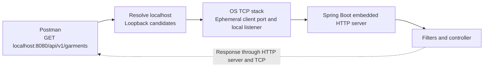

1. Postman parses the scheme, host, port, and path. `localhost` yields one or more loopback candidates, commonly `127.0.0.1` and `::1`.
2. The OS connects to the candidate and port. For IPv4 the conversation might be `127.0.0.1:53124 → 127.0.0.1:8080`. It stays in the local networking stack. An IPv4-only listener is a match for the IPv4 destination.
3. The embedded HTTP server receives bytes from an accepted socket and parses the request. Filters can authenticate or reject it before Spring MVC selects the controller. A method or path mismatch can produce a valid HTTP error.
4. The application result becomes a response. Postman shows the status, headers, and body. If there was no listener on the requested endpoint, you would usually see a connection failure instead.

### B — A client reaches a backend on another computer

Use the illustrative LAN peers `192.168.1.10/24` and `192.168.1.20/24`. The client names the backend's reachable address, `192.168.1.20`, and TCP port `8080`. The prefix match makes the backend a local neighbor, so the frame goes to its MAC address after ARP. If the client is on a different subnet, it uses a route and usually sends the first frame to a gateway, as in [the neighbor delivery diagram](#net-05).

The backend must listen on an address that matches the arriving packets. A `127.0.0.1` listener serves requests within its own environment. An appropriate LAN bind can receive the corresponding remote traffic when policy allows it. Firewalls must permit the flow and replies must have a route back. After TCP and any TLS handshake, the HTTP path is evaluated just as it would be on loopback. Use this as a paper trace. The hands-on labs remain on loopback.

### C — Spring Boot connects to PostgreSQL

Imagine a backend configured for `jdbc:postgresql://db.course.example:5432/labdb`. The hostname is fictional and represents a database reachable only from authorized applications.

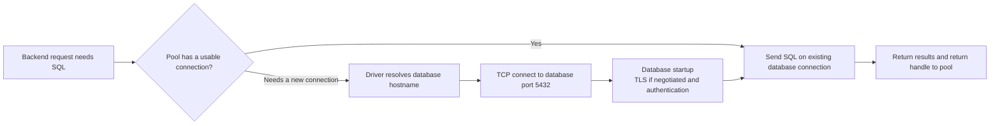

1. The request asks the pool for a connection. A busy pool may require a wait even if it already has healthy TCP connections.
2. When opening a connection, the driver resolves the hostname and connects to the database endpoint. Check this from the backend's environment, because that process owns the client socket.
3. Once TCP is established, the PostgreSQL startup conversation can include TLS and database authentication. PostgreSQL can reject a login after successful transport. The server's listening addresses and database authentication rules describe different controls.
4. The driver sends SQL once the database connection is ready. A SQL type or constraint error is evidence that a database operation reached a database session. Returning a handle to the pool often leaves the physical TCP socket open for the next request.

If the app runs alongside the database, `127.0.0.1` can work for both when they share the same network stack. When the app moves, its loopback points back to the app's own environment. The app then needs the database's actual reachable endpoint. [PostgreSQL connections and authentication settings](https://www.postgresql.org/docs/current/runtime-config-connection.html)

### D — A browser requests a public HTTPS website

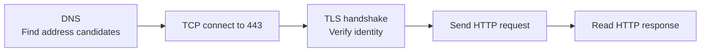

This order applies to a new HTTP/1.1 or HTTP/2 HTTPS connection. The browser can reuse a DNS result or an existing protected connection. It can also choose HTTP/3, in which QUIC over UDP establishes the transport and integrates the TLS handshake. Routing and filtering apply to every path. A certificate error normally stops this transaction before the browser accepts an HTTP response from that endpoint.

### E — A backend calls an external REST API

Your backend becomes the client. It constructs the method and URL, resolves the API name if opening a fresh connection, and connects from the backend's network environment. TLS verifies the server identity. The backend sends the application request with whatever authentication that API requires. It reads the status and body, and can reuse a connection for later requests.

An error can occur at each stage. A failed DNS lookup gives no destination. A connect timeout occurs before TCP completes. A TLS problem can follow a successful TCP connection. An HTTP `429` or `503` is an application-protocol response. A timeout after sending an operation leaves open the possibility that the other service processed it. Record which stage completed, spend retries within a bounded time budget, and repeat operations only according to their idempotency and the API's contract. The same distinctions apply if the calling backend uses Java's `HttpClient`.

**Key takeaways.** The caller's environment determines name lookup, routes, and local endpoints. A healthy transport can carry either an application success or application error. On a reused connection, some setup stages may already have completed.

<a id="net-17"></a>

## Part 17 — WSL2 and Docker Networking Preview

### Locate the client and server before interpreting localhost

A **virtual network interface** is a software-created attachment to a network. It can move packets between virtual machines, network namespaces, and physical interfaces. A **network namespace** is an isolated view of interfaces, addresses, routes, and sockets. WSL2 runs a Linux kernel in a Windows-managed VM, so Windows and the Linux guest can have distinct networking state and loopbacks.

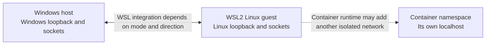

The two environments in the diagram each have a local stack. A supported forwarding or mirrored path can make a listener accessible from the other side. A local address stays meaningful only in the context where it is used.

| Situation | What to check |
| --- | --- |
| Windows client → WSL server in default NAT mode | Microsoft documents Windows localhost forwarding to Linux apps. Verify the WSL listener and the Windows connection separately. Availability can depend on configuration and competing listeners. |
| WSL client → Windows server in default NAT mode | Generally use the Windows host address as seen from WSL for this direction, and ensure the Windows service is actually reachable there. The gateway shown by `ip route show default` in a typical default NAT setup indicates the Windows-side address. A Windows loopback-only listener need not accept a connection to that address. |
| Mirrored networking where available | Microsoft documents IPv4 localhost access in both directions. For Linux to a Windows server, `::1` has a documented limitation even when IPv4 `127.0.0.1` works. Evaluate address family and host or Hyper-V firewall policy separately. |

Check the environment with `wsl --list --verbose` in **Windows PowerShell**, and with `ip -br addr`, `ip route`, and `ss -ltn` in **Ubuntu Bash**. `Get-NetTCPConnection` inspects Windows sockets. First reproduce the request with client and server in the same environment. This establishes a known-working endpoint before testing any supported cross-boundary behavior. WSL configuration, version, VPNs, and policy can change observed behavior. [Microsoft WSL networking](https://learn.microsoft.com/en-us/windows/wsl/networking)

### Why a published container port is a separate endpoint

Container networking gives processes their own network view by default. With separate network namespaces, localhost in container A identifies A, while localhost in container B identifies B. A service may listen on TCP `8080` inside its namespace. A **published port** provides a host-side endpoint that a runtime maps or forwards to a target container port. For example, the host side can be `127.0.0.1:18080` while the container side uses port `8080`. The service must listen on an address that the forwarding path can reach. The listening address and the scope of any published host bind matter independently.

Keep track of where each client runs and whether it is using an internal or host endpoint. The Docker Fundamentals course will handle actual networks, port publication, and configuration.

**Key takeaways.** Identify the network stack associated with each process. Then map the listener, address family, and any cross-boundary forwarding involved in the request.

<a id="net-18"></a>

## Part 18 — Network Troubleshooting

Write down the caller, target name or address, port, protocol, path, time, and exact error. A check from your laptop answers a question about your laptop. Reproduce from the application's environment when possible. Read the first stage for which you lack evidence, change one relevant input, and rerun the same check. Probe only lab or authorized endpoints.

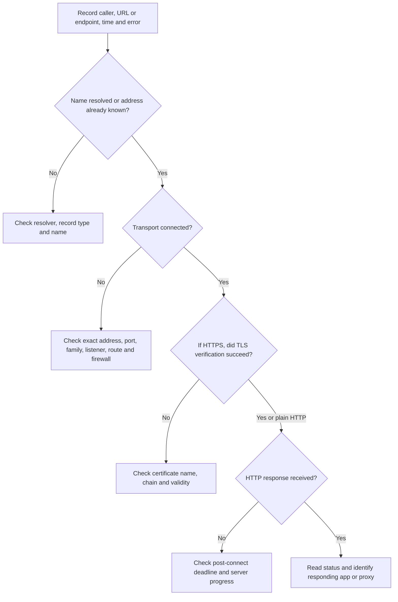

This is a workflow for a new HTTP connection. For a reused connection, setup may have happened earlier. For PostgreSQL, replace the final questions with database startup, authentication, and SQL. Use the following cases to connect symptoms to evidence.

### 1 — Connection refused

**Symptom and likely layer.** Curl reports failure to connect or Java reports `ConnectException: Connection refused`. TCP often received a fast rejection because there is no listener matching the exact address, port, and protocol. An active firewall rejection can also cause it.

**Investigate and correct.** Use `curl -v` with bounded loopback options, then inspect `ss -ltn 'sport = :18080'` or `Get-NetTCPConnection -State Listen -LocalPort 18080` in the server's environment, using your actual port. Check listening address and family. Start the lab service if it is absent or fix the intended destination. A quick explicit rejection is different evidence from no transport response before a timeout.

### 2 — TCP connection times out

**Symptom and likely layer.** The client reaches its connect deadline without establishing TCP. A drop, unreachable path, unavailable host, or broken return path can look similar.

**Investigate and correct.** Check the attempted remote IP in `curl -v` output. Look up the route with `ip route get ADDRESS` or inspect Windows route and TCP probe results on an authorized network. Check the listener on the server and consult approved firewall evidence. Verify the return path and correct the endpoint or report the missing connectivity to the owner. One timeout cannot prove a firewall caused it. A line showing an established connection shifts attention to TLS or the response phase.

### 3 — DNS resolution fails

**Symptom and likely layer.** Curl may report `Could not resolve host`, Java may throw `UnknownHostException`, or the DNS tool may report `NXDOMAIN`, `SERVFAIL`, or a timeout.

**Investigate and correct.** Confirm exact spelling and record type using `getent hosts NAME` and `dig NAME A` in Ubuntu or `Resolve-DnsName -Name NAME -Type A` in PowerShell. Use the configured resolver's view and compare the local system lookup. Fix the intended hostname or consult the DNS owner about the record or resolver. A direct trusted IP test can help establish separate transport facts. A valid address followed by refusal belongs to a later stage.

### 4 — Wrong server port

**Symptom and likely layer.** The host is correct, but a client URL with a different port fails or reaches a different application. A running server process alone gives no evidence about the requested port.

**Investigate and correct.** Compare the startup output with `ss -ltn` or `Get-NetTCPConnection -State Listen` and the client's exact URL. Verify the port belongs to your lab before requesting it. Update the client to the verified endpoint and check for the expected response. If the server failed to bind because another process owns that port, choose a different free lab port and coordinate both ends.

### 5 — Application is listening only on loopback or one family

**Symptom and likely layer.** The service answers from the same stack at `127.0.0.1` but fails from another host or through IPv6 `::1`.

**Investigate and correct.** Read the local address column, then compare concrete client destinations. Test only your lab with `http://127.0.0.1:18080/health` or `http://[::1]:18080/health`. A listener on IPv4 loopback supports the first path. An authorized remote service needs a suitable intended bind and policy. Keep the lab local and use the matching family. If a suitable listener already exists, investigate routes and filters next.

### 6 — The server process never started or exited

**Symptom and likely layer.** No expected listener is present, and the terminal returned to the prompt or the process list no longer shows the server.

**Investigate and correct.** Read the launch output. If you know the PID from this launch, check `ps -p PID` or `Get-Process -Id PID`. Review classpath, bind errors, and other startup diagnostics. Start the lab again and confirm both its printed endpoint and actual socket. A running process with no listener may still be initializing or may be an application with a different role.

### 7 — Traffic is blocked by a firewall

**Symptom and likely layer.** The intended listener answers locally and the approved client path fails. Firewall logs or rules may identify a drop or explicit rejection.

**Investigate and correct.** Compare the specific protocol, source scope, destination, port, and direction against the authorized policy. Use the source-side route and a targeted authorized TCP check, then compare with local listener evidence. A local success and a remote failure narrow the problem but still allow a routing or return-path fault. Report the evidence to the network owner. In a lab use the same-network-stack loopback path. Changing a real firewall is outside the lab.

### 8 — HTTP 404 after a successful connection

**Symptom and likely layer.** An endpoint returns a `404` status. The transport worked well enough to carry a real HTTP reply.

**Investigate and correct.** Use `curl -i` to compare a known health URL and the failing URL. Check the path, method, host routing, and logs from the respondent. Correct the route or address the wrong service if a proxy or different process replied. A connect error has no HTTP `404` status line.

### 9 — HTTPS certificate verification fails

**Symptom and likely layer.** A client connects but reports a name mismatch, untrusted issuer, or certificate date error before accepting an HTTP response.

**Investigate and correct.** Read the verification error in `curl -v` or the application's TLS exception for an authorized endpoint. Compare the URL hostname with SAN, check the chain and clock, and verify that the intended TLS endpoint answered. Have the service owner correct the name, chain, date, or approved trust configuration. Keep certificate verification enabled. HTTP `401` would indicate that an HTTP endpoint already received the request and wants application credentials.

### 10 — The backend cannot reach PostgreSQL

**Symptom and likely layer.** The JDBC error can occur during name lookup, TCP connection, TLS, PostgreSQL login, pool acquisition, or SQL execution.

**Investigate and correct.** Read the sanitized JDBC host and port and the deepest relevant cause. Check resolution and TCP reachability from the backend's environment, and check PostgreSQL's listener and logs from the database's environment. For example, a refusal points toward endpoint reachability, while a database message such as `password authentication failed` shows startup reached a PostgreSQL server. Check database auth only after locating that phase. Correct the internal endpoint or authorized access and preserve private database exposure.

### 11 — The hostname resolves and the application is unreachable

**Symptom and likely layer.** DNS returns one or more addresses, but the target application still fails.

**Investigate and correct.** Compare the A and AAAA results with the address actually attempted in the verbose client trace. Verify listener family, port, and path from the caller. A stale answer or unreachable IPv6 address may explain different behavior between clients. For your loopback test, `curl --resolve` can separate address choice from the application hostname without changing system resolution. Use the service's verified endpoint. An answer from DNS is only a candidate address.

### 12 — The HTTP client hangs or times out after connecting

**Symptom and likely layer.** A trace shows a connection and request, then no response before a deadline. The application or proxy may be waiting on other work.

**Investigate and correct.** Use `curl -v --connect-timeout 1 --max-time 2` with the local `/slow` URL and the direct loopback option, then compare `/health`. A line such as `Connected to` or `Established connection to` before timeout confirms that TCP connected. Check request processing, database pool waits, and upstream deadlines in application logs. For the known lab delay, let the first run finish and retry with a longer total limit. In a real service investigate the late work before changing deadlines or retrying a potentially completed effect.

### 13 — WSL2 networking differs from expectations

**Symptom and likely layer.** The same `localhost` URL succeeds in Ubuntu and fails in Windows, or the opposite direction behaves differently.

**Investigate and correct.** Identify where the server and caller are running. Inspect Windows and Linux listener tables separately, then check `wsl --list --verbose` in PowerShell and `ip route` in Ubuntu. Use a numeric loopback address from the server's own environment first. If only the cross-boundary test fails, check supported forwarding, mode, and family using the documentation. Working local HTTP narrows the fault to the path used by the cross-boundary test. [WSL modes and loopback](#net-17)

**Key takeaways.** Start at the first unverified boundary. Confirm the exact endpoint, preserve errors and statuses, and change only the input that the evidence implicates.

## Networking Protocol and Port Reference

| Protocol | Role | Usual port, when applicable |
| --- | --- | --- |
| Ethernet | Carries frames on the local network. | Uses MAC addresses. |
| IPv4 and IPv6 | Address and route packets. | Use IP addresses. |
| ARP and ICMPv6 Neighbor Discovery | Help find the local next hop's link-layer address. | Work outside TCP and UDP ports. |
| ICMP and ICMPv6 | Carry errors and network control messages such as echo. | Work outside TCP and UDP ports. |
| TCP and UDP | Deliver streams or datagrams to application endpoints. | Port selected per endpoint and transport. |
| SSH | Secure remote access and file transfer. | `22/TCP` |
| DNS | Looks up names and records. | Conventional `53/UDP` or `53/TCP`. Encrypted DNS can use other transports. |
| HTTP | Application request and response. | Usually `80/TCP` for plaintext HTTP, and `8080/TCP` in many development setups. |
| HTTPS | HTTP over a protected transport. | Usually `443/TCP` for HTTP/1.1 or HTTP/2, or `443/UDP` for HTTP/3 over QUIC. |
| PostgreSQL | Database protocol for startup, authentication, and query exchange. | Usually `5432/TCP`. |

## Windows and Linux Command Cheat Sheet

Replace lab ports only with your verified port. The PowerShell and Bash columns are command equivalents for particular questions.

| Question | Ubuntu Bash | Windows PowerShell |
| --- | --- | --- |
| What addresses and interfaces exist? | `ip -br addr` | `Get-NetIPAddress` or `ipconfig` |
| Which route would be used? | `ip route` and `ip route get ADDRESS` | `Get-NetRoute` or routing fields from `Test-NetConnection` |
| Who listens on this port? | `ss -ltnp 'sport = :18080'` | `Get-NetTCPConnection -State Listen -LocalPort 18080` |
| Which connections are established? | `ss -tn state established` then narrow by port | `Get-NetTCPConnection -State Established` then narrow by port |
| Does loopback answer ICMP? | `ping -c 2 127.0.0.1` | `ping.exe -n 2 127.0.0.1` |
| How can I trace a path? | `tracepath -n -m 4 127.0.0.1` | `tracert.exe -d -h 4 -w 1000 127.0.0.1` |
| What can the system resolve? | `getent hosts localhost` | `Resolve-DnsName -Name localhost -Type A` |
| What does a DNS resolver answer? | `dig NAME A` | `Resolve-DnsName -Name NAME -Type A -DnsOnly -NoHostsFile` |
| What did HTTP return locally? | `curl --noproxy '*' --max-time 3 -i URL` | `curl.exe --noproxy '*' --max-time 3 -i URL` |
| Did TCP reach my Windows lab port? | Inspect the curl verbose connect phase for the HTTP lab. | `Test-NetConnection -ComputerName 127.0.0.1 -Port 18080` |

## Glossary

| Term | Meaning |
| --- | --- |
| Address family | Kind of network address, such as IPv4 or IPv6. |
| ARP | Protocol for finding an IPv4 neighbor's link-layer address. |
| Bind | Assign a local address and port to a socket. |
| CIDR prefix | Leading bits that identify an address block. |
| Client and server | Roles of the initiator and the responder in a conversation. |
| Datagram | Discrete transport message, such as one UDP send. |
| Default gateway | Next hop selected by a default route when no more specific route applies. |
| DNS resolver | Component that finds name records for a caller. |
| Encapsulation | Carrying payload data with another protocol's control information. |
| Endpoint | A particular transport address made from IP address and port. |
| Ephemeral port | Temporary local port usually selected by the OS for a client connection. |
| Frame | Unit carried on a data link such as Ethernet. |
| Handshake | Initial exchange in which peers establish state or parameters. |
| Hop | Step from one network node to the next. |
| Idempotency | Property that repeating an identical operation has the same intended effect as one request. |
| Latency | Time taken for a particular path or operation. |
| Listener | Socket waiting for incoming connections on a local endpoint. |
| Loopback | Networking path that leads back to the same networking environment. |
| MAC address | Link-layer address used in Ethernet forwarding. |
| NAT and PAT | Translation of addresses and, with PAT, transport ports. |
| Network namespace | Isolated view of interfaces, routes, and sockets. |
| Packet | Unit of network delivery, often specifically an IP packet. |
| Protocol | Rules and message formats for communication. |
| Route and next hop | Instruction for matching an IP destination and the immediate receiver it selects. |
| Socket | Communication object used through the OS networking interface. |
| Throughput | Rate of successful data transfer observed under stated conditions. |
| TLS termination | Endpoint where a protected TLS connection ends. |
| TTL | Field that limits reuse time for a DNS record. IPv4 uses the same abbreviation for its distinct forwarding lifetime field. |

## Troubleshooting Checklist

- [ ] Identify the client environment, address family, destination, port, protocol, and request path.
- [ ] Verify a hostname answer and which address the client actually attempted.
- [ ] Check the intended listener and process in the server environment.
- [ ] For cross-network traffic, trace the route, next hop, return path, and authorized firewall policy.
- [ ] Distinguish refusal, connect timeout, post-connect timeout, and TLS failure from an HTTP status.
- [ ] Match logs with the failing attempt and verify the response after making one targeted change.

## Readiness Checklist

- [ ] I can explain how a remote IP packet reaches a gateway in a local frame.
- [ ] I can calculate a subnet and determine the selected route for a sample destination.
- [ ] I can distinguish localhost, a wildcard bind, and an address a remote client can use.
- [ ] I can run a loopback server, observe its listener and established endpoints, and interpret an HTTP response.
- [ ] I can say what the client and server each know after DNS, TCP, TLS, and a complete application response.
- [ ] I can locate a backend-to-database failure using evidence from the caller and the server.

### Before Docker Fundamentals

Bring three questions to every container example. Where is the caller running? What address and port is the process listening on? Which address and port can the caller use to reach it? These questions transfer directly to network namespaces, service discovery, and published ports. The same diagnostic sequence works when an extra boundary appears.

## Key Takeaways

- Switches forward frames within a local network. Routers move IP packets between networks, using the next hop selected by a route.
- Transport endpoints determine which socket receives traffic. TCP and UDP give applications different delivery and framing properties.
- DNS supplies candidates for connections, TLS protects the selected connection, and HTTP communicates an application result.
- Check each boundary from the actual caller's environment. Test the endpoint and the application response separately.

Apply the checks yourself in [Part A of the workbook](Networking_Exercises_and_Solutions.md#exercises).
