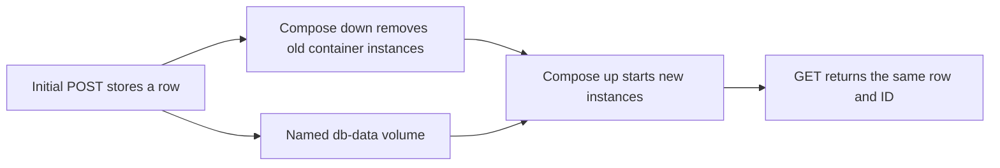

# Docker Fundamentals — Exercises and Solutions

## How to Use This Document

Read the linked [theory chapters](Docker_Theory.md), predict the result, then try Part A before opening Part B. Keep the exact command and output when a task fails. The point of a successful lab is to explain the observation and make the smallest change that would alter it.

## Practice Environment Setup

Use Docker Desktop with its Linux-container engine. Run host commands in **Windows PowerShell**. An instruction like `sh -c 'echo ready'` passed to `docker run` or `docker exec` executes **inside the Linux container**. The labs use public cached or downloaded bases, local loopback endpoints, and disposable state. Java/Maven for the larger lab run inside the builder. [Verify the engine and context](Docker_Theory.md#docker-02)

Start each exercise in a fresh scratch directory with a new scope. In **Windows PowerShell**:

```powershell
$DockerCourseId = 'dockerlab-' + [guid]::NewGuid().ToString('N').Substring(0, 8)
$DockerCourseRoot = Join-Path (Join-Path $env:LOCALAPPDATA 'docker-learning-lab') $DockerCourseId
New-Item -ItemType Directory -Path $DockerCourseRoot -Force | Out-Null
Set-Location -LiteralPath $DockerCourseRoot
$DockerCourseId
Get-Location
```

Keep the scope in the same terminal while working. Each recipe adds a recognizable suffix to these base names. Record the project name when you want to resume a retained volume. Create starter files in this scratch directory using VS Code with the exact file names shown. The notes exercises use the project tree and source listings in the [theory walkthrough](Docker_Theory.md#notes-files) or [the workbook reference](#reference-files).

## Safety Rules

- Verify your Docker context and work in the dedicated scratch directory. Inspect or remove only the containers, networks, volumes, and image tags that belong to that lab.
- Bind any host HTTP test port to `127.0.0.1`. Keep the database unpublished in the Compose project. If a host port is already in use, keep the existing service intact and use a verified free port.
- Use only the supplied fake password and sample notes. Avoid printing the full runtime environment or resolved Compose secrets.
- Stop a named lab container before removal. A named volume is separate from the container and may hold valuable data. Remove it only after confirming its identity and that you intend to discard it.
- Keep public base images available for later exercises. Docker's shared caches can be reused without cleaning other projects. [Storage safety](Docker_Theory.md#docker-09)

<a id="exercises"></a>

# Part A — Exercises

## Level 1 — Docker Foundations

### DOCKER-EX-01 — Verify the engine from PowerShell

**Difficulty** · Level 1  
**Related Theory** · [Part 2 — Docker architecture](Docker_Theory.md#docker-02)

**Learning Objective**  
Distinguish the installed client from the Linux engine and identify the Compose interface.

**Scenario**  
You need to establish which engine your next command would use.

**Prerequisites**  
Docker Desktop installed and started. Use PowerShell.

**Task**  
Inspect the active context, client and server versions, OS type and architecture of the engine, and installed Compose version. If the client responds but the server fails, identify the next place to check.

**Expected Result**  
Your notes show the selected context, a responding Linux server, its architecture, and a version for the modern Compose plugin.

**Self-Check Questions**  
Why is the client version insufficient to prove the engine is available?

**Cleanup**  
None. The checks are read-only.

### DOCKER-EX-02 — Pull and inspect a public image

**Difficulty** · Level 1  
**Related Theory** · [Part 4 — Images](Docker_Theory.md#docker-04), [Part 13 — Registries](Docker_Theory.md#docker-13)

**Learning Objective**  
Read a local tag, image ID, distribution reference, and image history.

**Scenario**  
You want to know what will be used when an nginx container is created.

**Prerequisites**  
A reachable engine and public registry access or a cached `nginx:alpine` image.

**Task**  
Pull the explicit `nginx:alpine` tag, list the local nginx entries, then record the image ID, the registry digest if shown, and one history step. Keep the base image for later labs.

**Expected Result**  
The image is available locally and you can point to metadata and filesystem changes in its history.

**Self-Check Questions**  
If the registry tag is updated, can the same tag later refer to different content?

**Cleanup**  
Leave the shared base tag in place.

### DOCKER-EX-03 — Create before starting

**Difficulty** · Level 1  
**Related Theory** · [Part 2 — Docker architecture](Docker_Theory.md#docker-02), [Part 5 — Lifecycle](Docker_Theory.md#docker-05)

**Learning Objective**  
Observe creation separately from execution and inspect the stopped result.

**Scenario**  
You want to see a container record before the job runs.

**Prerequisites**  
Alpine `3.22`. Use a unique name ending in `-e03`.

**Task**  
Create a container whose shell prints `created-then-started` and exits successfully. Find it before it starts. Start it with attached output and inspect the final state and logs.

**Expected Result**  
The object first appears as created. It later displays the line and retains an exit status of zero.

**Self-Check Questions**  
Why does this stopped object still appear with an all-containers listing?

**Cleanup**  
Remove only the stopped `-e03` container when finished.

### DOCKER-EX-04 — Find a short job's exit code

**Difficulty** · Level 1  
**Related Theory** · [Part 5 — Lifecycle](Docker_Theory.md#docker-05), [Part 18 — Troubleshooting](Docker_Theory.md#docker-18)

**Learning Objective**  
Distinguish a deliberate nonzero process result from an engine failure.

**Scenario**  
A job reports a validation issue and immediately stops.

**Prerequisites**  
Alpine `3.22`. Use a unique `-e04` container.

**Task**  
Run a shell command in a named container that prints `validation failed` and exits with code `7`. Capture the native command status at the host, then compare it with container state and logs.

**Expected Result**  
The attached output and saved logs show the message, and both statuses report `7`.

**Self-Check Questions**  
Would exit code `7` by itself explain which application check failed?

**Cleanup**  
Remove only the stopped `-e04` container.

### DOCKER-EX-05 — Stop and start a detached container

**Difficulty** · Level 1  
**Related Theory** · [Part 5 — Lifecycle](Docker_Theory.md#docker-05), [Part 16 — Health and logs](Docker_Theory.md#docker-16)

**Learning Objective**  
Show that a restart of an existing instance can run its original command again.

**Scenario**  
A background worker should log when it starts and then stay alive for inspection.

**Prerequisites**  
Alpine `3.22`. Use a unique `-e05` container and a bounded sleep.

**Task**  
Start the worker detached. Its launch should print `worker-started` before sleeping. Inspect its logs and ID. Stop it and confirm it remains listed, then start it again and compare its ID and logs.

**Expected Result**  
The same ID returns to running state and the startup line appears again.

**Self-Check Questions**  
What does the ID comparison establish about creation versus start?

**Cleanup**  
Stop and remove the `-e05` container.

### DOCKER-EX-06 — Use exec and logs for different observations

**Difficulty** · Level 1  
**Related Theory** · [Part 3 — Isolation](Docker_Theory.md#docker-03), [Part 5 — Lifecycle](Docker_Theory.md#docker-05)

**Learning Objective**  
Identify an extra process and the filesystem it accesses.

**Scenario**  
A running worker has useful state, but you want a diagnostic command without launching a second container.

**Prerequisites**  
Alpine `3.22`. Use a named `-e06` container with `sleep 600` as the main process.

**Task**  
Use an extra command to write a test line inside the running container. Read it with another exec command. Compare that output with the stored logs of the sleeping main process, then check running state.

**Expected Result**  
The new file is readable in the same instance, while the exec diagnostic output does not become normal main-process logs.

**Self-Check Questions**  
Why would stopping the main process make a new exec request fail?

**Cleanup**  
Stop and remove the `-e06` container.

### DOCKER-EX-07 — Observe the process and filesystem view

**Difficulty** · Level 1  
**Related Theory** · [Part 1 — Containers](Docker_Theory.md#docker-01), [Part 3 — Isolation](Docker_Theory.md#docker-03)

**Learning Objective**  
Tie a concrete observation to a PID namespace and an image filesystem.

**Scenario**  
Someone expects a container to contain a separate running VM and all its host's processes.

**Prerequisites**  
Alpine `3.22`. Use a disposable named run ending in `-e07`.

**Task**  
From inside one short-lived container, print the shell's PID, a process list, and the distribution information. Explain which part comes from the image and which belongs to the shared Linux environment.

**Expected Result**  
You can explain a short process list, the usual PID `1` for the launching shell, and the Alpine distribution label.

**Self-Check Questions**  
Why can two images have different distribution files but report the same kernel release?

**Cleanup**  
Use automatic removal for this one-shot lab.

### DOCKER-EX-08 — Compare two instances of one image

**Difficulty** · Level 1  
**Related Theory** · [Part 4 — Images](Docker_Theory.md#docker-04), [Part 5 — Lifecycle](Docker_Theory.md#docker-05), [Part 9 — Storage](Docker_Theory.md#docker-09)

**Learning Objective**  
Show that image reuse keeps container-specific changes separate.

**Scenario**  
Two workers start from the same build. One writes diagnostic data.

**Prerequisites**  
Alpine `3.22`. Use two lab names ending in `-e08-a` and `-e08-b`.

**Task**  
Start two detached sleepers from the same image. Compare their container IDs and referenced image. Write a marker under `/tmp` using the first worker. Try to read that exact path in both containers.

**Expected Result**  
They share an image reference and have different container IDs. Only the first has the marker.

**Self-Check Questions**  
What would happen to the first container's marker after stop versus removal?

**Cleanup**  
Stop and remove only the two named lab containers.

## Level 2 — Applied Docker

### DOCKER-EX-09 — Write an image with defaults and overridable arguments

**Difficulty** · Level 2  
**Related Theory** · [Part 6 — Dockerfiles](Docker_Theory.md#docker-06)

**Learning Objective**  
Connect Dockerfile instructions to the command the engine actually starts.

**Scenario**  
You want a tiny image that displays a packaged note by default.

**Prerequisites**  
Alpine `3.22` and a scratch file named `message.txt` containing `image says hello`.

**Task**  
Write a Dockerfile that copies the note under `/work`, makes it the default input to `cat`, and lets a caller choose a different input path. Build a unique image and run it both ways. Use `/etc/alpine-release` for the second input.

**Expected Result**  
The default prints the note. The override prints the Alpine version from the same image.

**Self-Check Questions**  
Which Dockerfile setting supplies the executable and which setting supplies the default argument?

**Cleanup**  
Use disposable containers and remove your custom tag when finished.

### DOCKER-EX-10 — Find which build step a source edit invalidates

**Difficulty** · Level 2  
**Related Theory** · [Part 6 — Dockerfiles](Docker_Theory.md#docker-06), [Part 7 — Build and cache](Docker_Theory.md#docker-07)

**Learning Objective**  
Use build output to confirm a cache prediction.

**Scenario**  
A workflow has a stable preparation file and a frequently changing message.

**Prerequisites**  
Alpine `3.22` plus `seed.txt` and `message.txt` in a fresh context.

**Task**  
Write a Dockerfile that copies and processes the seed before copying and processing the message. Build twice without editing. Change only the message, rebuild under a new tag, and compare cache lines and container output.

**Expected Result**  
The seed step can be reused, the message-dependent step reflects the new bytes, and the new image prints the edited message.

**Self-Check Questions**  
Why would starting with `COPY . .` make the stable preparation step sensitive to more changes?

**Cleanup**  
Remove only your two tags after the disposable run.

### DOCKER-EX-11 — Keep a fixture file out of the build context

**Difficulty** · Level 2  
**Related Theory** · [Part 6 — Dockerfiles](Docker_Theory.md#docker-06), [Part 7 — Build and cache](Docker_Theory.md#docker-07), [Part 15 — Security](Docker_Theory.md#docker-15)

**Learning Objective**  
Verify that a deliberate ignore rule excludes an unwanted build input.

**Scenario**  
A scratch context has a public note and a fake file that should never be packaged.

**Prerequisites**  
Alpine `3.22`. Create `public.txt` with `shareable note` and `local-only.txt` with a fake marker.

**Task**  
Write a small Dockerfile that copies the context into `/inputs`. Add a `.dockerignore` rule for the local-only file. Build and verify both the public file's contents and the absence of the fake marker file in the container.

**Expected Result**  
The public note is present, and `/inputs/local-only.txt` is absent even though it still exists on the host.

**Self-Check Questions**  
Why can removing an unwanted file in a later RUN step leave its bytes in the image?

**Cleanup**  
Use disposable containers and remove your custom image tag.

### DOCKER-EX-12 — Supply a runtime value with two inputs

**Difficulty** · Level 2  
**Related Theory** · [Part 11 — Environment](Docker_Theory.md#docker-11)

**Learning Objective**  
Verify how an env file and explicit option affect the launched process.

**Scenario**  
You need one utility image to print different labels in different environments.

**Prerequisites**  
Alpine `3.22` and a scratch file `labels.env` with `LAB_LABEL=from-file`.

**Task**  
Run the image to display only `LAB_LABEL` using the env file. Repeat while overriding that same key to `from-flag` for the second container.

**Expected Result**  
The first run prints `from-file` and the second prints `from-flag`.

**Self-Check Questions**  
Does changing the host file change a container that was already created with its earlier value?

**Cleanup**  
Use automatic removal. Keep or delete only the scratch env file.

### DOCKER-EX-13 — Publish an HTTP port only on loopback

**Difficulty** · Level 2  
**Related Theory** · [Part 8 — Networking](Docker_Theory.md#docker-08), [Part 15 — Security](Docker_Theory.md#docker-15)

**Learning Objective**  
Distinguish the host endpoint from the nginx listen port.

**Scenario**  
You want to reach a container from your own Windows browser without a LAN-facing lab.

**Prerequisites**  
The `nginx:alpine` image and a named `-e13` container.

**Task**  
Start nginx with its internal TCP `80` published on IPv4 loopback. Let Docker choose the unused host port. Discover the endpoint and request the page from PowerShell.

**Expected Result**  
The published address starts with `127.0.0.1:` and the response contains the nginx welcome page.

**Self-Check Questions**  
Which port would a peer on the same Docker network use?

**Cleanup**  
Stop and remove the `-e13` container.

### DOCKER-EX-14 — Reach a service by name on a Docker bridge

**Difficulty** · Level 2  
**Related Theory** · [Part 8 — Networking](Docker_Theory.md#docker-08)

**Learning Objective**  
Use Docker service discovery for traffic that stays inside the engine.

**Scenario**  
An internal HTTP client needs to reach a web container without a host port.

**Prerequisites**  
`nginx:alpine` and `alpine:3.22`. Use a unique lab network and one named web container.

**Task**  
Create a user-defined bridge. Put nginx on it with network alias `web` and no publication. Inspect network membership and fetch `http://web/` from a temporary Alpine container on the same network.

**Expected Result**  
The request works by alias and no port is published on Windows.

**Self-Check Questions**  
Why should the caller use `web` instead of a copied container IP or its own localhost?

**Cleanup**  
Remove the probe automatically, stop and remove the lab web container, then remove the lab network.

### DOCKER-EX-15 — Read data after replacing the writer

**Difficulty** · Level 2  
**Related Theory** · [Part 9 — Storage](Docker_Theory.md#docker-09)

**Learning Objective**  
Demonstrate storage with a lifetime independent of a running container.

**Scenario**  
A new job must be able to read a record written by a previous disposable job.

**Prerequisites**  
Alpine `3.22` and a fresh named volume.

**Task**  
Create the volume. Write `saved-note` into `/store/sample.txt` from one container and let the writer be removed. Start another container with the same storage attached read-only and read the file.

**Expected Result**  
The reader prints `saved-note` while the writer no longer exists.

**Self-Check Questions**  
What could go wrong if the second container uses the same path but a different volume?

**Cleanup**  
Inspect the exact volume name. Remove it only if you intend to discard the test record.

### DOCKER-EX-16 — Describe two services with Compose

**Difficulty** · Level 2  
**Related Theory** · [Part 8 — Networking](Docker_Theory.md#docker-08), [Part 10 — Compose](Docker_Theory.md#docker-10), [Part 16 — Health and logs](Docker_Theory.md#docker-16)

**Learning Objective**  
Use a project definition to start a service and run a separate probe.

**Scenario**  
You want a reusable web-and-probe lab instead of keeping several long run commands.

**Prerequisites**  
Modern Compose, nginx and Alpine images, and a fresh project name.

**Task**  
Write `compose.yaml` with a web service running nginx and a probe service using Alpine wget. Give the web service an internal HTTP health check. Validate the project, bring up only web and wait for health, then run the probe by service name.

**Expected Result**  
The web service becomes healthy, and the one-off service prints the nginx page without a published port.

**Self-Check Questions**  
How does a one-off Compose run differ from exec into the web container?

**Cleanup**  
Remove the probe automatically and bring down the verified project.

### DOCKER-EX-17 — Run Java on the final build stage

**Difficulty** · Level 2  
**Related Theory** · [Part 6 — Dockerfiles](Docker_Theory.md#docker-06), [Part 7 — Build and cache](Docker_Theory.md#docker-07), [Part 12 — Java integration](Docker_Theory.md#docker-12)

**Learning Objective**  
Compare the build-stage toolchain with the runtime image.

**Scenario**  
You can compile a small JAR, but the container only needs to run it afterward.

**Prerequisites**  
The `LabHello.java` source from [Part 6](Docker_Theory.md#docker-06), JDK and JRE base images, and a scratch build context.

**Task**  
Use a JDK stage to compile and package the source and a JRE stage to copy the JAR. Use a non-root default user and an exec-form Java launch. Run with greeting `welcome` and name `Ada` and inspect the final configuration.

**Expected Result**  
The container prints `welcome Ada` and the configured UID/GID is non-root.

**Self-Check Questions**  
Which artifact crosses stages, and how does the runtime argument replace the default?

**Cleanup**  
Use automatic container removal and delete only the custom tag if desired.

### DOCKER-EX-18 — Verify Spring Boot and PostgreSQL in a fresh project

**Difficulty** · Level 2  
**Related Theory** · [Part 10 — Compose](Docker_Theory.md#docker-10), [Part 12 — Java integration](Docker_Theory.md#docker-12), [Part 19 — Notes walkthrough](Docker_Theory.md#docker-19)

**Learning Objective**  
Show that starting both services also produces an actual database-backed response.

**Scenario**  
You need an integration check for the supplied notes API.

**Prerequisites**  
Make a fresh copy of the [notes source listings](Docker_Theory.md#notes-files) in your scratch folder. Choose a unique project and unused loopback app port.

**Task**  
Build the app image and start both services. Check health, resolve `postgres` from the app container, and make one POST and one GET. Confirm the row through PostgreSQL's client as separate evidence.

**Expected Result**  
Both services become healthy, the host API returns the test note, and PostgreSQL contains the row.

**Self-Check Questions**  
Why can the app use port `5432` even though the database has no published host port?

**Cleanup**  
Bring down your project. Retain or explicitly remove only its verified test volume and built image tag.

## Level 3 — Docker Troubleshooting

### DOCKER-EX-19 — Distinguish a restart loop from one quick exit

**Difficulty** · Level 3  
**Related Theory** · [Part 5 — Lifecycle](Docker_Theory.md#docker-05), [Part 16 — Health and logs](Docker_Theory.md#docker-16), [Part 18 — Troubleshooting](Docker_Theory.md#docker-18)

**Learning Objective**  
Use state, exit status, and repeated logs to identify a persistent failure.

**Scenario**  
A simulated worker retries startup but still lacks a required catalog.

**Prerequisites**  
Alpine `3.22`. Use a name ending in `-e19`. Model startup with an 11-second sleep before a diagnostic `missing catalog` and exit code `12`.

**Task**  
Start the worker detached with at most two automatic retries after nonzero exit. Observe it across attempts. Identify the configured policy, restart count, last exit, and common log cause.

**Expected Result**  
Logs show repeated failures and retries stop at the configured limit. Explain why a restart alone cannot add the missing input.

**Self-Check Questions**  
Why might inspecting only running containers hide the evidence after the retries complete?

**Cleanup**  
After the bounded run, stop it if still running and remove only the named worker.

### DOCKER-EX-20 — Diagnose a port collision

**Difficulty** · Level 3  
**Related Theory** · [Part 5 — Lifecycle](Docker_Theory.md#docker-05), [Part 8 — Networking](Docker_Theory.md#docker-08), [Part 18 — Troubleshooting](Docker_Theory.md#docker-18)

**Learning Objective**  
Read a startup error and change the host-side port without changing nginx.

**Scenario**  
Two copies of the same web image were configured for one host endpoint.

**Prerequisites**  
`nginx:alpine`. Use three distinct names. Pick an unused Windows loopback port such as `18087` and confirm it is free before starting.

**Task**  
Start one nginx container on that endpoint. Attempt a second publication of exactly the same endpoint. Inspect both containers, then start a replacement with a different automatically allocated loopback port. Test both successful listeners.

**Expected Result**  
The duplicate publication is rejected. Both successful containers serve on internal port `80` and use different host ports.

**Self-Check Questions**  
Why is switching the second container to an arbitrary internal port the wrong fix here?

**Cleanup**  
Remove the stopped failed object if it exists. Stop and remove only the two successful lab containers.

### DOCKER-EX-21 — Repair an image's working directory

**Difficulty** · Level 3  
**Related Theory** · [Part 6 — Dockerfiles](Docker_Theory.md#docker-06), [Part 7 — Build and cache](Docker_Theory.md#docker-07), [Part 18 — Troubleshooting](Docker_Theory.md#docker-18)

**Learning Objective**  
Read an image's recorded working directory and locate a copied file.

**Scenario**  
A reporting image builds but its default command cannot find its input.

**Prerequisites**  
Alpine `3.22`, `report.txt` containing `report ready`, and the broken Dockerfile below.

```dockerfile
FROM alpine:3.22
COPY report.txt /app/report.txt
WORKDIR /work
CMD ["cat","report.txt"]
```

**Task**  
Build and reproduce the error. Inspect the working directory and compare it with the destination. Fix either the working directory or the command path and build a new tag. Confirm the result.

**Expected Result**  
The old image exits with a missing-file error. The repaired one prints `report ready`.

**Self-Check Questions**  
Why did a successful COPY not establish that the default command could find the file?

**Cleanup**  
Remove any stopped lab container and your two custom image tags.

### DOCKER-EX-22 — Apply a missing runtime variable

**Difficulty** · Level 3  
**Related Theory** · [Part 5 — Lifecycle](Docker_Theory.md#docker-05), [Part 11 — Environment](Docker_Theory.md#docker-11), [Part 18 — Troubleshooting](Docker_Theory.md#docker-18)

**Learning Objective**  
Distinguish a container's saved environment from the host or a later change.

**Scenario**  
A small worker refuses to start without its release label.

**Prerequisites**  
Alpine `3.22`. Model the worker with a shell command that prints the value of `LAB_LABEL` when present or prints `LAB_LABEL missing` and exits `9` otherwise.

**Task**  
Run it as a named container with the value absent. Read logs and status. Try starting the same container again without recreation. Then make a new instance with the needed value `training` and compare the outcomes.

**Expected Result**  
Both starts of the old object retain the same failure. The newly configured instance prints `training` and succeeds.

**Self-Check Questions**  
Why can an image default or launch option affect new instances without changing an already-created container?

**Cleanup**  
Remove the two stopped lab containers.

### DOCKER-EX-23 — Diagnose Spring Boot's wrong database hostname

**Difficulty** · Level 3  
**Related Theory** · [Part 8 — Networking](Docker_Theory.md#docker-08), [Part 10 — Compose](Docker_Theory.md#docker-10), [Part 12 — Java integration](Docker_Theory.md#docker-12), [Part 18 — Troubleshooting](Docker_Theory.md#docker-18), [Part 19 — Notes walkthrough](Docker_Theory.md#docker-19)

**Learning Objective**  
Use logs and a healthy dependency to identify the application's failing connection.

**Scenario**  
A local-only JDBC setting followed the backend into a container.

**Prerequisites**  
The running [notes fixture](Docker_Theory.md#docker-19) in a dedicated project. Keep the working `.env` values and one sample row.

**Task**  
Temporarily make the app's JDBC hostname `localhost` by changing its Compose interpolation input and recreating only the app. Observe the app and PostgreSQL states and the relevant log. Restore the good input, recreate, and check recovery and the sample row.

**Expected Result**  
The app fails connecting to loopback, PostgreSQL stays healthy, and recovery keeps the original data volume.

**Self-Check Questions**  
Why would a plain restart with the saved failed environment give the same error?

**Cleanup**  
Bring down only the lab project after verifying recovery. Keep or explicitly discard its identified test volume.

### DOCKER-EX-24 — Explain missing data after recreation

**Difficulty** · Level 3  
**Related Theory** · [Part 4 — Images](Docker_Theory.md#docker-04), [Part 5 — Lifecycle](Docker_Theory.md#docker-05), [Part 9 — Storage](Docker_Theory.md#docker-09), [Part 18 — Troubleshooting](Docker_Theory.md#docker-18)

**Learning Objective**  
Prove the difference between a private writable layer and a data mount.

**Scenario**  
A scratch worker wrote a record and was removed. The replacement cannot find it.

**Prerequisites**  
Alpine `3.22` and a fresh area used only for lab objects. Use `/sample.txt` for the unmounted record.

**Task**  
Write `ephemeral-record` in a named container and prove it exists before removing that container. Recreate from the same image and test the path. Then repeat the write and replacement using a named volume.

**Expected Result**  
The container-layer file disappears with the original object. The test record on a named volume remains available to a new reader.

**Self-Check Questions**  
Why is starting the original container a different operation from replacing it?

**Cleanup**  
Remove only the named lab containers and the verified optional data volume.

### DOCKER-EX-25 — Catch a wrong bind source path

**Difficulty** · Level 3  
**Related Theory** · [Part 9 — Storage](Docker_Theory.md#docker-09), [Part 17 — Development](Docker_Theory.md#docker-17), [Part 18 — Troubleshooting](Docker_Theory.md#docker-18)

**Learning Objective**  
Trace the source on the daemon side and the target inside the container.

**Scenario**  
A reader is expected to see a Windows file under `/read` but the source is misspelled.

**Prerequisites**  
Alpine `3.22`. Create a scratch child `correct-source` with `sample.txt` containing `mounted note`. Leave another child name `incorrect-source` absent.

**Task**  
Attempt a read-only long-form bind from the missing source. Find the reason for failure and correct the source. Inspect the result from inside the container.

**Expected Result**  
The first launch or read fails. Your Windows path check shows the original source was absent, even if Desktop creates an empty directory during the run. The second prints `mounted note` at the intended target.

**Self-Check Questions**  
How might short bind syntax make a missing directory harder to notice?

**Cleanup**  
Clean up any named stopped lab instance and keep or remove only the two intended scratch paths.

### DOCKER-EX-26 — Diagnose missing publication and a broken health probe

**Difficulty** · Level 3  
**Related Theory** · [Part 6 — Dockerfiles](Docker_Theory.md#docker-06), [Part 8 — Networking](Docker_Theory.md#docker-08), [Part 16 — Health and logs](Docker_Theory.md#docker-16), [Part 18 — Troubleshooting](Docker_Theory.md#docker-18)

**Learning Objective**  
Separate a process's running state, its configured probe, and host reachability.

**Scenario**  
An nginx container is running, but the operator never published a port and set a probe to internal port `9999`.

**Prerequisites**  
`nginx:alpine`. Use unique names for the faulty and corrected cases. Probe only this lab.

**Task**  
Reproduce the faulty launch. Inspect health output and port publication. From inside the container, request the actual nginx listener. Recreate with the correct internal health command and loopback publication and test the Windows endpoint.

**Expected Result**  
The bad container is running but becomes unhealthy and has no published endpoint. The corrected container becomes healthy and serves its welcome page over loopback.

**Self-Check Questions**  
Does the Docker restart policy automatically restart each unhealthy container? Why does the internal test still work in the bad case?

**Cleanup**  
Stop and remove the two lab containers.

### DOCKER-EX-27 — Identify a bounded out-of-memory event

**Difficulty** · Level 3  
**Related Theory** · [Part 3 — Isolation](Docker_Theory.md#docker-03), [Part 14 — Resources](Docker_Theory.md#docker-14), [Part 18 — Troubleshooting](Docker_Theory.md#docker-18)

**Learning Objective**  
Distinguish an OOM kill from other exits using inspect data.

**Scenario**  
A tool uses more memory than its small container budget.

**Prerequisites**  
Use the finite memory-backed write model in [Part 14](Docker_Theory.md#docker-14), Alpine, and an engine that supports memory and swap flags. An offline evidence record is provided in the theory if the flags are unavailable.

**Task**  
Run the disposable command with `48m` of memory, no extra swap, and no network. Keep the stopped record. Read the exit code and the OOM flag, then explain why increasing only Java's heap limit could be counterproductive.

**Expected Result**  
On a supporting engine the process is killed and inspect shows an OOM flag with code `137`.

**Self-Check Questions**  
Could a process have exit code `137` without being an OOM event?

**Cleanup**  
Remove only the named stopped OOM test container. The tmpfs is temporary.

### DOCKER-EX-28 — Validate and repair a broken Compose dependency

**Difficulty** · Level 3  
**Related Theory** · [Part 10 — Compose](Docker_Theory.md#docker-10), [Part 16 — Health and logs](Docker_Theory.md#docker-16), [Part 18 — Troubleshooting](Docker_Theory.md#docker-18)

**Learning Objective**  
Find a configuration error before it starts work.

**Scenario**  
A dependency points to a service label that is absent from the project.

**Prerequisites**  
Modern Compose, a fresh scratch directory, and the broken YAML below.

```yaml
services:
  web:
    image: nginx:alpine
  probe:
    image: alpine:3.22
    depends_on: [http]
    command: ["wget", "-qO-", "http://web/"]
```

**Task**  
Validate the project without starting anything. Locate the undefined service and correct it. Revalidate, then demonstrate that the probe can fetch the web service after it is ready.

**Expected Result**  
The faulty file fails validation. The corrected project validates, and the probe can obtain the nginx page.

**Self-Check Questions**  
Does a corrected short-form dependency by itself prove nginx is already serving HTTP?

**Cleanup**  
Bring down only this project if you started it. Use automatic cleanup for the one-off probe.

## Final Mini Project — Spring Boot + PostgreSQL

**Difficulty** · Level 3  
**Related Theory** · [Dockerfiles and build cache](Docker_Theory.md#docker-06), [Service networking](Docker_Theory.md#docker-08), [Database storage](Docker_Theory.md#docker-09), [Compose](Docker_Theory.md#docker-10), [Java integration](Docker_Theory.md#docker-12), [Complete walkthrough](Docker_Theory.md#docker-19)

**Learning Objective**  
Containerize a small Spring Boot backend with PostgreSQL and explain every runtime dependency using observed evidence.

**Scenario**  
A teammate wants a repeatable local version of a notes API with persistent records, an app health endpoint, and a short recovery procedure.

**Prerequisites**  
A fresh lab folder, a unique Compose project, Docker Desktop's Linux engine, and a free loopback port. Use Java 21, Maven, Spring Boot, PostgreSQL, and disposable local credentials. Use your own small API or aim for the same behavior as the notes API. Try designing it before opening the reference files.

**Task**

1. Write a two-operation REST API and a Maven build that produces an executable JAR. Add a versioned migration to create one table.
2. Write a multi-stage Dockerfile and a `.dockerignore` file. Keep the JAR in the runtime stage, choose a non-root application user, and make the application handle normal stop.
3. Define an app service and a PostgreSQL service in Compose. Share a project network, use the database service hostname, mount a named DB volume, and supply runtime variables. Publish only the app on host loopback.
4. Configure an available in-container probe for each service. Build and start the project, then verify health, service DNS, and an actual write and read over HTTP.
5. Inspect logs and restart the app gracefully. Recreate both containers without deleting the volume, and verify the same record still exists.
6. Introduce one controlled app-only hostname or runtime setting error. Record the stage that fails, correct it, and show healthy recovery with the same database data.

**Expected Result**  
A clean project starts both services. The app answers a health request and a real database-backed request from Windows. The PostgreSQL data survives container replacement. Your notes specify the volume identity and explain the deliberate failure and recovery.

**Self-Check Questions**  
Which evidence establishes database health, which establishes application health, and which establishes persistence? Why would changing the host port never fix an app that tries to connect to its own loopback for PostgreSQL?

**Cleanup**  
Bring down only your project. Retain the database volume for review or remove it explicitly after verifying it contains just this disposable data. Remove only your built lab image tag if desired.

<a id="solutions"></a>

# Part B — Complete Solutions

Run each recipe in the dedicated lab scope in **Windows PowerShell**. Codes such as `sh -c '...'` after a Docker image or name run in the container. The source listings are small files to create in your scratch folder. Use the output descriptions to evaluate your result, and substitute any verified port you changed.

## Solution — DOCKER-EX-01

```powershell
docker context show
docker context ls
docker version
docker info --format '{{.OSType}} {{.Architecture}}'
docker compose version
```

`context show` reports the selected context and `ls` lets you compare endpoints. In `docker version` find both client and server sections. The format in `docker info` reads engine fields, so `linux` identifies the expected engine even from a Windows shell. The plugin's reported version may be later than major version 2. The command interface in use is `docker compose`.

**Self-check.** The client is a local executable. It can be installed while Docker Desktop is stopped, the selected engine is unavailable, or the endpoint denies access. Check Desktop and the context before creating objects.

**Cleanup.** None.

## Solution — DOCKER-EX-02

```powershell
docker pull nginx:alpine
docker image ls nginx
docker image inspect nginx:alpine --format '{{.Id}} {{json .RepoDigests}}'
docker image history nginx:alpine
```

`nginx:alpine` explicitly chooses the Alpine variant. The pull can download missing content or report that it already has it. Inspect prints the engine's image identifier and published digest references when known. The history shows build steps and sizes. A metadata step can have zero size. Using `docker pull nginx` would request a different label, `latest`.

**Self-check.** A publisher can assign an existing tag to new content. A digest reference identifies specific content.

**Cleanup.** Leave the public base tag available for later work.

## Solution — DOCKER-EX-03

```powershell
$DockerLabBox = "$DockerCourseId-e03"
docker create --name $DockerLabBox alpine:3.22 sh -c 'echo created-then-started; exit 0'
docker ps -a --filter "name=$DockerLabBox"
docker start -a $DockerLabBox
docker inspect --format '{{.State.Status}} {{.State.ExitCode}}' $DockerLabBox
docker logs $DockerLabBox
docker rm $DockerLabBox
```

`create` reserves the named instance and records its command. The first listing should say `Created`. `start -a` attaches to the command so it prints `created-then-started`. Inspect then shows `exited 0`, and logs show the retained message. Plain `docker ps` would skip a completed instance.

**Self-check.** Exiting stops the main process. The container record remains available until removal, unless automatic removal was requested.

**Cleanup.** The final command removes only the stopped `-e03` object.

## Solution — DOCKER-EX-04

```powershell
$DockerLabBox = "$DockerCourseId-e04"
docker run --name $DockerLabBox alpine:3.22 sh -c 'echo validation failed; exit 7'
$DockerLabExit = $LASTEXITCODE
"CLI exit=$DockerLabExit"
docker inspect --format '{{.State.Status}} {{.State.ExitCode}}' $DockerLabBox
docker logs $DockerLabBox
docker rm $DockerLabBox
```

Expect the message, `CLI exit=7`, and `exited 7` from inspect. The shell in the container intentionally returns that status. Save `$LASTEXITCODE` before running another native command. A CLI launch error can happen before the intended process runs, so always read the accompanying evidence.

**Self-check.** Code `7` is part of this program's convention. The log and the actual command establish what it means in this case.

**Cleanup.** The final command removes this stopped container after inspection.

## Solution — DOCKER-EX-05

```powershell
$DockerLabBox = "$DockerCourseId-e05"
docker run -d --name $DockerLabBox alpine:3.22 sh -c 'echo worker-started; exec sleep 600'
$DockerLabBefore = docker inspect --format '{{.Id}}' $DockerLabBox
docker logs $DockerLabBox
docker stop $DockerLabBox
docker ps -a --filter "name=$DockerLabBox"
docker start $DockerLabBox
$DockerLabAfter = docker inspect --format '{{.Id}}' $DockerLabBox
$DockerLabBefore -eq $DockerLabAfter
docker logs $DockerLabBox
docker stop $DockerLabBox
docker rm $DockerLabBox
```

`-d` returns without keeping the worker attached. The shell first logs a line and `exec sleep` replaces it with the main worker process. Stop leaves a named exited record. The IDs compare as `True`, and when the second run has started its command there are two startup lines. If needed, rerun the log check after the brief startup. Creating a new container would require another name while the original still exists.

**Self-check.** The unchanged ID proves that starting was an operation on the existing instance and did not allocate a new one.

**Cleanup.** The final stop and removal affect only the lab worker.

## Solution — DOCKER-EX-06

```powershell
$DockerLabBox = "$DockerCourseId-e06"
docker run -d --name $DockerLabBox alpine:3.22 sleep 600
docker exec $DockerLabBox sh -c 'echo exec-marker > /tmp/lab.txt'
docker exec $DockerLabBox cat /tmp/lab.txt
docker logs $DockerLabBox
docker inspect --format '{{.State.Running}}' $DockerLabBox
docker stop $DockerLabBox
docker rm $DockerLabBox
```

The `cat` launched by `exec` prints `exec-marker`. The sleeping main process produced no output, so its normal logs are empty. Inspect should report `true` before the stop. The exec processes share the container's paths and writable layer, while their attached output goes to the invoking CLI.

**Self-check.** A stopped main process leaves the container stopped. Docker needs a running container to start an extra exec process in its active runtime context.

**Cleanup.** Stop and remove the named worker as shown.

## Solution — DOCKER-EX-07

```powershell
docker run --rm --name "$DockerCourseId-e07" alpine:3.22 sh -c 'echo Shell-PID=$$; ps; cat /etc/os-release; uname -r'
```

PowerShell's single quotes pass the shell script as literal text. The container's shell expands `$$`. Expect `Shell-PID=1` in the default namespace configuration, a short list including the diagnostic processes, and an Alpine distribution label. `uname -r` shows the kernel release exposed to the process. `/etc/os-release` is read from the container's files.

**Self-check.** Separate image files can describe different distributions while both containers call the same underlying Linux kernel. The process list reflects the PID namespace.

**Cleanup.** `--rm` removes this disposable container after exit.

## Solution — DOCKER-EX-08

```powershell
$DockerLabFirst = "$DockerCourseId-e08-a"
$DockerLabSecond = "$DockerCourseId-e08-b"
docker run -d --name $DockerLabFirst alpine:3.22 sleep 600
docker run -d --name $DockerLabSecond alpine:3.22 sleep 600
docker inspect --format '{{.Id}} {{.Image}}' $DockerLabFirst $DockerLabSecond
docker exec $DockerLabFirst sh -c 'echo only-first > /tmp/marker.txt'
docker exec $DockerLabFirst cat /tmp/marker.txt
docker exec $DockerLabSecond cat /tmp/marker.txt
docker stop $DockerLabFirst $DockerLabSecond
docker rm $DockerLabFirst $DockerLabSecond
```

The first fields are two different container IDs and the second fields identify the same image. The first `cat` prints `only-first`. The second reports a missing path because no mount or writable layer was shared. An error in the second exec does not stop its sleeping main process.

**Self-check.** Stop leaves the first container's writable layer intact, so its own next start can see the marker. Removal discards that layer.

**Cleanup.** The two final commands operate on only the two named lab containers.

## Solution — DOCKER-EX-09

Save `Dockerfile` in the scratch directory.

```dockerfile
FROM alpine:3.22
WORKDIR /work
COPY message.txt .
ENTRYPOINT ["cat"]
CMD ["message.txt"]
```

```powershell
Set-Content -LiteralPath .\message.txt -Value 'image says hello' -Encoding Ascii
$DockerLabImage = "$DockerCourseId/note:e09"
docker build -t $DockerLabImage .
docker run --rm $DockerLabImage
docker run --rm $DockerLabImage /etc/alpine-release
docker image rm $DockerLabImage
```

`COPY ... .` copies into the current Dockerfile working directory, `/work`. The first run prints `image says hello`. The second makes `cat` read the absolute Alpine release path and prints a version. The last dot in `docker build` is the build context. Running from a directory without the note would fail at COPY.

**Self-check.** `ENTRYPOINT` chooses `cat`. `CMD` provides the default input path, which the explicit argument can replace.

**Cleanup.** Both instances are disposable and the removal names only your custom tag.

## Solution — DOCKER-EX-10

Save `Dockerfile` as follows.

```dockerfile
FROM alpine:3.22
WORKDIR /work
COPY seed.txt .
RUN cat seed.txt > prepared.txt
COPY message.txt .
RUN cat message.txt > final.txt
CMD ["cat","/work/final.txt"]
```

```powershell
Set-Content -LiteralPath .\seed.txt -Value 'stable seed' -Encoding Ascii
Set-Content -LiteralPath .\message.txt -Value 'first message' -Encoding Ascii
$DockerLabV1 = "$DockerCourseId/cache:e10-v1"
$DockerLabV2 = "$DockerCourseId/cache:e10-v2"
docker build --progress=plain -t $DockerLabV1 .
docker build --progress=plain -t $DockerLabV1 .
Set-Content -LiteralPath .\message.txt -Value 'second message' -Encoding Ascii
docker build --progress=plain -t $DockerLabV2 .
docker run --rm $DockerLabV2
docker image history $DockerLabV2
docker image rm $DockerLabV1 $DockerLabV2
```

Read the BuildKit progress for the seed COPY and its RUN. The unchanged build can reuse all matching operations. The edited build can keep the earlier seed work and should recompute the copied message and dependent preparation. The run prints `second message`. An engine or builder with preexisting cache may reuse part of the first build too. Compare the change in input and cache outcome. The `history` view describes the image, while progress output tells you what was cached during this build.

**Self-check.** An early broad copy includes the mutable message. A change in those inputs alters the state seen by the stable preparation instruction.

**Cleanup.** Remove the two local tags as shown. The engine can keep build cache independently.

## Solution — DOCKER-EX-11

Save `Dockerfile`.

```dockerfile
FROM alpine:3.22
WORKDIR /inputs
COPY . .
CMD ["cat","/inputs/public.txt"]
```

Save `.dockerignore` beside it.

```text
local-only.txt
```

```powershell
Set-Content -LiteralPath .\public.txt -Value 'shareable note' -Encoding Ascii
Set-Content -LiteralPath .\local-only.txt -Value 'fake local marker' -Encoding Ascii
$DockerLabImage = "$DockerCourseId/ignore:e11"
docker build -t $DockerLabImage .
docker run --rm $DockerLabImage
docker run --rm $DockerLabImage sh -c 'test ! -e /inputs/local-only.txt'
"Absence check=$LASTEXITCODE"
docker image rm $DockerLabImage
```

The default command prints `shareable note`. The alternate command runs `test` inside the container. It returns `0` when no entry exists at `/inputs/local-only.txt`. Because only `CMD` is set, the alternate command replaces it. Check the ignore filename and its location relative to the final context dot if the check fails. A narrower `COPY public.txt .` is also useful when the full context is unnecessary.

**Self-check.** A later deletion hides the file in the final view while the earlier image layer can still contain its bytes.

**Cleanup.** The two runs remove themselves. Remove the custom tag and keep or discard the fake scratch files.

## Solution — DOCKER-EX-12

```powershell
Set-Content -LiteralPath .\labels.env -Value 'LAB_LABEL=from-file' -Encoding Ascii
docker run --rm --env-file .\labels.env alpine:3.22 printenv LAB_LABEL
docker run --rm --env-file .\labels.env -e LAB_LABEL=from-flag alpine:3.22 printenv LAB_LABEL
```

The file supplies `from-file`. The explicit `-e` value wins in the second run, which prints `from-flag`. Specify Docker flags before the image name so they configure the run. `printenv LAB_LABEL` runs in the container and displays just the intended disposable key.

**Self-check.** The engine stores the selected environment at creation. Updating the source file afterward affects a subsequent creation, not a saved instance.

**Cleanup.** Runs are automatically removed. The local file is disposable.

## Solution — DOCKER-EX-13

```powershell
$DockerLabBox = "$DockerCourseId-e13"
docker run -d --name $DockerLabBox -p 127.0.0.1::80 nginx:alpine
$DockerLabEndpoint = docker port $DockerLabBox 80/tcp
$DockerLabEndpoint
curl.exe --noproxy '*' --max-time 5 "http://$DockerLabEndpoint/"
```

The mapping binds to host IPv4 loopback and allocates a free host port because the middle field is empty. The target remains `80/tcp`. Look for `127.0.0.1:` followed by the selected port in the reported endpoint and for the nginx welcome body. If you beat nginx startup, inspect `docker logs $DockerLabBox` and repeat the request before cleanup. The local test uses `curl.exe` to call the actual client executable in PowerShell.

**Self-check.** A peer on the same Docker network uses the web container's reachable name and internal port `80`. It has no need to use the host endpoint.

**Cleanup.** Stop and remove only the named web instance.

```powershell
docker stop $DockerLabBox
docker rm $DockerLabBox
```

## Solution — DOCKER-EX-14

```powershell
$DockerLabNet = "$DockerCourseId-e14-net"
$DockerLabBox = "$DockerCourseId-e14-web"
docker network create $DockerLabNet
docker run -d --name $DockerLabBox --network $DockerLabNet --network-alias web nginx:alpine
docker network inspect $DockerLabNet --format '{{range .Containers}}{{println .Name}}{{end}}'
docker port $DockerLabBox
docker run --rm --network $DockerLabNet alpine:3.22 wget -qO- http://web/
```

The endpoint listing includes the web container and `docker port` shows no mappings. `--network-alias web` makes the name available on the lab network. The Alpine client joins that same network, resolves the alias, and requests default HTTP port `80`. Check server startup if the first request arrives too early. Avoid testing `localhost` from the separate client. It refers to the client itself.

**Self-check.** The name tracks the current service IP on the network, including after replacement. Loopback remains local to the caller's namespace.

**Cleanup.** Remove the web container before its dedicated bridge. The short-lived request cleans up automatically.

```powershell
docker stop $DockerLabBox
docker rm $DockerLabBox
docker network rm $DockerLabNet
```

## Solution — DOCKER-EX-15

```powershell
$DockerLabVolume = "$DockerCourseId-e15-data"
docker volume create $DockerLabVolume
docker run --rm --name "$DockerCourseId-e15-writer" --mount "type=volume,source=$DockerLabVolume,target=/store" alpine:3.22 sh -c 'echo saved-note > /store/sample.txt'
docker run --rm --name "$DockerCourseId-e15-reader" --mount "type=volume,source=$DockerLabVolume,target=/store,readonly" alpine:3.22 cat /store/sample.txt
docker volume inspect $DockerLabVolume --format '{{.Name}} {{.Driver}}'
```

`target=/store` is the path seen inside each container. The first shell writes into the mounted volume. Its container disappears at exit. The second uses the same named storage with a read-only mount and prints `saved-note`. Mixing up the source and target can put data in a different place from where you intended.

**Self-check.** A different volume is a different storage object. The same mount path in the new container could then show empty or unrelated data.

**Cleanup.** Both containers remove themselves. If the inspected name belongs to this exercise and you want to discard it, run `docker volume rm $DockerLabVolume`.

## Solution — DOCKER-EX-16

Save `compose.yaml`.

```yaml
services:
  web:
    image: nginx:alpine
    healthcheck:
      test: ["CMD", "wget", "-qO-", "http://127.0.0.1/"]
      interval: 2s
      timeout: 2s
      retries: 5
  probe:
    image: alpine:3.22
    command: ["wget", "-qO-", "http://web/"]
```

```powershell
$DockerLabProject = "$DockerCourseId-e16"
docker compose -p $DockerLabProject config --quiet
docker compose -p $DockerLabProject up -d --wait web
docker compose -p $DockerLabProject ps
docker compose -p $DockerLabProject run --rm --no-deps probe
docker compose -p $DockerLabProject down
```

Validation checks the project definition before resource creation. `--wait` lets the configured web probe succeed before the one-off service runs. The web health check uses its internal loopback. The separate probe uses `web` on Compose's shared network. Expect a healthy listing and the nginx page. Without a supporting `--wait` option, use `up -d web` and check health before running the probe.

**Self-check.** `run` creates a new container from the probe service definition. `exec` enters an already-running instance. The two mechanisms have different process and filesystem scopes.

**Cleanup.** The probe removes itself and `down` removes this project's web instance and network.

## Solution — DOCKER-EX-17

Save the [Part 6 LabHello.java](Docker_Theory.md#docker-06) in a new child folder. Save `Dockerfile` as follows.

```dockerfile
FROM eclipse-temurin:21-jdk-noble AS build
WORKDIR /lab
COPY LabHello.java .
RUN javac LabHello.java && \
    jar --create --file hello.jar --main-class LabHello LabHello.class

FROM eclipse-temurin:21-jre-noble AS runtime
WORKDIR /app
COPY --from=build --chown=10001:10001 /lab/hello.jar /app/hello.jar
USER 10001:10001
ENV LAB_GREETING=hello
ENTRYPOINT ["java","-jar","/app/hello.jar"]
CMD ["reader"]
```

```powershell
$DockerLabImage = "$DockerCourseId/java:e17"
docker build -t $DockerLabImage .
docker run --rm -e LAB_GREETING=welcome $DockerLabImage Ada
docker image inspect $DockerLabImage --format '{{.Config.User}}'
docker image rm $DockerLabImage
```

The build uses `javac` and `jar` only in the first stage. Copying from the stage to an absolute runtime path ensures the entrypoint can find the JAR. The runtime prints `welcome Ada` and reports `10001:10001` as the configured user. A runtime base needs Java for this app. It does not need a compiler to execute an already compiled JAR.

**Self-check.** The JAR crosses stages. `Ada` replaces the image's `CMD` argument while the exec-form Java entrypoint remains in effect.

**Cleanup.** The container removes itself. The last command removes only the custom lab tag.

## Solution — DOCKER-EX-18

Create the files from the [notes walkthrough](Docker_Theory.md#notes-files) in a fresh scratch directory and run from that directory. Verify the port in `.env` is free. If necessary, change it before starting.

```powershell
$DockerLabProject = "$DockerCourseId-e18"
docker compose -p $DockerLabProject config --quiet
docker compose -p $DockerLabProject up -d --build --wait --wait-timeout 120
docker compose -p $DockerLabProject ps
docker compose -p $DockerLabProject exec -T app getent hosts postgres
$DockerLabEndpoint = docker compose -p $DockerLabProject port app 8080
$DockerLabUri = "http://$DockerLabEndpoint"
curl.exe --noproxy '*' -fsS --max-time 5 "$DockerLabUri/actuator/health"
$DockerLabBody = @{text='applied Docker note'} | ConvertTo-Json -Compress
Invoke-RestMethod -Method Post -Uri "$DockerLabUri/notes" -ContentType 'application/json' -Body $DockerLabBody
Invoke-RestMethod -Uri "$DockerLabUri/notes"
docker compose -p $DockerLabProject exec -T postgres psql -U labuser -d notesdb -c 'SELECT id, body FROM notes ORDER BY id;'
```

`--build` prepares the app image and `--wait` checks the services under the defined probes. The API is healthy and the new row appears in both GET and the direct SQL check. The app establishes a JDBC connection using project service DNS. Ordinary Windows tools use the reported host mapping for the app. PowerShell's JSON conversion produces the request body without relying on native-command quote passing.

**Self-check.** Both service containers share a project network. PostgreSQL listens there on `5432` even without any Windows-side published port.

**Cleanup.** Bring down the exact project and inspect the tracked volume. Remove it only if your test row is disposable. The image tag is also specific to this exercise.

```powershell
docker compose -p $DockerLabProject down
$DockerLabVolume = "${DockerLabProject}_db-data"
docker volume inspect $DockerLabVolume --format '{{.Name}} {{json .Labels}}'
```

After verifying that the volume belongs to your lab, these are the optional discard commands.

```powershell
docker volume rm $DockerLabVolume
docker image rm "$DockerLabProject-notes:lab"
```

## Solution — DOCKER-EX-19

```powershell
$DockerLabBox = "$DockerCourseId-e19"
docker run -d --name $DockerLabBox --restart on-failure:2 alpine:3.22 sh -c 'sleep 11; echo missing catalog; exit 12'
docker ps -a --filter "name=$DockerLabBox"
docker logs $DockerLabBox
docker inspect --format '{{.HostConfig.RestartPolicy.Name}} {{.HostConfig.RestartPolicy.MaximumRetryCount}} {{.RestartCount}} {{.State.Status}} {{.State.ExitCode}}' $DockerLabBox
```

Repeat the three inspection lines across the startup attempts. The worker waits 11 seconds on each run, so the first inspection may see it running with no diagnostic yet. After the initial try and two retries, expect three `missing catalog` lines and a final record like `on-failure 2 2 exited 12`. `on-failure:2` counts retries after a nonzero exit. Backoff and startup time affect when the attempts finish. Do not infer a cause from the restart count alone. The matching log line supplies the missing input.

**Self-check.** A running-only listing can skip the worker between attempts or after the final exit, even though the explicit failure evidence is still present.

**Cleanup.** Once you have collected the evidence, stop the named worker if it is active and run `docker rm $DockerLabBox`.

## Solution — DOCKER-EX-20

Pick an unused port. Check the intended listener address and port before starting the first lab container.

```powershell
$DockerLabPort = 18087
Get-NetTCPConnection -State Listen -LocalPort $DockerLabPort -ErrorAction SilentlyContinue
```

If the check shows another listener, choose a different verified port.

```powershell
$DockerLabFirst = "$DockerCourseId-e20-a"
$DockerLabBad = "$DockerCourseId-e20-bad"
$DockerLabSecond = "$DockerCourseId-e20-b"
docker run -d --name $DockerLabFirst -p "127.0.0.1:${DockerLabPort}:80" nginx:alpine
docker run -d --name $DockerLabBad -p "127.0.0.1:${DockerLabPort}:80" nginx:alpine
docker ps -a --filter "name=$DockerCourseId-e20"
docker run -d --name $DockerLabSecond -p 127.0.0.1::80 nginx:alpine
$DockerLabFirstEndpoint = docker port $DockerLabFirst 80/tcp
$DockerLabSecondEndpoint = docker port $DockerLabSecond 80/tcp
curl.exe --noproxy '*' --max-time 5 "http://$DockerLabFirstEndpoint/"
curl.exe --noproxy '*' --max-time 5 "http://$DockerLabSecondEndpoint/"
```

The second launch attempts to claim the first host endpoint and Docker rejects it. A failed start may leave a created or stopped container record. The replacement's port mapping leaves the host port empty so the engine selects another. Both responses should contain the nginx page once nginx has completed startup. The two nginx processes can each listen on `80` inside their own stacks.

**Self-check.** Changing only the target port does not free the requested host endpoint, and nginx still listens on its configured internal port.

**Cleanup.** Run these commands for the two successful containers. If `ps -a` shows your stopped failed object, remove it by its exact name with `docker rm $DockerLabBad`.

```powershell
docker stop $DockerLabFirst $DockerLabSecond
docker rm $DockerLabFirst $DockerLabSecond
```

## Solution — DOCKER-EX-21

Use the broken Dockerfile from Part A first. In the scratch directory:

```powershell
Set-Content -LiteralPath .\report.txt -Value 'report ready' -Encoding Ascii
$DockerLabBadImage = "$DockerCourseId/report:e21-bad"
$DockerLabGoodImage = "$DockerCourseId/report:e21-good"
docker build -t $DockerLabBadImage .
docker run --rm $DockerLabBadImage
docker image inspect $DockerLabBadImage --format '{{.Config.WorkingDir}} {{json .Config.Cmd}}'
```

The build succeeds, but `cat` cannot find `report.txt` relative to `/work`. Inspect shows that directory and the relative command operand. Save this repaired `Dockerfile`.

```dockerfile
FROM alpine:3.22
COPY report.txt /app/report.txt
WORKDIR /app
CMD ["cat","report.txt"]
```

```powershell
docker build -t $DockerLabGoodImage .
docker run --rm $DockerLabGoodImage
docker image rm $DockerLabBadImage $DockerLabGoodImage
```

Expect `report ready`. An absolute `CMD ["cat","/app/report.txt"]` would also fix file lookup with the original working directory.

**Self-check.** COPY controls the file's destination. The runtime resolves a relative argument using the process working directory, which must agree with the layout.

**Cleanup.** `--rm` cleans each job, including the failed one. Remove only the two created tags.

## Solution — DOCKER-EX-22

```powershell
$DockerLabBad = "$DockerCourseId-e22-bad"
$DockerLabGood = "$DockerCourseId-e22-good"
$DockerLabCommand = 'printenv LAB_LABEL || { echo LAB_LABEL missing; exit 9; }'
docker run --name $DockerLabBad alpine:3.22 sh -c $DockerLabCommand
docker logs $DockerLabBad
docker start -a $DockerLabBad
docker inspect --format '{{.State.ExitCode}}' $DockerLabBad
docker run --name $DockerLabGood -e LAB_LABEL=training alpine:3.22 sh -c $DockerLabCommand
docker inspect --format '{{.State.ExitCode}}' $DockerLabGood
docker rm $DockerLabBad $DockerLabGood
```

The first two starts show `LAB_LABEL missing` and the old instance reports `9`. The shell runs the command after `||` when `printenv` fails to find the key. This fixture checks for absence. An empty value would need its own validation. The newly created instance receives `training` and exits with code `0`. Editing a shell variable on Windows alone would not populate the existing container, or reach any container without an appropriate environment input.

**Self-check.** Each container keeps the environment chosen at creation. A new run can apply `-e` or new image defaults. A start reuses what was recorded.

**Cleanup.** Remove the two stopped records after examining them.

## Solution — DOCKER-EX-23

Use the dedicated notes directory from the prerequisites. Set `$DockerLabProject` to its already verified project name, for example `$DockerCourseProject` if you followed Part 19. Verify health and record a row before changing anything.

```powershell
docker compose -p $DockerLabProject ps
$DockerLabEndpoint = docker compose -p $DockerLabProject port app 8080
$DockerLabUri = "http://$DockerLabEndpoint"
Invoke-RestMethod -Uri "$DockerLabUri/notes"
$DockerLabOldHost = $env:DOCKER_LAB_DB_HOST
try {
    $env:DOCKER_LAB_DB_HOST = 'localhost'
    docker compose -p $DockerLabProject up -d --no-deps --force-recreate app
} finally {
    $env:DOCKER_LAB_DB_HOST = $DockerLabOldHost
}
```

The override changes only the Compose input for that operation. The resulting container keeps that failed URL even after the host variable is restored. Allow enough time for initialization to report its outcome, then inspect.

```powershell
docker compose -p $DockerLabProject ps -a
docker compose -p $DockerLabProject logs --tail 80 app
docker compose -p $DockerLabProject logs --tail 20 postgres
```

Expect an app startup error such as refusal at `localhost:5432` and a healthy PostgreSQL service. The database is on the project network's `postgres` service endpoint. A JDBC name or connect error happens before authentication and migration. Keep the database volume.

With `DOCKER_LAB_DB_HOST=postgres` in `.env` and no conflicting shell override, apply the good definition.

```powershell
docker compose -p $DockerLabProject up -d --wait --wait-timeout 120
docker compose -p $DockerLabProject exec -T app getent hosts postgres
curl.exe --noproxy '*' -fsS --max-time 5 "$DockerLabUri/actuator/health"
Invoke-RestMethod -Uri "$DockerLabUri/notes"
```

Compose reconciles the changed setting. Expect successful DNS, `UP`, and the same row. Editing `.env` while the old instance is running would leave that instance's environment unchanged.

**Self-check.** Restart would reuse the bad URL. A recreation applies the corrected Compose input.

**Cleanup.** Run `docker compose -p $DockerLabProject down` from this directory. Decide separately whether to remove its verified lab data volume and image as in [EX-18](#solution--docker-ex-18).

## Solution — DOCKER-EX-24

```powershell
$DockerLabBox = "$DockerCourseId-e24-old"
docker run -d --name $DockerLabBox alpine:3.22 sleep 600
docker exec $DockerLabBox sh -c 'echo ephemeral-record > /sample.txt'
docker exec $DockerLabBox cat /sample.txt
docker stop $DockerLabBox
docker rm $DockerLabBox
docker run --rm --name "$DockerCourseId-e24-new" alpine:3.22 cat /sample.txt
```

Expect `ephemeral-record` before removal and a missing path afterward. The initial file was in that instance's writable layer. Prove the independent storage path next.

```powershell
$DockerLabVolume = "$DockerCourseId-e24-data"
docker volume create $DockerLabVolume
docker run --rm --mount "type=volume,source=$DockerLabVolume,target=/store" alpine:3.22 sh -c 'echo persisted-record > /store/sample.txt'
docker run --rm --mount "type=volume,source=$DockerLabVolume,target=/store,readonly" alpine:3.22 cat /store/sample.txt
docker volume inspect $DockerLabVolume --format '{{.Name}}'
```

The fresh reader prints `persisted-record`. The path `/store` is a consistent target, and the volume name selects the same bytes. Remember that data already lost with a deleted writable layer cannot be recovered by creating a new mount afterward.

**Self-check.** Starting uses the same instance and private layer. Recreating starts with the shared image and a different private layer.

**Cleanup.** The containers are gone. After checking the exact volume name, discard the lab record only if intended with `docker volume rm $DockerLabVolume`.

## Solution — DOCKER-EX-25

Run in the fresh Windows scratch directory. The first source must be absent.

```powershell
$DockerLabGoodPath = Join-Path $DockerCourseRoot 'correct-source'
$DockerLabBadPath = Join-Path $DockerCourseRoot 'incorrect-source'
New-Item -ItemType Directory -Path $DockerLabGoodPath -Force | Out-Null
Set-Content -LiteralPath (Join-Path $DockerLabGoodPath 'sample.txt') -Value 'mounted note' -Encoding Ascii
Test-Path -LiteralPath $DockerLabBadPath
docker run --rm --mount "type=bind,source=$DockerLabBadPath,target=/read,readonly" alpine:3.22 cat /read/sample.txt
"First run exit=$LASTEXITCODE"
Test-Path -LiteralPath $DockerLabBadPath
docker run --rm --mount "type=bind,source=$DockerLabGoodPath,target=/read,readonly" alpine:3.22 cat /read/sample.txt
```

The first `Test-Path` should be `False` and the first run should return nonzero. A native Linux daemon commonly reports a missing source. On Docker Desktop, the Windows source can appear as an empty directory after the attempted mount. In that case, the second path check says `True` and the container's `cat` reports a missing file. Both observations point to the incorrect source. The corrected mount prints `mounted note`. Double quotes pass the Windows path and spaces as one mount argument. The path after `target=` belongs to the container.

**Self-check.** Short bind syntax can create a directory for a missing source. This can look like an empty mount rather than a source path mistake.

**Cleanup.** The disposable runs remove their containers. Retain or remove only `correct-source` and the empty `incorrect-source` if Desktop created it in the practice directory.

## Solution — DOCKER-EX-26

```powershell
$DockerLabBad = "$DockerCourseId-e26-bad"
$DockerLabGood = "$DockerCourseId-e26-good"
docker run -d --name $DockerLabBad --health-cmd 'wget -qO- http://127.0.0.1:9999/' --health-interval 2s --health-timeout 1s --health-retries 2 nginx:alpine
docker port $DockerLabBad
docker exec $DockerLabBad wget -qO- http://127.0.0.1:80/
docker inspect --format '{{.State.Running}} {{json .State.Health}}' $DockerLabBad
```

After a few probe intervals, inspect should show a running container and unhealthy status. The command at `9999` fails, while the internal request on `80` returns the nginx page after startup. There is no published mapping. Read the health command output, which shows probe failures independently of the primary process. Start a corrected instance.

```powershell
docker run -d --name $DockerLabGood -p 127.0.0.1::80 --health-cmd 'wget -qO- http://127.0.0.1:80/' --health-interval 2s --health-timeout 1s --health-retries 2 nginx:alpine
docker inspect --format '{{.State.Running}} {{.State.Health.Status}}' $DockerLabGood
$DockerLabEndpoint = docker port $DockerLabGood 80/tcp
curl.exe --noproxy '*' --max-time 5 "http://$DockerLabEndpoint/"
```

Check again after the first probe interval if health says `starting`. Expect `true healthy` and a successful host request. The available BusyBox wget command is important. Copying this probe into an image without wget would fail for a different reason.

**Self-check.** Engine restart policy normally reacts to a main-process exit. The bad probe and missing publication leave nginx's internal listener intact.

**Cleanup.**

```powershell
docker stop $DockerLabBad $DockerLabGood
docker rm $DockerLabBad $DockerLabGood
```

## Solution — DOCKER-EX-27

```powershell
$DockerLabBox = "$DockerCourseId-e27"
docker run --name $DockerLabBox --network none --memory 48m --memory-swap 48m --tmpfs /scratch:rw,size=96m alpine:3.22 dd if=/dev/zero of=/scratch/sample.bin bs=1M count=80
"CLI exit=$LASTEXITCODE"
docker inspect --format '{{.State.OOMKilled}} {{.State.ExitCode}} {{.HostConfig.Memory}}' $DockerLabBox
docker rm $DockerLabBox
```

Expect `CLI exit=137` and `true 137 50331648` on a supporting engine. The write targets temporary memory-backed storage. It is finite and the container is isolated from network traffic. Equal memory and memory-plus-swap values prevent extra swap allowance where supported. If an engine rejects these options, use the representative output instead of removing the safety limit. A larger Java heap would compete for room needed by other charged memory. Inspect actual usage before adjusting app or container limits.

**Self-check.** A `SIGKILL` from another cause can also yield `137`. The OOM flag is separate evidence.

**Cleanup.** The final line removes the stopped record. No data mount is retained.

## Solution — DOCKER-EX-28

Save the broken YAML from Part A and run this validation from its folder.

```powershell
$DockerLabProject = "$DockerCourseId-e28"
docker compose -p $DockerLabProject config --quiet
"Validation exit=$LASTEXITCODE"
```

Expected error text identifies the undefined service `http`. The declared key is `web`. Correct the dependency and add the probe that supplies evidence of readiness. Save as `compose.yaml`.

```yaml
services:
  web:
    image: nginx:alpine
    healthcheck:
      test: ["CMD", "wget", "-qO-", "http://127.0.0.1/"]
      interval: 2s
      timeout: 2s
      retries: 5
  probe:
    image: alpine:3.22
    depends_on: [web]
    command: ["wget", "-qO-", "http://web/"]
```

```powershell
docker compose -p $DockerLabProject config --quiet
docker compose -p $DockerLabProject up -d --wait web
docker compose -p $DockerLabProject run --rm --no-deps probe
docker compose -p $DockerLabProject down
```

Validation should return zero before you start services. The explicit wait makes the web health check part of this recipe's ordering. The one-off probe then uses the defined service name. A long-form dependency with `service_healthy` is an alternative when the dependent service should automatically wait for health during startup.

**Self-check.** Short-form dependency controls order. A successful nginx request or health check is the evidence that it serves HTTP.

**Cleanup.** The probe self-removes and `down` targets just the named project.

## Final Mini Project — Complete Reference Solution

### Prepare an isolated project

Use a fresh practice prefix and directory. In **Windows PowerShell**:

```powershell
$DockerLabProject = "$DockerCourseId-final"
New-Item -ItemType Directory -Force -Path '.\src\main\java\course\docker\notes', '.\src\main\resources\db\migration' | Out-Null
Get-Location
```

Save the following eight files at the exact names and locations shown. The password in `.env` is **disposable local-lab data**. The initial PostgreSQL user is a cluster bootstrap superuser in this lab. A deployed application should have its own restricted database role and an intentional migration identity.

<a id="reference-files"></a>

### Complete project files

#### `pom.xml`

```xml
<project xmlns="http://maven.apache.org/POM/4.0.0"
         xmlns:xsi="http://www.w3.org/2001/XMLSchema-instance"
         xsi:schemaLocation="http://maven.apache.org/POM/4.0.0 https://maven.apache.org/xsd/maven-4.0.0.xsd">
    <modelVersion>4.0.0</modelVersion>
    <parent>
        <groupId>org.springframework.boot</groupId>
        <artifactId>spring-boot-starter-parent</artifactId>
        <version>3.5.16</version>
        <relativePath/>
    </parent>
    <groupId>course.docker</groupId>
    <artifactId>notes</artifactId>
    <version>0.0.1</version>
    <properties>
        <java.version>21</java.version>
    </properties>
    <dependencies>
        <dependency>
            <groupId>org.springframework.boot</groupId>
            <artifactId>spring-boot-starter-web</artifactId>
        </dependency>
        <dependency>
            <groupId>org.springframework.boot</groupId>
            <artifactId>spring-boot-starter-jdbc</artifactId>
        </dependency>
        <dependency>
            <groupId>org.springframework.boot</groupId>
            <artifactId>spring-boot-starter-actuator</artifactId>
        </dependency>
        <dependency>
            <groupId>org.flywaydb</groupId>
            <artifactId>flyway-core</artifactId>
        </dependency>
        <dependency>
            <groupId>org.flywaydb</groupId>
            <artifactId>flyway-database-postgresql</artifactId>
        </dependency>
        <dependency>
            <groupId>org.postgresql</groupId>
            <artifactId>postgresql</artifactId>
            <scope>runtime</scope>
        </dependency>
    </dependencies>
    <build>
        <finalName>notes</finalName>
        <plugins>
            <plugin>
                <groupId>org.springframework.boot</groupId>
                <artifactId>spring-boot-maven-plugin</artifactId>
            </plugin>
        </plugins>
    </build>
</project>
```

#### `src/main/java/course/docker/notes/NotesApplication.java`

```java
package course.docker.notes;

import java.util.List;
import org.springframework.boot.SpringApplication;
import org.springframework.boot.autoconfigure.SpringBootApplication;
import org.springframework.http.HttpStatus;
import org.springframework.jdbc.core.JdbcTemplate;
import org.springframework.web.bind.annotation.GetMapping;
import org.springframework.web.bind.annotation.PostMapping;
import org.springframework.web.bind.annotation.RequestBody;
import org.springframework.web.bind.annotation.ResponseStatus;
import org.springframework.web.bind.annotation.RestController;
import org.springframework.web.server.ResponseStatusException;

@SpringBootApplication
@RestController
public class NotesApplication {
    private final JdbcTemplate jdbc;

    public NotesApplication(JdbcTemplate jdbc) {
        this.jdbc = jdbc;
    }

    public static void main(String[] args) {
        SpringApplication.run(NotesApplication.class, args);
    }

    @GetMapping("/notes")
    public List<Note> list() {
        return jdbc.query("select id, body from notes order by id",
                (row, index) -> new Note(row.getLong("id"), row.getString("body")));
    }

    @PostMapping("/notes")
    @ResponseStatus(HttpStatus.CREATED)
    public Note add(@RequestBody NewNote request) {
        String value = request.text();
        if (value == null || value.isBlank() || value.length() > 200) {
            throw new ResponseStatusException(HttpStatus.BAD_REQUEST, "Use 1 to 200 characters");
        }
        return jdbc.queryForObject("insert into notes (body) values (?) returning id, body",
                (row, index) -> new Note(row.getLong("id"), row.getString("body")), value);
    }

    public record Note(long id, String text) {}
    public record NewNote(String text) {}
}
```

#### `src/main/resources/application.properties`

```properties
spring.application.name=docker-notes
server.address=0.0.0.0
server.port=8080
server.shutdown=graceful
spring.lifecycle.timeout-per-shutdown-phase=15s
management.endpoints.web.exposure.include=health
spring.datasource.hikari.maximum-pool-size=4
spring.datasource.hikari.connection-timeout=5000
```

#### `src/main/resources/db/migration/V1__create_notes.sql`

```sql
CREATE TABLE notes (
    id BIGINT GENERATED ALWAYS AS IDENTITY PRIMARY KEY,
    body VARCHAR(200) NOT NULL
);
```

#### `Dockerfile`

```dockerfile
# syntax=docker/dockerfile:1
FROM maven:3.9-eclipse-temurin-21 AS build
WORKDIR /workspace
COPY pom.xml .
RUN mvn -B -ntp dependency:go-offline
COPY src ./src
RUN mvn -B -ntp package

FROM eclipse-temurin:21-jre-noble AS runtime
WORKDIR /app
RUN test -x /usr/bin/curl && \
    groupadd --gid 10001 app && \
    useradd --uid 10001 --gid 10001 --no-create-home app
COPY --from=build --chown=10001:10001 /workspace/target/notes.jar /app/notes.jar
USER 10001:10001
EXPOSE 8080
ENTRYPOINT ["java","-jar","/app/notes.jar"]
```

#### `.dockerignore`

```text
.git
.env
.env.*
target/
*.log
```

#### `.env`

```dotenv
# Disposable local lab settings
DOCKER_LAB_DB_PASSWORD=local-lab-only-53
DOCKER_LAB_APP_PORT=18088
DOCKER_LAB_DB_HOST=postgres
```

#### `compose.yaml`

```yaml
services:
  app:
    image: "${COMPOSE_PROJECT_NAME}-notes:lab"
    build:
      context: .
      dockerfile: Dockerfile
    ports:
      - "127.0.0.1:${DOCKER_LAB_APP_PORT:-18088}:8080"
    environment:
      SPRING_DATASOURCE_URL: "jdbc:postgresql://${DOCKER_LAB_DB_HOST:-postgres}:5432/notesdb"
      SPRING_DATASOURCE_USERNAME: labuser
      SPRING_DATASOURCE_PASSWORD: "${DOCKER_LAB_DB_PASSWORD:?Set DOCKER_LAB_DB_PASSWORD in .env}"
    depends_on:
      postgres:
        condition: service_healthy
    healthcheck:
      test: ["CMD", "curl", "--fail", "--silent", "--show-error", "--max-time", "2", "http://127.0.0.1:8080/actuator/health"]
      interval: 5s
      timeout: 3s
      retries: 8
      start_period: 20s
    stop_grace_period: 25s
    networks: [backend]

  postgres:
    image: postgres:17.11-bookworm
    environment:
      POSTGRES_DB: notesdb
      POSTGRES_USER: labuser
      POSTGRES_PASSWORD: "${DOCKER_LAB_DB_PASSWORD:?Set DOCKER_LAB_DB_PASSWORD in .env}"
    volumes:
      - db-data:/var/lib/postgresql/data
    healthcheck:
      test: ["CMD-SHELL", "pg_isready -h 127.0.0.1 -U \"$${POSTGRES_USER}\" -d \"$${POSTGRES_DB}\""]
      interval: 3s
      timeout: 2s
      retries: 10
      start_period: 5s
    networks: [backend]

networks:
  backend:

volumes:
  db-data:
```

The `pom.xml` uses the Spring Boot parent for compatible dependencies and repackages the JAR. Flyway runs the versioned SQL before requests query `notes`. The application container only needs the JAR and Java runtime, and the runtime stage checks that its intended probe executable exists. The application process runs as UID `10001`. The database setting is injected by Compose at container creation. The `postgres` hostname works because both containers share the project network. The database listens on its internal port and has no host publication.

### Build, start, and prove the API can use PostgreSQL

Check the app port in `.env` is unused. Use a different verified port in that file if needed. In **Windows PowerShell**:

```powershell
Get-NetTCPConnection -State Listen -LocalPort 18088 -ErrorAction SilentlyContinue
docker compose -p $DockerLabProject config --quiet
docker compose -p $DockerLabProject build app
docker compose -p $DockerLabProject up -d --wait --wait-timeout 120
docker compose -p $DockerLabProject ps
docker compose -p $DockerLabProject exec -T app id
docker compose -p $DockerLabProject exec -T app getent hosts postgres
docker compose -p $DockerLabProject logs --tail 40 app
```

Allow time for initial downloads and build. Continue after both services are healthy. The database's TCP check establishes that it accepts connections, and Actuator adds an application datasource check. The container can resolve `postgres`, and the logs show the packaged Spring Boot app, migration activity, and HTTP startup. If the port is wrong or the health check executable is absent, read probe output and logs before changing the project.

```powershell
$DockerLabEndpoint = docker compose -p $DockerLabProject port app 8080
$DockerLabUri = "http://$DockerLabEndpoint"
curl.exe --noproxy '*' -fsS --max-time 5 "$DockerLabUri/actuator/health"
$DockerLabBody = @{text='capstone note'} | ConvertTo-Json -Compress
$DockerLabNote = Invoke-RestMethod -Method Post -Uri "$DockerLabUri/notes" -ContentType 'application/json' -Body $DockerLabBody
$DockerLabNote
Invoke-RestMethod -Uri "$DockerLabUri/notes"
docker compose -p $DockerLabProject exec -T postgres psql -U labuser -d notesdb -c 'SELECT id, body FROM notes ORDER BY id;'
```

The health result includes `UP`. POST returns the created row with an ID, and GET and SQL show the same text. The app JAR was reached over the published host port. The JDBC request goes from the app to `postgres:5432` over the Compose network. `psql` runs inside the database container and confirms what was actually stored.

### Restart the app and prove the volume survives recreation

```powershell
docker compose -p $DockerLabProject restart app
docker compose -p $DockerLabProject up -d --wait --wait-timeout 120
docker compose -p $DockerLabProject logs --tail 60 app
Invoke-RestMethod -Uri "$DockerLabUri/notes"
$DockerLabDbBefore = docker compose -p $DockerLabProject ps -q postgres
docker compose -p $DockerLabProject down
$DockerLabVolume = "${DockerLabProject}_db-data"
docker volume inspect $DockerLabVolume --format '{{.Name}} {{json .Labels}}'
docker compose -p $DockerLabProject up -d --wait --wait-timeout 120
$DockerLabDbAfter = docker compose -p $DockerLabProject ps -q postgres
$DockerLabDbBefore -ne $DockerLabDbAfter
Invoke-RestMethod -Uri "$DockerLabUri/notes"
```



Observe a Spring Boot graceful shutdown message at restart and a new application startup. The restart reuses the same app container. The `down` and `up` pair replaces both containers, so the database ID comparison should be `True`. The volume is retained, and GET should still show the record and ID. Changing the project name for the second `up` would usually select a different volume.

### Reproduce and repair a bad runtime endpoint

In **Windows PowerShell** override the JDBC hostname only while creating the faulty app.

```powershell
$DockerLabPreviousHost = $env:DOCKER_LAB_DB_HOST
try {
    $env:DOCKER_LAB_DB_HOST = 'localhost'
    docker compose -p $DockerLabProject up -d --no-deps --force-recreate app
} finally {
    $env:DOCKER_LAB_DB_HOST = $DockerLabPreviousHost
}
docker compose -p $DockerLabProject ps -a
docker compose -p $DockerLabProject logs --tail 80 app
```

Wait for the app startup result and repeat inspection if needed. The app should fail with a local database connection error while the actual PostgreSQL service stays healthy. This is an address selection error before successful JDBC login. Check that `.env` still says `DOCKER_LAB_DB_HOST=postgres` and that no existing shell override conflicts with it, then recover.

```powershell
docker compose -p $DockerLabProject up -d --wait --wait-timeout 120
docker compose -p $DockerLabProject exec -T app getent hosts postgres
curl.exe --noproxy '*' -fsS --max-time 5 "$DockerLabUri/actuator/health"
Invoke-RestMethod -Uri "$DockerLabUri/notes"
```

The fixed Compose input replaces the broken app configuration. A restart alone would keep the failed environment. The correct service name resolves and the original note should survive. Avoid changing the database port, password, volume, or host publication to repair this particular hostname failure.

**Self-check.** `pg_isready` indicates PostgreSQL accepts connections. The app health endpoint and successful SQL-backed HTTP calls establish progressively more about the Java service. A row surviving a different database container ID with the same named volume demonstrates persistent storage. Host publication controls the Windows HTTP route and cannot change which stack `localhost` names inside the Java container.

### Clean up the verified lab project

```powershell
docker compose -p $DockerLabProject down
$DockerLabVolume = "${DockerLabProject}_db-data"
docker volume inspect $DockerLabVolume --format '{{.Name}} {{json .Labels}}'
```

The app and database instances and project network are removed. Keep the volume if you want to rerun with the same notes. When you have verified the label and intend to discard this test state, remove the exact volume and your exact image tag.

```powershell
docker volume rm $DockerLabVolume
docker image rm "$DockerLabProject-notes:lab"
```

# Self-Assessment

## Skills Checklist

- [ ] I can prove which engine I am using and tell client, daemon, image store, and runtime apart.
- [ ] I can predict which Dockerfile steps will rebuild after a change and describe what enters the final image.
- [ ] I can explain what `create`, `run`, `start`, `exec`, and `rm` do to a container instance.
- [ ] I can trace a host request and a peer request to different listening or published endpoints.
- [ ] I can name a database volume and prove whether replacing a container keeps the intended record.
- [ ] I can validate a Compose file and interpret health, process state, and logs separately.
- [ ] I can apply a runtime change, diagnose a failure, and recover without replacing persistent data unnecessarily.

## Capstone Summary

Your reference project builds a runnable Java artifact, starts a non-root app beside a database, and verifies a complete request using the project network and a named data mount. The strongest evidence is the same persisted row through a restart, a container replacement, and an app-only misconfiguration.

## Common Mistakes

| Mistake | Evidence to check |
| --- | --- |
| Assuming a new image tag updated a running process | Inspect the image of the actual container and choose a recreation when needed. |
| Using a host port from within a peer container | Use the service name and actual internal port on their shared network. |
| Changing the env file and restarting the same instance | Determine whether the value has been applied by container creation. |
| Treating a stopped database as lost data | Inspect the project volume and actual mount path before any deletion. |
| Inferring readiness from a PID | Compare the configured check, actual endpoint, and a representative transaction. |
| Diagnosing every `137` as OOM | Read `OOMKilled` and compare the limit with what the process actually used. |

## Self-Assessment Questions

1. When a Dockerfile edit changes only `CMD`, which aspects of the image or container can change? How would you demonstrate it?
2. If the database reconnects successfully while the Docker health check stays unhealthy, which executable, path, and result would you investigate?
3. How would you demonstrate that a missing row after `up` is due to a different volume rather than an empty result from a different database?
4. What changes are applied by a container recreation when you switch one runtime variable and leave the built image alone?

## Readiness for Application Configuration

Repeat the capstone or a Level 3 diagnosis with a different fresh scope. Draw the route from a `.env` value through Compose interpolation to the app's process, and predict whether a rebuild, restart, or recreation is needed to change it. Explain what a real credential would require and which evidence would show a successful change. You are ready to proceed when you can make that change deliberately while keeping the correct service endpoint and data volume. [Theory readiness checklist](Docker_Theory.md#readiness-checklist)

## Key Takeaways

- Name the exact object and boundary before changing it.
- Preserve useful logs and volume identity while diagnosing startup or connectivity.
- Verify the final image, runtime settings, service health, and real application outcome.


