# Docker Fundamentals — Theory

## Course Overview

A JAR can build successfully and still fail on another machine. It might find a different Java version, start in the wrong directory, or try to connect to a database using an address meaningful only on the developer's laptop. Docker lets you package much of the executable environment and describe how to run it. You still need to understand the process, network, and data each application depends on.

Start with one process and one image. Then work through builds, networking, storage, and Compose before bringing them together in a Java 21 notes API with PostgreSQL. The [companion workbook](Docker_Exercises_and_Solutions.md) lets you attempt each task before reading the solution.

## Learning Objectives

- Explain what the Docker client, engine, runtime, and Linux kernel do at each stage of a container launch.
- Build an image from a Dockerfile, reason about cache reuse, and choose what goes into the runtime stage.
- Distinguish the image, container, network, and volume when inspecting or removing resources.
- Trace a host request into an application container and a JDBC connection from that application to PostgreSQL.
- Run and troubleshoot a Compose project using logs, health checks, resource evidence, and targeted changes.
- Recreate an application or database container while keeping the intended data, and know when a cleanup would destroy it.

## Prerequisites and Environment Setup

Use Docker Desktop on Windows 11 with the **Linux-container engine**, Windows PowerShell, and the modern `docker compose` command. Ubuntu on WSL2 is optional. The [Linux course](../01_Linux/Linux_Theory.md) covers paths, process signals, and file permissions. The [networking course](../02_Networking/Networking_Theory.md) covers sockets, loopback, service endpoints, and the distinction between a reachable port and an HTTP response.

Start Docker Desktop and wait for the engine to be ready. For the default Windows setup, use the WSL2 backend as documented by Docker. Docker Desktop can integrate with an installed Ubuntu distribution if you want to run Docker commands from Bash. Windows PowerShell can use the Desktop engine without a separate Ubuntu distribution. On a Linux server, Docker Engine can run directly on the Linux host. The client commands are familiar, but daemon permissions, host paths, and port forwarding follow that server's environment. [Docker Desktop WSL2 guide](https://docs.docker.com/desktop/features/wsl/)

Host commands in `powershell` fences run in **Windows PowerShell**. When `docker exec ... sh -c '...'` or `docker run ... sh -c '...'` appears in that shell, the quoted commands run **inside the Linux container**. Blocks labeled **Ubuntu Bash** have Bash syntax. The [Java walkthrough](#docker-19) builds with Maven and Java 21 inside Docker. You can read and run it without installing Maven in your Windows PATH.

Initial image and Maven dependency downloads require Internet access. Public lab images and public Maven artifacts require no paid service or registry account under normal public pull limits. All application data and passwords are disposable. Use a new lab folder and project name. Expected outputs in this course are representative. IDs, IP addresses, timings, and image sizes depend on the machine and image version.

## Contents

| Foundations and construction | Running and operating applications |
| --- | --- |
| [1. Introduction](#docker-01) | [11. Environment and configuration](#docker-11) |
| [2. Architecture and setup checks](#docker-02) | [12. Java and Spring Boot](#docker-12) |
| [3. Isolation internals](#docker-03) | [13. Registries](#docker-13) |
| [4. Images](#docker-04) | [14. Resources](#docker-14) |
| [5. Lifecycle](#docker-05) | [15. Security](#docker-15) |
| [6. Dockerfiles](#docker-06) | [16. Logs and health](#docker-16) |
| [7. Builds and cache](#docker-07) | [17. Development workflows](#docker-17) |
| [8. Networking](#docker-08) | [18. Troubleshooting](#docker-18) |
| [9. Storage](#docker-09) | [19. Complete Java backend](#docker-19) |
| [10. Compose](#docker-10) | [Readiness](#readiness-checklist) |

<a id="docker-01"></a>

## Part 1 — Introduction to Containers and Docker

### Why the environment changes the result

Consider two developers running the same compiled Java app. One has a Java 21 runtime, a writable working directory, and a database listening where the app expects it. The other has an older Java runtime and a different database address. The same application bytes can produce different results before the first controller runs.

A **deployment environment** includes the runtime, OS interfaces, programs and libraries the application depends on, environment variables, working directory, permissions, network connections, and persistent data. A JAR bundles Java classes and sometimes library dependencies. It still needs a compatible JVM and access to the surrounding environment. Installation scripts and documentation help reproduce that environment, but they can drift as the host's packages and settings change.

A **process** is a running instance of a program. The kernel schedules its work and mediates access to memory, files, and network sockets. **Process isolation** limits what a process can see or affect. Separate processes already have different virtual address spaces. An OS can additionally give groups of processes different views of filesystems, process IDs, and interfaces. **Operating-system-level virtualization** uses those features to give workloads separate environments while sharing a kernel.

A **container** is an isolated execution environment for one or more processes. A container image supplies the application's starting filesystem and defaults such as the command to start. At runtime the kernel still performs process scheduling and handles system calls. A Linux image may contain packages from Ubuntu, Alpine, or another distribution, but it uses the Linux kernel provided by the machine or VM running the engine.

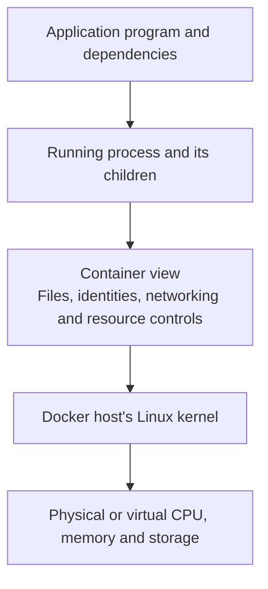

The application executes as an ordinary OS process with a configured view of the world. The container environment is enforced when that process uses kernel resources. On Docker Desktop for Windows, the Linux kernel in the diagram belongs to the Desktop Linux backend. Windows supplies the hardware virtualization and integration around it.

### Compare three ways to run an application

A **virtual machine (VM)** runs a guest operating system with its own kernel using virtual hardware supplied by a hypervisor. A machine can host several VMs, each with a separate guest kernel. Containers inside a Linux VM can share that VM's kernel.

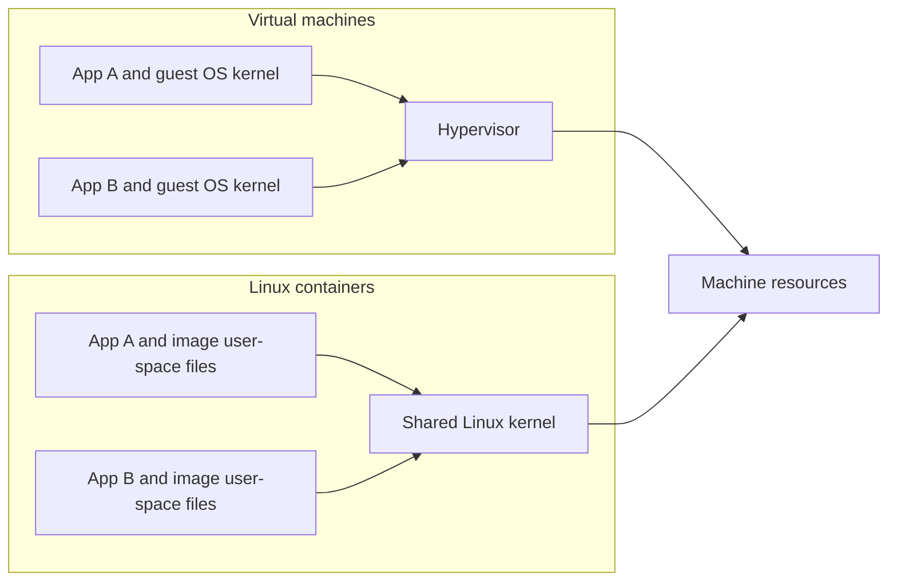

The VM side has a kernel per guest. The container side has separate process environments on one kernel. A container is compatible with the host kernel and required CPU platform, while a VM can boot a separately supplied compatible guest kernel. VM isolation also depends on hypervisor and runtime configuration.

| Approach | Environment and startup | Practical trade-off |
| --- | --- | --- |
| Directly on the host | Application uses host JVM, files, network, and service configuration. | Simple for a single trusted app with a managed runtime. Shared dependencies and port choices can collide as apps multiply. |
| Virtual machine | Application uses the guest kernel and guest user space. The machine boots the guest. | Useful for a separate OS or stronger separation boundary. More guest OS state, startup work, and memory to manage. |
| Container | Process starts with image files, runtime settings, and an isolated view on a compatible kernel. | Fast to create and easy to recreate from an image. External data, config, kernel compatibility, and security policy still need attention. |

**Portability** means a compatible environment can run the image with the same packaged software and defaults. The host still needs the right OS and CPU platform, or a supported emulation path. The application must receive appropriate database addresses, secrets, and storage. A file path from your laptop has no automatic meaning on a server.

### Why Docker exists

OS-level isolation predates Docker. Docker emerged in 2013 and popularized a workflow in which developers could build, version, download, and start packaged environments through a consistent interface. Today its common uses include reproducible local dependencies, integration tests, repeatable builds, and shipping a versioned backend artifact. Containers are useful when isolation and repeatability solve real problems. Running a local Java command with an already managed toolchain may have less overhead for a quick edit and debug cycle.

Isolation is a mechanism, and security is a property of the whole setup. A shared kernel, engine access, broad privileges, mounts, and published ports influence how much separation a workload actually has. Docker packages and runs software. It does not supply every operational function such as backups, authorization, or multi-host rollout. [Docker overview](https://docs.docker.com/get-started/docker-overview/)

**Key takeaways.** A container gives a process a controlled environment on a compatible kernel. An image makes that environment repeatable, while runtime addresses, data, and access policy remain explicit inputs.

<a id="docker-02"></a>

## Part 2 — Docker Architecture

### Follow a request from your terminal

When you type a Docker command in PowerShell, the executable in that shell is the **Docker CLI**. It sends requests to **Docker Engine** through the **Engine API**. The long-running engine daemon, `dockerd`, manages image and container operations, network attachment, and storage. It delegates low-level container management to components such as `containerd`, which can use an OCI runtime such as `runc` to start the process with the requested isolation. **OCI**, the Open Container Initiative, defines interoperable image and runtime specifications. Exact implementation and storage details vary by engine configuration.

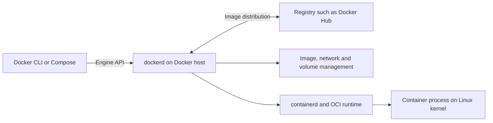

The CLI and Compose are clients. Starting an engine-side process does not require the CLI to keep running. The engine may be local, in Desktop's Linux environment, or remote. A **context** stores endpoint settings for reaching an engine. Always check the selected context before changing resources. A successful client-version display by itself does not establish that the engine is reachable.

| Item | Responsibility | What you can observe |
| --- | --- | --- |
| Docker CLI | Interprets command arguments and calls the engine API. | Client version and selected endpoint. |
| Docker daemon and Engine | Manage resources and run requested workloads on the Docker host. | Server version, engine settings, container state. |
| Docker Desktop | Bundles the engine, CLI, Compose, Desktop interface, and host integration. | Windows-to-Linux integration, resource settings, and the engine's readiness. |
| Docker Compose | Reads a project description and coordinates multiple engine resources. | Services, networks, volumes, and project labels. |
| Registry | Stores and serves image manifests and content. Docker Hub is an example. | Image repository, tags, and content digests. |

An **image** is a reusable package of filesystem content and launch settings. A **container** is a specific instance with its own configuration, process state, and writable filesystem layer. A **network** connects permitted endpoints. A **volume** is managed storage with its own lifecycle. These are distinct engine objects even when one Compose command creates several of them together.

### Verify the Windows setup and create a lab scope

In **Windows PowerShell** use these read-only checks.

```powershell
docker context show
docker context ls
docker version
docker info --format '{{.OSType}} {{.Architecture}}'
docker compose version
```

`docker version` should show a client and server. You should see `linux` in the engine information for this course. The selected Desktop context is often `desktop-linux`. Use the value actually shown on your machine. `docker context ls` shows what endpoints you can select. An engine error may mean Desktop is not ready or the selected context points elsewhere. Verify the intended engine before continuing. Compose V2 introduced the `docker compose` plugin interface. A current plugin can report a later major version while using that same interface. [Compose version history](https://docs.docker.com/compose/intro/history/)

If you also use **Ubuntu Bash** with Docker Desktop's WSL integration enabled for that distribution, these commands show the Linux client's view.

```bash
docker context show
docker version
docker info --format '{{.OSType}}'
```

Two shells integrated with the same engine may see the same objects. A separate Linux engine has its own objects. Before launching a lab, make a unique folder and prefix in **Windows PowerShell**. Reuse this value in the same tab. Keep the tab open or record the prefix before closing it.

```powershell
$DockerCourseId = 'dockerlab-' + [guid]::NewGuid().ToString('N').Substring(0, 8)
$DockerCourseRoot = Join-Path (Join-Path $env:LOCALAPPDATA 'docker-learning-lab') $DockerCourseId
New-Item -ItemType Directory -Path $DockerCourseRoot -Force | Out-Null
Set-Location -LiteralPath $DockerCourseRoot
$DockerCourseId
Get-Location
```

Use a new child folder for each build or Compose example. PowerShell variables in later examples refer to this prefix and directory. Image downloads may populate the engine's shared base-image cache. Container, volume, network, and custom image names in the labs use your own prefix. Remove only objects you verified as belonging to that prefix.

### Trace `docker run hello-world`

The textbook command creates a container with a generated name. For a locally identifiable run, use this **Windows PowerShell** version.

```powershell
docker run --name "$DockerCourseId-hello" hello-world:latest
docker ps -a --filter "name=$DockerCourseId-hello"
docker logs "$DockerCourseId-hello"
docker rm "$DockerCourseId-hello"
```

1. The CLI parses options and sends requests to the engine selected by the context.
2. The engine looks for the image reference in its local image store. With the usual missing-image pull policy, an absent image triggers a pull. The short name resolves to Docker Hub's official `hello-world` repository.
3. The registry supplies a manifest and content. The engine chooses a compatible platform and reuses layers that are already present.
4. The engine creates a container record, configures its filesystem and isolation, and asks the runtime to start the image's command.
5. In this attached run, the program's output is carried back to the CLI. Expect a greeting beginning with `Hello from Docker!`. The engine can also store that output through its logging configuration.
6. The program finishes. The stopped container still exists, typically with `Exited (0)`, and `docker logs` can read its saved output. `docker rm` then removes that named instance. The image remains available.

**Key takeaways.** The CLI controls the engine selected by its context. Containers, images, networks, and volumes belong to that engine, and each has its own lifecycle.

<a id="docker-03"></a>

## Part 3 — How Containers Work Internally

### Give the same kernel several views

A process in an Alpine container can see Alpine files at `/` and report itself as PID 1 while many other processes are running on the host. A Linux **namespace** gives processes a particular view of a kernel resource. Processes that share a namespace see related state for that resource. Docker chooses and configures namespaces when creating the container.

| Namespace | What can differ inside the container | Why it matters |
| --- | --- | --- |
| PID | Visible process IDs and the process acting as PID 1. | Other workloads on the host need not appear in the container's process list. |
| Network | Interfaces, addresses, routes, and listening sockets. | Each separate network namespace has its own loopback and can use the same internal port. |
| Mount | Filesystem mounts and paths visible beneath the container's root. | `/app` can refer to entirely different files in two containers. |
| User | Mapping between UIDs/GIDs in different namespaces where user namespaces are enabled. | A UID inside can map to a different host identity. Mapping depends on engine and runtime settings. |

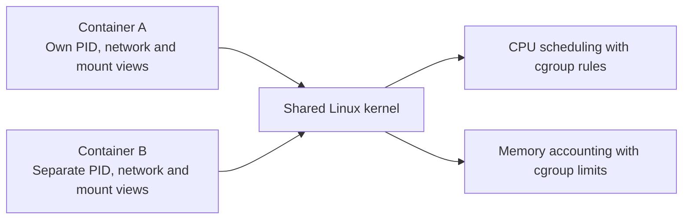

The namespace settings control what is visible. **Control groups (cgroups)** tell the kernel how to account for, organize, and constrain resources for process groups. A CPU quota can throttle work while memory limits can trigger termination under pressure. A container can have a separate namespace without a hard memory limit. Namespaces and cgroups answer different questions. Docker commonly uses cgroup v2 on newer Linux environments, but supported controllers and limits depend on the engine and kernel.

The **root filesystem** is the filesystem view that starts at `/` for the process. The engine prepares it from the image's files, a container-specific writable layer, and configured mounts. In a different mount namespace, a bind mount can place chosen host files at `/app/config`. That makes those selected files visible and may allow changes if the mount is writable. It does not give the process a general view of all host paths.

### Observe a small container

Run this in **Windows PowerShell**. The shell and its quoted commands run inside Alpine. `--rm` removes this single named instance when it exits.

```powershell
docker run --rm --name "$DockerCourseId-view" alpine:3.22 sh -c 'echo Shell-PID=$$; ps; cat /etc/os-release'
```

The shell normally prints `Shell-PID=1` with this command. `ps` shows a short process list. `/etc/os-release` identifies Alpine because it comes from the image. The kernel is still the Docker host's Linux kernel. `uname -r` from an Ubuntu container on the same engine can show the same kernel release even though its `/etc/os-release` reports Ubuntu.

Some runtime modes deliberately share namespaces. For example, host networking on native Linux uses the host network namespace. A non-root UID and user namespace mapping are separate settings. A normal rootful engine can give UID 0 inside a container without enabling user namespace remapping. This is why the Desktop VM, kernel, runtime settings, and mounts all matter when assessing isolation. [Docker runtime overview](https://docs.docker.com/engine/daemon/alternative-runtimes/), [Linux cgroup v2 documentation](https://docs.kernel.org/admin-guide/cgroup-v2.html)

**Key takeaways.** The kernel gives processes a configured view and can enforce resource limits. Inspect the effective runtime settings before assuming what is isolated or limited.

<a id="docker-04"></a>

## Part 4 — Docker Images

### A starting filesystem and rules for launch

Think of a reusable image of a Java runtime plus your packaged app. The image records filesystem content and defaults such as the working directory, environment, and command. The engine can use the same image to create several independent containers. Their process IDs, local writes, mounts, and network endpoints can differ.

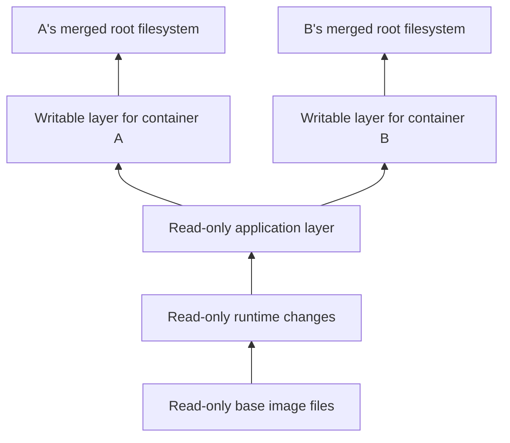

A **layer** records a set of filesystem differences. An image combines ordered layers with configuration metadata. A union or snapshotting filesystem implementation presents them through one root filesystem. When a process modifies a lower file, the storage system typically writes a private upper version, often called **copy-on-write**. Removing a lower file can hide it with an upper-layer record. The bytes can still exist in the image's lower layer. The exact implementation depends on the storage driver or snapshotter. Named volumes and bind mounts provide separate data paths. [Docker image and container layers](https://docs.docker.com/engine/storage/drivers/)

| Object | How it is used | What a write changes |
| --- | --- | --- |
| Image | Reusable starting point for new containers. | Its existing content stays immutable. A new build produces a new image configuration or content. |
| Image layer | Shared, read-only filesystem changes. | Several images or containers may reuse its content. |
| Container writable layer | Private filesystem changes for the created instance. | Writes survive stop and start of that instance. Removing it discards its layer. |

### Read image names and identities

An **image repository** groups related published references, for example `docker.io/library/nginx`. A **tag** is a label in a repository, such as `alpine` or `latest`. A publisher can point a tag at different content later, and local tags can also be reassigned. A **digest** identifies content by a cryptographic hash. A registry reference like `nginx@sha256:<verified-digest>` selects the exact manifest or multi-platform index represented by the digest. Use a real digest from the trusted publication. An **image ID** is the engine's local image identifier displayed by commands such as `docker image ls`. Treat it and any published `RepoDigests` as separate fields when matching what was run to what was pulled.

| Reference | Practical use |
| --- | --- |
| `nginx:alpine` | Selects the current content associated with a human-readable tag when pulled. Convenient for a lab. |
| `nginx@sha256:<verified-digest>` | Identifies an immutable published manifest or index. Useful when deployments must run known content. |
| Local image ID | Identifies the image available to the selected engine. Useful during inspection. |

A **base image** supplies the starting filesystem and defaults at a `FROM` line. Prefer a base suited to the workload. A JDK image has compiler and tooling and a JRE image is aimed at running Java. Layers are shared by content, so viewing each image's displayed size as additional disk use can overestimate total storage. Registry transfers are usually compressed, and local disk usage also includes writable layers, volumes, and build cache.

### Pull and inspect without touching unrelated images

In **Windows PowerShell**:

```powershell
docker pull nginx:alpine
docker image ls nginx
docker image inspect nginx:alpine --format '{{.Id}} {{json .RepoDigests}}'
docker image history nginx:alpine
docker image tag nginx:alpine "$DockerCourseId/nginx:study"
docker image rm "$DockerCourseId/nginx:study"
```

`docker pull nginx` on its own means `nginx:latest`. The explicit tag selects the Alpine-based variant in the example. During a pull the engine downloads needed manifests and content and can reuse layers it already has. `docker image inspect` shows configuration and identifiers, while `docker image history` shows recorded build steps and sizes. Metadata-only instructions can appear with zero bytes. You may view fewer details than the original Dockerfile provided.

`docker image rm nginx` would target the local `nginx:latest` reference. References or existing containers can keep image data in use. Practice removal on the unique alias above. It points to the same image and avoids removing a base tag shared by other work.

**Key takeaways.** An image is reusable and its content is immutable. A tag can move. Containers created from the same image share base content and own independent writable changes.

<a id="docker-05"></a>

## Part 5 — Docker Container Lifecycle

### Creation, execution, and retention

An image is ready, but you want to inspect the instance before starting its program. `docker create` allocates a container and records its configuration. `docker start` starts the existing container with those settings. `docker run` creates and starts a new one and can pull an image if needed. When the container's main process exits, the container stops. Its record, logs, and writable layer generally remain until it is removed.

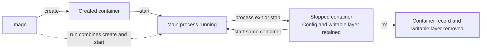

A restart stops and starts the same instance. A **recreation** replaces it with a new container, often to apply a new image, environment, or port configuration. A named volume can be attached to both instances in succession.

In **Windows PowerShell**, separate creation from start.

```powershell
docker create --name "$DockerCourseId-created" alpine:3.22 sh -c 'echo lab-started; exit 0'
docker ps -a --filter "name=$DockerCourseId-created"
docker start -a "$DockerCourseId-created"
docker inspect --format '{{.State.Status}} {{.State.ExitCode}}' "$DockerCourseId-created"
docker logs "$DockerCourseId-created"
docker rm "$DockerCourseId-created"
```

Look for `Created` first and `exited 0` afterward. `start -a` attaches output. `docker ps` lists running containers by default, and `-a` includes stopped and created instances. `docker inspect` reads the container record. `docker logs` reads stored stdout and stderr when the logging configuration supports retrieval.

### Attached, detached, and interactive runs

`docker run -d` starts the container in the background and returns its ID. `-i` keeps standard input open, and `-t` allocates a terminal. For a short interactive shell, run `docker run --rm -it --name "$DockerCourseId-terminal" alpine:3.22 sh` in **Windows PowerShell**. At the **container shell**, try `id` and `pwd`, then type `exit`. The shell is the main process and ending it ends this container.

Practice with a detached process in **Windows PowerShell**.

```powershell
docker run -d --name "$DockerCourseId-sleep" alpine:3.22 sleep 600
docker ps --filter "name=$DockerCourseId-sleep"
docker exec "$DockerCourseId-sleep" sh -c 'echo kept > /sample.txt'
docker stats --no-stream "$DockerCourseId-sleep"
docker stop "$DockerCourseId-sleep"
docker start "$DockerCourseId-sleep"
docker exec "$DockerCourseId-sleep" cat /sample.txt
docker restart "$DockerCourseId-sleep"
docker stop "$DockerCourseId-sleep"
docker rm "$DockerCourseId-sleep"
```

`docker exec` starts an extra process in a running container using its current environment and filesystem. It leaves the primary process running. The saved line `kept` survives stopping and starting because this is the same container. `docker stats --no-stream` displays one sample of resource activity. Container names are unique per engine. Docker also assigns a container ID, which tools can show in short or full form.

| Compare | Choose based on the effect |
| --- | --- |
| `run` and `start` | Run creates a new instance. Start uses an existing instance's saved config. |
| `run` and `exec` | Run has its own main process and filesystem. Exec runs a command in a running instance. |
| `logs` and `exec` | Logs can show output from a stopped instance. Exec needs the instance running and launches a command. |
| `stop` and `kill` | Stop gives the process a grace period. Kill defaults to immediate SIGKILL. |
| Stopped and removed | A stopped object can be inspected or started. A removed object's container layer and local log record are gone. |
| Restart and recreate | Restart preserves the instance. Recreate can apply new image or runtime settings. |

### Exit codes, restart policy, and signals

The main process supplies an **exit status**. A short command can exit successfully and leave a stopped container. If the CLI fails to run the container at all, status `125` commonly identifies a Docker-level launch error. `126` and `127` conventionally indicate a command that cannot be invoked or cannot be found. Application programs can return their own nonzero statuses. Read logs, `.State.Error`, and `.State.ExitCode` together. In PowerShell, read `$LASTEXITCODE` immediately for the last native command's status.

The container's main process is typically PID 1 inside its PID namespace. Linux treats PID 1 specially for default signal handling, and it also has responsibilities for orphaned child processes. Prefer an exec-form entrypoint that runs the intended application directly or a wrapper that replaces itself using shell `exec`. Docker's `--init` can provide a small init process that forwards signals and reaps children when appropriate.

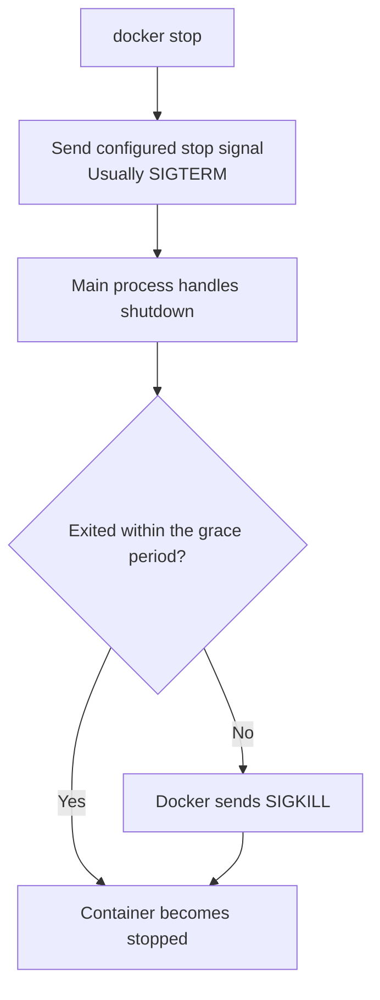

`docker stop --time 20 NAME` allows up to 20 seconds for graceful exit before force. An image or runtime setting can change the initial signal. `docker kill NAME` defaults to immediate `SIGKILL`, and `--signal` can send another signal without the stop wait sequence. Prefer normal stop for applications that close connections or finish transactions. Code `137` commonly indicates `SIGKILL`, with several possible causes. Code `143` often corresponds to `SIGTERM`. An application may choose another code while handling a signal. [Docker stop reference](https://docs.docker.com/reference/cli/docker/container/stop/), [Docker kill reference](https://docs.docker.com/reference/cli/docker/container/kill/)

Restart policies apply to exits and engine lifecycle. `no` is the default, `on-failure[:MAX]` retries on nonzero exit, and `always` or `unless-stopped` can start the service again under their documented rules. Manual stop affects those policies. Docker uses backoff to manage repeated failures. Restarting a process with the same invalid settings generally repeats the failure. Check `docker inspect --format '{{.RestartCount}} {{.State.Status}}' NAME` and recent logs. An unhealthy status has separate semantics from process exit. [Docker restart policies](https://docs.docker.com/engine/containers/start-containers-automatically/)

**Key takeaways.** Follow both the container instance and its process. Stop preserves the instance. Recreation applies different settings. Graceful termination depends on which process receives the signal.

<a id="docker-06"></a>

## Part 6 — Dockerfiles

### Describe the artifact once

A **Dockerfile** is a text recipe the builder evaluates to assemble an image and its defaults. Building creates an artifact. Running creates an instance with environment, mounts, ports, and resource settings chosen at launch. The **build context** is the set of files a build can access from its input directory or other specified source. For `docker build -t IMAGE .`, the final dot selects the current directory as context. `COPY` sources are relative to the context, even if `-f` selects a Dockerfile elsewhere. A `.dockerignore` at the context root excludes matching inputs before the builder uses them.

| Phase | What its input controls | Practical result |
| --- | --- | --- |
| Build time | Dockerfile, context, base images, and build arguments. | A new image can contain new program files or launch defaults. |
| Runtime | Selected image, command, bind address, environment, mounts, limits, and publication. | A container can run the same artifact with different settings and data. |

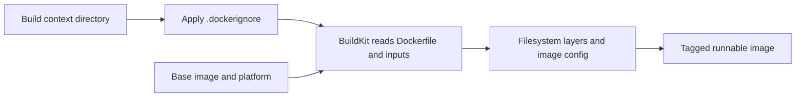

This flow can run in Desktop's builder or in a different engine or builder selected by the client. A file can exist in PowerShell's current view and still be unavailable to a build if it lies outside the selected context or matches an ignore rule.

| Instruction | Effect and concrete example |
| --- | --- |
| `FROM` | Starts a stage from an image, such as `FROM alpine:3.22`. `AS build` names a stage. |
| `WORKDIR` | Sets the working directory and creates it if needed, for example `WORKDIR /app`. Later relative destinations and the default runtime directory use it. |
| `COPY` | Copies selected inputs, such as `COPY LabHello.java .` from the context or `COPY --from=build /work/app.jar /app/app.jar` from a stage. |
| `ADD` | Can also fetch certain remote sources or unpack a recognized local tar archive, as in `ADD assets.tar /opt/assets/`. Use `COPY` for ordinary local files. |
| `RUN` | Executes a command during the build, such as `RUN javac LabHello.java`. Files produced become stage content. |
| `ENTRYPOINT` | Sets the main executable and fixed arguments, such as `ENTRYPOINT ["java","-jar","/app/app.jar"]`. |
| `CMD` | Sets the default command or default arguments to the entrypoint, such as `CMD ["reader"]`. Runtime arguments can replace it. |
| `ENV` | Sets image environment defaults and makes them available for later instructions and containers, for example `ENV LAB_GREETING=hello`. |
| `ARG` | Declares a build argument, for example `ARG RELEASE=dev`, provided with `--build-arg`. Scope depends on the stage. |
| `EXPOSE` | Documents an intended container port, such as `EXPOSE 8080`. Port publication requires runtime configuration like `-p` or Compose `ports`. |
| `USER` | Sets the default user for subsequent `RUN` instructions and the launched process. `USER 10001:10001` selects a numeric UID and GID. |
| `HEALTHCHECK` | Defines a periodic in-container probe. For example, `HEALTHCHECK --interval=5s --timeout=3s CMD ["curl","--fail","http://127.0.0.1:8080/actuator/health"]` works for the later app's image. Pick an executable available in the image. |

`RUN echo building` is **shell form**. Docker runs it through the configured shell, usually `/bin/sh -c` on Linux. `ENTRYPOINT ["java","-jar","/app/app.jar"]` is **exec form** and launches the command with explicit arguments without a shell. Variables such as `$LAB_GREETING` are not automatically expanded by a shell in exec form. Let the program read them or invoke a shell deliberately when shell features are required. A shell-form entrypoint can put a shell in front of the application and alter argument and signal behavior. The Java examples use exec form. [Dockerfile instruction reference](https://docs.docker.com/reference/dockerfile/)

`CMD` without an entrypoint can name the whole default command. With an exec-form entrypoint it usually supplies default arguments. `docker run IMAGE Ada` uses `Ada` in place of the image's default `CMD` arguments. `docker run --entrypoint sh IMAGE ...` explicitly replaces the entrypoint. Use image inspection to confirm the defaults.

### Build a small executable Java image

In a new child folder, save `LabHello.java` as follows.

```java
public class LabHello {
    public static void main(String[] args) {
        String greeting = System.getenv().getOrDefault("LAB_GREETING", "hello");
        String audience = args.length == 0 ? "reader" : String.join(" ", args);
        System.out.printf("%s %s%n", greeting, audience);
    }
}
```

Save `Dockerfile` with this content.

```dockerfile
FROM eclipse-temurin:21-jdk-noble
WORKDIR /lab
COPY LabHello.java .
RUN javac LabHello.java && \
    jar --create --file hello.jar --main-class LabHello LabHello.class
ENV LAB_GREETING=hello
ENTRYPOINT ["java","-jar","/lab/hello.jar"]
CMD ["reader"]
```

Save `.dockerignore` to keep unrelated local artifacts out of this example context.

```text
.git
.env
*.log
*.class
```

In **Windows PowerShell**, from that directory:

```powershell
docker build -t "$DockerCourseId/hello:single" .
docker run --rm --name "$DockerCourseId-hello-default" "$DockerCourseId/hello:single"
docker run --rm --name "$DockerCourseId-hello-custom" -e LAB_GREETING=welcome "$DockerCourseId/hello:single" Ada
```

The build compiles Java and packages an executable JAR with `LabHello` as its main class. Expect `hello reader` and `welcome Ada` from the two runs. `-e` overrides the image's environment default. The explicit `Ada` argument replaces `CMD ["reader"]`. The image does not need inbound network access for this job, so no port is published. Keep this source for the multi-stage example or remove your image tag with `docker image rm "$DockerCourseId/hello:single"` after both disposable containers exit.

**Key takeaways.** Build-time commands and inputs assemble the image. The image's launch defaults guide the runtime, where the caller can choose arguments, environment, and port mappings.

<a id="docker-07"></a>

## Part 7 — Docker Build Process, Layers, and Cache

### Learn what changes invalidate

**BuildKit** is the build engine used by current Docker builds in this course. It solves a graph of build steps, can skip unused stages, and reuses matches from its cache. `docker build --progress=plain -t TAG .` shows a readable build trace and tags the result. `-f PATH` selects a Dockerfile. The builder considers inputs to each operation, including the parent state, instructions, relevant arguments, and copied file content or metadata. Touching a copied file's modification time alone normally does not invalidate its cache. A plain `RUN` step's cache does not examine whether remote package metadata has changed.

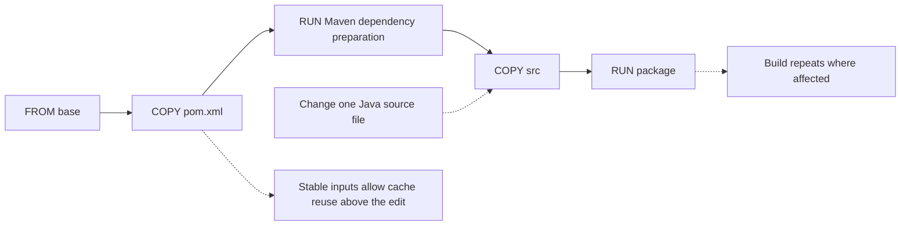

If `COPY . .` appears before dependency preparation, a routine Java edit can invalidate the copy and therefore the dependency step. Copy a relatively stable Maven POM before the frequently changing source. In a simple linear stage, a changed earlier result normally invalidates dependent later operations. Independent stages can still reuse their own steps. `--no-cache` bypasses reuse for a diagnostic build and `--pull` asks for newer base-image references. They answer different questions. [Build cache invalidation](https://docs.docker.com/build/cache/invalidation/)

Try the following in a new child folder. Save this `Dockerfile`.

```dockerfile
FROM alpine:3.22
WORKDIR /work
COPY seed.txt .
RUN cat seed.txt > prepared.txt
COPY message.txt .
RUN cat message.txt > final.txt
CMD ["cat","/work/final.txt"]
```

In **Windows PowerShell**:

```powershell
Set-Content -LiteralPath .\seed.txt -Value 'stable seed' -Encoding Ascii
Set-Content -LiteralPath .\message.txt -Value 'first message' -Encoding Ascii
docker build --progress=plain -t "$DockerCourseId/cache:v1" .
docker build --progress=plain -t "$DockerCourseId/cache:v1" .
Set-Content -LiteralPath .\message.txt -Value 'second message' -Encoding Ascii
docker build --progress=plain -t "$DockerCourseId/cache:v2" .
docker run --rm "$DockerCourseId/cache:v2"
docker image history "$DockerCourseId/cache:v2"
```

The unchanged build should report reused steps when cache is available. After editing `message.txt`, expect reuse for the seed-related steps and work for the changed copy and final preparation. The container prints `second message`. Compare the steps, rather than expecting a specific duration. Rebuilding a tag does not update containers already created from its old image. Remove the two lab tags when you no longer need them.

### Keep build tools out of the runtime stage

A **multi-stage build** uses more than one `FROM`. Later stages can copy exact artifacts out of earlier ones. The final image need only include what the runtime requires, while the build results can live in the builder cache.

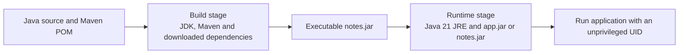

For the simple Java example from Part 6, replace its Dockerfile with the following in the same dedicated folder. The complete Maven/Spring Boot build in Part 19 follows the same pattern.

```dockerfile
FROM eclipse-temurin:21-jdk-noble AS build
WORKDIR /lab
COPY LabHello.java .
RUN javac LabHello.java && \
    jar --create --file hello.jar --main-class LabHello LabHello.class

FROM eclipse-temurin:21-jre-noble AS runtime
WORKDIR /app
COPY --from=build --chown=10001:10001 /lab/hello.jar /app/hello.jar
USER 10001:10001
ENV LAB_GREETING=hello
ENTRYPOINT ["java","-jar","/app/hello.jar"]
CMD ["reader"]
```

In **Windows PowerShell**:

```powershell
docker build -t "$DockerCourseId/hello:multi" .
docker run --rm "$DockerCourseId/hello:multi" learner
docker image inspect "$DockerCourseId/hello:multi" --format '{{.Config.User}} {{.Size}}'
```

`AS build` names the stage and `--from=build` resolves the absolute source path in that stage. The final stage carries the JAR, runtime, and configuration. It does not copy the compiler or source. Expect `hello learner` and a configured user of `10001:10001`. Package toolchains into build stages when the final process only needs the artifact. Image sizes also depend on the runtime base and shared layers.

### Bound the context and control inputs

Use `.dockerignore` for local build output, VCS metadata, logs, and real local environment files. A file excluded from the context is unavailable to `COPY`. Copy only the needed inputs even when ignores are present. Removing a secret in a later image layer can leave it in earlier layers. `ARG` and `ENV` can appear in metadata, history, attestations, or the final config, so do not use them for secrets. BuildKit **secret mounts** expose a short-lived file to a specific build step when a build truly needs a credential. The command must still avoid recording that secret in outputs. [Docker build secrets](https://docs.docker.com/build/building/secrets/)

For repeatability, record dependency versions, source revision, base-image digest where appropriate, and platform. A cache hit means a previous result matched the cache key. It does not prove that remote dependencies are current or that two independent builds are byte-for-byte identical. A multi-platform image can have an index pointing at separate image manifests for architectures such as `linux/amd64` and `linux/arm64`. Docker selects the matching variant when possible. Buildx can target platforms using native builders or emulation. Native libraries and CPU-specific binaries still need their own verification. [Multi-platform builds](https://docs.docker.com/build/building/multi-platform/)

**Key takeaways.** Put stable inputs before frequent edits, minimize what is copied, and move only needed build artifacts into the final stage. Document the inputs that matter for repeatability.

<a id="docker-08"></a>

## Part 8 — Docker Networking Fundamentals

### Establish whose localhost you mean

A Java app in a container uses `localhost:5432` and expects PostgreSQL in another container. The address targets the Java container's own loopback. Each container normally has a separate **network namespace** with its own interfaces, addresses, routes, and sockets. This lets many containers listen on port `8080` even on one machine.

A Docker **bridge network** connects container interfaces through a software network on the Docker host. Linux containers commonly join the engine's default `bridge` if none is specified. A **user-defined bridge** gives workloads a dedicated network and built-in DNS-based discovery by name or network alias. On the default bridge, direct IP connectivity and external DNS can work, but modern service-name discovery between peers is a reason to choose a user-defined network. Docker assigns addresses, which may change when containers are recreated. Prefer service names over copied IP addresses. [Docker bridge networks](https://docs.docker.com/engine/network/drivers/bridge/)

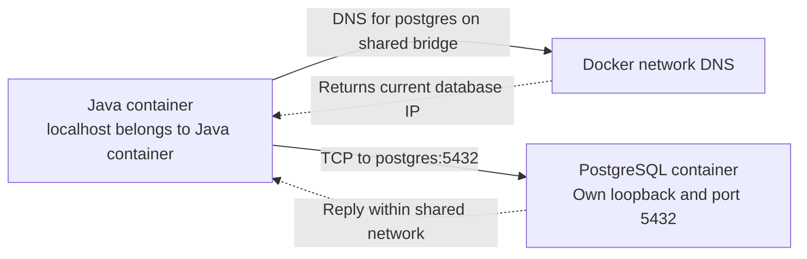

The client resolves `postgres` on its shared network and connects to the resulting container endpoint. Database publication to the host is unnecessary for this flow. Peers on different bridge networks generally need a common permitted network or a deliberately reachable path. A Docker network is a connectivity scope. Application authentication still applies.

### Trace the path from Windows into the container

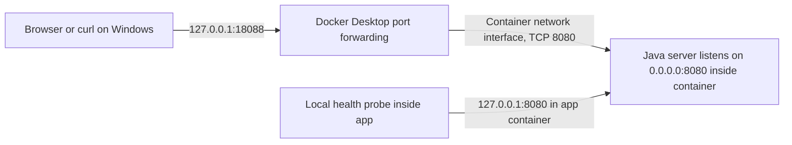

Port publication makes a host endpoint forward to the container port. On native Linux Docker implements publication with host networking rules and forwarding behavior. Docker Desktop integrates the host endpoint with its Linux backend. The address and port used inside the container are separate from what the Windows client uses.

| Concept | Where it lives | What to do with it |
| --- | --- | --- |
| Internal port | On the container's network stack. | Service peers use it with the service name. |
| Published port | On a host address, forwarding to a container's port. | Host clients use the published endpoint. It must be available and allowed. |
| Container `localhost` | Inside that container's network namespace. | Use for a health probe of that container's own process. |
| Service or network alias | Docker DNS on the attached user-defined network. | Use for peer-to-peer addressing, such as `postgres:5432`. |

These are two illustrative command forms for an image named `my-app`.

```text
docker run -p 8080:8080 my-app
docker run -p 127.0.0.1:8080:8080 my-app
```

The first `8080` is the **host port**, and the second is the **container port**. Without a host IP, publication normally applies to all host interfaces. With `127.0.0.1` it is scoped to IPv4 host loopback on current engines. Prefer that scope for local labs. Older engine versions have had limitations on the isolation of published loopback ports. Keep the local engine current and check the relevant networking mode and policy. Inside the container, a server bound only to `127.0.0.1` may answer its internal probe but cannot accept traffic arriving at its separate network interface. Binding the server to `0.0.0.0` inside the container includes that interface and still leaves host publication a separate decision. [Port publishing and its scope](https://docs.docker.com/engine/network/port-publishing/)

### Observe both paths with web and client containers

Run in **Windows PowerShell**. The empty host-port field in `127.0.0.1::80` asks Docker to choose a free host port.

```powershell
$DockerCourseNet = "$DockerCourseId-bridge"
docker network ls
docker network create $DockerCourseNet
docker run -d --name "$DockerCourseId-web" --network $DockerCourseNet --network-alias web -p 127.0.0.1::80 nginx:alpine
docker network inspect $DockerCourseNet --format '{{range .Containers}}{{println .Name}}{{end}}'
$DockerCourseEndpoint = docker port "$DockerCourseId-web" 80/tcp
curl.exe --noproxy '*' --max-time 5 "http://$DockerCourseEndpoint/"
docker run --rm --network $DockerCourseNet alpine:3.22 wget -qO- http://web/
```

Both requests should return the nginx welcome page once the server starts. If the first call arrives too early, inspect its logs and repeat the request after startup. The Windows request uses a host port reported by `docker port`. The short-lived Alpine client uses the Docker alias and nginx's internal `80`. `wget -qO-` asks the container's tool to print the fetched body. No host mapping is needed for the Alpine request.

You can attach a running container to an additional network with `docker network connect NETWORK CONTAINER`. This safe example adds and then removes only an attachment to the lab network.

```powershell
docker run -d --name "$DockerCourseId-extra" alpine:3.22 sleep 600
docker network connect $DockerCourseNet "$DockerCourseId-extra"
docker network inspect $DockerCourseNet --format '{{range .Containers}}{{println .Name}}{{end}}'
docker network disconnect $DockerCourseNet "$DockerCourseId-extra"
docker stop "$DockerCourseId-extra" "$DockerCourseId-web"
docker rm "$DockerCourseId-extra" "$DockerCourseId-web"
docker network rm $DockerCourseNet
```

An attached endpoint prevents ordinary network removal. Verify the attachments before removing the lab network. Attachments also explain why one service can resolve a name that another cannot.

### Container to host and host networking

On Docker Desktop, `host.docker.internal` is the documented name for reaching supported host services from a container. The host service must be listening on a reachable address, and host policy must permit it. On native Linux this name is not generally configured by default. A deliberate host gateway mapping or a routable address can be used when needed and authorized. This is a different direction from publishing a container port. [Docker Desktop networking how-tos](https://docs.docker.com/desktop/features/networking/networking-how-tos/)

| Network mode | Scope | Practical consequence |
| --- | --- | --- |
| User-defined bridge | Separate container stacks linked within a chosen network. | Peers use network DNS and internal ports. Publish intended host endpoints separately. |
| Native Linux host network | The container shares the host network namespace. | The app binds directly to a host port. `-p` has no mapping to create, and host port collisions apply directly. |
| Docker Desktop host networking | Opt-in integration for Linux containers on supported versions. | Has TCP/UDP and host integration differences from native Linux. Verify the mode's documented limitations. |

Use a user-defined bridge for this course. [Host network driver and Desktop limitations](https://docs.docker.com/engine/network/drivers/host/)

**Key takeaways.** Name the caller's stack and destination. Use service names and internal ports for neighbors. Use a published host endpoint for a host client and confirm the app's internal bind.

<a id="docker-09"></a>

## Part 9 — Docker Storage and Volumes

### Decide what should outlive an instance

A PostgreSQL container can be replaced to upgrade the packaged program or apply a different setting. Its rows need a lifecycle independent of that container. Files written into a container's writable layer survive stop and start of the same instance. They disappear with that layer when the instance is removed. A **mount** lets the container use external storage at a specified path, such as `/var/lib/postgresql/data`.

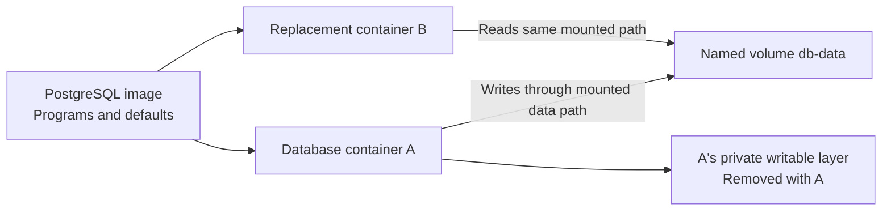

The two service instances can mount the same saved data at different times. The database server and its data remain distinct. Do not run two unrelated PostgreSQL servers against the same data directory.

| Storage | Who manages it | When to use it |
| --- | --- | --- |
| Image filesystem | Image store. Shared read-only content. | Application binary, dependencies, and static defaults. |
| Container writable layer | Engine, tied to one container. | Temporary output that can disappear when the instance is removed. |
| Bind mount | A chosen file or directory on the Docker host. | Local source, a known config file, or exchanging a disposable output with the host. |
| Named volume | Engine-managed storage with a chosen name and independent lifetime. | Database files and other persistent service state. |
| Anonymous volume | Engine-managed storage with a generated name, sometimes requested by an image. | Temporary work where explicit identity is unnecessary. It is easy to lose track of between recreations. |

| Removal operation | What the operation removes |
| --- | --- |
| `docker rm NAME` | The instance and its writable layer. The named volume and any bind source are independent. |
| `docker volume rm VOLUME` | The named volume and its stored data, once no container uses it. |

A volume or bind mount hides the files that would otherwise be visible at that mount path. With a newly created empty volume, Docker can copy preexisting image files from the destination into the volume by default. A mount path is a path **inside** the container. A bind source is interpreted on the **daemon host**. Docker Desktop provides Windows and WSL path sharing according to its configuration. A remote engine cannot automatically mount a directory from the machine where its CLI runs. [Docker volumes](https://docs.docker.com/engine/storage/volumes/), [Bind mounts](https://docs.docker.com/engine/storage/bind-mounts/)

### Prove persistence independently of the application

In **Windows PowerShell**:

```powershell
$DockerCourseVolume = "$DockerCourseId-data"
docker volume ls
docker volume create $DockerCourseVolume
docker run --rm --name "$DockerCourseId-writer" --mount "type=volume,source=$DockerCourseVolume,target=/store" alpine:3.22 sh -c 'echo saved-note > /store/sample.txt'
docker run --rm --name "$DockerCourseId-reader" --mount "type=volume,source=$DockerCourseVolume,target=/store,readonly" alpine:3.22 cat /store/sample.txt
docker volume inspect $DockerCourseVolume --format '{{.Name}} {{.Driver}}'
docker volume rm $DockerCourseVolume
```

The writer's main process exits and `--rm` removes its container. The reader prints `saved-note` because both use the same named volume. It mounts that volume read-only. The final command discards this named practice volume permanently. Run it only after verifying the displayed name and deciding the sample is disposable.

For a bind mount, make a dedicated Windows folder. In **Windows PowerShell**:

```powershell
$DockerCourseBind = Join-Path $DockerCourseRoot 'bind-sample'
New-Item -ItemType Directory -Path $DockerCourseBind -Force | Out-Null
Set-Content -LiteralPath (Join-Path $DockerCourseBind 'sample.txt') -Value 'from Windows' -Encoding Ascii
docker run --rm --mount "type=bind,source=$DockerCourseBind,target=/read,readonly" alpine:3.22 cat /read/sample.txt
```

Expect `from Windows`. A native Linux daemon normally rejects a missing source with the long `--mount` syntax, while short `-v` bind syntax can create it as a directory. Docker Desktop's Windows path-sharing layer can also create an empty source directory in a long-form bind. Check the Windows directory with `Test-Path -LiteralPath PATH -PathType Container` and verify the intended file before starting. If the mount already exists but is empty, inspect both paths. Use narrow paths and read-only access when possible. UID/GID, OS file-sharing rules, and mount mode can all affect access.

### PostgreSQL data, version, and backups

The `postgres:17.11-bookworm` image used here stores its database in `/var/lib/postgresql/data` by default. Mount the named volume there for PostgreSQL 17. The official images for PostgreSQL 18 and later recommend mounting `/var/lib/postgresql` and use a version-specific data directory such as `/var/lib/postgresql/18/docker`. Check the chosen image's documentation before changing a tag or moving existing data. A major PostgreSQL upgrade needs a compatible upgrade or logical migration plan.

On first startup with an empty data directory, the official PostgreSQL entrypoint creates the initial database and user using the supplied initialization values. It detects an existing database directory and skips initialization on later starts. Changing `POSTGRES_PASSWORD` in Compose does not rotate the database password already stored in a populated volume. Verify which volume is mounted and use the database's authorized credential management when changing real credentials. [Official PostgreSQL image documentation](https://github.com/docker-library/docs/blob/master/postgres/README.md)

A persistent volume is the primary data store, so it can still be corrupted, deleted, or tied to one host. A useful backup has consistency and a tested restore. For PostgreSQL, a logical backup using `pg_dump` is one option. An arbitrary copy of a live data directory may be inconsistent. Check volume identity, backup policy, and restore steps before removing data you need.

**Key takeaways.** Track the instance and mounted data separately. Verify the actual mount path and volume before diagnosing missing rows or deleting anything.

<a id="docker-10"></a>

## Part 10 — Docker Compose Fundamentals

### Describe a small application as a project

Hand-written `docker run` commands for a database, app, network, environment, and volume are easy to run in the wrong order or with mismatched names. **Docker Compose** reads a declarative `compose.yaml` and uses Docker Engine to create and manage related resources. Follow the modern `docker compose` syntax. The Compose Specification makes an old top-level `version:` field unnecessary.

| File | Question it answers | Example |
| --- | --- | --- |
| Dockerfile | What goes in the image and what executable should start by default? | Compile a JAR in one stage and copy it into the Java runtime. |
| Compose file | Which services and runtime inputs make up this project? | Run the built image beside PostgreSQL with a network, app port, and database volume. |

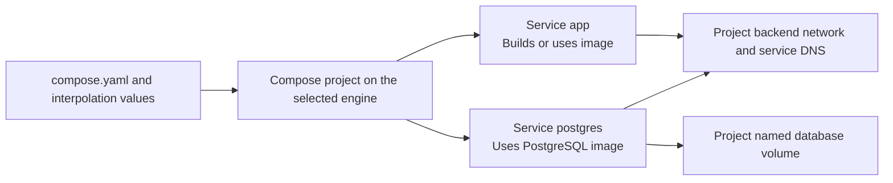

A **service** is a definition for one or more containers, including image or build settings, environment, networks, volumes, and commands. A **project** groups resources created from the configuration. It normally defaults to a name based on the project directory, and `-p NAME` picks an explicit project. Use a unique name in every lab. Compose creates a default project network when you omit network declarations. Peers on that network can resolve service names, such as `web` or `postgres`. Engine container names and IDs may change, while the service name is the intended network identity. A fixed `container_name` is unnecessary for this lab and can create naming or scaling constraints. [Compose file reference](https://docs.docker.com/reference/compose-file/)

### Practice with a web service and an on-demand probe

In a new child folder, save this as `compose.yaml`.

```yaml
services:
  web:
    image: nginx:alpine
    healthcheck:
      test: ["CMD", "wget", "-qO-", "http://127.0.0.1/"]
      interval: 2s
      timeout: 2s
      retries: 5
  probe:
    image: alpine:3.22
    command: ["wget", "-qO-", "http://web/"]
```

The web health check runs inside nginx's container and uses the wget supplied in this Alpine variant. The probe service uses the common network name `web`. There is no published host port. In **Windows PowerShell**, enter the directory and run:

```powershell
$DockerCourseWebProject = "$DockerCourseId-webpair"
docker compose -p $DockerCourseWebProject config --quiet
docker compose -p $DockerCourseWebProject up -d --wait web
docker compose -p $DockerCourseWebProject ps
docker compose -p $DockerCourseWebProject run --rm --no-deps probe
docker compose -p $DockerCourseWebProject logs --tail 15 web
docker compose -p $DockerCourseWebProject down
```

`up -d` applies the definition and leaves services running. `--wait` waits for selected services to be running or healthy according to their configuration. If your plugin lacks it, start detached, inspect `ps` and logs, and wait for the lab's health result before probing. The probe is a one-time container, independent of the web process. `--no-deps` leaves the already running web service alone and `--rm` removes the probe after execution. Its output should contain the nginx welcome page.

### Know what each operation preserves

| Command form after `docker compose -p PROJECT` | What it does |
| --- | --- |
| `up` or `up -d` | Creates or reconciles needed service containers and starts them. Foreground attaches logs, and `-d` starts detached. Use `--build` when source or build inputs should produce a new image. |
| `start` | Starts previously created, stopped containers. Their existing environment and image remain in use. |
| `stop` | Stops the project's services and keeps their containers and attached volumes. |
| `down` | Stops and removes service containers and the project's normal networks. Named volumes are retained by default. |
| `ps -a` | Shows running and stopped services for this project. |
| `logs --tail 50 SERVICE` | Reads recent logs for the named service. Add `-f` to follow. |
| `exec SERVICE COMMAND` | Runs a command in an existing running service container. Use `-T` when an allocated terminal is unnecessary, such as for scripted output. |
| `run --rm SERVICE COMMAND` | Creates a one-off container using a service definition. Published service ports are normally omitted for this command. |
| `build SERVICE` | Builds the service image using `build` settings. |
| `pull SERVICE` | Pulls a registry-backed service image without starting a container. |
| `config --quiet` | Validates the resolved project. `config` alone can print the full resolved file, including environment values. |

Running `down` differs from `stop` because the service's writable layers are removed. `down -v` also removes the declared project named volumes and attached anonymous volumes, subject to rules such as external volume retention. Never add it as a reflex when debugging. Check the project and volume identities. The [walkthrough](#docker-19) removes only its named test volume when you choose to discard the sample.

### Order, readiness, and a real two-service configuration

Short-form `depends_on` orders service startup but can start the dependent before a database accepts requests. In long form, `condition: service_healthy` waits for the dependency's configured health check. A readiness signal is only as meaningful as its command. A PostgreSQL readiness probe can indicate that TCP connections are accepted without validating the Java app's login, migrations, or SQL. If a dependency becomes unhealthy later, the application still needs an appropriate error and reconnection strategy. A runtime `restart` policy reacts to process exits under its rules. It is separate from startup dependency conditions.

Read the [complete Spring Boot and PostgreSQL Compose file](#notes-compose) now. It uses `build` and `image` for the app, a project network called `backend`, loopback publication for the app, health checks for both services, and `db-data` for storage. The app receives `jdbc:postgresql://postgres:5432/notesdb` after interpolation. `postgres` is the service DNS name and `5432` is the database's internal port. The app should not look at its own loopback for this database. Walk through creating the source files and starting that exact project in [Part 19](#docker-19). [Compose startup ordering](https://docs.docker.com/compose/how-tos/startup-order/)

**Key takeaways.** A Compose project coordinates related engine objects. Use service names for communication, a unique project name for isolation, and an explicit health signal when startup depends on readiness.

<a id="docker-11"></a>

## Part 11 — Environment Variables and Configuration

### One value can travel through several stages

An image can run in two environments with different database addresses. The app should receive the address at launch. When built-in defaults and external settings disagree, identify who reads each value and at what time.

| Mechanism | Who reads it | Where it applies |
| --- | --- | --- |
| Dockerfile `ARG` | Builder. | Build instructions in its scope. Passing an argument does not automatically set a runtime variable. |
| Dockerfile `ENV` | Builder and the image config. | Available to later instructions and as the default environment at runtime. |
| Compose `.env` or CLI `--env-file` before the subcommand | Compose while it interpolates the project. | Supplies substitutions like `${DOCKER_LAB_APP_PORT:-18088}`. A shell value normally takes precedence over file defaults. |
| Compose service `env_file` | Compose when it sets up one service. | Loads variable entries into that service's container environment. |
| Compose service `environment` | Compose when it creates the container. | Explicitly sets or overrides service environment values, including values from `env_file`. |
| Running container environment | OS and application process. | The launched process gets this environment. A later edit in the host shell does not change it. |

For a single container, `docker run --env-file PATH` reads lines such as `LAB_COLOR=blue`. `-e LAB_COLOR=green` explicitly overrides the value. `-e LAB_COLOR` asks Docker to pass the caller's set value if available. All other host environment variables do not automatically cross that process boundary. Try in a new scratch child using **Windows PowerShell**:

```powershell
Set-Content -LiteralPath .\labels.env -Value 'LAB_COLOR=blue' -Encoding Ascii
docker run --rm --env-file .\labels.env alpine:3.22 printenv LAB_COLOR
docker run --rm --env-file .\labels.env -e LAB_COLOR=green alpine:3.22 printenv LAB_COLOR
```

Expect `blue` and then `green`. Do not insert spaces around the assignment in this file. The `printenv` command runs in the disposable container. In a Compose project, `docker compose run -e NAME=value ...` can override a variable for that one-off container.

### Follow substitution into a service definition

If `.env` contains `DOCKER_LAB_COLOR=blue`, this service maps that value to a key the container will see.

```yaml
services:
  show:
    image: alpine:3.22
    environment:
      LAB_COLOR: "${DOCKER_LAB_COLOR:-gray}"
    command: ["printenv", "LAB_COLOR"]
```

The shell can supply a different `DOCKER_LAB_COLOR` to Compose. If the key is absent or empty, `:-gray` selects the default. `${NAME:?message}` requires a nonempty input and fails the configuration otherwise. For an expression that must be expanded inside a shell in the running container, use Compose's `$$` escape so Compose leaves a literal dollar sign. For example, the [PostgreSQL health check](#notes-compose) uses `$${POSTGRES_USER}` so the container shell reads its own variable. Exec-form commands generally do not perform shell expansion. [Compose interpolation and environment sources](https://docs.docker.com/compose/how-tos/environment-variables/variable-interpolation/), [Compose environment precedence](https://docs.docker.com/compose/how-tos/environment-variables/envvars-precedence/)

Inspect only disposable or explicitly non-sensitive keys. Full `docker inspect` and resolved `docker compose config` can expose runtime environment values to people with engine access. The capstone uses a plainly labeled throwaway password. In a real app, keep credentials out of the Dockerfile, image layers, source control, and logs. When the platform and app support it, supply a restricted runtime secret file or service instead of embedding credentials in the artifact. For a real rotation, update the database credential and the configured runtime secret with an authorized plan. Recreate the app to apply a changed environment.

**Key takeaways.** Trace the value from its source through Compose and the runtime into the process. Determine whether you changed a build input, a substitution, or a container setting before choosing how to apply it.

<a id="docker-12"></a>

## Part 12 — Docker and Java Spring Boot

### Decide what belongs in the build and the runtime

You can run `mvn package` with a full JDK in a build stage, then run the result in a smaller Java 21 runtime. Maven reads `pom.xml` to resolve dependencies and plugins. The Spring Boot Maven plugin repackages the ordinary JAR with a launcher and its nested dependencies. A `target/notes.jar` produced by the [walkthrough's POM](#notes-files) is runnable with `java -jar`. A plain Maven JAR without the required main entrypoint or dependencies may fail when launched the same way.

In the walkthrough, `maven:3.9-eclipse-temurin-21` supplies Maven and the JDK. `eclipse-temurin:21-jre-noble` supplies the application runtime. The build copies `pom.xml` before source, then copies one artifact to `/app/notes.jar` in the final stage. `WORKDIR /app` gives the app a predictable directory for relative paths. Declaring `USER 10001:10001` sets the default process identity. `EXPOSE 8080` documents the target. The embedded HTTP server still needs to listen on the intended address, and host access still needs a published port.

A Java 21 runtime generally detects supported Linux container CPU and memory constraints. The JVM can use those values for defaults such as effective CPU count and ergonomic heap sizing. Application threads, queues, allocation rate, and native memory still affect total consumption. A smaller image can reduce download time. Start time also depends on CPU, class loading, framework initialization, and database readiness. Measure both if they matter. [Java 21 launcher options](https://docs.oracle.com/en/java/javase/21/docs/specs/man/java.html), [Spring Boot executable JAR packaging](https://docs.spring.io/spring-boot/3.5/maven-plugin/packaging.html)

### Follow the process from boot to readiness

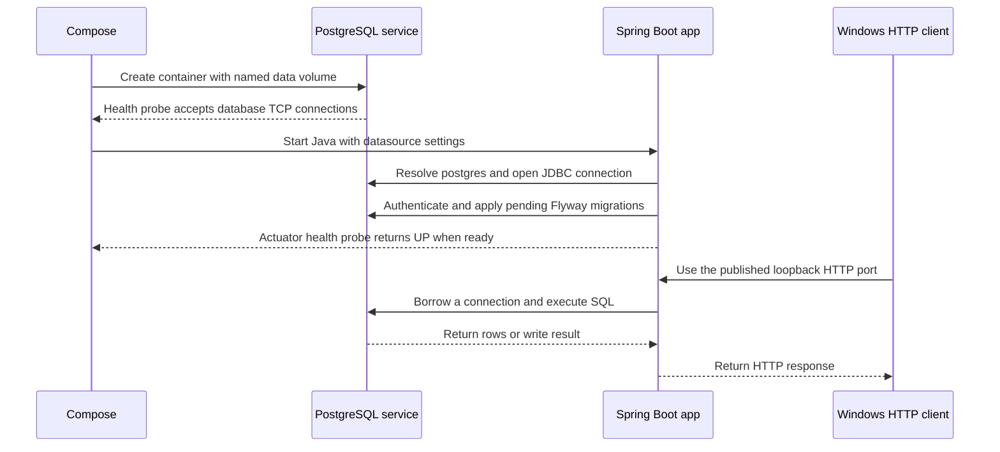

The walkthrough's Compose project supplies `SPRING_DATASOURCE_URL`, `SPRING_DATASOURCE_USERNAME`, and `SPRING_DATASOURCE_PASSWORD` to the Java process. Spring Boot maps those keys to datasource properties. For example, `spring.datasource.url=jdbc:postgresql://postgres:5432/appdb` requests a database named `appdb` at the `postgres` service endpoint. The walkthrough uses `notesdb`. This works when both services share a network with that service name, PostgreSQL accepts connections at `5432`, and the database and authorized credential exist. `localhost:5432` would target the app container's own network stack.

**JDBC** is the Java database API. The PostgreSQL driver speaks the database protocol over the chosen connection. **HikariCP**, provided in this lab by Spring Boot's JDBC starter, maintains a pool of physical connections. A request borrows a handle and returns it to the pool. A pool wait, connection refusal, authentication rejection, and SQL error point to different stages. Keep the pool size suited to the workload and database. The lab sets a small pool limit and a finite acquisition wait.

**Flyway** finds versioned migrations at `classpath:db/migration` by default. The lab's `V1__create_notes.sql` creates one table on a fresh database. Flyway records migration history in PostgreSQL. A later app start checks that history and applies pending migrations. It does not create a new database every time a container starts. A connection failure, missing PostgreSQL support module, incompatible migration, or insufficient database privilege can prevent the app from completing startup. The POM includes both `flyway-core` and the PostgreSQL database module, with versions managed by Spring Boot. [Spring Boot database migrations](https://docs.spring.io/spring-boot/3.5/how-to/data-initialization.html)

### Let the application handle termination

The exec-form entrypoint launches the JVM directly. When Docker sends `SIGTERM`, Spring Boot can close its application context and wait for in-flight web work during its graceful shutdown window. `spring.lifecycle.timeout-per-shutdown-phase=15s` and the project's `stop_grace_period: 25s` give the lab an intentional relationship between the app's shutdown phase and Docker's deadline. A multi-phase or busy application may need a different budget. Observe logs and requests during restart before accepting the defaults for a real service. [Spring Boot graceful shutdown](https://docs.spring.io/spring-boot/3.5/reference/web/graceful-shutdown.html)

By default the lab logs to stdout and stderr. Actuator's `/actuator/health` reports the combined health indicators available in this app, including the datasource when configured. A live JVM can be waiting for startup, serving on the wrong port, or unable to use its database. Check the health path and exercise an actual API read or write. A successful HTTP check supplies evidence beyond `docker ps`. [Actuator endpoints](https://docs.spring.io/spring-boot/3.5/reference/actuator/endpoints.html)

**Key takeaways.** Build the JAR with the tools it needs, run it with the runtime it needs, and supply endpoint configuration at launch. Verify migration, health, and an application transaction independently.

<a id="docker-13"></a>

## Part 13 — Docker Registries and Image Distribution

### Send one artifact to multiple environments

A developer can build locally, but another engine needs a way to obtain the same image. A **registry** stores and returns image manifests and content. A **repository** groups related images, and a tag gives a readable reference to a release or line of builds. Public images may be readable without credentials under the registry's limits. Private repositories require approved authentication and permissions. Docker Hub is the default registry for short public references such as `nginx:alpine`.

Building and tagging are local operations. Pulling downloads from a registry, and pushing uploads to an authorized repository. In **Windows PowerShell**, once a [small Java example](#docker-06) has been built:

```powershell
docker image tag "$DockerCourseId/hello:single" "$DockerCourseId/hello:demo-release"
docker image ls "$DockerCourseId/hello"
docker image inspect "$DockerCourseId/hello:demo-release" --format '{{.Id}} {{json .RepoDigests}}'
docker image rm "$DockerCourseId/hello:demo-release"
```

Both tags initially point to the same local image. A local build may have no published `RepoDigests`. Remove only the lab alias if you want to keep the original. The following is syntax for a future authorized registry workflow and needs no execution for this course.

```text
docker login REGISTRY
docker image tag LOCAL_IMAGE REGISTRY/TEAM/APP:RELEASE
docker image push REGISTRY/TEAM/APP:RELEASE
docker image pull REGISTRY/TEAM/APP:RELEASE
```

An authenticated writer must have permission for the target repository. Use the registry's approved credential flow. A tag such as `latest` can point to a new image at any time. Even a numerical tag can be mutable unless the registry enforces immutability. Record a verified digest to deploy identical published content. A multi-platform index can select appropriate content per architecture. Record the platform as well when it matters.

Trust concerns who built the image, what went into it, and whether it has been modified. Verify the registry and publisher, prefer known base sources, and use signatures or build provenance where your workflow supplies them. Pinning a digest establishes content identity and also pins its known vulnerabilities until you deliberately update. Scanning can identify known affected components. It cannot establish that an image is free of defects or that its runtime settings are appropriate. Later deployment workflows typically build once, publish a versioned artifact, and deploy the verified reference. [Docker pull reference](https://docs.docker.com/reference/cli/docker/image/pull/), [Docker push reference](https://docs.docker.com/reference/cli/docker/image/push/)

**Key takeaways.** Tags name releases and can move. Digests identify content. Registry permissions and provenance determine what you can publish and what you should trust to run.

<a id="docker-14"></a>

## Part 14 — Docker Resource Management

### Set a boundary the kernel can enforce

Containers share the engine's resources. With no configured hard limit, a process can compete with other workloads for more of the available memory or CPU. On Docker Desktop, the Windows-managed Linux environment also has an overall resource budget. Cgroups provide per-container accounting and controls within the engine's Linux environment.

In **Windows PowerShell**, inspect a lightweight constrained container:

```powershell
docker run -d --name "$DockerCourseId-budget" --network none --cpus 0.5 --memory 64m --memory-swap 64m alpine:3.22 sleep 600
docker stats --no-stream "$DockerCourseId-budget"
docker inspect --format '{{.HostConfig.NanoCpus}} {{.HostConfig.Memory}} {{.HostConfig.MemorySwap}}' "$DockerCourseId-budget"
docker system df
docker stop "$DockerCourseId-budget"
docker rm "$DockerCourseId-budget"
```

`--cpus 0.5` sets a quota equivalent to about half a CPU's time over the scheduling window. It does not pin a particular core. `--memory 64m` sets a memory limit on supported engines, and an equal memory-plus-swap setting disables extra swap allowance where supported. The fields are typically `500000000 67108864 67108864`. `docker stats` is a point-in-time or streaming view of CPU, memory, I/O, and processes. Shortly sampled numbers vary. `docker system df` reports engine disk usage categories. An unused object might still hold important data. [Docker resource constraints](https://docs.docker.com/engine/containers/resource_constraints/)

### Recognize a bounded memory failure

This **Windows PowerShell** demo has a small cap and no network. It writes at most 80 MiB of zeros to a memory-backed `tmpfs` in a disposable Alpine container. The size of the filesystem is greater than the memory budget so the process can hit the memory limit first.

```powershell
docker run --name "$DockerCourseId-oom" --network none --memory 48m --memory-swap 48m --tmpfs /scratch:rw,size=96m alpine:3.22 dd if=/dev/zero of=/scratch/sample.bin bs=1M count=80
"Docker command exit=$LASTEXITCODE"
docker inspect --format '{{.State.OOMKilled}} {{.State.ExitCode}} {{.HostConfig.Memory}}' "$DockerCourseId-oom"
docker rm "$DockerCourseId-oom"
```

On the course's Linux engine, expect `true 137 50331648` when the process is killed for exceeding its memory budget. Results depend on memory controller and swap support. If the flags are unsupported, use that expected record as worksheet evidence. The finite write size bounds the demonstration. `137` alone can also result from other forceful termination. `OOMKilled=true` identifies the memory event for this container. A Java `OutOfMemoryError` can occur when a JVM allocation fails even if the kernel never killed the container.

### Account for heap and everything else

The **Java heap** stores managed objects. Total process or container memory can also include metaspace, code cache, threads and stacks, native libraries, direct buffers, and other processes or charged page cache. `-Xmx` limits Java heap. It does not set the cgroup limit. A heap as large as the container limit can leave no headroom for other memory. Prefer a measured budget that leaves room for non-heap activity, and inspect the JVM under representative load. A memory limit constrains the impact of a process. It cannot fix retention bugs or an oversized connection pool.

CPU throttling and memory pressure can lengthen startup and health probes. A restart policy might keep relaunching an app that fails for the same reason. Use logs, `docker inspect`, `docker stats`, and a health check designed for the service's expected startup time. Observe trends and actual requests when tuning. A single measurement is insufficient to establish a safe operating limit.

**Key takeaways.** Distinguish quotas, application settings, and observed consumption. Use the state and memory evidence together before deciding whether a process was killed.

<a id="docker-15"></a>

## Part 15 — Docker Security Fundamentals

### Reduce what a process can affect

Every extra privilege, writable path, and listening endpoint expands what the process can reach. **Least privilege** grants only the operations the service needs. A typical backend can listen on a high port and read its JAR as a non-root user. A process running as UID 0 inside a rootful container can still have significant privileges, especially over writable mounts. A non-root `USER` reduces privileges inside the container. User namespace mapping and a rootless engine change other parts of the security model.

Linux **capabilities** divide privileges into individual permissions. Docker normally starts containers with a limited set. Drop capabilities the service does not need and supply extra capabilities only for a demonstrated requirement. A **read-only root filesystem** prevents ordinary writes to the container root and can be paired with deliberately writable temporary paths or data volumes. This bounded **Windows PowerShell** example runs a numeric non-root identity and writes only to a small temporary mount.

```powershell
docker run --rm --network none --user 10001:10001 --cap-drop ALL --read-only --tmpfs /tmp:rw,size=16m,mode=1777 alpine:3.22 sh -c 'id; touch /tmp/probe; ls -l /tmp/probe'
```

Expect the UID and GID to be `10001` and the sample file to exist under `/tmp`. A Java framework may need a temp directory for its embedded server. A database needs its intended writable mount and correct ownership. Confirm those requirements before enforcing a read-only root for a particular application.

### Treat engine access, images, and configuration as part of the boundary

| Control | Practical consequence |
| --- | --- |
| Run app as non-root with a small image | Limits ordinary access and reduces unnecessary runtime packages. |
| Keep trusted base images and update verified references | Reduces supply-chain uncertainty. Use version records and scans to decide when to rebuild. |
| Keep Docker daemon and socket access restricted | Engine credentials can control workloads, create mounts, or read configuration. Passing the socket to an app effectively gives it engine control. |
| Avoid privileged mode and broad host mounts | Preserves the intended capability and filesystem boundaries. |
| Use narrow ports and separate service scope | Publish only the needed app endpoint for authorized callers. Keep PostgreSQL off host publication in the course. |
| Handle credentials at runtime | Avoid putting secrets in image history, build arguments, logs, or inspectable settings when a restricted secret mechanism is available. |

A read-only mount can still reveal sensitive host contents. Docker Desktop's Linux environment adds a VM boundary, and the Desktop file sharing and engine controls remain relevant. Keep the host, Desktop, kernel, and application patched. Container isolation alone does not verify an app's authorization, certify its image, or provide a database backup. [Docker Engine security](https://docs.docker.com/engine/security/)

**Key takeaways.** Limit the process identity, mounts, ports, and engine access. Use trusted inputs and deliberate updates. Let application security protect requests after the network lets them through.

<a id="docker-16"></a>

## Part 16 — Logging, Health Checks, and Observability

### Ask separate questions about existence and service

A main process can be running while the app waits for a migration or listens on an unreachable address. Docker captures stdout and stderr through a **logging driver** such as `json-file` or `local`, as configured. Some drivers send logs elsewhere and do not always give the same local retrieval behavior. Using stdout and stderr keeps a container log accessible through common engine tools. Writing logs only to a private file in a container can make them invisible to `docker logs`. Log retention and aggregation are deliberate operational choices. [Docker logging configuration](https://docs.docker.com/engine/logging/configure/)

| Evidence | What it establishes |
| --- | --- |
| Running state | The main process is still alive. |
| Healthy state | The configured check has succeeded under its timing and retry policy. |
| HTTP API response | The client reached an HTTP handler. Its status and body tell you what happened. |
| Successful database-backed request | The app's route, database connectivity, identity, schema, and query worked for that request. |

A **health check** is a command the engine runs in the container. It is neither an HTTP server nor an external monitor. Code `0` indicates success and `1` indicates failure. Docker exposes starting, healthy, and unhealthy states. `interval`, `timeout`, `retries`, and `start_period` make the result less sensitive to expected initialization delay. Use an executable that exists in the image and a target meaningful inside its network namespace. Exceeding a probe deadline can fail the health check even when a slower request would eventually work. Keep probe output small and free of credentials.

### Investigate a running but unhealthy app

With the [notes project](#docker-19) in its project directory, use **Windows PowerShell**:

```powershell
docker compose -p $DockerCourseProject ps -a
docker compose -p $DockerCourseProject logs --tail 60 app
$DockerCourseApp = docker compose -p $DockerCourseProject ps -q app
if ($DockerCourseApp) {
    docker inspect --format '{{json .State.Health}}' $DockerCourseApp
    docker compose -p $DockerCourseProject exec -T app curl -fsS --max-time 3 http://127.0.0.1:8080/actuator/health
}
```

If the app is running, the health record has recent probe exit codes and output. A missing `curl` executable, wrong path, or wrong internal port can mark a working listener unhealthy. An HTTP `503` from the correct Actuator path points instead to a failed health indicator. Read app and database logs for causes, and verify DNS and JDBC connectivity on the shared network. `exec` requires a running container, so if the process already exited, start with retained logs and `inspect`. An unavailable host endpoint can also be a publication issue even when the internal health check works.

Docker Engine can leave a running container unhealthy indefinitely. Its restart policy normally evaluates process exits, not health status on its own. Compose can wait for a health check on startup without continuously fixing unhealthy services. For basic operations, combine state, logs with timestamps, health evidence, and `docker stats`. These views do not replace historical metrics, traces, request tests, or backup verification.

**Key takeaways.** A container's process can be running while its health check fails or its API returns errors. Check the meaning and location of the probe before treating its result as service health.

<a id="docker-17"></a>

## Part 17 — Docker Development Workflows

### Use different loops for editing and integration

During a Java edit you may want the IDE debugger and fast restarts. When verifying the release artifact you want to exercise the exact image, service addresses, and mounts. Both workflows can use Docker.

| Workflow | How it works | Trade-off |
| --- | --- | --- |
| IDE JVM with containerized dependencies | Run Java on Windows or in Ubuntu. A local database container can publish a dedicated loopback port for this authorized development client. Java uses that host endpoint. | Fast edit and debug loop. The local JVM and network differ from a deployed container. Keep the database port private to the local workflow. |
| App and dependencies in Compose | Build and run the application image. The app uses the database service name and internal port. | Exercises the container environment and packaging. Source edits require an appropriate rebuild and recreation. |
| Source bind-mounted into a dev container | Mount an intentional project path and use a tool inside the container to rebuild or reload. | Saves some rebuilds and can ease toolchain setup. File watching, permissions, and speed can differ between Windows files and WSL Linux files. Mounted files can hide files baked into the image. |

Use a tagged local build to distinguish artifacts. After changing Java source, `docker compose -p PROJECT up -d --build` builds and reconciles the app. `docker compose restart` reuses the same container and image. After changing only runtime environment, an appropriate `up -d` or explicit recreation applies it. For a temporary pause use `stop` and later `start`. Use `down` when you want to replace service containers and remove their project network. Decide separately whether to retain the development database volume.

| Setting | Disposable development lab | Deployment consideration |
| --- | --- | --- |
| Image | Rebuild a local tag during edits. | Run an approved versioned artifact with a recorded content identity. |
| Data and credentials | Use test rows and a disposable password. | Use restricted roles, tested recovery, and approved runtime credential handling. |
| Access and resources | Publish only to loopback with light test traffic. | Define the actual callers, access policy, health checks, and measured limits. |

**Test isolation** means a test owns its data and endpoints. Give different Compose labs different project names and volumes. Avoid pointing integration tests at your regular development database. **Testcontainers** is a library that can create and manage disposable containers during tests, wait for readiness, and supply selected addresses and ports to the test. It uses a reachable Docker engine and does not remove the need for meaningful readiness or test data. The workbook uses explicit small labs so the resource lifecycle is visible.

### Keep Windows, WSL, and container paths straight

The PowerShell CLI, an integrated Ubuntu CLI, and a shell in the container can use similar commands while seeing different files. Build context originates from the selected CLI's path. A bind mount's source must be usable by the selected daemon, with Desktop's path integration where applicable. For active Linux-tool development in WSL, putting source in the Linux filesystem often helps file watching and performance. Windows IDE tools can edit supported WSL paths. Use a small deliberate directory as context. Keep the installed engine and separate Docker context choice explicit. [Docker Desktop WSL2 best practices](https://docs.docker.com/desktop/features/wsl/best-practices/)

**Key takeaways.** Choose a fast editing loop and a repeatable integration loop. Know which JVM, image, network, and database each one exercises.

<a id="docker-18"></a>

## Part 18 — Docker Troubleshooting

Start with the intended engine and the exact command that failed. Identify a single container or project and keep its logs and inspect record until you have an explanation. If an app is unavailable, follow the stages shown below. Depending on the symptom, you may start directly at a later stage.

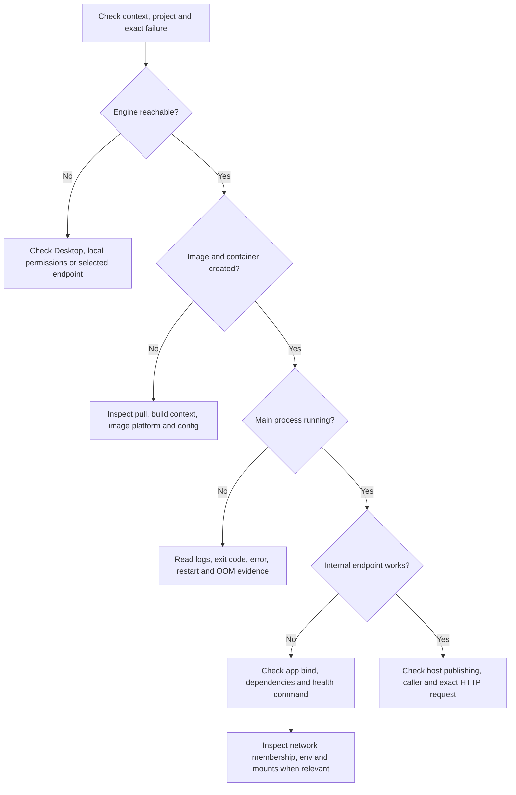

The workflow narrows evidence from engine to process to service. A running process and an HTTP response are different observations. Preserve the named volume while investigating a data or configuration problem.

### Engine, pulls, and builds

| Symptom and likely cause | Inspect and interpret | Correct and prevent |
| --- | --- | --- |
| CLI installed but daemon unavailable | Run `docker version` and `docker context show` in PowerShell. Client output without a working server response points to the endpoint, daemon state, or permissions. | Confirm Docker Desktop is ready or the authorized Linux daemon is running. Review the connection context and access. Check it before mutating resources. |
| Desktop stopped or using the wrong engine | Check the Desktop UI and `docker info --format '{{.OSType}}'`. A Windows-container engine cannot run the Linux lab images as intended. | Start Desktop through its supported UI and choose its Linux engine if needed. Keep Windows and WSL integration consistent. |
| Pull reports not found, denied, timeout, or rate limit | Read the full `docker pull REFERENCE` error. Separate an absent tag, registry permission, network problem, and quota. Inspect an available local reference with `docker image ls`. | Use the published reference, authorized registry access, or an already available lab base as appropriate. Record the correct registry and tag or digest in the project. |
| Build fails during an instruction | Run `docker build --progress=plain -t YOUR_LAB_TAG .`. Find the first failing step and command output. A Maven dependency resolution error differs from application compilation failure. | Fix the named input or command, then retry in the lab folder. Pin dependencies and keep failures visible in the build log. |
| Context lacks a file that exists elsewhere | Check `Get-Location`, the final context argument, and `.dockerignore`. A BuildKit checksum or file-not-found error at `COPY` often concerns context visibility. | Use the intended context and include only the necessary file. Keep build inputs in a small project directory. |
| Dockerfile uses the wrong path | Compare `WORKDIR` and the `COPY` destination with `CMD` or `ENTRYPOINT`. Use `docker image inspect --format '{{.Config.WorkingDir}}' IMAGE` after building. | Use a consistent working directory or an absolute artifact path. Test the same image and command the container will run. |
| Image architecture mismatch | Compare `docker info --format '{{.OSType}}/{{.Architecture}}'` and `docker image inspect --format '{{.Os}}/{{.Architecture}}' IMAGE`. A registry may report no matching manifest. A foreign binary without compatible execution support may give `exec format error`. | Select or build a supported platform variant. For an executable script, also check interpreter and line endings. Verify artifact and runtime platform during builds. |

### Container and service startup

| Symptom and likely cause | Inspect and interpret | Correct and prevent |
| --- | --- | --- |
| Container exits immediately | `docker ps -a`, `docker logs NAME`, and `docker inspect --format '{{.State.ExitCode}} {{.State.Error}}' NAME`. A short command may intentionally complete with 0. An app that should serve requests may have failed. | Correct the entrypoint or specific startup dependency. Use main-process state to tell a job from a long-running service. |
| Container continuously restarts | Inspect `{{.RestartCount}}` and use `docker logs --tail 50 NAME`. Repeated startup messages with the same error suggest a persistent fault. | Stop only the affected lab instance if needed, retain its logs, fix the actual setting, and recreate. Set a deliberate restart policy instead of relying on retries to fix config. |
| Port already allocated | Inspect `docker ps` and the candidate local port with `Get-NetTCPConnection -State Listen -LocalPort PORT`. A Docker creation can leave a stopped object after failing to start. | Keep the other listener intact. Choose a free loopback host port or request automatic allocation. Verify the chosen port with `docker port`. |
| Host API unreachable while container runs | Look at `docker port NAME`, then test the known internal app path with `docker exec NAME curl ...` when curl is available. Internal success with host failure suggests publishing, bind, or scope. | Publish the correct target port on the intended host IP. Verify the app listens on its container interface. Keep a known working path for comparison. |
| Health check keeps failing | Inspect `{{json .State.Health}}` and run the actual command in the container. A missing executable, wrong path, deadline, or real dependency failure can appear here. | Put the right probe tool in the image, correct its internal target, or fix the failed dependency. Use a meaningful check and allow normal startup time. |
| Process is killed at its limit | Inspect `{{.State.OOMKilled}}`, `{{.State.ExitCode}}`, and `{{.HostConfig.Memory}}`. Code 137 without the OOM flag is insufficient evidence. | Diagnose actual memory use and JVM headroom. Change the app or its measured budget. Keep output and historical metrics to distinguish a spike from a leak. |

### Configuration, network, and storage

| Symptom and likely cause | Inspect and interpret | Correct and prevent |
| --- | --- | --- |
| Spring Boot cannot use PostgreSQL | Use Compose logs for both services and DB health. A JDBC refusal or name error comes before authentication. Consider SQLSTATE and PostgreSQL logs if the DB accepted the connection. | Correct service name, internal port, credential, or schema according to the stage. Confirm success with a database-backed API operation. |
| Service hostname is wrong | Use `docker network inspect NETWORK` and, from the running app, `getent hosts postgres` where available. A service alias is scoped to the shared network. | Attach both services as intended and use the stable service name. Inside the app, `localhost` points back to that app. |
| Wrong or missing environment value | Use `docker compose config --quiet` and inspect a selected non-secret runtime key or datasource destination. A shell variable can replace a `.env` input before container creation. | Fix the source and recreate the affected container. Keep build defaults, Compose substitutions, and runtime secret values distinct. |
| Volume permission error | Check `docker inspect --format '{{json .Mounts}}' NAME`, process identity with `docker exec NAME id`, and allowed mode of the exact lab path. A mount can be read-only even with permissive file bits. | Apply correct ownership or mount mode to authorized paths. Avoid running the service privileged or granting write access to unrelated files. |
| Database data appears missing | Check project name, `docker volume ls`, actual container `.Mounts` and the database selected by the connection. A new empty volume can cause normal initialization. | Reattach the intended compatible volume or use the approved recovery process. Keep data backed up and record volume names before recreating services. |
| Windows, WSL, and container paths mixed up | Check `Get-Location` in Windows, `pwd` in Bash or the container, and inspect bind source and destination. Context, daemon, and container have different path roles. | Verify the Windows source and file with `Test-Path`. Use an explicit `--mount` source and absolute container target, then recreate the lab with the intended mount. |

**Key takeaways.** Follow the first failing boundary and change one input at a time. Preserve logs, inspect data, and the database volume until you can show what happened.

<a id="docker-19"></a>

## Part 19 — End-to-End Containerized Backend Walkthrough

Build a small notes service that proves more than an HTTP health response. The service writes a row to PostgreSQL, reads it back after restarting the app, and finds it again after both containers are recreated. Use this walkthrough as a reference for the workbook's final project.

### Prepare a new project

In **Windows PowerShell**, start with the unique `$DockerCourseId` and `$DockerCourseRoot` from [Part 2](#docker-02). Run:

```powershell
$DockerCourseProject = "$DockerCourseId-notes"
$DockerCourseNotesDir = Join-Path $DockerCourseRoot 'notes'
New-Item -ItemType Directory -Path $DockerCourseNotesDir -Force | Out-Null
Set-Location -LiteralPath $DockerCourseNotesDir
New-Item -ItemType Directory -Force -Path '.\src\main\java\course\docker\notes', '.\src\main\resources\db\migration' | Out-Null
Get-Location
```

Use VS Code to save the following files at the specified paths. Save `Dockerfile`, `.dockerignore`, and `.env` with their exact names, without an extra extension. Use a fresh folder and UTF-8 text.

```text
notes/
├── .dockerignore
├── .env
├── Dockerfile
├── compose.yaml
├── pom.xml
└── src/
    └── main/
        ├── java/course/docker/notes/NotesApplication.java
        └── resources/
            ├── application.properties
            └── db/migration/V1__create_notes.sql
```

<a id="notes-files"></a>

### Project files

The value in `.env` is a **disposable local-lab password**. Keep that file out of source control. The app gets it at runtime and the Docker build excludes the file. The PostgreSQL image initializes `labuser` as the lab cluster's bootstrap superuser. A deployed app should use a restricted application role and an intentional migration identity.

#### `pom.xml`

```xml
<project xmlns="http://maven.apache.org/POM/4.0.0"
         xmlns:xsi="http://www.w3.org/2001/XMLSchema-instance"
         xsi:schemaLocation="http://maven.apache.org/POM/4.0.0 https://maven.apache.org/xsd/maven-4.0.0.xsd">
    <modelVersion>4.0.0</modelVersion>
    <parent>
        <groupId>org.springframework.boot</groupId>
        <artifactId>spring-boot-starter-parent</artifactId>
        <version>3.5.16</version>
        <relativePath/>
    </parent>
    <groupId>course.docker</groupId>
    <artifactId>notes</artifactId>
    <version>0.0.1</version>
    <properties>
        <java.version>21</java.version>
    </properties>
    <dependencies>
        <dependency>
            <groupId>org.springframework.boot</groupId>
            <artifactId>spring-boot-starter-web</artifactId>
        </dependency>
        <dependency>
            <groupId>org.springframework.boot</groupId>
            <artifactId>spring-boot-starter-jdbc</artifactId>
        </dependency>
        <dependency>
            <groupId>org.springframework.boot</groupId>
            <artifactId>spring-boot-starter-actuator</artifactId>
        </dependency>
        <dependency>
            <groupId>org.flywaydb</groupId>
            <artifactId>flyway-core</artifactId>
        </dependency>
        <dependency>
            <groupId>org.flywaydb</groupId>
            <artifactId>flyway-database-postgresql</artifactId>
        </dependency>
        <dependency>
            <groupId>org.postgresql</groupId>
            <artifactId>postgresql</artifactId>
            <scope>runtime</scope>
        </dependency>
    </dependencies>
    <build>
        <finalName>notes</finalName>
        <plugins>
            <plugin>
                <groupId>org.springframework.boot</groupId>
                <artifactId>spring-boot-maven-plugin</artifactId>
            </plugin>
        </plugins>
    </build>
</project>
```

#### `src/main/java/course/docker/notes/NotesApplication.java`

```java
package course.docker.notes;

import java.util.List;
import org.springframework.boot.SpringApplication;
import org.springframework.boot.autoconfigure.SpringBootApplication;
import org.springframework.http.HttpStatus;
import org.springframework.jdbc.core.JdbcTemplate;
import org.springframework.web.bind.annotation.GetMapping;
import org.springframework.web.bind.annotation.PostMapping;
import org.springframework.web.bind.annotation.RequestBody;
import org.springframework.web.bind.annotation.ResponseStatus;
import org.springframework.web.bind.annotation.RestController;
import org.springframework.web.server.ResponseStatusException;

@SpringBootApplication
@RestController
public class NotesApplication {
    private final JdbcTemplate jdbc;

    public NotesApplication(JdbcTemplate jdbc) {
        this.jdbc = jdbc;
    }

    public static void main(String[] args) {
        SpringApplication.run(NotesApplication.class, args);
    }

    @GetMapping("/notes")
    public List<Note> list() {
        return jdbc.query("select id, body from notes order by id",
                (row, index) -> new Note(row.getLong("id"), row.getString("body")));
    }

    @PostMapping("/notes")
    @ResponseStatus(HttpStatus.CREATED)
    public Note add(@RequestBody NewNote request) {
        String value = request.text();
        if (value == null || value.isBlank() || value.length() > 200) {
            throw new ResponseStatusException(HttpStatus.BAD_REQUEST, "Use 1 to 200 characters");
        }
        return jdbc.queryForObject("insert into notes (body) values (?) returning id, body",
                (row, index) -> new Note(row.getLong("id"), row.getString("body")), value);
    }

    public record Note(long id, String text) {}
    public record NewNote(String text) {}
}
```

#### `src/main/resources/application.properties`

```properties
spring.application.name=docker-notes
server.address=0.0.0.0
server.port=8080
server.shutdown=graceful
spring.lifecycle.timeout-per-shutdown-phase=15s
management.endpoints.web.exposure.include=health
spring.datasource.hikari.maximum-pool-size=4
spring.datasource.hikari.connection-timeout=5000
```

#### `src/main/resources/db/migration/V1__create_notes.sql`

```sql
CREATE TABLE notes (
    id BIGINT GENERATED ALWAYS AS IDENTITY PRIMARY KEY,
    body VARCHAR(200) NOT NULL
);
```

#### `Dockerfile`

```dockerfile
# syntax=docker/dockerfile:1
FROM maven:3.9-eclipse-temurin-21 AS build
WORKDIR /workspace
COPY pom.xml .
RUN mvn -B -ntp dependency:go-offline
COPY src ./src
RUN mvn -B -ntp package

FROM eclipse-temurin:21-jre-noble AS runtime
WORKDIR /app
RUN test -x /usr/bin/curl && \
    groupadd --gid 10001 app && \
    useradd --uid 10001 --gid 10001 --no-create-home app
COPY --from=build --chown=10001:10001 /workspace/target/notes.jar /app/notes.jar
USER 10001:10001
EXPOSE 8080
ENTRYPOINT ["java","-jar","/app/notes.jar"]
```

#### `.dockerignore`

```text
.git
.env
.env.*
target/
*.log
```

#### `.env`

```dotenv
# Disposable local lab settings
DOCKER_LAB_DB_PASSWORD=local-lab-only-53
DOCKER_LAB_APP_PORT=18088
DOCKER_LAB_DB_HOST=postgres
```

<a id="notes-compose"></a>

#### `compose.yaml`

```yaml
services:
  app:
    image: "${COMPOSE_PROJECT_NAME}-notes:lab"
    build:
      context: .
      dockerfile: Dockerfile
    ports:
      - "127.0.0.1:${DOCKER_LAB_APP_PORT:-18088}:8080"
    environment:
      SPRING_DATASOURCE_URL: "jdbc:postgresql://${DOCKER_LAB_DB_HOST:-postgres}:5432/notesdb"
      SPRING_DATASOURCE_USERNAME: labuser
      SPRING_DATASOURCE_PASSWORD: "${DOCKER_LAB_DB_PASSWORD:?Set DOCKER_LAB_DB_PASSWORD in .env}"
    depends_on:
      postgres:
        condition: service_healthy
    healthcheck:
      test: ["CMD", "curl", "--fail", "--silent", "--show-error", "--max-time", "2", "http://127.0.0.1:8080/actuator/health"]
      interval: 5s
      timeout: 3s
      retries: 8
      start_period: 20s
    stop_grace_period: 25s
    networks: [backend]

  postgres:
    image: postgres:17.11-bookworm
    environment:
      POSTGRES_DB: notesdb
      POSTGRES_USER: labuser
      POSTGRES_PASSWORD: "${DOCKER_LAB_DB_PASSWORD:?Set DOCKER_LAB_DB_PASSWORD in .env}"
    volumes:
      - db-data:/var/lib/postgresql/data
    healthcheck:
      test: ["CMD-SHELL", "pg_isready -h 127.0.0.1 -U \"$${POSTGRES_USER}\" -d \"$${POSTGRES_DB}\""]
      interval: 3s
      timeout: 2s
      retries: 10
      start_period: 5s
    networks: [backend]

networks:
  backend:

volumes:
  db-data:
```

The Maven parent manages compatible Spring Boot and dependency versions. The Maven plugin makes the executable JAR. The sole migration creates the table before the REST handlers need it. `JdbcTemplate` uses prepared parameters for the user-provided note text. HTTP GET and POST use the JDBC connection pool.

The builder's Maven stage handles compilation and dependencies. The runtime stage copies only the packaged JAR and uses UID and GID `10001`. The selected Temurin image includes `curl`, and the runtime stage checks for it so a base-image change that removes the probe fails at build time. `server.address=0.0.0.0` accepts container-interface traffic within that namespace. Only the app's host port is published, at IPv4 loopback.

Compose interpolates the JDBC host into the app's environment and uses the selected project name in the built image tag. The app and database join the `backend` network. The database health check uses TCP on `127.0.0.1` inside PostgreSQL's container. This helps avoid treating the temporary initialization server, which starts without a TCP listener, as the final server. The `$$` escape leaves variables for the database container's shell. The app's Actuator check adds application and database evidence, and the POST and GET exercise the actual handler and schema. The named `db-data` volume maps to the PostgreSQL 17 data path.

### Build and verify the first launch

In **Windows PowerShell**, from the notes directory, check that port `18088` has no existing listener. If it does, choose an unused app port and update `DOCKER_LAB_APP_PORT` in this project's `.env`.

```powershell
Get-NetTCPConnection -State Listen -LocalPort 18088 -ErrorAction SilentlyContinue
docker compose -p $DockerCourseProject config --quiet
docker compose -p $DockerCourseProject config --services
docker compose -p $DockerCourseProject build app
docker compose -p $DockerCourseProject up -d --wait --wait-timeout 120
docker compose -p $DockerCourseProject ps
```

Stop and read the error if configuration, build, or startup fails. The first build can download the Dockerfile frontend, bases, Maven plugins, and dependencies. `--wait` bounds the startup wait and checks service health. Expect both `app` and `postgres` with healthy state, and no host port for PostgreSQL. If a pull, build, or health check fails, use the exact error and the [troubleshooting tables](#docker-18).

Inspect runtime identity and reachability. The Docker commands issue requests from PowerShell, and the commands after the service names execute **inside the respective containers**.

```powershell
docker compose -p $DockerCourseProject exec -T app id
docker compose -p $DockerCourseProject exec -T app getent hosts postgres
docker compose -p $DockerCourseProject logs --tail 40 app
$DockerCourseNotesEndpoint = docker compose -p $DockerCourseProject port app 8080
$DockerCourseNotesUri = "http://$DockerCourseNotesEndpoint"
curl.exe --noproxy '*' -fsS --max-time 5 "$DockerCourseNotesUri/actuator/health"
```

The app process runs as UID `10001`, and `getent` resolves the service to a project IP. The logs show server startup, datasource initialization and Flyway migration or validation. Actuator should return JSON with `status` equal to `UP`. The actual source of the host endpoint is `docker compose port`, so the HTTP tests work after a deliberate change to the external port.

### Write and independently verify a database row

Run in **Windows PowerShell**:

```powershell
$DockerCourseNoteBody = @{ text = 'first Docker note' } | ConvertTo-Json -Compress
Invoke-RestMethod -Method Post -Uri "$DockerCourseNotesUri/notes" -ContentType 'application/json' -Body $DockerCourseNoteBody
Invoke-RestMethod -Uri "$DockerCourseNotesUri/notes"
docker compose -p $DockerCourseProject exec -T postgres psql -U labuser -d notesdb -c 'SELECT id, body FROM notes ORDER BY id;'
```

The POST returns the created note and an assigned ID with HTTP `201`. GET returns a list containing `first Docker note`. The `psql` command queries from the database container using its local connection and confirms the same value is stored. The successful POST proves the app's *remote* connection works over the project network. Record the note text and its ID before the next checks.

### Restart the app, then recreate both containers

In **Windows PowerShell**:

```powershell
docker compose -p $DockerCourseProject restart app
docker compose -p $DockerCourseProject up -d --wait --wait-timeout 120
docker compose -p $DockerCourseProject logs --tail 60 app
Invoke-RestMethod -Uri "$DockerCourseNotesUri/notes"
$DockerCourseDbBefore = docker compose -p $DockerCourseProject ps -q postgres
docker compose -p $DockerCourseProject down
$DockerCourseNotesVolume = "${DockerCourseProject}_db-data"
docker volume inspect $DockerCourseNotesVolume --format '{{.Name}} {{json .Labels}}'
docker compose -p $DockerCourseProject up -d --wait --wait-timeout 120
$DockerCourseDbAfter = docker compose -p $DockerCourseProject ps -q postgres
$DockerCourseDbBefore -ne $DockerCourseDbAfter
Invoke-RestMethod -Uri "$DockerCourseNotesUri/notes"
```

The restart sends the configured stop signal to the Java process and starts it again in the same app container. Watch the logs for graceful shutdown and the new startup. The second experiment removes both containers with `down` and then recreates them. The database ID comparison should be `True`, the volume name stays the same, and the note survives. PostgreSQL reopens an existing data directory. The new app validates the Flyway history already in that database.

### Diagnose one deliberate configuration error

In **Windows PowerShell**, override the interpolation input for one Compose operation. This changes the app and keeps PostgreSQL and its data in place.

```powershell
$DockerCourseOldHost = $env:DOCKER_LAB_DB_HOST
try {
    $env:DOCKER_LAB_DB_HOST = 'localhost'
    docker compose -p $DockerCourseProject up -d --no-deps --force-recreate app
} finally {
    $env:DOCKER_LAB_DB_HOST = $DockerCourseOldHost
}
docker compose -p $DockerCourseProject ps -a
docker compose -p $DockerCourseProject logs --tail 80 app
```

The new app can be briefly starting. Repeat the two inspection commands until the startup result is visible. Expect a JDBC connection failure mentioning localhost or a nested connection refusal, followed by an app startup failure. PostgreSQL can remain healthy because the faulty request was aimed at the app's own network stack. If no error appears, verify the project name and confirm the intended app was recreated. A stale shell override can also replace a value in `.env`.

With `DOCKER_LAB_DB_HOST=postgres` in this project's `.env` and no conflicting shell value, reconcile the good definition and verify recovery:

```powershell
docker compose -p $DockerCourseProject up -d --wait --wait-timeout 120
curl.exe --noproxy '*' -fsS --max-time 5 "$DockerCourseNotesUri/actuator/health"
Invoke-RestMethod -Uri "$DockerCourseNotesUri/notes"
```

Changing the input leads Compose to recreate the app with the right datasource URL. A plain restart of the broken instance would reuse its environment. If connection errors remain, check service DNS, health, and address first. A password rejection points to database authentication. A Flyway error after connection points toward the migration or schema. If the internal probe succeeds but Windows cannot reach the app, inspect `docker compose port app 8080` in this project and use the reported endpoint.

### Clean up only this project

Run in **Windows PowerShell**, from the notes directory:

```powershell
docker compose -p $DockerCourseProject down
$DockerCourseNotesVolume = "${DockerCourseProject}_db-data"
docker volume inspect $DockerCourseNotesVolume --format '{{.Name}} {{json .Labels}}'
```

The first command removes the service containers and project network. Keeping the inspected volume lets you come back to the same test rows later. If you intend to discard these test rows and the label identifies your fresh lab project, remove that exact volume. The second line below removes the built lab image tag. It leaves the public base images and their potentially shared layers available.

```powershell
docker volume rm $DockerCourseNotesVolume
docker image rm "$DockerCourseProject-notes:lab"
```

Keep the sample source files as a reference or remove only their verified scratch folder after leaving it. Use the same project name to inspect or resume a retained volume. Changing project name normally creates a different named volume.

**Key takeaways.** Verify the service at every stage: correct image, process identity, network name, database login, health endpoint, real write, and a persistent read after recreation.

## Docker Architecture Recap

The CLI selects an engine through a context. The engine manages image content and calls runtime components to start the container process. The Linux kernel supplies its namespaces and resource controls. The process reads a merged filesystem and configured mounts, uses attached networks, and emits logs and exit state. Compose applies a project definition to those same engine objects.

## Docker Command Cheat Sheet

Use these command forms in **Windows PowerShell**, substituting your verified object names. Commands with `exec` run their specified executable inside the container.

| Goal | Command form |
| --- | --- |
| Verify client, server, and context | `docker version`, `docker context show`, `docker info` |
| Pull and examine an image | `docker pull IMAGE:TAG`, `docker image ls`, `docker image inspect IMAGE`, `docker image history IMAGE` |
| Manage local image aliases | `docker image tag SOURCE TARGET`, `docker image rm YOUR_LAB_TAG` |
| Build with a visible cache trace | `docker build --progress=plain -t YOUR_LAB_TAG .` |
| Create or start a container | `docker create --name NAME IMAGE COMMAND`, `docker start -a NAME` |
| Create and run | `docker run --name NAME IMAGE`, or add `-d` for background and `--rm` for a disposable one-shot. |
| Check state and output | `docker ps -a`, `docker logs --tail 50 NAME`, `docker inspect NAME` |
| Run a process inside | `docker exec NAME COMMAND` or `docker exec -it NAME sh` |
| Stop, restart, or remove | `docker stop NAME`, `docker restart NAME`, `docker rm NAME` after stop |
| Inspect published port | `docker port NAME 8080/tcp` |
| Create, inspect, attach, or remove network | `docker network create NET`, `docker network inspect NET`, `docker network connect NET NAME`, `docker network disconnect NET NAME`, `docker network rm NET` |
| Manage storage | `docker volume ls`, `docker volume create VOL`, `docker volume inspect VOL`, `docker volume rm VERIFIED_LAB_VOL` |
| Observe resource use | `docker stats --no-stream NAME`, `docker system df` |
| Validate or start Compose | `docker compose -p PROJECT config --quiet`, `docker compose -p PROJECT up -d --wait` |
| Inspect Compose | `docker compose -p PROJECT ps -a`, `docker compose -p PROJECT logs --tail 50 SERVICE` |
| Pause or replace project instances | `docker compose -p PROJECT stop` then `start` to resume, or `down` to remove the containers. |

## Dockerfile Instruction Reference

| Intent | Instructions |
| --- | --- |
| Choose a base and location | `FROM ... AS stage`, `WORKDIR /app` |
| Add context files or a stage artifact | `COPY source target`, `COPY --from=stage source target`, `ADD` for its specific additional behaviors |
| Execute a build step | `RUN command` |
| Pass inputs or set defaults | `ARG NAME` for build inputs, `ENV NAME=value` for runtime defaults and later instructions |
| Define the launched process | Exec-form `ENTRYPOINT ["program"]` with optional `CMD ["default-arg"]` |
| Document or restrict the runtime | `EXPOSE port`, `USER uid:gid`, `HEALTHCHECK` |
| Restrict the build context | Put patterns in `.dockerignore` at the context root. |

## Docker Compose Reference

| Key or setting | Use in a project |
| --- | --- |
| `services` | Define runnable roles and their image or build source. |
| `ports` | Publish host endpoints to container ports. |
| `environment` and `env_file` | Supply variables to service containers. |
| `volumes` | Define named storage and attach it to precise container paths. |
| `networks` | Create communication scopes and attach intended peers. |
| `healthcheck` and `depends_on` | Evaluate service-specific gates and define startup dependencies. |
| `restart` and `stop_grace_period` | Describe exit restart policy and time allowed for termination. |
| `-p PROJECT` | Select a unique project group for commands. |

## Common Misconceptions

| Assumption | What to verify |
| --- | --- |
| A Linux image carries its own Linux kernel. | Check the kernel of the machine or VM that runs the engine. |
| Rebuilding a tag updates running containers. | Compare their image references and recreate the intended instance. |
| `EXPOSE` makes a service reachable on my laptop. | Inspect publication and the listening socket. |
| Every container on a host shares localhost. | Identify each network namespace and intended address. |
| Removing a container always deletes or always keeps its data. | Inspect the actual mount type, name, and path. |
| The app is ready if the container is running. | Check an internal probe and a representative request. |
| Lab configuration can be copied directly to deployment. | Establish real credential handling, access boundaries, resource budgets, and backup policies. |

## Glossary

| Term | Meaning |
| --- | --- |
| Build context | Files available as build inputs after filtering. |
| BuildKit | Docker build engine that executes and caches build operations. |
| cgroup | Kernel mechanism for process group resource accounting and constraints. |
| Compose project | Group of services and related engine resources managed together. |
| Container | A specific process environment and its engine-managed state. |
| Context | Client configuration identifying a Docker endpoint. |
| Digest | Content hash used for immutable image references. |
| Entrypoint | Image or runtime setting specifying the main executable and fixed arguments. |
| Health check | Periodic command that supplies service health evidence. |
| Image | Reusable filesystem content and launch configuration. |
| Layer | A set of filesystem changes in an image or container view. |
| Namespace | Kernel-isolated view of a resource such as processes or interfaces. |
| OCI | Open Container Initiative specifications for images, distribution, and runtime behavior. |
| Published port | Host endpoint forwarded to an internal container port. |
| Registry | Service that stores and serves image content and repository references. |
| Service discovery | Finding a current service endpoint, for example through Compose DNS. |
| Volume | Engine-managed storage with its own lifetime. |

## Troubleshooting Checklist

- [ ] Verify the selected engine and project before acting.
- [ ] Check the actual image, build logs, platform, and start command.
- [ ] Read stopped-container logs and inspect exit, restart, and OOM state.
- [ ] Confirm environment at the intended stage and avoid printing sensitive keys.
- [ ] Identify the caller's network, publish scope, service name, and internal listener.
- [ ] Check health output, actual HTTP response, and database-backed behavior.
- [ ] Verify the named volume and mount path before replacing or deleting any data.

## Readiness Checklist

- [ ] I can build an image twice, predict cache reuse, and explain what the final stage contains.
- [ ] I can explain the difference between an image, a stopped container, and a named volume.
- [ ] I can trace one Windows request and one service-to-service request to their respective endpoints.
- [ ] I can change a runtime setting, apply it by recreation, and explain why restart alone reuses the old value.
- [ ] I can show a database row surviving project recreation and identify the volume that preserved it.
- [ ] I can diagnose a controlled configuration fault using logs and inspect output and demonstrate recovery.

### Before Application Configuration and Deployment Fundamentals

Carry forward the distinction between the built artifact and the runtime values supplied by its environment. Application Configuration will cover how an app resolves those values and how to handle credentials and environment-specific settings. Deployment Fundamentals can then start with an image, a verified health response, a known route, and a plan for persistent state.

## Key Takeaways

- An image packages user-space files and launch defaults. The engine runs a process in a configured Linux environment.
- The intended behavior depends on image content, runtime configuration, network scope, and storage identity.
- Compose creates related resources. Service health, configuration changes, and data retention still need independent verification.
- Use the smallest safe experiment that explains a failure. Keep evidence and data while testing the correction.

Practice those checks in [Part A of the workbook](Docker_Exercises_and_Solutions.md#exercises).
