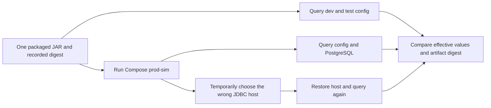

# Application Configuration Fundamentals — Exercises and Solutions

## How to Use This Document

Read the linked [Theory](Application_Configuration_Theory.md) sections, predict the result, and complete the task before looking at its reference solution. Write down the intended source, the effective value or error, and one observation that rules out another cause. Use the challenge questions to check your reasoning.

- [Level 1 — Foundations](#level-1-foundations) builds the process and Java model.
- [Level 2 — Spring Boot Configuration](#level-2-spring-boot-configuration) applies it to Boot and Compose.
- [Level 3 — Troubleshooting](#level-3-troubleshooting) starts with symptoms and asks you to prove a cause.
- [Final Mini Project](#config-final-project) brings the contracts together.
- [Part B — Complete Solutions](#config-solutions) follows exercise order.

## Environment Setup

Open a fresh Windows PowerShell window. Workspace files for this course are disposable. Use the following commands to create a scratch workspace and verify the tools. Java and Maven should both report Java 21 for these labs. Use Docker Desktop with Linux containers and Compose V2. Ubuntu Bash in WSL2 needs its own Java 21 installation for Exercise 03. The initial dependency/image downloads require ordinary Internet access.

```powershell
$ConfigPracticeRoot = Join-Path ([IO.Path]::GetTempPath()) ('config-course-' + [Guid]::NewGuid().ToString('N').Substring(0, 8))
New-Item -ItemType Directory -Path $ConfigPracticeRoot | Out-Null
Set-Location -LiteralPath $ConfigPracticeRoot
java -version
mvn.cmd -v
docker compose version
curl.exe --version
```

Create a `core` subdirectory for the ordinary Java files and a `config-lab` subdirectory for the Spring project. For Level 2, assemble a disposable copy of the [walkthrough project](Application_Configuration_Theory.md#config-19), or build your own first using the final project contract. Keep the source-tree paths exactly as shown. `overrides` is an external directory next to `pom.xml`, distinct from `src/main/resources`. Run the JAR from the project directory for these relative paths. Use an exercise-specific scratch copy before intentionally breaking YAML, settings, or Compose files.

Run PowerShell commands in Windows PowerShell and Bash commands in Ubuntu. Use Java's source-file mode (`java File.java`) when given a source path, or compile with `javac File.java` before running `java ClassName`. Start a foreground app in one VS Code terminal tab and use a second tab for probes. Stop each JVM with Ctrl+C before trying the next command. Use Postman GET requests to the same loopback URLs if you prefer. The walkthrough uses ports `18094` (dev), `18096` (test), `18095` (stub), and `18098` (Compose). Inspect listeners with `Get-NetTCPConnection -State Listen -LocalPort 18094,18095,18096,18098 -ErrorAction SilentlyContinue` and choose unused alternatives when needed.

## Exercise Safety Rules

- Use the scratch root and names from this document. Keep CapsuleAI code, data, endpoints, and credentials out of the exercises.
- Generate fresh disposable values inside the isolated project. Keep `secrets/` and `.env` out of Git and the Docker build context. Show only secret file presence/readability or an error's key name.
- Use a unique Docker project name. Record it when resources are created and reuse it in follow-up commands. `up` can pull images, create networks and volumes, and create containers. `down` removes this project's containers and network. Remove a named volume only after confirming it is disposable and belongs to that project.
- A Compose `.env` entry, a service env file, and the app's OS environment are distinct places. Keep the first two free of sensitive values in these labs. Avoid full env dumps, full Compose model output, and generic container inspection.
- Use clean shells and stop the previous run before applying a new setting. Clean up only variables and files created for the exercise.

# Part A — Exercises


<a id="level-1-foundations"></a>

## Level 1 — Foundations

<a id="config-ex-01"></a>

### CONFIG-EX-01 — Externalize a hardcoded target label

- **Difficulty.** Level 1 (foundations)
- **Related Theory.** [Part 1 introduction](Application_Configuration_Theory.md#config-01) · [Part 3 environment variables](Application_Configuration_Theory.md#config-03)
- **Learning objective.** Extract a setting without changing the job's business behavior.
- **Scenario.** A local job needs a different display label for each run while its batch limit stays fixed.
- **Prerequisites.** Java 21 and the fixed job in Part 1.

**Task.** Write a standalone Java class based on the fixed job. Read `CFG_LAB_LABEL` once at startup. Keep `desk` as the default and preserve the format and count of the three report lines. Run it twice from PowerShell, once absent and once set to `review`.

**Expected result.** The two runs print `desk-1` through `desk-3` and `review-1` through `review-3` respectively.

**Self-check questions**

1. Which value can change without compiling again?
2. Why would you make a different choice for a password?

**Cleanup.** Remove `CFG_LAB_LABEL` after the second run.

<a id="config-ex-02"></a>

### CONFIG-EX-02 — PowerShell variables and process inheritance

- **Difficulty.** Level 1 (foundations)
- **Related Theory.** [Part 3 environment variables](Application_Configuration_Theory.md#config-03)
- **Learning objective.** Predict the value a Java child inherits.
- **Scenario.** A PowerShell variable and a Windows process environment variable share a name.
- **Prerequisites.** `EnvProbe.java` from Part 3 in your Java practice folder.

**Task.** Set the ordinary PowerShell variable `$CFG_LAB_LABEL` to `plain` in a fresh window. Probe from Java. Set the process variable to `exported`, probe, update it to `changed`, probe again, and remove it before the final run.

**Expected result.** The process sees `<unset>`, `exported`, `changed`, then `<unset>`. The ordinary variable remains `plain` until removed.

**Self-check questions**

1. Why does the unqualified PowerShell variable stay private?
2. What would a child that was already running see?

**Cleanup.** Remove both demo variables from this window.

<a id="config-ex-03"></a>

### CONFIG-EX-03 — Export and scope a value in Bash

- **Difficulty.** Level 1 (foundations)
- **Related Theory.** [Part 3 environment variables](Application_Configuration_Theory.md#config-03)
- **Learning objective.** Distinguish a shell variable, an export, and a per-command assignment.
- **Scenario.** A Bash launcher should change one Java run without changing subsequent runs.
- **Prerequisites.** Ubuntu Bash with Java 21 and `EnvProbe.java` visible from WSL.

**Task.** Start with an unset key. Create a Bash variable, run the probe, export it and rerun. Then give one Java launch a temporary value of `once` and show that the next launch still receives the exported value. Finally remove it.

**Expected result.** The unexported value is invisible to Java. The exported value persists for later children, the temporary value appears once, and unset restores `<unset>`.

**Self-check questions**

1. Why is `set` output broader than a child environment?
2. When would one-command assignment be useful?

**Cleanup.** Unset `CFG_LAB_LABEL` in Bash.

<a id="config-ex-04"></a>

### CONFIG-EX-04 — Trace JVM options and program arguments

- **Difficulty.** Level 1 (foundations)
- **Related Theory.** [Part 4 Core Java](Application_Configuration_Theory.md#config-04)
- **Learning objective.** Place JVM properties and application arguments in their correct locations.
- **Scenario.** The same spelling can be interpreted by the JVM or arrive as an ordinary application argument.
- **Prerequisites.** `InputProbe.java` from Part 4.

**Task.** Compile the probe. Pass `plain.label=jvm` as a system property and `--label=program` as a program argument in one run. Then move the `-D` token to the program-argument position and compare both lines.

**Expected result.** The proper JVM option appears in the property line. After moving it, the property is unset and the token appears in the arguments array.

**Self-check questions**

1. Who reads `-D`?
2. Who decides what `--label=program` means?

**Cleanup.** Keep the compiled probe for reuse or delete its scratch class file.

<a id="config-ex-05"></a>

### CONFIG-EX-05 — Load a Java properties file

- **Difficulty.** Level 1 (foundations)
- **Related Theory.** [Part 2 configuration sources](Application_Configuration_Theory.md#config-02) · [Part 4 Core Java](Application_Configuration_Theory.md#config-04)
- **Learning objective.** Make a nonsecret settings file usable without rebuilding.
- **Scenario.** A batch job must read a local target and a limit chosen by its operator.
- **Prerequisites.** `PlainConfig.java` from Part 4. Start with no `CFG_PLAIN_*` overrides.

**Task.** Create `local.properties` with label `file`, target `outbox`, and limit `7`. Run the Java source with that path. Move the file to a new scratch subdirectory, prove the old relative path fails, then pass the corrected path.

**Expected result.** First and final runs select the three file values. The bad path exits `2` with a controlled diagnostic.

**Self-check questions**

1. Which folder does an ordinary relative path use?
2. Why choose a Reader with explicit encoding?

**Cleanup.** Restore the file name for reuse or remove your scratch file and empty subdirectory.

<a id="config-ex-06"></a>

### CONFIG-EX-06 — Test the default and an invalid value

- **Difficulty.** Level 1 (foundations)
- **Related Theory.** [Part 4 Core Java](Application_Configuration_Theory.md#config-04) · [Part 11 validation](Application_Configuration_Theory.md#config-11)
- **Learning objective.** Separate conversion errors from range violations.
- **Scenario.** The operator omits the optional batch size, mistypes it, then provides a number outside its allowed range.
- **Prerequisites.** `PlainConfig.java` in a clean PowerShell session.

**Task.** Supply the required target `outbox`. Run with no limit, with `large`, with `0`, and with an explicit valid value. Record stdout or the error category and process exit status each time.

**Expected result.** Missing limit uses `5`. Non-integer and out-of-range input fail with different messages and status `2`.

**Self-check questions**

1. Why should an invalid supplied value fail even when a safe default exists?
2. Is `0` a parsing failure?

**Cleanup.** No persistent files are created.

<a id="config-ex-07"></a>

### CONFIG-EX-07 — Enforce a required setting and predict precedence

- **Difficulty.** Level 1 (foundations)
- **Related Theory.** [Part 1 introduction](Application_Configuration_Theory.md#config-01) · [Part 2 configuration sources](Application_Configuration_Theory.md#config-02) · [Part 4 Core Java](Application_Configuration_Theory.md#config-04)
- **Learning objective.** Use a source contract to explain both a winning value and a failed startup.
- **Scenario.** The batch job receives different target values from a file, the environment, a JVM option, and its arguments.
- **Prerequisites.** `PlainConfig.java` and access to a fresh scratch file.

**Task.** Define distinct target values from all four sources. Remove winners in order until the file wins, then simulate explicit blank and missing target separately. Record the outcome before running each command.

**Expected result.** The chosen target follows CLI, JVM, environment, file. Missing and explicitly blank target both exit `2`.

**Self-check questions**

1. Why can a blank flag shadow the file value?
2. What changes if the loader checks presence before validating?

**Cleanup.** Remove the demo target environment variable and scratch file.

<a id="level-2-spring-boot-configuration"></a>

## Level 2 — Spring Boot Configuration

<a id="config-ex-08"></a>

### CONFIG-EX-08 — Keep defaults and add an external file

- **Difficulty.** Level 2 (Spring Boot)
- **Related Theory.** [Part 5 Boot Config Data](Application_Configuration_Theory.md#config-05) · [Part 6 properties and YAML](Application_Configuration_Theory.md#config-06) · [Part 8 precedence](Application_Configuration_Theory.md#config-08)
- **Learning objective.** Add deployment overrides independent of the JAR.
- **Scenario.** The packaged dev file exists and you want to replace its label locally while keeping other defaults.
- **Prerequisites.** Built `config-lab.jar`, free port `18094`, and an empty scratch `overrides` directory beside the project.

**Task.** Create an external base properties file with label `external`. First launch the dev profile without an extra location. Stop it and start it again with the directory configured as additional. Compare the label and timeout.

**Expected result.** The label changes `dev` → `external` while the timeout stays `PT1S`.

**Self-check questions**

1. Why did external base beat packaged dev?
2. How would a replacement location change the set of eligible files?

**Cleanup.** Stop the JVM and remove your external file.

<a id="config-ex-09"></a>

### CONFIG-EX-09 — Translate properties into nested YAML

- **Difficulty.** Level 2 (Spring Boot)
- **Related Theory.** [Part 5 Boot Config Data](Application_Configuration_Theory.md#config-05) · [Part 6 properties and YAML](Application_Configuration_Theory.md#config-06) · [Part 10 type-safe binding](Application_Configuration_Theory.md#config-10)
- **Learning objective.** Verify equivalent typed behavior for flattened keys, lists, and maps.
- **Scenario.** An operator prefers a nested document with a two-value channel list and a path-shaped alias key.
- **Prerequisites.** Built JAR and a scratch extra config directory.

**Task.** Create equivalent properties and YAML files for `label=yaml-equivalent`, a `750ms` timeout, `768KB` buffer, channels `web,email`, public alias `Visitor`, and alias `/course=Study`. Run each separately. Compare the responses and predict what happens if the formats coexist with conflicting labels.

**Expected result.** The separate formats agree on values, including `PT0.75S` and `786432` bytes. `staff` survives the alias overrides. A co-located properties label wins over YAML.

**Self-check questions**

1. Why did the list replace the old list but the map retain `staff`?
2. Why is the path-like map key bracketed?

**Cleanup.** Stop all launches and remove your scratch override files.

<a id="config-ex-10"></a>

### CONFIG-EX-10 — Select profiles, order, and a group

- **Difficulty.** Level 2 (Spring Boot)
- **Related Theory.** [Part 5 Boot Config Data](Application_Configuration_Theory.md#config-05) · [Part 7 Spring Profiles](Application_Configuration_Theory.md#config-07) · [Part 8 precedence](Application_Configuration_Theory.md#config-08)
- **Learning objective.** Predict the active/default set and load order inside a location group.
- **Scenario.** A teammate assumes activating `test` preserves all `dev` profile settings automatically.
- **Prerequisites.** Built JAR, clean environment, ports `18094` and `18096` available.

**Task.** Observe default mode, explicit `dev`, and environment-selected `test`. Then try `dev,test`, `test,dev`, and `workstation`. Record profiles, label, timeout, port, page size, and banner where they differ.

**Expected result.** Order changes the winning label when both apply. `workstation` supplies the platform's dev values and `workstation-banner`. The default selection has an empty active array.

**Self-check questions**

1. Is `dev` active in the no-selector run?
2. Why can `dev,test` keep the dev timeout while taking the test label?

**Cleanup.** Stop each launch before the next. Remove the process selector if set.

<a id="config-ex-11"></a>

### CONFIG-EX-11 — Prove source precedence by subtraction

- **Difficulty.** Level 2 (Spring Boot)
- **Related Theory.** [Part 5 Boot Config Data](Application_Configuration_Theory.md#config-05) · [Part 7 Spring Profiles](Application_Configuration_Theory.md#config-07) · [Part 8 precedence](Application_Configuration_Theory.md#config-08)
- **Learning objective.** Predict and verify an override chain through four different source tiers.
- **Scenario.** A support ticket says the file label is ignored when the app is started by a custom launcher.
- **Prerequisites.** Built JAR, base dev launch, scratch extra config directory.

**Task.** Set distinct values `external`, `env`, `jvm`, and `cli` for `lab.label` in the respective sources. Predict the winner with all present. Remove one winner each run until packaged dev wins.

**Expected result.** Winners descend `cli` → `jvm` → `env` → `external` → `dev`.

**Self-check questions**

1. Where must `-D` be passed?
2. Why does setting a variable in a second PowerShell window fail to alter the first launch?

**Cleanup.** Stop the JVM, clear the nonsecret label variable, and remove the scratch override.

<a id="config-ex-12"></a>

### CONFIG-EX-12 — Exercise the banner placeholder

- **Difficulty.** Level 2 (Spring Boot)
- **Related Theory.** [Part 5 Boot Config Data](Application_Configuration_Theory.md#config-05) · [Part 8 precedence](Application_Configuration_Theory.md#config-08) · [Part 9 @Value](Application_Configuration_Theory.md#config-09)
- **Learning objective.** Distinguish overriding the placeholder input from overriding its property.
- **Scenario.** A UI-facing text currently comes from a fallback embedded in `banner.text`.
- **Prerequisites.** Built JAR with the capstone controller and a clean environment.

**Task.** Run the dev profile with no banner inputs, then with `COURSE_NOTICE` set to `local-review`, and finally with that variable and an explicit `banner.text` CLI override of `direct`. Use `/config` to inspect `banner`. Explain how the optional required `@Value` example differs.

**Expected result.** The banner is `packaged-banner`, `local-review`, then `direct`.

**Self-check questions**

1. Which source is involved in resolving `COURSE_NOTICE`?
2. Does the constructor's own `learning` fallback normally run when the packaged file supplies `banner.text`?

**Cleanup.** Stop each run and remove `COURSE_NOTICE`.

<a id="config-ex-13"></a>

### CONFIG-EX-13 — Bind duration, size, and nested values

- **Difficulty.** Level 2 (Spring Boot)
- **Related Theory.** [Part 6 properties and YAML](Application_Configuration_Theory.md#config-06) · [Part 10 type-safe binding](Application_Configuration_Theory.md#config-10) · [Part 11 validation](Application_Configuration_Theory.md#config-11)
- **Learning objective.** Apply a typed contract with nested data and explicit units.
- **Scenario.** A feature should remain disabled while its nonsecret wait and payload settings change.
- **Prerequisites.** Built JAR and the `LabSettings` contract.

**Task.** Run dev with `lab.timeout` set to `900ms`, `lab.buffer-size` set to `256KB`, `lab.integration.connect-timeout` set to `400ms` and `lab.integration.enabled` false. Verify the fields exposed through `/config`. Explain how to prove the connect timeout was bound without exposing the whole environment.

**Expected result.** `timeout` is `PT0.9S`, `bufferBytes` is `262144`, and the integration stays off. The nested timeout can be observed in a controlled test.

**Self-check questions**

1. What does a bare `900` mean for this duration?
2. What creates a nested instance with no integration keys?

**Cleanup.** Stop the JVM. Remove a scratch test if you wrote one.

<a id="config-ex-14"></a>

### CONFIG-EX-14 — Separate binding failure from validation

- **Difficulty.** Level 2 (Spring Boot)
- **Related Theory.** [Part 10 type-safe binding](Application_Configuration_Theory.md#config-10) · [Part 11 validation](Application_Configuration_Theory.md#config-11) · [Part 17 testing](Application_Configuration_Theory.md#config-17)
- **Learning objective.** Identify the phase in which each wrong input was rejected.
- **Scenario.** Three error reports all cite configuration during startup, but the remediation differs.
- **Prerequisites.** Built JAR and free host dev port.

**Task.** Run separately with `lab.page-size=large`, `lab.page-size=0`, `lab.integration.enabled=true` without a URL, and `lab.enabled=true`. Classify each failure. Correct the valid-integer problem and URL settings in a final run, omitting the unknown key.

**Expected result.** You see a type error, numeric constraint error, nested invariant error, and unknown-key failure. The repaired run starts.

**Self-check questions**

1. What does `@Valid` contribute?
2. Would `ignoreUnknownFields=false` catch `labb.enabled`?

**Cleanup.** Stop the repaired run. CLI-only inputs leave no files.

<a id="config-ex-15"></a>

### CONFIG-EX-15 — Switch an optional HTTP client on and off

- **Difficulty.** Level 2 (Spring Boot)
- **Related Theory.** [Part 10 type-safe binding](Application_Configuration_Theory.md#config-10) · [Part 11 validation](Application_Configuration_Theory.md#config-11) · [Part 15 infrastructure](Application_Configuration_Theory.md#config-15) · [Part 16 feature flags](Application_Configuration_Theory.md#config-16)
- **Learning objective.** Distinguish disabled, enabled and reachable, and enabled but unavailable.
- **Scenario.** The learning backend should keep its core routes working when a hint provider is unavailable.
- **Prerequisites.** Built JAR and Part 16's Java stub in the scratch project. Ports `18094` and `18095` available.

**Task.** Observe `/hint` with the flag off. Start the stub and enable the flag with its base URL. Verify the hint, then stop only the stub and recheck `/hint` and `/config`.

**Expected result.** The endpoint returns `disabled`, then `sample-hint`, then HTTP `503` on the enabled integration path. Core config still responds.

**Self-check questions**

1. Why must the base URL end in `/`?
2. Would a successful bind prove the provider was reachable?

**Cleanup.** Stop both processes and remove the optional source file if no longer needed.

<a id="config-ex-16"></a>

### CONFIG-EX-16 — Wire a Compose app to PostgreSQL

- **Difficulty.** Level 2 (Spring Boot)
- **Related Theory.** [Part 12 secrets](Application_Configuration_Theory.md#config-12) · [Part 14 Docker and Compose](Application_Configuration_Theory.md#config-14) · [Part 15 infrastructure](Application_Configuration_Theory.md#config-15) · [Part 19 capstone walkthrough](Application_Configuration_Theory.md#config-19)
- **Learning objective.** Trace runtime settings, a secret file and container DNS to a real query.
- **Scenario.** The app starts on the host but must now connect to a database on a Compose network.
- **Prerequisites.** Built lab, Docker Desktop Compose, a unique disposable project name, and two locally generated dummy secret files.

**Task.** Start the dev stack. Verify the mapped HTTP port, effective label and profile, readable app secret files without printing, and the actual PostgreSQL response. Explain why the DB needs no host port.

**Expected result.** `/config` gives `compose-dev`, `/database` returns `configlab`, and the file check exits `0`.

**Self-check questions**

1. Which layer supplies `LAB_LABEL`?
2. Which hostname does Java put into its JDBC connection from the container?

**Cleanup.** Bring down only this project. Retain its generated files and volume together if reusing it.

<a id="config-ex-17"></a>

### CONFIG-EX-17 — Run the two configuration test suites

- **Difficulty.** Level 2 (Spring Boot)
- **Related Theory.** [Part 8 precedence](Application_Configuration_Theory.md#config-08) · [Part 10 type-safe binding](Application_Configuration_Theory.md#config-10) · [Part 11 validation](Application_Configuration_Theory.md#config-11) · [Part 17 testing](Application_Configuration_Theory.md#config-17)
- **Learning objective.** Read configuration tests as proofs of different contracts.
- **Scenario.** You want a regression test for feature binding and a separate one for launch precedence.
- **Prerequisites.** Complete capstone Maven test files, Java 21, and a clean PowerShell session.

**Task.** Run standard Maven tests and the `junit5-core` Maven profile. Identify where the full-context, condition, invalid-value, missing-input, and dynamic-source assertions live. Describe how to tell intended failure warnings from a broken test.

**Expected result.** Six tests pass on the standard path and four on the programmatic JUnit 5 path. No successful external database login is required.

**Self-check questions**

1. Which test proves actual Config Data profile loading?
2. Why does the JUnit 5 run only include the programmatic test class?

**Cleanup.** Keep build output for later exercises or use Maven clean in the disposable project.

<a id="level-3-troubleshooting"></a>

## Level 3 — Troubleshooting

<a id="config-ex-18"></a>

### CONFIG-EX-18 — Diagnose a missing production-like key

- **Difficulty.** Level 3 (troubleshooting)
- **Related Theory.** [Part 7 Spring Profiles](Application_Configuration_Theory.md#config-07) · [Part 11 validation](Application_Configuration_Theory.md#config-11) · [Part 12 secrets](Application_Configuration_Theory.md#config-12) · [Part 18 troubleshooting](Application_Configuration_Theory.md#config-18) · [Part 19 capstone walkthrough](Application_Configuration_Theory.md#config-19)
- **Learning objective.** Recognize a startup guard failure and restore the authorized source.
- **Scenario.** A prod-like launch has a JDBC URL and username but stops during initialization. Someone proposes a default signing key.
- **Prerequisites.** Built JAR and no mounted or inherited signing key for the isolated host probe.

**Task.** Reproduce the startup failure using only safe stub DB parameters. Find the key name and nonzero exit without exposing any secret. Then run the production-like Compose configuration with the correctly named file and confirm readiness and DB access.

**Expected result.** Host startup fails mentioning `lab-auth.signing-key`. The guarded Compose app starts and answers the PostgreSQL query.

**Self-check questions**

1. Why is an embedded default dangerous?
2. What does the guard check that `Test-Path` alone does not?

**Cleanup.** Stop the Compose project. Keep its disposable volume and secrets together if revisiting.

<a id="config-ex-19"></a>

### CONFIG-EX-19 — Investigate a typo and two env spellings

- **Difficulty.** Level 3 (troubleshooting)
- **Related Theory.** [Part 3 environment variables](Application_Configuration_Theory.md#config-03) · [Part 8 precedence](Application_Configuration_Theory.md#config-08) · [Part 10 type-safe binding](Application_Configuration_Theory.md#config-10) · [Part 18 troubleshooting](Application_Configuration_Theory.md#config-18)
- **Learning objective.** Prove which property name is read instead of guessing from underscores.
- **Scenario.** A launcher sets `LABB_PAGESIZE`. Two team scripts suggest `LAB_PAGE_SIZE` and `LAB_PAGESIZE`.
- **Prerequisites.** Built JAR and fresh PowerShell session.

**Task.** Observe a baseline. Run with the misspelled prefix. In a new run set only the legacy spelling to `8`. Then leave it set and add the canonical spelling with value `9`. Observe the effective page size and choose a single production spelling.

**Expected result.** The typo leaves `5`. Legacy alone binds `8` in this release, and the canonical value wins with `9` when both exist.

**Self-check questions**

1. What conversion produces `LAB_PAGESIZE`?
2. Why is the prefix typo invisible to strict binding?

**Cleanup.** Stop all JVMs and remove the three variable names from your scratch session.

<a id="config-ex-20"></a>

### CONFIG-EX-20 — Catch a permissive default or wrong mode

- **Difficulty.** Level 3 (troubleshooting)
- **Related Theory.** [Part 7 Spring Profiles](Application_Configuration_Theory.md#config-07) · [Part 11 validation](Application_Configuration_Theory.md#config-11) · [Part 13 environments](Application_Configuration_Theory.md#config-13) · [Part 18 troubleshooting](Application_Configuration_Theory.md#config-18)
- **Learning objective.** Detect when a deployment omitted a selector or had it overridden.
- **Scenario.** An operator expects production-like validation. The app started with a dev label after a launch wrapper omitted its profile.
- **Prerequisites.** Built JAR in a clean session.

**Task.** Check the app with no explicit selector. Then simulate conflicting `SPRING_PROFILES_ACTIVE` and CLI arguments by setting the variable to `prod-sim` but explicitly starting `dev`. Explain the two outcomes and demonstrate that an unambiguous `prod-sim` host launch with stub JDBC settings activates the guard.

**Expected result.** The first run shows default dev and an empty active list. The second selects active dev. Explicit prod-like mode with missing key fails.

**Self-check questions**

1. What evidence distinguishes default dev from explicitly active dev?
2. Which control catches a deployment that omitted its expected mode?

**Cleanup.** Stop JVMs and remove the profile variable.

<a id="config-ex-21"></a>

### CONFIG-EX-21 — Find the hidden higher-priority input

- **Difficulty.** Level 3 (troubleshooting)
- **Related Theory.** [Part 5 Boot Config Data](Application_Configuration_Theory.md#config-05) · [Part 8 precedence](Application_Configuration_Theory.md#config-08) · [Part 18 troubleshooting](Application_Configuration_Theory.md#config-18)
- **Learning objective.** Isolate an unexpected winning source with one-change experiments.
- **Scenario.** An external file changed to `reviewed`, but the app still reports `old-launcher`. The wrapper is known to set one override. You may simulate it with a JVM option or an inherited variable.
- **Prerequisites.** Built JAR, external properties scratch directory, and two PowerShell windows.

**Task.** Reproduce the ticket. Confirm the file is eligible and identify the winning source without editing packaged files or clearing every potential override at once. Remove just that source and prove the external value appears.

**Expected result.** A single identified higher-priority input explains the reported label and a targeted relaunch restores `reviewed`.

**Self-check questions**

1. How could a tiny check distinguish a file-loading problem from an override?
2. Why avoid a full env dump?

**Cleanup.** Stop the app, remove the scratch file, and clear any variable used in the experiment.

<a id="config-ex-22"></a>

### CONFIG-EX-22 — Diagnose two YAML indentation faults

- **Difficulty.** Level 3 (troubleshooting)
- **Related Theory.** [Part 5 Boot Config Data](Application_Configuration_Theory.md#config-05) · [Part 6 properties and YAML](Application_Configuration_Theory.md#config-06) · [Part 10 type-safe binding](Application_Configuration_Theory.md#config-10) · [Part 18 troubleshooting](Application_Configuration_Theory.md#config-18)
- **Learning objective.** Distinguish an invalid YAML sequence/map from a valid YAML tree with the wrong key.
- **Scenario.** A reviewer receives these two candidate `overrides/application.yml` files. Apply them separately.
- **Prerequisites.** Built JAR and scratch external directory holding just one file format.

**Task.** Launch with fixture A, then fixture B. Identify one parser failure and one binding failure. Repair the indentation to place both `enabled` and `connect-timeout` under `lab.integration`.

**Fixture A**

```yaml
lab:
  integration:
    enabled: false
   connect-timeout: 400ms
```

**Fixture B**

```yaml
lab:
  enabled: false
  integration:
    connect-timeout: 400ms
```

**Expected result.** A gives a YAML parser failure. B is valid YAML but produces unexpected `lab.enabled`. The corrected file starts with the integration off.

**Self-check questions**

1. At what stage did each case fail?
2. Could YAML syntax checking alone detect fixture B?

**Cleanup.** Remove the scratch YAML and stop any successful host run.

<a id="config-ex-23"></a>

### CONFIG-EX-23 — Investigate duration syntax and units

- **Difficulty.** Level 3 (troubleshooting)
- **Related Theory.** [Part 10 type-safe binding](Application_Configuration_Theory.md#config-10) · [Part 11 validation](Application_Configuration_Theory.md#config-11) · [Part 15 infrastructure](Application_Configuration_Theory.md#config-15) · [Part 18 troubleshooting](Application_Configuration_Theory.md#config-18)
- **Learning objective.** Explain a parsing failure, a valid duration rejected by policy, and an ambiguous bare number.
- **Scenario.** An external service timeout was supplied as `soon`. A teammate proposes `60000`.
- **Prerequisites.** Built JAR, clean dev launch settings.

**Task.** Try `soon`, `60000`, and `750ms` separately as `lab.timeout`. Record whether parsing, validation, or neither stopped the application. Infer the default unit from one additional valid-running input using a bare number.

**Expected result.** `soon` fails conversion. `60000` means 60 seconds and fails the 30-second bound. `750ms` binds to `PT0.75S`.

**Self-check questions**

1. Why can changing units make a syntactically valid property unsafe?
2. Which constraint checks the actual duration?

**Cleanup.** Stop the successful JVMs.

<a id="config-ex-24"></a>

### CONFIG-EX-24 — Repair a self-looping JDBC URL

- **Difficulty.** Level 3 (troubleshooting)
- **Related Theory.** [Part 14 Docker and Compose](Application_Configuration_Theory.md#config-14) · [Part 15 infrastructure](Application_Configuration_Theory.md#config-15) · [Part 18 troubleshooting](Application_Configuration_Theory.md#config-18) · [Part 19 capstone walkthrough](Application_Configuration_Theory.md#config-19)
- **Learning objective.** Separate app health from DB access and reason about container namespaces.
- **Scenario.** Both containers are running. The app's JDBC host was changed to `localhost`, making only `/database` fail.
- **Prerequisites.** A healthy Compose lab and the project name for that exact disposable stack.

**Task.** Recreate the app with the bad JDBC host using the supplied interpolation variable. Check app config, DB container health, and the database route's status. Correct the host and recreate only the app. Verify recovery without resetting PostgreSQL.

**Expected result.** `/config` works with the bad host. `/database` returns `503` until the host is restored to the Compose service name.

**Self-check questions**

1. Why does PostgreSQL's own loopback health check pass?
2. Why would publishing DB port `5432` not repair the app's loopback address?

**Cleanup.** Restore the good host and remove your temporary environment override. Bring down the lab when finished.

<a id="config-ex-25"></a>

### CONFIG-EX-25 — Trace Compose interpolation and stale environment

- **Difficulty.** Level 3 (troubleshooting)
- **Related Theory.** [Part 3 environment variables](Application_Configuration_Theory.md#config-03) · [Part 14 Docker and Compose](Application_Configuration_Theory.md#config-14) · [Part 18 troubleshooting](Application_Configuration_Theory.md#config-18)
- **Learning objective.** Separate omitted service mapping from container recreation behavior.
- **Scenario.** A tiny service reads one variable from `runtime.env`. The team added a value to `.env` and used `restart`, but the process value did not change.
- **Prerequisites.** Docker Desktop and a unique scratch directory/project. Use `alpine:3.22` with a long-running command from Part 14.

**Task.** Create a service initially containing only `env_file` and an interpolation input in `.env`. Observe the runtime label and check whether `CONFIG_LAB_LABEL` reached the container. Add an explicit mapping, recreate, edit `.env` again, then compare `restart` with recreation.

**Expected result.** The service first reads its runtime file. The interpolation variable is absent in the container. Adding a mapping sets `LAB_LABEL` from it. Restart keeps the previous effective label and recreation uses the new one.

**Self-check questions**

1. Which file belongs to each phase?
2. Why can `config --quiet` pass while the live env is stale?

**Cleanup.** Bring down only this utility project and remove its scratch files.

<a id="config-ex-26"></a>

### CONFIG-EX-26 — Respond to a credential logging mistake

- **Difficulty.** Level 3 (troubleshooting)
- **Related Theory.** [Part 11 validation](Application_Configuration_Theory.md#config-11) · [Part 12 secrets](Application_Configuration_Theory.md#config-12) · [Part 15 infrastructure](Application_Configuration_Theory.md#config-15) · [Part 18 troubleshooting](Application_Configuration_Theory.md#config-18)
- **Learning objective.** Replace exposure with a useful diagnostic and explain recovery.
- **Scenario.** A code review found this illustrative logging template. Treat it as a static example and do not execute it or supply any real value.
- **Prerequisites.** Knowledge of the production guard and log levels. No service or actual credential is required.

**Task.** Draft a safe replacement that logs only operational telemetry. Identify exposure surfaces and a response order for a real incident. Propose a test or review check that verifies presence/absence handling without writing any credential.

```java
// Deliberately unsafe static example. Do not build or run it.
log.debug("Authentication signing key loaded: {}", signingKey);
```

**Expected result.** The corrected diagnostic tells operators what to fix without a secret. Your response includes limiting access, credential revocation/rotation, and verification of clean diagnostics.

**Self-check questions**

1. Why are masking and Base64 insufficient?
2. How would you prove the updated logging behavior with a marker that is only test data?

**Cleanup.** Scratch notes only. Dispose of them without ever including sensitive values.

<a id="config-final-project"></a>

## Final Mini Project

### CONFIG-PROJECT — Multi-Environment Spring Boot Configuration Lab

- **Difficulty.** Integrated project
- **Related Theory.** [Parts 5–11 resolution, binding and validation](Application_Configuration_Theory.md#config-05) · [Parts 12–17 delivery and verification](Application_Configuration_Theory.md#config-12) · [Part 19 reference walkthrough](Application_Configuration_Theory.md#config-19)
- **Learning objective.** Build, test, configure and diagnose one unchanged application across multiple runtime configurations.
- **Scenario.** A team promotes the same backend through local and test execution and a disposable production-like Docker environment. The operator needs evidence of mode, validation, and real DB connectivity.
- **Prerequisites.** Java 21, Maven, Docker Compose V2, local PowerShell, the previous levels, and a new disposable directory. Use a unique Compose project.

**Task.** Build with Spring Boot 4.0.10 and supply a typed `lab` contract with values for label, page size, duration/size, collections, and nested integration settings. Expose permitted settings and profile names on `GET /config`, run a PostgreSQL query on `GET /database`, and offer a default-off integration on `GET /hint`. Make dev, test, and production-like profiles visible. Require mounted database settings and a strong dummy signing key for the production-like mode. Keep an unchanged JAR hash across local and Compose runs. Configure data and app services so only the app has a published loopback port. Write programmatic tests for binding, validation, and flag behavior, and Spring TestContext tests for profile and property precedence.

**Expected result.** Your notes provide evidence for each check below.

1. One packaged artifact with a recorded SHA-256 and outputs from dev and test launches.
2. An external file override and a higher-priority environment override.
3. A rejected malformed or out-of-range property and a precise diagnosis.
4. A production-like launch that fails when the signing key is missing, followed by a successful secure lab launch.
5. A real PostgreSQL query from the containerized app.
6. Feature off, feature enabled against the local stub, and safe failure when the stub disappears.
7. Standard Maven tests and the compatible JUnit 5 programmatic test path.
8. A dependency fault or stale configuration that you diagnose and fix without replacing database data.

**Self-check questions**

1. What can remain identical while you promote the application?
2. What evidence proves the intended profile, effective setting, and reachable database?
3. How can changing a mounted password file differ from rotating the initialized database account?
4. Which evidence is safe to store in a screenshot or notes?

**Cleanup.** Stop the host JVM and stub. Remove only this Compose project. Review whether to keep the named lab volume and its paired files. If discarding it, remove the confirmed disposable volume and dummy files. Keep any write-up free of credentials.


<a id="config-solutions"></a>

# Part B — Complete Solutions

Use the same working directory as each exercise. When a sequence launches a foreground JVM more than once, query the relevant port from another tab and stop that JVM before entering the next launch. Cleanup commands apply to the scratch paths and variables created for the specific solution.

<a id="config-solution-01"></a>

## Solution — CONFIG-EX-01

[Return to exercise](#config-ex-01)

Save `RefactoredJob.java` in the core practice folder. The program still prints three formatted lines. It takes its label from the Java process environment and falls back to `desk` only when the key is absent.

```java
public class RefactoredJob {
    public static void main(String[] args) {
        String label = System.getenv().getOrDefault("CFG_LAB_LABEL", "desk");
        for (int row = 1; row <= 3; row++) {
            System.out.println(label + "-" + row);
        }
    }
}
```

**Windows PowerShell**

```powershell
Remove-Item Env:CFG_LAB_LABEL -ErrorAction SilentlyContinue
java RefactoredJob.java
$env:CFG_LAB_LABEL = 'review'
java RefactoredJob.java
Remove-Item Env:CFG_LAB_LABEL
```

Expect `desk-1` through `desk-3` and then `review-1` through `review-3`. The label changes across launches with identical source. The report formatting and row limit stay in Java. A password needs an authorized, restricted delivery path and a required check if the workload depends on it. Printing it or using a shared fallback would expose access. A common error is setting `$CFG_LAB_LABEL` without `env:`. In Bash the analogous one-command override is `CFG_LAB_LABEL=review java RefactoredJob.java`. The PowerShell sequence clears the demo variable.

<a id="config-solution-02"></a>

## Solution — CONFIG-EX-02

[Return to exercise](#config-ex-02)

Save the following as `EnvProbe.java` in the core directory.

```java
public class EnvProbe {
    public static void main(String[] args) {
        String label = System.getenv("CFG_LAB_LABEL");
        System.out.println(label == null ? "<unset>" : label.isEmpty() ? "<empty>" : label);
    }
}
```

**Windows PowerShell**

```powershell
Remove-Item Env:CFG_LAB_LABEL -ErrorAction SilentlyContinue
$CFG_LAB_LABEL = 'plain'
java EnvProbe.java
$env:CFG_LAB_LABEL = 'exported'
java EnvProbe.java
$env:CFG_LAB_LABEL = 'changed'
java EnvProbe.java
Remove-Item Env:CFG_LAB_LABEL
java EnvProbe.java
$CFG_LAB_LABEL
Remove-Variable CFG_LAB_LABEL
```

Outputs from Java are `<unset>`, `exported`, `changed`, and `<unset>`. The final PowerShell echo is `plain`. The unqualified variable belongs to the shell. A newly launched JVM receives a copy of its parent's process environment. An existing child keeps its original copy. Check your own values with `Test-Path Env:CFG_LAB_LABEL`. Avoid persistent user-level changes for this code. The commands remove both lab variables.

<a id="config-solution-03"></a>

## Solution — CONFIG-EX-03

[Return to exercise](#config-ex-03)

Use `EnvProbe.java` from [Solution 02](#config-solution-02). Open Ubuntu Bash in the folder containing it and verify Bash can run Java 21.

```bash
java -version
unset CFG_LAB_LABEL
CFG_LAB_LABEL=bash-local
java EnvProbe.java
export CFG_LAB_LABEL
java EnvProbe.java
CFG_LAB_LABEL=once java EnvProbe.java
java EnvProbe.java
unset CFG_LAB_LABEL
java EnvProbe.java
```

Expect `<unset>`, `bash-local`, `once`, `bash-local`, and `<unset>`. `set` includes shell state beyond exported variables. Java's process gets exported variables and the one-command override. Use per-command assignment to test a mode without leaving it set in every later child. `CFG_LAB_LABEL = bash-local` with spaces would try to execute a command, so use Bash assignment syntax. The last `unset` cleans up.

<a id="config-solution-04"></a>

## Solution — CONFIG-EX-04

[Return to exercise](#config-ex-04)

Save the following as `InputProbe.java`.

```java
import java.util.Arrays;

public class InputProbe {
    public static void main(String[] args) {
        System.out.println("JVM=" + System.getProperty("plain.label", "<unset>"));
        System.out.println("arguments=" + Arrays.toString(args));
    }
}
```

**Windows PowerShell**

```powershell
javac InputProbe.java
java '-Dplain.label=jvm' InputProbe '--label=program'
java InputProbe '-Dplain.label=jvm' '--label=program'
```

```text
JVM=jvm
arguments=[--label=program]
JVM=<unset>
arguments=[-Dplain.label=jvm, --label=program]
```

The Java launcher interprets `-D` before the class or `-jar`. After the entrypoint, tokens become arguments. The program decides whether `--label=program` has any special meaning. A bare Java program has no Boot-style parser unless you supply one. Use `java '-Dplain.label=jvm' InputProbe.java '--label=program'` if you prefer source-file mode. Cleanup can remove `.\InputProbe.class` from this scratch directory.

<a id="config-solution-05"></a>

## Solution — CONFIG-EX-05

[Return to exercise](#config-ex-05)

Save `PlainConfig.java` from [Part 4](Application_Configuration_Theory.md#config-04). It supplies the complete loader and supports `--config=...`. Copy the following entries to `local.properties`.

```properties
plain.label=file
plain.target=outbox
plain.limit=7
```

Run from the core directory in PowerShell.

```powershell
java PlainConfig.java --config=local.properties
New-Item -ItemType Directory -Path .\settings -Force | Out-Null
Move-Item -LiteralPath .\local.properties -Destination .\settings\local.properties
java PlainConfig.java --config=local.properties
$LASTEXITCODE
java PlainConfig.java --config=./settings/local.properties
```

The first and final runs show `label=file target=outbox limit=7`. The second reports `Configuration error: cannot read the --config file` and exits `2`. A relative path resolves from the running JVM's working directory. A `Reader` with explicit UTF-8 makes file decoding predictable across operating systems. A common mistake is to assume Java searches relative to the source file or JAR. An absolute path is also valid. Move the file back if needed or remove the one scratch file and its now-empty `settings` directory.

<a id="config-solution-06"></a>

## Solution — CONFIG-EX-06

[Return to exercise](#config-ex-06)

Run these commands alongside `PlainConfig.java` in PowerShell.

```powershell
java PlainConfig.java --target=outbox
$LASTEXITCODE
java PlainConfig.java --target=outbox --limit=large
$LASTEXITCODE
java PlainConfig.java --target=outbox --limit=0
$LASTEXITCODE
java PlainConfig.java --target=outbox --limit=12
$LASTEXITCODE
```

| Input | Result | Exit |
| --- | --- | --- |
| Limit absent | `label=local target=outbox limit=5` | `0` |
| `large` | `Configuration error: limit must be an integer` | `2` |
| `0` | `Configuration error: limit must be between 1 and 50` | `2` |
| `12` | `label=local target=outbox limit=12` | `0` |

`0` parses correctly and fails the business range check. Using a fallback for a supplied typo would hide a bad deployment value. Record the status right after each run. Passing `--limit=` supplies an empty string, which also fails conversion. This exercise has no cleanup beyond the scratch source you started with.

<a id="config-solution-07"></a>

## Solution — CONFIG-EX-07

[Return to exercise](#config-ex-07)

Save the following in `targets.properties` alongside `PlainConfig.java`.

```properties
plain.target=from-file
```

**Windows PowerShell**

```powershell
$env:CFG_PLAIN_TARGET = 'from-env'
java '-Dplain.target=from-jvm' PlainConfig.java --config=targets.properties --target=from-cli
java '-Dplain.target=from-jvm' PlainConfig.java --config=targets.properties
java PlainConfig.java --config=targets.properties
Remove-Item Env:CFG_PLAIN_TARGET
java PlainConfig.java --config=targets.properties
java PlainConfig.java --config=targets.properties '--target='
$LASTEXITCODE
java PlainConfig.java
$LASTEXITCODE
```

The effective targets are `from-cli`, `from-jvm`, `from-env` and `from-file`. Both final runs report `target is required and must be nonblank` and exit `2`. The loader tests whether a flag key exists before using its value. The blank string is present and intentionally shadows the file, so validation rejects it. Treating blanks as absent could be a different contract, but would conceal an explicitly empty required value here. The commands remove the env input. Remove `.\targets.properties` when finished.

<a id="config-solution-08"></a>

## Solution — CONFIG-EX-08

[Return to exercise](#config-ex-08)

From the project root in PowerShell, run once with packaged dev settings and once with the extra directory.

```powershell
New-Item -ItemType Directory -Path .\overrides -Force | Out-Null
'lab.label=external' | Set-Content -LiteralPath .\overrides\application.properties -Encoding ascii
java -jar .\target\config-lab.jar --spring.profiles.active=dev
java -jar .\target\config-lab.jar --spring.profiles.active=dev '--spring.config.additional-location=file:./overrides/'
```

Query the settings in a second PowerShell tab during each launch.

```powershell
Invoke-RestMethod 'http://127.0.0.1:18094/config' | Select-Object label, timeout
```

The first run shows `dev / PT1S`. The second shows `external / PT1S`. The external base file is eligible only in the extra-location run, and its label outranks the packaged profile file. The extra path doesn't supply a timeout. Replacing locations with `spring.config.location` would drop the default path list, including the packaged resources, unless you explicitly restore them. Keep the trailing slash for a directory. Stop the JVM and remove `.\overrides\application.properties`.

<a id="config-solution-09"></a>

## Solution — CONFIG-EX-09

[Return to exercise](#config-ex-09)

Start by creating only `overrides/application.properties`.

```properties
lab.label=yaml-equivalent
lab.timeout=750ms
lab.buffer-size=768KB
lab.channels[0]=web
lab.channels[1]=email
lab.aliases.public=Visitor
lab.aliases[/course]=Study
```

Then use this version as `overrides/application.yml` on its own.

```yaml
lab:
  label: yaml-equivalent
  timeout: 750ms
  buffer-size: 768KB
  channels:
    - web
    - email
  aliases:
    public: Visitor
    "[/course]": Study
```

Repeat the PowerShell command for each file format.

```powershell
java -jar .\target\config-lab.jar --spring.profiles.active=dev '--spring.config.additional-location=file:./overrides/'
```

In a second tab, `Invoke-RestMethod 'http://127.0.0.1:18094/config'` shows the same label, `PT0.75S`, 786,432 bytes, both channels, and the three aliases. Map entries merge by key and `staff` comes from the package. The high-priority list is chosen whole. Quoted bracket notation preserves `/course`. To check co-location behavior, restore both and set `lab.label=properties-win` in the properties file. That label wins. Loading both can obscure origins when maintaining a deployment. Use a single format per location. Stop the JVM and remove only these two scratch files.


<a id="config-solution-10"></a>

## Solution — CONFIG-EX-10

[Return to exercise](#config-ex-10)

Use a clean PowerShell tab. Stop each JVM before starting the next.

```powershell
java -jar .\target\config-lab.jar
java -jar .\target\config-lab.jar --spring.profiles.active=dev

$env:SPRING_PROFILES_ACTIVE = 'test'
try {
    java -jar .\target\config-lab.jar
} finally {
    Remove-Item Env:SPRING_PROFILES_ACTIVE -ErrorAction SilentlyContinue
}

java -jar .\target\config-lab.jar '--spring.profiles.active=dev,test'
java -jar .\target\config-lab.jar '--spring.profiles.active=test,dev'
java -jar .\target\config-lab.jar --spring.profiles.active=workstation
```

Query `/config` on the port shown for each launch.

| Launch | Active profiles | Port | Label | Page size | Timeout | Banner |
| --- | --- | --- | --- | --- | --- | --- |
| Default | Empty, default is `dev` | 18094 | `dev` | 5 | `PT1S` | `packaged-banner` |
| `dev` | `dev` | 18094 | `dev` | 5 | `PT1S` | `packaged-banner` |
| `test` | `test` | 18096 | `test` | 3 | `PT2S` | `packaged-banner` |
| `dev,test` | `dev`, `test` | 18096 | `test` | 3 | `PT1S` | `packaged-banner` |
| `test,dev` | `test`, `dev` | 18096 | `dev` | 3 | `PT1S` | `packaged-banner` |
| `workstation` | `workstation`, `dev`, `local-log` | 18094 | `dev` | 5 | `PT1S` | `workstation-banner` |

Dev applies as a default only when there is no active selector. Within the same location group, the later profile wins if both define the same key. Dev still supplies timeout when test has no candidate. Test supplies port in both combined orders because the dev file does not define its own port. Quote the whole comma-containing argument to preserve it across shells. To swap selectors cleanly, prefer one explicit CLI or env input per exercise. Stop the last launch and confirm the env selector was removed by `finally`.

<a id="config-solution-11"></a>

## Solution — CONFIG-EX-11

[Return to exercise](#config-ex-11)

Run from the lab directory in PowerShell.

```powershell
New-Item -ItemType Directory -Path .\overrides -Force | Out-Null
'lab.label=external' | Set-Content -LiteralPath .\overrides\application.properties -Encoding ascii
$LocationArg = '--spring.config.additional-location=file:./overrides/'
$env:LAB_LABEL = 'env'
try {
    java '-Dlab.label=jvm' -jar .\target\config-lab.jar --spring.profiles.active=dev $LocationArg --lab.label=cli
    java '-Dlab.label=jvm' -jar .\target\config-lab.jar --spring.profiles.active=dev $LocationArg
    java -jar .\target\config-lab.jar --spring.profiles.active=dev $LocationArg
} finally {
    Remove-Item Env:LAB_LABEL -ErrorAction SilentlyContinue
}
java -jar .\target\config-lab.jar --spring.profiles.active=dev $LocationArg
java -jar .\target\config-lab.jar --spring.profiles.active=dev
```

Query `/config` on port `18094` during each run. The results are `cli`, `jvm`, `env`, `external` and `dev`. The JVM reads `-D` before `-jar`. The app and Boot process `--lab.label` after the JAR name. The env assignment must be inherited at process creation from the launch tab. Editing the probe tab or changing the env after launch does not rewrite a running JVM. One-change runs distinguish source order from path mistakes. Stop the final launch and remove `.\overrides\application.properties` after checking you created it for this exercise.

<a id="config-solution-12"></a>

## Solution — CONFIG-EX-12

[Return to exercise](#config-ex-12)

Start from a clean project in PowerShell. Stop each JVM between probes.

```powershell
java -jar .\target\config-lab.jar --spring.profiles.active=dev

$env:COURSE_NOTICE = 'local-review'
try {
    java -jar .\target\config-lab.jar --spring.profiles.active=dev
    java -jar .\target\config-lab.jar --spring.profiles.active=dev --banner.text=direct
} finally {
    Remove-Item Env:COURSE_NOTICE -ErrorAction SilentlyContinue
}
```

`/config` returns `packaged-banner` when the packaged `banner.text` placeholder uses its own fallback. The OS variable supplies `COURSE_NOTICE` in run two, giving `local-review`. In run three, the CLI supplies `banner.text` directly with `direct`. The constructor's `learning` fallback applies only if `banner.text` itself cannot be resolved in that context. The packaged file normally supplies it. The optional required constructor parameter in Part 9 has no fallback, and a missing key fails bean creation when that profile activates the example. Another solution is an external file with `banner.text=direct`, assuming no higher source supplies the key. The commands clean the demo env. Stop any remaining JVM.

<a id="config-solution-13"></a>

## Solution — CONFIG-EX-13

[Return to exercise](#config-ex-13)

**Windows PowerShell**

```powershell
java -jar .\target\config-lab.jar --spring.profiles.active=dev --lab.timeout=900ms --lab.buffer-size=256KB --lab.integration.enabled=false --lab.integration.connect-timeout=400ms
```

Run the probe in a second PowerShell tab.

```powershell
Invoke-RestMethod 'http://127.0.0.1:18094/config' |
    Select-Object timeout, bufferBytes, integrationEnabled
```

The response includes `PT0.9S`, `262144` and `False`. The bound nested setting belongs to `LabSettings.Integration`. To verify it safely, in a scratch copy of [`SettingsRunnerTest`](#config-reference-files) add `"lab.integration.connect-timeout=400ms"` to the `withPropertyValues(...)` in `bindsDefaultsAndTypedValues`, then add the following assertion to its `run` callback.

```java
assertThat(settings.integration().connectTimeout()).isEqualTo(Duration.ofMillis(400));
```

The reference class already imports `Duration` and `assertThat`. Run `mvn.cmd -B -ntp -Pjunit5-core test` in that copy. The controller intentionally does not include the nested timeout in its output. A bare `900` for `Duration` in this record means 900 milliseconds. Empty `@DefaultValue` on the parameter constructs the nested object even when no integration keys are supplied. Use explicit units and assume the consumer's value is only proven by a bind assertion or a deliberate probe. Stop the app and discard the scratch test edit.

<a id="config-solution-14"></a>

## Solution — CONFIG-EX-14

[Return to exercise](#config-ex-14)

Perform each check in a fresh PowerShell launch.

```powershell
java -jar .\target\config-lab.jar --spring.profiles.active=dev --lab.page-size=large
$LASTEXITCODE
java -jar .\target\config-lab.jar --spring.profiles.active=dev --lab.page-size=0
$LASTEXITCODE
java -jar .\target\config-lab.jar --spring.profiles.active=dev --lab.integration.enabled=true
$LASTEXITCODE
java -jar .\target\config-lab.jar --spring.profiles.active=dev --lab.enabled=true
$LASTEXITCODE
java -jar .\target\config-lab.jar --spring.profiles.active=dev --lab.page-size=10 --lab.integration.enabled=true --lab.integration.base-url=http://127.0.0.1:18095/
```

The first four exits are nonzero. `large` cannot convert to an integer. `0` converts but violates `@Min(1)`. Enabling the integration with no URI violates the record's endpoint invariant, which is checked because `@Valid` cascades to the nested record. `lab.enabled` is an unbound property under the strict `lab` prefix. A different prefix such as `labb` is outside that guard, so a test of the consumer is still needed. The final launch starts because its config is valid, even if the optional provider is currently offline. You can instead keep the integration off for an intentionally absent provider. Stop the repaired launch. No files were changed.

<a id="config-solution-15"></a>

## Solution — CONFIG-EX-15

[Return to exercise](#config-ex-15)

Save `HintStub.java` from [Part 16](Application_Configuration_Theory.md#config-16). Start the app in PowerShell terminal A, from the lab directory.

```powershell
java -jar .\target\config-lab.jar --spring.profiles.active=dev
```

In a probe tab, `curl.exe --noproxy '*' -fsS http://127.0.0.1:18094/hint` returns `{"status":"disabled"}`. Stop the app. Start the stub in A and the enabled app in B.

```powershell
# Terminal A
java --add-modules jdk.httpserver HintStub.java
```

```powershell
# Terminal B
java -jar .\target\config-lab.jar --spring.profiles.active=dev --lab.integration.enabled=true --lab.integration.base-url=http://127.0.0.1:18095/
```

Verify both routes from a third PowerShell tab.

```powershell
curl.exe --noproxy '*' -fsS http://127.0.0.1:18094/hint
# Stop terminal A with Ctrl+C, leaving B running
curl.exe --noproxy '*' -sS -o NUL -w '%{http_code}' http://127.0.0.1:18094/hint
curl.exe --noproxy '*' -fsS http://127.0.0.1:18094/config
```

You get `{"hint":"sample-hint"}`, then HTTP `503`, and an ordinary config response. The conditional bean makes the request only while enabled. The required trailing slash makes URI resolution append `hint` to the configured base path, instead of replacing its last path segment. Passing conversion and validation proves shape and policy. The actual request tests reachability. A common mistake is trying the host loopback stub from a container as if they shared an address space. Stop B and delete your scratch `HintStub.java` if finished.

<a id="config-solution-16"></a>

## Solution — CONFIG-EX-16

[Return to exercise](#config-ex-16)

Use the [reference project files](#config-reference-files) and the [disposable file generation step](#config-project-secrets). Keep `CONFIG_LAB_PROFILE=dev`, `CONFIG_LAB_LABEL=compose-dev` and `CONFIG_LAB_APP_PORT=18098` in `.env`. Launch from the lab in a fresh PowerShell window without host interpolation overrides.

```powershell
mvn.cmd -B -ntp package
$ConfigProject = 'config-lab-' + [Guid]::NewGuid().ToString('N').Substring(0, 8)
$ConfigProject
docker compose -p $ConfigProject config --quiet
docker compose -p $ConfigProject up -d --build --wait --wait-timeout 90
docker compose -p $ConfigProject ps
docker compose -p $ConfigProject port app 8080
docker compose -p $ConfigProject exec -T app sh -c 'test -r /run/secrets/spring.datasource.password && test -r /run/secrets/lab-auth.signing-key'
$LASTEXITCODE
```

Probe the routes after the server is ready.

```powershell
curl.exe --noproxy '*' -fsS http://127.0.0.1:18098/config
curl.exe --noproxy '*' -fsS http://127.0.0.1:18098/database
```

The file check exits `0`. Config shows `compose-dev` and active `dev`. The database returns `{"database":"configlab"}`. The service `environment` maps `CONFIG_LAB_LABEL` through interpolation to `LAB_LABEL` inside Java's environment. The client connects to `postgres` on its Compose network. Only the app needs a host mapping. PostgreSQL's health probe and the app's actual JDBC query prove different things. Adjust your probes if you changed the host mapping. Clean up with `docker compose -p $ConfigProject down`. Keep the saved project name, volume, and generated files together if reusing them in Level 3. To discard them, follow the [scoped cleanup](#config-project-cleanup).

<a id="config-solution-17"></a>

## Solution — CONFIG-EX-17

[Return to exercise](#config-ex-17)

Run from the project containing the [three reference test files](#config-reference-files) in PowerShell.

```powershell
mvn.cmd -B -ntp clean test
mvn.cmd -B -ntp -Pjunit5-core test
Get-ChildItem -LiteralPath .\target\surefire-reports -Filter '*.txt'
```

| Test path | Evidence |
| --- | --- |
| Standard Maven | Six passing tests. `ProfilePrecedenceTest` checks real Config Data profile binding and an inline test-source override. `DynamicPrecedenceTest` verifies the dynamic winner |
| `junit5-core` | Four passing tests. `SettingsRunnerTest` checks conversion/defaults, range/type failures, nested flag conditions, and absence of the required key |
| Both | Warnings from intentionally invalid runner contexts can precede passing assertions. Use final Surefire counts and the appropriate named report |

The Maven profile restricts the JUnit 5 engine to the programmatic class because Boot 4's full Spring TestContext extension requires JUnit 6. A clean environment prevents an arbitrary external override of a configuration field under test. A minimal runner is suitable for a fast new binding test. Use a full Boot test when loading or source order is the contract. If you need a fresh JAR for the next lab, run `mvn.cmd -B -ntp package` on the standard path. To remove all generated build output from this scratch project, use `mvn.cmd -B -ntp clean`.


<a id="config-solution-18"></a>

## Solution — CONFIG-EX-18

[Return to exercise](#config-ex-18)

Start the host app in PowerShell from a fresh launch environment without the signing key.

```powershell
java -jar .\target\config-lab.jar --spring.profiles.active=prod-sim --spring.datasource.url=jdbc:postgresql://127.0.0.1:15439/configlab --spring.datasource.username=configlab
$LASTEXITCODE
```

Expect a nonzero code and `lab-auth.signing-key is required in prod-sim`. The mode-specific bean requires a nonblank value of the agreed Base64 form that decodes to exactly 32 bytes. A file presence check cannot validate shape, and a length check cannot establish how the bytes were generated. A shared fallback would undermine environments that trust tokens signed with it.

Create the local files using [the secure generation step](#config-project-secrets). If you are reusing a lab, keep its original `$ConfigProject`, secret files and volume together. Edit `.env` to `CONFIG_LAB_PROFILE=prod-sim` and `CONFIG_LAB_LABEL=compose-production`, retaining the host port setting. Run from the lab in PowerShell.

```powershell
if (-not $ConfigProject) {
    $ConfigProject = 'config-lab-' + [Guid]::NewGuid().ToString('N').Substring(0, 8)
}
Test-Path -LiteralPath .\secrets\lab-auth.signing-key
docker compose -p $ConfigProject config --quiet
docker compose -p $ConfigProject up -d --build --wait --wait-timeout 90
docker compose -p $ConfigProject exec -T app sh -c 'test -r /run/secrets/lab-auth.signing-key'
$LASTEXITCODE
curl.exe --noproxy '*' -fsS http://127.0.0.1:18098/config
curl.exe --noproxy '*' -fsS http://127.0.0.1:18098/database
```

Wait for HTTP readiness. `True`, exit `0`, active `prod-sim` and `{"database":"configlab"}` together demonstrate file delivery and startup. Avoid adding a fake fallback or passing the signing key in argv. `docker compose -p $ConfigProject down` removes the containers. Keep the secret files paired with the volume if using them again. Otherwise use the [cleanup](#config-project-cleanup).

<a id="config-solution-19"></a>

## Solution — CONFIG-EX-19

[Return to exercise](#config-ex-19)

PowerShell, start clean. Query `/config` and note `pageSize` after each launch.

```powershell
java -jar .\target\config-lab.jar --spring.profiles.active=dev
$env:LABB_PAGESIZE = '8'
java -jar .\target\config-lab.jar --spring.profiles.active=dev
Remove-Item Env:LABB_PAGESIZE
$env:LAB_PAGE_SIZE = '8'
java -jar .\target\config-lab.jar --spring.profiles.active=dev
$env:LAB_PAGESIZE = '9'
java -jar .\target\config-lab.jar --spring.profiles.active=dev
Remove-Item Env:LAB_PAGE_SIZE, Env:LAB_PAGESIZE
```

The sizes are `5, 5, 8, 9` in that order. The first specified name misspells the `lab` namespace and is outside strict binding. `LAB_PAGE_SIZE` is a supported legacy spelling for this scalar in the pin used by the lab. The documented form joins `PAGE` and `SIZE` because it removes hyphens when converting the canonical `lab.page-size` name. Boot 4.0.10 probes the canonical name first. Prefer the one documented name in operational files. Using a direct CLI or Config Data property in canonical kebab-case is also valid. Stop the last JVM, then the commands clear the env variables.

<a id="config-solution-20"></a>

## Solution — CONFIG-EX-20

[Return to exercise](#config-ex-20)

PowerShell. Run and probe each launch before closing it.

```powershell
java -jar .\target\config-lab.jar

$env:SPRING_PROFILES_ACTIVE = 'prod-sim'
try {
    java -jar .\target\config-lab.jar --spring.profiles.active=dev
} finally {
    Remove-Item Env:SPRING_PROFILES_ACTIVE -ErrorAction SilentlyContinue
}

java -jar .\target\config-lab.jar --spring.profiles.active=prod-sim --spring.datasource.url=jdbc:postgresql://127.0.0.1:15439/configlab --spring.datasource.username=configlab
$LASTEXITCODE
```

First run has `activeProfiles=[]` with `defaultProfiles=["dev"]` and label `dev`. The second shows `activeProfiles=["dev"]` because the CLI selector outranks the OS env variable. The last run activates the guard and exits nonzero for the missing key. To catch omission, set the selector in one deployment source, avoid duplicate selectors, and check the actual active profiles in the deployment smoke test. For consequential environments require an explicit verified mode in your launch policy. Changing a label never selects a profile. Stop the app and rely on `finally` for the only scratch env input.

<a id="config-solution-21"></a>

## Solution — CONFIG-EX-21

[Return to exercise](#config-ex-21)

Reproduce the problem with a JVM property in an isolated PowerShell lab.

```powershell
New-Item -ItemType Directory -Path .\overrides -Force | Out-Null
'lab.label=reviewed' | Set-Content -LiteralPath .\overrides\application.properties -Encoding ascii
$LocationArg = '--spring.config.additional-location=file:./overrides/'
java '-Dlab.label=old-launcher' -jar .\target\config-lab.jar --spring.profiles.active=dev $LocationArg
java -jar .\target\config-lab.jar --spring.profiles.active=dev $LocationArg
```

Query `/config` while each runs. It reports `old-launcher` and then `reviewed`. Only the higher source changed, so the second observation proves the file was eligible. If uncertain about eligibility before changing the launcher, use an isolated execution with `--logging.level.org.springframework.boot.context.config=TRACE` to confirm its path, or put a second nonsecret file key that the wrapper does not override and observe it. Avoid dumping the entire environment because it may contain unrelated credentials. A branch of the same diagnosis removes just an inherited `LAB_LABEL`. Stop the JVM, remove the exercise file, and remove the env key if you used that alternative.

<a id="config-solution-22"></a>

## Solution — CONFIG-EX-22

[Return to exercise](#config-ex-22)

Apply the broken fixtures one at a time. Keep the scratch directory free of a co-located properties file. Use the following PowerShell commands for each run.

```powershell
$LocationArg = '--spring.config.additional-location=file:./overrides/'
Get-Content -LiteralPath .\overrides\application.yml
java -jar .\target\config-lab.jar --spring.profiles.active=dev $LocationArg
$LASTEXITCODE
```

Fixture A fails when Config Data tries to parse an inconsistent indentation level. Fixture B produces a valid property tree with `lab.enabled` and `lab.integration.connect-timeout`. The strict binder rejects the first of those keys. Syntax validation alone cannot detect that contract violation.

Save the repaired scratch YAML.

```yaml
lab:
  integration:
    enabled: false
    connect-timeout: 400ms
```

Run the same command after saving. `/config` now reports `integrationEnabled=false`. The keys share one child level under `integration`. A properties document with `lab.integration.enabled=false` and `lab.integration.connect-timeout=400ms` would bind identically. Stop the successful launch and remove `.\overrides\application.yml`.

<a id="config-solution-23"></a>

## Solution — CONFIG-EX-23

[Return to exercise](#config-ex-23)

**Windows PowerShell**

```powershell
java -jar .\target\config-lab.jar --spring.profiles.active=dev --lab.timeout=soon
$LASTEXITCODE
java -jar .\target\config-lab.jar --spring.profiles.active=dev --lab.timeout=60000
$LASTEXITCODE
java -jar .\target\config-lab.jar --spring.profiles.active=dev --lab.timeout=750ms
java -jar .\target\config-lab.jar --spring.profiles.active=dev --lab.timeout=750
```

The first run cannot parse a duration. The second converts `60000` into 60 seconds, then `LabSettings.isTimeoutUsable()` rejects it through `@AssertTrue`. The last two both give `PT0.75S` in `/config`. Writing units makes the intent stable for reviewers and protects against applying the wrong convention. `--lab.timeout=PT0.75S` expresses the same duration. A wrong guess about units can produce a valid, undesirable timeout, making a semantic bound valuable. Stop the two successful launches after checking them.

<a id="config-solution-24"></a>

## Solution — CONFIG-EX-24

[Return to exercise](#config-ex-24)

Verify the good stack first. Reuse its recorded Compose project name and port. Run from the same project in PowerShell while PostgreSQL is healthy.

```powershell
$ConfigBase = 'http://127.0.0.1:18098'
curl.exe --noproxy '*' -fsS "$ConfigBase/database"
$env:CONFIG_LAB_DB_HOST = 'localhost'
try {
    docker compose -p $ConfigProject up -d --no-deps --force-recreate app
    docker compose -p $ConfigProject ps
    # Wait for the app startup line before probing.
    curl.exe --noproxy '*' -fsS "$ConfigBase/config"
    curl.exe --noproxy '*' -sS -o NUL -w '%{http_code}' "$ConfigBase/database"
    docker compose -p $ConfigProject logs --tail 30 app
} finally {
    Remove-Item Env:CONFIG_LAB_DB_HOST -ErrorAction SilentlyContinue
    docker compose -p $ConfigProject up -d --no-deps --force-recreate app
}
```

After recovery starts, `curl.exe --noproxy '*' -fsS "$ConfigBase/database"` succeeds again. During the fault the status was `503` and the config route worked. `localhost` refers to the app container itself. PostgreSQL's health probe uses its own loopback address and can pass at the same time. A host publish rule would expose a route from the host but would not move the DB into the app container. Removing the override restores `postgres` from the supplied Compose default. Confirm `.env` has no custom bad host value. If you changed it there, restore `CONFIG_LAB_DB_HOST=postgres`. The app-only recreations preserve the DB container and volume. Use `docker compose -p $ConfigProject down` when the lab is finished.

<a id="config-solution-25"></a>

## Solution — CONFIG-EX-25

[Return to exercise](#config-ex-25)

Create a dedicated `compose-inputs` folder and save the initial `compose.yaml`.

```yaml
services:
  show:
    image: alpine:3.22
    env_file: [runtime.env]
    command: ["sleep", "600"]
```

Save `runtime.env` with `LAB_LABEL=from-runtime-file`. Save `.env` with `CONFIG_LAB_LABEL=from-dotenv`. Run from the utility project in PowerShell.

```powershell
$ConfigMiniProject = 'config-inputs-' + [Guid]::NewGuid().ToString('N').Substring(0, 8)
docker compose -p $ConfigMiniProject config --quiet
docker compose -p $ConfigMiniProject up -d
docker compose -p $ConfigMiniProject exec -T show printenv LAB_LABEL
docker compose -p $ConfigMiniProject exec -T show printenv CONFIG_LAB_LABEL
$LASTEXITCODE
```

First output is `from-runtime-file`. The second probe has no output and a nonzero status. Update `compose.yaml` with the explicit runtime mapping.

```yaml
services:
  show:
    image: alpine:3.22
    env_file: [runtime.env]
    environment:
      LAB_LABEL: "${CONFIG_LAB_LABEL:-from-interpolation}"
    command: ["sleep", "600"]
```

**Windows PowerShell**

```powershell
docker compose -p $ConfigMiniProject up -d --force-recreate show
docker compose -p $ConfigMiniProject exec -T show printenv LAB_LABEL
'CONFIG_LAB_LABEL=after-edit' | Set-Content -LiteralPath .\.env -Encoding ascii
docker compose -p $ConfigMiniProject config --quiet
docker compose -p $ConfigMiniProject restart show
docker compose -p $ConfigMiniProject exec -T show printenv LAB_LABEL
docker compose -p $ConfigMiniProject up -d --force-recreate show
docker compose -p $ConfigMiniProject exec -T show printenv LAB_LABEL
docker compose -p $ConfigMiniProject down
```

Results after the edit of the Compose model are `from-dotenv`, `from-dotenv`, and `after-edit`. `runtime.env` supplies values inside the container. `.env` supplies the model input, which the explicit `environment` mapping uses to set `LAB_LABEL`. It does not inject the variable `CONFIG_LAB_LABEL` itself. Model validation can succeed even while the existing container uses an older creation-time environment. Using only a service `env_file` is another valid approach for a static group of nonsecret variables. This solution removes the project container and network. Remove the three scratch files.

<a id="config-solution-26"></a>

## Solution — CONFIG-EX-26

[Return to exercise](#config-ex-26)

Keep the actual credential inside the validation/use path. Pass only presence to a logger. The complete helper below can live in a scratch copy as `src/main/java/learning/config/SigningKeyDiagnostics.java`, compiled with the capstone's Maven dependencies. The original reference guard already uses safe fixed failure messages.

```java
package learning.config;

import org.slf4j.Logger;
import org.slf4j.LoggerFactory;

final class SigningKeyDiagnostics {
    private static final Logger LOG = LoggerFactory.getLogger(SigningKeyDiagnostics.class);

    private SigningKeyDiagnostics() {}

    static void reportPresence(boolean configured) {
        if (configured) {
            LOG.debug("Signing key input is present");
        } else {
            LOG.warn("Required key input is missing: lab-auth.signing-key");
        }
    }
}
```

Call the helper with a presence boolean computed where the secret is resolved. The helper's signature prevents the raw value from flowing into the log. A credential may already have reached local console, aggregated logs, exports, tickets and backups if the old debug line ran. For an actual incident, restrict affected log access, stop the emitting line, identify scope, rotate or revoke the exposed credential through the authorized process, adopt the replacement, and verify affected consumers. Preserve needed evidence under restricted access. Follow the JWT issuer's invalidation plan if a signing key was exposed.

Base64 is reversible, and masking depends on recognizers, formatting, and complete coverage. Review for direct config/credential dumps. In a bounded test, use a synthetic marker in a fake input, capture only isolated test logs across both boolean branches, and assert that the expected fixed messages appear while the marker does not. A test of the guard can also assert on its fixed missing-key message and exit condition. Avoid running the unsafe illustrative logging line. Discard the scratch helper and notes when finished.


<a id="config-final-reference"></a>

## Final Mini Project — Reference Solution

[Return to project](#config-final-project) · [Read the theory walkthrough](Application_Configuration_Theory.md#config-19)

Build the Multi-Environment Spring Boot Configuration Lab in a new scratch directory. The Java code keeps operational controls together in `LabSettings`. The Spring profile guard enforces required production-like values. Compose controls the process inputs, and PostgreSQL stays on the internal network. The HTTP responses demonstrate effective fields and connectivity without exposing secret values.



Keep a small evidence table with `launch`, `selected mode`, `nonsecret value`, `dependency result` and `artifact hash`. The hash can stay the same while those observations change.

<a id="config-reference-files"></a>

### Complete reference files

Create these relative to the new project root. Copy `.env` as shown and use UTF-8 without BOM. Java 21 and Spring Boot 4.0.10 run the standard suite with JUnit Jupiter 6. The `junit5-core` Maven profile runs the programmatic configuration test on Jupiter `5.14.4`. No live service is needed for the Maven test suite.

#### `pom.xml`

```xml
<?xml version="1.0" encoding="UTF-8"?>
<project xmlns="http://maven.apache.org/POM/4.0.0"
         xmlns:xsi="http://www.w3.org/2001/XMLSchema-instance"
         xsi:schemaLocation="http://maven.apache.org/POM/4.0.0 https://maven.apache.org/xsd/maven-4.0.0.xsd">
    <modelVersion>4.0.0</modelVersion>
    <parent>
        <groupId>org.springframework.boot</groupId>
        <artifactId>spring-boot-starter-parent</artifactId>
        <version>4.0.10</version>
        <relativePath/>
    </parent>
    <groupId>learning.config</groupId>
    <artifactId>config-lab</artifactId>
    <version>1.0.0</version>
    <properties>
        <java.version>21</java.version>
    </properties>
    <dependencies>
        <dependency>
            <groupId>org.springframework.boot</groupId>
            <artifactId>spring-boot-starter-webmvc</artifactId>
        </dependency>
        <dependency>
            <groupId>org.springframework.boot</groupId>
            <artifactId>spring-boot-starter-jdbc</artifactId>
        </dependency>
        <dependency>
            <groupId>org.springframework.boot</groupId>
            <artifactId>spring-boot-starter-validation</artifactId>
        </dependency>
        <dependency>
            <groupId>org.postgresql</groupId>
            <artifactId>postgresql</artifactId>
            <scope>runtime</scope>
        </dependency>
        <dependency>
            <groupId>org.springframework.boot</groupId>
            <artifactId>spring-boot-starter-test</artifactId>
            <scope>test</scope>
        </dependency>
    </dependencies>
    <build>
        <finalName>config-lab</finalName>
        <plugins>
            <plugin>
                <groupId>org.springframework.boot</groupId>
                <artifactId>spring-boot-maven-plugin</artifactId>
            </plugin>
        </plugins>
    </build>
    <profiles>
        <profile>
            <id>junit5-core</id>
            <properties>
                <junit-jupiter.version>5.14.4</junit-jupiter.version>
            </properties>
            <build>
                <plugins>
                    <plugin>
                        <artifactId>maven-surefire-plugin</artifactId>
                        <configuration>
                            <includes>
                                <include>**/SettingsRunnerTest.java</include>
                            </includes>
                        </configuration>
                    </plugin>
                </plugins>
            </build>
        </profile>
    </profiles>
</project>
```

<a id="config-file-main"></a>

#### `src/main/java/learning/config/ConfigLabApplication.java`

```java
package learning.config;

import org.springframework.boot.SpringApplication;
import org.springframework.boot.autoconfigure.SpringBootApplication;
import org.springframework.boot.context.properties.ConfigurationPropertiesScan;

@SpringBootApplication
@ConfigurationPropertiesScan
public class ConfigLabApplication {
    public static void main(String[] args) {
        SpringApplication.run(ConfigLabApplication.class, args);
    }
}
```

<a id="config-file-settings"></a>

#### `src/main/java/learning/config/LabSettings.java`

```java
package learning.config;

import java.net.URI;
import java.time.Duration;
import java.util.List;
import java.util.Map;

import jakarta.validation.Valid;
import jakarta.validation.constraints.AssertTrue;
import jakarta.validation.constraints.Max;
import jakarta.validation.constraints.Min;
import jakarta.validation.constraints.NotBlank;
import jakarta.validation.constraints.Pattern;
import org.springframework.boot.context.properties.ConfigurationProperties;
import org.springframework.boot.context.properties.bind.DefaultValue;
import org.springframework.util.unit.DataSize;
import org.springframework.validation.annotation.Validated;

@ConfigurationProperties(prefix = "lab", ignoreUnknownFields = false)
@Validated
public record LabSettings(
        @DefaultValue("base") @NotBlank String label,
        @DefaultValue("5") @Min(1) @Max(50) int pageSize,
        @DefaultValue("2s") Duration timeout,
        @DefaultValue("512KB") DataSize bufferSize,
        List<String> channels,
        Map<String, String> aliases,
        @DefaultValue @Valid Integration integration) {

    public LabSettings {
        channels = channels == null ? List.of() : List.copyOf(channels);
        aliases = aliases == null ? Map.of() : Map.copyOf(aliases);
    }

    @AssertTrue(message = "lab.timeout must be positive and at most 30s")
    public boolean isTimeoutUsable() {
        return isShortPositive(timeout);
    }

    private static boolean isShortPositive(Duration value) {
        return value != null && value.isPositive()
                && value.compareTo(Duration.ofSeconds(30)) <= 0;
    }

    public record Integration(
            @DefaultValue("false")
            @Pattern(regexp = "(?i:true|false)", message = "lab.integration.enabled must be true or false")
            String enabled,
            URI baseUrl,
            @DefaultValue("1s") Duration connectTimeout) {

        public boolean isEnabled() {
            return "true".equalsIgnoreCase(enabled);
        }

        @AssertTrue(message = "lab.integration.connect-timeout must be positive and at most 30s")
        public boolean isConnectTimeoutUsable() {
            return isShortPositive(connectTimeout);
        }

        @AssertTrue(message = "When enabled, lab.integration.base-url must be an HTTP(S) base URL ending in / without credentials, query, or fragment")
        public boolean isEndpointUsable() {
            if (!isEnabled()) {
                return true;
            }
            return baseUrl != null
                    && ("http".equalsIgnoreCase(baseUrl.getScheme())
                        || "https".equalsIgnoreCase(baseUrl.getScheme()))
                    && baseUrl.getHost() != null
                    && baseUrl.getUserInfo() == null
                    && baseUrl.getQuery() == null
                    && baseUrl.getFragment() == null
                    && baseUrl.getPath().endsWith("/");
        }
    }
}
```

<a id="config-file-prod-guard"></a>

#### `src/main/java/learning/config/ProductionGuard.java`

```java
package learning.config;

import java.util.Base64;

import org.springframework.context.annotation.Profile;
import org.springframework.core.env.Environment;
import org.springframework.stereotype.Component;

@Component
@Profile("prod-sim")
final class ProductionGuard {
    ProductionGuard(Environment environment) {
        String key = required(environment, "lab-auth.signing-key");
        if (!isLabSigningKey(key)) {
            throw new IllegalStateException(
                    "lab-auth.signing-key must encode exactly 32 bytes in this lab");
        }
        required(environment, "spring.datasource.url");
        required(environment, "spring.datasource.username");
        required(environment, "spring.datasource.password");
    }

    private static String required(Environment environment, String name) {
        String value = environment.getProperty(name);
        if (value == null || value.isBlank()) {
            throw new IllegalStateException(name + " is required in prod-sim");
        }
        return value;
    }

    private static boolean isLabSigningKey(String key) {
        try {
            return Base64.getDecoder().decode(key.strip()).length == 32;
        } catch (IllegalArgumentException ignored) {
            return false;
        }
    }
}
```

<a id="config-file-hint"></a>

#### `src/main/java/learning/config/HintConfiguration.java`

```java
package learning.config;

import java.io.IOException;
import java.net.URI;
import java.net.http.HttpClient;
import java.net.http.HttpRequest;
import java.net.http.HttpResponse;
import java.time.Duration;

import org.springframework.boot.autoconfigure.condition.ConditionalOnProperty;
import org.springframework.context.annotation.Bean;
import org.springframework.context.annotation.Configuration;

@Configuration(proxyBeanMethods = false)
class HintConfiguration {
    @Bean
    @ConditionalOnProperty(prefix = "lab.integration", name = "enabled", havingValue = "true")
    HintClient hintClient(LabSettings settings) {
        return new HintClient(settings.integration(), settings.timeout());
    }
}

final class HintClient implements AutoCloseable {
    private final HttpClient http;
    private final URI endpoint;
    private final Duration requestTimeout;

    HintClient(LabSettings.Integration settings, Duration requestTimeout) {
        this.http = HttpClient.newBuilder()
                .proxy(HttpClient.Builder.NO_PROXY)
                .connectTimeout(settings.connectTimeout())
                .build();
        this.endpoint = settings.baseUrl().resolve("hint");
        this.requestTimeout = requestTimeout;
    }

    String fetch() throws IOException, InterruptedException {
        HttpRequest request = HttpRequest.newBuilder(endpoint)
                .timeout(requestTimeout)
                .GET()
                .build();
        HttpResponse<String> response = http.send(request, HttpResponse.BodyHandlers.ofString());
        if (response.statusCode() != 200) {
            throw new IOException("Hint provider returned a non-success status");
        }
        return response.body();
    }

    @Override
    public void close() {
        http.close();
    }
}
```

<a id="config-file-controller"></a>

#### `src/main/java/learning/config/LabController.java`

```java
package learning.config;

import java.io.IOException;
import java.sql.SQLException;
import java.util.List;
import java.util.Map;

import org.slf4j.Logger;
import org.slf4j.LoggerFactory;
import org.springframework.beans.factory.ObjectProvider;
import org.springframework.beans.factory.annotation.Value;
import org.springframework.core.env.Environment;
import org.springframework.dao.DataAccessException;
import org.springframework.http.HttpStatus;
import org.springframework.jdbc.core.simple.JdbcClient;
import org.springframework.web.bind.annotation.GetMapping;
import org.springframework.web.bind.annotation.RestController;
import org.springframework.web.server.ResponseStatusException;

@RestController
final class LabController {
    private static final Logger LOG = LoggerFactory.getLogger(LabController.class);
    private final LabSettings settings;
    private final Environment environment;
    private final String banner;
    private final JdbcClient database;
    private final ObjectProvider<HintClient> hints;

    LabController(LabSettings settings, Environment environment,
            @Value("${banner.text:learning}") String banner,
            JdbcClient database, ObjectProvider<HintClient> hints) {
        this.settings = settings;
        this.environment = environment;
        this.banner = banner;
        this.database = database;
        this.hints = hints;
    }

    @GetMapping("/config")
    Map<String, Object> summary() {
        return Map.of(
                "label", settings.label(),
                "banner", banner,
                "pageSize", settings.pageSize(),
                "timeout", settings.timeout().toString(),
                "bufferBytes", settings.bufferSize().toBytes(),
                "channels", settings.channels(),
                "aliases", settings.aliases(),
                "integrationEnabled", settings.integration().isEnabled(),
                "activeProfiles", List.of(environment.getActiveProfiles()),
                "defaultProfiles", List.of(environment.getDefaultProfiles()));
    }

    @GetMapping("/database")
    Map<String, String> database() {
        try {
            String name = database.sql("select current_database()").query(String.class).single();
            return Map.of("database", name);
        } catch (DataAccessException error) {
            Throwable cause = error.getMostSpecificCause();
            if (cause instanceof SQLException sql) {
                LOG.warn("Database probe failed. SQLState={}", sql.getSQLState());
            } else {
                LOG.warn("Database probe failed. Cause type={}", cause.getClass().getSimpleName());
            }
            throw new ResponseStatusException(HttpStatus.SERVICE_UNAVAILABLE, "Database check failed");
        }
    }

    @GetMapping("/hint")
    Map<String, String> hint() {
        HintClient client = hints.getIfAvailable();
        if (client == null) {
            return Map.of("status", "disabled");
        }
        try {
            return Map.of("hint", client.fetch());
        } catch (InterruptedException error) {
            Thread.currentThread().interrupt();
            throw new ResponseStatusException(HttpStatus.SERVICE_UNAVAILABLE, "Hint request interrupted");
        } catch (IOException error) {
            throw new ResponseStatusException(HttpStatus.SERVICE_UNAVAILABLE, "Hint provider unavailable");
        }
    }
}
```

<a id="config-file-base"></a>

#### `src/main/resources/application.properties`

```properties
spring.application.name=config-lab
spring.profiles.default=dev
spring.profiles.group.workstation[0]=dev
spring.profiles.group.workstation[1]=local-log

server.address=127.0.0.1
server.port=18094
spring.datasource.hikari.connection-timeout=2000
spring.datasource.hikari.maximum-pool-size=4

lab.label=base
lab.channels[0]=mail
lab.channels[1]=web
lab.aliases.public=Guest
lab.aliases.staff=Staff
banner.text=${COURSE_NOTICE:packaged-banner}
```

#### `src/main/resources/application-dev.properties`

```properties
lab.label=dev
lab.timeout=1s
spring.datasource.url=jdbc:postgresql://127.0.0.1:15439/configlab
spring.datasource.username=configlab
```

#### `src/main/resources/application-test.properties`

```properties
lab.label=test
lab.page-size=3
server.port=18096
spring.datasource.url=jdbc:postgresql://127.0.0.1:15439/configlab
spring.datasource.username=configlab
```

#### `src/main/resources/application-prod-sim.properties`

```properties
lab.label=prod-sim
lab.timeout=4s
logging.level.learning.config=INFO
```

#### `src/main/resources/application-local-log.properties`

```properties
logging.level.learning.config=DEBUG
banner.text=workstation-banner
```

<a id="config-file-runner-test"></a>

#### `src/test/java/learning/config/SettingsRunnerTest.java`

```java
package learning.config;

import java.time.Duration;

import org.junit.jupiter.api.Test;
import org.springframework.boot.context.properties.EnableConfigurationProperties;
import org.springframework.boot.test.context.runner.ApplicationContextRunner;
import org.springframework.boot.test.context.TestConfiguration;

import static org.assertj.core.api.Assertions.assertThat;

class SettingsRunnerTest {
    private final ApplicationContextRunner isolated = new ApplicationContextRunner()
            .withInitializer(context -> {
                var sources = context.getEnvironment().getPropertySources();
                sources.remove("systemProperties");
                sources.remove("systemEnvironment");
            });

    private final ApplicationContextRunner binding = isolated
            .withUserConfiguration(SettingsOnly.class, HintConfiguration.class);

    @Test
    void bindsDefaultsAndTypedValues() {
        binding.withPropertyValues(
                "lab.timeout=750ms",
                "lab.buffer-size=768KB",
                "lab.channels[0]=web",
                "lab.aliases.public=Guest")
                .run(context -> {
                    assertThat(context).hasNotFailed();
                    LabSettings settings = context.getBean(LabSettings.class);
                    assertThat(settings.pageSize()).isEqualTo(5);
                    assertThat(settings.timeout()).isEqualTo(Duration.ofMillis(750));
                    assertThat(settings.bufferSize().toBytes()).isEqualTo(786_432L);
                    assertThat(settings.channels()).containsExactly("web");
                    assertThat(settings.aliases()).containsEntry("public", "Guest");
                    assertThat(context).doesNotHaveBean(HintClient.class);
                });
    }

    @Test
    void rejectsBadRangeAndUnparseableDuration() {
        binding.withPropertyValues("lab.page-size=0")
                .run(context -> {
                    assertThat(context).hasFailed();
                    assertThat(context.getStartupFailure()).hasStackTraceContaining("pageSize");
                });
        binding.withPropertyValues("lab.timeout=soon")
                .run(context -> {
                    assertThat(context).hasFailed();
                    assertThat(context.getStartupFailure()).hasStackTraceContaining("lab.timeout");
                });
    }

    @Test
    void enablingHintRequiresAValidEndpoint() {
        binding.withPropertyValues("lab.integration.enabled=true")
                .run(context -> {
                    assertThat(context).hasFailed();
                    assertThat(context.getStartupFailure()).hasStackTraceContaining("lab.integration.base-url");
                });
        binding.withPropertyValues("lab.integration.enabled=on",
                "lab.integration.base-url=http://127.0.0.1:18095/")
                .run(context -> {
                    assertThat(context).hasFailed();
                    assertThat(context.getStartupFailure()).hasStackTraceContaining("lab.integration.enabled must be true or false");
                });
        binding.withPropertyValues(
                "lab.integration.enabled=true",
                "lab.integration.base-url=http://127.0.0.1:18095/")
                .run(context -> assertThat(context).hasSingleBean(HintClient.class));
    }

    @Test
    void productionGuardRejectsMissingKey() {
        isolated.withInitializer(context -> context.getEnvironment().setActiveProfiles("prod-sim"))
                .withUserConfiguration(ProductionGuard.class)
                .run(context -> {
                    assertThat(context).hasFailed();
                    assertThat(context.getStartupFailure())
                            .hasStackTraceContaining("lab-auth.signing-key is required in prod-sim");
                });
    }

    @TestConfiguration(proxyBeanMethods = false)
    @EnableConfigurationProperties(LabSettings.class)
    static class SettingsOnly {}
}
```

<a id="config-file-profile-test"></a>

#### `src/test/java/learning/config/ProfilePrecedenceTest.java`

```java
package learning.config;

import org.junit.jupiter.api.Test;
import org.springframework.beans.factory.annotation.Autowired;
import org.springframework.boot.test.context.SpringBootTest;
import org.springframework.core.env.Environment;
import org.springframework.test.context.ActiveProfiles;
import org.springframework.test.context.TestPropertySource;

import static org.assertj.core.api.Assertions.assertThat;

@SpringBootTest(webEnvironment = SpringBootTest.WebEnvironment.NONE,
        properties = "lab.label=boot-test")
@ActiveProfiles("test")
@TestPropertySource(properties = "lab.label=test-source")
class ProfilePrecedenceTest {
    @Autowired LabSettings settings;
    @Autowired Environment environment;

    @Test
    void loadsTestProfileAndUsesInlineTestSource() {
        assertThat(environment.getActiveProfiles()).containsExactly("test");
        assertThat(settings.pageSize()).isEqualTo(3);
        assertThat(settings.label()).isEqualTo("test-source");
    }
}
```

<a id="config-file-dynamic-test"></a>

#### `src/test/java/learning/config/DynamicPrecedenceTest.java`

```java
package learning.config;

import org.junit.jupiter.api.Test;
import org.springframework.beans.factory.annotation.Autowired;
import org.springframework.boot.test.context.SpringBootTest;
import org.springframework.test.context.ActiveProfiles;
import org.springframework.test.context.DynamicPropertyRegistry;
import org.springframework.test.context.DynamicPropertySource;
import org.springframework.test.context.TestPropertySource;

import static org.assertj.core.api.Assertions.assertThat;

@SpringBootTest(webEnvironment = SpringBootTest.WebEnvironment.NONE,
        properties = "lab.label=boot-test")
@ActiveProfiles("test")
@TestPropertySource(properties = "lab.label=test-source")
class DynamicPrecedenceTest {
    @DynamicPropertySource
    static void register(DynamicPropertyRegistry registry) {
        registry.add("lab.label", () -> "dynamic-test");
    }

    @Autowired LabSettings settings;

    @Test
    void usesDynamicSourceBeforeInlineTestSource() {
        assertThat(settings.label()).isEqualTo("dynamic-test");
    }
}
```

#### `Dockerfile`

```dockerfile
FROM eclipse-temurin:21-jre-noble
WORKDIR /app
COPY --chown=10001:10001 target/config-lab.jar /app/config-lab.jar
USER 10001:10001
EXPOSE 8080
ENTRYPOINT ["java","-jar","/app/config-lab.jar"]
```

#### `.gitignore`

```text
target/
secrets/
.env
.env.*
*.log
```

#### `.dockerignore`

```text
.git
secrets/
.env
.env.*
*.log
target/*
!target/config-lab.jar
```

#### `.env`

```properties
CONFIG_LAB_PROFILE=dev
CONFIG_LAB_LABEL=compose-dev
CONFIG_LAB_APP_PORT=18098
```

#### `compose.yaml`

```yaml
services:
  app:
    image: "${COMPOSE_PROJECT_NAME}-app:lab"
    build: .
    environment:
      SPRING_PROFILES_ACTIVE: "${CONFIG_LAB_PROFILE:-dev}"
      LAB_LABEL: "${CONFIG_LAB_LABEL:-compose-dev}"
      SERVER_ADDRESS: "0.0.0.0"
      SERVER_PORT: "8080"
      SPRING_DATASOURCE_URL: "jdbc:postgresql://${CONFIG_LAB_DB_HOST:-postgres}:5432/configlab"
      SPRING_DATASOURCE_USERNAME: configlab
      SPRING_CONFIG_IMPORT: "configtree:/run/secrets/"
    ports:
      - "127.0.0.1:${CONFIG_LAB_APP_PORT:-18098}:8080"
    secrets:
      - source: db_password
        target: spring.datasource.password
      - source: signing_key
        target: lab-auth.signing-key
    depends_on:
      postgres:
        condition: service_healthy
    networks: [lab-net]
  postgres:
    image: postgres:17.11-bookworm
    environment:
      POSTGRES_DB: configlab
      POSTGRES_USER: configlab
      POSTGRES_PASSWORD_FILE: /run/secrets/db-password
    secrets:
      - source: db_password
        target: db-password
    volumes:
      - pg-data:/var/lib/postgresql/data
    healthcheck:
      test: ["CMD", "pg_isready", "-h", "127.0.0.1", "-U", "configlab", "-d", "configlab"]
      interval: 3s
      timeout: 2s
      retries: 12
    networks: [lab-net]
secrets:
  db_password:
    file: ./secrets/spring.datasource.password
  signing_key:
    file: ./secrets/lab-auth.signing-key
volumes:
  pg-data:
networks:
  lab-net:
```

#### `HintStub.java` (optional local provider)

Save this beside `pom.xml`. It stays outside Maven's source tree and the runtime JAR.

```java
import com.sun.net.httpserver.HttpExchange;
import com.sun.net.httpserver.HttpServer;

import java.io.IOException;
import java.net.InetSocketAddress;
import java.nio.charset.StandardCharsets;

public class HintStub {
    public static void main(String[] args) throws IOException {
        HttpServer server = HttpServer.create(
                new InetSocketAddress("127.0.0.1", 18095), 0);
        server.createContext("/hint", HintStub::reply);
        Runtime.getRuntime().addShutdownHook(new Thread(() -> server.stop(0)));
        server.start();
        System.out.println("Hint stub ready on 127.0.0.1:18095");
    }

    private static void reply(HttpExchange exchange) throws IOException {
        try (exchange) {
            if (!"GET".equals(exchange.getRequestMethod())) {
                exchange.sendResponseHeaders(405, -1);
                return;
            }
            byte[] body = "sample-hint".getBytes(StandardCharsets.UTF_8);
            exchange.getResponseHeaders().set("Content-Type", "text/plain; charset=utf-8");
            exchange.sendResponseHeaders(200, body.length);
            exchange.getResponseBody().write(body);
        }
    }
}
```

### Build and prove the host modes

Run from the reference project root in PowerShell.

```powershell
mvn.cmd -B -ntp clean package
mvn.cmd -B -ntp -Pjunit5-core test
$ConfigArtifactHash = (Get-FileHash -LiteralPath .\target\config-lab.jar -Algorithm SHA256).Hash
$ConfigArtifactHash
java -jar .\target\config-lab.jar --spring.profiles.active=dev
```

While it runs, `curl.exe --noproxy '*' -fsS http://127.0.0.1:18094/config` shows `dev`, page size `5` and timeout `PT1S`. `GET /hint` returns `{"status":"disabled"}`. Stop this JVM, run `java -jar .\target\config-lab.jar --spring.profiles.active=test` and inspect `http://127.0.0.1:18096/config` for `test` and page size `3`. Stop it before changing the configuration.

In PowerShell, run one launch at a time.

```powershell
New-Item -ItemType Directory -Path .\overrides -Force | Out-Null
'lab.label=external' | Set-Content -LiteralPath .\overrides\application.properties -Encoding ascii
$LocationArg = '--spring.config.additional-location=file:./overrides/'
java -jar .\target\config-lab.jar --spring.profiles.active=dev $LocationArg
$env:LAB_LABEL = 'runtime-env'
try {
    java -jar .\target\config-lab.jar --spring.profiles.active=dev $LocationArg
} finally {
    Remove-Item Env:LAB_LABEL -ErrorAction SilentlyContinue
}
java -jar .\target\config-lab.jar --spring.profiles.active=dev --lab.timeout=soon
$LASTEXITCODE
java -jar .\target\config-lab.jar --spring.profiles.active=prod-sim --spring.datasource.url=jdbc:postgresql://127.0.0.1:15439/configlab --spring.datasource.username=configlab
$LASTEXITCODE
```

The labels are `external` and `runtime-env`. The bad timeout gives a conversion failure. The host `prod-sim` check fails for `lab-auth.signing-key` if that key has never been supplied. Both errors should return nonzero. Only the host guard exercise uses the unused loopback DB URL.

Start `java --add-modules jdk.httpserver HintStub.java` in a separate PowerShell tab. With the previous JVM stopped, run `java -jar .\target\config-lab.jar --spring.profiles.active=dev --lab.integration.enabled=true --lab.integration.base-url=http://127.0.0.1:18095/`. Request `/hint` on `18094` and expect `sample-hint`. Stop the stub and confirm HTTP `503` on that route and a successful `/config` response. Then stop the app.

<a id="config-project-secrets"></a>

### Generate disposable secrets

Run from the project root in PowerShell before creating a new lab database volume.

```powershell
$SecretDir = Join-Path (Get-Location).Path 'secrets'
if (Test-Path -LiteralPath $SecretDir) {
    throw 'Reuse the existing lab secret files with their initialized database volume.'
}
New-Item -ItemType Directory -Path $SecretDir | Out-Null
$ConfigRng = [Security.Cryptography.RandomNumberGenerator]::Create()
try {
    foreach ($name in @('spring.datasource.password', 'lab-auth.signing-key')) {
        $bytes = New-Object byte[] 32
        $ConfigRng.GetBytes($bytes)
        [IO.File]::WriteAllText(
            (Join-Path $SecretDir $name),
            [Convert]::ToBase64String($bytes),
            [Text.UTF8Encoding]::new($false))
    }
} finally {
    $ConfigRng.Dispose()
}
Test-Path -LiteralPath .\secrets\spring.datasource.password
Test-Path -LiteralPath .\secrets\lab-auth.signing-key
```

Both checks show `True`. Keep the files in their disposable restricted directory. Each source is independent and the values are safe to discard with this lab. Never put them in the terminal output. A password written to `POSTGRES_PASSWORD_FILE` is consumed during initialization on an empty database directory. Changing the file after initialization does not change the existing database role's password. An actual password rotation updates the database role under the authorized workflow and switches its clients, or creates a new role and retires the old one.

### Run dev and production-like Compose configurations

PowerShell, from the same project. Keep the generated project name and `$ConfigBase` for every following command. If you choose an alternate host port, update both `.env` and the probe URLs. For each create or recreate, check `ps` and wait for the app startup line or retry HTTP until ready.

```powershell
$ConfigProject = 'config-lab-' + [Guid]::NewGuid().ToString('N').Substring(0, 8)
$ConfigProject
$ConfigBase = 'http://127.0.0.1:18098'

docker compose -p $ConfigProject config --quiet
docker compose -p $ConfigProject up -d --build --wait --wait-timeout 90
docker compose -p $ConfigProject ps
docker compose -p $ConfigProject port app 8080
docker compose -p $ConfigProject exec -T app sh -c 'test -r /run/secrets/spring.datasource.password && test -r /run/secrets/lab-auth.signing-key'
$LASTEXITCODE
curl.exe --noproxy '*' -fsS "$ConfigBase/config"
curl.exe --noproxy '*' -fsS "$ConfigBase/database"
```

The first values come from dev plus Compose interpolation. The DB query returns `configlab`. Update the lab's `.env` with these values.

```properties
CONFIG_LAB_PROFILE=prod-sim
CONFIG_LAB_LABEL=compose-production
CONFIG_LAB_APP_PORT=18098
```

**Windows PowerShell**

```powershell
docker compose -p $ConfigProject up -d --no-deps --force-recreate app
docker compose -p $ConfigProject ps
curl.exe --noproxy '*' -fsS "$ConfigBase/config"
curl.exe --noproxy '*' -fsS "$ConfigBase/database"
$ConfigArtifactHash -ceq (Get-FileHash -LiteralPath .\target\config-lab.jar -Algorithm SHA256).Hash
```

Verify active `prod-sim`, `compose-production`, timeout `PT4S`, the same successful database query, and `True` for the hash comparison. The app starts because the Compose environment provides the URL and username and the config tree supplies the remaining credentials. It resolves `postgres` on the attached network. Recreate only the app with `CONFIG_LAB_DB_HOST=localhost` in its launcher environment as in [Solution 24](#config-solution-24). Confirm `/database` returns `503` while `/config` works. Restore the service name and rerun the probe. No change to PostgreSQL data is involved.

The ready mode and safe effective settings appear on `/config` and the database round trip is demonstrated by `/database`. The target profile and dependencies are intentionally controlled by the runtime. Logs, notes and screenshots should only include nonsecret fields, exit statuses, revision/digest identifiers, and the key names used to describe a validation failure.

<a id="config-project-cleanup"></a>

### Clean up scoped resources

Run in PowerShell using the project name you recorded.

```powershell
docker compose -p $ConfigProject down
docker volume ls --filter "label=com.docker.compose.project=$ConfigProject"
```

This removes the app and DB containers and the network. Keep the volume and its paired files if you want to repeat the run with its existing data. If you are finished and the data is expendable, remove the confirmed project volume.

```powershell
$ConfigVolume = "${ConfigProject}_pg-data"
$ConfigOwnedVolumes = @(docker volume ls --filter "label=com.docker.compose.project=$ConfigProject" --format '{{.Name}}')
if ($LASTEXITCODE -ne 0 -or $ConfigOwnedVolumes -cnotcontains $ConfigVolume) {
    throw 'Volume ownership could not be confirmed.'
}
docker volume rm $ConfigVolume
if ($LASTEXITCODE -ne 0) {
    throw 'The disposable volume was not removed.'
}
docker image rm "${ConfigProject}-app:lab"
Remove-Item -LiteralPath '.\secrets\spring.datasource.password', '.\secrets\lab-auth.signing-key'
```

The volume deletion is permanent for that database. The command uses its recorded Compose project label to scope it. Delete the exercise's two optional files `.\overrides\application.properties` and `.\HintStub.java` if you are done with their isolated copies. Stop any host JVM or stub.

## Skills Checklist

- [ ] I can set a process-scoped value in both shells and prove what Java inherited.
- [ ] I can distinguish JVM properties, program arguments, files, and their precedence.
- [ ] I can select profiles, bind and validate nested configuration, and test the resulting bean.
- [ ] I can deliver a required secret without printing it and prove the application can read it.
- [ ] I can connect an app to PostgreSQL on a Compose network and recover from a dependency mistake.
- [ ] I can explain the conditions under which the runtime refreshes configuration.

## Final Project Summary

One JAR runs with distinct labels, profiles and dependency inputs. A typed contract controls conversion and validation. A separate guard protects required production-like settings. Compose grants file mounts and network identity. Explicit probes give evidence of mode, effective configuration and dependency access. A targeted fault demonstrates which layer to correct.

## Self-Assessment

1. The packaged file has `lab.label=base`, the dev file has `dev`, an external base file has `external`, and inherited `LAB_LABEL=env`. Which wins and why? What happens if a JVM property appears?
2. How can `activeProfiles` be empty while the app loads `application-dev.properties`? Which experiment proves the difference?
3. A valid-duration property still stops startup. Name two validation conditions that could cause that behavior and how to isolate them.
4. `/config` works and PostgreSQL's container is healthy, but `/database` is `503`. What observation would distinguish a wrong host from a wrong credential?
5. Which Compose branch supplies an input for interpolation, and which branch injects it into the service environment?
6. What would you verify before and after rotating a real credential? Which evidence would you redact or omit?
7. Why does a minimal binder test not establish CLI/profile precedence, and how does the capstone establish it?
8. How would you prove staging and production use identical application bytes while confirming different configuration?

## Common Mistakes

| Mistake | Repair |
| --- | --- |
| Setting a shell variable but forgetting export or `env:` | Verify a child process receives the named input |
| Putting a JVM option after the JAR | Put `-D` before the entrypoint and `--key=value` after it |
| Looking only at a single file | Include active profiles, locations, and higher sources in your hypothesis |
| Relying on `.env` as automatic injection | Map the service input or use a service `env_file` |
| Running `restart` after changing the creation-time environment | Recreate the scoped app container and probe it |
| Treating a valid URI as a health result | Exercise the connection or readiness check |
| Storing a key in a command or logging it | Deliver via a restricted source and show only safe status |
| Rebuilding to switch environments | Reuse the artifact and verify settings at launch |

## Readiness for Deployment Fundamentals

You are ready to move on when you can perform the final project from a blank scratch directory, explain each source of the running application's settings, show a controlled startup failure and recovery, and reproduce your notes from a fresh terminal. Retain the artifact hash, configuration revision and active profile as evidence.

## Key Takeaways

- Predict the winning source before launching. Prove it by changing one input and probing the consumer.
- Validate contract shape at startup, check dependencies at runtime, and make both failures actionable without exposing credentials.
- Reuse one built artifact, recreate the right runtime when settings change, and keep environment identities separate.


