# Application Configuration Fundamentals — Theory

## Course Overview

The same backend can offer a fast local feedback loop, use predictable settings in tests, and connect to an approved database when deployed. Configuration supplies those differences. The engineering problem is to choose the right value, validate it at the right time, and change it without exposing sensitive data or rebuilding unnecessarily.

Start with ordinary Java and explicit inputs. Then trace a setting through Spring Boot's sources, profiles, binding, validation, and startup. The final project runs one Java 21 JAR from PowerShell and in Docker Compose. Try the [companion exercises](Application_Configuration_Exercises_and_Solutions.md) before consulting their solutions.

## Learning Objectives

- Separate application inputs, business rules, persistent data, and credentials.
- Predict which configuration source wins and demonstrate the result with an isolated Java process.
- Apply profiles, bind validated records, and make optional integrations fail safely.
- Trace a setting from a Compose file or secret mount to the running Java process.
- Test configuration without a real database or provider for binding tests, then verify real connectivity in a disposable project.
- Diagnose missing values, precedence surprises, unsafe defaults, and stale runtime settings.

## Prerequisites and Environment

Use Windows 11 PowerShell, Java 21, Maven, and a disposable working directory. Ubuntu Bash in WSL2 is useful for shell examples. Use Docker Desktop's Linux backend and the modern `docker compose` command for the final integration. A Java executable inside WSL or a container is separate from the Windows JDK. The earlier courses cover [Linux processes and shell environments](../01_Linux/Linux_Theory.md#part-08), [client and server endpoints](../02_Networking/Networking_Theory.md#net-07), and [Compose projects and cleanup](../03_Docker/Docker_Theory.md#docker-10).

The Spring examples target **Spring Boot 4.0.10 with Java 21**. The test split in Part 17 uses the Boot-managed JUnit Jupiter 6 stack for Spring's test extension and a dedicated Jupiter 5.14.4 Maven profile for programmatic context tests. Maven's initial public dependency downloads and Docker image pulls need Internet access. The labs use no paid service or real application database. [Spring Boot 4.0 system requirements](https://docs.spring.io/spring-boot/4.0/system-requirements.html)

Run `powershell` fences in **Windows PowerShell** and `bash` fences in **Ubuntu Bash**. Commands after `docker compose exec` or `docker run IMAGE` execute inside a Linux container. Run foreground applications in their own tab and stop them with **Ctrl+C**. Start a fresh scratch folder for each independent experiment. Example outputs show expected values. Process IDs, log times, image digests, and network addresses vary.

## Contents

| Foundations and Spring resolution | Operating with configuration |
| --- | --- |
| [1. Introduction](#config-01) | [11. Validation](#config-11) |
| [2. Configuration sources](#config-02) | [12. Secrets](#config-12) |
| [3. Environment variables](#config-03) | [13. Environments](#config-13) |
| [4. Core Java](#config-04) | [14. Docker and Compose](#config-14) |
| [5. Spring Boot configuration](#config-05) | [15. Infrastructure](#config-15) |
| [6. Properties and YAML](#config-06) | [16. Feature flags](#config-16) |
| [7. Profiles](#config-07) | [17. Testing](#config-17) |
| [8. Precedence](#config-08) | [18. Troubleshooting](#config-18) |
| [9. @Value](#config-09) | [19. Complete walkthrough](#config-19) |
| [10. @ConfigurationProperties](#config-10) | [Readiness](#readiness-checklist) |

<a id="config-01"></a>

## Part 1 — Introduction to Application Configuration

### See the cost of a fixed input

A small reporting job prints three report labels. Save this as `FixedJob.java` and run `java FixedJob.java` in **PowerShell or Ubuntu Bash** with Java 21. Source-file mode compiles and runs it directly.

```java
public class FixedJob {
    public static void main(String[] args) {
        String label = "desk";
        for (int row = 1; row <= 3; row++) {
            System.out.println(label + "-" + row);
        }
    }
}
```

Now suppose a test needs label `trial` and one row. Editing and rebuilding makes a second artifact just to change inputs. First read the label from the process environment and keep the old value as a fallback. Part 3 shows a complete program and the syntax in both shells.

```java
String label = System.getenv().getOrDefault("CFG_LAB_LABEL", "desk");
```

Then allow a caller to supply a row limit, convert its text to an integer, and reject values outside the allowed range. Part 4 makes that refactor complete. Separating input from behavior gives you one program whose contract says what values it accepts and when it fails. The formatting of a report line and the allowed range stay in the program. The chosen label and row limit can vary between runs.

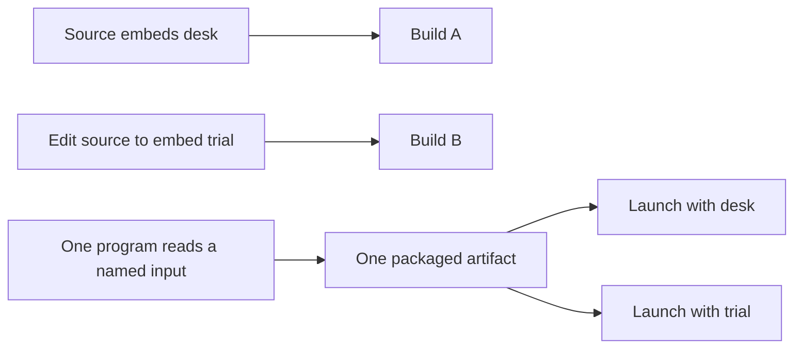

The hardcoded path produces a different artifact for each input change. The externalized path can reuse the same tested artifact and set values when it starts. Configuration still needs a schema, validation, and a reliable way to supply it.

### Draw useful boundaries

| Concern | Example | What to preserve |
| --- | --- | --- |
| Configuration | JDBC address, request timeout, reporting label. | A named input with a documented type, source, and lifecycle. |
| Code and business rules | How to total an order or which state transitions are allowed. | Consistent logic with tests, regardless of deployment. |
| Application data | A user's order or a persisted report. | Integrity, retention, backups, and correct ownership. |
| Secrets | A database password or a signing key. | Confidential delivery, access controls, and rotation. |

Some secrets are configuration inputs. Give them stricter handling than ordinary settings. A business rule can deliberately be parameterized, such as the maximum retry count within safe bounds. Making a setting editable does not transfer responsibility for correctness away from the application.

| Decision | When it helps | Example |
| --- | --- | --- |
| Hardcoded | Behavior or a safe invariant that is intended to ship with the code. | The program never accepts a negative size. |
| Externalized | Values differ between deployment environments or operators. | A database hostname. |
| Default | A known fallback gives meaningful, safe behavior. | A short request timeout or an optional integration disabled. |
| Required input | Guessing could direct traffic or data incorrectly. | An intended production database, or a required signing secret. |
| Build-time | The value legitimately affects the packaged artifact. | Java target release in Maven. |
| Runtime | The same artifact must behave according to its deployment. | A listening port or database address. |

**Static configuration** is chosen once for a process or context. A change takes effect through a new launch or deliberate reload. **Dynamically refreshed configuration** involves a designed update mechanism, with versioning, validation, safe application, and behavior when the provider fails. Editing a file alone does not update a Spring singleton. Prefer a controlled restart until you have a genuine need for refresh and a way to handle partially applied changes.

An **immutable artifact** is the same versioned JAR or image promoted as a unit. Runtime inputs can differ without changing its bytes. **Configuration portability** means the same input contract works across deployments, even when the delivery method and values differ. **Configuration drift** occurs when running settings diverge from their intended state, for example after an unrecorded manual override. Record nonsecret inputs and secret references, compare effective safe settings, and test recreation from a fresh shell.

The Twelve-Factor App's config principle separates deploy-varying values from code and favors environment-provided config. Files supplied at startup and managed secret delivery serve the same practical goal when appropriate. The key lifecycle distinction is which settings can move independently of the artifact. [Twelve-Factor App, Config](https://12factor.net/config)

**Key Takeaways.** Extract settings that change by deployment. Decide which inputs have safe defaults, which are required, and when changes should take effect.

<a id="config-02"></a>

## Part 2 — Configuration Sources

A JVM needs both a connection timeout and a database password. They could be delivered through the same mechanism, but the access, audit, and change needs differ. A **source** is where the application obtains a candidate value. A loader decides which sources exist and a precedence policy decides which candidate wins.

| Source | Useful for | Costs and risks |
| --- | --- | --- |
| Code constant | An invariant or a safe default. | Updating the constant requires a new artifact. A secret in code spreads into repository history and binaries. |
| Configuration file | Structured groups, lists, reviewed non-secret settings, mounted inputs. | Path, encoding, and file precedence matter. Access to a secret file must be restricted. |
| OS environment variable | Scalar settings supplied to a particular launch. | Values are strings. Privileged users, child processes, debuggers, or container metadata can see them. |
| Java system property | JVM-local options and launcher overrides. | `-D` goes before the JAR argument. Launch arguments and diagnostic mechanisms can expose values. |
| Program argument | Explicit per-run override or tool input. | The app must parse it. Command history and process listings can expose secrets. |
| External config provider | Shared or versioned non-secret settings across many processes. | Startup can depend on network, access, availability, and a clear refresh policy. |
| Dedicated secrets manager | Credentials with identity-based retrieval, audit, and rotation requirements. | Requires bootstrap identity and a delivery policy. The receiving process can still access secrets it uses. |

Use an intentional default and explicit overrides for ordinary settings. Use a separate handling path for credentials. Identity, precedence, and visibility are three distinct questions. For example, an app may read an authorized token from a restricted mount, but an accidentally higher-priority environment key can still replace that input. Compare the intended and effective source before deciding what needs to change.

**Key Takeaways.** Choose the source according to who sets the value, when it changes, and who can see it. Make precedence explicit for values that can appear in multiple places.

<a id="config-03"></a>

## Part 3 — Environment Variables

### Follow a launch across the process boundary

An environment is a set of string name/value entries attached to a process. A parent process typically supplies an environment when it launches a child. Each launch can inherit or override entries. Changing a parent afterward does not modify an already running child. Java's `System.getenv("NAME")` reads the environment supplied to the Java process.

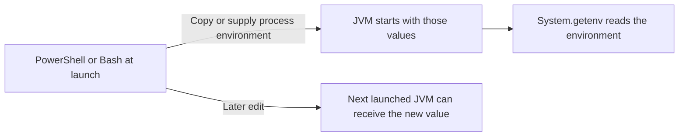

Bash has shell variables and exported environment variables. An unexported shell variable can be used by that shell while being absent from a child. A PowerShell variable such as `$ConfigLabel` holds a value in PowerShell. Use `$env:CFG_LAB_LABEL` to set the environment entry. Keep samples uppercase. Environment names are case-sensitive on Linux in normal use, while Windows generally treats them case-insensitively.

Save `EnvProbe.java` in the scratch directory.

```java
public class EnvProbe {
    public static void main(String[] args) {
        String label = System.getenv("CFG_LAB_LABEL");
        System.out.println(label == null ? "<unset>" : label.isEmpty() ? "<empty>" : label);
    }
}
```

Run this in a dedicated **Windows PowerShell** tab. Use sample values only.

```powershell
$env:CFG_LAB_LABEL = $null
$ConfigLabel = 'PowerShell variable'
java EnvProbe.java
$env:CFG_LAB_LABEL = 'windows-one'
java EnvProbe.java
$env:CFG_LAB_LABEL = 'windows-two'
Get-Item Env:CFG_LAB_LABEL
java EnvProbe.java
$env:CFG_LAB_LABEL = $null
java EnvProbe.java
```

The first JVM reports `<unset>`, because the ordinary PowerShell variable is not an environment entry. The next two report the assigned values. Setting the entry to `$null` removes it in this process. The final new JVM reports `<unset>`.

Run this separately in **Ubuntu Bash**, with the same Java source in that environment.

```bash
unset CFG_LAB_LABEL
CFG_LAB_LABEL='shell only'
java EnvProbe.java
export CFG_LAB_LABEL
java EnvProbe.java
CFG_LAB_LABEL='one child' java EnvProbe.java
printenv CFG_LAB_LABEL
unset CFG_LAB_LABEL
java EnvProbe.java
```

Expected results are `<unset>`, `shell only`, `one child`, then `shell only` from `printenv` and `<unset>` after removal. The assignment before the Java command changes only that launch's environment. Quoting preserves spaces in illustrative values.

For persistent user settings on Windows, the Environment Variables UI can record a user-scope entry for processes started later from a launcher that has refreshed its environment. In Bash, an export in the relevant startup file is applied when a shell reads that file. Services, IDEs, and containers can have separate launch configuration and may never read your interactive startup files. For these labs use disposable process-scoped entries and remove them afterward. Treat missing and empty values separately when you design required inputs. Windows PowerShell versions differ in how they handle an explicitly empty environment value. [PowerShell environment variable scopes](https://learn.microsoft.com/en-us/powershell/module/microsoft.powershell.core/about/about_environment_variables)

Environment variables are convenient delivery inputs. They can be visible to privileged processes, diagnostics, crash artifacts, children, and Docker inspection. Avoid dumping an entire environment. Observe only a known non-sensitive value or whether the intended key is present.

**Key Takeaways.** Set the value in the process that launches Java, export it when using Bash, and start a new JVM to apply a changed value.

<a id="config-04"></a>

## Part 4 — Configuration in Core Java

### Distinguish three routes into the same program

| Input | Set by | Read in Java |
| --- | --- | --- |
| OS environment | Process launcher or parent shell. | `System.getenv("CFG_PLAIN_LABEL")`. |
| JVM system property | Java launcher option such as `-Dplain.label=jvm` or controlled Java code. | `System.getProperty("plain.label")`. |
| Program argument | Text after the JAR or source file name. | `main(String[] args)`. |
| Properties file | File chosen by the program's loader. | `Properties.load(Reader)` after opening the path. |

Java assigns no general precedence between these inputs. A library or application implements that policy. A JVM flag after the source filename or after `-jar app.jar` goes to `args` instead of setting a system property. `System.getProperty(key, fallback)` uses the fallback if the JVM property is missing.

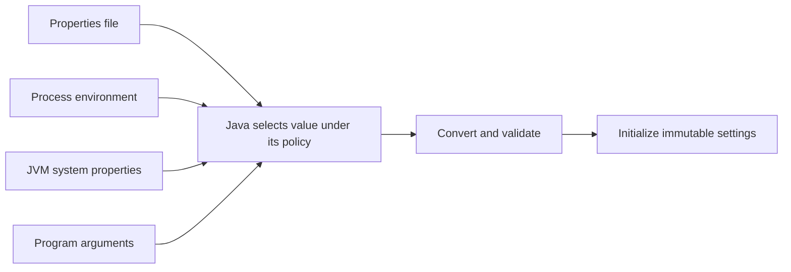

Save `InputProbe.java`. It deliberately prints only disposable inputs.

```java
import java.util.Arrays;

public class InputProbe {
    public static void main(String[] args) {
        System.out.println("JVM=" + System.getProperty("plain.label", "<unset>"));
        System.out.println("arguments=" + Arrays.toString(args));
    }
}
```

Run the example in Windows PowerShell or Ubuntu Bash.

```bash
java '-Dplain.label=jvm' InputProbe.java --label=program
java InputProbe.java '-Dplain.label=argument'
```

The first run prints `JVM=jvm` and `arguments=[--label=program]`. The second prints an unset JVM property and an argument that happens to look like a JVM option.

### Complete the refactor with an explicit loader

Save `PlainConfig.java`. It selects program flags before JVM properties, then environment, then the selected file, then a fallback. An explicitly blank higher-priority input is still an input. The example validates the required target and parses the limit before normal work begins.

<a id="plain-config"></a>

```java
import java.io.IOException;
import java.io.Reader;
import java.nio.charset.StandardCharsets;
import java.nio.file.Files;
import java.nio.file.Path;
import java.util.HashMap;
import java.util.Locale;
import java.util.Map;
import java.util.Properties;
import java.util.Set;

public class PlainConfig {
    private static final Set<String> OPTIONS = Set.of("config", "label", "limit", "target");

    public static void main(String[] args) {
        try {
            Settings settings = load(args);
            System.out.printf("label=%s target=%s limit=%d%n",
                    settings.label(), settings.target(), settings.limit());
        } catch (IOException error) {
            System.err.println("Configuration error: cannot read the --config file");
            System.exit(2);
        } catch (IllegalArgumentException error) {
            System.err.println("Configuration error: " + error.getMessage());
            System.exit(2);
        }
    }

    static Settings load(String[] args) throws IOException {
        Map<String, String> flags = parseFlags(args);
        Properties file = new Properties();
        if (flags.containsKey("config")) {
            try (Reader reader = Files.newBufferedReader(
                    Path.of(flags.get("config")), StandardCharsets.UTF_8)) {
                file.load(reader);
            }
        }

        String label = select("label", "local", flags, file);
        String target = select("target", null, flags, file);
        if (target == null || target.isBlank()) {
            throw new IllegalArgumentException("target is required and must be nonblank");
        }
        int limit;
        try {
            limit = Integer.parseInt(select("limit", "5", flags, file).strip());
        } catch (NumberFormatException error) {
            throw new IllegalArgumentException("limit must be an integer");
        }
        if (limit < 1 || limit > 50) {
            throw new IllegalArgumentException("limit must be between 1 and 50");
        }
        return new Settings(label, target.strip(), limit);
    }

    private static Map<String, String> parseFlags(String[] args) {
        Map<String, String> flags = new HashMap<>();
        for (String arg : args) {
            int separator = arg.indexOf('=');
            if (!arg.startsWith("--") || separator <= 2) {
                throw new IllegalArgumentException("use --name=value for each argument");
            }
            String name = arg.substring(2, separator);
            if (!OPTIONS.contains(name)) {
                throw new IllegalArgumentException("supported names are config, label, limit, target");
            }
            flags.put(name, arg.substring(separator + 1));
        }
        return flags;
    }

    private static String select(String name, String fallback, Map<String, String> flags, Properties file) {
        if (flags.containsKey(name)) {
            return flags.get(name);
        }
        String jvm = System.getProperty("plain." + name);
        if (jvm != null) {
            return jvm;
        }
        String env = System.getenv("CFG_PLAIN_" + name.toUpperCase(Locale.ROOT));
        return env != null ? env : file.getProperty("plain." + name, fallback);
    }

    record Settings(String label, String target, int limit) {}
}
```

Save a scratch `plain.properties` file.

```properties
plain.label=file
plain.target=weekly-report
plain.limit=8
```

Run in Windows PowerShell or Ubuntu Bash.

```bash
java PlainConfig.java --config=plain.properties
java '-Dplain.limit=11' PlainConfig.java --config=plain.properties --limit=12
java PlainConfig.java --target=weekly-report
java PlainConfig.java --target=weekly-report --limit=soon
java PlainConfig.java
```

In a clean shell the limits are `8`, `12`, and `5` for the first three runs. The fourth reports an invalid integer and the last reports a missing target. Check `$LASTEXITCODE` in PowerShell or `$?` in Bash immediately after failure. The expected result is `2`. `--config` is explicitly required only when you ask to load a file. Resolve a relative filename against the process working directory. `Properties.load(Reader)` reads key/value text from the UTF-8 reader you opened, and the try block closes it. Catch conversion errors close to the property and give the key and required shape. Avoid echoing an untrusted or sensitive rejected value.

**Key Takeaways.** The launcher, application, and file loader supply different inputs. Initialize a typed configuration snapshot after selecting and validating values, then pass it to the code that uses it.


<a id="config-05"></a>

## Part 5 — Spring Boot Externalized Configuration

The handwritten Java loader made three choices: where to look, which value to use, and when to turn text into typed settings. Spring Boot makes those choices visible in a reusable startup pipeline. It gives application and infrastructure beans access to the same effective configuration.

### Environment, PropertySource, and Config Data

A Spring `Environment` exposes active and default profiles and supports looking up properties by name. Its ordered `PropertySource` collection might contain a system environment adapter, JVM properties, or entries from a loaded file. A plain lookup walks the applicable sources and returns the highest-priority non-null value it can resolve. Source adapters may translate a canonical lookup name to the syntax of their source.

`ConfigData` is Spring Boot's early file and import loading system. It processes properties/YAML documents, considers profile activation, and contributes property sources. It works alongside the already available OS environment, system properties, and command-line input. `Environment#getProperty(...)` is useful for a scalar lookup. The Boot Binder consumes related keys, converts types, assembles collections, and constructs or populates objects. `@Value` resolves an individual expression or placeholder during bean creation. Keep the loader, resolver, and binder separate in your mental model.

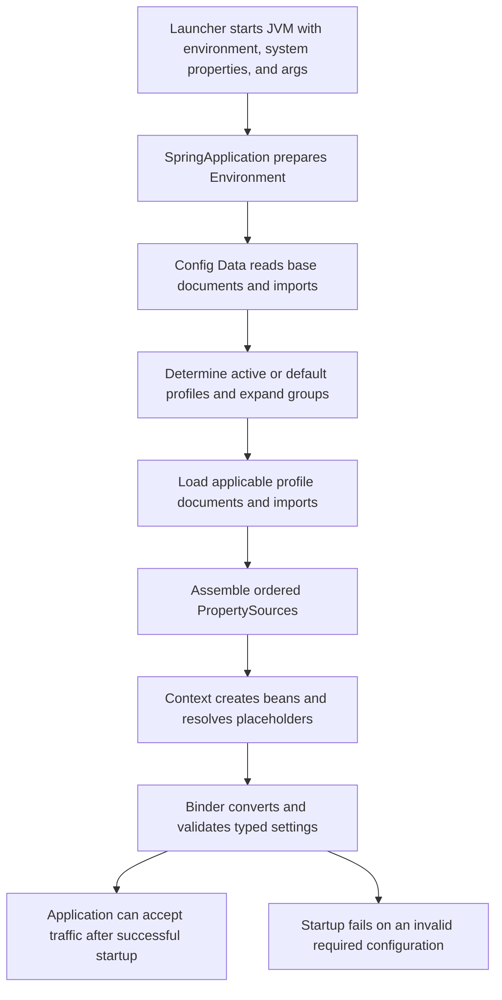

Config Data is profile-aware and can load documents in multiple passes. The diagram shows the dependency between those passes. Beans can be created in different orders according to their dependencies. The context fails if a required bean cannot initialize. A loaded file is eligible to supply values. Whether a given key wins is a separate question.

| Question | Loading and activation | Property precedence and resolution |
| --- | --- | --- |
| What does it govern? | Which files/documents/imports enter the environment | Which eligible source supplies a key |
| Example | `application-dev.properties` is read when `dev` applies | An OS variable can override the key from that file |
| What can go wrong? | Wrong cwd, location, filename, or profile | A higher source supplies a different value or a blank |
| How do you debug it? | Confirm cwd, resource paths, and active profiles | List candidate sources and compare a known nonsecret value |

### Where Boot looks

With default Config Data settings, Boot considers the locations below. Within the classpath group or external group, later locations can override earlier ones. Profile-specific variants and explicit grouping affect the full order discussed in [Part 8](#config-08).

1. Classpath root such as `src/main/resources/application.properties` before packaging.
2. Classpath `/config/`.
3. The process working directory.
4. Its `config/` subdirectory.
5. Immediate child directories of external `config/`.

Relative external paths resolve from Java's process working directory. Starting `java -jar C:\work\config-lab.jar` from `C:\scratch` therefore gives different external search paths than starting it from `C:\work`. The classpath resources travel inside the JAR. External files can change independently of its bytes.

| Setting | Effect | Operational detail |
| --- | --- | --- |
| `spring.config.name` | Change the base filename from `application` | Set it early with an OS variable, JVM property, or application argument |
| `spring.config.location` | Replace the default search locations | A directory entry needs a trailing slash. Use `file:` or `classpath:` to make the intent clear |
| `spring.config.additional-location` | Add locations after the defaults | Use it to keep packaged defaults while adding a deployment override |
| `spring.config.import` | Import a file or location from the declaring document | Values in an import can override its importer. Later imports in its list can override earlier imports |
| `optional:` | Allow a specified location to be absent | Use it for deliberately optional inputs. Required deployments should surface missing locations and validate required keys |

In a scratch folder containing the capstone JAR, use `--spring.config.additional-location=optional:file:./overrides/` to pick up `overrides/application.properties` or its profile variant. Imports can resolve relative to the declaring resource, such as `spring.config.import=optional:extras.properties`. A fixed prefix such as `file:` or `classpath:` changes that lookup. Boot also checks profile variants of imports when applicable. `configtree:/run/secrets/` turns mounted files into property values keyed by their names. Requiring the directory still leaves individual keys to be validated.

### Placeholders and startup timing

A file value such as `banner.text=${COURSE_NOTICE:packaged-banner}` is resolved against the existing environment when consumed. A caller can override `COURSE_NOTICE`, or override the `banner.text` key itself from a higher-priority source. A colon within the placeholder introduces a fallback for an unresolved key. A key supplied with an empty value can resolve to that empty value. Validate blanks explicitly when they are unacceptable. Prefer canonical kebab-case for application property references and reserve all-caps names for deliberate OS aliases like `COURSE_NOTICE`.

`@PropertySource` is added during context refresh. It arrives too late for early settings such as `logging.*` and `spring.main.*`, and its default loader expects properties syntax. Early settings belong in Config Data or in a source available to the launcher. Property sources can also be altered programmatically by tests and framework extensions, so confirm the lifecycle your application actually uses.

For a path or activation problem, run an isolated launch with `--logging.level.org.springframework.boot.context.config=TRACE`. Use it to inspect the config files and import paths. Start with `Get-Location` in PowerShell or `pwd` in Bash. Turn the trace off before working with sensitive deployment metadata. [Spring Boot externalized configuration](https://docs.spring.io/spring-boot/4.0/reference/features/external-config.html)

**Key Takeaways.** Config Data discovers eligible configuration. The Environment resolves values. The Binder builds typed settings. Diagnose in that order.

<a id="config-06"></a>

## Part 6 — application.properties and application.yml

Spring Boot flattens both formats into property keys. Choose a format by how people read and review it. Flat keys make single-setting edits and searches easy. YAML visually groups nested integrations and collections. Both can back the same application.

Here are equivalent documents for the capstone's configuration contract. Use one as `overrides/application.properties` or the other as `overrides/application.yml` in a disposable directory. Pass `--spring.config.additional-location=file:./overrides/`, then inspect `GET /config`. The timeout is 750 milliseconds and the buffer is 786,432 bytes.

```properties
lab.label=yaml-equivalent
lab.timeout=750ms
lab.buffer-size=768KB
lab.channels[0]=web
lab.channels[1]=email
lab.aliases.public=Visitor
lab.aliases[/course]=Study
lab.integration.enabled=false
banner.text=${COURSE_NOTICE:packaged-banner}
```

```yaml
lab:
  label: yaml-equivalent
  timeout: 750ms
  buffer-size: 768KB
  channels:
    - web
    - email
  aliases:
    public: Visitor
    "[/course]": Study
  integration:
    enabled: false
banner:
  text: "${COURSE_NOTICE:packaged-banner}"
```

| Concern | `.properties` | `.yml` / `.yaml` |
| --- | --- | --- |
| Structure | One flat key per entry, commonly `key=value` | Indented mappings and sequences |
| Scalars | Text interpreted by the code/binder after loading | YAML loader can recognize booleans, numeric forms, and nulls before binding |
| Collections | Explicit indices and dotted/bracketed map selectors | `-` sequence items and nested mappings |
| Literals | A backslash starts an escape or line continuation. Use forward slashes for Windows location examples | Quote text that resembles a number, boolean, or date when its spelling matters |
| Usual failure | Wrong key or escape sequence | Invalid indentation or structurally valid YAML at the wrong path |
| Same location | Boot gives the properties file precedence | Use a single format per location to keep origins clear |

In a map, brackets preserve a key containing characters such as `/`. In YAML, quote the whole bracketed selector. A higher source can override one map key while lower-source entries survive. Lists are selected as whole lists from the highest relevant source. In this example the list is exactly `web,email`, the `public` alias is `Visitor`, and the packaged `staff` alias persists. If a YAML line like `enabled: false` is indented under `lab` instead of `lab.integration`, the result is `lab.enabled`. A parser may accept it and strict binding can then report the unexpected key. Use spaces and keep each nesting level consistent.

**Key Takeaways.** Compare flattened keys and typed results when converting formats. A valid YAML file can still put a valid value in the wrong place.

<a id="config-07"></a>

## Part 7 — Spring Profiles

A profile is a named Spring configuration selection. It lets the same application assemble an appropriate combination of profile-specific documents and beans. A deployment environment is broader. It includes its network, dependencies, identities, access control, and operational policies. A local JVM can select `prod-sim`, and a container in a production network can accidentally select `dev`. Selecting a profile grants no permissions.

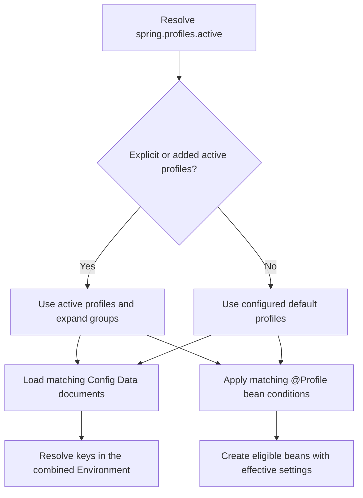

Boot's default name is `default` when there are no active profiles. This lab sets `spring.profiles.default=dev` for convenient loopback use. The `activeProfiles` array can be empty while the `dev` defaults apply. In deployments, select the intended profile explicitly. In a shell exercise, use one of the following alternatives and stop a foreground process with Ctrl+C before trying the next.

Run from the built capstone project in PowerShell.

```powershell
java -jar .\target\config-lab.jar --spring.profiles.active=dev

$env:SPRING_PROFILES_ACTIVE = 'test'
try {
    java -jar .\target\config-lab.jar
} finally {
    Remove-Item Env:SPRING_PROFILES_ACTIVE -ErrorAction SilentlyContinue
}

java -jar .\target\config-lab.jar '--spring.profiles.active=dev,test'
java -jar .\target\config-lab.jar --spring.profiles.active=workstation
```

Run from the built project in Ubuntu Bash.

```bash
SPRING_PROFILES_ACTIVE=test java -jar target/config-lab.jar
```

| Selector | What the lab loads | What to inspect |
| --- | --- | --- |
| No explicit selection | Base and default `dev` files | `activeProfiles=[]`, `defaultProfiles=["dev"]`, label `dev` |
| `dev` | Base and `application-dev.properties` | Label `dev`, timeout `PT1S`, port `18094` |
| `test` | Base and `application-test.properties` | Label `test`, page size `3`, port `18096` |
| `dev,test` | Both profile files, `test` last within this group | Label `test`, page size `3`, timeout `PT1S` from `dev` |
| `workstation` | Group expands to `dev` and `local-log` | `dev` values plus `workstation-banner` and a more verbose package logger |
| `prod-sim` | `application-prod-sim.properties` and `@Profile("prod-sim")` guard | Required key and database inputs. See [Part 19](#config-19) |

A conventionally named `application-prod.properties` would apply to the profile `prod`, which has no built-in privileges or production behavior. The walkthrough chooses `prod-sim` to distinguish the lab. Filename and active profile must match exactly.

Profiles can be used in one multi-document YAML file. This example belongs in an external scratch location for a focused test of document activation. The first document is unconditional. The second applies to a matching active or default profile.

```yaml
lab:
  label: yaml-base
---
spring:
  config:
    activate:
      on-profile: dev
lab:
  label: yaml-dev
```

`spring.config.activate.on-profile` also accepts expressions such as `"dev & !prod-sim"`. It decides whether that document participates. Set global selection (`spring.profiles.active`, `spring.profiles.default`, `spring.profiles.include`, `spring.profiles.group.*`) in non-profile-specific documents or an appropriate launcher source. Boot disallows these selectors inside profile-specific or profile-activated documents. Active profile selection follows ordinary precedence as a whole value. `spring.profiles.include` adds profiles before the active list and is processed per source. A group is a named bundle, such as `spring.profiles.group.workstation[0]=dev` and `[1]=local-log` in the base file.

`@Profile` is a bean-registration condition. The complete [`ProductionGuard`](#config-file-prod-guard) constructor checks presence and shape of required production-like inputs. You could also use profile-specific bean definitions for a mail-capture adapter and an actual SMTP adapter. When beans implement the same interface, ensure combinations define exactly the intended candidates. Use [feature flags](#config-16) for optional capabilities and actual permission checks for user access. Profiles still work when production credentials are missing, so validation is a separate control. [Spring Boot profiles](https://docs.spring.io/spring-boot/4.0/reference/features/profiles.html)

**Key Takeaways.** Name the active profiles at launch, know which defaults apply when they are absent, and account for list order and location groups when several documents define the same key.

<a id="config-08"></a>

## Part 8 — Configuration Precedence

For a single key, list the sources the particular launch actually has. Move from the highest eligible source downward until the key resolves. A packaged profile file can win over the packaged base file and still lose to an external base file. Adding one source can affect a single key without erasing lower sources for other keys.

### Spring Boot 4.0.10 source order

This table follows the consolidated Boot documentation from lower to higher precedence, with compact groups for the servlet-specific stages. A normal packaged JVM service only has the applicable entries. Config Data has its own ordering below. Tests also have a framework-specific ordering explained immediately after the table.

| Relative stage, lower to higher | Source | When it participates |
| --- | --- | --- |
| 1 | Defaults via `SpringApplication.setDefaultProperties` | The application supplies them programmatically |
| 2 | `@PropertySource` | During context refresh, too late for early startup settings |
| 3 | Config Data | Packaged/external documents and imports |
| 4 | `RandomValuePropertySource` | Only `random.*` lookups |
| 5 | OS environment | The Java process inherited the value |
| 6 | JVM system properties | For example `-Dlab.label=jvm` before `-jar` |
| 7 | JNDI `java:comp/env` | An applicable JNDI environment is available |
| 8–9 | ServletContext and then ServletConfig initialization parameters | An applicable servlet environment supplies them |
| 10 | `SPRING_APPLICATION_JSON` or its system-property form | Boot parses the inline JSON. A JSON null is treated as missing during lookup |
| 11 | Application CLI property options | `--key=value` when CLI property handling is enabled |
| 12 | `properties` on `@SpringBootTest` and supported slice annotations | Only the test that defines them |
| 13–14 | `@DynamicPropertySource` and `@TestPropertySource` | TestContext contributions. See verified order below |
| 15 | Devtools global settings | Only when Devtools is active |

When using default locations and a single applicable profile, the usual Config Data sequence from lower to higher is packaged base → packaged profile → external base → external profile. External overrides are intentionally above packaged defaults. Boot prefers `.properties` when both it and YAML define the same key at a location. Files imported by a document can override it. Within a location group, `dev,test` gives `test` priority for duplicate keys. In an explicit location list, commas create ordered location groups, while semicolons keep locations at the same level. For example `'--spring.config.location=classpath:/baseline/;classpath:/extensions/,file:./overrides/'` puts two classpath locations together and treats external overrides as a later group. Quote the complete argument in PowerShell and Bash and use `optional:` when a directory is intentionally absent.

The consolidated Boot table lists dynamic properties before static test-source properties in its ascending list. Spring Framework's TestContext documentation specifically gives `@DynamicPropertySource` higher precedence than `@TestPropertySource`. The actual Boot 4.0.10 capstone verifies the latter behavior for its test setup. The second test verifies that static inline `@TestPropertySource` wins over `@SpringBootTest(properties=...)` in the same setup. Use the relevant harness documentation and a collision test when precedence affects correctness. [Boot source order and location groups](https://docs.spring.io/spring-boot/4.0/reference/features/external-config.html) · [Spring TestContext dynamic property sources](https://docs.spring.io/spring-framework/reference/testing/testcontext-framework/ctx-management/dynamic-property-sources.html)

### Worked collision

The table accumulates sources one row at a time for `lab.label`. Use the capstone from [Part 19](#config-19). For test rows, the exact declaration values come from the included test fixtures and the launch is a test context.

| Inputs available | Winning value | Reason |
| --- | --- | --- |
| Packaged base only, with no matching profile document | `base` | Base resource supplies it |
| Add packaged `application-dev.properties` | `dev` | Matching packaged variant overrides its base |
| Add `overrides/application.properties` with `lab.label=external` and select its location | `external` | External base overrides even the packaged dev document |
| Add `overrides/application-dev.properties` with `lab.label=external-dev` | `external-dev` | External profile file wins within that location |
| Add inherited `LAB_LABEL=env` | `env` | OS environment outranks Config Data |
| Add `-Dlab.label=jvm` | `jvm` | JVM properties outrank OS environment |
| Add `--lab.label=cli` after the JAR | `cli` | CLI property source outranks both |
| In `ProfilePrecedenceTest`, set `properties = "lab.label=boot-test"` | `boot-test` if it is the only test override | Inline test value wins over normal application config |
| Same test adds `@TestPropertySource(properties = "lab.label=test-source")` | `test-source` | The inline TestContext source wins in this fixture |
| `DynamicPrecedenceTest` also registers `lab.label=dynamic-test` | `dynamic-test` | The dynamic registry has the highest relevant priority in this fixture |

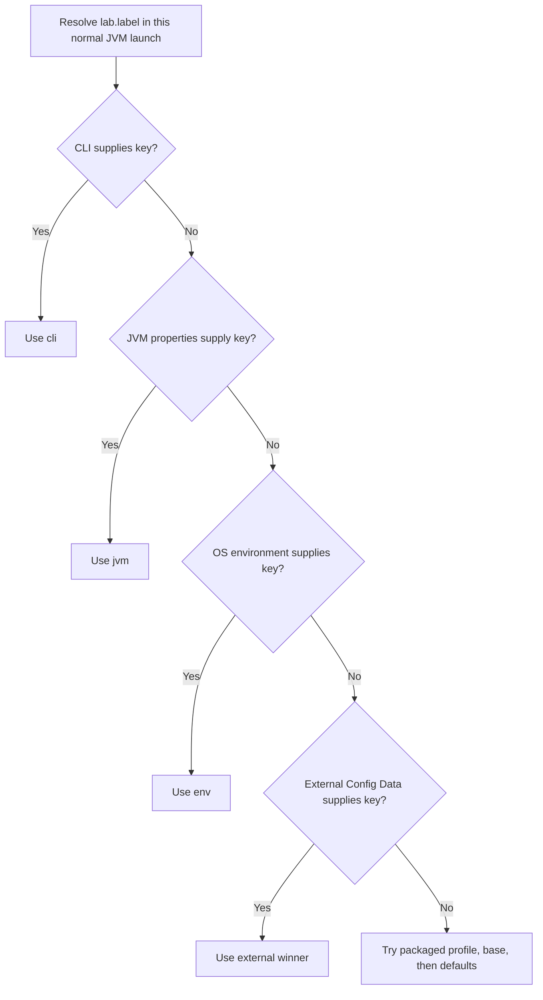

The diagram omits sources absent in this launch, such as JSON and tests. To prove a collision, remove just one high-priority input at a time, restart, and inspect the new result. An empty winning value is still different from a missing source. Probe a safe field through `/config` and inspect source names or file origins as needed. An environment dump can reveal credentials.

**Key Takeaways.** Find the highest eligible source for the key. Check profile/location ordering inside Config Data and test-specific sources inside test contexts.

<a id="config-09"></a>

## Part 9 — @Value

`@Value` is a concise way to inject an individual value into a bean. Boot normally installs placeholder resolution during bean creation. `${key:fallback}` looks up a property and uses the fallback if unresolved. `${key}` expresses a required property in this Boot context and can abort creation of the bean if no source supplies it. An empty resolved value can still require application validation. Spring converts the resolved text to the declared type where a converter exists.

This optional experiment uses the capstone's same package and POM. Create it only in a separate copy of the capstone. It requires a nonsecret `export.channel` and uses a typed fallback of `3` for `export.retry-count`. Its bean is created only with the `value-demo` profile, so the normal lab tests remain independent.

```java
package learning.config;

import org.springframework.beans.factory.annotation.Value;
import org.springframework.context.annotation.Profile;
import org.springframework.web.bind.annotation.GetMapping;
import org.springframework.web.bind.annotation.RestController;

@RestController
@Profile("value-demo")
final class ExportNotice {
    private final String channel;
    private final int retryCount;

    ExportNotice(@Value("${export.channel}") String channel,
            @Value("${export.retry-count:3}") int retryCount) {
        if (channel.isBlank()) {
            throw new IllegalArgumentException("export.channel must be nonblank");
        }
        this.channel = channel;
        this.retryCount = retryCount;
    }

    @GetMapping("/export-notice")
    String notice() {
        return channel + " retries=" + retryCount;
    }
}
```

Save as `src/main/java/learning/config/ExportNotice.java` in the optional copy and run the build in PowerShell.

```powershell
mvn.cmd -B -ntp clean package
java -jar .\target\config-lab.jar '--spring.profiles.active=dev,value-demo' --export.channel=local
```

`GET http://127.0.0.1:18094/export-notice` gives `local retries=3`. Omit `--export.channel=local` to see the missing-placeholder failure, or supply `--export.retry-count=many` to see a conversion failure. Stop the good run first. Delete the optional copy when done. The capstone's compiled [`LabController`](#config-file-controller) already demonstrates the simpler `banner.text` use and how to exercise it without changing code.

Constructor injection makes dependencies explicit, allows fields to be final, and permits direct construction with test arguments. Field injection happens after construction and requires a Spring-managed instance or additional test setup. Use canonical kebab-case placeholders for the relaxed lookups Boot supports. Avoid spreading a group of configuration values across many injection sites. Spring also supports SpEL in `@Value`, using `#{...}`. Keep expressions code-owned and predictable. Treat deployment inputs as data.

**Key Takeaways.** Use `@Value` for a small, isolated setting. Confirm the difference between missing and blank. Move a related set of typed, validated inputs into its own configuration object.


<a id="config-10"></a>

## Part 10 — @ConfigurationProperties

An integration needs several values that must agree. A base address, timeout, and enablement switch become easier to reason about when they are modeled together. `@ConfigurationProperties(prefix = "lab")` gives a type responsibility for the property subtree. Code consuming that type receives the same bound configuration snapshot.


The [complete `LabSettings` record](#config-file-settings) shows the implementation with Java 21 imports. [`ConfigLabApplication`](#config-file-main) registers it through `@ConfigurationPropertiesScan`, the [base properties file](#config-file-base) supplies common entries, and [`LabController`](#config-file-controller) consumes the record. The [configuration runner tests](#config-file-runner-test) show explicit registration. Use one registration strategy for each type.

| Choice | Use when | Mechanism |
| --- | --- | --- |
| `@ConfigurationPropertiesScan` | An application owns a set of config types | Finds annotated types under the annotated class's package by default. You can specify other packages |
| `@EnableConfigurationProperties(LabSettings.class)` | A focused test or module knows the exact types | Registers the stated type without relying on package discovery |
| `@Bean` with `@ConfigurationProperties` | A third-party type has setters and you control its factory | Bind properties onto the object returned by the factory |
| Constructor-bound record or class | Consumers should receive an immutable snapshot | A single parameterized constructor can be inferred. If there are multiple constructors, select the binding constructor with Boot's `@ConstructorBinding` |
| JavaBean-style class | The type is designed for setters or existing nested objects | Boot mutates the object through its bean accessors during binding |

For constructor binding, register through scanning or `@EnableConfigurationProperties`. Ordinary component creation and `@Bean` factory creation use different construction paths. Keep configuration records focused on values, make defensive copies of mutable input collections, and inject infrastructure into the consumer. A constructor-supplied configuration snapshot still requires an explicit refresh mechanism if you want live reload.

### Names, values, and collections

Use kebab-case in files and annotation prefixes. The binder can normalize variants of a field name within a source. Environment variable names follow a source-specific conversion.

| Canonical key | Java access | Canonical OS spelling |
| --- | --- | --- |
| `lab.page-size` | `settings.pageSize()` | `LAB_PAGESIZE` |
| `lab.integration.base-url` | `settings.integration().baseUrl()` | `LAB_INTEGRATION_BASEURL` |
| `lab.channels[0]` | First list element | `LAB_CHANNELS_0` |
| `lab.aliases.staff` | Value for map key `staff` | `LAB_ALIASES_STAFF` |

Convert dots to underscores, remove hyphens, then uppercase. For an indexed element use a numeric segment, for example `MY_SERVICE_0_OTHER` for `my.service[0].other`. OS-provided map keys are lowercased by the environment binding path. Spring Boot 4.0.10 also tests legacy names. In this lab `LAB_PAGE_SIZE` alone binds `lab.page-size`, and the canonical `LAB_PAGESIZE` wins when both are present. Use one documented spelling to avoid ambiguity. Use a config file for rich lists or maps when possible and environment variables for targeted changes. Higher-priority lists replace the lower list. Maps can merge by key. See the side-by-side values in [Part 6](#config-06). [Boot 4.0.10 environment property mapper](https://github.com/spring-projects/spring-boot/blob/v4.0.10/core/spring-boot/src/main/java/org/springframework/boot/context/properties/source/SystemEnvironmentPropertyMapper.java)

A value like `750ms` becomes a `Duration`, `768KB` becomes `DataSize`, and `http://127.0.0.1:18095/` becomes a `URI`. Write units explicitly. A bare duration number defaults to milliseconds and a bare size number defaults to bytes unless annotated with a different default unit. For `Duration`, `750ms` and ISO-8601 `PT0.75S` express the same amount. Boot's `DataSize` uses `1KB` = 1024 bytes. Converters establish types. Constraints such as `@Min`, `@Max` and `@AssertTrue` then enforce allowed values.

`@DefaultValue("2s")` on the record constructor parameter is used when `lab.timeout` is absent from the binding sources. It cannot repair an unparseable value. Empty `@DefaultValue` on `integration` builds the nested record even when no integration properties are supplied, making the disabled default and its timeout available. `@Valid` cascades validation into that record. The strict `ignoreUnknownFields = false` option turns many typos under `lab` into startup errors. A typo completely outside that prefix can still be ignored. A startup assertion or a contract test that reads the bound value catches that class of error. The optional Maven dependency `org.springframework.boot:spring-boot-configuration-processor` generates metadata for IDE completion and property documentation. Runtime binding does not depend on this metadata.

| Need | `@Value` | `@ConfigurationProperties` |
| --- | --- | --- |
| One string or scalar | Concise at the injection point | Reasonable if it belongs to a durable settings prefix |
| Related nested values and collections | Multiple injection sites or explicit custom parsing | Automatic assembly |
| Relaxed names and metadata | Limited placeholder semantics | Binder support and metadata processor |
| Coherent invariant | Manual check or validation of a consuming bean | Centralized constraint on the settings type |
| Expression evaluation | Supports SpEL | Binds data into a typed structure |

**Key Takeaways.** Use canonical names and explicit units. Model related settings together and use validation to encode the contract at the point settings are bound. [Spring Boot type-safe configuration properties](https://docs.spring.io/spring-boot/4.0/reference/features/external-config.html#features.external-config.typesafe-configuration-properties)

<a id="config-11"></a>

## Part 11 — Validation and Fail-Fast Startup

A default is a policy decision. `5` is a reasonable page size if no one chose one. A signing key with a fallback shared by every deployment would undermine trust in every token. Required values must come from an allowed launch source and must meet a documented invariant.

| Condition | Example | Responsibility |
| --- | --- | --- |
| Optional with safe default | `lab.page-size` defaults to `5` | Binding and a numeric range constraint |
| Unconditionally required | Production-like DB password | Required presence and nonblank input |
| Required only in a mode | `lab.integration.base-url` when enabled | Cross-property validation |
| Present but malformed | `lab.timeout=soon` | Type conversion fails |
| Well formed but unacceptable | `lab.timeout=0s` or `lab.page-size=51` | Bean Validation fails |
| Settings valid, dependency unavailable | Valid URI, provider offline | Runtime handling or a readiness check |

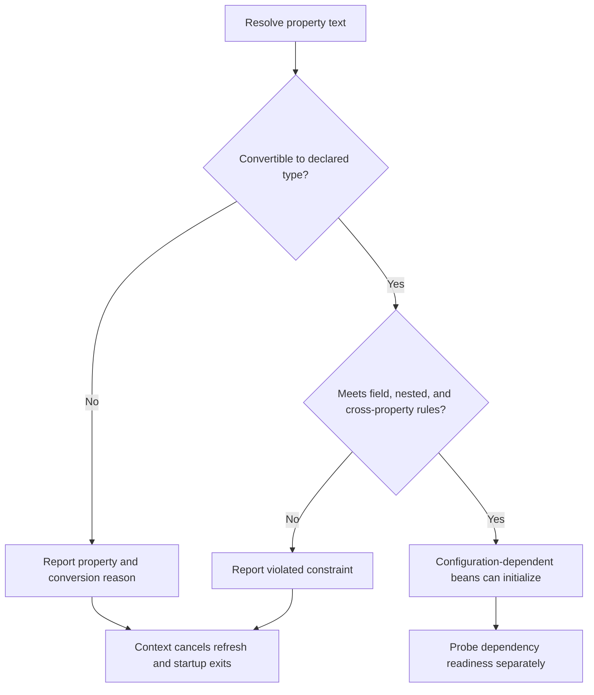

The capstone uses `spring-boot-starter-validation` to provide a Jakarta Bean Validation implementation. `@Validated` triggers binding-time validation for `LabSettings`, field constraints restrict individual values, `@Valid` cascades, and `@AssertTrue` methods encode invariants that require more than one field. A separate profile-specific guard verifies required sensitive settings. When conversion fails the binder cannot build the requested type. When validation fails it rejects the constructed settings. Both can be wrapped in a configuration binding/bean creation exception. Boot analyzes the failure and cancels context refresh. Under normal `java -jar` launch, the process exits unsuccessfully. Some infrastructure resources may have begun initializing by then, so use the application's ready state as the startup signal.

These settings enable the loopback provider from [Part 16](#config-16). Start the provider before making the request.

```properties
lab.page-size=20
lab.timeout=800ms
lab.integration.enabled=true
lab.integration.base-url=http://127.0.0.1:18095/
lab.integration.connect-timeout=500ms
```

Try each value separately to distinguish the startup failures.

| Override | First issue to look for | Corrective action |
| --- | --- | --- |
| `--lab.page-size=large` | Invalid integer | Use an integer in `1–50` |
| `--lab.page-size=0` | Violated lower bound | Choose a value in range |
| `--lab.timeout=soon` | Malformed duration | Use a duration with a unit |
| `--lab.timeout=31s` | Cross-cutting timeout limit | Use a positive duration up to `30s` |
| `--lab.integration.enabled=true` with no URL | Nested requirement | Provide the intended base URL |
| Enabled with `--lab.integration.base-url=localhost` | Relative URI could have parsed successfully | Use an absolute `http://` or `https://` base URL ending in `/` |
| Enabled with `--lab.integration.base-url=ftp://127.0.0.1/` | Scheme is incompatible | Correct the URI and verify the service |
| `prod-sim` with no key | `lab-auth.signing-key is required in prod-sim` | Mount the disposable secret file as specified in the lab |

| Check | Configuration validation | Health/readiness check |
| --- | --- | --- |
| What it answers | Whether the declared settings have valid shape and semantics | Whether a live instance or dependency is currently usable |
| Typical timing | At context creation | On demand or periodically after startup |
| Example | URL has an allowed scheme and an address | Service responds within the allowed interval |
| Remediation | Fix the deployment input | Investigate network, authentication, capacity, or provider health |

Use messages that name the missing key and expected form. Avoid interpolating the original sensitive value in a rejection message. Framework diagnostics can include a rejected value for some bind failures, so validate secret material with a controlled error and avoid treating logs as a confidential sink. `/config` explicitly publishes safe lab fields. It does not serialize the entire environment, database settings, or guard.

**Key Takeaways.** Fail early for invalid configuration contracts and test dependency availability separately. Make failures actionable without showing sensitive values.

<a id="config-12"></a>

## Part 12 — Secrets Management

Secrets are configuration inputs whose disclosure grants access, impersonation, or decryption. Treat PostgreSQL passwords, API keys, SMTP credentials, signing keys, private keys, and bearer/refresh tokens as credentials. A hostname usually changes behavior without granting access. Its exposure may still reveal information about internal topology. Classify each input by consequence of exposure.

| Where a secret might leak | How it gets there | Safer handling |
| --- | --- | --- |
| Git, snippets, or tickets | Hardcoded literals or added `.env` | Keep a placeholder or documented key name in version control. Review tracked paths and rotate any exposed actual credential |
| Shell history and process arguments | Inline flags, `-D`, tracing, or copy-paste | Deliver from a restricted file or managed provider. Keep actual secret text off command lines |
| Process environment and inspect output | Runtime env variables inherited by children or shown by container tools | Scope access to launcher/daemon and prefer a mount or managed provider where suited |
| Image, cache, layers or registry | `ARG`/`ENV` or build context included the file | Exclude sensitive files using `.dockerignore`. Use a build secret mount if a build actually needs a credential |
| Logs, exception text, metrics, HTTP | Config dumps, redaction bypass, request capture, URLs | Publish an explicit safe field set. For confidential fields record status or type only |
| Files, mounts, backups | Broad ACLs, shared directories or screenshots | Give the app identity read access to only its own secret files. Limit administrators, backup readers, and retention |

Base64 encodes bytes as text and can be reversed without any key. It is useful for transporting random bytes in a text file. Encryption provides confidentiality only in combination with key management and authorized decryption. For the lab, generate 32 cryptographically random bytes per dummy value as shown in [Part 19](#config-19). A format/length check alone does not prove entropy. Use a cryptographic RNG and generate independent values. Keep the signing key dev-only and do not paste it into a terminal output, git diff, or screenshot.

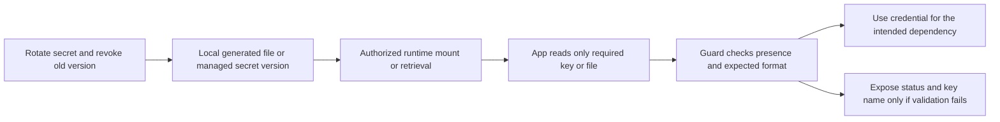

In PowerShell, check a path with `Test-Path -LiteralPath` and inspect access with `Get-Acl -LiteralPath` in your own scratch workspace. On Linux, restrictive file permissions can start with `umask 077` before generation and `chmod 600` for files meant for the creating identity. On Docker Desktop a mounted file must also be readable by the container's effective user. Compose's local-file secret mounts are bind mounts. Its `uid`, `gid`, and `mode` attributes cannot remap file ownership and mode for that source. Test readability with `test -r` from the intended container, without reading the contents to stdout. Restrict access to the Docker daemon and host directory. [.gitignore behavior](https://git-scm.com/docs/gitignore) · [Compose service secrets](https://docs.docker.com/reference/compose-file/services/#secrets)

Scope access to one workload, environment, and dependency. A runtime DB user usually needs fewer privileges than a schema migration identity. Distinct keys across environments prevent one disclosure from crossing environments. Rotation is a lifecycle: provision the new value, update consumers, recreate or refresh them deliberately, verify usage, and revoke the old value. For JWT signature validation, planned overlap can support existing tokens if the design allows old and new verification keys with distinct key IDs. For an exposed signer, follow incident policy because continued trust in the old key allows forgery. In this lab, changing a secret source file does not change the password already stored in the initialized PostgreSQL volume.

| Choice | OS environment variable | Managed secret service |
| --- | --- | --- |
| What it provides | Named process input and inheritance | Controlled storage, access policy, versioning and, depending on the service, auditing and rotation |
| Operational cost | Small at startup. Reveal risk via process/container diagnostics | Identity setup, retrieval/mount workflow, caching and service availability considerations |
| Where it fits | Nonsecret deployment switches and simple controlled environments | Centrally managed credentials shared with authorized workloads |
| Rotation behavior | Relaunch or use explicit refresh | A new version must still reach the workload, and clients must adopt it |

AWS Secrets Manager is designed for managed secrets and supports rotation workflows. AWS Systems Manager Parameter Store holds hierarchical settings and offers encrypted `SecureString` parameters. Integration still requires workload identity, authorization, and a plan for refreshing values. The capstone uses local files and does not require an AWS account. [AWS Secrets Manager overview](https://docs.aws.amazon.com/secretsmanager/latest/userguide/intro.html) · [AWS Systems Manager Parameter Store](https://docs.aws.amazon.com/systems-manager/latest/userguide/systems-manager-parameter-store.html)

**Key Takeaways.** Choose a delivery path that restricts access and keeps credentials out of artifacts, command lines, and diagnostics. Know how new versions become effective and what to revoke after exposure.


<a id="config-13"></a>

## Part 13 — Multi-Environment Configuration

A runtime environment combines configuration, infrastructure, and identity. Rebuilding for each environment puts code and configuration changes in the same promotion step. Shipping one measured artifact lets you promote the exact bytes that passed testing while changing only the authorized runtime inputs.

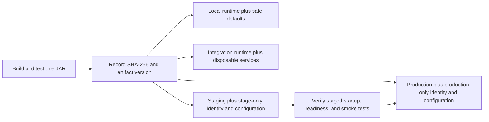

The arrows from the hash show reuse of artifact bytes. Integration or staging configuration and credentials remain scoped to their own environments. The staging verification gives evidence for promotion.

| Environment | Typical inputs | Dependency choices and isolation |
| --- | --- | --- |
| Local development | Loopback port, dev defaults, selected debug logging | Disposable database, local mail capture, optional API disabled until configured |
| Unit test | Explicit small values, minimal context or no framework | Test doubles and no developer credentials |
| Integration test | Intentional test profile, test URL and scoped credentials | Disposable actual service when the behavior depends on it |
| Staging | Explicit configuration and required values | Production-like topology and separate test data, endpoints and identity |
| Production | Explicit mode, audited overrides and managed secret references | Approved services, separate runtime identity, bounded diagnostics and readiness |

Keep common nonsecret defaults and a documented contract near the code. Keep per-environment settings in the owning deployment configuration. Give secrets a separate delivery path. For diagnosis record the artifact hash, selected profile, nonsecret configuration revision and secret version identifiers where allowed. Change a single intended input and verify the resulting behavior. An undocumented override, a stale container, or a manually edited file creates drift even when the JAR hash matches. Use validation and a safe smoke test before moving traffic.

Run from a clean capstone directory in PowerShell. Stop each foreground launch with Ctrl+C before starting the next.

```powershell
$before = (Get-FileHash -LiteralPath .\target\config-lab.jar -Algorithm SHA256).Hash
java -jar .\target\config-lab.jar --spring.profiles.active=dev
java -jar .\target\config-lab.jar --spring.profiles.active=test
$after = (Get-FileHash -LiteralPath .\target\config-lab.jar -Algorithm SHA256).Hash
$before -ceq $after
```

Expect `True`. Use `/config` on ports `18094` and `18096` respectively to verify the different values during the two launches. The Dockerfile later copies the same JAR. The Compose `prod-sim` run adds required files and reaches PostgreSQL without changing it. The host capstone's `dev` default is deliberate for learning. Require an explicit deployment mode, verified by the deployment manifest and smoke checks, where permissive fallback would be costly.

**Key Takeaways.** Promote one artifact and apply reviewed runtime configuration separately. Test the effective mode and dependency identity in each environment.

<a id="config-14"></a>

## Part 14 — Docker and Docker Compose Configuration

An image contains the application filesystem and image defaults. Container creation chooses the process environment, mounts, networking, and command. Compose adds a separate earlier step: interpolation while reading the Compose model.

| Mechanism | Evaluated when | How a container sees it | Appropriate use |
| --- | --- | --- | --- |
| Dockerfile `ARG` | Build | Does not become a runtime env variable by itself. Values can be reflected in build metadata, cache, provenance or output | Nonsecret build choices |
| Dockerfile `ENV` | Build sets an image default | Present in descendant build steps and future containers unless overridden | Public defaults valid across environments |
| Compose `.env` | Compose reads project/interpolation inputs | A variable is only passed through if the service config uses it or otherwise explicitly supplies it | Host port, image tag, profile and label substitutions |
| Compose CLI `--env-file` | Before model interpolation | Selects interpolation values. This is distinct from service injection | Alternate nonsecret deployment settings file |
| Service `env_file` | Container creation | Values become that service's process environment | Group nonsecret runtime settings |
| Service `environment` | Model values resolved, then container creation | Explicit service environment. Overrides an identical `env_file` key, including an explicitly empty value | Document and inject runtime settings deliberately |
| Compose `secrets` | Container creation | Service is granted a file mount | Deliver per-service secret files |

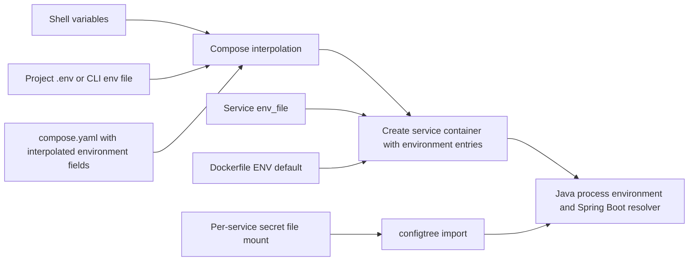

The shell has priority for interpolation. Without `--env-file`, Compose can read `.env` in its working directory and, if the project directory differs, consult its project `.env` at lower priority. An explicit CLI env file changes the inputs for that invocation. In typical service configuration, explicit `environment` entries win over the same service `env_file` names, and image `ENV` fills in remaining defaults. For a one-off `docker compose run`, `-e KEY=value` wins for that key. Resolution of entries that ask Compose to copy a host value has additional interpolation rules. Inspect the documented precedence table when combining those forms. [Compose interpolation](https://docs.docker.com/compose/how-tos/environment-variables/variable-interpolation/) · [Compose environment precedence](https://docs.docker.com/compose/how-tos/environment-variables/envvars-precedence/)

PowerShell, Docker CLI example. For a file example, create `runtime.env` containing the single line `LAB_LABEL=from-file` in a new scratch directory.

```powershell
docker run --rm --network none -e LAB_LABEL=from-cli alpine:3.22 printenv LAB_LABEL
docker run --rm --network none --env-file .\runtime.env alpine:3.22 printenv LAB_LABEL
```

Both containers exit and are removed after showing the nonsecret label. `docker run --env-file` reads variables for that container. It does not run the Compose model interpolation step. Remove the scratch file when done.

### A Compose experiment

Save the following as `compose.yaml` in a separate scratch directory called `compose-inputs`.

```yaml
services:
  show:
    image: alpine:3.22
    env_file: [runtime.env]
    environment:
      LAB_LABEL: "${CONFIG_LAB_LABEL:-from-interpolation}"
    command: ["sleep", "600"]
```

Save `runtime.env` with `LAB_LABEL=from-runtime-file`. Save `.env` with `CONFIG_LAB_LABEL=from-dotenv`. Here `:-` supplies a default when the interpolation variable is unset or empty. For a required interpolation input, use a form such as `${CONFIG_LAB_LABEL:?Set CONFIG_LAB_LABEL}`. If a Compose service command uses `sh -c` and needs the container shell to expand `LAB_LABEL`, write `$$LAB_LABEL` in Compose to preserve the dollar sign through model rendering. `printenv LAB_LABEL` avoids shell expansion entirely.

PowerShell, from `compose-inputs`. Use a fresh project name for each independent scratch directory and run in a shell without an inherited `CONFIG_LAB_LABEL` override.

```powershell
$ConfigMiniProject = 'config-inputs-' + [Guid]::NewGuid().ToString('N').Substring(0, 8)
docker compose -p $ConfigMiniProject config --quiet
docker compose -p $ConfigMiniProject up -d
docker compose -p $ConfigMiniProject exec -T show printenv LAB_LABEL

'CONFIG_LAB_LABEL=after-edit' | Set-Content -LiteralPath .\.env -Encoding ascii
docker compose -p $ConfigMiniProject restart show
docker compose -p $ConfigMiniProject exec -T show printenv LAB_LABEL

docker compose -p $ConfigMiniProject up -d --force-recreate show
docker compose -p $ConfigMiniProject exec -T show printenv LAB_LABEL
docker compose -p $ConfigMiniProject down
```

The first and second reads are `from-dotenv`. `restart` stops and starts the old container with its original environment. The last read is `after-edit` because recreation uses the current model. Without the service mapping, `LAB_LABEL` would be `from-runtime-file` and `CONFIG_LAB_LABEL` from `.env` would not appear automatically. The cleanup removes this project's container and network. The downloaded Alpine image can be reused. Remove the three scratch files when done.

### Files and Java

A read-only bind mount can hold nonsecret deployment files. A service can mount a directory at `/app/overrides` and inject `SPRING_CONFIG_ADDITIONAL_LOCATION=file:/app/overrides/`. The app needs to be restarted deliberately to reread startup-bound files even if the underlying mount reflects edits. Prefer recreating containers after changing the Compose environment or secret mapping. Compose secrets can be imported by Spring through `SPRING_CONFIG_IMPORT=configtree:/run/secrets/`. The service mounts a specific named file and Spring treats that file name as a property key. Compose's local secrets protect against accidental environment dumps when permissions and access are correct. They still depend on host filesystem and daemon access. Revisit [Part 12](#config-12) before diagnosing mounts. [Compose secrets guide](https://docs.docker.com/compose/how-tos/use-secrets/) · [Docker build variables](https://docs.docker.com/build/building/variables/)

**Key Takeaways.** Trace the value through the Compose model, creation of a container, and then Boot resolution. Replace the intended container when changing its environment.

<a id="config-15"></a>

## Part 15 — Spring Boot Infrastructure Configuration

Infrastructure settings describe how the process reaches dependencies and how long it waits. Confirm the meaning, units and ownership of each input. The following are bounded examples for a backend using the appropriate Spring Boot starter. The capstone uses JDBC and the JDK HTTP client.

### PostgreSQL, HikariCP, and Flyway

```properties
spring.datasource.url=jdbc:postgresql://postgres:5432/configlab?connectTimeout=2&socketTimeout=5
spring.datasource.username=configlab
spring.datasource.hikari.connection-timeout=2000
spring.datasource.hikari.maximum-pool-size=4
```

The JDBC URL chooses driver, host, port, and database name. In Compose, `postgres` is a service name on the shared network. From a host client it usually requires a published port and an address such as `127.0.0.1`. Each container has its own loopback. Keep `spring.datasource.password` in a secret source. For authenticated server TLS, use the provider's supported verification settings and trust roots, such as PGJDBC `sslmode=verify-full` with an identity that matches the host. This isolated lab uses the Compose network and local credentials.

| Bound | Controls | Units in this example |
| --- | --- | --- |
| `spring.datasource.hikari.connection-timeout` | Longest wait for a pooled connection | Milliseconds |
| PGJDBC `connectTimeout` | Driver socket connection timeout | Seconds |
| PGJDBC `socketTimeout` | Driver socket read timeout | Seconds |
| `spring.datasource.hikari.maximum-pool-size` | Upper limit of connections this instance can hold | Count per app instance |

An error waiting for a connection can be pool exhaustion or a new connection failure. Distinguish pool-acquisition timeout, refused connections, authentication failures, and query latency before changing values. Budget database connections across all running app replicas. [PGJDBC connection properties](https://jdbc.postgresql.org/documentation/use/) · [HikariCP configuration](https://github.com/brettwooldridge/HikariCP#gear-configuration-knobs-baby)

Flyway applies versioned schema changes. For a Boot 4 app with migrations, include `org.springframework.boot:spring-boot-starter-flyway` and `org.flywaydb:flyway-database-postgresql`. Normally Flyway uses the primary data source, including credentials. Deployment can set dedicated external `spring.flyway.url`, `spring.flyway.user` and `spring.flyway.password` for a separate migration connection. Limit that credential to the migration workflow. Keep schema ownership with Flyway if it is your migration tool and avoid running an extra schema initializer against the same tables. The properties below explicitly enable Flyway and disable Boot's script-based initializer.

```properties
spring.flyway.enabled=true
spring.flyway.locations=classpath:db/migration
spring.sql.init.mode=never
```

Migration errors can prevent startup because Boot normally invokes migration during initialization. Integration tests should verify migrations on a disposable database before promotion. The capstone queries PostgreSQL's built-in `current_database()` function and needs no schema migrations. [Spring Boot database initialization](https://github.com/spring-projects/spring-boot/blob/v4.0.10/documentation/spring-boot-docs/src/docs/antora/modules/how-to/pages/data-initialization.adoc)

### HTTP server and external HTTP

Host `server.address=127.0.0.1` exposes a loopback listener in the process's network namespace. Containers commonly use `server.address=0.0.0.0` internally so the app can receive port-forwarded traffic. A Compose binding like `127.0.0.1:18098:8080` independently decides what is accessible on the host. `server.port` sets the app's listening port. `server.port=0` asks the OS to choose one and is useful for concurrent integration tests. Verify actual startup port in logs or call `docker compose port app 8080` to discover a configured host mapping.

Treat provider base URL, connect timeout, request timeout and enablement as a coherent contract. Connection timeout bounds creation of a connection. A request timeout bounds a request according to the client's semantics. In the capstone, `lab.integration.connect-timeout=1s` is for JDK `HttpClient`, and `lab.timeout=2s` (binding default) is passed to `HttpRequest.Builder.timeout(...)`. Use explicit units and test under actual delays. The disabled route returns a stable status. If enabled and the provider is unavailable, the lab returns `503` on `/hint` while its core endpoints can still respond. Carry credentials separately from URLs. [Java 21 HTTP client](https://docs.oracle.com/en/java/javase/21/docs/api/java.net.http/java/net/http/HttpClient.html) · [Java 21 HTTP request builder](https://docs.oracle.com/en/java/javase/21/docs/api/java.net.http/java/net/http/HttpRequest.Builder.html)

### Email, authentication, and logging

For an app with `spring-boot-starter-mail`, a local mail catcher can capture outbound messages, attachment names, and rendering during development without delivering mail. If you already have a separate local capture service, point to its loopback address and port. This example assumes that service listens on `127.0.0.1:1025`.

```properties
spring.mail.host=127.0.0.1
spring.mail.port=1025
spring.mail.properties[mail.smtp.auth]=false
spring.mail.properties[mail.smtp.connectiontimeout]=2000
spring.mail.properties[mail.smtp.timeout]=3000
spring.mail.properties[mail.smtp.writetimeout]=3000
```

For a submission service that requires STARTTLS, use its hostname and provider-documented port, often `587`. Set `spring.mail.properties[mail.smtp.starttls.enable]=true` and `spring.mail.properties[mail.smtp.starttls.required]=true`, enable authentication, and provide its username/password through approved runtime inputs. Configure certificate/hostname checks for the chosen JavaMail client configuration. Implicit TLS, often on `465`, starts TLS before SMTP commands and uses the provider's implicit-TLS settings instead. Verify the TLS and authentication behavior in the target environment. Keep local capture separate from real addresses and credentials. [Spring Boot email configuration](https://docs.spring.io/spring-boot/4.0/reference/io/email.html) · [Spring Boot mail properties](https://docs.spring.io/spring-boot/4.0/appendix/application-properties/#appendix.application-properties.mail)

For JWTs, a symmetric signing key must be available to the issuer and trusted symmetric verifiers. An asymmetric issuer holds the private key and shares only the public verification key as appropriate. Pin the algorithm in code or a validated policy, and choose material meeting that algorithm's requirements. The lab's guard checks an HS256-sized demo input sourced from 32 random bytes. It demonstrates configuration validation and has no authentication endpoints. On a real rotation, coordinate verifiers and token expiry before retiring the old verification material. [JSON Web Algorithms, HMAC key requirements](https://www.rfc-editor.org/rfc/rfc7518#section-3.2)

Use `logging.level.root=INFO` and a scoped logger such as `logging.level.learning.config=DEBUG` when needed. Verbose framework logging can reveal paths, queries, or metadata. Apply it temporarily in controlled environments. Log operation and category (`SQLState` where available) and avoid credentials, tokens, Authorization headers, full connection strings, and config object dumps. Masking known fields can help. Explicitly selecting safe fields avoids failures from new keys or nested data.

**Key Takeaways.** Configure addresses from the caller's namespace. Set bounds where each timeout actually applies, validate secrets before exposure to traffic, and keep optional components' failure behavior predictable.


<a id="config-16"></a>

## Part 16 — Feature Flags

A feature flag is an input that controls whether code takes an optional product or operational path. It helps you ship a common artifact while keeping a dependency inactive until its settings and service are ready. The flag should have a named owner, a documented state in each deployment, and a plan for retiring it.

| Mechanism | Question it answers | Capstone example or consequence |
| --- | --- | --- |
| Spring profile | Which named configuration/bean bundle applies? | `prod-sim` enables the required-input guard |
| Feature flag | Is this optional capability enabled for this instance? | `lab.integration.enabled=true` registers the hint client |
| Authorization | May this principal perform this operation? | Enforce permission at the endpoint or service for every relevant request |
| Environment variable | How did the process receive a value? | `LAB_INTEGRATION_ENABLED` may deliver the flag. `SPRING_PROFILES_ACTIVE` may select the profile |

The [complete `HintConfiguration` and `HintClient`](#config-file-hint), [settings record](#config-file-settings), and [controller](#config-file-controller) implement an optional HTTP integration. `@ConditionalOnProperty(prefix = "lab.integration", name = "enabled", havingValue = "true")` matches the value `true` case-insensitively. The settings record validates raw flag text as `true` or `false` and exposes a Boolean result through `isEnabled()`. This keeps the condition and the record in agreement. Spring's ordinary Boolean binder also accepts aliases such as `on`, which the condition would not match. The lab rejects such strings during startup. An absent flag defaults to false.

`ObjectProvider<HintClient>` represents optional lookup. The controller gives `{"status":"disabled"}` when no client was registered and HTTP `503` on provider failure. The endpoint requirement applies when enabled. A valid but unreachable host is detected by an actual request.

The flag is evaluated at context initialization. Changing a shell variable will leave a running JVM and its registered beans alone. Restart/recreate deliberately and verify the resulting state on each instance. Dynamic flag platforms use different retrieval, refresh, and consistency mechanisms. They need behavior for stale settings and provider failure. Keep flags few, test off and on paths, and remove temporary code once rollout is complete. [Spring Boot conditional property API](https://docs.spring.io/spring-boot/4.0/api/java/org/springframework/boot/autoconfigure/condition/ConditionalOnProperty.html)

### Exercise the external API on loopback

Save the complete file below as `HintStub.java` beside the lab's `pom.xml` in your disposable practice copy. It uses only Java 21 and does not alter the packaged application.

```java
import com.sun.net.httpserver.HttpExchange;
import com.sun.net.httpserver.HttpServer;

import java.io.IOException;
import java.net.InetSocketAddress;
import java.nio.charset.StandardCharsets;

public class HintStub {
    public static void main(String[] args) throws IOException {
        HttpServer server = HttpServer.create(
                new InetSocketAddress("127.0.0.1", 18095), 0);
        server.createContext("/hint", HintStub::reply);
        Runtime.getRuntime().addShutdownHook(new Thread(() -> server.stop(0)));
        server.start();
        System.out.println("Hint stub ready on 127.0.0.1:18095");
    }

    private static void reply(HttpExchange exchange) throws IOException {
        try (exchange) {
            if (!"GET".equals(exchange.getRequestMethod())) {
                exchange.sendResponseHeaders(405, -1);
                return;
            }
            byte[] body = "sample-hint".getBytes(StandardCharsets.UTF_8);
            exchange.getResponseHeaders().set("Content-Type", "text/plain; charset=utf-8");
            exchange.sendResponseHeaders(200, body.length);
            exchange.getResponseBody().write(body);
        }
    }
}
```

Run one command in each PowerShell terminal.

```powershell
# Terminal A
java --add-modules jdk.httpserver HintStub.java
```

```powershell
# Terminal B
java -jar .\target\config-lab.jar --spring.profiles.active=dev --lab.integration.enabled=true --lab.integration.base-url=http://127.0.0.1:18095/
```

From a third terminal, run `curl.exe --noproxy '*' -fsS http://127.0.0.1:18094/hint`. Expect `{"hint":"sample-hint"}`. Stop terminal A with Ctrl+C and try `curl.exe --noproxy '*' -sS -o NUL -w '%{http_code}' http://127.0.0.1:18094/hint`. Expect `503`. `/config` still responds on terminal B. Stop B and remove your scratch stub file when finished. This host-loopback test keeps app and stub in the same network namespace. A Compose container's `127.0.0.1` would point back to that container.

**Key Takeaways.** Start optional integrations disabled when that preserves core behavior. Explain what happens when the flag turns on, when settings are wrong, and when the provider is unavailable.

<a id="config-17"></a>

## Part 17 — Configuration Testing

A reliable configuration test asserts what the consumer receives or whether the context accepts the inputs. It controls sources so an arbitrary developer environment cannot make it pass by accident.

| Harness | How it works | What the lab proves |
| --- | --- | --- |
| Java unit test | Build a typed value or consumer directly | Good for a business rule. Skips Boot binding, profiles, and precedence |
| `ApplicationContextRunner` | Bring up a minimal Spring context with explicit input sources and selected configuration classes | Default integer, duration/size conversion, collections, invalid range/duration, optional bean presence, URL requirement, and missing production key |
| `@SpringBootTest` | Load the application via Boot's test bootstrapper | Packaged Config Data and test property-source behavior in a real application context |
| Manual/smoke integration | Run the JAR or service and query a narrowly selected endpoint | The effective container configuration, reachable PostgreSQL, profile selection and behavior when a dependency is unavailable |

The [runner class](#config-file-runner-test) removes `systemProperties` and `systemEnvironment` on that specific context. It intentionally skips full Config Data loading. `withPropertyValues(...)` provides controlled test inputs. `hasFailed()` and assertions on the failure reason show that a violation prevented that context from starting. The flag test checks both registration states and a failed enablement, without calling any API.

The [profile test](#config-file-profile-test) uses `@ActiveProfiles("test")` and asserts that the test profile's page size was bound. `@SpringBootTest(properties = ...)` makes an inline Boot test override available. `@TestPropertySource` supplies additional test properties and wins a deliberate collision in this setup. The [dynamic precedence test](#config-file-dynamic-test) adds `@DynamicPropertySource` and checks the dynamic winner. Dynamic properties are useful for temporary service addresses allocated at test time. Explicit `@ActiveProfiles` in these tests comes from the TestContext mechanism. TestContext does not take `spring.profiles.active` from the environment to override that annotation. Use a clean launch environment for full-context tests, so unrelated variables, external files and command-line wrappers do not change extra inputs. No test in this suite requires a live database.

Spring Boot `4.0.10` uses Spring Framework 7. Its `SpringExtension` requires JUnit Jupiter 6. Use the Boot-managed JUnit 6 engine for both `@SpringBootTest` classes. To practice with JUnit 5, the same POM has a `junit5-core` Maven profile that uses JUnit Jupiter `5.14.4` and runs only the programmatic `SettingsRunnerTest`. It reuses the compatible programmatic Boot test APIs without using `SpringExtension`. The Maven profile selects build behavior. The Spring profile selects application configuration. [SpringExtension API](https://docs.spring.io/spring-framework/docs/7.0.x/javadoc-api/org/springframework/test/context/junit/jupiter/SpringExtension.html) · [Boot application testing](https://docs.spring.io/spring-boot/4.0/reference/testing/spring-boot-applications.html) · [JUnit 5.14.4 user guide](https://docs.junit.org/5.14.4/user-guide/)

Run the tests from the lab directory in PowerShell.

```powershell
mvn.cmd -B -ntp clean test
mvn.cmd -B -ntp -Pjunit5-core test
```

With the capstone files, expect six tests on the standard path and four on the JUnit 5 path. Several cases intentionally cause isolated context failures and can generate warnings during a successful test run. Check the final result for failures/errors and the named test reports under `target/surefire-reports/`. Under Bash use `mvn`. An existing Maven Wrapper can use equivalent arguments.

**Key Takeaways.** Match the harness to the property behavior under test. Use small context tests for binding, full Boot tests for profile and source interaction, and runtime checks for container wiring and reachability.

<a id="config-18"></a>

## Part 18 — Configuration Troubleshooting

Start by reproducing one symptom against a disposable application. Write down the expected key, scope, and data type. Check the process invocation and establish the lowest-cost observation that can discriminate between a missing input and one that lost precedence.

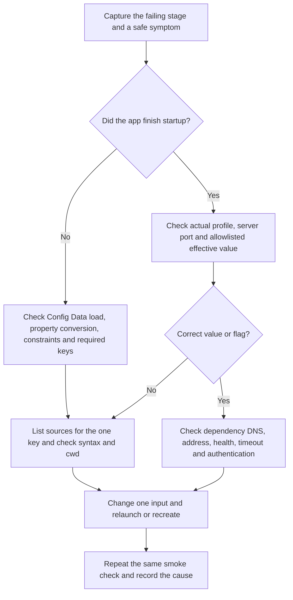

The application can load and bind all settings but fail when it first contacts a dependency. Work from the caller's namespace. Use the lab's `/config` and `/database` as distinct probes. Commands below assume PowerShell unless labeled Bash or run via `docker compose exec`. Use only nonsecret names and safe error summaries.

| Symptom and likely reason | Investigation and reasoning | Safe repair and prevention |
| --- | --- | --- |
| Environment override missing because Java did not inherit it | `Test-Path Env:LAB_LABEL` in the launching PowerShell or `printenv LAB_LABEL` in Bash. Confirm the actual launcher uses that scope | Set `$env:LAB_LABEL` or Bash `export LAB_LABEL` and start a new JVM. Document launcher ownership |
| Incorrect property name | Compare the schema `lab.page-size` with the spelling `LAB_PAGESIZE`. Check `pageSize` from `/config` | Use the canonical form and add a binding assertion. Avoid duplicate aliases |
| Invalid prefix leaves a property unused | Search the value's source for the key with `rg -n 'labb\.label' .\overrides`. Compare it with the record's `lab` prefix | Correct the prefix. Use startup and smoke assertions because strict binding only applies within its configured prefix |
| Wrong active profile | Read `activeProfiles` and `defaultProfiles` in `/config`, and safe startup profile lines | Set the selection in the intended launcher source. Verify order and remove accidental override |
| Unexpected winner | Locate the specific key in the intended file. Check `Test-Path Env:LAB_LABEL` and the exact known launch arguments for `-Dlab.label` and `--lab.label` | Remove the unintended higher source. Keep a provenance note for each deployment override |
| YAML parser fails or parses wrong shape | Read the reported line and inspect surrounding spaces with `Get-Content -LiteralPath .\overrides\application.yml` on this nonsecret file | Align indentation and use spaces, one format per location. Add a binding test to catch a valid but wrong tree |
| Cannot convert text to a target type | Run the disposable app with `--lab.page-size=many`. Check reported property and target type | Use a typed value such as `20`, validate its range and use IDE metadata |
| Invalid duration or unreasonable bound | Compare `--lab.timeout=soon` with `--lab.timeout=31s` in separate runs | Fix syntax or correct the duration policy violation. Document allowed units/range |
| Missing required secret | Read the guard's key name and use `Test-Path -LiteralPath .\secrets\lab-auth.signing-key` on the host. Check container `test -r` if it runs | Provide the authorized file with its exact mount name and permission. Recreate and verify without printing its contents |
| Unexpected server port or address | Check Java startup and `Get-NetTCPConnection -LocalPort 18094 -State Listen` on host. For Docker use `docker compose -p $ConfigProject port app 8080` | Correct `server.port`/`server.address` or host mapping. Use the actual profile port and keep host loopback access |
| PostgreSQL host points to app loopback | Compare configured host name with the Compose service name. An HTTP `503` on `/database` with a healthy `/config` confines the issue to dependency access | Use `postgres:5432` from the app container, and keep both on the shared network. A host client has a different route |
| Compose interpolation omitted or overridden | Run `docker compose -p $ConfigProject config --quiet` to catch syntax. Inspect only the nonsecret field using `exec -T app printenv LAB_LABEL` and compare the service mapping and interpolation input | Explicitly map the key in `environment` or supply a service `env_file`. Check the invocation's shell values first |
| Runtime value did not update after changing `.env` | Observe nonsecret label after `docker compose restart`. It still matches the old container | Apply `up -d --force-recreate app` with the intended inputs. Compare before/after result |
| Flag remains off or provider call fails | Inspect `integrationEnabled`, then `/hint`. `disabled` differs from `503`. Reproduce condition in runner | Correct key/URI, restart, and verify provider from the caller's namespace. Test off/on with explicit Boolean strings |
| Sensitive data was logged | Identify the emitting source location and sinks without reprinting the value. Determine access and scope | Remove detailed logging, limit access, rotate/revoke an exposed actual credential, and verify new diagnostics contain safe fields only |
| App starts under permissive default | Inspect `activeProfiles` and `defaultProfiles` against deployment intent. In the lab no explicit selector gives defaults `dev` | Specify the intended profile and smoke-test it. Use required inputs and explicit mode validation for consequential deployments |

For targeted recent app logs use `docker compose -p $ConfigProject logs --tail 40 app` in the disposable lab, with the original safe log paths. Use `docker compose -p $ConfigProject ps` to distinguish restarting/exited services. Avoid generic `docker inspect`, full environment dumps, and renderer output if the environment could contain actual credentials. If using Actuator in a real app, minimize exposure of diagnostics and review authorization and masking behavior before exposing `env` or `configprops`. The capstone uses an explicit endpoint that returns only its built-in safe field set.

**Key Takeaways.** Identify the failing stage before changing a value. Check the single key's source and consumer, reproduce safely, and confirm the fix against the original symptom.


<a id="config-19"></a>

## Part 19 — End-to-End Spring Boot Walkthrough

### What you will run

The Multi-Environment Spring Boot Configuration Lab builds one Java 21 JAR. On the host it demonstrates config-only startup and an optional HTTP provider. In Docker, the same JAR also reaches a disposable PostgreSQL service. `prod-sim` requires externally delivered credentials. The independent practice workbook asks you to re-create this contract before reading its reference solution.

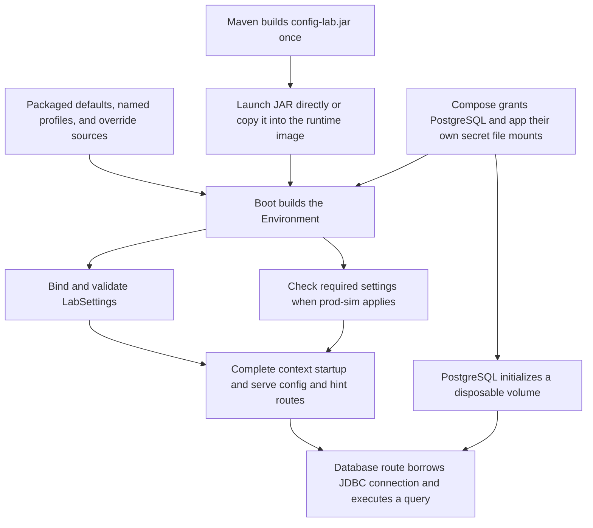

The app can serve the settings endpoint before making its first JDBC connection. In Compose the PostgreSQL health gate controls app start ordering. Only the app's PostgreSQL query proves that this app's host, user, database, and mounted credential work together.

PowerShell, choose a fresh directory and create the files from the listings below. Save text files as UTF-8 without a BOM. Use VS Code if you like.

```powershell
$ConfigLab = Join-Path ([IO.Path]::GetTempPath()) ('config-lab-' + [Guid]::NewGuid().ToString('N').Substring(0, 8))
New-Item -ItemType Directory -Path $ConfigLab | Out-Null
Set-Location -LiteralPath $ConfigLab
java -version
mvn.cmd -v
docker compose version
```

```text
config-lab/
├── pom.xml
├── Dockerfile
├── compose.yaml
├── .dockerignore
├── .gitignore
├── .env
└── src
    ├── main
    │   ├── java/learning/config/
    │   │   ├── ConfigLabApplication.java
    │   │   ├── LabSettings.java
    │   │   ├── ProductionGuard.java
    │   │   ├── HintConfiguration.java
    │   │   └── LabController.java
    │   └── resources/
    │       ├── application.properties
    │       ├── application-dev.properties
    │       ├── application-test.properties
    │       ├── application-prod-sim.properties
    │       └── application-local-log.properties
    └── test/java/learning/config/
        ├── SettingsRunnerTest.java
        ├── ProfilePrecedenceTest.java
        └── DynamicPrecedenceTest.java
```

### Complete project files

The Maven parent aligns supported dependencies for Boot `4.0.10`. The source uses Java 21 and the HTTP server starts on host loopback. The build copies only the JAR to the runtime image. The JAR has no real credentials and the example `.env` only holds ordinary interpolation settings. [Spring Boot 4.0.10 on Maven Central](https://central.sonatype.com/artifact/org.springframework.boot/spring-boot-starter-parent/4.0.10) · [Official PostgreSQL container image](https://hub.docker.com/_/postgres)

#### `pom.xml`

```xml
<?xml version="1.0" encoding="UTF-8"?>
<project xmlns="http://maven.apache.org/POM/4.0.0"
         xmlns:xsi="http://www.w3.org/2001/XMLSchema-instance"
         xsi:schemaLocation="http://maven.apache.org/POM/4.0.0 https://maven.apache.org/xsd/maven-4.0.0.xsd">
    <modelVersion>4.0.0</modelVersion>
    <parent>
        <groupId>org.springframework.boot</groupId>
        <artifactId>spring-boot-starter-parent</artifactId>
        <version>4.0.10</version>
        <relativePath/>
    </parent>
    <groupId>learning.config</groupId>
    <artifactId>config-lab</artifactId>
    <version>1.0.0</version>
    <properties>
        <java.version>21</java.version>
    </properties>
    <dependencies>
        <dependency>
            <groupId>org.springframework.boot</groupId>
            <artifactId>spring-boot-starter-webmvc</artifactId>
        </dependency>
        <dependency>
            <groupId>org.springframework.boot</groupId>
            <artifactId>spring-boot-starter-jdbc</artifactId>
        </dependency>
        <dependency>
            <groupId>org.springframework.boot</groupId>
            <artifactId>spring-boot-starter-validation</artifactId>
        </dependency>
        <dependency>
            <groupId>org.postgresql</groupId>
            <artifactId>postgresql</artifactId>
            <scope>runtime</scope>
        </dependency>
        <dependency>
            <groupId>org.springframework.boot</groupId>
            <artifactId>spring-boot-starter-test</artifactId>
            <scope>test</scope>
        </dependency>
    </dependencies>
    <build>
        <finalName>config-lab</finalName>
        <plugins>
            <plugin>
                <groupId>org.springframework.boot</groupId>
                <artifactId>spring-boot-maven-plugin</artifactId>
            </plugin>
        </plugins>
    </build>
    <profiles>
        <profile>
            <id>junit5-core</id>
            <properties>
                <junit-jupiter.version>5.14.4</junit-jupiter.version>
            </properties>
            <build>
                <plugins>
                    <plugin>
                        <artifactId>maven-surefire-plugin</artifactId>
                        <configuration>
                            <includes>
                                <include>**/SettingsRunnerTest.java</include>
                            </includes>
                        </configuration>
                    </plugin>
                </plugins>
            </build>
        </profile>
    </profiles>
</project>
```

<a id="config-file-main"></a>

#### `src/main/java/learning/config/ConfigLabApplication.java`

```java
package learning.config;

import org.springframework.boot.SpringApplication;
import org.springframework.boot.autoconfigure.SpringBootApplication;
import org.springframework.boot.context.properties.ConfigurationPropertiesScan;

@SpringBootApplication
@ConfigurationPropertiesScan
public class ConfigLabApplication {
    public static void main(String[] args) {
        SpringApplication.run(ConfigLabApplication.class, args);
    }
}
```

<a id="config-file-settings"></a>

#### `src/main/java/learning/config/LabSettings.java`

```java
package learning.config;

import java.net.URI;
import java.time.Duration;
import java.util.List;
import java.util.Map;

import jakarta.validation.Valid;
import jakarta.validation.constraints.AssertTrue;
import jakarta.validation.constraints.Max;
import jakarta.validation.constraints.Min;
import jakarta.validation.constraints.NotBlank;
import jakarta.validation.constraints.Pattern;
import org.springframework.boot.context.properties.ConfigurationProperties;
import org.springframework.boot.context.properties.bind.DefaultValue;
import org.springframework.util.unit.DataSize;
import org.springframework.validation.annotation.Validated;

@ConfigurationProperties(prefix = "lab", ignoreUnknownFields = false)
@Validated
public record LabSettings(
        @DefaultValue("base") @NotBlank String label,
        @DefaultValue("5") @Min(1) @Max(50) int pageSize,
        @DefaultValue("2s") Duration timeout,
        @DefaultValue("512KB") DataSize bufferSize,
        List<String> channels,
        Map<String, String> aliases,
        @DefaultValue @Valid Integration integration) {

    public LabSettings {
        channels = channels == null ? List.of() : List.copyOf(channels);
        aliases = aliases == null ? Map.of() : Map.copyOf(aliases);
    }

    @AssertTrue(message = "lab.timeout must be positive and at most 30s")
    public boolean isTimeoutUsable() {
        return isShortPositive(timeout);
    }

    private static boolean isShortPositive(Duration value) {
        return value != null && value.isPositive()
                && value.compareTo(Duration.ofSeconds(30)) <= 0;
    }

    public record Integration(
            @DefaultValue("false")
            @Pattern(regexp = "(?i:true|false)", message = "lab.integration.enabled must be true or false")
            String enabled,
            URI baseUrl,
            @DefaultValue("1s") Duration connectTimeout) {

        public boolean isEnabled() {
            return "true".equalsIgnoreCase(enabled);
        }

        @AssertTrue(message = "lab.integration.connect-timeout must be positive and at most 30s")
        public boolean isConnectTimeoutUsable() {
            return isShortPositive(connectTimeout);
        }

        @AssertTrue(message = "When enabled, lab.integration.base-url must be an HTTP(S) base URL ending in / without credentials, query, or fragment")
        public boolean isEndpointUsable() {
            if (!isEnabled()) {
                return true;
            }
            return baseUrl != null
                    && ("http".equalsIgnoreCase(baseUrl.getScheme())
                        || "https".equalsIgnoreCase(baseUrl.getScheme()))
                    && baseUrl.getHost() != null
                    && baseUrl.getUserInfo() == null
                    && baseUrl.getQuery() == null
                    && baseUrl.getFragment() == null
                    && baseUrl.getPath().endsWith("/");
        }
    }
}
```

<a id="config-file-prod-guard"></a>

#### `src/main/java/learning/config/ProductionGuard.java`

```java
package learning.config;

import java.util.Base64;

import org.springframework.context.annotation.Profile;
import org.springframework.core.env.Environment;
import org.springframework.stereotype.Component;

@Component
@Profile("prod-sim")
final class ProductionGuard {
    ProductionGuard(Environment environment) {
        String key = required(environment, "lab-auth.signing-key");
        if (!isLabSigningKey(key)) {
            throw new IllegalStateException(
                    "lab-auth.signing-key must encode exactly 32 bytes in this lab");
        }
        required(environment, "spring.datasource.url");
        required(environment, "spring.datasource.username");
        required(environment, "spring.datasource.password");
    }

    private static String required(Environment environment, String name) {
        String value = environment.getProperty(name);
        if (value == null || value.isBlank()) {
            throw new IllegalStateException(name + " is required in prod-sim");
        }
        return value;
    }

    private static boolean isLabSigningKey(String key) {
        try {
            return Base64.getDecoder().decode(key.strip()).length == 32;
        } catch (IllegalArgumentException ignored) {
            return false;
        }
    }
}
```

<a id="config-file-hint"></a>

#### `src/main/java/learning/config/HintConfiguration.java`

```java
package learning.config;

import java.io.IOException;
import java.net.URI;
import java.net.http.HttpClient;
import java.net.http.HttpRequest;
import java.net.http.HttpResponse;
import java.time.Duration;

import org.springframework.boot.autoconfigure.condition.ConditionalOnProperty;
import org.springframework.context.annotation.Bean;
import org.springframework.context.annotation.Configuration;

@Configuration(proxyBeanMethods = false)
class HintConfiguration {
    @Bean
    @ConditionalOnProperty(prefix = "lab.integration", name = "enabled", havingValue = "true")
    HintClient hintClient(LabSettings settings) {
        return new HintClient(settings.integration(), settings.timeout());
    }
}

final class HintClient implements AutoCloseable {
    private final HttpClient http;
    private final URI endpoint;
    private final Duration requestTimeout;

    HintClient(LabSettings.Integration settings, Duration requestTimeout) {
        this.http = HttpClient.newBuilder()
                .proxy(HttpClient.Builder.NO_PROXY)
                .connectTimeout(settings.connectTimeout())
                .build();
        this.endpoint = settings.baseUrl().resolve("hint");
        this.requestTimeout = requestTimeout;
    }

    String fetch() throws IOException, InterruptedException {
        HttpRequest request = HttpRequest.newBuilder(endpoint)
                .timeout(requestTimeout)
                .GET()
                .build();
        HttpResponse<String> response = http.send(request, HttpResponse.BodyHandlers.ofString());
        if (response.statusCode() != 200) {
            throw new IOException("Hint provider returned a non-success status");
        }
        return response.body();
    }

    @Override
    public void close() {
        http.close();
    }
}
```

<a id="config-file-controller"></a>

#### `src/main/java/learning/config/LabController.java`

```java
package learning.config;

import java.io.IOException;
import java.sql.SQLException;
import java.util.List;
import java.util.Map;

import org.slf4j.Logger;
import org.slf4j.LoggerFactory;
import org.springframework.beans.factory.ObjectProvider;
import org.springframework.beans.factory.annotation.Value;
import org.springframework.core.env.Environment;
import org.springframework.dao.DataAccessException;
import org.springframework.http.HttpStatus;
import org.springframework.jdbc.core.simple.JdbcClient;
import org.springframework.web.bind.annotation.GetMapping;
import org.springframework.web.bind.annotation.RestController;
import org.springframework.web.server.ResponseStatusException;

@RestController
final class LabController {
    private static final Logger LOG = LoggerFactory.getLogger(LabController.class);
    private final LabSettings settings;
    private final Environment environment;
    private final String banner;
    private final JdbcClient database;
    private final ObjectProvider<HintClient> hints;

    LabController(LabSettings settings, Environment environment,
            @Value("${banner.text:learning}") String banner,
            JdbcClient database, ObjectProvider<HintClient> hints) {
        this.settings = settings;
        this.environment = environment;
        this.banner = banner;
        this.database = database;
        this.hints = hints;
    }

    @GetMapping("/config")
    Map<String, Object> summary() {
        return Map.of(
                "label", settings.label(),
                "banner", banner,
                "pageSize", settings.pageSize(),
                "timeout", settings.timeout().toString(),
                "bufferBytes", settings.bufferSize().toBytes(),
                "channels", settings.channels(),
                "aliases", settings.aliases(),
                "integrationEnabled", settings.integration().isEnabled(),
                "activeProfiles", List.of(environment.getActiveProfiles()),
                "defaultProfiles", List.of(environment.getDefaultProfiles()));
    }

    @GetMapping("/database")
    Map<String, String> database() {
        try {
            String name = database.sql("select current_database()").query(String.class).single();
            return Map.of("database", name);
        } catch (DataAccessException error) {
            Throwable cause = error.getMostSpecificCause();
            if (cause instanceof SQLException sql) {
                LOG.warn("Database probe failed. SQLState={}", sql.getSQLState());
            } else {
                LOG.warn("Database probe failed. Cause type={}", cause.getClass().getSimpleName());
            }
            throw new ResponseStatusException(HttpStatus.SERVICE_UNAVAILABLE, "Database check failed");
        }
    }

    @GetMapping("/hint")
    Map<String, String> hint() {
        HintClient client = hints.getIfAvailable();
        if (client == null) {
            return Map.of("status", "disabled");
        }
        try {
            return Map.of("hint", client.fetch());
        } catch (InterruptedException error) {
            Thread.currentThread().interrupt();
            throw new ResponseStatusException(HttpStatus.SERVICE_UNAVAILABLE, "Hint request interrupted");
        } catch (IOException error) {
            throw new ResponseStatusException(HttpStatus.SERVICE_UNAVAILABLE, "Hint provider unavailable");
        }
    }
}
```

<a id="config-file-base"></a>

#### `src/main/resources/application.properties`

```properties
spring.application.name=config-lab
spring.profiles.default=dev
spring.profiles.group.workstation[0]=dev
spring.profiles.group.workstation[1]=local-log

server.address=127.0.0.1
server.port=18094
spring.datasource.hikari.connection-timeout=2000
spring.datasource.hikari.maximum-pool-size=4

lab.label=base
lab.channels[0]=mail
lab.channels[1]=web
lab.aliases.public=Guest
lab.aliases.staff=Staff
banner.text=${COURSE_NOTICE:packaged-banner}
```

#### `src/main/resources/application-dev.properties`

```properties
lab.label=dev
lab.timeout=1s
spring.datasource.url=jdbc:postgresql://127.0.0.1:15439/configlab
spring.datasource.username=configlab
```

#### `src/main/resources/application-test.properties`

```properties
lab.label=test
lab.page-size=3
server.port=18096
spring.datasource.url=jdbc:postgresql://127.0.0.1:15439/configlab
spring.datasource.username=configlab
```

#### `src/main/resources/application-prod-sim.properties`

```properties
lab.label=prod-sim
lab.timeout=4s
logging.level.learning.config=INFO
```

#### `src/main/resources/application-local-log.properties`

```properties
logging.level.learning.config=DEBUG
banner.text=workstation-banner
```

<a id="config-file-runner-test"></a>

#### `src/test/java/learning/config/SettingsRunnerTest.java`

```java
package learning.config;

import java.time.Duration;

import org.junit.jupiter.api.Test;
import org.springframework.boot.context.properties.EnableConfigurationProperties;
import org.springframework.boot.test.context.runner.ApplicationContextRunner;
import org.springframework.boot.test.context.TestConfiguration;

import static org.assertj.core.api.Assertions.assertThat;

class SettingsRunnerTest {
    private final ApplicationContextRunner isolated = new ApplicationContextRunner()
            .withInitializer(context -> {
                var sources = context.getEnvironment().getPropertySources();
                sources.remove("systemProperties");
                sources.remove("systemEnvironment");
            });

    private final ApplicationContextRunner binding = isolated
            .withUserConfiguration(SettingsOnly.class, HintConfiguration.class);

    @Test
    void bindsDefaultsAndTypedValues() {
        binding.withPropertyValues(
                "lab.timeout=750ms",
                "lab.buffer-size=768KB",
                "lab.channels[0]=web",
                "lab.aliases.public=Guest")
                .run(context -> {
                    assertThat(context).hasNotFailed();
                    LabSettings settings = context.getBean(LabSettings.class);
                    assertThat(settings.pageSize()).isEqualTo(5);
                    assertThat(settings.timeout()).isEqualTo(Duration.ofMillis(750));
                    assertThat(settings.bufferSize().toBytes()).isEqualTo(786_432L);
                    assertThat(settings.channels()).containsExactly("web");
                    assertThat(settings.aliases()).containsEntry("public", "Guest");
                    assertThat(context).doesNotHaveBean(HintClient.class);
                });
    }

    @Test
    void rejectsBadRangeAndUnparseableDuration() {
        binding.withPropertyValues("lab.page-size=0")
                .run(context -> {
                    assertThat(context).hasFailed();
                    assertThat(context.getStartupFailure()).hasStackTraceContaining("pageSize");
                });
        binding.withPropertyValues("lab.timeout=soon")
                .run(context -> {
                    assertThat(context).hasFailed();
                    assertThat(context.getStartupFailure()).hasStackTraceContaining("lab.timeout");
                });
    }

    @Test
    void enablingHintRequiresAValidEndpoint() {
        binding.withPropertyValues("lab.integration.enabled=true")
                .run(context -> {
                    assertThat(context).hasFailed();
                    assertThat(context.getStartupFailure()).hasStackTraceContaining("lab.integration.base-url");
                });
        binding.withPropertyValues("lab.integration.enabled=on",
                "lab.integration.base-url=http://127.0.0.1:18095/")
                .run(context -> {
                    assertThat(context).hasFailed();
                    assertThat(context.getStartupFailure()).hasStackTraceContaining("lab.integration.enabled must be true or false");
                });
        binding.withPropertyValues(
                "lab.integration.enabled=true",
                "lab.integration.base-url=http://127.0.0.1:18095/")
                .run(context -> assertThat(context).hasSingleBean(HintClient.class));
    }

    @Test
    void productionGuardRejectsMissingKey() {
        isolated.withInitializer(context -> context.getEnvironment().setActiveProfiles("prod-sim"))
                .withUserConfiguration(ProductionGuard.class)
                .run(context -> {
                    assertThat(context).hasFailed();
                    assertThat(context.getStartupFailure())
                            .hasStackTraceContaining("lab-auth.signing-key is required in prod-sim");
                });
    }

    @TestConfiguration(proxyBeanMethods = false)
    @EnableConfigurationProperties(LabSettings.class)
    static class SettingsOnly {}
}
```

<a id="config-file-profile-test"></a>

#### `src/test/java/learning/config/ProfilePrecedenceTest.java`

```java
package learning.config;

import org.junit.jupiter.api.Test;
import org.springframework.beans.factory.annotation.Autowired;
import org.springframework.boot.test.context.SpringBootTest;
import org.springframework.core.env.Environment;
import org.springframework.test.context.ActiveProfiles;
import org.springframework.test.context.TestPropertySource;

import static org.assertj.core.api.Assertions.assertThat;

@SpringBootTest(webEnvironment = SpringBootTest.WebEnvironment.NONE,
        properties = "lab.label=boot-test")
@ActiveProfiles("test")
@TestPropertySource(properties = "lab.label=test-source")
class ProfilePrecedenceTest {
    @Autowired LabSettings settings;
    @Autowired Environment environment;

    @Test
    void loadsTestProfileAndUsesInlineTestSource() {
        assertThat(environment.getActiveProfiles()).containsExactly("test");
        assertThat(settings.pageSize()).isEqualTo(3);
        assertThat(settings.label()).isEqualTo("test-source");
    }
}
```

<a id="config-file-dynamic-test"></a>

#### `src/test/java/learning/config/DynamicPrecedenceTest.java`

```java
package learning.config;

import org.junit.jupiter.api.Test;
import org.springframework.beans.factory.annotation.Autowired;
import org.springframework.boot.test.context.SpringBootTest;
import org.springframework.test.context.ActiveProfiles;
import org.springframework.test.context.DynamicPropertyRegistry;
import org.springframework.test.context.DynamicPropertySource;
import org.springframework.test.context.TestPropertySource;

import static org.assertj.core.api.Assertions.assertThat;

@SpringBootTest(webEnvironment = SpringBootTest.WebEnvironment.NONE,
        properties = "lab.label=boot-test")
@ActiveProfiles("test")
@TestPropertySource(properties = "lab.label=test-source")
class DynamicPrecedenceTest {
    @DynamicPropertySource
    static void register(DynamicPropertyRegistry registry) {
        registry.add("lab.label", () -> "dynamic-test");
    }

    @Autowired LabSettings settings;

    @Test
    void usesDynamicSourceBeforeInlineTestSource() {
        assertThat(settings.label()).isEqualTo("dynamic-test");
    }
}
```

#### `Dockerfile`

```dockerfile
FROM eclipse-temurin:21-jre-noble
WORKDIR /app
COPY --chown=10001:10001 target/config-lab.jar /app/config-lab.jar
USER 10001:10001
EXPOSE 8080
ENTRYPOINT ["java","-jar","/app/config-lab.jar"]
```

#### `.gitignore`

```text
target/
secrets/
.env
.env.*
*.log
```

#### `.dockerignore`

```text
.git
secrets/
.env
.env.*
*.log
target/*
!target/config-lab.jar
```

#### `.env`

```properties
CONFIG_LAB_PROFILE=dev
CONFIG_LAB_LABEL=compose-dev
CONFIG_LAB_APP_PORT=18098
```

#### `compose.yaml`

```yaml
services:
  app:
    image: "${COMPOSE_PROJECT_NAME}-app:lab"
    build: .
    environment:
      SPRING_PROFILES_ACTIVE: "${CONFIG_LAB_PROFILE:-dev}"
      LAB_LABEL: "${CONFIG_LAB_LABEL:-compose-dev}"
      SERVER_ADDRESS: "0.0.0.0"
      SERVER_PORT: "8080"
      SPRING_DATASOURCE_URL: "jdbc:postgresql://${CONFIG_LAB_DB_HOST:-postgres}:5432/configlab"
      SPRING_DATASOURCE_USERNAME: configlab
      SPRING_CONFIG_IMPORT: "configtree:/run/secrets/"
    ports:
      - "127.0.0.1:${CONFIG_LAB_APP_PORT:-18098}:8080"
    secrets:
      - source: db_password
        target: spring.datasource.password
      - source: signing_key
        target: lab-auth.signing-key
    depends_on:
      postgres:
        condition: service_healthy
    networks: [lab-net]
  postgres:
    image: postgres:17.11-bookworm
    environment:
      POSTGRES_DB: configlab
      POSTGRES_USER: configlab
      POSTGRES_PASSWORD_FILE: /run/secrets/db-password
    secrets:
      - source: db_password
        target: db-password
    volumes:
      - pg-data:/var/lib/postgresql/data
    healthcheck:
      test: ["CMD", "pg_isready", "-h", "127.0.0.1", "-U", "configlab", "-d", "configlab"]
      interval: 3s
      timeout: 2s
      retries: 12
    networks: [lab-net]
secrets:
  db_password:
    file: ./secrets/spring.datasource.password
  signing_key:
    file: ./secrets/lab-auth.signing-key
volumes:
  pg-data:
networks:
  lab-net:
```

### Build, test, and observe a host run

From the lab directory in a new PowerShell session, check that ports `18094`, `18095`, `18096` and `18098` are free if you plan to use the defaults. `Get-NetTCPConnection -State Listen -LocalPort 18094,18095,18096,18098 -ErrorAction SilentlyContinue` shows any listeners. Pick an unused port and make the corresponding client change if needed.

```powershell
mvn.cmd -B -ntp clean package
mvn.cmd -B -ntp -Pjunit5-core test
$ConfigArtifactHash = (Get-FileHash -LiteralPath .\target\config-lab.jar -Algorithm SHA256).Hash
java -jar .\target\config-lab.jar --spring.profiles.active=dev
```

Probe the running app from a second PowerShell window.

```powershell
curl.exe --noproxy '*' -fsS http://127.0.0.1:18094/config
curl.exe --noproxy '*' -fsS http://127.0.0.1:18094/hint
```

Expect `label=dev`, `banner=packaged-banner`, `activeProfiles=["dev"]`, `pageSize=5`, `timeout=PT1S`, and `integrationEnabled=false` in `/config` if no higher input overrides them. `/hint` returns `{"status":"disabled"}`. The host dev/test URLs point at an unused lab port. Use `/database` for a successful connection only in the Compose run. For a working hint integration, use the [host stub exercise](#config-16).

Stop the dev process. Start `java -jar .\target\config-lab.jar --spring.profiles.active=test` and inspect `http://127.0.0.1:18096/config`. It shows `label=test`, `pageSize=3`, and `timeout=PT2S`. Stop that process before moving on.

In PowerShell, run the external-file and environment override experiments in sequence.

```powershell
New-Item -ItemType Directory -Path .\overrides -Force | Out-Null
'lab.label=external' | Set-Content -LiteralPath .\overrides\application.properties -Encoding ascii
java -jar .\target\config-lab.jar --spring.profiles.active=dev '--spring.config.additional-location=file:./overrides/'

$env:LAB_LABEL = 'runtime-env'
try {
    java -jar .\target\config-lab.jar --spring.profiles.active=dev '--spring.config.additional-location=file:./overrides/'
} finally {
    Remove-Item Env:LAB_LABEL -ErrorAction SilentlyContinue
}
```

Hit the dev port's `/config` during each launch and stop it before continuing. The values are `external` and `runtime-env` respectively. Use a new scratch shell so these examples can remove variables they set without affecting unrelated work. Keep scratch override files separate from the capstone's packaged resources.

Run the next command in a shell with no `lab-auth.signing-key` source to test startup failure. The command passes a disposable URL and username to isolate the missing-key check.

```powershell
java -jar .\target\config-lab.jar --spring.profiles.active=prod-sim --spring.datasource.url=jdbc:postgresql://127.0.0.1:15439/configlab --spring.datasource.username=configlab
$LASTEXITCODE
```

Expected startup result is a nonzero process exit and `lab-auth.signing-key is required in prod-sim` in the cause. The guarded application does not become ready.

### Generate two disposable files

Run once from the lab directory in PowerShell before creating a new lab volume.

```powershell
$SecretDir = Join-Path (Get-Location).Path 'secrets'
if (Test-Path -LiteralPath $SecretDir) {
    throw 'This lab already has a secrets directory. Reuse those files with its database volume.'
}
New-Item -ItemType Directory -Path $SecretDir | Out-Null
$ConfigRng = [Security.Cryptography.RandomNumberGenerator]::Create()
try {
    foreach ($name in @('spring.datasource.password', 'lab-auth.signing-key')) {
        $bytes = New-Object byte[] 32
        $ConfigRng.GetBytes($bytes)
        [IO.File]::WriteAllText(
            (Join-Path $SecretDir $name),
            [Convert]::ToBase64String($bytes),
            [Text.UTF8Encoding]::new($false))
    }
} finally {
    $ConfigRng.Dispose()
}
Test-Path -LiteralPath .\secrets\spring.datasource.password
Test-Path -LiteralPath .\secrets\lab-auth.signing-key
```

Both checks return `True` and only report presence. PostgreSQL initializes its `configlab` database and the disposable `configlab` account on an empty volume using `POSTGRES_PASSWORD_FILE`. This account is created by the image's initialization workflow for the lab. Use a limited app-role account when modeling a real deployment. Compose mounts the same password source once under each consumer's expected name, and grants the signing-key file only to the app. Boot reads both app mounts through the required `configtree:` import. Keep the files stable with that lab database volume. The `.dockerignore` keeps them out of the build context.

### Run the same artifact in Compose

PowerShell, from the capstone directory. Use an installation with the Compose `up --wait` option. Use the same project name for every command in this run. Fresh scratch terminals should have no accidental environment overrides of the `CONFIG_LAB_*` interpolation values. The defaults below publish only an app port on host loopback.

```powershell
$ConfigProject = 'config-lab-' + [Guid]::NewGuid().ToString('N').Substring(0, 8)
$ConfigProject
docker compose -p $ConfigProject config --quiet
docker compose -p $ConfigProject up -d --build --wait --wait-timeout 90
docker compose -p $ConfigProject ps
docker compose -p $ConfigProject port app 8080
docker compose -p $ConfigProject exec -T app sh -c 'test -r /run/secrets/spring.datasource.password && test -r /run/secrets/lab-auth.signing-key'
$LASTEXITCODE
```

Expect an exit code of `0` for the readability probe. `--wait` checks service running/health status, using configured health checks. The app service has no health check here. Wait for the Spring startup line or retry the following HTTP probes for up to 30 seconds.

```powershell
$ConfigBase = 'http://127.0.0.1:18098'
curl.exe --noproxy '*' -fsS "$ConfigBase/config"
curl.exe --noproxy '*' -fsS "$ConfigBase/database"
```

Expect label `compose-dev` and profile `dev`. `/database` returns `{"database":"configlab"}`. Notice that `18098` is the host port and `8080` is the app port inside the container. PostgreSQL has no published port. If you set a different host port, use `docker compose -p $ConfigProject port app 8080` and adjust `$ConfigBase`.

Now edit the disposable `.env` to these three nonsecret lines. Keep the hash baseline and Docker project name from the earlier commands.

```properties
CONFIG_LAB_PROFILE=prod-sim
CONFIG_LAB_LABEL=compose-production
CONFIG_LAB_APP_PORT=18098
```

**Windows PowerShell**

```powershell
docker compose -p $ConfigProject up -d --no-deps --force-recreate app
docker compose -p $ConfigProject ps
curl.exe --noproxy '*' -fsS "$ConfigBase/config"
curl.exe --noproxy '*' -fsS "$ConfigBase/database"
$ConfigArtifactHash -ceq (Get-FileHash -LiteralPath .\target\config-lab.jar -Algorithm SHA256).Hash
```

Wait for app startup before querying again. Expect `prod-sim`, label `compose-production`, timeout `PT4S`, and the same database response. The final comparison gives `True`. `--no-deps` avoids recreating PostgreSQL while switching this app's settings. For controlled faults see [the workbook troubleshooting exercises](Application_Configuration_Exercises_and_Solutions.md#level-3-troubleshooting).

### Clean up

Run from the same scratch project in PowerShell.

```powershell
docker compose -p $ConfigProject down
docker volume ls --filter "label=com.docker.compose.project=$ConfigProject"
```

This stops and removes the lab containers and its network, keeping the named volume and image. The volume contains only this disposable database. To discard it, confirm the ownership label first. The removal affects the specified lab volume permanently. If you want to rerun with its data, keep the volume and its original secret files together.

```powershell
$ConfigVolume = "${ConfigProject}_pg-data"
$ConfigOwnedVolumes = @(docker volume ls --filter "label=com.docker.compose.project=$ConfigProject" --format '{{.Name}}')
if ($LASTEXITCODE -ne 0 -or $ConfigOwnedVolumes -cnotcontains $ConfigVolume) {
    throw 'Volume ownership could not be confirmed.'
}
docker volume rm $ConfigVolume
if ($LASTEXITCODE -ne 0) {
    throw 'The disposable volume was not removed.'
}
docker image rm "${ConfigProject}-app:lab"
```

After removing the disposable database volume, remove `.\secrets\spring.datasource.password` and `.\secrets\lab-auth.signing-key` using their literal paths, or delete your specific scratch project from File Explorer. Stop the host JVM or stub if running. The named project and paths keep cleanup scoped.

**Key Takeaways.** Verify the artifact hash and effective settings when promoting one artifact. Check startup, scoped secret mounts, and dependency access separately.

<a id="configuration-reference"></a>

## Configuration Reference

| Input/inspection | PowerShell or configuration form | What it confirms |
| --- | --- | --- |
| OS variable | `$env:LAB_LABEL = 'runtime'` | Present in child JVM if launched from this session |
| JVM system property | `java '-Dlab.label=jvm' -jar .\target\config-lab.jar` | Passed through the JVM launcher |
| Boot property argument | `java -jar .\target\config-lab.jar --lab.label=cli` | Boot includes a command-line property source |
| Additional file location | `--spring.config.additional-location=file:./overrides/` | Keeps base configuration and adds this directory |
| Typed conversion | `lab.timeout=750ms` and `lab.buffer-size=768KB` | Duration and size with explicit units |
| Nested flag | `LAB_INTEGRATION_ENABLED=true` | Enables the integration only if valid required config exists |
| Secret mounting | `SPRING_CONFIG_IMPORT=configtree:/run/secrets/` | Reads exact filenames as keys |
| Safe HTTP evidence | `curl.exe --noproxy '*' -fsS http://127.0.0.1:18094/config` | Returns the lab's allowlisted effective configuration |
| Verify Compose model | `docker compose -p $ConfigProject config --quiet` | Reports model validity. Runtime reachability is separate |

## Spring Profiles Cheat Sheet

| Task | Syntax or outcome |
| --- | --- |
| Choose a profile in PowerShell | Set `$env:SPRING_PROFILES_ACTIVE='dev'` and launch Java in the same shell |
| One explicit launch | `--spring.profiles.active=test` |
| Multiple active profiles | Pass `'--spring.profiles.active=dev,test'`. The later profile wins matching keys within one location group |
| Default with no active profile | `spring.profiles.default=dev` in a base file for this lab |
| Add a set via a group | `spring.profiles.group.workstation[0]=dev` and `spring.profiles.group.workstation[1]=local-log` |
| Pick a YAML document | `spring.config.activate.on-profile` inside that document |
| Register a mode-specific bean | `@Profile("prod-sim")` |
| Isolate a test | `@ActiveProfiles("test")` in an explicit TestContext |

## Property Precedence Reference

For a normal run with the corresponding sources, resolve from CLI `--key=value` → JVM `-D` → OS environment → Config Data → lower sources/defaults. `SPRING_APPLICATION_JSON` fits between CLI and any applicable servlet/JNDI/system stages. Within default Config Data locations the usual order from highest is external profile → external base → packaged profile → packaged base. Imports, explicit location groups, format and applicable tests can change which sources participate. See [Part 8](#config-08) for the documented order and collision tests.

## Secrets Checklist

- [ ] Classify secret inputs and keep them separate from versioned configuration.
- [ ] Confirm they are absent from Git tracking, container build context, image layers, command lines, logs, and example output.
- [ ] Limit runtime read access by workload/environment. Verify only presence or readability.
- [ ] Validate required shape and mode without revealing values. Keep secret material out of `/config`.
- [ ] Document adoption and revocation for rotation, including volume-backed DB users and JWT verification overlap.
- [ ] Remove disposable lab secrets after decommissioning their data volume.

## Glossary

| Term | Meaning |
| --- | --- |
| Artifact | Packaged program, such as a JAR or container image |
| Configuration contract | Allowed keys, value types, defaults, invariants, and required sources |
| Config Data | Boot's early loading/import/activation pipeline for configuration resources |
| Configuration drift | Effective config diverges from the reviewed intent over time |
| Effective value | Value a lookup or consumer receives after precedence and conversion |
| Environment | In Spring, the abstraction over property sources and profiles. In operations, the surrounding deployment context |
| Property source | Named contribution of keys and values to a Spring environment |
| Placeholder | Expression that asks the resolver for a value, with an optional fallback |
| Relaxed binding | Binder's adaptation of equivalent external naming forms to canonical keys and Java accessors |
| Configuration tree | Directory whose paths/file contents form configuration keys and values |
| Secret rotation | Issuing a new credential, adopting it, then revoking the old material |
| Readiness | Whether the running application can safely receive its intended traffic |

## Troubleshooting Checklist

- [ ] Record the context startup state and one safe symptom.
- [ ] Check cwd, effective profile and actual port from the applicable namespace.
- [ ] Trace the selected key through the launcher, Compose and Boot sources.
- [ ] Separate syntax, conversion, validation and dependency availability.
- [ ] Test with one isolated change and an explicit relaunch or recreation.
- [ ] Repeat the same probe and capture the cause without sensitive values.

<a id="readiness-checklist"></a>

## Readiness Checklist

- [ ] I can reproduce CLI, JVM, environment, and external-file overrides and explain the result.
- [ ] I can bind a nested object and explain why a wrong duration fails at startup.
- [ ] I can choose a profile explicitly and show the selected mode and bean behavior.
- [ ] I can run host and Compose profiles from the same JAR and prove identity by hash.
- [ ] I can demonstrate a failed required input and recover securely.
- [ ] I can separate a healthy HTTP server from an unavailable database or optional provider.
- [ ] I can run both test paths and explain how their isolation and precedence differ.

## Key Takeaways

- Track each setting from its owner and source through resolution, validation, and actual use.
- Give safe behavior a deliberate default. Require critical deployment values and fail safely when the contract is violated.
- Promote one artifact. Scope credentials, verify the effective config in each environment, and test dependencies from the caller's namespace.


