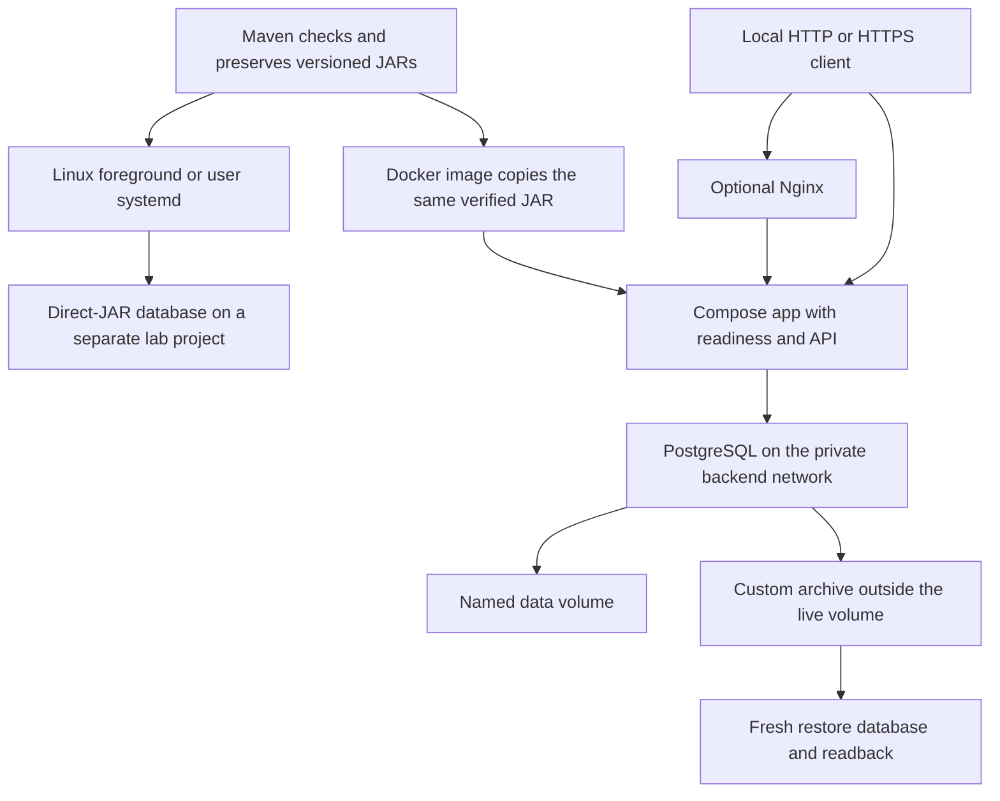

# Deployment Fundamentals — Exercises and Solutions

## How to Use This Document

Read the linked [Theory](Deployment_Theory.md) first. For each exercise, predict the observable result, do the task, then explain what your evidence proves. Consult Part B after trying. Keep **one change per failure drill**, one repeatable probe, and a short record of the release and state before and after.

## Practice Environment Setup

Use Windows 11 PowerShell, Ubuntu through WSL2 or a disposable Linux VM, VS Code, Java 21, Maven, Docker Desktop with Linux containers, and `docker compose`. Use the [practice project setup](Deployment_Theory.md#deploy-setup) for a unique `$DeployRoot`, `$DeployProject`, and `$DeployHostProject`. Save them in your scratch notes so they remain available in each shell. Initial public dependency and image downloads require Internet access.

Create the Deploy Notes source files from the [Theory listings](Deployment_Theory.md#deploy-files), or assemble the project from the contract and compare your result to the reference. For Level 1 host exercises, prepare the [host database and runtime inputs](Deployment_Theory.md#deploy-host) once. Then solve the launch, probes and troubleshooting tasks. Keep host and Compose data independent. Default host ports are `18081` in Ubuntu for the direct JAR and `18080` on Windows for the app container. The optional proxy uses `18082` and `18443`. The direct-JAR DB uses `15452` on the scoped host interface. Pick unused ports and update the matching probes when needed.

PowerShell commands run on Windows and Bash runs in Ubuntu or the VM. In `docker compose exec`, the named service runs the actual command inside its container. Readiness may take several seconds. Inspect the logs and recheck the specified route after startup. Use Postman for the HTTP checks if you prefer URL and raw body entry.

## Safety Rules

- Use these scratch projects, test data and generated local credentials. Keep CapsuleAI and any real databases, endpoints, and tokens out of the exercises.
- Verify the current directory, Docker engine and project before mutation. Bind the app locally and keep the normal Compose database private. The direct-JAR database mapping is only for the verified loopback or dedicated WSL adapter.
- Keep the matched secret and volume together if retaining data. Show only allowed metadata and presence/readability. Avoid full inspect and environment/configuration dumps.
- Stop only the intended JVM, unit, or scoped service. Never use broad prune commands or unverified volume removal.
- TLS trust in the lab is scoped to one client command with a disposable certificate. Production addresses, public certificates and firewall changes are unnecessary.
- Treat cleanup as its own step. `down` removes selected containers and networks. Remove a labeled disposable volume only after choosing to discard those rows.

# Part A — Exercises


## Level 1 — Deployment Foundations

<a id="deploy-ex-01"></a>

### DEPLOY-EX-01 — Package and identify the executable JAR

- **Difficulty.** Level 1
- **Related Theory.** [Part 2 The Complete Deployment Lifecycle](Deployment_Theory.md#deploy-02) · [Part 4 Application Packaging and Release Artifacts](Deployment_Theory.md#deploy-04)
- **Learning objective.** Separate compilation, tests, packaging and release identity.
- **Scenario.** Your IDE starts the app, but the target machine will receive one file.
- **Prerequisites.** Java 21, Maven and Deploy Notes v1 source with V2 outside the migration directory.

**Task.** Package release 1.0.0, inspect the entrypoint layout and build metadata, and record the artifact's hash. Keep this executable file as the deployment input.

**Expected result.** Two tests pass and the JAR contains Boot classes, nested libraries, release metadata and V1.

**Self-check questions**

1. What makes this archive executable?
2. What does its checksum establish?

**Cleanup.** Keep the saved release and remove generated output only in its scratch project if needed.

<a id="deploy-ex-02"></a>

### DEPLOY-EX-02 — Launch from a Linux terminal

- **Difficulty.** Level 1
- **Related Theory.** [Part 5 Running Spring Boot on Linux](Deployment_Theory.md#deploy-05) · [Part 12 Application Configuration During Deployment](Deployment_Theory.md#deploy-12) · [Part 26 End-to-End Deployment Walkthrough](Deployment_Theory.md#deploy-26)
- **Learning objective.** Prove a Linux JVM can run the packaged backend with the intended inputs.
- **Scenario.** The artifact needs to run on Ubuntu outside the IDE.
- **Prerequisites.** Saved JAR, Linux Java 21, direct-JAR lab database, and the prepared host env and secret from Theory.

**Task.** Start the JVM in Ubuntu, confirm the initial profile and migration, and query the release and readiness routes from another Ubuntu tab.

**Expected result.** The release says 1.0.0 and linux-host. Readiness is UP at the expected listener.

**Self-check questions**

1. What launcher supplies config?
2. Why does the database address differ from Compose?

**Cleanup.** Stop the foreground JVM with Ctrl+C. Keep the isolated host database for the next task.

<a id="deploy-ex-03"></a>

### DEPLOY-EX-03 — Find the process and its real listener

- **Difficulty.** Level 1
- **Related Theory.** [Part 5 Running Spring Boot on Linux](Deployment_Theory.md#deploy-05) · [Part 9 Deployment Networking](Deployment_Theory.md#deploy-09) · [Part 19 Deployment Verification](Deployment_Theory.md#deploy-19)
- **Learning objective.** Match OS observations to the process serving the API.
- **Scenario.** A client calls the right address and the wrong port.
- **Prerequisites.** Foreground host deployment and a second Ubuntu tab.

**Task.** Find the actual Java process and listener. Contrast a bounded HTTP probe on the verified port with a probe on an unused port. Record PID, user, bind, and observed release.

**Expected result.** Only the actual listener produces the expected release JSON. The unused endpoint produces a transport error.

**Self-check questions**

1. Why does a PID fail to prove the endpoint?
2. Which tool tells you the bind?

**Cleanup.** Stop the host process if no longer needed.

<a id="deploy-ex-04"></a>

### DEPLOY-EX-04 — Change one nonsecret runtime setting

- **Difficulty.** Level 1
- **Related Theory.** [Part 3 Deployment Environments](Deployment_Theory.md#deploy-03) · [Part 12 Application Configuration During Deployment](Deployment_Theory.md#deploy-12)
- **Learning objective.** Prove an override without creating another artifact.
- **Scenario.** An operator wants a site label for a one-time troubleshooting run.
- **Prerequisites.** Host deployment files and saved artifact hash.

**Task.** Run normally, record the active mode, then relaunch with a nonsecret override of deploy.site. Compare the two effective values and hashes.

**Expected result.** The site changes, and the build version and checksum stay stable.

**Self-check questions**

1. Why do changes in another shell leave a running JVM alone?
2. Which source won?

**Cleanup.** Stop both runs and keep the original env file.

<a id="deploy-ex-05"></a>

### DEPLOY-EX-05 — Observe logs and graceful stop

- **Difficulty.** Level 1
- **Related Theory.** [Part 5 Running Spring Boot on Linux](Deployment_Theory.md#deploy-05) · [Part 16 Application Startup, Shutdown, and Recovery](Deployment_Theory.md#deploy-16) · [Part 18 Logging, Monitoring, and Observability](Deployment_Theory.md#deploy-18)
- **Learning objective.** Use output and exit state to establish the process lifecycle.
- **Scenario.** A terminal exits before a teammate records how Java shut down.
- **Prerequisites.** Prepared host deployment in a disposable location.

**Task.** Capture stdout and stderr to separate files and run a request. Verify the exact JVM before requesting graceful termination. Compare log and port state and record the exit result.

**Expected result.** The log shows startup and graceful shutdown. The verified listener disappears.

**Self-check questions**

1. What prevents you from confusing an old PID with the app?
2. How would KILL affect shutdown?

**Cleanup.** Keep or remove only your two scratch log files.

<a id="deploy-ex-06"></a>

### DEPLOY-EX-06 — Distinguish an archive failure from a Spring startup error

- **Difficulty.** Level 1
- **Related Theory.** [Part 2 The Complete Deployment Lifecycle](Deployment_Theory.md#deploy-02) · [Part 4 Application Packaging and Release Artifacts](Deployment_Theory.md#deploy-04) · [Part 5 Running Spring Boot on Linux](Deployment_Theory.md#deploy-05) · [Part 24 Deployment Troubleshooting](Deployment_Theory.md#deploy-24)
- **Learning objective.** Locate failure before framework or dependency initialization.
- **Scenario.** Someone deployed the original Maven archive instead of the repackaged one.
- **Prerequisites.** Packaged v1 JAR and, when present, target/deploy-notes.jar.original.

**Task.** Try the nonexecutable archive, identify the failing layer, and verify the actual Boot artifact with valid runtime inputs. Save the exact error and exit status.

**Expected result.** The wrong archive fails before Boot logs appear. The verified app launches and responds.

**Self-check questions**

1. Would changing JDBC config resolve a missing manifest entry?
2. What should the release record identify?

**Cleanup.** Stop the verified app and remove a scratch plain archive if you made one.

<a id="deploy-ex-07"></a>

### DEPLOY-EX-07 — Verify an API read, write and rejection

- **Difficulty.** Level 1
- **Related Theory.** [Part 14 PostgreSQL Deployment and Persistence](Deployment_Theory.md#deploy-14) · [Part 19 Deployment Verification](Deployment_Theory.md#deploy-19)
- **Learning objective.** Distinguish readiness from business behavior.
- **Scenario.** A ready status is being treated as complete acceptance evidence.
- **Prerequisites.** A ready Deploy Notes instance on the host or in Compose.

**Task.** Record the version, send a synthetic note, read back the exact ID and text, and deliberately send a blank note. Use curl or Postman.

**Expected result.** Readiness is UP. Valid POST returns 201 and its row. Invalid POST returns 400.

**Self-check questions**

1. Why can a successful HTTP transport still convey failure?
2. Which result proves the migration and write path?

**Cleanup.** Keep the disposable row if you will use it as a persistence marker.

## Level 2 — Practical Deployment

<a id="deploy-ex-08"></a>

### DEPLOY-EX-08 — Stage two Linux releases

- **Difficulty.** Level 2
- **Related Theory.** [Part 3 Deployment Environments](Deployment_Theory.md#deploy-03) · [Part 4 Application Packaging and Release Artifacts](Deployment_Theory.md#deploy-04) · [Part 5 Running Spring Boot on Linux](Deployment_Theory.md#deploy-05) · [Part 20 Application Updates and Release Management](Deployment_Theory.md#deploy-20) · [Part 26 End-to-End Deployment Walkthrough](Deployment_Theory.md#deploy-26)
- **Learning objective.** Separate versioned code, protected config and a selected release.
- **Scenario.** A host should change versions without replacing its database or secret.
- **Prerequisites.** Two packaged artifacts and a prepared host database endpoint.

**Task.** Prepare a private Linux release directory tree, keep the secret outside both release directories, and select v1 with a symlink. Verify the chosen hash and read permissions.

**Expected result.** The selected JAR is accessible by the app user, and the credential file is restrictive.

**Self-check questions**

1. What controls traversal?
2. What can the service reuse across a switch?

**Cleanup.** Keep the tree for systemd. Use a separate clean scope if replaying the setup.

<a id="deploy-ex-09"></a>

### DEPLOY-EX-09 — Supervise the backend with systemd

- **Difficulty.** Level 2
- **Related Theory.** [Part 6 Linux Service Management with systemd](Deployment_Theory.md#deploy-06) · [Part 16 Application Startup, Shutdown, and Recovery](Deployment_Theory.md#deploy-16) · [Part 26 End-to-End Deployment Walkthrough](Deployment_Theory.md#deploy-26)
- **Learning objective.** Operate a user service and verify restart evidence.
- **Scenario.** A service should survive closing the launch terminal during the Linux session.
- **Prerequisites.** Host release layout and an available systemd user manager. Use a disposable VM if absent.

**Task.** Install and verify a disposable unit, start it, confirm readiness, restart intentionally, and observe the changed main PID and log evidence.

**Expected result.** The service uses the expected user and environment and comes back ready after restart.

**Self-check questions**

1. What does Type=exec prove?
2. Why can a WSL user service stop if Windows stops its distro?

**Cleanup.** Stop the unit. Remove only your installed lab unit when finished.

<a id="deploy-ex-10"></a>

### DEPLOY-EX-10 — Build and inspect the deployed image

- **Difficulty.** Level 2
- **Related Theory.** [Part 4 Application Packaging and Release Artifacts](Deployment_Theory.md#deploy-04) · [Part 7 Docker-Based Application Deployment](Deployment_Theory.md#deploy-07) · [Part 13 Secrets and Deployment Security](Deployment_Theory.md#deploy-13) · [Part 26 End-to-End Deployment Walkthrough](Deployment_Theory.md#deploy-26)
- **Learning objective.** Prove what the runtime image contains and how it starts.
- **Scenario.** An operator wants evidence the image contains the tested JAR and a non-root process default.
- **Prerequisites.** Docker Desktop, saved JAR, Dockerfile and scratch project.

**Task.** Build the packaged target with the v1 tag. Inspect identity, entrypoint and user, and compare the JAR hash inside the image. Explain when from-source is suitable.

**Expected result.** The JAR bytes match the saved file and the image records the correct user and launch command.

**Self-check questions**

1. What is included in the builder but absent in the runtime?
2. Why is a tag insufficient as durable identity?

**Cleanup.** Retain the v1 image for Compose and remove only a tagged demo image when done.

<a id="deploy-ex-11"></a>

### DEPLOY-EX-11 — Start a private PostgreSQL dependency

- **Difficulty.** Level 2
- **Related Theory.** [Part 8 Multi-Container Deployment with Docker Compose](Deployment_Theory.md#deploy-08) · [Part 13 Secrets and Deployment Security](Deployment_Theory.md#deploy-13) · [Part 14 PostgreSQL Deployment and Persistence](Deployment_Theory.md#deploy-14)
- **Learning objective.** Distinguish a reachable service from published host access and retained state.
- **Scenario.** The application needs a database, but host clients should not use its port.
- **Prerequisites.** Complete Compose model, unique project and generated full-stack DB password file.

**Task.** Start only the PostgreSQL service. Check its readiness, actual mounted volume and database identity. Confirm it has no published port.

**Expected result.** PostgreSQL is healthy, named storage is attached, and no host mapping exists.

**Self-check questions**

1. What does pg_isready prove?
2. What happens to a role if you edit the password file after initialization?

**Cleanup.** Keep the service for the next exercise or down the scoped project, preserving its data.

<a id="deploy-ex-12"></a>

### DEPLOY-EX-12 — Deploy the full Compose application

- **Difficulty.** Level 2
- **Related Theory.** [Part 7 Docker-Based Application Deployment](Deployment_Theory.md#deploy-07) · [Part 8 Multi-Container Deployment with Docker Compose](Deployment_Theory.md#deploy-08) · [Part 9 Deployment Networking](Deployment_Theory.md#deploy-09) · [Part 14 PostgreSQL Deployment and Persistence](Deployment_Theory.md#deploy-14) · [Part 17 Health Checks and Readiness](Deployment_Theory.md#deploy-17) · [Part 19 Deployment Verification](Deployment_Theory.md#deploy-19)
- **Learning objective.** Connect Java to PostgreSQL through service DNS with verifiable runtime config.
- **Scenario.** The Compose app should use its existing image and internal PostgreSQL endpoint.
- **Prerequisites.** V1 image, database project from Exercise 11, file secret, and a free host app port.

**Task.** Start the full stack. Find the app's internal and external addresses, inspect effective site and app UID, check its secret readability and run a real notes request.

**Expected result.** Version 1.0.0 and profile deploy are visible. The stack is ready and JDBC backs the note access.

**Self-check questions**

1. Who interprets the release selector?
2. Why can the app reach an unpublished database?

**Cleanup.** Keep the scoped lab for persistence, proxy and recovery tasks.

<a id="deploy-ex-13"></a>

### DEPLOY-EX-13 — Prove persistence across container replacement

- **Difficulty.** Level 2
- **Related Theory.** [Part 8 Multi-Container Deployment with Docker Compose](Deployment_Theory.md#deploy-08) · [Part 14 PostgreSQL Deployment and Persistence](Deployment_Theory.md#deploy-14) · [Part 16 Application Startup, Shutdown, and Recovery](Deployment_Theory.md#deploy-16)
- **Learning objective.** Distinguish service identity, container ID, and the data volume.
- **Scenario.** You plan to recreate two services without losing the verification note.
- **Prerequisites.** Working Compose v1 and one known synthetic row.

**Task.** Save the app/DB identities and volume name, restart app, and deliberately recreate the database container. Compare the row and volume afterward.

**Expected result.** The database container ID changes, the same volume remains, and the original row returns.

**Self-check questions**

1. What survives app restart?
2. Why can a new project show an empty DB?

**Cleanup.** Leave the correct lab running or stop it without removing its named volume.

<a id="deploy-ex-14"></a>

### DEPLOY-EX-14 — Observe liveness and readiness during an outage

- **Difficulty.** Level 2
- **Related Theory.** [Part 16 Application Startup, Shutdown, and Recovery](Deployment_Theory.md#deploy-16) · [Part 17 Health Checks and Readiness](Deployment_Theory.md#deploy-17) · [Part 18 Logging, Monitoring, and Observability](Deployment_Theory.md#deploy-18)
- **Learning objective.** Set a probe according to the operational decision it should support.
- **Scenario.** PostgreSQL is briefly unavailable while Java keeps running.
- **Prerequisites.** A healthy Compose instance and a saved note.

**Task.** Stop only the disposable database. Compare liveness, readiness, and app state. Restore the DB and prove readiness and the same row recover.

**Expected result.** The app stays live, readiness becomes 503, and it recovers after PostgreSQL returns.

**Self-check questions**

1. Why would a database check in liveness create poor recovery behavior?
2. Does an unhealthy container restart by itself?

**Cleanup.** Restore PostgreSQL and confirm readiness before continuing.

<a id="deploy-ex-15"></a>

### DEPLOY-EX-15 — Put Nginx in front of the app

- **Difficulty.** Level 2
- **Related Theory.** [Part 9 Deployment Networking](Deployment_Theory.md#deploy-09) · [Part 10 Reverse Proxies](Deployment_Theory.md#deploy-10) · [Part 11 DNS, HTTPS, and TLS](Deployment_Theory.md#deploy-11) · [Part 23 Deployment Security Checklist](Deployment_Theory.md#deploy-23)
- **Learning objective.** Trace the two network hops and verify what is exposed at the edge.
- **Scenario.** A browser should use the proxy for the API. Operational paths need a narrower scope.
- **Prerequisites.** Healthy Compose, optional proxy files and free edge port. For TLS use the certificate lab from Theory.

**Task.** Start the HTTP proxy and trace its upstream. Verify the API and the blocked health path. Optionally enable local TLS and compare a correctly trusted hostname with an IP URL.

**Expected result.** Proxy serves the release endpoint and rejects Actuator. Optional TLS succeeds for localhost when the supplied cert is trusted.

**Self-check questions**

1. Which endpoint terminates TLS?
2. Why should the proxy overwrite forwarded headers?

**Cleanup.** Stop your proxy or leave it for the fault exercise. Remove the optional cert/key only after the proxy stops.

<a id="deploy-ex-16"></a>

### DEPLOY-EX-16 — Update the app and apply an additive migration

- **Difficulty.** Level 2
- **Related Theory.** [Part 15 Database Migrations During Deployment](Deployment_Theory.md#deploy-15) · [Part 19 Deployment Verification](Deployment_Theory.md#deploy-19) · [Part 20 Application Updates and Release Management](Deployment_Theory.md#deploy-20) · [Part 26 End-to-End Deployment Walkthrough](Deployment_Theory.md#deploy-26)
- **Learning objective.** Deploy a new release while preserving compatible data.
- **Scenario.** Version 1.1.0 adds a nullable notes column.
- **Prerequisites.** Running v1, retained v1 and v2 artifacts and images, and a saved note.

**Task.** Change only the app version. Record old and new app/DB identities and examine Flyway history and the API result.

**Expected result.** Version becomes 1.1.0, migrations 1 and 2 are present, DB container stays, and the note survives.

**Self-check questions**

1. Why does restart alone fail to select the new image?
2. Which change makes old code still compatible?

**Cleanup.** Keep both artifacts and your deployment record for the rollback drill.

<a id="deploy-ex-17"></a>

### DEPLOY-EX-17 — Back up and restore into a fresh database

- **Difficulty.** Level 2
- **Related Theory.** [Part 14 PostgreSQL Deployment and Persistence](Deployment_Theory.md#deploy-14) · [Part 21 Rollback and Recovery](Deployment_Theory.md#deploy-21) · [Part 22 Backups and Restore](Deployment_Theory.md#deploy-22)
- **Learning objective.** Prove a logical backup can be recovered without touching the original.
- **Scenario.** The database is persistent, yet you need evidence beyond volume retention.
- **Prerequisites.** Healthy stack, known sample row, and a free disposable restore DB name.

**Task.** Write a custom archive, copy it outside the live volume, verify readability and hash, restore it into a fresh target, and compare rows and migration history.

**Expected result.** The restored database matches recorded data and history. The app still queries the original DB.

**Self-check questions**

1. What does an archive listing prove?
2. What can be lost when restoring an earlier snapshot?

**Cleanup.** Keep the archive private. Drop only the verified disposable restore DB if finished with it.

## Level 3 — Troubleshooting and Recovery

<a id="deploy-ex-18"></a>

### DEPLOY-EX-18 — Separate a wrong port from a bind conflict

- **Difficulty.** Level 3
- **Related Theory.** [Part 5 Running Spring Boot on Linux](Deployment_Theory.md#deploy-05) · [Part 9 Deployment Networking](Deployment_Theory.md#deploy-09) · [Part 16 Application Startup, Shutdown, and Recovery](Deployment_Theory.md#deploy-16) · [Part 24 Deployment Troubleshooting](Deployment_Theory.md#deploy-24)
- **Learning objective.** Separate a caller's mistake from a server that cannot bind.
- **Scenario.** One test reaches an unused port. A second JVM tries to bind the working app's port.
- **Prerequisites.** Running direct-JAR v1 in Ubuntu, verified free comparison port, and the same safe host env.

**Task.** Record the failing client probe. Launch a second test JVM at the occupied bind, observe startup error, and prove that the first app still responds.

**Expected result.** The client error is refusal or no transport, and the second launch reports an address already in use.

**Self-check questions**

1. Which process owns the working port?
2. Why should you leave it running?

**Cleanup.** Stop the second launch if it started on a different port, then the first only when done.

<a id="deploy-ex-19"></a>

### DEPLOY-EX-19 — Diagnose an incorrect PostgreSQL hostname

- **Difficulty.** Level 3
- **Related Theory.** [Part 8 Multi-Container Deployment with Docker Compose](Deployment_Theory.md#deploy-08) · [Part 9 Deployment Networking](Deployment_Theory.md#deploy-09) · [Part 14 PostgreSQL Deployment and Persistence](Deployment_Theory.md#deploy-14) · [Part 15 Database Migrations During Deployment](Deployment_Theory.md#deploy-15) · [Part 24 Deployment Troubleshooting](Deployment_Theory.md#deploy-24)
- **Learning objective.** Find a startup failure when a container points to its own loopback.
- **Scenario.** The database service is healthy while the recreated app exits.
- **Prerequisites.** Known-good Compose version and synthetic row.

**Task.** Introduce an app-only wrong DB hostname. Identify the actual caller and compare logs, state and service DNS. Restore the setting.

**Expected result.** Flyway cannot connect to the wrong endpoint. App-only recovery keeps the original PG container and row.

**Self-check questions**

1. Why does the DB health gate still pass?
2. Which evidence distinguishes bad credentials?

**Cleanup.** Restore the correct endpoint and verify the app is ready.

<a id="deploy-ex-20"></a>

### DEPLOY-EX-20 — Detect a wrong Spring Profile

- **Difficulty.** Level 3
- **Related Theory.** [Part 3 Deployment Environments](Deployment_Theory.md#deploy-03) · [Part 12 Application Configuration During Deployment](Deployment_Theory.md#deploy-12) · [Part 19 Deployment Verification](Deployment_Theory.md#deploy-19)
- **Learning objective.** Catch effective configuration drift despite a running app.
- **Scenario.** The release starts with explicit DB settings but the planned profile was lost.
- **Prerequisites.** Healthy Compose app and known profile expectation.

**Task.** Launch the same image with an unintended profile, compare release output and readiness, then restore the intended mode.

**Expected result.** Readiness can pass while the profile and site fail acceptance. Selecting deploy restores them.

**Self-check questions**

1. Does a profile create infrastructure isolation?
2. What else must be verified?

**Cleanup.** Recreate the app with deploy selected.

<a id="deploy-ex-21"></a>

### DEPLOY-EX-21 — Investigate a failed Flyway migration

- **Difficulty.** Level 3
- **Related Theory.** [Part 15 Database Migrations During Deployment](Deployment_Theory.md#deploy-15) · [Part 16 Application Startup, Shutdown, and Recovery](Deployment_Theory.md#deploy-16) · [Part 21 Rollback and Recovery](Deployment_Theory.md#deploy-21) · [Part 24 Deployment Troubleshooting](Deployment_Theory.md#deploy-24)
- **Learning objective.** Distinguish a SQL migration failure from database reachability.
- **Scenario.** A candidate adds a migration that references a table absent from the disposable schema.
- **Prerequisites.** Healthy lab with v2 schema and saved v2 image. Use only scratch source.

**Task.** Build a throwaway v3 candidate with one intentionally invalid additive migration. Attempt app-only rollout, inspect SQL/migration evidence, and recover the retained image.

**Expected result.** The candidate fails, the transactional migration adds no successful V3 record, and the retained version serves the data.

**Self-check questions**

1. What does the history show?
2. Why should an already-applied migration file stay immutable?

**Cleanup.** Remove only the new disposable fixture and image after it is no longer running.

<a id="deploy-ex-22"></a>

### DEPLOY-EX-22 — Distinguish a restart loop from a probe failure

- **Difficulty.** Level 3
- **Related Theory.** [Part 8 Multi-Container Deployment with Docker Compose](Deployment_Theory.md#deploy-08) · [Part 16 Application Startup, Shutdown, and Recovery](Deployment_Theory.md#deploy-16) · [Part 17 Health Checks and Readiness](Deployment_Theory.md#deploy-17) · [Part 24 Deployment Troubleshooting](Deployment_Theory.md#deploy-24)
- **Learning objective.** Separate a process exit from a healthy JVM that fails a configured probe.
- **Scenario.** One change points a health check at a missing route. Another provides a nonnumeric server port.
- **Prerequisites.** Working lab, Compose override knowledge and a scratch override file.

**Task.** Test each override independently. Record actual API response, health state and restarts. Remove both overrides and verify recovery.

**Expected result.** A wrong probe can mark a live app unhealthy. An invalid bind value makes Java exit and can trigger retries.

**Self-check questions**

1. Would restarting automatically fix bad config or a bad probe?
2. What output reveals the first fault?

**Cleanup.** Apply the base model once, verify readiness, then remove your scratch override.

<a id="deploy-ex-23"></a>

### DEPLOY-EX-23 — Diagnose a reverse proxy 502

- **Difficulty.** Level 3
- **Related Theory.** [Part 9 Deployment Networking](Deployment_Theory.md#deploy-09) · [Part 10 Reverse Proxies](Deployment_Theory.md#deploy-10) · [Part 19 Deployment Verification](Deployment_Theory.md#deploy-19) · [Part 24 Deployment Troubleshooting](Deployment_Theory.md#deploy-24)
- **Learning objective.** Locate a failed upstream after the edge accepts a request.
- **Scenario.** The edge still answers clients while the backend service stops.
- **Prerequisites.** HTTP proxy already serving the lab API and healthy app at the start.

**Task.** Stop only the app in the lab. Compare the proxy's status with direct app access and logs. Start the app and prove the proxy can route again.

**Expected result.** Proxy returns 502 while the upstream is unavailable and returns the release after recovery.

**Self-check questions**

1. Why is 502 different from a client-side connection refusal?
2. How can upstream DNS change after recreation?

**Cleanup.** Restore the app. Stop the optional proxy when done.

<a id="deploy-ex-24"></a>

### DEPLOY-EX-24 — Diagnose a required secret without revealing it

- **Difficulty.** Level 3
- **Related Theory.** [Part 5 Running Spring Boot on Linux](Deployment_Theory.md#deploy-05) · [Part 12 Application Configuration During Deployment](Deployment_Theory.md#deploy-12) · [Part 13 Secrets and Deployment Security](Deployment_Theory.md#deploy-13) · [Part 24 Deployment Troubleshooting](Deployment_Theory.md#deploy-24)
- **Learning objective.** Distinguish an absent secret key from a missing mount directory or a login failure.
- **Scenario.** A host launch has a valid JDBC URL and account but no password entry in the config tree.
- **Prerequisites.** Prepared direct Ubuntu host lab, classpath JAR and a fresh empty secrets test directory.

**Task.** Override the config-tree directory only for one isolated launch using an empty directory. Observe the safe key-name diagnostic and nonzero exit. Then use the original directory again.

**Expected result.** The process fails before datasource initialization and never prints the secret. The verified original configuration works.

**Self-check questions**

1. Why is a readable directory insufficient?
2. How does starting with an empty value differ from wrong credentials?

**Cleanup.** Remove only the empty test directory and leave the real lab secret untouched.

<a id="deploy-ex-25"></a>

### DEPLOY-EX-25 — Find missing data and test separated recovery

- **Difficulty.** Level 3
- **Related Theory.** [Part 8 Multi-Container Deployment with Docker Compose](Deployment_Theory.md#deploy-08) · [Part 14 PostgreSQL Deployment and Persistence](Deployment_Theory.md#deploy-14) · [Part 21 Rollback and Recovery](Deployment_Theory.md#deploy-21) · [Part 22 Backups and Restore](Deployment_Theory.md#deploy-22) · [Part 24 Deployment Troubleshooting](Deployment_Theory.md#deploy-24)
- **Learning objective.** Locate the expected volume before considering restore.
- **Scenario.** Using a different Compose project name makes a table or row appear to vanish.
- **Prerequisites.** Known-good lab project, saved archive, and fresh recovery project or restore DB.

**Task.** Start only a new disposable DB under a new project and confirm its fresh volume. Compare the original project, then restore the archive into a distinct DB and verify rows.

**Expected result.** The first project's data remains intact. A different project creates a different volume and restoring elsewhere reproduces the archive snapshot.

**Self-check questions**

1. Why is a fresh volume different from lost data?
2. How would you verify the chosen recovery point after actual loss?

**Cleanup.** Remove only the temporary project and chosen restore resources, preserving the original.

<a id="deploy-ex-26"></a>

### DEPLOY-EX-26 — Explain a release mismatch and recover

- **Difficulty.** Level 3
- **Related Theory.** [Part 4 Application Packaging and Release Artifacts](Deployment_Theory.md#deploy-04) · [Part 19 Deployment Verification](Deployment_Theory.md#deploy-19) · [Part 20 Application Updates and Release Management](Deployment_Theory.md#deploy-20) · [Part 21 Rollback and Recovery](Deployment_Theory.md#deploy-21) · [Part 26 End-to-End Deployment Walkthrough](Deployment_Theory.md#deploy-26)
- **Learning objective.** Prove what serves requests before and after a failed update.
- **Scenario.** The deployment record expects v2, but the endpoint responds v1. During repair a bad hostname is introduced.
- **Prerequisites.** V1 and v2 saved, migrated schema and a known row.

**Task.** Inspect tag, image ID and build metadata. Correct the selection and then reproduce a failed v2 runtime input. Choose the compatible known-good release, keep the schema and confirm recovery.

**Expected result.** Wrong identity is detected even if health passes. Rollback restores v1 with migration 2 and the same row.

**Self-check questions**

1. Why does correcting a tag alone fail?
2. What would rule out a safe app rollback?

**Cleanup.** Restore the recorded good app and leave PostgreSQL data intact until the capstone cleanup.

<a id="deploy-project"></a>

## Final Capstone — Deploy and Operate a Spring Boot Backend

**Project.** Deploy and Operate a Spring Boot + PostgreSQL Backend

- **Difficulty.** Integrated project
- **Related Theory.** [Part 26 dual deployment](Deployment_Theory.md#deploy-26) · [Part 22 backup and restore](Deployment_Theory.md#deploy-22) · [Part 24 diagnosis](Deployment_Theory.md#deploy-24)
- **Learning objective.** Release, operate, update and recover one small independently deployed service.
- **Scenario.** A developer hands you a Java artifact and requirements for runtime inputs, availability, and data retention. You own both the release evidence and a safe recovery.
- **Prerequisites.** Java 21, Maven, Ubuntu and Docker Desktop, independent scratch inputs, and the skills from Levels 1–3.

**Task.** Build an API with read/write notes, safe release evidence, Flyway and separate readiness. Package a v1 and an additive v2. Provide a direct Linux launcher and a user unit where supported. Run the JVM, inspect its process, listener, logs, profile and dependency. Then build a non-root app image and deploy it with a private PostgreSQL dependency on a named volume. Show acceptance, restart and persistence. Deploy v2 and introduce one config or networking fault. Recover the compatible known-good v1, preserving the database. Create an independent logical archive, restore it into a separate disposable DB and verify the contents. Close the lab with scoped cleanup.

**Expected result.** Record the following evidence in your private scratch notes.

1. Two executable JARs with known versions and hashes. The v1 host and container use the same bytes.
2. Verified direct process, identity, config and log destination. A service start and restart where a user manager is available.
3. Healthy Compose app and private PostgreSQL, successful migration, real API write/read and a controlled app restart.
4. Known row after database recreation. A new app version and migration history without replacing the database for an app-only update.
5. Failure-layer diagnosis and successful recovery of the known-good application. Confirm that the schema state and existing row remain.
6. Custom-format backup copied outside the live volume. Fresh restore target with expected data and schema history.
7. Scope and disposition of the stopped processes, project, mounts, images, archive and temporary passwords.

**Self-check questions**

1. What evidence tells you which artifact, runtime profile and database are actually in use?
2. How does a running process differ from readiness and a successful note write?
3. What justifies the app rollback after migration V2? What would make another release unsafe to roll back?
4. Why does container recreation preserve this DB, and which other evidence proves recoverability?

**Cleanup.** Stop host and Compose services. Keep or discard only the named lab data after checking who owns it. Keep volume and credential paired when retaining the data. Protect retained backup evidence.


# Part B — Complete Solutions

Use the [complete reference files](#deploy-files) in an independent scratch project. Start each command in the indicated environment. Keep `$DeployProject` and `$DeployBase` from the intended run. Follow the lab's actual port if you changed it. Stop foreground instances before launching another on the same listener unless the exercise intentionally tests a collision.

<a id="deploy-solution-01"></a>

## Solution — DEPLOY-EX-01

[Return to exercise](#deploy-ex-01)

From the reference project with V2 still outside `src/main/resources/db/migration/`, use Windows PowerShell.

```powershell
mvn.cmd -B -ntp '-Drevision=1.0.0' clean package
if ($LASTEXITCODE) { throw 'Build failed' }
jar tf .\target\deploy-notes.jar | Select-String 'BOOT-INF/lib|build-info.properties|V1__create_notes.sql'
New-Item -ItemType Directory -Path .\releases -Force | Out-Null
Copy-Item -LiteralPath .\target\deploy-notes.jar -Destination .\releases\deploy-notes-1.0.0.jar
Get-FileHash -LiteralPath .\releases\deploy-notes-1.0.0.jar -Algorithm SHA256
```

`clean` removes generated target files. `package` compiles, tests, builds and repackages. Check two passing tests and `BUILD SUCCESS`. The Boot plugin includes its launcher and nested dependency archives in the executable JAR. Build-info supplies version identity and the checksum compares saved bytes. The checksum is useful with a trusted expected value. Include both in the release record. A plain `.jar.original` lacks the Boot layout. If using the Wrapper from a trusted project, equivalent flags work. Keep the release. Maven clean affects generated output inside this scratch project.

<a id="deploy-solution-02"></a>

## Solution — DEPLOY-EX-02

[Return to exercise](#deploy-ex-02)

Prepare the database and host paths in [the direct lab](#deploy-host), then launch in Ubuntu Bash.

```bash
cd "$HOME/deployment-learning-lab/host" || exit 1
(
    set -a
    . ./app.env
    set +a
    exec /usr/bin/java -jar ./current/deploy-notes.jar
)
```

Probe the service in a second Ubuntu tab.

```bash
curl --noproxy '*' -fsS http://127.0.0.1:18081/api/release
curl --noproxy '*' -fsS http://127.0.0.1:18081/actuator/health/readiness
```

The foreground shell exports `app.env`. Its config-tree path supplies the file password. Flyway connects to the host lab DB and applies V1 on an empty database. The result reports version `1.0.0`, `linux-host` and `UP` when startup completes. This caller lives in Ubuntu. It uses the verified Ubuntu-local or Windows WSL adapter route to PostgreSQL. The Docker service name applies inside the other Compose project. In Windows Docker Desktop, its loopback and Ubuntu's are separate scopes. Stop the JVM with Ctrl+C and keep the host database for later use.

<a id="deploy-solution-03"></a>

## Solution — DEPLOY-EX-03

[Return to exercise](#deploy-ex-03)

With the host app running, observe it from the second Ubuntu terminal.

```bash
ss -ltnp 'sport = :18081'
ps -eo pid,user,args | grep '[d]eploy-notes.jar'
ss -ltn 'sport = :18083'
curl --noproxy '*' --connect-timeout 2 --max-time 4 -i http://127.0.0.1:18081/api/release
# Run this last probe only if 18083 has no listener.
curl --noproxy '*' --connect-timeout 2 --max-time 4 -i http://127.0.0.1:18083/api/release
```

The intended listener shows the local address and port, and may show PID details for your own process. `ss` answers the bind question while `ps` shows execution and identity. A JVM can exist before it opens the socket. The bounded unused-port probe commonly fails with curl code `7` and no HTTP response. The good port returns a version. In PowerShell `Get-NetTCPConnection` describes Windows sockets. Look at the server's real namespace before interpreting the result. Stop your host app when done.

<a id="deploy-solution-04"></a>

## Solution — DEPLOY-EX-04

[Return to exercise](#deploy-ex-04)

In Ubuntu Bash, one foreground run at a time. Query `/api/release` on port `18081` in a second tab and stop each launch with Ctrl+C.

```bash
cd "$HOME/deployment-learning-lab/host" || exit 1
sha256sum ./current/deploy-notes.jar
(
    set -a
    . ./app.env
    set +a
    exec /usr/bin/java -jar ./current/deploy-notes.jar
)
(
    set -a
    . ./app.env
    set +a
    exec /usr/bin/java -jar ./current/deploy-notes.jar --deploy.site=review
)
sha256sum ./current/deploy-notes.jar
```

The replies show `linux-host` and then `review`, with the same `1.0.0` version if v1 is selected. The application argument wins over the profile file. The hash stays the same because the launcher supplies different config to the same file. Already running children keep the environment supplied at launch. `-Ddeploy.site=review` before `-jar` is another supported source, with its own precedence. Keep the original env file. Stop the second process.

<a id="deploy-solution-05"></a>

## Solution — DEPLOY-EX-05

[Return to exercise](#deploy-ex-05)

Run in one Ubuntu tab after stopping any prior app on the port.

```bash
cd "$HOME/deployment-learning-lab/host" || exit 1
(
    set -a
    . ./app.env
    set +a
    exec /usr/bin/java -jar ./current/deploy-notes.jar
) > exercise-05.out 2> exercise-05.err &
DeployLabPid=$!
ps -p "$DeployLabPid" -o pid,ppid,user,args
```

After startup, check the actual release and `tail -n 25 exercise-05.out exercise-05.err`. Return to the same tab. Request TERM only when the PID, command and owner still identify this lab JVM.

```bash
ps -p "$DeployLabPid" -o pid,ppid,user,args
kill -TERM "$DeployLabPid"
wait "$DeployLabPid"
DeployLabStatus=$?
printf 'exit=%s\n' "$DeployLabStatus"
tail -n 25 exercise-05.out exercise-05.err
ss -ltn 'sport = :18081'
```

The subshell replaces itself with Java. `wait` collects the status of that actual child. TERM commonly yields `143` for this JVM and a graceful shutdown log. KILL would prevent the JVM's cleanup handlers. Process identity can change, so review it immediately before signaling. Spring normally routes console logs to stdout, and separate capture keeps launcher stderr observable. If systemd owns the process, stop the unit and inspect its journal. Remove only the two lab logs when finished.

<a id="deploy-solution-06"></a>

## Solution — DEPLOY-EX-06

[Return to exercise](#deploy-ex-06)

Inspect the archive from the Windows project directory.

```powershell
jar tf .\target\deploy-notes.jar.original | Select-String 'META-INF|BOOT-INF'
java -jar .\target\deploy-notes.jar.original
$LASTEXITCODE
```

The original archive typically shows a manifest with no executable entry point. If it is absent, create a guaranteed plain disposable archive with `'demo' | Set-Content -LiteralPath .\plain-marker.txt` and `jar --create --file .\plain.jar .\plain-marker.txt`, then run `java -jar .\plain.jar` and capture the status. The failure originates in the Java launcher, typically `no main manifest attribute`. No JDBC setting can resolve that error.

Run the saved executable JAR using [Solution 02](#deploy-solution-02). Its Boot launcher gets far enough to verify config, migrations and HTTP. The release record should identify the repackaged archive and its checksum, not the source POM alone. Stop that JVM, and remove only the fallback marker and plain archive if created.

<a id="deploy-solution-07"></a>

## Solution — DEPLOY-EX-07

[Return to exercise](#deploy-ex-07)

On the Ubuntu host, send these requests when the lab is ready.

```bash
base=http://127.0.0.1:18081
curl --noproxy '*' -fsS "$base/api/release"
curl --noproxy '*' -fsS "$base/actuator/health/readiness"
curl --noproxy '*' -i -H 'Content-Type: application/json' -d '{"text":"workbook accept"}' "$base/api/notes"
curl --noproxy '*' -fsS "$base/api/notes"
curl --noproxy '*' -i -H 'Content-Type: application/json' -d '{"text":""}' "$base/api/notes"
```

`-i` shows the response status and headers along with the body. Expect `201` and an assigned ID for the write, a GET containing the same text and ID, and `400` for a blank note. A successful request transfer can still carry application rejection. The post/readback proves the migrated schema and permitted DB operation for that request. Use the same raw JSON in Postman, or `Invoke-RestMethod` in PowerShell for a Compose service. Keep the note in the disposable DB for later verification.

<a id="deploy-solution-08"></a>

## Solution — DEPLOY-EX-08

[Return to exercise](#deploy-ex-08)

Use the [complete host provisioning commands](#deploy-host) on a fresh practice tree with both saved JARs, the correct host DB address, and its matching dummy password. The snippet below checks the files it creates. Run in Ubuntu Bash.

```bash
cd "$HOME/deployment-learning-lab/host" || exit 1
readlink current
stat -c '%A %a %U:%G %n' . ./secrets ./secrets/spring.datasource.password
test -r ./current/deploy-notes.jar && test -r ./secrets/spring.datasource.password
sha256sum ./current/deploy-notes.jar ./releases/1.0.0/deploy-notes.jar
```

`readlink` should report `releases/1.0.0`. The hashes agree, and the credential is owned by the app user with mode `600`. Each directory requires traversal access, and file read access is separate. The runtime can retain the secret location, profile, host DB and logs across the code switch. On a server where you administer a different identity, test readability for that identity and the exact path. Avoid copying the password into versioned releases. Keep the layout for systemd. Do not run the creation step over an unrelated tree.

<a id="deploy-solution-09"></a>

## Solution — DEPLOY-EX-09

[Return to exercise](#deploy-ex-09)

In Ubuntu Bash, set `ProjectSource` to the copied lab sources and stop any foreground instance on the same port before installing the unit.

```bash
systemctl --user is-system-running
UnitPath="$HOME/.config/systemd/user/deploy-notes-lab.service"
test ! -e "$UnitPath" && test ! -L "$UnitPath" || exit 1
mkdir -p -- "$HOME/.config/systemd/user"
install -m 644 -- "$ProjectSource/deploy-notes-lab.service" "$UnitPath"
systemd-analyze --user verify "$UnitPath" || exit 1
systemctl --user daemon-reload
systemctl --user start deploy-notes-lab.service
systemctl --user show -p MainPID -p NRestarts deploy-notes-lab.service
```

After readiness, request the same release URL, then restart and repeat.

```bash
curl --noproxy '*' -fsS http://127.0.0.1:18081/actuator/health/readiness
systemctl --user restart deploy-notes-lab.service
systemctl --user show -p MainPID -p NRestarts deploy-notes-lab.service
journalctl --user -u deploy-notes-lab.service -n 35 --no-pager
```

The [unit](#deploy-unit) starts Java with its stored context. `Type=exec` provides execution evidence. It does not wait for migrations and acceptance. An intentional restart changes PID and should produce a shutdown and startup sequence. `NRestarts` tracks automatic restarts and need not increment on manual restart. WSL's environment survives only while its Windows-managed lifecycle permits it. If a user manager is unavailable, use the foreground example or a disposable VM. Stop the lab unit and, if finished, remove the exact unit file and reload. Database state persists.

<a id="deploy-solution-10"></a>

## Solution — DEPLOY-EX-10

[Return to exercise](#deploy-ex-10)

From Windows PowerShell in the project. Use the verified v1 artifact, and retain the matching release-specific tag.

```powershell
Copy-Item -LiteralPath .\releases\deploy-notes-1.0.0.jar -Destination .\target\deploy-notes.jar
docker build --target packaged -t "${DeployProject}-notes:1.0.0" .
if ($LASTEXITCODE) { throw 'Image build failed' }
docker image inspect "${DeployProject}-notes:1.0.0" --format '{{.Id}} {{.Config.User}} {{json .Config.Entrypoint}}'
docker run --rm --network none --entrypoint sha256sum "${DeployProject}-notes:1.0.0" /app/app.jar
Get-FileHash -LiteralPath .\releases\deploy-notes-1.0.0.jar -Algorithm SHA256
```

Compare the hash ignoring hex case. The saved JAR is copied into the Java 21 runtime. `USER` supplies `10001:10001` and the exec-form entrypoint runs Java. A compiler and Maven live only in the source builder. Use the `from-source` target when the build pipeline should compile in Docker, and identify the result separately. A mutable tag cannot prove exact identity. Reading the image ID and JAR hash provides separate evidence. Use the tested image in the next lab and remove only additionally built lab tags when done.

<a id="deploy-solution-11"></a>

## Solution — DEPLOY-EX-11

[Return to exercise](#deploy-ex-11)

After generating the separate full-stack secret, use Windows PowerShell from `$DeployRoot`.

```powershell
docker compose -p $DeployProject config --quiet
docker compose -p $DeployProject up -d --wait --wait-timeout 60 postgres
docker compose -p $DeployProject ps postgres
$PostgresId = docker compose -p $DeployProject ps -q postgres
docker inspect --format '{{range .Mounts}}{{println .Name .Destination}}{{end}}' $PostgresId
docker compose -p $DeployProject port postgres 5432
docker compose -p $DeployProject exec -T postgres psql -X -U deploylab -d deploynotes -c 'select current_database();'
```

The DB is healthy, includes a `pg-data` volume at the PostgreSQL 17 data directory, and gives no published mapping. A request for the absent port mapping can return an error. `pg_isready` checks the server's acceptance state. The local query proves a different path from the app's TCP login. Changing the password file after first initialization does not change the stored DB role. Keep the matched file and data together. Start only PostgreSQL in this exercise. Stop it or leave it for the next task while preserving the verified volume.

<a id="deploy-solution-12"></a>

## Solution — DEPLOY-EX-12

[Return to exercise](#deploy-ex-12)

Run from the desktop project with the v1 image and matching database secret.

```powershell
$env:DEPLOY_RELEASE = '1.0.0'
$env:DEPLOY_PROFILE = 'deploy'
$env:DEPLOY_DB_HOST = 'postgres'
$env:DEPLOY_APP_PORT = '18080'
$DeployBase = 'http://127.0.0.1:18080'
docker compose -p $DeployProject up -d --wait --wait-timeout 90
docker compose -p $DeployProject port app 8080
docker compose -p $DeployProject exec -T app id
docker compose -p $DeployProject exec -T app sh -c 'test -r /run/secrets/spring.datasource.password'
$LASTEXITCODE
curl.exe --noproxy '*' -fsS "$DeployBase/api/release"
curl.exe --noproxy '*' -fsS "$DeployBase/actuator/health/readiness"
Invoke-RestMethod -Uri "$DeployBase/api/notes"
```

The app's local HTTP port is `8080` and the host mapping uses `18080`. The effective deployment reports v1, `deploy` and `compose`. The secret probe exits `0` without printing the file. Compose substitutes the release selector and config; the app receives its JDBC URL and resolves the DB name inside the backend network. The internal port needs no host mapping. A GET using the actual table confirms migration, and a successful [write/readback](#deploy-solution-07) additionally proves write privileges. Leave the stack associated with its project for persistence tests. Use scoped `down` if pausing the lab.


<a id="deploy-solution-13"></a>

## Solution — DEPLOY-EX-13

[Return to exercise](#deploy-ex-13)

Use the same project and a known note in Windows PowerShell.

```powershell
$OldApp = docker compose -p $DeployProject ps -q app
$OldDb = docker compose -p $DeployProject ps -q postgres
docker compose -p $DeployProject restart app
$OldApp -ceq (docker compose -p $DeployProject ps -q app)
docker compose -p $DeployProject up -d --no-deps --force-recreate --wait --wait-timeout 60 postgres
$OldDb -cne (docker compose -p $DeployProject ps -q postgres)
docker volume ls --filter "label=com.docker.compose.project=$DeployProject"
```

Wait for app readiness and read `Invoke-RestMethod "$DeployBase/api/notes"`. The app restart reuses the existing container, configuration and attached state. The DB recreation replaces its container while mounting the same named data. The original note persists. A different project name normally selects a differently named volume and would initialize different data. Compare the original ID/text and volume before and after. A restart can lose active requests, so use this only in the disposable lab. Leave the DB volume in place.

<a id="deploy-solution-14"></a>

## Solution — DEPLOY-EX-14

[Return to exercise](#deploy-ex-14)

Run in PowerShell with a note already recorded.

```powershell
docker compose -p $DeployProject stop postgres
curl.exe --noproxy '*' -i --max-time 8 "$DeployBase/actuator/health/liveness"
curl.exe --noproxy '*' -i --max-time 8 "$DeployBase/actuator/health/readiness"
docker compose -p $DeployProject ps -a
docker compose -p $DeployProject up -d --wait --wait-timeout 60 postgres
```

Retry the outage probes briefly if health has not yet reflected the stopped database. Liveness stays `200`, readiness gives `503`, and Java can remain alive. Its readiness group includes DB connectivity and its liveness group concerns local state. A required shared DB in liveness could cause all healthy JVMs to restart during a DB outage. Docker's restart policy reacts to process exits. An unhealthy probe alone is not a process exit. After restoring PostgreSQL wait for readiness and GET your saved note. If recovery delays, inspect pool and server logs before deciding whether an app restart is needed.

<a id="deploy-solution-15"></a>

## Solution — DEPLOY-EX-15

[Return to exercise](#deploy-ex-15)

Select a healthy app and start the proxy with the base Compose files in Windows PowerShell.

```powershell
docker compose -p $DeployProject --profile edge up -d proxy
docker compose -p $DeployProject exec -T proxy nginx -t
curl.exe --noproxy '*' -i http://127.0.0.1:18082/api/release
curl.exe --noproxy '*' -i http://127.0.0.1:18082/actuator/health
docker compose -p $DeployProject logs --tail 20 proxy
```

Expect `200` plus a request ID for the release endpoint and `404` for Actuator via the proxy. Nginx receives client traffic and forwards the API request to `app:8080` on the edge network. The [route config](#deploy-proxy) overwrites forwarded headers so downstream logs and permission logic do not trust spoofed client values. This lab leaves those headers unused by Spring. Optional TLS instructions and complete override files are in [the reference TLS lab](#deploy-tls). Its Nginx endpoint terminates HTTPS and uses HTTP to the app across the private network.

Stop `proxy` with `docker compose -p $DeployProject --profile edge stop proxy` or include both TLS model files when you used them. Keep the private key in the isolated lab until the TLS instance stops, then remove or retain the exact scratch files deliberately.

<a id="deploy-solution-16"></a>

## Solution — DEPLOY-EX-16

[Return to exercise](#deploy-ex-16)

Build both releases and images using [the reference build steps](#deploy-build-images). Start with v1 ready before changing the release in Windows PowerShell.

```powershell
$PreviousApp = docker compose -p $DeployProject ps -q app
$PreviousDb = docker compose -p $DeployProject ps -q postgres
$env:DEPLOY_RELEASE = '1.1.0'
docker compose -p $DeployProject up -d --no-deps --force-recreate --wait --wait-timeout 90 app
if ($LASTEXITCODE) { throw 'Inspect startup before accepting the release.' }
$PreviousApp -cne (docker compose -p $DeployProject ps -q app)
$PreviousDb -ceq (docker compose -p $DeployProject ps -q postgres)
curl.exe --noproxy '*' -fsS "$DeployBase/api/release"
Invoke-RestMethod "$DeployBase/api/notes"
docker compose -p $DeployProject exec -T postgres psql -X -v ON_ERROR_STOP=1 -U deploylab -d deploynotes -c 'select version, success from flyway_schema_history order by installed_rank;'
```

Both identity comparisons should be `True`. The app reports `1.1.0` and the DB shows successful V1 and V2. Flyway adds a nullable column and both app versions use explicit existing columns. A restart of the old container keeps its image. The selected Compose replacement uses a new image and reaches readiness after migration. A single app can be unavailable during replacement. Keep v1 and v2 and record the evidence. Keep the known row and volume for the recovery drill.

<a id="deploy-solution-17"></a>

## Solution — DEPLOY-EX-17

[Return to exercise](#deploy-ex-17)

Run from the scratch Compose project with a known note. A custom archive made inside the PostgreSQL container can be transferred byte-for-byte using `compose cp`.

```powershell
New-Item -ItemType Directory -Path .\backups -Force | Out-Null
if (Test-Path -LiteralPath .\backups\deploynotes.dump) {
    throw 'Keep the earlier archive and choose a fresh filename for this run.'
}
docker compose -p $DeployProject exec -T postgres pg_dump -U deploylab -d deploynotes -Fc -f /tmp/deploynotes.dump
if ($LASTEXITCODE) { throw 'pg_dump failed' }
docker compose -p $DeployProject exec -T postgres pg_restore --list /tmp/deploynotes.dump
if ($LASTEXITCODE) { throw 'Archive listing failed' }
docker compose -p $DeployProject cp postgres:/tmp/deploynotes.dump .\backups\deploynotes.dump
if ($LASTEXITCODE) { throw 'Copy failed' }
Get-FileHash -LiteralPath .\backups\deploynotes.dump -Algorithm SHA256
docker compose -p $DeployProject exec -T postgres rm -- /tmp/deploynotes.dump
```

Use a new target database for restoration.

```powershell
docker compose -p $DeployProject cp .\backups\deploynotes.dump postgres:/tmp/deploynotes-restore.dump
if ($LASTEXITCODE) { throw 'Copy to PostgreSQL container failed' }
docker compose -p $DeployProject exec -T postgres createdb -T template0 -U deploylab deploynotes_restore
if ($LASTEXITCODE) { throw 'Restore database creation failed. Use a fresh target.' }
docker compose -p $DeployProject exec -T postgres pg_restore --exit-on-error --no-owner --no-privileges -U deploylab -d deploynotes_restore /tmp/deploynotes-restore.dump
if ($LASTEXITCODE) { throw 'Restore failed. Inspect this disposable target.' }
docker compose -p $DeployProject exec -T postgres psql -X -v ON_ERROR_STOP=1 -U deploylab -d deploynotes_restore -c 'select id, body from notes order by id;'
docker compose -p $DeployProject exec -T postgres psql -X -v ON_ERROR_STOP=1 -U deploylab -d deploynotes_restore -c 'select version, success from flyway_schema_history order by installed_rank;'
docker compose -p $DeployProject exec -T postgres rm -- /tmp/deploynotes-restore.dump
```

The listing validates archive structure. The restored rows and Flyway history prove a usable result from the snapshot. The source continues to accept traffic through its original DB name. A restored database lacks writes that committed after the dump snapshot unless you have a later recovery method. Protect the archive and record the snapshot and restore time. Copying active data files or keeping a volume cannot substitute for this restore test. If you have finished with `deploynotes_restore` and confirmed the exact project and DB, remove only that DB with `docker compose -p $DeployProject exec -T postgres dropdb -U deploylab deploynotes_restore`. The capstone can also keep it until volume cleanup.

<a id="deploy-solution-18"></a>

## Solution — DEPLOY-EX-18

[Return to exercise](#deploy-ex-18)

Leave the original Ubuntu host instance running and test from a second tab.

```bash
ss -ltnp 'sport = :18081'
ss -ltn 'sport = :18083'
# Only when 18083 has no listener
curl --noproxy '*' --connect-timeout 2 --max-time 4 -i http://127.0.0.1:18083/api/release
curl --noproxy '*' -fsS http://127.0.0.1:18081/api/release
cd "$HOME/deployment-learning-lab/host" || exit 1
(
    set -a
    . ./app.env
    set +a
    exec /usr/bin/java -jar ./current/deploy-notes.jar --server.port=18081
)
printf 'second launch exit=%s\n' "$?"
```

The unused port normally refuses the caller while the correct port still returns a release. The second JVM attempts the same bind and exits with a nonzero status and a bind failure. A PID from `ss` identifies the first process. Keep it running because it is the verified service and the intended conflict. If using an alternate port, update both requests and override. Scope the lab to an ordinary launch and same schema so it can reach the bind stage. Stop any unexpectedly started test JVM with Ctrl+C. No file change is required.

<a id="deploy-solution-19"></a>

## Solution — DEPLOY-EX-19

[Return to exercise](#deploy-ex-19)

From a working Windows PowerShell lab, record the good app release and DB ID. Apply the faulty hostname to the app service.

```powershell
$BeforeDb = docker compose -p $DeployProject ps -q postgres
$env:DEPLOY_DB_HOST = 'localhost'
docker compose -p $DeployProject up -d --no-deps --force-recreate app
docker compose -p $DeployProject ps -a
docker compose -p $DeployProject logs --tail 55 app
docker compose -p $DeployProject exec -T postgres pg_isready -h 127.0.0.1 -U deploylab -d deploynotes
```

Wait for the JDBC error. The app tried its own namespace at `localhost:5432`. Postgres checks loopback from its own namespace and can be healthy throughout. Connection refusal happens before valid login. A password rejection proves a database reached the login step. Recreate the app with the correct database endpoint.

```powershell
$env:DEPLOY_DB_HOST = 'postgres'
docker compose -p $DeployProject up -d --no-deps --force-recreate --wait --wait-timeout 90 app
docker compose -p $DeployProject exec -T app getent hosts postgres
$BeforeDb -ceq (docker compose -p $DeployProject ps -q postgres)
Invoke-RestMethod "$DeployBase/api/notes"
```

Name resolution and the real note confirm recovery. Keep the DB ID and volume, and restore the original host override if it was a deliberate lab setting. A plain restart reuses the bad settings, so replace only the affected app container.

<a id="deploy-solution-20"></a>

## Solution — DEPLOY-EX-20

[Return to exercise](#deploy-ex-20)

Change only the profile in Windows PowerShell using the recorded image and DB settings.

```powershell
$env:DEPLOY_PROFILE = 'wrong-lab-profile'
docker compose -p $DeployProject up -d --no-deps --force-recreate --wait --wait-timeout 90 app
curl.exe --noproxy '*' -fsS "$DeployBase/api/release"
curl.exe --noproxy '*' -fsS "$DeployBase/actuator/health/readiness"
$env:DEPLOY_PROFILE = 'deploy'
docker compose -p $DeployProject up -d --no-deps --force-recreate --wait --wait-timeout 90 app
curl.exe --noproxy '*' -fsS "$DeployBase/api/release"
```

The unwanted profile is visible and site falls back to `unselected`. It can still satisfy readiness because explicit DB settings are valid. The correct profile sets `compose`. Profile selection only chooses config and beans. Verify the actual database, credentials and network boundaries separately. Using the right artifact is also a separate gate. The last commands restore the intended profile and runtime.

<a id="deploy-solution-21"></a>

## Solution — DEPLOY-EX-21

[Return to exercise](#deploy-ex-21)

In a scratch source tree that contains V1 and V2, create `src/main/resources/db/migration/V3__failing_deploy_lab.sql` with this intentionally invalid statement. The fixture refers to a nonexistent lab table.

```sql
ALTER TABLE deploy_missing ADD COLUMN marker integer;
```

Build the test image and attempt an app-only rollout in Windows PowerShell against the established lab.

```powershell
mvn.cmd -B -ntp '-Drevision=1.2.0-fault' clean package
if ($LASTEXITCODE) { throw 'Candidate packaging failed' }
docker build --target packaged -t "${DeployProject}-notes:1.2.0-fault" .
if ($LASTEXITCODE) { throw 'Candidate image build failed' }
$env:DEPLOY_RELEASE = '1.2.0-fault'
docker compose -p $DeployProject up -d --no-deps --force-recreate app
docker compose -p $DeployProject logs --tail 60 app
docker compose -p $DeployProject exec -T postgres psql -X -v ON_ERROR_STOP=1 -U deploylab -d deploynotes -c 'select version, success from flyway_schema_history order by installed_rank;'
```

Wait until the migration failure is logged. It reports an absent relation at V3. The successful history remains 1 and 2. A package can pass unit tests even when deployment SQL is invalid. In this transactional case the statement does not add a committed schema change. Preserve and validate the history instead of editing V1 or V2 or concealing an error with repair.

```powershell
$env:DEPLOY_RELEASE = '1.1.0'
docker compose -p $DeployProject up -d --no-deps --force-recreate --wait --wait-timeout 90 app
curl.exe --noproxy '*' -fsS "$DeployBase/api/release"
Invoke-RestMethod "$DeployBase/api/notes"
Remove-Item -LiteralPath .\src\main\resources\db\migration\V3__failing_deploy_lab.sql
docker image rm "${DeployProject}-notes:1.2.0-fault"
```

The retained v2 image serves the original row after recovery. The deleted SQL and tag are specific disposable artifacts. The generated `target` still reflects the previous package until the next clean build, so continue using the recorded release archives.


<a id="deploy-solution-22"></a>

## Solution — DEPLOY-EX-22

[Return to exercise](#deploy-ex-22)

Save this fixture in the Windows project as `compose.bad-probe.yaml`.

```yaml
services:
  app:
    healthcheck:
      test: ["CMD", "curl", "-fsS", "http://127.0.0.1:8080/missing-probe"]
      interval: 2s
      timeout: 2s
      retries: 2
      start_period: 0s
```

Save the invalid runtime value in a separate `compose.bad-port.yaml`.

```yaml
services:
  app:
    environment:
      SERVER_PORT: invalid
```

Apply the bad probe first in PowerShell while the database remains ready.

```powershell
docker compose -p $DeployProject -f compose.yaml -f compose.bad-probe.yaml up -d --no-deps --force-recreate app
$AppId = docker compose -p $DeployProject ps -a -q app
docker inspect --format '{{.State.Status}} {{.State.Health.Status}} {{.RestartCount}}' $AppId
curl.exe --noproxy '*' -fsS "$DeployBase/api/release"
```

Wait until startup succeeds and at least two checks fail. The app can show `running unhealthy` while `/api/release` responds. The probe fails because it tests the wrong route. Apply the port override next.

```powershell
docker compose -p $DeployProject -f compose.yaml -f compose.bad-port.yaml up -d --no-deps --force-recreate app
$AppId = docker compose -p $DeployProject ps -a -q app
docker compose -p $DeployProject ps -a
docker inspect --format '{{.State.Status}} {{.State.ExitCode}} {{.RestartCount}}' $AppId
docker compose -p $DeployProject logs --tail 45 app
```

Expect a bind/configuration conversion failure for `server.port`, followed by a nonzero exit. Depending on when you check, the bounded policy can show restarting or exited. A retry reuses the same input. The first cause and the container state distinguish it from a failed health probe on a live process.

```powershell
docker compose -p $DeployProject up -d --no-deps --force-recreate --wait --wait-timeout 90 app
curl.exe --noproxy '*' -fsS "$DeployBase/actuator/health/readiness"
Remove-Item -LiteralPath .\compose.bad-probe.yaml, .\compose.bad-port.yaml
```

Using only the base model applies the original health command and port. Ensure `UP` before removing the exact override files. Keep the original DB data.

<a id="deploy-solution-23"></a>

## Solution — DEPLOY-EX-23

[Return to exercise](#deploy-ex-23)

Start from the HTTP proxy with the base model and a ready app. Probe both paths in Windows PowerShell.

```powershell
curl.exe --noproxy '*' -fsS http://127.0.0.1:18082/api/release
docker compose -p $DeployProject stop app
curl.exe --noproxy '*' -i --max-time 6 http://127.0.0.1:18082/api/release
curl.exe --noproxy '*' -i --max-time 5 "$DeployBase/api/release"
docker compose -p $DeployProject logs --tail 20 proxy
docker compose -p $DeployProject up -d --no-deps --wait --wait-timeout 90 app
curl.exe --noproxy '*' -fsS http://127.0.0.1:18082/api/release
```

Observe `502` after the stopped app. Nginx accepted the edge connection and could not reach its upstream. Direct app access commonly refuses the connection. A proxy can also return `502` for an invalid upstream response, so pair the status with its logs. The proxy resolves the service name from its own network and can pick up replacement addresses after the short DNS cache interval. Retry after readiness if the first proxy call lands before that. Keep PostgreSQL intact and stop the optional proxy when done.

<a id="deploy-solution-24"></a>

## Solution — DEPLOY-EX-24

[Return to exercise](#deploy-ex-24)

Run in Ubuntu Bash with the real lab database running. Pick a new, empty secret directory. Scope the override to one subshell.

```bash
cd "$HOME/deployment-learning-lab/host" || exit 1
EmptyTree=$(mktemp -d "$PWD/no-secret.XXXXXX") || exit 1
(
    set -a
    . ./app.env
    set +a
    unset SPRING_DATASOURCE_PASSWORD
    export SPRING_CONFIG_IMPORT="configtree:$EmptyTree/"
    exec /usr/bin/java -jar ./current/deploy-notes.jar
)
Status=$?
printf 'failed launch status=%s\n' "$Status"
rmdir -- "$EmptyTree"
```

The directory loads as an empty tree. The initializer reports `Required deployment setting missing: spring.datasource.password` and exits nonzero before JDBC. A directory can be readable while a required file is absent. A wrong supplied password passes presence validation and fails later during DB authentication. Keep the original secret closed and use only `test -r` for a file check. Run [Solution 02](#deploy-solution-02) with the original source and verify readiness. The lab's empty tree was the only deleted resource.

<a id="deploy-solution-25"></a>

## Solution — DEPLOY-EX-25

[Return to exercise](#deploy-ex-25)

Use the saved archive and keep the source project intact. In Windows PowerShell, start just PostgreSQL from the same scratch model under a disposable recovery scope.

```powershell
$RecoveryProject = "$DeployProject-restore-check"
docker compose -p $RecoveryProject up -d --wait --wait-timeout 60 postgres
docker volume ls --filter "label=com.docker.compose.project=$RecoveryProject"
docker compose -p $RecoveryProject exec -T postgres psql -X -U deploylab -d deploynotes -c "select to_regclass('public.notes') as notes_table;"
docker compose -p $DeployProject exec -T postgres psql -X -U deploylab -d deploynotes -c 'select id, body from notes order by id;'
```

This temporary project creates a new volume and reuses only the course's dummy initializer input. The new database lacks the notes table because Flyway has not run there. The original project still has its row. This is an identity mismatch. If a volume were actually lost, restore into a separate target, confirm the archive's snapshot time and compare known rows before planning a cutover.

```powershell
docker compose -p $RecoveryProject cp .\backups\deploynotes.dump postgres:/tmp/deploynotes-restore.dump
if ($LASTEXITCODE) { throw 'Restore input copy failed' }
docker compose -p $RecoveryProject exec -T postgres createdb -T template0 -U deploylab deploynotes_restore
if ($LASTEXITCODE) { throw 'Use a fresh restore target' }
docker compose -p $RecoveryProject exec -T postgres pg_restore --exit-on-error --no-owner --no-privileges -U deploylab -d deploynotes_restore /tmp/deploynotes-restore.dump
if ($LASTEXITCODE) { throw 'Restore failed' }
docker compose -p $RecoveryProject exec -T postgres psql -X -v ON_ERROR_STOP=1 -U deploylab -d deploynotes_restore -c 'select id, body from notes order by id;'
docker compose -p $RecoveryProject exec -T postgres psql -X -v ON_ERROR_STOP=1 -U deploylab -d deploynotes_restore -c 'select version, success from flyway_schema_history order by installed_rank;'
docker compose -p $RecoveryProject exec -T postgres rm -- /tmp/deploynotes-restore.dump
docker compose -p $RecoveryProject down
```

The restored data can be compared with the file's recorded snapshot without swapping the source database. If removing the recovery volume, check `docker volume ls --filter "label=com.docker.compose.project=$RecoveryProject"` and then remove exactly `"${RecoveryProject}_pg-data"`. It discards only the recovery cluster. Keep the original volume and source password paired. The successful restore is evidence for the recorded snapshot only.

<a id="deploy-solution-26"></a>

## Solution — DEPLOY-EX-26

[Return to exercise](#deploy-ex-26)

In a working PowerShell lab after V2 succeeded, compare the expected release with the actual deployed artifact. Apply the mismatched release for the drill.

```powershell
$env:DEPLOY_RELEASE = '1.0.0'
docker compose -p $DeployProject up -d --no-deps --force-recreate --wait --wait-timeout 90 app
$AppId = docker compose -p $DeployProject ps -q app
docker inspect --format '{{.Image}}' $AppId
docker image inspect "${DeployProject}-notes:1.0.0" --format '{{.Id}}'
docker image inspect "${DeployProject}-notes:1.1.0" --format '{{.Id}}'
curl.exe --noproxy '*' -fsS "$DeployBase/api/release"
```

The container image ID matches the v1 tag's current artifact and `/api/release` gives `1.0.0`. The mismatch can persist while health passes. Retagging does not replace a running container. Select and recreate a good `1.1.0` using [Solution 16](#deploy-solution-16). Apply a bad v2 runtime input and gather evidence before recovery.

```powershell
$SavedDb = docker compose -p $DeployProject ps -q postgres
$env:DEPLOY_RELEASE = '1.1.0'
$env:DEPLOY_DB_HOST = 'localhost'
docker compose -p $DeployProject up -d --no-deps --force-recreate app
docker compose -p $DeployProject logs --tail 45 app
```

Wait for the JDBC failure. Restore the known pair after verifying that the nullable V2 column permits the older explicit queries.

```powershell
$env:DEPLOY_DB_HOST = 'postgres'
$env:DEPLOY_RELEASE = '1.0.0'
docker compose -p $DeployProject up -d --no-deps --force-recreate --wait --wait-timeout 90 app
curl.exe --noproxy '*' -fsS "$DeployBase/api/release"
$SavedDb -ceq (docker compose -p $DeployProject ps -q postgres)
docker compose -p $DeployProject exec -T postgres psql -X -v ON_ERROR_STOP=1 -U deploylab -d deploynotes -c 'select version, success from flyway_schema_history order by installed_rank;'
Invoke-RestMethod "$DeployBase/api/notes"
```

Expect v1 again with unchanged database ID, both migrations and the saved note. Incompatibility, such as a dropped column used by V1, would rule out this simple recovery. You would need a compatible forward fix or a reviewed data recovery plan. Record which release is actually live and why recovery succeeded. Keep the DB until scoped cleanup.


<a id="deploy-reference"></a>

## Final Capstone — Complete Reference Solution

[Return to the capstone task](#deploy-project). The fixtures below reproduce the same two deployment modes in a new lab scope.


### The lab contract

| Evidence | Expected |
| --- | --- |
| Host | Linux JVM binds `127.0.0.1:18081` and reports `linux-host` under `host` |
| App container | JVM binds `0.0.0.0:8080`, reached from Windows at `127.0.0.1:18080` |
| Compose dependencies | JDBC reaches `postgres:5432` on the project network. The stack has no database host port |
| Optional edge | Nginx accepts HTTP at `127.0.0.1:18082` and optionally TLS at `localhost:18443` |
| Release and API | `GET /api/release` identifies version and profile. `POST /api/notes` writes a synthetic note and `GET /api/notes` reads it |
| Health | `/actuator/health/liveness` and `/actuator/health/readiness` expose different signals |
| Recovery | Known-good app serves the compatible schema. A host archive restores into `deploynotes_restore` |



Approach A uses a separate database project with an authorized client path. Approach B demonstrates private service discovery, container replacement, and migration-aware recovery. The service code stays small so the runtime decisions are visible.

<a id="deploy-setup"></a>

### Create a clean practice project

Use a dedicated Windows PowerShell session for both project names.

```powershell
$DeployId = [Guid]::NewGuid().ToString('N').Substring(0, 8)
$DeployRoot = Join-Path ([IO.Path]::GetTempPath()) "deployment-learning-lab-$DeployId"
$DeployProject = "deploy-notes-$DeployId"
$DeployHostProject = "$DeployProject-host"
New-Item -ItemType Directory -Path $DeployRoot | Out-Null
Set-Location -LiteralPath $DeployRoot
$DeployRoot
$DeployProject
$DeployHostProject
java -version
mvn.cmd -v
docker context show
docker compose version
```

Record both project names. Create the files at their exact relative paths using UTF-8 without BOM. The V2 SQL file starts outside the packaged migration directory. Keep it there until building the second artifact. Use the example ports only while they are free. For alternate ports update the listener, published mapping and probe as relevant. The TLS example uses port `18443` in both the mapping and the redirect.

<a id="deploy-files"></a>

### Complete project files

The Maven parent selects compatible dependencies. The lab initializer checks the actual inputs before context initialization creates Flyway and JDBC. Build-info describes the artifact version. The controller binds a SQL parameter for the note text, logs the new ID, and exposes only approved release metadata. Unit tests check the input contract without a database. Live verification separately proves auto-configuration and database access.

<a id="deploy-pom"></a>

#### `pom.xml`

```xml
<?xml version="1.0" encoding="UTF-8"?>
<project xmlns="http://maven.apache.org/POM/4.0.0"
         xmlns:xsi="http://www.w3.org/2001/XMLSchema-instance"
         xsi:schemaLocation="http://maven.apache.org/POM/4.0.0 https://maven.apache.org/xsd/maven-4.0.0.xsd">
    <modelVersion>4.0.0</modelVersion>
    <parent>
        <groupId>org.springframework.boot</groupId>
        <artifactId>spring-boot-starter-parent</artifactId>
        <version>4.0.10</version>
        <relativePath/>
    </parent>
    <groupId>learning.deploy</groupId>
    <artifactId>deploy-notes</artifactId>
    <version>${revision}</version>
    <properties>
        <revision>1.0.0</revision>
        <java.version>21</java.version>
    </properties>
    <dependencies>
        <dependency>
            <groupId>org.springframework.boot</groupId>
            <artifactId>spring-boot-starter-webmvc</artifactId>
        </dependency>
        <dependency>
            <groupId>org.springframework.boot</groupId>
            <artifactId>spring-boot-starter-jdbc</artifactId>
        </dependency>
        <dependency>
            <groupId>org.springframework.boot</groupId>
            <artifactId>spring-boot-starter-flyway</artifactId>
        </dependency>
        <dependency>
            <groupId>org.flywaydb</groupId>
            <artifactId>flyway-database-postgresql</artifactId>
        </dependency>
        <dependency>
            <groupId>org.postgresql</groupId>
            <artifactId>postgresql</artifactId>
            <scope>runtime</scope>
        </dependency>
        <dependency>
            <groupId>org.springframework.boot</groupId>
            <artifactId>spring-boot-starter-actuator</artifactId>
        </dependency>
        <dependency>
            <groupId>org.springframework.boot</groupId>
            <artifactId>spring-boot-starter-test</artifactId>
            <scope>test</scope>
        </dependency>
    </dependencies>
    <build>
        <finalName>deploy-notes</finalName>
        <plugins>
            <plugin>
                <groupId>org.springframework.boot</groupId>
                <artifactId>spring-boot-maven-plugin</artifactId>
                <executions>
                    <execution>
                        <id>build-metadata</id>
                        <goals><goal>build-info</goal></goals>
                    </execution>
                </executions>
            </plugin>
        </plugins>
    </build>
</project>
```

#### `src/main/java/learning/deploy/DeployNotesApplication.java`

```java
package learning.deploy;

import org.springframework.boot.SpringApplication;
import org.springframework.boot.autoconfigure.SpringBootApplication;
import org.springframework.core.env.Environment;

@SpringBootApplication
public class DeployNotesApplication {
    public static void main(String[] args) {
        SpringApplication app = new SpringApplication(DeployNotesApplication.class);
        app.addInitializers(context -> checkRuntimeInputs(context.getEnvironment()));
        app.run(args);
    }

    static void checkRuntimeInputs(Environment environment) {
        require(environment, "spring.datasource.url");
        require(environment, "spring.datasource.username");
        require(environment, "spring.datasource.password");
    }

    private static void require(Environment environment, String key) {
        String value = environment.getProperty(key);
        if (value == null || value.isBlank()) {
            throw new IllegalStateException("Required deployment setting missing: " + key);
        }
    }
}
```

#### `src/main/java/learning/deploy/NotesController.java`

```java
package learning.deploy;

import java.util.List;
import java.util.Map;

import org.slf4j.Logger;
import org.slf4j.LoggerFactory;
import org.springframework.beans.factory.annotation.Value;
import org.springframework.boot.info.BuildProperties;
import org.springframework.core.env.Environment;
import org.springframework.http.HttpStatus;
import org.springframework.jdbc.core.simple.JdbcClient;
import org.springframework.web.bind.annotation.GetMapping;
import org.springframework.web.bind.annotation.PostMapping;
import org.springframework.web.bind.annotation.RequestBody;
import org.springframework.web.bind.annotation.ResponseStatus;
import org.springframework.web.bind.annotation.RestController;
import org.springframework.web.server.ResponseStatusException;

@RestController
final class NotesController {
    private static final Logger LOG = LoggerFactory.getLogger(NotesController.class);

    private final JdbcClient jdbc;
    private final BuildProperties build;
    private final Environment environment;
    private final String site;

    NotesController(JdbcClient jdbc, BuildProperties build, Environment environment,
            @Value("${deploy.site:unselected}") String site) {
        this.jdbc = jdbc;
        this.build = build;
        this.environment = environment;
        this.site = site;
    }

    @GetMapping("/api/release")
    Map<String, Object> release() {
        return Map.of("version", build.getVersion(),
                "site", site, "activeProfiles", List.of(environment.getActiveProfiles()));
    }

    @GetMapping("/api/notes")
    List<Note> notes() {
        return jdbc.sql("select id, body as text from notes order by id limit 50")
                .query(Note.class).list();
    }

    @PostMapping("/api/notes")
    @ResponseStatus(HttpStatus.CREATED)
    Note create(@RequestBody Draft draft) {
        String text = draft.text() == null ? "" : draft.text().strip();
        if (text.isEmpty() || text.length() > 200) {
            throw new ResponseStatusException(HttpStatus.BAD_REQUEST, "Use 1 to 200 characters");
        }
        Note note = jdbc.sql("insert into notes (body) values (:body) returning id, body as text")
                .param("body", text)
                .query(Note.class).single();
        LOG.info("Note created id={}", note.id());
        return note;
    }

    public record Note(long id, String text) {}
    public record Draft(String text) {}
}
```

#### `src/test/java/learning/deploy/RuntimeInputsTest.java`

```java
package learning.deploy;

import org.junit.jupiter.api.Test;
import org.springframework.mock.env.MockEnvironment;

import static org.junit.jupiter.api.Assertions.assertDoesNotThrow;
import static org.junit.jupiter.api.Assertions.assertEquals;
import static org.junit.jupiter.api.Assertions.assertThrows;

class RuntimeInputsTest {
    private final MockEnvironment inputs = new MockEnvironment()
            .withProperty("spring.datasource.url", "jdbc:postgresql://localhost:15452/deploynotes")
            .withProperty("spring.datasource.username", "deploylab");

    @Test
    void rejectsAnAbsentPassword() {
        IllegalStateException error = assertThrows(IllegalStateException.class,
                () -> DeployNotesApplication.checkRuntimeInputs(inputs));
        assertEquals("Required deployment setting missing: spring.datasource.password",
                error.getMessage());
    }

    @Test
    void acceptsAnExplicitTestValue() {
        inputs.setProperty("spring.datasource.password", "test-fixture-only");
        assertDoesNotThrow(() -> DeployNotesApplication.checkRuntimeInputs(inputs));
    }
}
```

#### `src/main/resources/application.properties`

```properties
spring.application.name=deploy-notes
server.address=127.0.0.1
server.port=18081
server.forward-headers-strategy=none
server.shutdown=graceful
spring.lifecycle.timeout-per-shutdown-phase=10s

spring.datasource.hikari.maximum-pool-size=4
spring.datasource.hikari.connection-timeout=2000
spring.flyway.connect-retries=2
spring.flyway.ignore-migration-patterns=*:future
spring.sql.init.mode=never

management.endpoints.web.exposure.include=health
management.endpoint.health.show-details=never
management.endpoint.health.probes.enabled=true
management.endpoint.health.group.readiness.include=readinessState,db
```

#### `src/main/resources/application-host.properties`

```properties
deploy.site=linux-host
```

#### `src/main/resources/application-deploy.properties`

```properties
deploy.site=compose
```

#### `src/main/resources/db/migration/V1__create_notes.sql`

```sql
CREATE TABLE notes (
    id bigint GENERATED ALWAYS AS IDENTITY PRIMARY KEY,
    body varchar(200) NOT NULL
);
```

#### `V2__add_note_source.sql`

```sql
ALTER TABLE notes ADD COLUMN source varchar(30);
```

<a id="deploy-dockerfile"></a>

#### `Dockerfile`

```dockerfile
FROM maven:3.9-eclipse-temurin-21 AS build
WORKDIR /src
COPY pom.xml .
RUN mvn -B -ntp dependency:go-offline
COPY src ./src
ARG RELEASE=1.0.0
RUN mvn -B -ntp -Drevision=${RELEASE} clean package

FROM eclipse-temurin:21-jre-noble AS runtime
WORKDIR /app
RUN test -x /usr/bin/curl
USER 10001:10001
EXPOSE 8080
ENTRYPOINT ["java","-jar","/app/app.jar"]

FROM runtime AS from-source
COPY --from=build --chown=10001:10001 /src/target/deploy-notes.jar /app/app.jar

FROM runtime AS packaged
COPY --chown=10001:10001 target/deploy-notes.jar /app/app.jar
```

#### `.dockerignore`

```text
.git
.env
.env.*
secrets/
host-db-secrets/
tls/
backups/
releases/
target/*
!target/deploy-notes.jar
```

#### `.gitignore`

```text
target/
releases/
backups/
secrets/
host-db-secrets/
tls/
.env
.env.*
```

<a id="deploy-compose"></a>

#### `compose.yaml`

```yaml
services:
  app:
    image: "${COMPOSE_PROJECT_NAME}-notes:${DEPLOY_RELEASE:-1.0.0}"
    pull_policy: never
    environment:
      SPRING_PROFILES_ACTIVE: "${DEPLOY_PROFILE:-deploy}"
      SERVER_ADDRESS: "0.0.0.0"
      SERVER_PORT: "8080"
      SPRING_DATASOURCE_URL: "jdbc:postgresql://${DEPLOY_DB_HOST:-postgres}:5432/deploynotes?connectTimeout=2"
      SPRING_DATASOURCE_USERNAME: deploylab
      SPRING_CONFIG_IMPORT: "configtree:/run/secrets/"
    secrets:
      - source: db_password
        target: spring.datasource.password
    ports:
      - "127.0.0.1:${DEPLOY_APP_PORT:-18080}:8080"
    networks: [backend, edge]
    depends_on:
      postgres:
        condition: service_healthy
    restart: "on-failure:3"
    stop_grace_period: 20s
    mem_limit: 512m
    healthcheck:
      test: ["CMD", "curl", "-fsS", "--max-time", "3", "http://127.0.0.1:8080/actuator/health/readiness"]
      interval: 5s
      timeout: 4s
      retries: 5
      start_period: 20s

  postgres:
    image: postgres:17.11-bookworm
    environment:
      POSTGRES_DB: deploynotes
      POSTGRES_USER: deploylab
      POSTGRES_PASSWORD_FILE: /run/secrets/db-password
    secrets:
      - source: db_password
        target: db-password
    volumes:
      - pg-data:/var/lib/postgresql/data
    networks: [backend]
    restart: unless-stopped
    healthcheck:
      test: ["CMD", "pg_isready", "-h", "127.0.0.1", "-U", "deploylab", "-d", "deploynotes"]
      interval: 3s
      timeout: 2s
      retries: 15

  proxy:
    profiles: [edge]
    image: nginx:alpine
    user: "101:101"
    entrypoint: ["nginx", "-g", "daemon off;"]
    ports:
      - "127.0.0.1:${DEPLOY_EDGE_PORT:-18082}:8080"
    volumes:
      - ./proxy/nginx.conf:/etc/nginx/nginx.conf:ro
      - ./proxy/routes.conf:/etc/nginx/notes-routes.conf:ro
    networks: [edge]
    depends_on:
      app:
        condition: service_healthy

secrets:
  db_password:
    file: ./secrets/db-password
volumes:
  pg-data:
networks:
  backend:
  edge:
```

<a id="deploy-host-compose"></a>

#### `compose.host.yaml`

```yaml
services:
  postgres:
    image: postgres:17.11-bookworm
    environment:
      POSTGRES_DB: deploynotes
      POSTGRES_USER: deploylab
      POSTGRES_PASSWORD_FILE: /run/secrets/db-password
    secrets:
      - source: db_password
        target: db-password
    ports:
      - "${HOST_DB_BIND:-127.0.0.1}:${HOST_DB_PORT:-15452}:5432"
    volumes:
      - host-data:/var/lib/postgresql/data
    healthcheck:
      test: ["CMD", "pg_isready", "-h", "127.0.0.1", "-U", "deploylab", "-d", "deploynotes"]
      interval: 3s
      timeout: 2s
      retries: 15
secrets:
  db_password:
    file: ./host-db-secrets/db-password
volumes:
  host-data:
```

#### `proxy/nginx.conf`

```nginx
pid /tmp/nginx.pid;
error_log /dev/stderr warn;
events { worker_connections 256; }
http {
    log_format deploy '$status $request_method $uri $request_time $request_id';
    access_log /dev/stdout deploy;
    client_body_temp_path /tmp/nginx-client;
    proxy_temp_path /tmp/nginx-proxy;
    fastcgi_temp_path /tmp/nginx-fastcgi;
    uwsgi_temp_path /tmp/nginx-uwsgi;
    scgi_temp_path /tmp/nginx-scgi;
    resolver 127.0.0.11 valid=3s ipv6=off;

    server {
        listen 8080;
        server_name localhost;
        include /etc/nginx/notes-routes.conf;
    }
}
```

#### `proxy/nginx-tls.conf`

```nginx
pid /tmp/nginx.pid;
error_log /dev/stderr warn;
events { worker_connections 256; }
http {
    log_format deploy '$status $request_method $uri $request_time $request_id';
    access_log /dev/stdout deploy;
    client_body_temp_path /tmp/nginx-client;
    proxy_temp_path /tmp/nginx-proxy;
    fastcgi_temp_path /tmp/nginx-fastcgi;
    uwsgi_temp_path /tmp/nginx-uwsgi;
    scgi_temp_path /tmp/nginx-scgi;
    resolver 127.0.0.11 valid=3s ipv6=off;

    server {
        listen 8080;
        server_name localhost;
        return 308 https://localhost:18443$request_uri;
    }
    server {
        listen 8443 ssl;
        server_name localhost;
        ssl_certificate /etc/nginx/lab-tls/cert.pem;
        ssl_certificate_key /etc/nginx/lab-tls/key.pem;
        ssl_protocols TLSv1.2 TLSv1.3;
        include /etc/nginx/notes-routes.conf;
    }
}
```

<a id="deploy-proxy"></a>

#### `proxy/routes.conf`

```nginx
location /api/ {
    set $upstream app:8080;
    proxy_pass http://$upstream;
    proxy_http_version 1.1;
    proxy_set_header Host $host;
    proxy_set_header Forwarded "";
    proxy_set_header X-Forwarded-For $remote_addr;
    proxy_set_header X-Forwarded-Proto $scheme;
    proxy_set_header X-Forwarded-Host $host;
    proxy_set_header X-Forwarded-Port "";
    proxy_set_header X-Request-ID $request_id;
    add_header X-Request-ID $request_id always;
    client_max_body_size 16k;
    proxy_connect_timeout 2s;
    proxy_read_timeout 5s;
}
location / {
    return 404;
}
```

#### `compose.tls.yaml`

```yaml
services:
  proxy:
    ports:
      - "127.0.0.1:18443:8443"
    volumes:
      - ./proxy/nginx-tls.conf:/etc/nginx/nginx.conf:ro
      - ./tls:/etc/nginx/lab-tls:ro
```

<a id="deploy-unit"></a>

#### `deploy-notes-lab.service`

```ini
[Unit]
Description=Disposable Deploy Notes backend
StartLimitIntervalSec=30s
StartLimitBurst=3

[Service]
Type=exec
WorkingDirectory=%h/deployment-learning-lab/host
EnvironmentFile=%h/deployment-learning-lab/host/app.env
ExecStart=/usr/bin/java -jar %h/deployment-learning-lab/host/current/deploy-notes.jar
Restart=on-failure
RestartSec=3s
TimeoutStopSec=20s
NoNewPrivileges=yes

[Install]
WantedBy=default.target
```

### Build and retain two releases

Windows PowerShell, from `$DeployRoot`. Review the tests and build results after each package.

```powershell
mvn.cmd -B -ntp '-Drevision=1.0.0' clean package
if ($LASTEXITCODE) { throw 'v1 build failed' }
New-Item -ItemType Directory -Path .\releases -Force | Out-Null
Copy-Item -LiteralPath .\target\deploy-notes.jar -Destination .\releases\deploy-notes-1.0.0.jar
Copy-Item -LiteralPath .\V2__add_note_source.sql -Destination .\src\main\resources\db\migration\V2__add_note_source.sql
mvn.cmd -B -ntp '-Drevision=1.1.0' clean package
if ($LASTEXITCODE) { throw 'v2 build failed' }
Copy-Item -LiteralPath .\target\deploy-notes.jar -Destination .\releases\deploy-notes-1.1.0.jar
Get-FileHash -Algorithm SHA256 -LiteralPath .\releases\deploy-notes-1.0.0.jar, .\releases\deploy-notes-1.1.0.jar
```

The first artifact carries V1. The second carries V1 and V2. Both include `META-INF/build-info.properties` under the executable JAR's application classes and return their own version. To repeat a v1 build use a clean v1 source tree without V2. Use the saved v1 artifact for rollback.

### Generate the two disposable database inputs

Run once per new practice project in Windows PowerShell.

```powershell
$DeployRng = [Security.Cryptography.RandomNumberGenerator]::Create()
try {
    foreach ($Folder in @('secrets','host-db-secrets')) {
        if (Test-Path -LiteralPath $Folder) { throw "Reuse the lab files and matching volume for $Folder" }
        New-Item -ItemType Directory -Path $Folder | Out-Null
        $SecretBytes = New-Object byte[] 32
        $DeployRng.GetBytes($SecretBytes)
        [IO.File]::WriteAllText(
            (Join-Path (Join-Path $DeployRoot $Folder) 'db-password'),
            [Convert]::ToBase64String($SecretBytes),
            [Text.UTF8Encoding]::new($false))
    }
} finally {
    $DeployRng.Dispose()
}
Test-Path -LiteralPath .\secrets\db-password
Test-Path -LiteralPath .\host-db-secrets\db-password
```

The checks report presence. The files differ and remain paired with their own initialized database volumes. Restrict the parent directory to the lab owner. The initialization step consumes each password on the first empty-volume run. The Docker build excludes both locations.


<a id="deploy-host"></a>

### Approach A — Direct JAR on Ubuntu

The JVM runs in Ubuntu outside containers. The [isolated database service](#deploy-host-compose) supplies PostgreSQL for this approach. On a conventional Linux VM with its own Docker engine, transfer the verified release files and matching lab credential through an authorized path. Run PostgreSQL on that VM with `compose.host.yaml` and default `HOST_DB_BIND=127.0.0.1`. In a WSL2 setup with verified Windows loopback access, the Docker Desktop database can also use that binding. For WSL2 NAT mode, use the dedicated Windows adapter as follows. This binding keeps PostgreSQL off general Windows interfaces. Use the VM's loopback path if host policy blocks it.

In Windows PowerShell, select your actual Ubuntu distro and confirm its IPv4 gateway is the Windows WSL adapter.

```powershell
$DeployDistro = 'Ubuntu-24.04'
$WslRoute = @(wsl.exe -d $DeployDistro --exec ip -4 route show default) -join ' '
if ($WslRoute -notmatch '\bvia ([0-9.]+)\b') { throw 'No WSL IPv4 gateway. Use the VM or verified loopback route.' }
$WslHostAddress = $Matches[1]
$WslAdapter = Get-NetIPAddress -AddressFamily IPv4 -IPAddress $WslHostAddress -ErrorAction SilentlyContinue |
    Where-Object InterfaceAlias -Like 'vEthernet (WSL*'
if (-not $WslAdapter) { throw 'Gateway does not match the dedicated Windows WSL adapter.' }
$env:HOST_DB_BIND = $WslHostAddress
$env:HOST_DB_PORT = '15452'
docker compose -p $DeployHostProject -f compose.host.yaml config --quiet
if ($LASTEXITCODE) { throw 'Host database model invalid' }
docker compose -p $DeployHostProject -f compose.host.yaml up -d --wait --wait-timeout 60 postgres
if ($LASTEXITCODE) { throw 'Host database failed to start' }
docker compose -p $DeployHostProject -f compose.host.yaml port postgres 5432
wsl.exe -d $DeployDistro --exec wslpath -a $DeployRoot
```

Use the printed IP and WSL path below. For the native VM alternative substitute the copied project path and `127.0.0.1`. Start its own host-db project with `docker compose -p UNIQUE_HOST_PROJECT -f compose.host.yaml up -d --wait postgres` in Bash. This dedicated mapping exists to make the host JVM a database client. The full Compose stack keeps its DB port private.

In Ubuntu Bash, replace the source and address placeholders first. Keep deployed files in Linux home so Linux permissions apply.

```bash
ProjectSource='/mnt/c/path/from/wslpath'
HostDbAddress='REPLACE_WITH_DB_IP'
HostDbPort=15452
HostRoot="$HOME/deployment-learning-lab/host"

test -f "$ProjectSource/releases/deploy-notes-1.0.0.jar" || exit 1
timeout 3 bash -c 'exec 3<>"/dev/tcp/$1/$2"' _ "$HostDbAddress" "$HostDbPort" || exit 1
if [ -e "$HostRoot" ] || [ -L "$HostRoot" ]; then
    printf '%s\n' 'Use the existing course deployment or a fresh lab context.' >&2
    exit 1
fi
install -d -m 700 -- "$HostRoot" "$HostRoot/secrets" "$HostRoot/releases/1.0.0" "$HostRoot/releases/1.1.0"
install -m 644 -- "$ProjectSource/releases/deploy-notes-1.0.0.jar" "$HostRoot/releases/1.0.0/deploy-notes.jar"
install -m 644 -- "$ProjectSource/releases/deploy-notes-1.1.0.jar" "$HostRoot/releases/1.1.0/deploy-notes.jar"
install -m 600 -- "$ProjectSource/host-db-secrets/db-password" "$HostRoot/secrets/spring.datasource.password"
ln -s -- releases/1.0.0 "$HostRoot/current"
cat > "$HostRoot/app.env" <<EOF
SPRING_PROFILES_ACTIVE=host
SPRING_DATASOURCE_URL=jdbc:postgresql://$HostDbAddress:$HostDbPort/deploynotes?connectTimeout=2
SPRING_DATASOURCE_USERNAME=deploylab
SPRING_CONFIG_IMPORT="configtree:$HostRoot/secrets/"
SERVER_ADDRESS=127.0.0.1
SERVER_PORT=18081
EOF
java -version
sha256sum "$HostRoot/current/deploy-notes.jar"
```

The first checks establish artifact availability and a TCP path. Match the JAR hash to the Windows output. The app environment contains a config-tree path and the appropriately named file supplies the secret. Use the actual Java executable. The Ubuntu unit uses `/usr/bin/java`. If a VM uses another path, identify it with `command -v java` and update the lab's unit to that absolute path.

Start the foreground JVM in Ubuntu Bash.

```bash
cd "$HOME/deployment-learning-lab/host" || exit 1
(
    set -a
    . ./app.env
    set +a
    exec /usr/bin/java -jar ./current/deploy-notes.jar
)
```

After startup completes, probe from a second Ubuntu Bash tab.

```bash
ss -ltn 'sport = :18081'
ps -eo pid,user,args | grep '[d]eploy-notes.jar'
curl --noproxy '*' -fsS http://127.0.0.1:18081/api/release
curl --noproxy '*' -fsS http://127.0.0.1:18081/actuator/health/readiness
curl --noproxy '*' -fsS -H 'Content-Type: application/json' \
    -d '{"text":"host probe"}' http://127.0.0.1:18081/api/notes
curl --noproxy '*' -fsS http://127.0.0.1:18081/api/notes
```

Expect `1.0.0`, `linux-host`, readiness `UP`, and a readback of the note. Press Ctrl+C in the launch tab before using the unit on the same port. Logs identify whether a startup fault involves a missing key, Flyway, or the server bind. To practice missing input with an empty secret directory, see [Solution 24](#deploy-solution-24).

If the user manager is available, install the [lab unit](#deploy-unit) from Ubuntu Bash using the same `ProjectSource`.

```bash
UnitPath="$HOME/.config/systemd/user/deploy-notes-lab.service"
if [ -e "$UnitPath" ] || [ -L "$UnitPath" ]; then
    printf '%s\n' 'A unit already exists. Verify its ownership before proceeding.' >&2
    exit 1
fi
mkdir -p -- "$HOME/.config/systemd/user"
install -m 644 -- "$ProjectSource/deploy-notes-lab.service" "$UnitPath"
systemd-analyze --user verify "$UnitPath" || exit 1
systemctl --user daemon-reload
systemctl --user start deploy-notes-lab.service
systemctl --user status deploy-notes-lab.service --no-pager
journalctl --user -u deploy-notes-lab.service -n 25 --no-pager
```

Run the same HTTP probes after readiness. `systemctl --user restart deploy-notes-lab.service` performs a controlled restart. Use a versioned link to plan the update while retaining the previous artifact and database. `mv -T` treats the destination as a path. The rename within one directory replaces that symlink.

```bash
cd "$HOME/deployment-learning-lab/host" || exit 1
test -L current || exit 1
ln -s -- releases/1.1.0 current.next && mv -Tf -- current.next current || exit 1
systemctl --user restart deploy-notes-lab.service
journalctl --user -u deploy-notes-lab.service -n 40 --no-pager
```

After readiness, `/api/release` shows `1.1.0` and the note is still present. Without the user manager, stop the foreground JVM, switch the same symlink, and relaunch using the original command. Confirm the new version and expected migrated state. On finishing the systemd exercise, stop and remove only the unit you installed in Ubuntu.

```bash
systemctl --user stop deploy-notes-lab.service
rm -- "$HOME/.config/systemd/user/deploy-notes-lab.service"
systemctl --user daemon-reload
```

Stop any foreground JVM. In Windows PowerShell `docker compose -p $DeployHostProject -f compose.host.yaml down` removes the host database container and its scoped publication. Keep its password with its retained volume. See [scoped cleanup](#deploy-cleanup) to discard that data.


<a id="deploy-build-images"></a>

### Approach B — Image and Compose deployment

From Windows PowerShell, build the `packaged` target using each saved JAR and a release-specific tag.

```powershell
Copy-Item -LiteralPath .\releases\deploy-notes-1.0.0.jar -Destination .\target\deploy-notes.jar
docker build --target packaged -t "${DeployProject}-notes:1.0.0" .
if ($LASTEXITCODE) { throw 'v1 image build failed' }
Copy-Item -LiteralPath .\releases\deploy-notes-1.1.0.jar -Destination .\target\deploy-notes.jar
docker build --target packaged -t "${DeployProject}-notes:1.1.0" .
if ($LASTEXITCODE) { throw 'v2 image build failed' }
docker image inspect "${DeployProject}-notes:1.0.0" "${DeployProject}-notes:1.1.0" --format '{{.Id}} {{json .RepoTags}}'
```

Record the IDs. In a registry workflow record the verified published digest as well. The other target provides a complete multi-stage build for the current v2 source. Try `docker build --target from-source --build-arg RELEASE=1.1.0 -t "${DeployProject}-notes:source-demo" .` for a separate demo image, and retain the packaged versions for the rollout. The runtime stage carries the JRE and JAR. The builder stage carries the JDK and Maven.

Use the same PowerShell session for the following launch inputs.

```powershell
$env:DEPLOY_RELEASE = '1.0.0'
$env:DEPLOY_PROFILE = 'deploy'
$env:DEPLOY_DB_HOST = 'postgres'
$env:DEPLOY_APP_PORT = '18080'
$env:DEPLOY_EDGE_PORT = '18082'
$DeployBase = 'http://127.0.0.1:18080'
docker compose -p $DeployProject config --quiet
if ($LASTEXITCODE) { throw 'Compose model invalid' }
docker compose -p $DeployProject up -d --wait --wait-timeout 90
if ($LASTEXITCODE) { throw 'Startup failed. Inspect app and postgres logs.' }
docker compose -p $DeployProject ps
docker compose -p $DeployProject port app 8080
docker compose -p $DeployProject exec -T app id
docker compose -p $DeployProject exec -T app sh -c 'test -r /run/secrets/spring.datasource.password'
$LASTEXITCODE
docker compose -p $DeployProject exec -T app sha256sum /app/app.jar
```

Expect both services healthy, a loopback mapping for the app, app UID `10001`, exit `0` for the file probe, and a JAR hash matching v1. Check migration V1 in the app log. Run the smoke test and retain the note for the persistence check.

```powershell
curl.exe --noproxy '*' -fsS "$DeployBase/api/release"
curl.exe --noproxy '*' -fsS "$DeployBase/actuator/health/readiness"
$DeployPayload = @{text='deployment proof note'} | ConvertTo-Json -Compress
$CreatedNote = Invoke-RestMethod -Method Post -Uri "$DeployBase/api/notes" -ContentType 'application/json' -Body $DeployPayload
$CreatedNote
Invoke-RestMethod "$DeployBase/api/notes"
docker compose -p $DeployProject exec -T postgres psql -X -v ON_ERROR_STOP=1 -U deploylab -d deploynotes -c 'select id, body from notes order by id;'
```

Use `docker compose -p $DeployProject restart app` and wait for readiness before repeating the read. For a persistence proof recreate the disposable database container with the same database volume. This interrupts database service.

```powershell
$BeforeDb = docker compose -p $DeployProject ps -q postgres
docker compose -p $DeployProject up -d --no-deps --force-recreate --wait --wait-timeout 60 postgres
$AfterDb = docker compose -p $DeployProject ps -q postgres
$BeforeDb -ne $AfterDb
docker volume ls --filter "label=com.docker.compose.project=$DeployProject"
```

Expect a new database container ID and the same volume name. Retry app readiness while the pool reconnects and confirm the original note survives. If it fails, inspect app and DB logs. A different Compose project name would select a different database volume.

<a id="deploy-rollback"></a>

### Update, break and recover an application release

Use Windows PowerShell. Start with a reachable PostgreSQL service and v1 accepting traffic.

```powershell
$DeployPreviousDb = docker compose -p $DeployProject ps -q postgres
$env:DEPLOY_RELEASE = '1.1.0'
docker compose -p $DeployProject up -d --no-deps --force-recreate --wait --wait-timeout 90 app
curl.exe --noproxy '*' -fsS "$DeployBase/api/release"
docker compose -p $DeployProject exec -T postgres psql -X -v ON_ERROR_STOP=1 -U deploylab -d deploynotes -c 'select version, success from flyway_schema_history order by installed_rank;'
Invoke-RestMethod "$DeployBase/api/notes"
```

Verify `1.1.0`, V1 and V2 history, the same database container, and your original row. Apply a deliberate bad hostname with the candidate release.

```powershell
$env:DEPLOY_DB_HOST = 'localhost'
docker compose -p $DeployProject up -d --no-deps --force-recreate app
docker compose -p $DeployProject ps -a
docker compose -p $DeployProject logs --tail 45 app
```

Wait until the startup error is visible. The app reaches its own namespace and its target PostgreSQL port has no matching listener. Flyway cannot finish. PostgreSQL remains healthy. A running HTTP proxy may report `502` while the upstream is unavailable. Restore the known-good image and database endpoint.

```powershell
$env:DEPLOY_DB_HOST = 'postgres'
$env:DEPLOY_RELEASE = '1.0.0'
docker compose -p $DeployProject up -d --no-deps --force-recreate --wait --wait-timeout 90 app
curl.exe --noproxy '*' -fsS "$DeployBase/api/release"
Invoke-RestMethod "$DeployBase/api/notes"
$DeployPreviousDb -ceq (docker compose -p $DeployProject ps -q postgres)
docker compose -p $DeployProject exec -T postgres psql -X -v ON_ERROR_STOP=1 -U deploylab -d deploynotes -c 'select version, success from flyway_schema_history order by installed_rank;'
```

Expect `1.0.0`, the original note, `True` for the database ID comparison, and V2 still present. This is a deliberate, compatible app rollback. Use the [backup](#deploy-backup) and [restore](#deploy-restore) procedure now and verify the known note and migrations in the isolated restore database.


<a id="deploy-backup"></a>

### Back up from the known recovered state

After rollback, while the full stack remains active, record the known note's ID and text, the source DB name, successful V1 and V2 history, and the backup time. Use Windows PowerShell.

```powershell
New-Item -ItemType Directory -Path .\backups -Force | Out-Null
if (Test-Path -LiteralPath .\backups\deploynotes.dump) {
    throw 'Keep the earlier archive and choose a fresh filename for this run.'
}
docker compose -p $DeployProject exec -T postgres pg_dump -U deploylab -d deploynotes -Fc -f /tmp/deploynotes.dump
if ($LASTEXITCODE) { throw 'pg_dump failed' }
docker compose -p $DeployProject exec -T postgres pg_restore --list /tmp/deploynotes.dump
if ($LASTEXITCODE) { throw 'Archive listing failed' }
docker compose -p $DeployProject cp postgres:/tmp/deploynotes.dump .\backups\deploynotes.dump
if ($LASTEXITCODE) { throw 'Copy failed' }
Get-FileHash -LiteralPath .\backups\deploynotes.dump -Algorithm SHA256
docker compose -p $DeployProject exec -T postgres rm -- /tmp/deploynotes.dump
```

The custom archive lives outside the database volume. Save its checksum beside the private release evidence. An archive listing confirms its structure. The next probe establishes recovery.

<a id="deploy-restore"></a>

### Restore into a fresh database and verify

Use this section in the same disposable stack with the source still intact. If a previous exercise already used `deploynotes_restore`, pick a new dedicated name and use it consistently in every target operation.

```powershell
docker compose -p $DeployProject cp .\backups\deploynotes.dump postgres:/tmp/deploynotes-restore.dump
if ($LASTEXITCODE) { throw 'Copy to PostgreSQL container failed' }
docker compose -p $DeployProject exec -T postgres createdb -T template0 -U deploylab deploynotes_restore
if ($LASTEXITCODE) { throw 'Restore database creation failed. Use a fresh target.' }
docker compose -p $DeployProject exec -T postgres pg_restore --exit-on-error --no-owner --no-privileges -U deploylab -d deploynotes_restore /tmp/deploynotes-restore.dump
if ($LASTEXITCODE) { throw 'Restore failed. Inspect this disposable target.' }
docker compose -p $DeployProject exec -T postgres psql -X -v ON_ERROR_STOP=1 -U deploylab -d deploynotes_restore -c 'select id, body from notes order by id;'
docker compose -p $DeployProject exec -T postgres psql -X -v ON_ERROR_STOP=1 -U deploylab -d deploynotes_restore -c 'select version, success from flyway_schema_history order by installed_rank;'
docker compose -p $DeployProject exec -T postgres rm -- /tmp/deploynotes-restore.dump
```

Compare the known note and successful migrations to the recorded source. The app still uses `deploynotes`. The restored state proves an identified recovery point and keeps that validation separate from a traffic cutover.

<a id="deploy-tls"></a>

### Optional Nginx and scoped TLS

First start and probe the HTTP proxy as in [Solution 15](#deploy-solution-15). Keep the app running. The TLS override replaces the Nginx config by matching its mount target, retains the route snippet, and adds the host loopback HTTPS mapping. Use the same override file for later TLS-specific commands. [Compose override merge semantics](https://docs.docker.com/reference/compose-file/merge/)

From Windows PowerShell create a fresh TLS directory. The generator runs as the proxy's UID/GID so the non-root proxy can read its private key with restrictive permissions.

```powershell
$TlsDir = (New-Item -ItemType Directory -Path .\tls -ErrorAction Stop).FullName
docker run --rm --network none --user 101:101 --mount "type=bind,source=$TlsDir,target=/tls" --entrypoint openssl eclipse-temurin:21-jdk-noble req -x509 -newkey rsa:2048 -nodes -sha256 -days 2 -subj '/CN=localhost' -addext 'subjectAltName=DNS:localhost' -keyout /tls/key.pem -out /tls/cert.pem
if ($LASTEXITCODE) { throw 'Certificate generation failed' }
docker compose -p $DeployProject -f compose.yaml -f compose.tls.yaml --profile edge config --quiet
docker compose -p $DeployProject -f compose.yaml -f compose.tls.yaml --profile edge up -d --no-deps --force-recreate proxy
docker compose -p $DeployProject -f compose.yaml -f compose.tls.yaml --profile edge exec -T proxy nginx -t
curl.exe --noproxy '*' -sS -I http://127.0.0.1:18082/api/release
curl.exe --noproxy '*' --resolve 'localhost:18443:127.0.0.1' --cacert .\tls\cert.pem -fsS https://localhost:18443/api/release
curl.exe --noproxy '*' --cacert .\tls\cert.pem -sS https://127.0.0.1:18443/api/release
$LASTEXITCODE
```

Expect `308`, success with the verified name `localhost`, and a nonzero exit for the IP URL. If proxy startup fails, inspect its logs and key access for UID `101`. Keep the key private and use only the certificate for this per-command trust. Use the same model for `stop proxy` if pausing the TLS demo. A public service needs ownership validation, trusted issuance, renewal, and route verification. [OpenSSL req](https://docs.openssl.org/3.0/man1/openssl-req/) · [curl TLS verification](https://curl.se/docs/sslcerts.html)

<a id="deploy-cleanup"></a>

### Scoped cleanup

From Windows PowerShell, after stopping the host JVM or unit, use the names recorded when you created the projects. The base app model includes the optional edge service.

```powershell
docker compose -p $DeployProject --profile edge down
docker compose -p $DeployHostProject -f compose.host.yaml down
docker volume ls --filter "label=com.docker.compose.project=$DeployProject"
docker volume ls --filter "label=com.docker.compose.project=$DeployHostProject"
```

The containers and their networks are removed. Named volumes remain. Keep each password file paired with its volume if retaining data. To intentionally discard the full stack's disposable data, confirm exact ownership. This removal permanently deletes the lab database and any restore target in that cluster.

```powershell
$Volume = "${DeployProject}_pg-data"
$Owned = @(docker volume ls --filter "label=com.docker.compose.project=$DeployProject" --format '{{.Name}}')
if ($LASTEXITCODE -ne 0 -or $Owned -cnotcontains $Volume) { throw 'Lab volume ownership not confirmed' }
docker volume rm $Volume
```

For the separate host DB use the same label check with `$DeployHostProject` and `"${DeployHostProject}_host-data"`. Remove only your versioned lab image tags. Keep or deliberately discard the scratch archive and lab secret files after their consumers stop. Remove the exact Ubuntu host lab tree and Windows scratch folder when finished. For retained backups use restricted storage.

**Key takeaways.** Prove a deployable artifact, managed startup, database-backed behavior, compatible rollback, and restorable data from separate observations.


### Interpret the capstone evidence

The host and container hashes prove which Java bytes ran. Release metadata confirms the launched build and profile. Readiness checks the live service and its required database. A note's creation and readback prove a specific transaction path. Container and volume IDs explain retained data. V2 remains in the database after v1 recovery because the selected SQL is compatible with the additional nullable column. The custom archive demonstrates recoverability only after its data and schema are verified in a separate target.

## Capstone Completion Checklist

- [ ] Both built artifacts retained and recorded with SHA-256 and build version.
- [ ] Linux launch inspected and the unit started and restarted where supported.
- [ ] Main app UID, mapped port, private database, and secret readability verified.
- [ ] Readiness, actual note write/read, and migration history recorded.
- [ ] App restart and database recreation proved with the same expected row.
- [ ] App update and compatible rollback verified, along with the original database identity.
- [ ] Backup archived outside the volume and restored into a separate disposable DB.
- [ ] Ended with scoped cleanup and a decision on data and credentials.

## Skills Self-Assessment

1. Explain how Maven packaging, a JVM process, a service, and an HTTP response represent different evidence.
2. Show which caller can reach the direct host listener, the app's published port, and `postgres:5432`.
3. Prove a missing secret fails early. Show why authenticated DB access and a migration still require separate verification.
4. Explain the process stop budget and recover a ready app after intentional shutdown.
5. Record the current release and schema and choose a compatible recovery using those exact records.

## Troubleshooting Assessment

| You see | Evidence to gather next |
| --- | --- |
| Service active, HTTP refuses | Listener address, port, app logs, and caller namespace |
| App healthy, proxy path fails | Compare direct and proxy requests, then check upstream DNS and route |
| PostgreSQL healthy, Flyway fails | Actual JDBC endpoint and failure stage, migration history and SQL error |
| Correct tag expected, another version responds | Check image/container identity, target project, and build metadata from the same endpoint |
| Data missing after an update | Verify volume, actual DB and schema before restoring elsewhere |

Test yourself by writing a single corrective change and a repeatable success probe for each row. Include what evidence you would keep before recreating the affected runtime.

## Common Deployment Mistakes

| Mistake | Verification that catches it |
| --- | --- |
| Choosing the original JAR instead of the Boot archive | Inspect the archive and run the approved artifact |
| Relying on an interactive shell export for a service | Query the effective profile and safe runtime metadata under the actual launcher |
| Using host or loopback database address inside the app container | Check service DNS and its internal connection from the app |
| Reading only the running flag | Inspect readiness and execute a small actual transaction |
| Restarting after selecting a new image | Inspect the live image ID and recreate the intended app |
| Blindly reverting schema or dropping the original volume | Compare compatibility and restore a trusted archive into a separate target |
| Debugging with full secrets in output | Limit fields and inspect file presence, mode or log category |
| Disabling certificate verification after a mismatch | Compare URL identity, certificate SAN, trust, clock and termination |

## Readiness for CI and AWS

### Independent deployment readiness

You can perform the reference workflow in a fresh project, identify a release by digest, explain the real runtime inputs and access boundaries, correct one failure without disturbing unrelated state, and demonstrate a tested database recovery. Keep an evidence record that another developer can reproduce from approved artifacts and private input references.

### Next learning stages

Use the package and test outcomes as future CI gates, the direct and Compose smoke checks as deployment acceptance, and the artifact and schema records as recovery inputs. AWS will provide different concrete identities, routes and storage for the same operational responsibilities. Carry forward the habit of proving private database access and authorized API behavior.

## Key Takeaways

- Package a known artifact, verify its execution scope, and validate the actual public or local request path.
- Keep process, configuration, readiness, and database evidence distinct through startup, updates and incidents.
- Preserve compatible state through rollback and prove recoverability with a real restore.


