# Deployment Fundamentals — Theory

## Course Overview

A backend becomes a deployed service when a specific artifact runs under the intended identity and configuration, reaches its dependencies, and serves the intended clients. Deployment finishes with evidence. Operation continues through monitoring, updates, incidents, and recovery.

This course uses **Deploy Notes**, a small Spring Boot API that writes synthetic notes to a disposable PostgreSQL database. You will run the same Java 21 JAR from Linux and in Docker, follow a request through Nginx, verify readiness and schema, and recover an earlier application release without rewinding the database. The [companion workbook](Deployment_Exercises_and_Solutions.md) separates tasks from complete solutions.

## Learning Objectives

- Identify the artifact, environment, identity, network paths, and persistent state involved in a deployment.
- Launch and supervise a Java process, then run an equivalent service with Docker Compose.
- Verify a PostgreSQL migration, application readiness, and a real API transaction independently.
- Trace a request through DNS, TLS, a reverse proxy, and the backend.
- Replace a release, decide between rollback and roll-forward, and prove a database backup can be restored.
- Use bounded probes and logs to locate the first failing boundary before changing a deployment.

## Prerequisites and Environment Setup

| Prerequisite | Apply it here |
| --- | --- |
| [Linux processes, services, and logs](../01_Linux/Linux_Theory.md#part-09) | Follow the actual process owner, working directory, supervisor, and shutdown |
| [Networking sockets and listeners](../02_Networking/Networking_Theory.md#net-07) | Trace the caller, destination, bind, and protocol phase |
| [Docker Compose](../03_Docker/Docker_Theory.md#docker-10) | Own project names, container recreation, named volumes, and scoped cleanup |
| [Application configuration precedence](../04_Application_Configuration/Application_Configuration_Theory.md#config-08) | Explain why the runtime receives a particular profile, file, or secret |

The lab pins **Spring Boot 4.0.10**, Java 21, and PostgreSQL `17.11-bookworm`. Build on Windows with Maven or on a Linux machine with a Linux JDK and Maven. For direct execution, Ubuntu on WSL2 or a disposable Linux VM needs a Linux Java 21 runtime. Docker Desktop uses Linux containers and the modern `docker compose` command. Initial dependency and public image downloads require Internet access. All runtime services in this lab are local. [Spring Boot system requirements](https://docs.spring.io/spring-boot/4.0/system-requirements.html) · [Spring Boot 4.0.10 artifact](https://central.sonatype.com/artifact/org.springframework.boot/spring-boot-starter-parent/4.0.10)

| Where you are | What it owns | Typical command |
| --- | --- | --- |
| Windows host | PowerShell session, Maven build files, Postman and host-published ports | `mvn.cmd -v`, `docker compose version` |
| WSL2 Ubuntu | Linux shell, Linux Java process, its files and listeners, optional user systemd | `java -version`, `ss -ltn`, `systemctl --user status` |
| Linux VM | Guest OS, its network and service lifecycle | `ip addr`, `systemctl status` |
| Docker host | Engine that creates images, mounts, networks, and port mappings. Desktop runs this in its Linux backend | `docker context show` from the client |
| Docker container | A workload's process, filesystem and network namespace | `docker compose exec -T app id` from the client targets that namespace |
| Remote Linux server | Different host reached using an authorized login | `hostname` and `id` after connecting |

A conventional VM can represent boot-time services, host interfaces, and server administration. WSL2 is useful for Linux commands and supervision where supported. Its lifecycle remains tied to Windows and network access depends on WSL's mode. Check PID 1 before using systemd and verify reachability from the actual caller. Part 26 gives a WSL2 NAT path through the **dedicated Windows WSL adapter** and a native Linux loopback alternative. [WSL networking](https://learn.microsoft.com/en-us/windows/wsl/networking) · [systemd on WSL](https://learn.microsoft.com/en-us/windows/wsl/systemd)

Use a new `deployment-learning-lab` directory with separate Compose project names for the full stack and direct-JAR database. Use the default example ports only while they are free. PowerShell fences are for Windows unless explicitly identified otherwise. Bash fences name their Linux caller. Commands after `docker compose exec` run inside the named container. Use dummy files and data only. Logged examples show expected behavior. Process IDs, hashes, and timings vary. Section examples reuse the [complete lab settings](#deploy-files) and [project setup](#deploy-setup).

## Contents

| From source to service | From service to operation |
| --- | --- |
| [1. Introduction to Application Deployment](#deploy-01) | [14. PostgreSQL Deployment and Persistence](#deploy-14) |
| [2. The Complete Deployment Lifecycle](#deploy-02) | [15. Database Migrations During Deployment](#deploy-15) |
| [3. Deployment Environments](#deploy-03) | [16. Application Startup, Shutdown, and Recovery](#deploy-16) |
| [4. Application Packaging and Release Artifacts](#deploy-04) | [17. Health Checks and Readiness](#deploy-17) |
| [5. Running Spring Boot on Linux](#deploy-05) | [18. Logging, Monitoring, and Observability](#deploy-18) |
| [6. Linux Service Management with systemd](#deploy-06) | [19. Deployment Verification](#deploy-19) |
| [7. Docker-Based Application Deployment](#deploy-07) | [20. Application Updates and Release Management](#deploy-20) |
| [8. Multi-Container Deployment with Docker Compose](#deploy-08) | [21. Rollback and Recovery](#deploy-21) |
| [9. Deployment Networking](#deploy-09) | [22. Backups and Restore](#deploy-22) |
| [10. Reverse Proxies](#deploy-10) | [23. Deployment Security Checklist](#deploy-23) |
| [11. DNS, HTTPS, and TLS](#deploy-11) | [24. Deployment Troubleshooting](#deploy-24) |
| [12. Application Configuration During Deployment](#deploy-12) | [25. Deployment Strategies and Trade-offs](#deploy-25) |
| [13. Secrets and Deployment Security](#deploy-13) | [26. End-to-End Deployment Walkthrough](#deploy-26) |

<a id="deploy-01"></a>

## Part 1 — Introduction to Application Deployment

When an IDE starts Spring Boot, it supplies a JVM, classpath, working directory, profile, and terminal. A server needs each decision made explicitly. A **deployment** applies an identified release to a target runtime. A **server** is a machine or environment that provides a service to clients. **Hosting** supplies a place and lifecycle for that server. **Infrastructure** includes computation, network paths, storage, identities, and dependency services. A **deployment target** is the particular host, VM, container engine, or managed service that will run the release.

| Action | What it changes | Example evidence |
| --- | --- | --- |
| Build | Turns source into compiled outputs and resolves required inputs | Maven compiler succeeded with Java 21 |
| Package | Bundles the application and required runtime libraries into a distributable artifact | `target/deploy-notes.jar` contains Boot's launcher and nested libraries |
| Release | Records the approved artifact, config version, requirements, and recovery reference | Version `1.0.0` plus SHA-256 and release notes |
| Deploy | Applies the release and runtime inputs to the chosen target | The intended user unit or Compose service uses that release |
| Run | Starts the process in that environment | Actual PID, exit state, socket, and logs |
| Operate | Keeps the service useful and recoverable over time | Successful smoke check, alert response, and restore test |

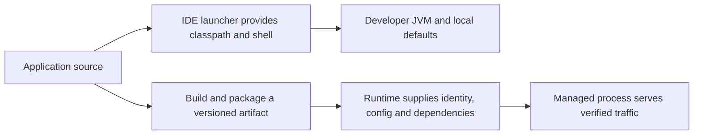

The same source can start by both paths. The deployed path fixes the artifact identity and supplies dependencies explicitly. A build can succeed without DNS, an available database, writable mounted paths, a compatible JVM, or a client route. Each is a separate runtime condition.

| Execution approach | Strength | What you must arrange |
| --- | --- | --- |
| IDE | Fast edit/debug cycle | Editor and test-specific settings |
| Packaged JAR | Simple artifact and clear JVM launch | Host JVM, service unit, configuration, network, and logs |
| Docker | Repeatable user-space filesystem and isolated runtime | Suitable host engine, image, port wiring, secrets and mounts |
| Remote server | Real service lifetime and network behavior | Authorized administration, service supervision, firewall, DNS/TLS, data policies. It can run a JAR or Docker |

A practical success test is a client request that writes a row and reads it back under the intended release, alongside expected unauthorized or invalid-input behavior for the deployed service. Keep that evidence separate from long-term latency, capacity, backup, and incident responsibilities.

**Key takeaways.** Treat the release, process, dependency paths, and evidence of service as separate objects.

<a id="deploy-02"></a>

## Part 2 — The Complete Deployment Lifecycle

The lifecycle exists to keep a change traceable. At each handoff, an operator should know what went in, what came out, and what the next stage can assume. A **gate** is a check used to decide whether to proceed.

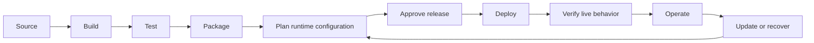

Training uses manual commands for many stages. Later CI can automate repeatable gates, and CD can apply an approved release. Maven can run several stages within one invocation. Keep their evidence distinct.

| Stage | Input → output | Actor | Typical failure and success evidence |
| --- | --- | --- | --- |
| Source | Reviewed commit → build input | Developer or reviewer | Dirty tree or wrong branch. Record the exact revision and intended changes |
| Build | Source, toolchain, dependencies → class files | Maven and JDK | Wrong compiler/repository failure. Record the expected Java and successful compiler phase |
| Test | Code and fixtures → results | Test runner | Wrong assumptions or unavailable test service. Review assertions and result counts |
| Package | Compiled classes and dependencies → executable JAR or image | Boot plugin or builder | Wrong entry point or missing dependency. Inspect and run the actual artifact |
| Configure | Contract and environment choices → launch inputs and secret references | Operator | Wrong target, missing key, stale override. Validate the model and inspect selected inputs |
| Release | Candidate, checks, config contract → approved release record | Release owner | Mutable reference or unknown schema assumptions. Record digest, environment config, migration impact, and last known good |
| Deploy | Approved record → updated runtime | Operator or automation | Wrong project, unwritable files, active port collision. Inspect container or unit and release identity |
| Verify | Target and expected behavior → pass/fail observations | Operator or smoke client | Listening process fails a dependency or requests reach an old version. Verify readiness, version, and real transaction |
| Operate | Live workload and telemetry → decisions and incident response | Service owner | Slow requests, failed backups, or extra restarts. Check trend, logs, and recovery evidence |
| Update/recover | New candidate or incident → restored behavior and records | Release or incident owner | Incompatible schema or wrong recovery point. Re-run verification and document what changed |

Exercise the separation with `mvn package`, the recorded JAR hash, and a launch missing the database password. The artifact remains valid even though the launch correctly fails. With valid inputs, an instance can start and later become unready when PostgreSQL stops. Keep the failed timestamp, evidence, and corrective action in the release record.

**Key takeaways.** Promote evidence from one stage to the next. Re-run live verification after every update or recovery.

<a id="deploy-03"></a>

## Part 3 — Deployment Environments

Different environments allow different kinds of failure. A developer may reset a disposable database. A production controller can handle actual customer records and requires explicit boundaries around access and recovery.

| Environment | Purpose and inputs | Data and operational expectations |
| --- | --- | --- |
| Development | Fast feedback with local profile, logs, and reachable sandbox dependencies | Dummy data and disposable credentials |
| Unit test | Exercise code with small isolated inputs | Repeatable fixtures and no dependence on a developer's database |
| Integration test | Exercise real boundaries such as database startup and migrations | Isolated schema and credentials with controllable cleanup |
| Staging | Rehearse the production release and observe realistic wiring | Separate identity and data. Test the same migration and access controls |
| Production-like lab | Practice production mechanisms within a local scope | Dummy values, controlled faults, boot and health verification |
| Production | Meet user and operational expectations | Approved identities, real data, monitoring, recovery, and controlled changes |

**Environment parity** means keeping the important behavior comparable, including Java and PostgreSQL major releases, migration checks, startup inputs, and the network path. **Configuration drift** is a difference between the intended inputs and what the service actually receives. An extra shell override, manually replaced image tag, or stale container can create drift.

A Spring profile selects files and beans. Infrastructure enforces identity, routes, storage ownership, and access. A production profile on a developer laptop can still reach a production database if credentials and routes permit it. Use separate project names, volumes, database credentials, and known endpoints in the lab. Promote the same JAR bytes, record the hash, and verify `/api/release` after changing settings. A reproducible artifact still needs a valid environment. [Profiles and source selection](../04_Application_Configuration/Application_Configuration_Theory.md#config-07)

**Key takeaways.** Promote the tested artifact. Provision and verify independent identities, dependencies, and data for each environment.

<a id="deploy-04"></a>

## Part 4 — Application Packaging and Release Artifacts

The JDK compiler writes JVM bytecode into class files. A JAR is an archive of those files plus metadata and resources. A Boot executable JAR includes launcher classes and a manifest, the application's classes and resources under `BOOT-INF/classes`, and dependency archives under `BOOT-INF/lib`. `java -jar` reads the manifest and invokes the Boot launcher, which builds the runtime class-loading environment and calls the application entry point. A regular Maven JAR may lack the launcher and nested dependencies.

Maven runs ordered lifecycle phases. `compile` compiles main sources. `test` runs unit tests through Surefire when configured. `package` runs earlier phases and bundles an artifact. `verify` goes beyond packaging and can run integration checks configured later in the lifecycle. `clean` is a separate lifecycle that removes generated output. In the lab, the parent configures Boot repackaging and the build adds `build-info` to include the Maven release version. The `revision` property supplies a version per build. [Maven lifecycle](https://maven.apache.org/guides/introduction/introduction-to-the-lifecycle.html) · [Maven CI-friendly versions](https://maven.apache.org/maven-ci-friendly.html) · [Boot executable JAR layout](https://docs.spring.io/spring-boot/4.0/specification/executable-jar/nested-jars.html) · [Boot build information](https://docs.spring.io/spring-boot/4.0/how-to/build.html)

From the [lab project](#deploy-files), run in Windows PowerShell.

```powershell
mvn.cmd -B -ntp '-Drevision=1.0.0' clean package
jar tf .\target\deploy-notes.jar | Select-String 'BOOT-INF/classes|BOOT-INF/lib|build-info.properties'
Get-FileHash -LiteralPath .\target\deploy-notes.jar -Algorithm SHA256
```

`-B` makes Maven noninteractive and `-ntp` suppresses download progress. An existing trusted Maven Wrapper can use the same arguments via `.\mvnw.cmd` or `./mvnw` in Bash. The lab uses installed Maven and supplies a complete POM. Inspect the final JAR, since the Boot plugin may also retain an original archive. `BuildProperties` makes the actual packaged version observable through `/api/release`. An environment variable that selects the image tag has no effect on built-in build information.

| Artifact | What travels | What the target supplies |
| --- | --- | --- |
| Executable JAR | Application bytecode, Boot launcher, dependencies, resources | Compatible JVM, OS, working directory, service process manager and external state |
| Docker image | An artifact containing packaged user-space files, JVM, and launch defaults | Compatible OS/CPU platform and engine, network, runtime secrets, and storage |

Use a version to communicate change and a digest or checksum to compare bytes. A local Docker image ID identifies image configuration on the engine. A registry manifest digest identifies the published content referenced by the digest. A tag can move. A JAR checksum does not identify a remote container image, and matching input source does not guarantee byte-identical rebuilds. Build reproducibility depends on pinned toolchains, dependency resolution, timestamps, and platform. Archive the artifact you verified. Use a trusted source for its expected digest. [Docker image references and digests](https://docs.docker.com/engine/containers/run/#image-references)

**Key takeaways.** Package one known version, check the actual artifact, and match the build and runtime Java versions.

<a id="deploy-05"></a>

## Part 5 — Running Spring Boot on Linux

When Bash launches `java -jar deploy-notes.jar`, the OS starts a process using an effective identity, inherited environment and current directory. The JVM loads the JAR, initializes Spring, opens the datasource for Flyway, and creates the embedded HTTP server. On failure the launcher exits with a status and emits diagnostics. A statement that the JAR exists tells you little about the inputs this process receives.

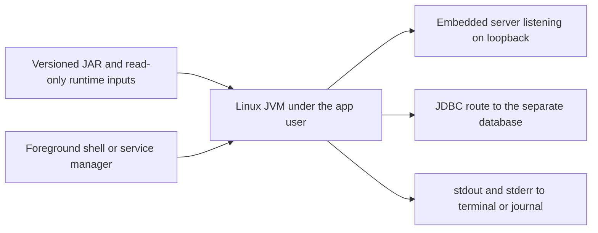

Use Java 21 and the intended Linux architecture. On an Ubuntu practice machine missing the runtime, an authorized administrator can install `openjdk-21-jre-headless` with APT after reviewing the package plan. The host lab runs as the normal Ubuntu user. The app needs read access to its JAR and secret, traversal rights on parent directories, and a writable temp area. In an administered server layout, use separate paths for versioned artifacts, configuration, and persistent data. In this course those files live below a dedicated directory in the Linux home.

Prepare [the direct database and host paths](#deploy-host) and launch the JAR in Ubuntu Bash.

```bash
cd "$HOME/deployment-learning-lab/host" || exit 1
java -version
id
pwd
(
    set -a
    . ./app.env
    set +a
    exec /usr/bin/java -jar ./current/deploy-notes.jar
)
```

`set -a` exports variables assigned while reading the lab's operator-owned nonsecret file. `exec` replaces the subshell with Java and preserves the terminal attachment. In a second Ubuntu tab use `ss -ltn 'sport = :18081'`, `ps -eo pid,user,args | grep '[d]eploy-notes.jar'`, and `curl -fsS http://127.0.0.1:18081/api/release`. Reconcile the listed listener and the emitted version. Verify readiness and a notes request separately. Stop the foreground run with Ctrl+C. When redirecting to files, use distinct stdout and stderr first, such as `>start.out 2>start.err`, and capture `$?` immediately following a failed launch. A background child started with `&` needs its launch PID and `wait` from the launching shell if you want its eventual status.

Closing a terminal can hang up attached jobs or end their session. `nohup` only addresses a hangup signal and optional output redirection. It supplies no desired state, readiness check or bounded restart policy. Use the service manager for sustained operation. Consult [Linux process signals](../01_Linux/Linux_Theory.md#part-07) for the verified PID and graceful-stop workflow.

**Key takeaways.** Reproduce the launch under the real identity and cwd. Confirm inputs, process, listener, and actual response separately.

<a id="deploy-06"></a>

## Part 6 — Linux Service Management with systemd

A **daemon** or long-running service needs a known command, predictable files, ownership, and an operator-visible lifecycle. Systemd supervises the process group of a unit. It tracks the main PID, collects status and logs, applies startup and stop policy, and can restart failed processes. An interactive terminal is a temporary supervisor with different guarantees.

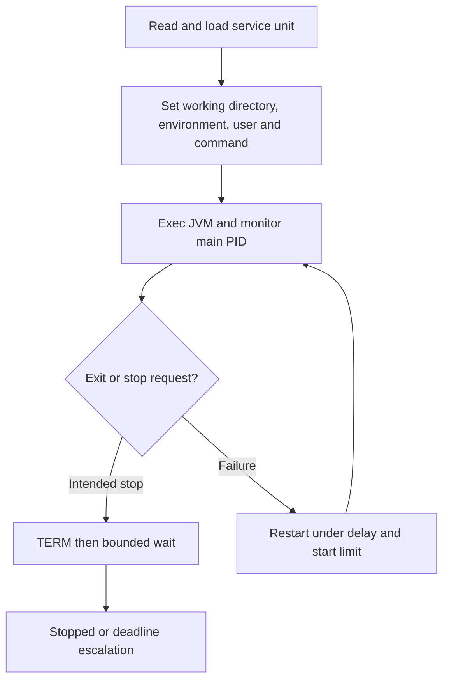

The [complete user unit](#deploy-unit) uses `Type=exec`, which waits until the executable is successfully invoked. This provides better execution-failure reporting and leaves readiness to probes. `WorkingDirectory` selects the host directory, `EnvironmentFile` supplies nonsecret values, and `ExecStart` uses the absolute Java launcher and known JAR. `Restart=on-failure` and the start limit bound repeated failure. `TimeoutStopSec` bounds the service manager's stop wait. `Wants=` or `Requires=` describe unit relationships, and `After=` describes ordering. A service can start after a dependency unit and still encounter a database that is not serving the intended request.

Run `ps -p 1 -o comm=` and `systemctl --user is-system-running` in Ubuntu before installing the lab unit. The user manager owns this unit, so the app runs with your user's privileges. Conventional multi-user server service files often live under `/etc/systemd/system/` with a dedicated `User=` and `Group=`. An authorized administrator prepares these identities, file access, and boot enablement. WSL user sessions may stop when Windows stops the distribution. Enablement adds normal activation links for the corresponding manager. `start` applies current state immediately. For this lab, use `start` without enabling automatic login startup.

Once the unit and files from Part 26 exist, operate it in Ubuntu Bash.

```bash
systemctl --user daemon-reload
systemctl --user start deploy-notes-lab.service
systemctl --user status deploy-notes-lab.service --no-pager
journalctl --user -u deploy-notes-lab.service -n 25 --no-pager
curl -fsS http://127.0.0.1:18081/actuator/health/readiness
systemctl --user stop deploy-notes-lab.service
```

The unit remains after stopping it. Use the [scoped removal steps](#deploy-host) when done. A user manager unavailable on WSL2 is a reason to use the foreground lab or a disposable VM. Systemd may report a service active before HTTP starts. Use `systemctl --user show -p MainPID -p ExecMainStatus -p NRestarts UNIT` for targeted evidence. `daemon-reload` rereads unit definitions. An intentional restart applies changed environment or executable inputs. [systemd service reference](https://www.freedesktop.org/software/systemd/man/latest/systemd.service.html) · [systemctl reference](https://www.freedesktop.org/software/systemd/man/latest/systemctl.html)

| Runtime object | Responsibility | Operational consequence |
| --- | --- | --- |
| Process | Running program and its OS state | PID can change or exit while the service definition remains |
| Linux service unit | Declarative command, identity, and supervision | Read the unit status and journal. Health is separately probed |
| Docker restart policy | Engine decision after a container process exits | Restart reuses its image and config. A health failure alone leaves its restart behavior unchanged |

**Key takeaways.** Manage the supervisor that owns the process. Verify the service from the client's path after it starts.

<a id="deploy-07"></a>

## Part 7 — Docker-Based Application Deployment

A Docker image packages the chosen Java runtime and JAR with a launch command. In a multi-stage build, Maven and the compiler run in a build stage and the runtime stage receives only the artifact and its JVM. In a build-once workflow, the image can instead copy an already verified JAR. The [lab Dockerfile](#deploy-dockerfile) implements both targets. `from-source` builds in Docker. `packaged` retains exact bytes from the host build.

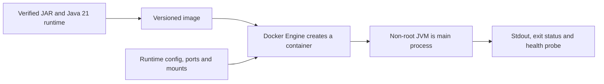

The container adds a writable layer and mounts at creation. Keep long-lived database data outside the app container. Image configuration documents an `EXPOSE` target, while Compose selects actual publication. Use `SERVER_ADDRESS=0.0.0.0` for the app inside the lab network and publish only the intended host loopback address. `USER 10001:10001` is the image's default process identity. Verify mount readability for that identity. Exec-form `ENTRYPOINT` lets the JVM receive the stop signal. Observe readiness before sending traffic.

After packaging, build the image from the project directory in Windows PowerShell.

```powershell
docker build --target packaged -t deploy-notes-demo:1.0.0 .
docker image inspect deploy-notes-demo:1.0.0 --format '{{.Id}} {{.Config.User}}'
```

This command creates a local image reference. Keep it for inspection or remove that exact demo tag when no lab uses it. For Compose use the per-project tags in Part 26. Image updates create a new app container, and `restart` restarts an existing one. A restart policy controls exit recovery. An app may instead keep running with a failed health check. Set memory and CPU budgets from measured load. Docker can kill a process at its cgroup limit, so compare exit status with `.State.OOMKilled` and JVM logs. [Docker multi-stage builds](https://docs.docker.com/build/building/multi-stage/) · [Restart policies](https://docs.docker.com/engine/containers/start-containers-automatically/)

**Key takeaways.** Use the image as a release artifact, and apply identity, limits, ports, and credentials at container creation.


<a id="deploy-08"></a>

## Part 8 — Multi-Container Deployment with Docker Compose

Compose translates a deployment description into engine objects. In one project, services share predictable network names, one database has a persistent data path, and the same app definition specifies the image and runtime inputs. Each container has its own namespace. The app's `localhost` points back to the app.

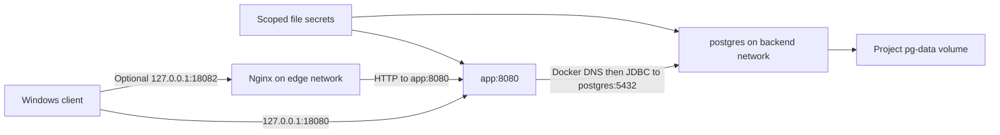

The [complete Compose model](#deploy-compose) defines `backend` and `edge` networks. PostgreSQL belongs only to `backend` and has no host port in this model. The app belongs to both, and the optional `proxy` belongs only to `edge`. A caller inside the app resolves `postgres` via Docker DNS and uses the internal port `5432`. The target for the Windows client is the mapping reported by `docker compose port app 8080`.

Prepare the image and secret files in [Part 26](#deploy-26), then run the Compose checks in Windows PowerShell.

```powershell
docker compose -p $DeployProject config --quiet
docker compose -p $DeployProject up -d --wait --wait-timeout 90
docker compose -p $DeployProject ps -a
docker compose -p $DeployProject logs --tail 35 app
```

A `build:` specification asks Compose to build an image. `image:` supplies an image reference to use for a service. In the release workflow the model selects an explicit version and uses `pull_policy: never` because the artifacts are already local. For source development, a model can point `build.context` at the project and set `build.target: from-source`, then invoke `build` and `up` deliberately. This lab keeps the verified JAR and the deployed image identity easy to compare.

| Mechanism | What is verified at this point |
| --- | --- |
| `config --quiet` | Resolved model is structurally valid, without printing its values |
| `depends_on: condition: service_healthy` | Compose waits for the dependency's configured startup probe |
| `pg_isready` | PostgreSQL accepts server connections at the checked endpoint |
| App readiness health check | The Spring process accepts work and the configured DB health contributor can reach the datasource |
| API write and readback | The caller, route, app's DB role, migrated schema, and actual query path work together |

A health gate is a startup ordering rule. PostgreSQL can become unavailable later, login can fail, and migrations can fail after TCP succeeds. `--wait` returns once the applicable service conditions are satisfied or it times out. Verify the API independently. `restart` uses the existing container, while a planned `up … --force-recreate app` applies an updated image or environment. `--no-deps` limits the replacement when you already know PostgreSQL is healthy. `down` normally keeps the named volume. Keep the project name stable across recreations. [Compose startup ordering](https://docs.docker.com/compose/how-tos/startup-order/) · [Compose up behavior](https://docs.docker.com/reference/cli/docker/compose/up/)

Local Compose is a transparent way to rehearse these relationships. A real deployment also needs scoped network access, controlled release promotion, tested backups, patching, memory budgets, and a plan when the host fails. Compose on one host provides no redundancy by itself.

**Key takeaways.** Know the project, network, service endpoint, volume, and health contract before changing the stack.

<a id="deploy-09"></a>

## Part 9 — Deployment Networking

Every connection has a caller and a target. A target needs an address the caller can route to, a process listening on the exact port and family, any necessary port translation, and permitted traffic in both directions. A private IP can be reachable from its intended internal networks. A public address can be routed publicly subject to filtering. A wildcard bind such as `0.0.0.0` selects all local IPv4 interfaces in that namespace. A client uses a specific destination address or hostname.

| Flow | Caller and target | Investigation |
| --- | --- | --- |
| Postman to direct JAR | Same Linux environment uses `127.0.0.1:18081`. Windows access to WSL depends on its integration | Check Ubuntu `ss -ltn` and query the same endpoint with Ubuntu curl first |
| Windows to Compose app | Windows `127.0.0.1:18080` forwards to `app:8080` | Compare `docker compose port app 8080` with actual bind inside the container |
| Client to different server | Use the service DNS name or its authorized private/public interface | Check listener bind, route and firewall for that source, then TLS and HTTP |
| Compose app to PostgreSQL | App resolves `postgres` on `backend`, uses `5432` | Test from the Compose network and compare app/database logs |
| App container to external API | App resolves expected hostname, creates outbound TCP/TLS connection, sends request | Check resolver, approved outbound route, TLS identity, timeouts, then HTTP status |

Use these probes in Windows PowerShell while the Compose lab runs.

```powershell
docker compose -p $DeployProject port app 8080
Get-NetTCPConnection -LocalPort 18080 -State Listen -ErrorAction SilentlyContinue
curl.exe --noproxy '*' --connect-timeout 2 --max-time 5 -i http://127.0.0.1:18080/api/release
docker compose -p $DeployProject exec -T app getent hosts postgres
```

The first row identifies the mapping even when a Windows listener belongs to Docker's forwarding process. The last line checks name resolution in the app container. A refusal commonly means the attempted port lacks a listener or a device actively rejects it. A connect timeout points to an unanswered attempt, which can result from a route, filter, unavailable host, or return-path issue. A request timeout can also occur after connection while an application waits on its pool or upstream. Name lookup, TCP, TLS, and HTTP produce different evidence. Capture the exact host, address family, port, and deadline.

For a remote service, the same host port can be reused by different callers only where routes and inbound policy allow it. In the lab keep the boundary controlled. The WSL direct DB exception maps solely to Windows loopback or the verified WSL virtual adapter in [Part 26](#deploy-host). In the Compose stack publish no database port. [Prerequisite network troubleshooting](../02_Networking/Networking_Theory.md#net-18) · [Docker port publishing](https://docs.docker.com/engine/network/port-publishing/)

**Key takeaways.** Probe from the relevant caller. Separate endpoint reachability, protocol responses, and application behavior.

<a id="deploy-10"></a>

## Part 10 — Reverse Proxies

A reverse proxy accepts client connections on behalf of an application. It can terminate TLS, route a hostname or path, enforce bounds on request size and waits, add observability fields, and hide app instances from direct public ingress. A forward proxy acts on behalf of clients when they connect outward. An application server accepts the upstream HTTP request and runs application behavior.

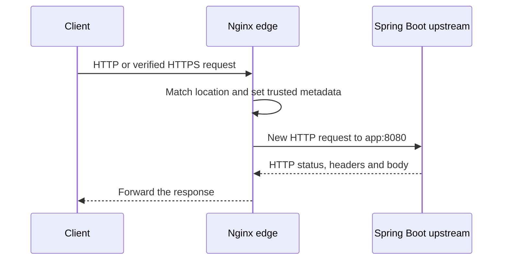

There are two transport connections. The upstream normally sees the proxy as its peer. A trusted boundary may add information about the client address, original protocol, and host. Never accept arbitrary client-supplied forwarded metadata for authorization or logging identity. The [lab Nginx route](#deploy-proxy) overwrites `X-Forwarded-For` with its observed peer and `X-Forwarded-Proto` with its transport, clears `Forwarded` and inbound port data, and generates `X-Request-ID`. The app leaves forwarded-header processing disabled. Where a real application needs original scheme or address, trust only known ingress proxies and ensure the backend accepts requests only from them. A NAT or earlier proxy can be the peer observed by Nginx.

The proxy maps `/api/` to `app:8080` and returns `404` for other paths. Runtime DNS resolution through Docker's resolver on its user-defined network helps after app recreation replaces an address. Connections and successful DNS resolution still have finite timeouts. Verify this behavior when changing the topology. A `502` commonly indicates an upstream connection or response problem. A `504` commonly indicates a proxy wait deadline. A `404` might originate at the proxy or in Spring. Use route and log evidence rather than assuming one cause. `proxy_read_timeout` bounds gaps between upstream read operations. Design end-to-end deadlines separately. A body-size limit can reject a request before any application handler sees it.

Start and test the proxy in Windows PowerShell after the app is healthy.

```powershell
docker compose -p $DeployProject --profile edge up -d proxy
docker compose -p $DeployProject exec -T proxy nginx -t
curl.exe --noproxy '*' -i http://127.0.0.1:18082/api/release
curl.exe --noproxy '*' -i http://127.0.0.1:18082/actuator/health
```

Expect `200` with version and a request ID on the first call, and `404` on the second. Stop only the optional service with `docker compose -p $DeployProject --profile edge stop proxy` when done. [Nginx proxy module](https://nginx.org/en/docs/http/ngx_http_proxy_module.html) · [Nginx resolver](https://nginx.org/en/docs/http/ngx_http_core_module.html#resolver)

**Key takeaways.** Trace client-to-proxy and proxy-to-app separately. Configure forwarded headers at an explicit trust boundary.

<a id="deploy-11"></a>

## Part 11 — DNS, HTTPS, and TLS

DNS gives a client candidates for a name. An `A` record contains an IPv4 address and an `AAAA` record contains an IPv6 address. A resolver or cached answer can return an older or network-specific address. A reverse proxy receives connections at a chosen address and routes HTTP after connection establishment. A DNS record does not start a proxy, open a port, or choose a URL path.

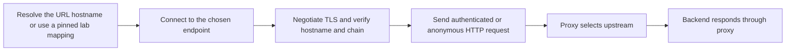

The diagram illustrates a new HTTPS connection over TCP. Address resolution and TLS can be reused; other transport constructions such as QUIC differ. A **certificate** supplies a public key and identity claims. A client verifies the expected hostname against an identity in the certificate and checks validity and chain to an authorized trust anchor. The endpoint proves possession of the private key during handshake. **TLS termination** is the point at which this protected connection ends. The lab terminates at Nginx and sends HTTP within the private edge network. Decide whether an authenticated, encrypted upstream hop is needed in a real deployment.

| Concepts | Practical distinction |
| --- | --- |
| DNS and reverse proxy | DNS supplies address candidates. The proxy accepts and routes requests at an endpoint |
| HTTP and HTTPS | Both use HTTP semantics. HTTPS protects the authenticated transport |
| TLS termination and application authentication | TLS verifies the service peer and protects the connection. The app authorizes the caller and action |
| Public certificate and local lab certificate | Public issuance requires ownership validation and trusted issuance. A lab certificate is deliberately trusted by one client command |

Without TLS, credentials and bearer tokens can be visible on the path. Use HTTPS for sensitive traffic and enforce app authorization even on trusted transport. Redirect regular HTTP traffic to HTTPS where appropriate. Clients should start with HTTPS when sending credentials, since a redirect occurs after the first HTTP request. Monitor chain, expiry, and renewal. Verify that the endpoint loaded replacement material and serves the chain expected by clients. Use safe inspection of dates, host identity, and chain. A wrong certificate, wrong SNI name, stale local resolver, incorrect clock, and incomplete chain produce different failures. [Nginx HTTPS configuration](https://nginx.org/en/docs/http/configuring_https_servers.html) · [Service identity](https://www.rfc-editor.org/rfc/rfc9525.html)

The [TLS lab](#deploy-tls) generates a short-lived certificate with `DNS:localhost` and keeps the key in a private scratch folder. The scoped PowerShell probe uses `curl.exe --resolve 'localhost:18443:127.0.0.1' --cacert .\tls\cert.pem https://localhost:18443/api/release`. Try `127.0.0.1` as the HTTPS URL hostname to observe an intentional identity mismatch. The local mapping sets the address and keeps `localhost` as the name verified. No global trust changes are needed.

**Key takeaways.** Verify the name, route, port, certificate chain and terminating endpoint before interpreting HTTP.

<a id="deploy-12"></a>

## Part 12 — Application Configuration During Deployment

The same JAR can read profile defaults from its classpath, external files from a mounted or operator-managed location, values inherited from the launcher, and explicit JVM or application flags. Only loaded and eligible sources take part. During startup, Boot resolves precedence and prepares the environment. The lab initializer checks three datasource fields before context refresh. It reports the missing key without a value. Flyway and the connection pool check a different condition later, when they use those inputs.

| Launcher | How to supply a setting | What applies a change |
| --- | --- | --- |
| Foreground shell | Export a nonsecret property in `app.env` or pass a deliberate override | Start a new process |
| User systemd | `EnvironmentFile` and config-tree secret file | Restart the unit for input changes. Reload units after unit-file changes |
| Compose | Service `environment`, file mounts, and secrets. Project interpolation feeds the model | Recreate the affected app when its model changes |
| Packaged app | Standard files under `src/main/resources`, profile-specific defaults | Build a new artifact if this source must change |

In common launches, CLI properties outrank JVM `-D`, which outrank process environment and Config Data. External locations, imports and profile ordering determine which file wins within Config Data. A classpath file may remain a fallback. Use the [full source rules](../04_Application_Configuration/Application_Configuration_Theory.md#config-08) for unusual sources, tests, and collisions. An image tag and the app's build identity have different origins.

In Ubuntu, after setting up Part 26, start once with `SPRING_PROFILES_ACTIVE=host` and once with `--deploy.site=override-demo` appended to the `java -jar` launch. Stop between runs. On the same port `/api/release` returns the same build version and a different site value. Check the JAR hash and then remove the override. Compose `deploy` sets its own site. An accidental profile can still start with explicit valid DB settings, so accept only the intended mode during verification.

Review each release for changed config requirements, defaults, and secrets. Save a nonsecret snapshot or revision and authorized secret identifiers. Compare effective values that may be disclosed, such as app port, profile, and version. Release drift often hides in a higher-priority value or a container that did not get recreated. [Spring Boot externalized configuration](https://docs.spring.io/spring-boot/4.0/reference/features/external-config.html)

**Key takeaways.** Set configuration in the real launcher, fail early for missing required inputs, and verify the effective mode after each change.

<a id="deploy-13"></a>

## Part 13 — Secrets and Deployment Security

A database hostname and a password both configure a connection. Disclosure of the password grants authority, so it needs a restricted delivery and rotation lifecycle. JWT signing secrets and private keys can authorize identity claims or decryption. SMTP, API, and database credentials usually grant a scoped capability. Treat every secret according to what an attacker could do with it.

| Exposure path | Deployment control |
| --- | --- |
| Git history, copied files, or screenshots | Keep working secrets outside tracked content, exclude them explicitly, and rotate exposed material |
| Shell history, process listings, and environment copies | Pass references and mount files. Avoid raw values in argv or broad environment dumps |
| Image layers and build cache | Limit the build context and keep secrets out of `ARG`, `ENV`, and layers. Use scoped build secret mounts where necessary |
| Container metadata and engine control | Restrict engine access. Inspect selected fields. A running instance can read runtime material it legitimately needs |
| Logs, errors, Actuator, tracing, or metrics | Emit key name, category, and limited context. Keep tokens, payloads and raw credential values out |
| File mounts and backups | Limit identity, ACLs and scope. Test readability as the app user and verify authorized recovery |

The lab gives each database a newly generated password and keeps the two projects' data and credentials separate. Compose mounts the password under a postgres-specific target for `POSTGRES_PASSWORD_FILE` and under the Spring property name for a `configtree:` import. Compose file-based secrets are mounted from the host. Access still depends on host and daemon permissions and the container user's access. Check `test -r /run/secrets/spring.datasource.password` in the app and avoid emitting the file body. On Linux use restrictive permissions and a directory that permits traversal only to intended identities. On Desktop use private Windows folders and check actual container readability.

The image starts Java with UID/GID `10001`. A real deployment should separate app and migration roles where appropriate, grant minimal database privileges, and isolate the database on intended networks. The lab role is the image's bootstrap account in a disposable cluster. Use SSH with verified server identity and a scoped user. Restrict inbound reachability and internal administrative endpoints. Renew certificates and rotate credentials by updating the issuer or database, deploying new references to consumers, validating new access, and revoking the previous version. A modified password file alone does not update a role in an existing initialized database. [Docker Compose secrets](https://docs.docker.com/compose/how-tos/use-secrets/) · [Secrets prerequisite](../04_Application_Configuration/Application_Configuration_Theory.md#config-12) · [Linux owner and permissions](../01_Linux/Linux_Theory.md#part-05)

**Key takeaways.** Restrict the service identity, access paths and secret sinks. Verify that credential delivery and rotation actually reach the caller.

<a id="deploy-14"></a>

## Part 14 — PostgreSQL Deployment and Persistence

PostgreSQL starts a server process that supervises connection-handling processes and maintains background tasks. Its initialized data directory stores database state, relation files and transaction recovery information. The app connects over JDBC to a server, negotiates and authenticates, and executes queries through pooled physical connections. Returning a logical connection usually releases it to the pool. Use bounded acquisition and connect waits, and size the pool against the server's connection budget.

`jdbc:postgresql://postgres:5432/deploynotes?connectTimeout=2` targets the Compose service, its internal port, and the intended database. The driver connect timeout here is in seconds. The capstone's Hikari `connection-timeout=2000` is a pool acquisition wait in milliseconds. `pg_isready` checks server responsiveness. It does not prove credentials, schema, or query behavior. `/api/notes` exercises the actual app identity and schema.

| Object | Survival across container removal | Example |
| --- | --- | --- |
| Container writable layer | Removed with that instance | Temporary files written by the app container |
| Project named database volume | Normally retained after `down` | `PROJECT_pg-data` for PostgreSQL 17 |
| Logical backup copied outside the engine volume | Independent when stored separately and validated | `pg_dump -Fc` archive with tested restore |

PostgreSQL 17 in this lab mounts the volume at `/var/lib/postgresql/data`. Changing database major version can require a different data path and a compatible upgrade or restore procedure. The official image uses initialization settings when it creates an empty database directory. An existing data directory retains user credentials and data. A different project name can create a new empty volume and make old rows appear missing. Check the effective database, project and mount before any cleanup. Read Postgres logs and distinguish startup, password rejection, and query errors. [Official PostgreSQL image and initialization](https://hub.docker.com/_/postgres) · [PGJDBC connection parameters](https://jdbc.postgresql.org/documentation/use/)

Inspect the database from Windows PowerShell after the stack starts.

```powershell
docker compose -p $DeployProject logs --tail 30 postgres
docker volume ls --filter "label=com.docker.compose.project=$DeployProject"
docker compose -p $DeployProject exec -T postgres psql -U deploylab -d deploynotes -c 'select current_database(), count(*) from notes;'
```

The local psql probe runs inside the database container. Its local authentication rules differ from the app's TCP login. Compare an API request with this separate database evidence. Test a row surviving recreation and preserve the exact volume identity.

**Key takeaways.** Track the app, the database process, the durable data directory, and the backup independently.

<a id="deploy-15"></a>

## Part 15 — Database Migrations During Deployment

Application code and database schema evolve at different rates. A **migration** is a reviewed database change with identity and order. Flyway discovers migration files, compares them with recorded history and checksums, and applies pending changes. Boot normally invokes migration while its context starts. If Flyway cannot connect or apply an expected change, a required bean can fail and the release may never accept traffic.

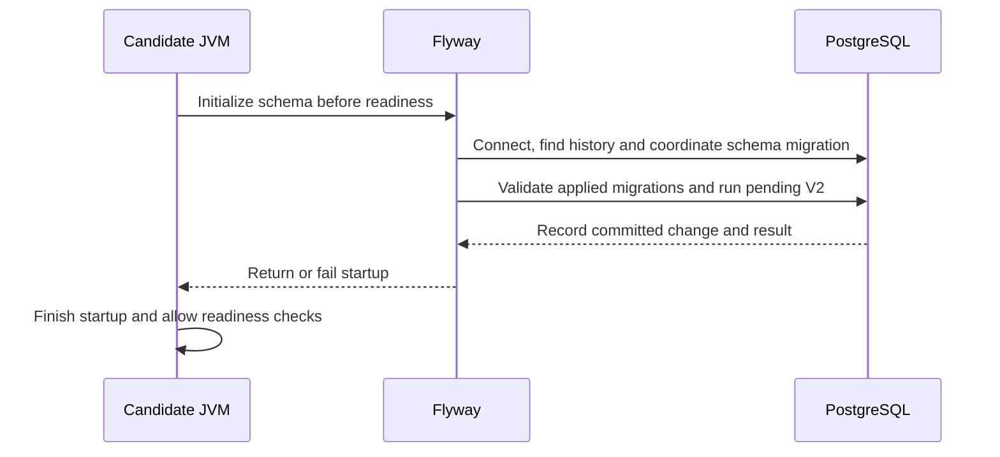

The lab starts from `V1__create_notes.sql`. The version `1.1.0` artifact also includes `V2__add_note_source.sql`, which adds a nullable column.

```sql
ALTER TABLE notes ADD COLUMN source varchar(30);
```

Both app versions insert/select explicit columns that still exist. The new column accepts `NULL`, so the old application can keep writing. Flyway's `*:future` pattern in this lab allows the older migration set to validate with the eligible later migration applied. Verify both schema compatibility and validation with the exact deployed versions. A future migration ignored by validation can still break actual SQL in an old application.

| Change | Risk while two app versions may run |
| --- | --- |
| Add nullable column | Old SQL can work if it names expected columns and tolerates the new schema |
| Rename or drop old column | Old reads, writes, or queries can fail after app rollback |
| Enforce a new constraint | Existing data or old writers may violate it |
| Backfill large volume | Locks, load and duration can affect availability |

An **expand-and-contract** sequence first adds compatible structure, then deploys code able to handle the transition, backfills and verifies, and only at the end retires old schema after the previous runtime has gone. Keep rollback windows explicit. PostgreSQL supports transactions for many DDL operations. Certain commands, such as `CREATE INDEX CONCURRENTLY`, require nontransactional execution. A failing nontransactional script may leave partial state. Inspect schema and history before retrying, and never edit an applied migration casually or run a repair just to hide a checksum mismatch. Flyway coordinates migration execution per schema history, yet concurrent application startups can wait, collide with schema assumptions, or put DDL load on the same database. A production release often uses a deliberately timed migration step and an authorized migration identity after validating a backup and rehearsing against representative data. [Boot database initialization](https://github.com/spring-projects/spring-boot/blob/v4.0.10/documentation/spring-boot-docs/src/docs/antora/modules/how-to/pages/data-initialization.adoc) · [Flyway validation](https://documentation.red-gate.com/flyway/reference/commands/validate) · [Future migration behavior](https://documentation.red-gate.com/fd/flyway-ignore-migration-patterns-setting-277579002.html)

In the lab, query `select version, success from flyway_schema_history order by installed_rank`. Version 1 initially yields row `1` and version 1.1 adds `2`. Starting the older app does not remove either row or reverse the column addition. The verified compatible pair is the basis for the rollback drill.

**Key takeaways.** Plan schema changes before replacing the app. Prove the chosen application version against the actual persisted schema.


<a id="deploy-16"></a>

## Part 16 — Application Startup, Shutdown, and Recovery

Startup is a sequence of gates, even though supervisors often expose one state. The launcher starts a JVM. `Environment` preparation includes loading configuration and selecting profiles. In this specific lab the initializer checks required keys. Flyway uses JDBC before the context can complete. Embedded server initialization and bean creation are part of the context lifecycle. A process or bound socket can exist while the app still expects startup work.

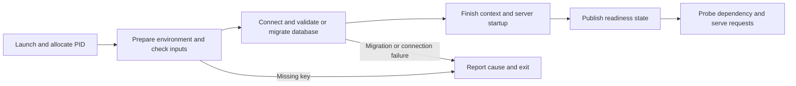

Dependency reachability can change later. A healthy JVM can resume serving after a DB outage without restart if connection recovery succeeds. A broken configuration leads to repeated failure under an automatic restart policy. Use bounded retries, a finite deadline, backoff, and clear diagnostics. A restart is an execution decision. An application update or user/credential change is a separate decision. A failing HTTP readiness check can leave a process alive.

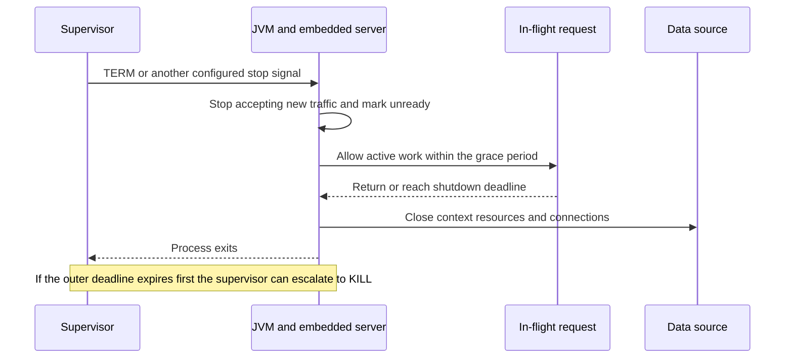

In the example `spring.lifecycle.timeout-per-shutdown-phase=10s` bounds each applicable Spring phase. Both the Compose app and the user unit give 20 seconds before outer escalation. Total shutdown can span multiple phases. Choose budgets for actual operations and measure them. A client that loses the response may need to confirm whether a write committed before retrying it. A forced KILL skips JVM cleanup. When doing a planned update, drain traffic in a multi-instance design or accept and record downtime on a single instance. [Boot graceful shutdown](https://docs.spring.io/spring-boot/4.0/reference/web/graceful-shutdown.html)

To observe graceful behavior in the disposable stack, run `docker compose -p $DeployProject restart app`, then `docker compose -p $DeployProject logs --tail 40 app` in Windows PowerShell. Check for the configured stop sequence and the new startup. Wait for readiness and confirm a note still exists. On a Linux user unit, check `journalctl --user -u deploy-notes-lab.service`. Be explicit about which environment and release you are stopping.

**Key takeaways.** Give the JVM time to finish work, use the supervisor for intended stops, and fix the first cause behind repeated failures.

<a id="deploy-17"></a>

## Part 17 — Health Checks and Readiness

A health check is a defined observation at a point in time. Design probes according to what should happen after a failure.

| Signal | Question | Suitable reaction |
| --- | --- | --- |
| Running process | Does the supervisor still see a main process? | Inspect exit state and logs if absent |
| Listening port | Did a process bind this address and port? | Test the actual route and protocol |
| Startup check | Is initial work complete or still in the allowed window? | Wait within a bounded startup deadline |
| Liveness | Can this instance recover and continue running? | Consider a controlled restart when a local process is irrecoverable |
| Readiness | Should traffic be sent here now? | Hold or drain traffic while temporarily unavailable |
| Application smoke test | Does an actual use case succeed? | Verify the route, auth, data change, and release |

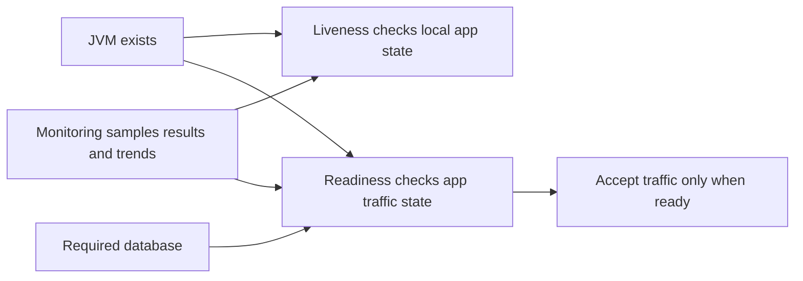

In the lab, `spring-boot-starter-actuator` exposes `health` only, with details hidden. `management.endpoint.health.probes.enabled=true` enables `/actuator/health/liveness` and `/actuator/health/readiness` outside orchestrators too. `management.endpoint.health.group.readiness.include=readinessState,db` deliberately includes PostgreSQL for this database-backed API. Keep a shared database out of liveness so an outage does not create cascading process restarts. Optional dependencies may need per-feature error handling instead of taking all routes out of service. Check the actual indicators and permitted endpoint before relying on them.

<a id="deploy-readiness-fault"></a>

After saving a note in the isolated lab, run the following in PowerShell.

```powershell
docker compose -p $DeployProject stop postgres
curl.exe --noproxy '*' -i --max-time 8 "$DeployBase/actuator/health/liveness"
curl.exe --noproxy '*' -i --max-time 8 "$DeployBase/actuator/health/readiness"
docker compose -p $DeployProject ps -a
docker compose -p $DeployProject up -d --wait --wait-timeout 60 postgres
```

When the outage is visible, liveness remains `200` while readiness gives `503`. Recheck after restart until the app reports `UP` and can read the saved row. Docker observes probe failures to report unhealthy. Its normal restart policy responds to process exits. A Docker health status by itself does not restart an unhealthy live app or remove client traffic. This Nginx lab does not watch readiness continuously. A real routing system must actively use a readiness signal or a deployment must drain traffic deliberately.

Configure probe cadence and timeouts with realistic startup times. A static HTML page or an always-200 controller can falsely claim readiness. An excessively short deadline can mark a usable service unhealthy. Probe from the intended namespace, observe response status and the command's exit status, and compare it with a real transaction. Keep detailed Actuator administration endpoints and health metadata on an access-controlled path. [Actuator endpoint access and probes](https://docs.spring.io/spring-boot/4.0/reference/actuator/endpoints.html#actuator.endpoints.kubernetes-probes)

**Key takeaways.** Design a probe around the action it drives. Measure readiness and real business behavior separately.

<a id="deploy-18"></a>

## Part 18 — Logging, Monitoring, and Observability

Logs record individual events. Metrics summarize measurements over time. Traces connect parts of one request across boundaries. Monitoring evaluates selected conditions and alerts when they cross a policy. Observability is the ability to explain a workload's internal behavior using those signals and targeted probes.

| Signal | What to collect | How it helps |
| --- | --- | --- |
| Application logs | Timestamp, release, level, event, sanitized category, request ID | Identify which release, launch and request failed |
| System logs | Unit status, process exits, host/network/storage events | Locate permission, restart, disk, and host failures |
| Container logs | App stdout/stderr and service logs for the same time window | Compare first error, dependencies, migrations, and restart history |
| Metrics | Throughput, error rate, latency percentiles, CPU, memory, pool saturation | Distinguish one failing request from a trend or capacity problem |
| Traces | Parent request and timed spans such as API → JDBC or provider call | Locate where work waited or failed |

Use a stable time zone such as UTC in a real operation and include offset when comparing sources. Use `INFO` for normal lifecycle events and scoped `DEBUG` only where needed. Structured JSON supports filtering. Spring Boot supports console formats such as `logging.structured.format.console=ecs`. Validate sink support and fields before switching an existing service. Record an opaque request ID at the edge and propagate it when authorized, but keep its values bounded and identify which boundary generated it. The optional Nginx config generates a request ID and logs path without query. It does not save the request body. Deploy Notes logs the ID of a successful synthetic insertion.

Inspect the running Compose project in Windows PowerShell.

```powershell
docker compose -p $DeployProject logs --since 5m --tail 60 --timestamps app postgres
docker compose -p $DeployProject ps -a
$DeployAppId = docker compose -p $DeployProject ps -a -q app
docker inspect --format '{{.State.Status}} {{.State.ExitCode}} {{.State.OOMKilled}} {{.RestartCount}}' $DeployAppId
docker stats --no-stream $DeployAppId
```

Inspect the user unit from Ubuntu Bash.

```bash
journalctl --user -u deploy-notes-lab.service --since '5 minutes ago' -n 60 --no-pager
systemctl --user show -p MainPID -p ExecMainStatus -p NRestarts deploy-notes-lab.service
```

Review the earliest relevant error and match it to time and release. Mitigate log IO and disk exhaustion with a retention policy. Protect log readers and incident exports. Select dashboards and alerts for actionable conditions such as sustained error rates, high latency, growing pool wait, an unhealthy service, or stale backups. A diagnostic endpoint is a point check. Monitoring adds time, trend, and notification. No paid system is needed for the lab. [Spring Boot logging](https://docs.spring.io/spring-boot/4.0/reference/features/logging.html) · [Actuator metrics](https://docs.spring.io/spring-boot/4.0/reference/actuator/metrics.html)

**Key takeaways.** Inspect the smallest evidence needed to answer the operational question. Retain useful history and protect sensitive fields.

<a id="deploy-19"></a>

## Part 19 — Deployment Verification

Verification answers whether the intended version provides the intended service within the expected boundary. Start with small checks and follow them with a representative transaction. Define acceptance criteria before deploying. A launcher exit status or HTTP `200` on a static response proves only part of the contract.

| Acceptance layer | Evidence and result |
| --- | --- |
| Identity | Running image ID and `GET /api/release` match the approved release and profile |
| Access | The intended published port responds from the actual client. Database remains private in the Compose stack |
| Readiness | App and required PostgreSQL dependency report ready within startup deadline |
| Function | POST a synthetic note, receive `201` and an ID, and GET the same ID/text |
| Database and schema | Independent database query finds the expected note and successful migrations |
| Failure behavior | Invalid input receives `400`. A controlled dependent outage is visible and recoverable |
| Authentication | For a protected real API, distinguish missing identity `401`, wrong permission `403` when applicable, and allowed success. Verify the service contract with an approved throwaway identity |
| Persistence and operation | Note survives a controlled restart or recreation. Expected logs and restore evidence are available |

The public-facing lab routes accept only disposable operations on loopback. For a real authenticated deployment such as CapsuleAI, test an authorized read and an unauthorized request and separately verify object-level access. Keep tokens and credentials out of checked-in collections, shell history, and printed output.

Run the smoke test in PowerShell from the Compose project.

```powershell
curl.exe --noproxy '*' -fsS "$DeployBase/api/release"
curl.exe --noproxy '*' -fsS "$DeployBase/actuator/health/readiness"
$Body = @{text='first deployment proof'} | ConvertTo-Json -Compress
$Note = Invoke-RestMethod -Method Post -Uri "$DeployBase/api/notes" -ContentType 'application/json' -Body $Body
$Note
Invoke-RestMethod -Uri "$DeployBase/api/notes"
```

In Postman, use the same GET URLs and send the POST with raw JSON and `Content-Type: application/json`. For a bad input use `{"text":""}` and inspect `400`. Read headers and body when troubleshooting. An HTTP transfer can succeed at the protocol level with an error status. Record the exact client and location of the test.

**Key takeaways.** Require evidence from the actual request path, then confirm the release served it and the intended database contains the result.

<a id="deploy-20"></a>

## Part 20 — Application Updates and Release Management

A release records the artifact, configuration revision, supported schema and operational plan. Select a versioned immutable reference and capture its actual identity. A tag can still be moved, so compare the recorded image ID or published digest. Retain the previous known-good artifact and authorized configuration until the recovery window closes.

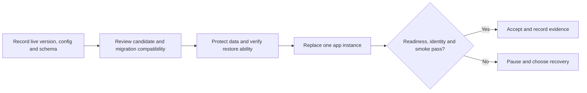

In the lab, build version `1.0.0` and record its hash and ID. Add the V2 SQL to the migration source and build `1.1.0` independently. Keep both artifacts. A one-host Compose app replaces the old container and can experience interruption from stop until application readiness. Tell users about a planned window where appropriate. For a real workflow, verify the release in a comparable environment first and decide how to drain or direct traffic. A rolling deployment adds capacity management, routing and health gates.

After [building both versions](#deploy-build-images), in PowerShell record the app and DB container IDs. Then select the new image and recreate just the app.

```powershell
$env:DEPLOY_RELEASE = '1.1.0'
docker compose -p $DeployProject up -d --no-deps --force-recreate --wait --wait-timeout 90 app
curl.exe --noproxy '*' -fsS "$DeployBase/api/release"
docker compose -p $DeployProject exec -T postgres psql -U deploylab -d deploynotes -c 'select version, success from flyway_schema_history order by installed_rank;'
```

Confirm the app version changes, the database identity stays, versions `1` and `2` succeeded, and a note remains available. Check version and dependencies independently because a tag or deployment command can say one thing while the actual endpoint responds with old content. Keep the release log with change time, previous and new IDs and hashes, migration compatibility, and acceptance checks. For direct-JAR service changes, use a versioned directory and select the desired JAR, then restart once and perform the same gates.

**Key takeaways.** Build with a verifiable identity, replace only what needs to change, and treat schema compatibility as part of the release.

<a id="deploy-21"></a>

## Part 21 — Rollback and Recovery

**Rollback** selects an earlier known-good application or configuration. Recovery restores usable service and expected data. A forward fix can replace a faulty version without returning to an old schema assumption. **Recovery point objective (RPO)** expresses tolerable data loss in time. **Recovery time objective (RTO)** expresses tolerated service interruption. If a backup is from 10:00 and you restore it as of 10:30, writes after the dump's snapshot can be absent. Test the time needed to find, restore, and verify data rather than using dump duration as RTO evidence.

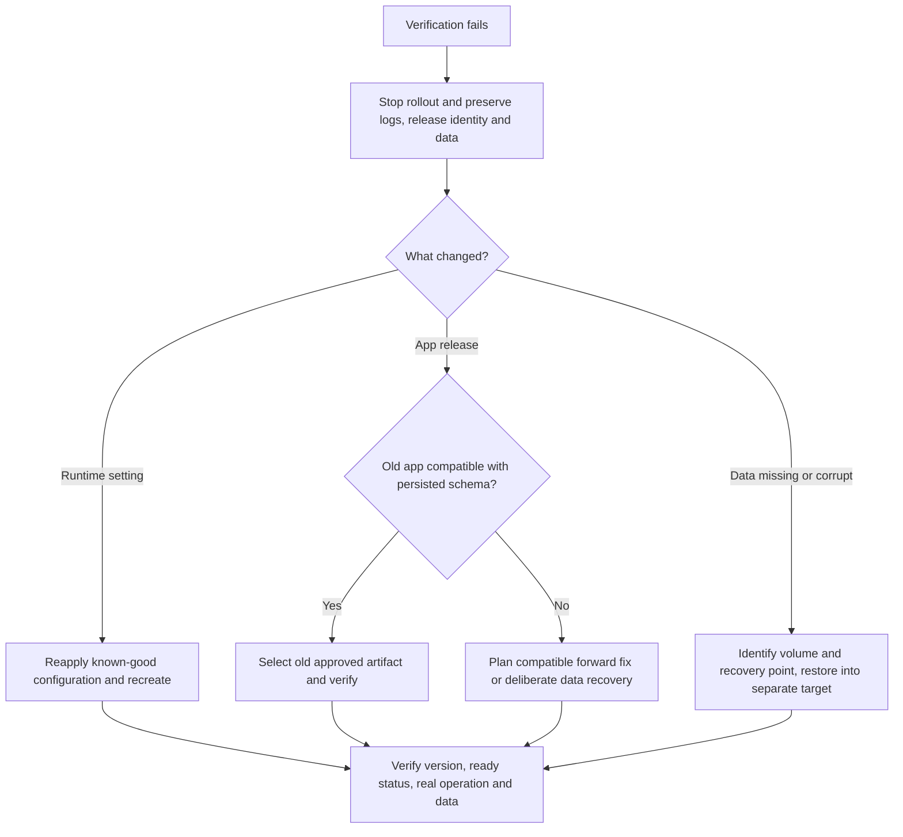

| Situation | Appropriate action |
| --- | --- |
| Candidate fails before any schema change | Reapply known-good artifact and config, preserving the data volume |
| Wrong JDBC endpoint | Correct the caller's runtime setting and recreate the app. Inspect DB health separately |
| New schema no longer supports the old app | Roll forward or use a reviewed DB recovery/migration plan. Application rollback alone cannot fix incompatible SQL |
| PostgreSQL container recreated with the same compatible data volume | Wait for startup and confirm role, schema and rows. Restore is usually unnecessary |
| Disposable volume unavailable | Determine the expected project and mount first. Rehearse restore in a separate target from a validated archive and compare rows and recovery point |

In the lab, V2 adds a nullable column and V1's SQL remains compatible. Simulate a bad app configuration, recover the known-good env and `1.0.0` image, and verify that Flyway history still records `2`. A successful app rollback leaves committed schema changes and data in place. Avoid automatic schema rewinds and edits to migration history. For a real incident, decide explicitly whether accepting data loss, restoring elsewhere, or keeping live data while applying a forward correction is appropriate. [Working recovery drill](#deploy-rollback)

**Key takeaways.** Recover the failed layer and measure the result. App, configuration, and database state require separate compatibility decisions.


<a id="deploy-22"></a>

## Part 22 — Backups and Restore

A named volume protects data from container replacement. A backup is a separate recoverable copy at a known point. If the host, volume, or database is damaged, restore verifies that the copy can produce a usable schema and data in a new target.

| Mechanism | What it does | Practical consequence |
| --- | --- | --- |
| Logical backup | Exports data definitions and rows in an archive or SQL representation | Can restore a selected database with compatible tooling. Cluster roles and other databases need separate planning |
| Physical backup | Captures database storage via a consistent database-aware procedure, often with WAL for recovery | Restores the cluster under version and recovery constraints |
| Restore | Reconstructs state in a target with a specified recovery point | Requires suitable roles, schema, compatible tools and actual verification |
| Volume retention | Preserves the existing live data directory | Keeps normal state across recreation and shares the live system's failure risks |

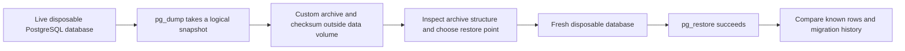

`pg_dump` uses a consistent database snapshot. A filesystem copy of an active PostgreSQL data directory is not equivalent to a coordinated backup. For a live system consider WAL, point-in-time recovery, separate role and config backup, role ownership, and external storage. Protect backups as sensitive data. Define frequency from RPO, retention from recovery and governance goals, and restore rehearsals from RTO. Use a dump tool compatible with the source server and a tested target version. Only restore archives from trusted sources because they can contain executable SQL. [PostgreSQL backup methods](https://www.postgresql.org/docs/17/backup.html) · [PostgreSQL pg_dump](https://www.postgresql.org/docs/17/app-pgdump.html) · [PostgreSQL pg_restore](https://www.postgresql.org/docs/17/app-pgrestore.html)

<a id="deploy-backup"></a>

### Logical backup in the lab

Run from Windows PowerShell with the verified Compose project active. Keep the known note ID and text and the source schema history. Create a new archive and measure when the source snapshot was taken. `-Fc` requests a custom archive. `-f` writes inside PostgreSQL's container, and `compose cp` transfers the binary file without shell text transcoding. Use a fresh output path for each retained backup.

```powershell
New-Item -ItemType Directory -Path .\backups -Force | Out-Null
if (Test-Path -LiteralPath .\backups\deploynotes.dump) {
    throw 'Keep the earlier archive and choose a fresh filename for this run.'
}
docker compose -p $DeployProject exec -T postgres pg_dump -U deploylab -d deploynotes -Fc -f /tmp/deploynotes.dump
if ($LASTEXITCODE) { throw 'pg_dump failed' }
docker compose -p $DeployProject exec -T postgres pg_restore --list /tmp/deploynotes.dump
if ($LASTEXITCODE) { throw 'Archive listing failed' }
docker compose -p $DeployProject cp postgres:/tmp/deploynotes.dump .\backups\deploynotes.dump
if ($LASTEXITCODE) { throw 'Copy failed' }
Get-FileHash -LiteralPath .\backups\deploynotes.dump -Algorithm SHA256
docker compose -p $DeployProject exec -T postgres rm -- /tmp/deploynotes.dump
```

The hash identifies the archive bytes. The archive listing proves that it can be read as an archive. The restore checks that it contains usable data. The `psql` tools run under the demo image's local socket policy inside the correct container, so the lab keeps credentials out of command arguments. A real recovery plan needs a scoped dump role, a controlled connection path, and an archive copy that survives loss of the database host.

<a id="deploy-restore"></a>

### Restore into a fresh database

`createdb -T template0` creates a new clean database. Omit `pg_restore -C` so the explicit `-d deploynotes_restore` target is used. `--no-owner` and `--no-privileges` keep restores independent of source role grants in this test. Review the necessary grants after restoration if promoting a real recovery.

```powershell
docker compose -p $DeployProject cp .\backups\deploynotes.dump postgres:/tmp/deploynotes-restore.dump
if ($LASTEXITCODE) { throw 'Copy to PostgreSQL container failed' }
docker compose -p $DeployProject exec -T postgres createdb -T template0 -U deploylab deploynotes_restore
if ($LASTEXITCODE) { throw 'Restore database creation failed. Use a fresh target.' }
docker compose -p $DeployProject exec -T postgres pg_restore --exit-on-error --no-owner --no-privileges -U deploylab -d deploynotes_restore /tmp/deploynotes-restore.dump
if ($LASTEXITCODE) { throw 'Restore failed. Inspect this disposable target.' }
docker compose -p $DeployProject exec -T postgres psql -X -v ON_ERROR_STOP=1 -U deploylab -d deploynotes_restore -c 'select id, body from notes order by id;'
docker compose -p $DeployProject exec -T postgres psql -X -v ON_ERROR_STOP=1 -U deploylab -d deploynotes_restore -c 'select version, success from flyway_schema_history order by installed_rank;'
docker compose -p $DeployProject exec -T postgres rm -- /tmp/deploynotes-restore.dump
```

Expect the known row and successful migration records from the snapshot. A dump taken after the upgrade includes `1` and `2`. Compare with the recorded source evidence. The original live database remains selected by the app's URL. The restored DB remains disposable in this lab volume until cleanup. Keep the archive in separate protected storage if retaining it. If repeating this test with the same stack, use a fresh restore name in all commands or confirm the previous restored database is disposable before dropping that one database.

**Key takeaways.** Verify a backup by restoring it and checking data. Keep the restore target and original deployment distinct until an authorized cutover.

<a id="deploy-23"></a>

## Part 23 — Deployment Security Checklist

The service is only as isolated as its weakest access path. Attach each safeguard to an owner and verify observable behavior.

| Boundary | Check and evidence |
| --- | --- |
| Application | Verify authentication, object-level authorization, safe errors, and input limits. Review dependency patches and route access |
| Artifact and build | Use known base and dependencies, record version/hash/registry digest, and keep credentials out of build inputs |
| OS and process | Use a dedicated least-privilege identity, restricted file and directory access, and authorized SSH keys with verified host identity |
| Network | Publish only intended ports. Confirm a default private database path and policy for app-to-DB/outbound calls |
| Proxy and TLS | Verify names, chain, dates and actual termination. Overwrite forwarded headers at the trust boundary. Control proxy route scope |
| Runtime configuration | Require secrets, set explicit profiles, verify mounted access, prevent unsafe implicit defaults and control rotation |
| Operational APIs and logs | Limit exposed Actuator routes, protect logs and backup files, and exclude tokens, passwords and raw values |
| Recovery | Test archive integrity, restore, and compatibility. Record which authorized identity can access or use the backups |

In the lab, confirm `docker compose ps` shows host loopback publication for the app, `docker compose port postgres 5432` shows no host mapping in the full stack, and the optional Nginx route rejects `/actuator/health`. Verify app identity with `docker compose exec -T app id` and test secret readability by exit status. The separate direct-JAR database binds only to loopback or the dedicated WSL adapter for the WSL exercise. On an administered server review access policy and restrict administrative networks. Document any authorized exception and its lifetime.

Spring Security, permissions, firewall filtering, TLS, and service identity each protect different decisions. Model what happens when a component is compromised, and choose a fault boundary that limits that component's rights.

**Key takeaways.** Verify controls from the actual paths and identities. Protect inbound traffic, dependency access, and recovery materials together.

<a id="deploy-24"></a>

## Part 24 — Deployment Troubleshooting

Record project or unit, host, release ID, caller, endpoint, exact error, and time. Find the first boundary that lacks evidence. Gather logs before recreating failed containers. Restrict commands to your lab and sensitive diagnostics to known fields.

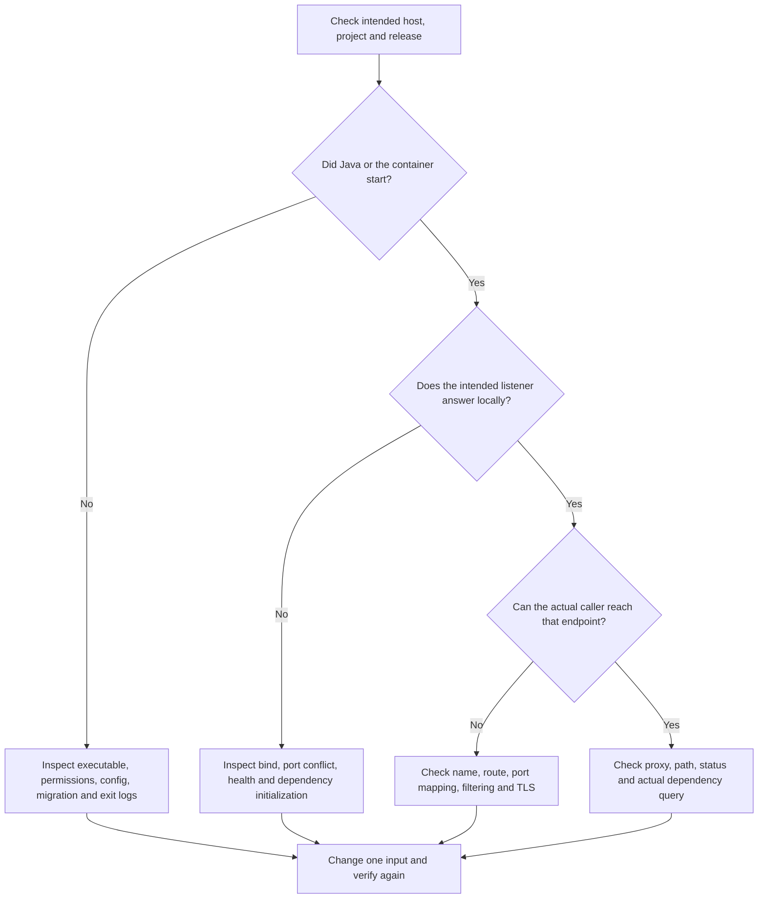

The same response can have multiple root causes. Treat a classification such as “no established TCP connection” as a starting point for targeted checks. In the tables, `UNIT`, `ID` and `PORT` stand for verified objects. Linux commands run in Ubuntu or the named server, and Compose commands run from the selected engine's project directory. In PowerShell use `curl.exe`. If a container has exited, use its retained logs and inspect state before attempting `exec`.

| Symptom and layer | Investigate and interpret | Correct and prevent |
| --- | --- | --- |
| `java: command not found`, launcher | `command -v java` and `type -a java`. Compare systemd `ExecStart` and the intended installed runtime | Install approved JRE on target if missing. Use the verified path and record `java -version` |
| `UnsupportedClassVersionError`, Java compatibility | Compare `java -version` in the actual executor with Maven compiler target and artifact | Deploy the matching Java 21 runtime or rebuild deliberately for a supported target |
| No main manifest or corrupt JAR, artifact | `jar tf`, expected SHA-256, launcher output and archive name | Deploy Boot's verified executable JAR instead of a plain/original archive |
| Config file absent despite present in editor, filesystem | `pwd` and `systemctl --user show -p WorkingDirectory UNIT`. Resolve path from the actual process | Use explicit authorized paths and set cwd in the launcher |
| `Permission denied`, filesystem identity | Compare `id` or unit UID with `ls -ld` on every parent and `test -r` for the file | Grant only necessary traversal/read or temp write rights. Run app as intended user |
| Required key missing, startup config | Read the key name from logs. Check file presence/readability and `SPRING_CONFIG_IMPORT` origin without the body | Supply the correct mounted secret or launcher input and verify fail-fast checks |
| Wrong Spring profile, startup config | Read `/api/release` profiles and startup logs. Compare CLI, env and Config Data | Explicitly set intended profile, remove accidental overrides and verify the result |
| Port already in use, bind | Linux `ss -ltn` or PowerShell `Get-NetTCPConnection -LocalPort PORT`. Check engine port mapping too | Choose another verified lab port. Leave unrelated listeners running |
| HTTP endpoint unreachable, socket/routing | Probe same environment, then actual caller. Check `ss`, `docker compose port` and client destination | Correct app bind, mapping or authorized routing. Verify the original client request |
| Container running but unavailable, readiness | `docker compose ps -a`, `logs`, internal health curl. A PID may be starting or bound on the wrong interface | Fix startup or probe, wait boundedly and verify from client |
| JDBC connection refused, TCP | Look for attempted address in app cause and DB listening evidence. `localhost` in app points to the app stack | Use `postgres:5432` on shared network and wait for DB service |
| JDBC connect timeout, path or pool | Compare PG driver error against pool acquisition message and `getent hosts postgres` from caller. Check route and DB state | Fix the failing route/endpoint or pool contention after evidence. Bound each wait |
| `UnknownHostException`, DNS | `getent hosts NAME` in caller or approved resolver check. Compare name and network membership | Use stable service name on attached network, correct authoritative record or resolver |
| Nginx `502`, upstream | Compare proxy logs, `nginx -t`, and direct app health. Check edge network and upstream address/bind | Correct upstream and route, apply/recreate the scope that changed, and test both hops |
| TLS name/issuer/validity error, transport security | `curl --verbose` with safe request and certificate metadata. Compare SAN, chain, clock, SNI | Fix name, chain, renewal or scoped trusted root. Keep verification enabled |
| Flyway startup fails, schema | Read the first migration/driver error and `flyway_schema_history`. Check checksum, location and SQL transaction outcomes | Recover approved migration set or review a forward correction. Preserve schema and backup evidence |
| Rows missing after recreation, storage | Inspect Compose project, `docker volume ls`, and container mounts with `docker inspect --format '{{json .Mounts}}' ID` | Select intended compatible volume/database or restore to an isolated target. Avoid blind deletion |
| Killed JVM or `137`, resource | `docker inspect --format '{{.State.OOMKilled}} {{.State.ExitCode}}' ID`, `docker stats`, and logs | Differentiate OS kill from Java memory error and stop escalation. Measure resource use before resizing |
| Unhealthy despite working route, health | Compare `.State.Health` command/response with actual internal path, executable and deadline | Align probe signal, target, and startup budget. Validate required dependency health |
| Repeated restart, supervision | Inspect `.RestartCount` and early app logs, or systemd `NRestarts` and journal | Stop only the affected lab app if needed, correct first cause, recreate/restart appropriately |
| Changed behavior after deployment, runtime state | Compare safe effective profile, config, schema, edge path and image/JAR identity | Restore intended inputs or compatible release. Re-run acceptance checks and improve release records |
| Wrong version despite tag, release identity | Compare `/api/release`, container `.Image` and image inspect ID, and confirm actual host/port | Deploy the correct saved artifact once and reconcile the scoped project. Test the same client path |

**Key takeaways.** Use the first unverified boundary to choose the next probe. Preserve evidence and persistent state while correcting the cause.

<a id="deploy-25"></a>

## Part 25 — Deployment Strategies and Trade-offs

Choose a strategy based on tolerated interruption, number of hosts, schema compatibility, and the cost of keeping multiple versions or environments running. Stable artifacts and a tested recovery plan support all of these strategies.

| Strategy | Mechanism | Costs and appropriate use |
| --- | --- | --- |
| Direct JAR on one server | Service manager starts a versioned artifact | Simple runtime. You own JVM installation, host permissions and operating system lifecycle |
| Single host with Compose | Model recreates related app and dependency containers | Repeatable local integration and straightforward operations. One host still represents one failure boundary |
| Manual deployment | Operator executes documented, ordered steps and records evidence | Good for learning and small changes. Human error increases as release frequency and environments grow |
| CI and CD | Automated build/verification and controlled artifact promotion | Repeatable gates and traceable results. Secrets, permissions, approval policy and recovery still need care |
| In-place or restart-based update | Stop and replace the only instance | Short procedure, downtime expected. Keep a maintenance and rollback plan |
| Rolling deployment | Replace subsets behind coordinated routing and readiness | Requires capacity and old/new coexistence, including schema compatibility |
| Blue-green | Prepare two environments and switch traffic | Cutover can be fast. State, capacity, routing and compatibility need coordinated decisions |
| Canary | Send a small part of traffic to the candidate and observe | Limits initial exposure. Needs trustworthy signals, routing and clear abort conditions |
| Immutable deployment | Start a new verified artifact with declarative config and replace old instances | Reproducibility and traceable identity. Persistent data still needs its own managed lifecycle |

For CapsuleAI's current roadmap, practice and record one manual release and rollback on a disposable stack. Use those steps to identify later automation gates. In a single-instance lab, measure time from stop to successful ready/smoke. For a real rolling plan, state what happens while both versions use the same schema and what happens to active requests. Container orchestration and provider-specific setup come in later study.

**Key takeaways.** Match the strategy to the service and recovery budget. Preserve compatible data and verify actual traffic behavior.


<a id="deploy-26"></a>

## Part 26 — End-to-End Deployment Walkthrough

### The lab contract

| Evidence | Expected |
| --- | --- |
| Host | Linux JVM binds `127.0.0.1:18081` and reports `linux-host` under `host` |
| App container | JVM binds `0.0.0.0:8080`, reached from Windows at `127.0.0.1:18080` |
| Compose dependencies | JDBC reaches `postgres:5432` on the project network. The stack has no database host port |
| Optional edge | Nginx accepts HTTP at `127.0.0.1:18082` and optionally TLS at `localhost:18443` |
| Release and API | `GET /api/release` identifies version and profile. `POST /api/notes` writes a synthetic note and `GET /api/notes` reads it |
| Health | `/actuator/health/liveness` and `/actuator/health/readiness` expose different signals |
| Recovery | Known-good app serves the compatible schema. A host archive restores into `deploynotes_restore` |

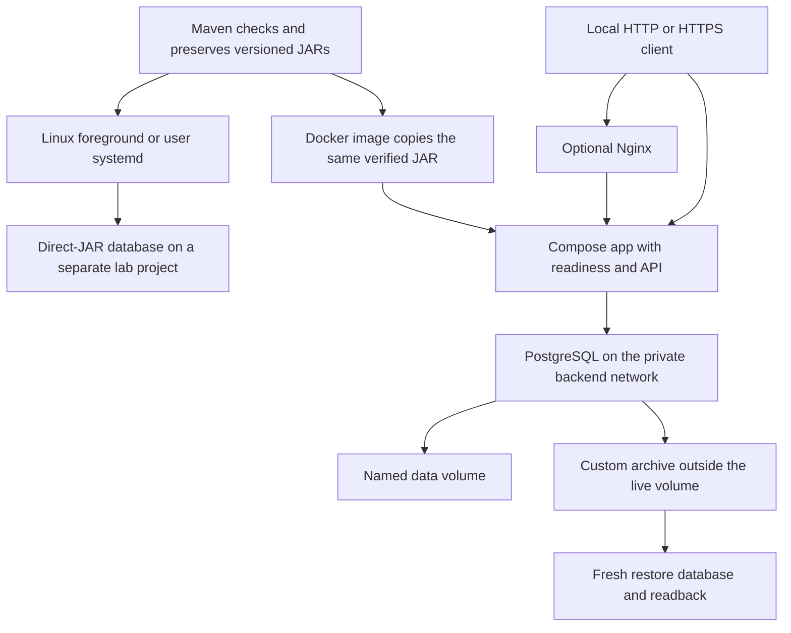

Approach A uses a separate database project with an authorized client path. Approach B demonstrates private service discovery, container replacement, and migration-aware recovery. The service code stays small so the runtime decisions are visible.

<a id="deploy-setup"></a>

### Create a clean practice project

Use a dedicated Windows PowerShell session for both project names.

```powershell
$DeployId = [Guid]::NewGuid().ToString('N').Substring(0, 8)
$DeployRoot = Join-Path ([IO.Path]::GetTempPath()) "deployment-learning-lab-$DeployId"
$DeployProject = "deploy-notes-$DeployId"
$DeployHostProject = "$DeployProject-host"
New-Item -ItemType Directory -Path $DeployRoot | Out-Null
Set-Location -LiteralPath $DeployRoot
$DeployRoot
$DeployProject
$DeployHostProject
java -version
mvn.cmd -v
docker context show
docker compose version
```

Record both project names. Create the files at their exact relative paths using UTF-8 without BOM. The V2 SQL file starts outside the packaged migration directory. Keep it there until building the second artifact. Use the example ports only while they are free. For alternate ports update the listener, published mapping and probe as relevant. The TLS example uses port `18443` in both the mapping and the redirect.

<a id="deploy-files"></a>

### Complete project files

The Maven parent selects compatible dependencies. The lab initializer checks the actual inputs before context initialization creates Flyway and JDBC. Build-info describes the artifact version. The controller binds a SQL parameter for the note text, logs the new ID, and exposes only approved release metadata. Unit tests check the input contract without a database. Live verification separately proves auto-configuration and database access.

<a id="deploy-pom"></a>

#### `pom.xml`

```xml
<?xml version="1.0" encoding="UTF-8"?>
<project xmlns="http://maven.apache.org/POM/4.0.0"
         xmlns:xsi="http://www.w3.org/2001/XMLSchema-instance"
         xsi:schemaLocation="http://maven.apache.org/POM/4.0.0 https://maven.apache.org/xsd/maven-4.0.0.xsd">
    <modelVersion>4.0.0</modelVersion>
    <parent>
        <groupId>org.springframework.boot</groupId>
        <artifactId>spring-boot-starter-parent</artifactId>
        <version>4.0.10</version>
        <relativePath/>
    </parent>
    <groupId>learning.deploy</groupId>
    <artifactId>deploy-notes</artifactId>
    <version>${revision}</version>
    <properties>
        <revision>1.0.0</revision>
        <java.version>21</java.version>
    </properties>
    <dependencies>
        <dependency>
            <groupId>org.springframework.boot</groupId>
            <artifactId>spring-boot-starter-webmvc</artifactId>
        </dependency>
        <dependency>
            <groupId>org.springframework.boot</groupId>
            <artifactId>spring-boot-starter-jdbc</artifactId>
        </dependency>
        <dependency>
            <groupId>org.springframework.boot</groupId>
            <artifactId>spring-boot-starter-flyway</artifactId>
        </dependency>
        <dependency>
            <groupId>org.flywaydb</groupId>
            <artifactId>flyway-database-postgresql</artifactId>
        </dependency>
        <dependency>
            <groupId>org.postgresql</groupId>
            <artifactId>postgresql</artifactId>
            <scope>runtime</scope>
        </dependency>
        <dependency>
            <groupId>org.springframework.boot</groupId>
            <artifactId>spring-boot-starter-actuator</artifactId>
        </dependency>
        <dependency>
            <groupId>org.springframework.boot</groupId>
            <artifactId>spring-boot-starter-test</artifactId>
            <scope>test</scope>
        </dependency>
    </dependencies>
    <build>
        <finalName>deploy-notes</finalName>
        <plugins>
            <plugin>
                <groupId>org.springframework.boot</groupId>
                <artifactId>spring-boot-maven-plugin</artifactId>
                <executions>
                    <execution>
                        <id>build-metadata</id>
                        <goals><goal>build-info</goal></goals>
                    </execution>
                </executions>
            </plugin>
        </plugins>
    </build>
</project>
```

#### `src/main/java/learning/deploy/DeployNotesApplication.java`

```java
package learning.deploy;

import org.springframework.boot.SpringApplication;
import org.springframework.boot.autoconfigure.SpringBootApplication;
import org.springframework.core.env.Environment;

@SpringBootApplication
public class DeployNotesApplication {
    public static void main(String[] args) {
        SpringApplication app = new SpringApplication(DeployNotesApplication.class);
        app.addInitializers(context -> checkRuntimeInputs(context.getEnvironment()));
        app.run(args);
    }

    static void checkRuntimeInputs(Environment environment) {
        require(environment, "spring.datasource.url");
        require(environment, "spring.datasource.username");
        require(environment, "spring.datasource.password");
    }

    private static void require(Environment environment, String key) {
        String value = environment.getProperty(key);
        if (value == null || value.isBlank()) {
            throw new IllegalStateException("Required deployment setting missing: " + key);
        }
    }
}
```

#### `src/main/java/learning/deploy/NotesController.java`

```java
package learning.deploy;

import java.util.List;
import java.util.Map;

import org.slf4j.Logger;
import org.slf4j.LoggerFactory;
import org.springframework.beans.factory.annotation.Value;
import org.springframework.boot.info.BuildProperties;
import org.springframework.core.env.Environment;
import org.springframework.http.HttpStatus;
import org.springframework.jdbc.core.simple.JdbcClient;
import org.springframework.web.bind.annotation.GetMapping;
import org.springframework.web.bind.annotation.PostMapping;
import org.springframework.web.bind.annotation.RequestBody;
import org.springframework.web.bind.annotation.ResponseStatus;
import org.springframework.web.bind.annotation.RestController;
import org.springframework.web.server.ResponseStatusException;

@RestController
final class NotesController {
    private static final Logger LOG = LoggerFactory.getLogger(NotesController.class);

    private final JdbcClient jdbc;
    private final BuildProperties build;
    private final Environment environment;
    private final String site;

    NotesController(JdbcClient jdbc, BuildProperties build, Environment environment,
            @Value("${deploy.site:unselected}") String site) {
        this.jdbc = jdbc;
        this.build = build;
        this.environment = environment;
        this.site = site;
    }

    @GetMapping("/api/release")
    Map<String, Object> release() {
        return Map.of("version", build.getVersion(),
                "site", site, "activeProfiles", List.of(environment.getActiveProfiles()));
    }

    @GetMapping("/api/notes")
    List<Note> notes() {
        return jdbc.sql("select id, body as text from notes order by id limit 50")
                .query(Note.class).list();
    }

    @PostMapping("/api/notes")
    @ResponseStatus(HttpStatus.CREATED)
    Note create(@RequestBody Draft draft) {
        String text = draft.text() == null ? "" : draft.text().strip();
        if (text.isEmpty() || text.length() > 200) {
            throw new ResponseStatusException(HttpStatus.BAD_REQUEST, "Use 1 to 200 characters");
        }
        Note note = jdbc.sql("insert into notes (body) values (:body) returning id, body as text")
                .param("body", text)
                .query(Note.class).single();
        LOG.info("Note created id={}", note.id());
        return note;
    }

    public record Note(long id, String text) {}
    public record Draft(String text) {}
}
```

#### `src/test/java/learning/deploy/RuntimeInputsTest.java`

```java
package learning.deploy;

import org.junit.jupiter.api.Test;
import org.springframework.mock.env.MockEnvironment;

import static org.junit.jupiter.api.Assertions.assertDoesNotThrow;
import static org.junit.jupiter.api.Assertions.assertEquals;
import static org.junit.jupiter.api.Assertions.assertThrows;

class RuntimeInputsTest {
    private final MockEnvironment inputs = new MockEnvironment()
            .withProperty("spring.datasource.url", "jdbc:postgresql://localhost:15452/deploynotes")
            .withProperty("spring.datasource.username", "deploylab");

    @Test
    void rejectsAnAbsentPassword() {
        IllegalStateException error = assertThrows(IllegalStateException.class,
                () -> DeployNotesApplication.checkRuntimeInputs(inputs));
        assertEquals("Required deployment setting missing: spring.datasource.password",
                error.getMessage());
    }

    @Test
    void acceptsAnExplicitTestValue() {
        inputs.setProperty("spring.datasource.password", "test-fixture-only");
        assertDoesNotThrow(() -> DeployNotesApplication.checkRuntimeInputs(inputs));
    }
}
```

#### `src/main/resources/application.properties`

```properties
spring.application.name=deploy-notes
server.address=127.0.0.1
server.port=18081
server.forward-headers-strategy=none
server.shutdown=graceful
spring.lifecycle.timeout-per-shutdown-phase=10s

spring.datasource.hikari.maximum-pool-size=4
spring.datasource.hikari.connection-timeout=2000
spring.flyway.connect-retries=2
spring.flyway.ignore-migration-patterns=*:future
spring.sql.init.mode=never

management.endpoints.web.exposure.include=health
management.endpoint.health.show-details=never
management.endpoint.health.probes.enabled=true
management.endpoint.health.group.readiness.include=readinessState,db
```

#### `src/main/resources/application-host.properties`

```properties
deploy.site=linux-host
```

#### `src/main/resources/application-deploy.properties`

```properties
deploy.site=compose
```

#### `src/main/resources/db/migration/V1__create_notes.sql`

```sql
CREATE TABLE notes (
    id bigint GENERATED ALWAYS AS IDENTITY PRIMARY KEY,
    body varchar(200) NOT NULL
);
```

#### `V2__add_note_source.sql`

```sql
ALTER TABLE notes ADD COLUMN source varchar(30);
```

<a id="deploy-dockerfile"></a>

#### `Dockerfile`

```dockerfile
FROM maven:3.9-eclipse-temurin-21 AS build
WORKDIR /src
COPY pom.xml .
RUN mvn -B -ntp dependency:go-offline
COPY src ./src
ARG RELEASE=1.0.0
RUN mvn -B -ntp -Drevision=${RELEASE} clean package

FROM eclipse-temurin:21-jre-noble AS runtime
WORKDIR /app
RUN test -x /usr/bin/curl
USER 10001:10001
EXPOSE 8080
ENTRYPOINT ["java","-jar","/app/app.jar"]

FROM runtime AS from-source
COPY --from=build --chown=10001:10001 /src/target/deploy-notes.jar /app/app.jar

FROM runtime AS packaged
COPY --chown=10001:10001 target/deploy-notes.jar /app/app.jar
```

#### `.dockerignore`

```text
.git
.env
.env.*
secrets/
host-db-secrets/
tls/
backups/
releases/
target/*
!target/deploy-notes.jar
```

#### `.gitignore`

```text
target/
releases/
backups/
secrets/
host-db-secrets/
tls/
.env
.env.*
```

<a id="deploy-compose"></a>

#### `compose.yaml`

```yaml
services:
  app:
    image: "${COMPOSE_PROJECT_NAME}-notes:${DEPLOY_RELEASE:-1.0.0}"
    pull_policy: never
    environment:
      SPRING_PROFILES_ACTIVE: "${DEPLOY_PROFILE:-deploy}"
      SERVER_ADDRESS: "0.0.0.0"
      SERVER_PORT: "8080"
      SPRING_DATASOURCE_URL: "jdbc:postgresql://${DEPLOY_DB_HOST:-postgres}:5432/deploynotes?connectTimeout=2"
      SPRING_DATASOURCE_USERNAME: deploylab
      SPRING_CONFIG_IMPORT: "configtree:/run/secrets/"
    secrets:
      - source: db_password
        target: spring.datasource.password
    ports:
      - "127.0.0.1:${DEPLOY_APP_PORT:-18080}:8080"
    networks: [backend, edge]
    depends_on:
      postgres:
        condition: service_healthy
    restart: "on-failure:3"
    stop_grace_period: 20s
    mem_limit: 512m
    healthcheck:
      test: ["CMD", "curl", "-fsS", "--max-time", "3", "http://127.0.0.1:8080/actuator/health/readiness"]
      interval: 5s
      timeout: 4s
      retries: 5
      start_period: 20s

  postgres:
    image: postgres:17.11-bookworm
    environment:
      POSTGRES_DB: deploynotes
      POSTGRES_USER: deploylab
      POSTGRES_PASSWORD_FILE: /run/secrets/db-password
    secrets:
      - source: db_password
        target: db-password
    volumes:
      - pg-data:/var/lib/postgresql/data
    networks: [backend]
    restart: unless-stopped
    healthcheck:
      test: ["CMD", "pg_isready", "-h", "127.0.0.1", "-U", "deploylab", "-d", "deploynotes"]
      interval: 3s
      timeout: 2s
      retries: 15

  proxy:
    profiles: [edge]
    image: nginx:alpine
    user: "101:101"
    entrypoint: ["nginx", "-g", "daemon off;"]
    ports:
      - "127.0.0.1:${DEPLOY_EDGE_PORT:-18082}:8080"
    volumes:
      - ./proxy/nginx.conf:/etc/nginx/nginx.conf:ro
      - ./proxy/routes.conf:/etc/nginx/notes-routes.conf:ro
    networks: [edge]
    depends_on:
      app:
        condition: service_healthy

secrets:
  db_password:
    file: ./secrets/db-password
volumes:
  pg-data:
networks:
  backend:
  edge:
```

<a id="deploy-host-compose"></a>

#### `compose.host.yaml`

```yaml
services:
  postgres:
    image: postgres:17.11-bookworm
    environment:
      POSTGRES_DB: deploynotes
      POSTGRES_USER: deploylab
      POSTGRES_PASSWORD_FILE: /run/secrets/db-password
    secrets:
      - source: db_password
        target: db-password
    ports:
      - "${HOST_DB_BIND:-127.0.0.1}:${HOST_DB_PORT:-15452}:5432"
    volumes:
      - host-data:/var/lib/postgresql/data
    healthcheck:
      test: ["CMD", "pg_isready", "-h", "127.0.0.1", "-U", "deploylab", "-d", "deploynotes"]
      interval: 3s
      timeout: 2s
      retries: 15
secrets:
  db_password:
    file: ./host-db-secrets/db-password
volumes:
  host-data:
```

#### `proxy/nginx.conf`

```nginx
pid /tmp/nginx.pid;
error_log /dev/stderr warn;
events { worker_connections 256; }
http {
    log_format deploy '$status $request_method $uri $request_time $request_id';
    access_log /dev/stdout deploy;
    client_body_temp_path /tmp/nginx-client;
    proxy_temp_path /tmp/nginx-proxy;
    fastcgi_temp_path /tmp/nginx-fastcgi;
    uwsgi_temp_path /tmp/nginx-uwsgi;
    scgi_temp_path /tmp/nginx-scgi;
    resolver 127.0.0.11 valid=3s ipv6=off;

    server {
        listen 8080;
        server_name localhost;
        include /etc/nginx/notes-routes.conf;
    }
}
```

#### `proxy/nginx-tls.conf`

```nginx
pid /tmp/nginx.pid;
error_log /dev/stderr warn;
events { worker_connections 256; }
http {
    log_format deploy '$status $request_method $uri $request_time $request_id';
    access_log /dev/stdout deploy;
    client_body_temp_path /tmp/nginx-client;
    proxy_temp_path /tmp/nginx-proxy;
    fastcgi_temp_path /tmp/nginx-fastcgi;
    uwsgi_temp_path /tmp/nginx-uwsgi;
    scgi_temp_path /tmp/nginx-scgi;
    resolver 127.0.0.11 valid=3s ipv6=off;

    server {
        listen 8080;
        server_name localhost;
        return 308 https://localhost:18443$request_uri;
    }
    server {
        listen 8443 ssl;
        server_name localhost;
        ssl_certificate /etc/nginx/lab-tls/cert.pem;
        ssl_certificate_key /etc/nginx/lab-tls/key.pem;
        ssl_protocols TLSv1.2 TLSv1.3;
        include /etc/nginx/notes-routes.conf;
    }
}
```

<a id="deploy-proxy"></a>

#### `proxy/routes.conf`

```nginx
location /api/ {
    set $upstream app:8080;
    proxy_pass http://$upstream;
    proxy_http_version 1.1;
    proxy_set_header Host $host;
    proxy_set_header Forwarded "";
    proxy_set_header X-Forwarded-For $remote_addr;
    proxy_set_header X-Forwarded-Proto $scheme;
    proxy_set_header X-Forwarded-Host $host;
    proxy_set_header X-Forwarded-Port "";
    proxy_set_header X-Request-ID $request_id;
    add_header X-Request-ID $request_id always;
    client_max_body_size 16k;
    proxy_connect_timeout 2s;
    proxy_read_timeout 5s;
}
location / {
    return 404;
}
```

#### `compose.tls.yaml`

```yaml
services:
  proxy:
    ports:
      - "127.0.0.1:18443:8443"
    volumes:
      - ./proxy/nginx-tls.conf:/etc/nginx/nginx.conf:ro
      - ./tls:/etc/nginx/lab-tls:ro
```

<a id="deploy-unit"></a>

#### `deploy-notes-lab.service`

```ini
[Unit]
Description=Disposable Deploy Notes backend
StartLimitIntervalSec=30s
StartLimitBurst=3

[Service]
Type=exec
WorkingDirectory=%h/deployment-learning-lab/host
EnvironmentFile=%h/deployment-learning-lab/host/app.env
ExecStart=/usr/bin/java -jar %h/deployment-learning-lab/host/current/deploy-notes.jar
Restart=on-failure
RestartSec=3s
TimeoutStopSec=20s
NoNewPrivileges=yes

[Install]
WantedBy=default.target
```

### Build and retain two releases

Windows PowerShell, from `$DeployRoot`. Review the tests and build results after each package.

```powershell
mvn.cmd -B -ntp '-Drevision=1.0.0' clean package
if ($LASTEXITCODE) { throw 'v1 build failed' }
New-Item -ItemType Directory -Path .\releases -Force | Out-Null
Copy-Item -LiteralPath .\target\deploy-notes.jar -Destination .\releases\deploy-notes-1.0.0.jar
Copy-Item -LiteralPath .\V2__add_note_source.sql -Destination .\src\main\resources\db\migration\V2__add_note_source.sql
mvn.cmd -B -ntp '-Drevision=1.1.0' clean package
if ($LASTEXITCODE) { throw 'v2 build failed' }
Copy-Item -LiteralPath .\target\deploy-notes.jar -Destination .\releases\deploy-notes-1.1.0.jar
Get-FileHash -Algorithm SHA256 -LiteralPath .\releases\deploy-notes-1.0.0.jar, .\releases\deploy-notes-1.1.0.jar
```

The first artifact carries V1. The second carries V1 and V2. Both include `META-INF/build-info.properties` under the executable JAR's application classes and return their own version. To repeat a v1 build use a clean v1 source tree without V2. Use the saved v1 artifact for rollback.

### Generate the two disposable database inputs

Run once per new practice project in Windows PowerShell.

```powershell
$DeployRng = [Security.Cryptography.RandomNumberGenerator]::Create()
try {
    foreach ($Folder in @('secrets','host-db-secrets')) {
        if (Test-Path -LiteralPath $Folder) { throw "Reuse the lab files and matching volume for $Folder" }
        New-Item -ItemType Directory -Path $Folder | Out-Null
        $SecretBytes = New-Object byte[] 32
        $DeployRng.GetBytes($SecretBytes)
        [IO.File]::WriteAllText(
            (Join-Path (Join-Path $DeployRoot $Folder) 'db-password'),
            [Convert]::ToBase64String($SecretBytes),
            [Text.UTF8Encoding]::new($false))
    }
} finally {
    $DeployRng.Dispose()
}
Test-Path -LiteralPath .\secrets\db-password
Test-Path -LiteralPath .\host-db-secrets\db-password
```

The checks report presence. The files differ and remain paired with their own initialized database volumes. Restrict the parent directory to the lab owner. The initialization step consumes each password on the first empty-volume run. The Docker build excludes both locations.


<a id="deploy-host"></a>

### Approach A — Direct JAR on Ubuntu

The JVM runs in Ubuntu outside containers. The [isolated database service](#deploy-host-compose) supplies PostgreSQL for this approach. On a conventional Linux VM with its own Docker engine, transfer the verified release files and matching lab credential through an authorized path. Run PostgreSQL on that VM with `compose.host.yaml` and default `HOST_DB_BIND=127.0.0.1`. In a WSL2 setup with verified Windows loopback access, the Docker Desktop database can also use that binding. For WSL2 NAT mode, use the dedicated Windows adapter as follows. This binding keeps PostgreSQL off general Windows interfaces. Use the VM's loopback path if host policy blocks it.

In Windows PowerShell, select your actual Ubuntu distro and confirm its IPv4 gateway is the Windows WSL adapter.

```powershell
$DeployDistro = 'Ubuntu-24.04'
$WslRoute = @(wsl.exe -d $DeployDistro --exec ip -4 route show default) -join ' '
if ($WslRoute -notmatch '\bvia ([0-9.]+)\b') { throw 'No WSL IPv4 gateway. Use the VM or verified loopback route.' }
$WslHostAddress = $Matches[1]
$WslAdapter = Get-NetIPAddress -AddressFamily IPv4 -IPAddress $WslHostAddress -ErrorAction SilentlyContinue |
    Where-Object InterfaceAlias -Like 'vEthernet (WSL*'
if (-not $WslAdapter) { throw 'Gateway does not match the dedicated Windows WSL adapter.' }
$env:HOST_DB_BIND = $WslHostAddress
$env:HOST_DB_PORT = '15452'
docker compose -p $DeployHostProject -f compose.host.yaml config --quiet
if ($LASTEXITCODE) { throw 'Host database model invalid' }
docker compose -p $DeployHostProject -f compose.host.yaml up -d --wait --wait-timeout 60 postgres
if ($LASTEXITCODE) { throw 'Host database failed to start' }
docker compose -p $DeployHostProject -f compose.host.yaml port postgres 5432
wsl.exe -d $DeployDistro --exec wslpath -a $DeployRoot
```

Use the printed IP and WSL path below. For the native VM alternative substitute the copied project path and `127.0.0.1`. Start its own host-db project with `docker compose -p UNIQUE_HOST_PROJECT -f compose.host.yaml up -d --wait postgres` in Bash. This dedicated mapping exists to make the host JVM a database client. The full Compose stack keeps its DB port private.

In Ubuntu Bash, replace the source and address placeholders first. Keep deployed files in Linux home so Linux permissions apply.

```bash
ProjectSource='/mnt/c/path/from/wslpath'
HostDbAddress='REPLACE_WITH_DB_IP'
HostDbPort=15452
HostRoot="$HOME/deployment-learning-lab/host"

test -f "$ProjectSource/releases/deploy-notes-1.0.0.jar" || exit 1
timeout 3 bash -c 'exec 3<>"/dev/tcp/$1/$2"' _ "$HostDbAddress" "$HostDbPort" || exit 1
if [ -e "$HostRoot" ] || [ -L "$HostRoot" ]; then
    printf '%s\n' 'Use the existing course deployment or a fresh lab context.' >&2
    exit 1
fi
install -d -m 700 -- "$HostRoot" "$HostRoot/secrets" "$HostRoot/releases/1.0.0" "$HostRoot/releases/1.1.0"
install -m 644 -- "$ProjectSource/releases/deploy-notes-1.0.0.jar" "$HostRoot/releases/1.0.0/deploy-notes.jar"
install -m 644 -- "$ProjectSource/releases/deploy-notes-1.1.0.jar" "$HostRoot/releases/1.1.0/deploy-notes.jar"
install -m 600 -- "$ProjectSource/host-db-secrets/db-password" "$HostRoot/secrets/spring.datasource.password"
ln -s -- releases/1.0.0 "$HostRoot/current"
cat > "$HostRoot/app.env" <<EOF
SPRING_PROFILES_ACTIVE=host
SPRING_DATASOURCE_URL=jdbc:postgresql://$HostDbAddress:$HostDbPort/deploynotes?connectTimeout=2
SPRING_DATASOURCE_USERNAME=deploylab
SPRING_CONFIG_IMPORT="configtree:$HostRoot/secrets/"
SERVER_ADDRESS=127.0.0.1
SERVER_PORT=18081
EOF
java -version
sha256sum "$HostRoot/current/deploy-notes.jar"
```

The first checks establish artifact availability and a TCP path. Match the JAR hash to the Windows output. The app environment contains a config-tree path and the appropriately named file supplies the secret. Use the actual Java executable. The Ubuntu unit uses `/usr/bin/java`. If a VM uses another path, identify it with `command -v java` and update the lab's unit to that absolute path.

Start the foreground JVM in Ubuntu Bash.

```bash
cd "$HOME/deployment-learning-lab/host" || exit 1
(
    set -a
    . ./app.env
    set +a
    exec /usr/bin/java -jar ./current/deploy-notes.jar
)
```

After startup completes, probe from a second Ubuntu Bash tab.

```bash
ss -ltn 'sport = :18081'
ps -eo pid,user,args | grep '[d]eploy-notes.jar'
curl --noproxy '*' -fsS http://127.0.0.1:18081/api/release
curl --noproxy '*' -fsS http://127.0.0.1:18081/actuator/health/readiness
curl --noproxy '*' -fsS -H 'Content-Type: application/json' \
    -d '{"text":"host probe"}' http://127.0.0.1:18081/api/notes
curl --noproxy '*' -fsS http://127.0.0.1:18081/api/notes
```

Expect `1.0.0`, `linux-host`, readiness `UP`, and a readback of the note. Press Ctrl+C in the launch tab before using the unit on the same port. Logs identify whether a startup fault involves a missing key, Flyway, or the server bind. To practice missing input with an empty secret directory, see [Solution 24](Deployment_Exercises_and_Solutions.md#deploy-solution-24).

If the user manager is available, install the [lab unit](#deploy-unit) from Ubuntu Bash using the same `ProjectSource`.

```bash
UnitPath="$HOME/.config/systemd/user/deploy-notes-lab.service"
if [ -e "$UnitPath" ] || [ -L "$UnitPath" ]; then
    printf '%s\n' 'A unit already exists. Verify its ownership before proceeding.' >&2
    exit 1
fi
mkdir -p -- "$HOME/.config/systemd/user"
install -m 644 -- "$ProjectSource/deploy-notes-lab.service" "$UnitPath"
systemd-analyze --user verify "$UnitPath" || exit 1
systemctl --user daemon-reload
systemctl --user start deploy-notes-lab.service
systemctl --user status deploy-notes-lab.service --no-pager
journalctl --user -u deploy-notes-lab.service -n 25 --no-pager
```

Run the same HTTP probes after readiness. `systemctl --user restart deploy-notes-lab.service` performs a controlled restart. Use a versioned link to plan the update while retaining the previous artifact and database. `mv -T` treats the destination as a path. The rename within one directory replaces that symlink.

```bash
cd "$HOME/deployment-learning-lab/host" || exit 1
test -L current || exit 1
ln -s -- releases/1.1.0 current.next && mv -Tf -- current.next current || exit 1
systemctl --user restart deploy-notes-lab.service
journalctl --user -u deploy-notes-lab.service -n 40 --no-pager
```

After readiness, `/api/release` shows `1.1.0` and the note is still present. Without the user manager, stop the foreground JVM, switch the same symlink, and relaunch using the original command. Confirm the new version and expected migrated state. On finishing the systemd exercise, stop and remove only the unit you installed in Ubuntu.

```bash
systemctl --user stop deploy-notes-lab.service
rm -- "$HOME/.config/systemd/user/deploy-notes-lab.service"
systemctl --user daemon-reload
```

Stop any foreground JVM. In Windows PowerShell `docker compose -p $DeployHostProject -f compose.host.yaml down` removes the host database container and its scoped publication. Keep its password with its retained volume. See [scoped cleanup](#deploy-cleanup) to discard that data.


<a id="deploy-build-images"></a>

### Approach B — Image and Compose deployment

From Windows PowerShell, build the `packaged` target using each saved JAR and a release-specific tag.

```powershell
Copy-Item -LiteralPath .\releases\deploy-notes-1.0.0.jar -Destination .\target\deploy-notes.jar
docker build --target packaged -t "${DeployProject}-notes:1.0.0" .
if ($LASTEXITCODE) { throw 'v1 image build failed' }
Copy-Item -LiteralPath .\releases\deploy-notes-1.1.0.jar -Destination .\target\deploy-notes.jar
docker build --target packaged -t "${DeployProject}-notes:1.1.0" .
if ($LASTEXITCODE) { throw 'v2 image build failed' }
docker image inspect "${DeployProject}-notes:1.0.0" "${DeployProject}-notes:1.1.0" --format '{{.Id}} {{json .RepoTags}}'
```

Record the IDs. In a registry workflow record the verified published digest as well. The other target provides a complete multi-stage build for the current v2 source. Try `docker build --target from-source --build-arg RELEASE=1.1.0 -t "${DeployProject}-notes:source-demo" .` for a separate demo image, and retain the packaged versions for the rollout. The runtime stage carries the JRE and JAR. The builder stage carries the JDK and Maven.

Use the same PowerShell session for the following launch inputs.

```powershell
$env:DEPLOY_RELEASE = '1.0.0'
$env:DEPLOY_PROFILE = 'deploy'
$env:DEPLOY_DB_HOST = 'postgres'
$env:DEPLOY_APP_PORT = '18080'
$env:DEPLOY_EDGE_PORT = '18082'
$DeployBase = 'http://127.0.0.1:18080'
docker compose -p $DeployProject config --quiet
if ($LASTEXITCODE) { throw 'Compose model invalid' }
docker compose -p $DeployProject up -d --wait --wait-timeout 90
if ($LASTEXITCODE) { throw 'Startup failed. Inspect app and postgres logs.' }
docker compose -p $DeployProject ps
docker compose -p $DeployProject port app 8080
docker compose -p $DeployProject exec -T app id
docker compose -p $DeployProject exec -T app sh -c 'test -r /run/secrets/spring.datasource.password'
$LASTEXITCODE
docker compose -p $DeployProject exec -T app sha256sum /app/app.jar
```

Expect both services healthy, a loopback mapping for the app, app UID `10001`, exit `0` for the file probe, and a JAR hash matching v1. Check migration V1 in the app log. Run the smoke test and retain the note for the persistence check.

```powershell
curl.exe --noproxy '*' -fsS "$DeployBase/api/release"
curl.exe --noproxy '*' -fsS "$DeployBase/actuator/health/readiness"
$DeployPayload = @{text='deployment proof note'} | ConvertTo-Json -Compress
$CreatedNote = Invoke-RestMethod -Method Post -Uri "$DeployBase/api/notes" -ContentType 'application/json' -Body $DeployPayload
$CreatedNote
Invoke-RestMethod "$DeployBase/api/notes"
docker compose -p $DeployProject exec -T postgres psql -X -v ON_ERROR_STOP=1 -U deploylab -d deploynotes -c 'select id, body from notes order by id;'
```

Use `docker compose -p $DeployProject restart app` and wait for readiness before repeating the read. For a persistence proof recreate the disposable database container with the same database volume. This interrupts database service.

```powershell
$BeforeDb = docker compose -p $DeployProject ps -q postgres
docker compose -p $DeployProject up -d --no-deps --force-recreate --wait --wait-timeout 60 postgres
$AfterDb = docker compose -p $DeployProject ps -q postgres
$BeforeDb -ne $AfterDb
docker volume ls --filter "label=com.docker.compose.project=$DeployProject"
```

Expect a new database container ID and the same volume name. Retry app readiness while the pool reconnects and confirm the original note survives. If it fails, inspect app and DB logs. A different Compose project name would select a different database volume.

<a id="deploy-rollback"></a>

### Update, break and recover an application release

Use Windows PowerShell. Start with a reachable PostgreSQL service and v1 accepting traffic.

```powershell
$DeployPreviousDb = docker compose -p $DeployProject ps -q postgres
$env:DEPLOY_RELEASE = '1.1.0'
docker compose -p $DeployProject up -d --no-deps --force-recreate --wait --wait-timeout 90 app
curl.exe --noproxy '*' -fsS "$DeployBase/api/release"
docker compose -p $DeployProject exec -T postgres psql -X -v ON_ERROR_STOP=1 -U deploylab -d deploynotes -c 'select version, success from flyway_schema_history order by installed_rank;'
Invoke-RestMethod "$DeployBase/api/notes"
```

Verify `1.1.0`, V1 and V2 history, the same database container, and your original row. Apply a deliberate bad hostname with the candidate release.

```powershell
$env:DEPLOY_DB_HOST = 'localhost'
docker compose -p $DeployProject up -d --no-deps --force-recreate app
docker compose -p $DeployProject ps -a
docker compose -p $DeployProject logs --tail 45 app
```

Wait until the startup error is visible. The app reaches its own namespace and its target PostgreSQL port has no matching listener. Flyway cannot finish. PostgreSQL remains healthy. A running HTTP proxy may report `502` while the upstream is unavailable. Restore the known-good image and database endpoint.

```powershell
$env:DEPLOY_DB_HOST = 'postgres'
$env:DEPLOY_RELEASE = '1.0.0'
docker compose -p $DeployProject up -d --no-deps --force-recreate --wait --wait-timeout 90 app
curl.exe --noproxy '*' -fsS "$DeployBase/api/release"
Invoke-RestMethod "$DeployBase/api/notes"
$DeployPreviousDb -ceq (docker compose -p $DeployProject ps -q postgres)
docker compose -p $DeployProject exec -T postgres psql -X -v ON_ERROR_STOP=1 -U deploylab -d deploynotes -c 'select version, success from flyway_schema_history order by installed_rank;'
```

Expect `1.0.0`, the original note, `True` for the database ID comparison, and V2 still present. This is a deliberate, compatible app rollback. Use the [backup](#deploy-backup) and [restore](#deploy-restore) procedure now and verify the known note and migrations in the isolated restore database.

<a id="deploy-tls"></a>

### Optional Nginx and scoped TLS

First start and probe the HTTP proxy as in [Part 10](#deploy-10). Keep the app running. The TLS override replaces the Nginx config by matching its mount target, retains the route snippet, and adds the host loopback HTTPS mapping. Use the same override file for later TLS-specific commands. [Compose override merge semantics](https://docs.docker.com/reference/compose-file/merge/)

From Windows PowerShell create a fresh TLS directory. The generator runs as the proxy's UID/GID so the non-root proxy can read its private key with restrictive permissions.

```powershell
$TlsDir = (New-Item -ItemType Directory -Path .\tls -ErrorAction Stop).FullName
docker run --rm --network none --user 101:101 --mount "type=bind,source=$TlsDir,target=/tls" --entrypoint openssl eclipse-temurin:21-jdk-noble req -x509 -newkey rsa:2048 -nodes -sha256 -days 2 -subj '/CN=localhost' -addext 'subjectAltName=DNS:localhost' -keyout /tls/key.pem -out /tls/cert.pem
if ($LASTEXITCODE) { throw 'Certificate generation failed' }
docker compose -p $DeployProject -f compose.yaml -f compose.tls.yaml --profile edge config --quiet
docker compose -p $DeployProject -f compose.yaml -f compose.tls.yaml --profile edge up -d --no-deps --force-recreate proxy
docker compose -p $DeployProject -f compose.yaml -f compose.tls.yaml --profile edge exec -T proxy nginx -t
curl.exe --noproxy '*' -sS -I http://127.0.0.1:18082/api/release
curl.exe --noproxy '*' --resolve 'localhost:18443:127.0.0.1' --cacert .\tls\cert.pem -fsS https://localhost:18443/api/release
curl.exe --noproxy '*' --cacert .\tls\cert.pem -sS https://127.0.0.1:18443/api/release
$LASTEXITCODE
```

Expect `308`, success with the verified name `localhost`, and a nonzero exit for the IP URL. If proxy startup fails, inspect its logs and key access for UID `101`. Keep the key private and use only the certificate for this per-command trust. Use the same model for `stop proxy` if pausing the TLS demo. A public service needs ownership validation, trusted issuance, renewal, and route verification. [OpenSSL req](https://docs.openssl.org/3.0/man1/openssl-req/) · [curl TLS verification](https://curl.se/docs/sslcerts.html)

<a id="deploy-cleanup"></a>

### Scoped cleanup

From Windows PowerShell, after stopping the host JVM or unit, use the names recorded when you created the projects. The base app model includes the optional edge service.

```powershell
docker compose -p $DeployProject --profile edge down
docker compose -p $DeployHostProject -f compose.host.yaml down
docker volume ls --filter "label=com.docker.compose.project=$DeployProject"
docker volume ls --filter "label=com.docker.compose.project=$DeployHostProject"
```

The containers and their networks are removed. Named volumes remain. Keep each password file paired with its volume if retaining data. To intentionally discard the full stack's disposable data, confirm exact ownership. This removal permanently deletes the lab database and any restore target in that cluster.

```powershell
$Volume = "${DeployProject}_pg-data"
$Owned = @(docker volume ls --filter "label=com.docker.compose.project=$DeployProject" --format '{{.Name}}')
if ($LASTEXITCODE -ne 0 -or $Owned -cnotcontains $Volume) { throw 'Lab volume ownership not confirmed' }
docker volume rm $Volume
```

For the separate host DB use the same label check with `$DeployHostProject` and `"${DeployHostProject}_host-data"`. Remove only your versioned lab image tags. Keep or deliberately discard the scratch archive and lab secret files after their consumers stop. Remove the exact Ubuntu host lab tree and Windows scratch folder when finished. For retained backups use restricted storage.

**Key takeaways.** Prove a deployable artifact, managed startup, database-backed behavior, compatible rollback, and restorable data from separate observations.


## Deployment Lifecycle Summary

Take a reviewed change through build, tests, packaging, and a release record. Supply runtime configuration and authorized secret references to the target. Start through a supervisor or engine, confirm the actual artifact and scope, verify readiness and the API, then monitor and exercise recovery. Reuse these gates for an update. Choose recovery using the live schema and data state.

## Deployment Command Cheat Sheet

| Need | Command and environment |
| --- | --- |
| Package and identify JAR | Windows PowerShell `mvn.cmd -B -ntp '-Drevision=1.0.0' clean package`, then `Get-FileHash` |
| Inspect archive | `jar tf PATH` where the JDK is installed |
| Inspect runtime process and socket | Ubuntu `ps -eo pid,user,args` and `ss -ltn` with a narrow port filter |
| Inspect supervised startup | Ubuntu `systemctl --user status deploy-notes-lab.service`, then `journalctl --user -u deploy-notes-lab.service -n 40 --no-pager` |
| Verify scope and model | PowerShell `docker context show` and `docker compose -p $DeployProject config --quiet` |
| Start or replace scoped services | `docker compose -p $DeployProject up -d --wait` or `up -d --no-deps --force-recreate --wait app` after reviewing target and inputs |
| Check port and who listens | `docker compose -p $DeployProject port app 8080` and Windows `Get-NetTCPConnection` |
| Inspect service state and recent error | `docker compose -p $DeployProject ps -a` and `logs --tail 40 app postgres` |
| Query private health path | PowerShell `curl.exe --noproxy '*' -i "$DeployBase/actuator/health/readiness"` |
| Verify PostgreSQL data | `docker compose -p $DeployProject exec -T postgres psql -U deploylab -d deploynotes` in the disposable lab |
| Copy a logical archive | Container `pg_dump -Fc -f PATH` then host `docker compose cp` |
| Restore to another target | `createdb -T template0 TARGET`, then `pg_restore --exit-on-error -d TARGET ARCHIVE` |

## Deployment Checklists

### Direct JAR deployment

- [ ] Verified Java 21 and deployable JAR hash.
- [ ] Effective runtime user, working directory, and secret path.
- [ ] Required profile and JDBC endpoint set in actual launcher.
- [ ] Unit command, startup logs, actual bind, readiness, and smoke verified.
- [ ] Stop or restart observed, with last known-good artifact retained.

### Docker Compose deployment

- [ ] Intended engine, project, service names, and resolved model.
- [ ] Versioned local image ID or published digest matches release.
- [ ] Ports, private network, named volume and runtime UID verified.
- [ ] Health ordering, real query, logs, safe app recreation, and DB persistence.
- [ ] Scoped cleanup decision for project, volume, backup, and secret files.

### Networking and HTTPS

- [ ] Caller context, name answer, destination address family, bind, port and route.
- [ ] Intended host exposure and network policy. DB has only authorized clients.
- [ ] Proxy upstream name/port, path and trusted header boundary.
- [ ] TLS chain, identity, validity, termination, renewal and live probe.

### Secrets and security

- [ ] Least privilege in app, OS, database, network, and engine access.
- [ ] Secrets excluded from version history and images with approved delivery and rotation.
- [ ] Readability under target identity and safe diagnostics.
- [ ] Authorized SSH, trusted dependencies, protected log and backup access.

### Health and observability

- [ ] Startup, liveness, readiness and transaction probes have explicit meanings.
- [ ] Logs include time and release. Metrics or alerts answer a clear operational question.
- [ ] Actuator exposure limited. Secrets, tokens, and user data excluded from diagnostic payloads.

### PostgreSQL persistence

- [ ] Intended database, role, internal path and named volume.
- [ ] Initialization and normal restart understood.
- [ ] App permissions and actual migration history verified.
- [ ] Note survives intended recreation with its data and credentials.

### Backup and recovery

- [ ] Known-good artifacts and approved runtime configuration available.
- [ ] Independent backup retained, with checksum and expected recovery point.
- [ ] Restore into separate target tested with actual rows and migration record.
- [ ] Runtime rollback compatible with live schema, or a forward recovery plan approved.

## Common Misconceptions

| Assumption | How to verify what matters |
| --- | --- |
| The build ran, so deployment succeeded | Probe the exact deployed version and real dependency-backed behavior |
| An active service or a listening socket means readiness | Check availability state, required dependencies, and the actual API route |
| A profile isolates production | Verify the real network, identities, permissions, and state |
| Healthy PostgreSQL guarantees the app will start | Check JDBC login, migrations, and the app's ready state |
| A valid TLS certificate authorizes operations | Verify the transport peer and application permissions independently |
| A persistent volume is a backup | Restore a separate archive to a fresh target and compare its contents |
| Rollback reverts every change | Read migration history, assess database compatibility, and verify persisted data |
| Compose recreation keeps traffic uninterrupted | Measure the gap between stopping a single instance and verified readiness |

## Troubleshooting Decision Tree

1. Verify project, machine, identity, and intended release. Preserve the first error.
2. If the process exits, check Java and artifact, then working directory, config and Flyway in that order as indicated by the logs.
3. If local access works, compare the caller's DNS, route, port mapping and TLS with the local listener.
4. If an HTTP endpoint responds, identify the proxy or app that answered. Read the status and probe actual database or business behavior.
5. If data appears missing, verify database name, volume and schema before deciding to restore. Compare archive recovery point with actual loss.
6. After a targeted change, repeat the original probe, document why it works, and update the release or incident record. See [the diagnostic cases](#deploy-24).

## Glossary

| Term | Meaning |
| --- | --- |
| Artifact | Versioned package such as a JAR or image |
| Release | Approved artifact with configuration, migration, and verification record |
| Deployment | Applying a release and required runtime inputs to a target |
| Unit | Defined systemd resource, such as a supervised service |
| Bind / publication | Local socket address versus host mapping into another namespace |
| Upstream | Backend endpoint a proxy connects to |
| TLS termination | Where the protected connection is decrypted and ends |
| Config tree | Mapping from mounted filenames and contents to Boot properties |
| Migration | Ordered change to persisted database structure or data |
| Readiness | Availability for intended traffic right now |
| Liveness | Operational state of the process itself |
| Smoke test | Small real check of an expected service behavior |
| RPO / RTO | Tolerable lost data interval and tolerated time to restore service |
| Roll-forward | Resolve failure by deploying a compatible correction |
| Rollback | Select a known-good earlier artifact or config, subject to state compatibility |

## Readiness Checklist

- [ ] I can deploy the same artifact directly on Linux and in Compose and prove both identities.
- [ ] I can interpret a guard failure, a bind error, refusal, TLS mismatch, and unavailable dependency using their own evidence.
- [ ] I can keep DB access private, handle secrets and use health, logs, and an actual transaction.
- [ ] I can update the JVM or container, explain downtime and compatibility, and recover the known-good version.
- [ ] I can prove persisted rows and restore an archive without changing the source database.

## Preparation for Continuous Integration and AWS

Carry forward reproducible packaging, unit and integration test gates, signed or hashed references as appropriate, configuration contracts, and the manual acceptance record. An eventual CI workflow can build and test artifacts and report their identity. A future AWS deployment will supply actual networks, identities, compute, storage, DNS and secrets while retaining the same operational questions. Use a separate staging environment and test database for CapsuleAI. Its additional release checks can cover authorized wardrobe access, rejected cross-user access, Flyway history, and fallback when an optional recommendation provider is down. Keep those checks scoped to dummy records first.

## Key Takeaways

- Verify artifact identity and runtime inputs before trying to diagnose user-facing behavior.
- Operate the intended process and trace each caller's endpoint. Confirm database readiness, application login, and actual SQL independently.
- Preserve persistent data through recreation, plan compatible migrations, and prove restoration before relying on a backup.
- Verify each update and recovery with the same scoped smoke tests.


