# Background Jobs, Workers, and Cleanup — Java 21 / Spring Boot 4 / PostgreSQL Textbook

> **Scope:** A standalone self-study resource, starting with intuition and progressing to a complete practice application. Explanations are in English. No existing project is required.
>
> **Example project technology baseline:** Java 21, Spring Boot **4.0.9**, PostgreSQL 17, Spring JDBC, Flyway, JUnit Jupiter, Testcontainers 2.0.5, and Maven. These versions are *pinned for learning*, not claimed to be the latest. The source code is designed for this configuration; **actual successful build/test execution has not been verified** in the authoring environment. When practicing, run the verification commands at the end of the project chapter.

## Table of Contents

1. [Intuition: Why Do We Need Background Processing?](#1-intuition-why-do-we-need-background-processing)
2. [Glossary and Comparisons](#2-glossary-and-comparisons)
3. [Inside the JVM: Threads, Thread Pools, Queues, and Resources](#3-inside-the-jvm-threads-thread-pools-queues-and-resources)
4. [Standard Java Executors](#4-standard-java-executors)
5. [Spring Boot: Scheduling and Async](#5-spring-boot-scheduling-and-async)
6. [Cleanup and Data Lifecycle](#6-cleanup-and-data-lifecycle)
7. [PostgreSQL as a Durable Job Store](#7-postgresql-as-a-durable-job-store)
8. [Reliability, Retries, and Failure Handling](#8-reliability-retries-and-failure-handling)
9. [Transactions and External Side Effects](#9-transactions-and-external-side-effects)
10. [Architecture and Technology Comparison](#10-architecture-and-technology-comparison)
11. [Complete Project: Temporary File Cleanup Service](#11-complete-project-temporary-file-cleanup-service)
12. [Testing Background Processing](#12-testing-background-processing)
13. [Production Operations](#13-production-operations)
14. [Practice Exercises and Solutions](#14-practice-exercises-and-answers)
15. [Cheat Sheet, Decision Tree, and Learning Roadmap](#15-cheat-sheet-decision-tree-and-learning-roadmap)
16. [Official References](#16-official-references)

---

# 1. Intuition: Why Do We Need Background Processing?

## 1.1 Restaurant Analogy: Request, Job, and Worker

Imagine a restaurant:

- **Customer:** Arrives at the counter and places an order.
- **Order taker:** Records the request and gives the customer an order number.
- **Order ticket (Job):** Stores what must be done and its status.
- **Queue:** Holds tickets waiting to be processed.
- **Chef (Worker):** Takes orders from the queue and prepares food.
- **Clock/coordinator (Scheduler):** Determines when to check orders or perform periodic work.
- **Cleaner (Cleanup Worker):** Disposes of expired items at scheduled times.

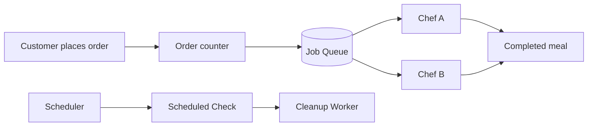

If the cashier **waits for every meal to be cooked** before accepting another customer, the line grows. If the cashier records orders and hands them to the kitchen, the counter can keep serving customers. But a new question arises: **what happens to the tickets if the kitchen loses power?** If orders exist only in RAM, they may be lost; if committed to PostgreSQL, workers can recover them.

> **Mental model 1:** A *request* is an incoming demand; a *job* is a record describing work; a *worker* executes it; a *queue* organizes pending work; a *scheduler* triggers work based on time; and *cleanup* handles resources that have reached the end of their lifecycle. These are **roles**, not necessarily separate threads or processes.

**Misconception:** Returning HTTP `202 Accepted` does not guarantee a job has completed. It only communicates that the request was accepted for processing; a *durability* guarantee additionally requires successfully recording the job in reliable storage.

**Knowledge check:** (1) Must every chef be a different server? — No. (2) Does storing an order ticket in a database make it run automatically? — No; it still needs a worker.

# 2. Glossary and Comparisons

## 2.1 Easily Confused Technical Terms

| Term | Plain-English definition | Example | Note |
|---|---|---|---|
| **Task** | A unit of work that can be executed | Call an email-sending API | Can be tiny; need not be stored in a database |
| **Job** | Work with an ID and lifecycle, often including status | Generate report `job_id=...` | In practice, *task* and *job* are sometimes interchangeable |
| **Worker** | A component responsible for obtaining and executing work | `EmailWorker` | Can be a bean, thread, process, or separate service |
| **Worker thread** | A JVM thread that actually executes a piece of work | `pool-1-thread-2` | A worker may use multiple threads |
| **Queue** | A place to organize waiting work | `BlockingQueue`, jobs table | An in-memory queue does not provide durability automatically |
| **Scheduler** | Decides **when** work should be triggered | `@Scheduled` at 02:00 | A scheduler is not the same as a worker |
| **Background job** | A job that does not require its caller to wait for completion | Export a report | May start immediately or later |
| **Cleanup job** | Work that deletes/disposes of resources no longer needed | Delete expired temporary files | A kind of job, not a special kind of thread |
| **Cleanup worker** | Worker that performs cleanup jobs | `TemporaryFileCleanupWorker` | May share a thread pool with other work when appropriate |
| **Job status** | Current lifecycle status of a job | PENDING/RUNNING/COMPLETED | State transitions must be controlled |
| **Retry** | Attempt an operation again after failure | Send an email for the second time | May cause duplicate side effects |
| **Cron** | Expression that specifies a time-based schedule | `0 0 2 * * *` | Spring uses **six fields**, including seconds |
| **Polling** | Periodically check a source for new work | Query the database every five seconds | Adds query overhead and latency |
| **Backpressure** | Limit intake or execution under overload | Queue capped at 100 items | Prevents unbounded queue growth |

## 2.2 Synchronous/Asynchronous vs. Foreground/Background

These two pairs describe **different dimensions**:

- **Synchronous:** The caller waits at the call site until the method finishes.
- **Asynchronous:** The caller can continue while the work happens later or on a different execution path.
- **Foreground:** Processing directly tied to the current response.
- **Background:** Processing that need not finish during the current HTTP request lifecycle.

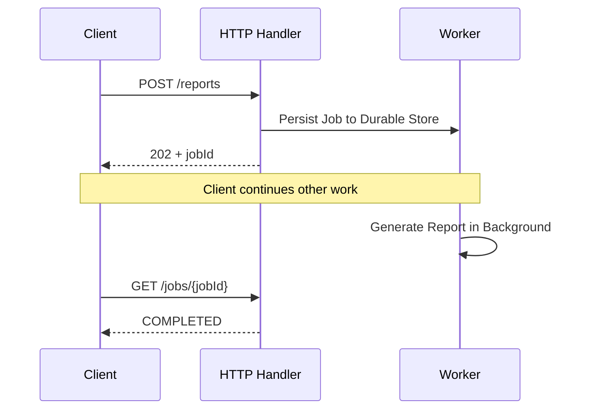

**Crucial difference:** `@Async` merely transfers work to an executor inside the JVM. It does **not automatically create** a durable job or restart one after a server crash.

| Approach | Must the caller wait? | Durable storage by default? | When to use |
|---|---|---|---|
| Direct method invocation | Yes | No | Short work requiring an immediate result |
| `CompletableFuture` / executor | Not necessarily | No | Independent work where crash loss is acceptable, or persistence is implemented separately |
| HTTP + commit job to DB + worker | No | Yes, after a successful commit | Work that must recover after a crash |

## 2.3 Classifying Jobs by Trigger and Timing

| Type | Mechanism | Advantage | Disadvantage | Example |
|---|---|---|---|---|
| **One-time** | Runs once | Straightforward | Must track completion | Export an invoice |
| **Recurring** | Runs according to a schedule | Maintains itself | Can run redundantly with multiple app replicas | Clean files every hour |
| **Event-triggered** | Triggered by an event | Responds quickly | Must avoid losing events | Order just paid |
| **Scheduled** | Runs at a specified time | Predictable | Latency and clock dependency | Send a digest at 08:00 |
| **Delayed** | Runs after its `runAt` time | Useful for retries | Requires a clock and pending-work store | Send reminder after 30 minutes |
| **Batch** | Processes multiple records together | Reduces setup overhead | Large batches can monopolize resources | Delete 1,000 records at once |
| **Polling** | Periodically queries for work | Simple | Repeated queries and latency | Scan PENDING jobs |

**Scheduled** differs from **event-triggered**: a timer firing is one trigger; an “order created” event is another. A job may be triggered initially by an event and subsequently use a *retry schedule* after failure.

## 2.4 Task Queues and Message Queues

- **Task queue:** Holds commands to *execute*, such as `generateReport(reportId)`.
- **Message queue:** A system for transferring messages between components. A message may be a command, event, or data; not every message is a job.
- **In-process queue:** For example, `ArrayBlockingQueue` resides in JVM RAM; it is fast, but work is typically lost if the process dies.
- **External broker:** RabbitMQ, Redis, and Kafka store and distribute messages according to their own semantics; acknowledgment, retention, and replay differ.

Do not describe `Kafka` as “just another task queue like RabbitMQ.” Kafka is primarily a **durable event log/stream** with consumer offsets. It can support workers, but you must understand partitions, ordering, offsets, and replay.

## 2.5 In-Process Workers vs. Separate Workers

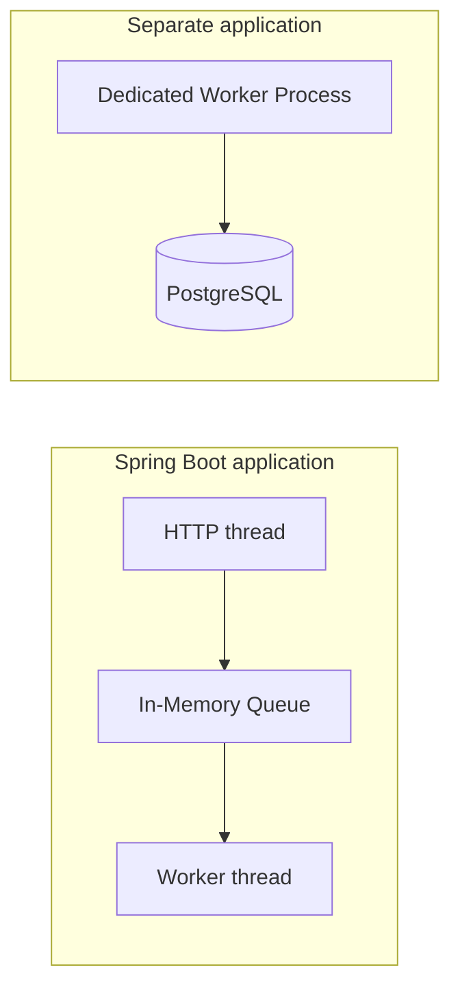

**In-process worker:** Runs in the backend's JVM; simple, with little extra deployment complexity. **Dedicated worker application:** Runs in a separate process/container; easier to scale and isolate workload, but adds operational and job-delivery complexity. **Distributed worker system:** Many instances run across machines and require ownership, leases, and recovery capabilities.

> **Mental model 2:** “Background” describes *whether a request blocks on work*; “thread” describes *what executes code*; “job” describes *what work needs doing*; “scheduler” describes *when*; “queue” describes *where work waits*; and “durability” describes *whether work survives restart*.

**Misconceptions:** `@Scheduled` is not a durable queue. A worker need not be a dedicated thread. `@Async` does not automatically provide retries.

**Knowledge check:** (1) An order is placed at 10:00 but handled 10 minutes later: what kind of job? — A delayed job. (2) Which survives a JVM crash by itself: `BlockingQueue` or a committed PostgreSQL job record? — The committed database record.

# 3. Inside the JVM: Threads, Thread Pools, Queues, and Resources

## 3.1 How Does a Request Travel Through the JVM?

A Spring MVC backend commonly uses request-handling threads. Three concurrent requests may call the **same singleton instance** of a controller or service, while each invocation has its own call stack and local variables. Mutable fields on that singleton can be accessed concurrently.

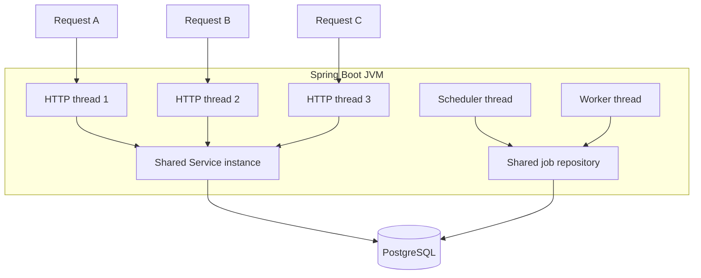

Sharing an object **does not** mean sharing local variables belonging to separate method invocations. However, a mutable `static` field or singleton `ArrayList` field can cause race conditions.

## 3.2 Main Thread, HTTP Thread, and Worker Thread

- **Main thread:** Calls `main()` and starts the application. Once the server is running, requests generally do not execute on the main thread.
- **HTTP thread:** Receives and handles an HTTP request (in a conventional servlet/platform-thread model).
- **Worker thread:** Executes a job; may come from `ExecutorService` or `TaskExecutor`.
- **Scheduler thread:** Triggers work according to a clock; may run the job itself or submit it to a worker pool.

Java 21 also provides **virtual threads**. They have independent execution state and suit many I/O-bound workloads, but do not remove CPU, database-connection, or memory limits. Learn platform threads and pools first.

## 3.3 `Thread`, `Runnable`, and `Callable`

`Runnable.run()` returns no result; `Callable<V>.call()` returns `V` and can throw a checked exception.

```java
// Java 21; standalone illustration
Runnable task = () -> System.out.println(Thread.currentThread().getName());
Thread thread = new Thread(task, "manual-worker");
thread.start();  // starts a new execution path
thread.join();   // calling thread waits for worker completion
```

```java
import java.util.concurrent.Callable;
import java.util.concurrent.Executors;
import java.util.concurrent.ExecutorService;
import java.util.concurrent.Future;

public class CallableExample {
    public static void main(String[] args) throws Exception {
        Callable<Integer> calculation = () -> 40 + 2;
        try (ExecutorService executor = Executors.newFixedThreadPool(2)) {
            Future<Integer> result = executor.submit(calculation);
            System.out.println(result.get()); // 42; get() may block
        }
    }
}
```

`ExecutorService` manages and reuses threads. `submit()` enqueues/submits a task but does not mean it starts immediately. `Future.get()` becomes a *synchronous wait* if the result is not ready. Close executors properly to avoid leaking threads.

## 3.4 Thread Pools and Task Queues

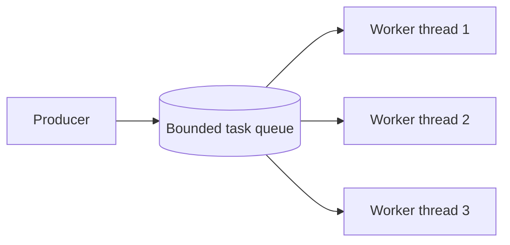

A thread pool with three threads **cannot** run 100 CPU-bound jobs in parallel as if each had its own CPU. Remaining jobs wait in the queue or are rejected, depending on configuration.

- **CPU-bound:** Compression and computation; begin with concurrency near the usable CPU-core count, then measure.
- **I/O-bound:** HTTP/database calls and disk waits; more concurrency may help, but external resources impose limits.
- **Blocking:** The current thread waits for I/O, a lock, or `Future.get()`, and cannot advance other work during that wait.
- **Contention:** Threads compete for locks, CPU, RAM, database connections, or disk bandwidth.
- **Thread safety:** Correct behavior under concurrent data access. Prefer immutable data, concurrent collections, atomic operations, database transactions, and avoid unsafe increments of ordinary `int` fields.

### Example Timeline

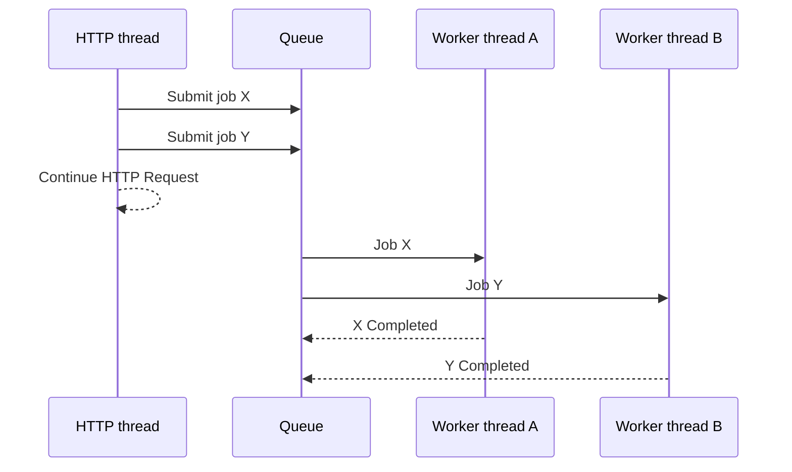

**Common confusion:** When two HTTP threads call `service.submit(...)` simultaneously, `service` may be the same object, but each call has its own local stack. The queue is a shared resource that must be thread-safe (`BlockingQueue` or an `ExecutorService` provides the appropriate queue machinery).

## 3.5 Resource Limits

Suppose a backend has 10 HikariCP connections, a worker pool with 20 threads, and HTTP handlers that also query the database. Do not assume all 20 workers can hold database connections simultaneously; they may wait for the pool or time out. A task may hold a transaction/connection while calling an API for 30 seconds, causing a system bottleneck.

| Resource | Overload symptom | Control |
|---|---|---|
| CPU | Growing run queues and latency | Limit concurrency; profile |
| RAM | GC pressure, out-of-memory failures | Bounded queues, payload limits |
| Database connections | Waiting to acquire a connection | Short transactions; appropriate pool sizing |
| External API | Rate limits and timeouts | Timeouts, retry backoff, circuit breakers |
| Disk | Accumulating temp files | Quotas, cleanup, monitoring |

> **Mental model 3:** The worker pool is a team of workers; the queue is the backlog; threads, connections, and CPU are shared resources. Adding workers does not increase throughput without limit.

**Misconception:** `synchronized` only coordinates through a monitor within one JVM. Running two instances requires database locks or an appropriate distributed coordination mechanism.

**Knowledge check:** (1) Does a successful return from `executor.submit()` mean the job is finished? — No. (2) Can 30 worker threads execute 30 concurrent database queries through a pool of five connections? — Not through that five-connection pool.

# 4. Standard Java Executors

## 4.1 `ExecutorService` for One-Time Tasks

```java
import java.util.concurrent.ArrayBlockingQueue;
import java.util.concurrent.ThreadPoolExecutor;
import java.util.concurrent.TimeUnit;

public class BoundedExecutorDemo {
    public static void main(String[] args) {
        ThreadPoolExecutor executor = new ThreadPoolExecutor(
                2, 2, 0, TimeUnit.SECONDS,
                new ArrayBlockingQueue<>(10),
                new ThreadPoolExecutor.AbortPolicy());
        try {
            executor.execute(() -> System.out.println("Send sample email"));
        } finally {
            executor.shutdown();
        }
    }
}
```

Here, at most two tasks can execute concurrently and ten can wait; submitting more work when capacity is exhausted may throw `RejectedExecutionException`. A **bounded queue** protects RAM; the client must be told to retry or handle rejection, rather than having work silently discarded.

## 4.2 `ScheduledExecutorService` for Simple Scheduling

```java
import java.util.concurrent.Executors;
import java.util.concurrent.ScheduledExecutorService;
import java.util.concurrent.TimeUnit;

public class PeriodicExample {
    public static void main(String[] args) throws InterruptedException {
        ScheduledExecutorService timer = Executors.newScheduledThreadPool(1);
        try {
            timer.scheduleWithFixedDelay(
                () -> System.out.println("Check temporary files"),
                0, 5, TimeUnit.SECONDS);
            Thread.sleep(12_000); // illustration only; do not use for real job tests
        } finally {
            timer.shutdownNow();
        }
    }
}
```

- `schedule(...)`: Execute once after a delay.
- `scheduleAtFixedRate(...)`: Target a regular interval between **start times**.
- `scheduleWithFixedDelay(...)`: Wait a specified delay **after the preceding execution finishes**.
- If a periodic task throws an unhandled exception, subsequent runs can be suppressed according to the executor contract. Handle failures deliberately.

## 4.3 Why Aren't Java Executors Enough for Every Job?

Jobs stored only in RAM can disappear if the JVM terminates unexpectedly. Executors do not automatically provide job IDs, durable statuses, or multi-instance replay. Conversely, a short statistics task that may safely be lost during restart can use an executor without introducing an external queue system.

> **Mental model 4:** Java executors are *mechanisms for executing work inside a JVM*. Durability is *an additional design decision*, usually implemented with a database or broker.

**Misconception:** `shutdownNow()` requests interruption; it does not guarantee that every task stops immediately.

**Knowledge check:** (1) Is holding a `Future` sufficient to retry after restart? — No. (2) Must lightweight, unimportant tasks always have a job table? — No.

# 5. Spring Boot: Scheduling and Async

## 5.1 API Overview

| API | Definition | Purpose / when to use | Limitation |
|---|---|---|---|
| `@EnableScheduling` | Enables scheduling annotations | Allows Spring to recognize `@Scheduled` | Does not create persistence |
| `@Scheduled` | Declares a schedule | Cron, fixedRate, fixedDelay | Does not guarantee parallel or exactly-once execution across replicas |
| `TaskScheduler` | Scheduling abstraction | Schedule work programmatically | Not a durable job store |
| `ThreadPoolTaskScheduler` | Pool-backed scheduler | Tune scheduler threads | Requires resource limits |
| `@EnableAsync` | Enables `@Async` interception | Async method calls through a proxy | Does not persist work |
| `@Async` | Transfers a method call to an executor | Short work outside the HTTP path | Self-invocation and error-handling caveats |
| `TaskExecutor` | Task execution abstraction | Submit work to worker threads | Not a durable queue |
| `ThreadPoolTaskExecutor` | Configurable executor pool | Bounded asynchronous work | Can reject when full |

## 5.2 `@Scheduled`: Fixed Delay, Fixed Rate, and Cron

```java
import org.springframework.scheduling.annotation.EnableScheduling;
import org.springframework.context.annotation.Configuration;

@Configuration
@EnableScheduling
public class SchedulingConfiguration { }
```

```java
import org.springframework.scheduling.annotation.Scheduled;
import org.springframework.stereotype.Component;

@Component
public class ExampleTimers {
    @Scheduled(fixedDelay = 5000)
    public void afterCompletion() { /* next run starts 5s after the previous run finishes */ }

    @Scheduled(fixedRate = 5000)
    public void onRate() { /* target roughly 5s between starts */ }

    @Scheduled(cron = "0 0 2 * * *", zone = "Asia/Ho_Chi_Minh")
    public void atTwoAm() { /* 02:00 daily in the specified time zone */ }
}
```

> The examples above have empty comments to distinguish syntax; they are not practical business tasks. The complete project appears in Chapter 11.

Spring cron expressions have **six fields**: `second minute hour day-of-month month day-of-week`. `0 0 2 * * *` means 02:00, not “every two hours.” With `fixedRate`, a long execution can delay future ticks, and other schedules/configurations can contend for capacity; **do not assume every run creates a new thread**. A scheduler configured with one thread can delay unrelated scheduled tasks. With multiple application replicas, each instance has its own scheduler and may trigger the same work independently.

## 5.3 `@Async`, Proxies, and Self-Invocation

```java
import java.util.concurrent.ThreadPoolExecutor;
import org.springframework.context.annotation.Bean;
import org.springframework.context.annotation.Configuration;
import org.springframework.scheduling.annotation.EnableAsync;
import org.springframework.scheduling.concurrent.ThreadPoolTaskExecutor;

@Configuration
@EnableAsync
public class AsyncConfiguration {
    @Bean("emailTaskExecutor")
    ThreadPoolTaskExecutor emailTaskExecutor() {
        ThreadPoolTaskExecutor executor = new ThreadPoolTaskExecutor();
        executor.setCorePoolSize(2);
        executor.setMaxPoolSize(4);
        executor.setQueueCapacity(20);
        executor.setThreadNamePrefix("email-worker-");
        executor.setRejectedExecutionHandler(new ThreadPoolExecutor.AbortPolicy());
        executor.initialize();
        return executor;
    }
}
```

```java
import org.springframework.scheduling.annotation.Async;
import org.springframework.stereotype.Service;

@Service
public class EmailSender {
    @Async("emailTaskExecutor")
    public void send(String destination) {
        System.out.println("Sending to " + destination);
    }
}
```

Spring generally implements `@Async` through a **proxy** (an intermediary object intercepting a call). When another bean calls `emailSender.send(...)`, the proxy submits work. However, `this.send(...)` from another method **on the same object** usually bypasses the proxy and executes synchronously. A simple solution is to call a separate bean. A `void @Async` method cannot propagate its failure to the caller as a `Future` does; use logging / `AsyncUncaughtExceptionHandler`, or return `CompletableFuture` and handle completion.

**Dangerous scenario:** An HTTP handler calls `@Async sendEmail()` and returns `202`; the JVM crashes before the task runs, so the email is never sent. If sending the email is mandatory, commit a durable intent/job/outbox record before responding.

## 5.4 `ThreadPoolTaskScheduler` and Shutdown

```java
import org.springframework.context.annotation.Bean;
import org.springframework.context.annotation.Configuration;
import org.springframework.scheduling.concurrent.ThreadPoolTaskScheduler;

@Configuration
public class TimerPoolConfiguration {
    @Bean("taskScheduler")
    ThreadPoolTaskScheduler taskScheduler() {
        ThreadPoolTaskScheduler scheduler = new ThreadPoolTaskScheduler();
        scheduler.setPoolSize(2);
        scheduler.setThreadNamePrefix("scheduled-");
        scheduler.setWaitForTasksToCompleteOnShutdown(true);
        scheduler.setAwaitTerminationSeconds(15);
        return scheduler;
    }
}
```

`TaskScheduler` allows programmatic scheduling instead of annotations; `ThreadPoolTaskScheduler` supplies a pool of threads to execute scheduled work. A **TaskExecutor** executes tasks, while a **TaskScheduler** adds the ability to choose their execution times. A scheduler can also trigger jobs and delegate expensive work to another executor or durable job store.

### When Scheduled Work Takes Too Long

Suppose a task runs every five seconds but each execution takes 20 seconds. Do not promise four simultaneous runs; behavior depends on scheduler type, pool, trigger, and invocation pattern. A safe cleanup approach is to **claim a bounded batch on each tick** rather than wait indefinitely, and use leases to distribute jobs across instances.

### During Application Shutdown

A good sequence: stop accepting new work → allow in-flight jobs some time to finish → perform controlled cancellation → recover incomplete leased jobs after restart. `shutdown()` cannot make external HTTP/email/file operations transactional; already-sent operations may have succeeded.

> **Mental model 5:** `@Scheduled` chooses **when**; `@Async`/executors choose **which execution thread**; a job table defines **what must be done and whether it can be recovered**.

**Misconceptions:** `@Scheduled` does not create a distributed lock across replicas; default proxy-mode `@Async` does not apply on self-invocation; increasing pool size does not increase the database connection limit.

**Knowledge check:** (1) Is `fixedDelay` measured from the start or completion of the previous run? — Completion. (2) Does `@Async` intercept a call through `this` in default proxy configuration? — No.

# 6. Cleanup and Data Lifecycle

## 6.1 Why Is Cleanup a Business Responsibility?

A system that accepts temporary-file uploads must eventually delete them after expiration. If deletion happens only when users click a button, abandoned files may remain forever. A **cleanup job** handles resources that are no longer needed; a **cleanup worker** executes it; and a **scheduler** determines when to check.

Example:

```text
09:00  Create file T1, expiresAt=10:00
09:30  User closes browser
10:00  T1 becomes eligible for cleanup
10:05  Scheduler triggers worker
10:05  Worker deletes file and records COMPLETED status
```

**Expiration** is the moment a resource is no longer usable; **retention** is how long copies must be retained under policy. These need not be identical. For example, downloads may stop at 10:00 while physical deletion occurs 24 hours later when policy permits.

## 6.2 Logical Deletion vs. Physical Deletion

| Type | Operation | Recovery potential | Risk |
|---|---|---|---|
| **Logical deletion** | Set `deleted_at`/`DELETED` in the database | Recoverable if bytes still exist | Bytes remain and consume storage |
| **Physical deletion** | `Files.deleteIfExists`, S3 `DeleteObject` | Difficult/impossible without versions or backups | Database may remain unchanged if a crash occurs |

Do not say “deletion completed” in an HTTP response if you have only **recorded a deletion request**. Distinguish **deletion requested**, **cleanup pending**, **cleanup completed**, and **cleanup failed**.

## 6.3 Cleanup State Machine

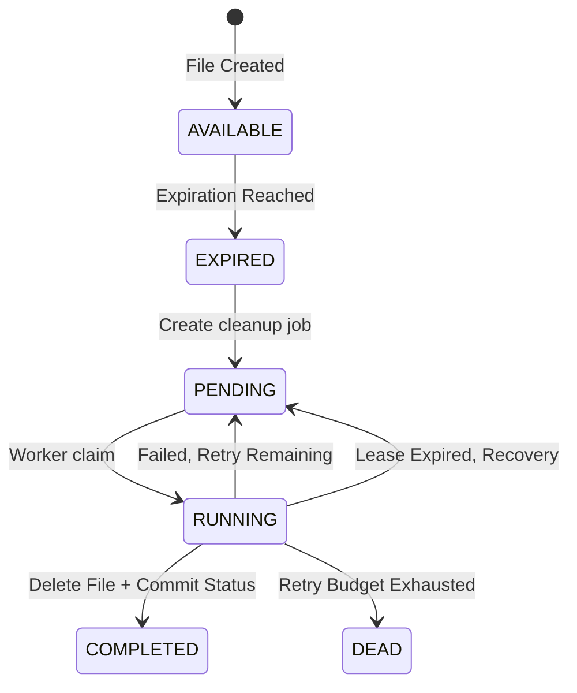

This is a **conceptual** diagram. The example project stores `deleted_at` on the file table and job status on a separate job table; every state need not be stored in one table.

## 6.4 Three Inconsistency Scenarios

**A — File deletion succeeds; DB update fails:** The file is gone, but its record still says it has not been deleted. The worker retries `deleteIfExists()`; “file absent” is treated as an acceptable cleanup result, then the worker commits the job as COMPLETED.

**B — DB is marked “deleted” first; file deletion fails:** Metadata claims cleanup is finished while bytes remain. Avoid this ordering: delete the file first, then record completion. Recovery is still needed for a crash between these steps.

**C — Cleaning an old file during a new upload:** If a path is reused, the old worker may accidentally delete the new file. Use **immutable object identities**, generate new UUID-based file names, and never reuse an identifier for different contents.

## 6.5 Durable Cleanup Obligations

A **durable cleanup obligation** means the system records *resource X must be deleted*, even across restart. For example, a row in `cleanup_job` with `status=PENDING`. This differs from a `Runnable` held only in RAM.

- **Cleanup eligibility:** Conditions for deletion (`expires_at <= now`, not protected by a retention/legal hold, and no upload in progress).
- **Cleanup deadline:** Latest acceptable completion time; may be later than expiration.
- **Overdue monitoring:** Counts jobs past deadline that are not COMPLETED.
- **Partial cleanup:** File deletion succeeded, but updating status did not.
- **Duplicate cleanup:** Repeated deletion attempts; the operation should be **idempotent**.
- **File-system cleanup:** Delete from local/shared storage; guard against path traversal and symlinks.
- **Object-storage cleanup:** Call a delete API using a canonical object key; S3 versioning affects delete-marker behavior.
- **Database cleanup:** Delete indexed batches in short transactions; account for foreign keys, retention, and vacuum.

### Before and After in PostgreSQL

**Before:**

| temporary_file.id | expires_at | deleted_at | cleanup_job.status |
|---|---|---|---|
| `1111...` | 09:00 | NULL | PENDING |
| `2222...` | 12:00 | NULL | (not created) |

**After job 1111 succeeds:**

| temporary_file.id | expires_at | deleted_at | cleanup_job.status |
|---|---|---|---|
| `1111...` | 09:00 | 10:05 | COMPLETED |
| `2222...` | 12:00 | NULL | (not created) |

Here, COMPLETED is recorded **after confirming deletion**, not merely after submitting a task to the queue.

> **Mental model 6:** `expiresAt` is the eligibility condition; `cleanup_job` is the durable reminder; the worker performs deletion; and `COMPLETED` is the completion receipt. A successful initial request does not mean future cleanup is already complete.

**Misconceptions:** `DELETE FROM temporary_file` does not delete bytes from disk/S3. Stopping the server does not guarantee a job's `finally` block runs.

**Knowledge check:** (1) The file is gone but a DB update failed: how can recovery work? — Retry idempotent deletion and update the DB. (2) Should the same path be reused for another file? — Not if an old worker might still delete it.

# 7. PostgreSQL as a Durable Job Store

## 7.1 Why Use a Job Table?

A `job` table can store `id`, `status`, `attempts`, `next_attempt_at`, `lease_until`, `owner_token`, and `last_error`. A successful commit lets a future process determine what work remains, even if the original JVM is gone.

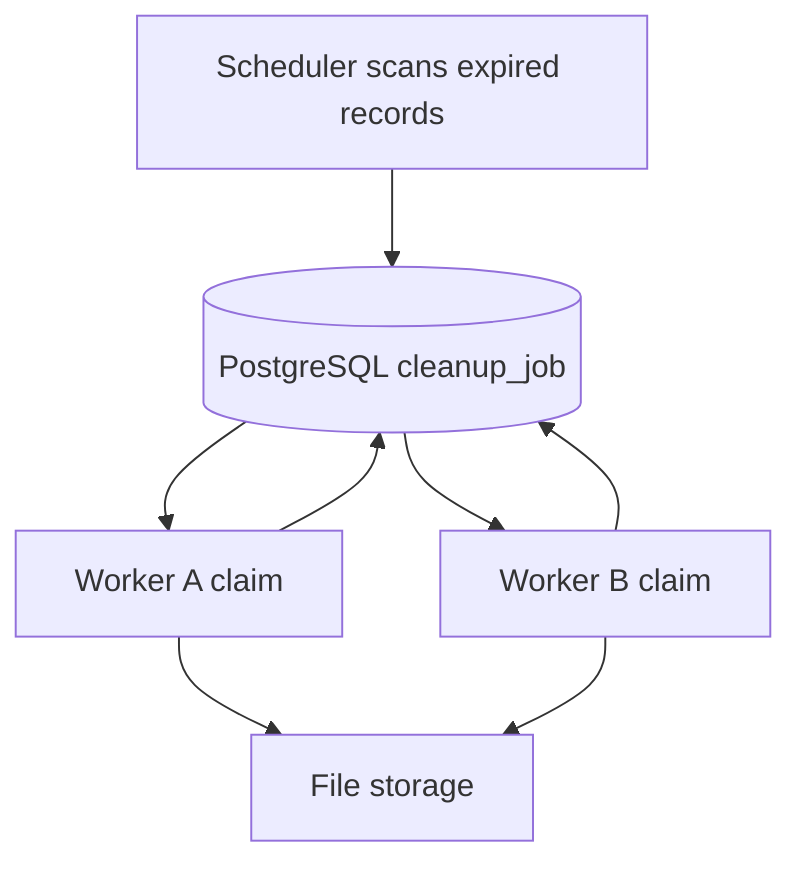

Creating a job and **claiming** a job are different actions. A scheduler may simply detect work and create PENDING jobs; a worker executes them. In a small application, one class may fulfill both roles.

## 7.2 Standard Job States

| Status | Meaning | Transition mechanism |
|---|---|---|
| `PENDING` | Waiting; claimable when its scheduled time arrives | INSERT/retry |
| `RUNNING` | Claimed by a worker with a lease | Claim transaction |
| `COMPLETED` | External side effect succeeded and the result is recorded | Completion transaction |
| `DEAD` | Retry budget exhausted; requires intervention | Retry budget exhausted |

Another system might use `FAILED` instead of `DEAD`, or use both. **Consistent definitions matter more than the exact state names.**

## 7.3 Why `SELECT ... FOR UPDATE`?

Imagine a single PENDING job `J1`. Worker instances A and B both see it. If both execute:

```sql
SELECT id FROM cleanup_job WHERE status = 'PENDING' LIMIT 1;
```

both could select `J1` and process it. You need an **atomic claim operation** so one worker owns the job while the other receives a different job or no job.

```sql
BEGIN;
SELECT id
FROM cleanup_job
WHERE status = 'PENDING'
ORDER BY created_at
FOR UPDATE;
-- ... UPDATE job status and lease in the same transaction
COMMIT;
```

`FOR UPDATE` locks rows to prevent two transactions from updating/claiming the same row simultaneously. Other workers might need to **wait** if they attempt to select a locked row.

### `SKIP LOCKED`: Skip Locked Rows

```sql
SELECT id
FROM cleanup_job
WHERE status = 'PENDING'
ORDER BY created_at
LIMIT 1
FOR UPDATE SKIP LOCKED;
```

If worker A holds the row lock for `J1`, worker B **skips** `J1` and looks for another job. This suits queue consumers but **not** queries requiring a consistent snapshot of the entire table: it intentionally omits locked rows.

```mermaid
sequenceDiagram
    participant A as Worker A
    participant DB as PostgreSQL
    participant B as Worker B
    A->>DB: BEGIN; lock J1 FOR UPDATE
    B->>DB: SELECT ... SKIP LOCKED
    DB-->>B: J2 (skip locked J1)
    A->>DB: Set J1 RUNNING + lease; COMMIT
    B->>DB: Set J2 RUNNING + lease; COMMIT
```

## 7.4 Why Hold Locks Only During Short Transactions?

**Operationally problematic:** `BEGIN` → lock job → call API for 20 seconds → delete file → `COMMIT`. This holds a transaction, connection, and lock for 20 seconds. Under load, the database becomes a bottleneck.

**Better:** Use a **claim transaction** that sets a lease in milliseconds → commit → perform external work outside the database transaction → use a second transaction to **acknowledge** the outcome.

A lease is a *time-limited claim* (for example, 60 seconds) recorded in the database. If a worker crashes, another worker may claim the job once the lease expires.

## 7.5 Atomic Claim in One SQL Statement

```sql
WITH candidate AS (
    SELECT id
    FROM cleanup_job
    WHERE (status = 'PENDING' AND next_attempt_at <= :now)
       OR (status = 'RUNNING' AND lease_until <= :now)
    ORDER BY next_attempt_at, created_at
    LIMIT 1
    FOR UPDATE SKIP LOCKED
)
UPDATE cleanup_job AS j
SET status = 'RUNNING',
    attempts = j.attempts + 1,
    owner_token = :new_owner_token,
    lease_until = :new_lease_until,
    updated_at = :now
FROM candidate
WHERE j.id = candidate.id
RETURNING j.id, j.temporary_file_id, j.attempts, j.owner_token;
```

Tokens such as `:now` and `:new_owner_token` are parameters bound by `NamedParameterJdbcTemplate` (not directly runnable PostgreSQL SQL without supplying values). A CTE selects at most one row while taking its lock; the `UPDATE` happens in the same statement/transaction. PostgreSQL does **not run a job queue automatically**; workers still need to poll.

### Two Workers Claiming Concurrently

| Time | Worker A | Worker B |
|---|---|---|
| t0 | Sees J1 | Sees J1 |
| t1 | Locks J1 | Skips J1 through `SKIP LOCKED` |
| t2 | Updates J1 → RUNNING | Claims J2 or gets no job |
| t3 | COMMIT | COMMIT |

Your contract needs `(job_id, owner_token)` to identify the claimant. On completion, only the current token with a valid lease may acknowledge the result; an old worker must not overwrite a newer worker's completion.

## 7.6 Crashes, Leases, and Recovery

```mermaid
sequenceDiagram
    participant A as Worker A
    participant DB as PostgreSQL
    participant B as Worker B
    A->>DB: Claim J1, lease until 10:01
    A->>A: Crash at 10:00:30
    Note over DB: J1 remains RUNNING
    B->>DB: Poll at 10:01:10
    DB-->>B: Lease Expired; B Claims J1 with New Token
    B->>B: Retry Idempotently
    B->>DB: ACK with B Token
```

**Important distinction:** An expired lease does not prove that the old worker stopped. Worker A may simply be **slow** and still be performing the external operation. Therefore:

1. External side effects must be idempotent or support an external idempotency key.
2. Completion updates must check `owner_token` and lease validity.
3. Jobs running longer than a lease need **heartbeats/lease renewal**, or a sufficiently long lease with an appropriate execution timeout.
4. Never reuse a file key/ID for different contents.

**Enforcing attempt limits:** A job might consume its Nth attempt and then crash. There must be a transition for expired-lease `RUNNING` jobs with `attempts >= maxAttempts` to become `DEAD` instead of being stuck forever. The example project implements that transition.

> **Mental model 7:** A DB lock is held during the *claim transaction*; a lease preserves processing ownership *after commit*; a token prevents stale acknowledgments; idempotency handles repeated external side effects.

**Misconceptions:** `SKIP LOCKED` does not “permanently skip a job.” After transaction A commits or rolls back, that job may again qualify for selection. A database row lock does not lock filesystem/S3 resources.

**Knowledge check:** (1) A worker claims a job but crashes before deletion. What enables recovery? — Lease expiration and re-claiming. (2) Does `SKIP LOCKED` make worker B wait for worker A to release the lock? — No.

# 8. Reliability, Retries, and Failure Handling

## 8.1 Failure Scenarios

| Failure scenario | What can happen | Mitigation |
|---|---|---|
| JVM crashes while a job is RUNNING | Job remains stuck in RUNNING | Lease timeout and re-claim |
| Database transaction rolls back | Status remains unchanged | Retry transaction; do not assume external effects roll back |
| HTTP/email request times out | Unclear whether the other side processed it | Idempotency key and result verification |
| Network drops after sending request | Response is lost | Backoff retry; receiver-side deduplication |
| Same job delivered twice | Duplicate side effects | Idempotent execution |
| Side effect succeeds, DB acknowledgment fails | Job is replayed | Idempotent operation and repeated acknowledgment |
| Worker gets stuck | Long lease or overdue work | Deadlines, alerts, recovery |
| Two workers execute the same job | Incorrect claim or mid-operation lease expiry | `SKIP LOCKED` + ownership token + idempotency |
| Shutdown during processing | Incomplete work | Graceful shutdown and lease recovery |

## 8.2 Delivery Semantics: At-Most-Once, At-Least-Once, Exactly-Once

- **At-most-once:** Execute zero or one times; work may be *lost*, but no automatic retry is performed.
- **At-least-once:** Work is executed at least once if the system continues operating and retries eventually succeed; **duplicates are possible**.
- **Exactly-once:** Promising “a final effect exactly once” is difficult across independent systems. Some systems guarantee exactly-once within a specific transaction/log, which does not automatically cover emails, HTTP requests, or filesystem operations.

A practical approach is usually **at-least-once + idempotency**: retries may happen, but repeating the operation does not corrupt its outcome.

## 8.3 What Is Idempotency?

An operation is idempotent if repeating it with the same intent does not create unintended further changes after its first successful execution.

- Repeated `DELETE file if exists` → result “file is absent”: generally idempotent.
- Repeated `SET order.status='PAID'` → may be idempotent if transitions are controlled.
- Repeated `account.balance += 100` → **not** idempotent.
- Repeated “send email” → multiple emails; preventing duplicates requires message-ID deduplication at an appropriate boundary or equivalent safeguards.

Idempotency does not automatically mean *race-free*. For example, a stale worker could delete a different file if the path is reused; use immutable IDs.

## 8.4 Retries: Fixed Delay, Exponential Backoff, and Jitter

**Fixed delay:** Always wait five seconds. **Exponential backoff:** Wait 5s, 10s, 20s, 40s, etc. to reduce pressure when a dependency fails. **Jitter:** Add random variation so workers do not retry simultaneously.

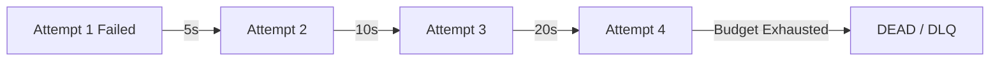

The example project uses **deterministic** backoff for easy testing; production systems can add jitter. Choose maximum attempts, timeouts, deadlines, and which errors are **retryable** (429, 503, timeout) versus **nonretryable** (invalid input). Do not retry forever.

### Poison Messages and Dead-Letter Queues

A **poison message** is a job that repeatedly fails (for example, malformed input) and can monopolize worker capacity. A **DLQ (dead-letter queue)** isolates jobs/messages whose retries are exhausted or that cannot be processed. A database implementation can use `status=DEAD` and `last_error` rather than a separate broker.

### Circuit Breakers

A circuit breaker observes failures from an external service and temporarily stops making calls after repeated failures, protecting the system. It differs from a retry, which repeats an individual operation. Combine it with timeouts/backoff; it is not a durable queue.

## 8.5 Shutdown and Stuck Jobs

Upon SIGTERM: stop polling → stop claiming new jobs → allow bounded time for running jobs → shut down. If the application is killed abruptly, leases allow recovery *after their expiration*. Monitor `RUNNING` jobs past their lease, overdue `PENDING` jobs, `DEAD` counts, attempts, latency, and queue depth.

> **Mental model 8:** Retries handle *temporary failure*; leases handle *a disappeared worker*; idempotency handles *repeated execution*; DLQ/DEAD handles *failures requiring human or policy intervention*.

**Misconceptions:** `try/catch` does not protect against a power-loss crash. `waitFor(timeout)` does not automatically kill an external process. HTTP 200 from another service does not prove your DB transaction committed.

**Knowledge check:** (1) A file was deleted but a DB update failed: is retry safe? — Yes, if deletion is idempotent and uses an immutable identifier. (2) Can a PostgreSQL transaction alone guarantee that an email is sent exactly once? — No.

# 9. Transactions and External Side Effects

## 9.1 Where Is the Transaction Boundary?

A PostgreSQL transaction ensures related database changes commit or roll back according to ACID principles. It does **not** automatically roll back an HTTP API call, a sent email, a deleted file, or an uploaded S3 object.

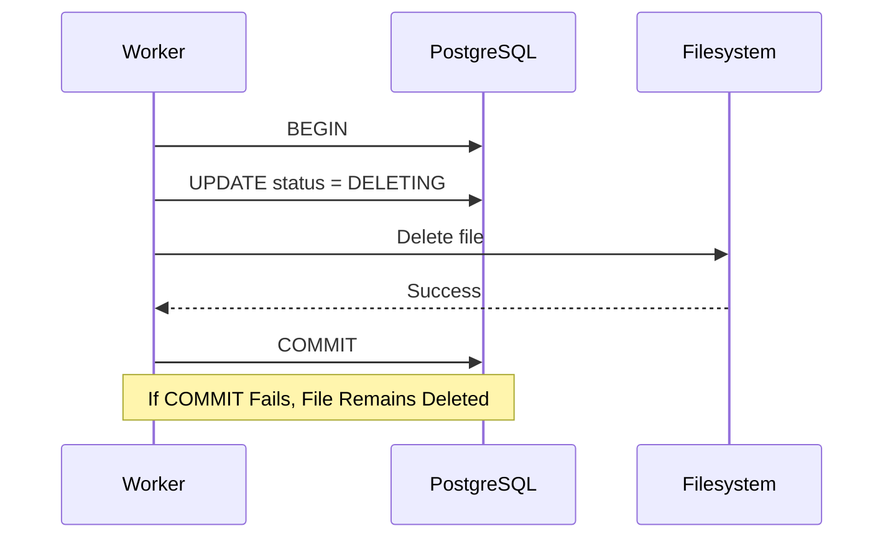

Therefore, the example project **does not** keep a transaction open while deleting a file: it claims work in one transaction → deletes the file → commits completion in a separate transaction.

### Successful Execution Flow

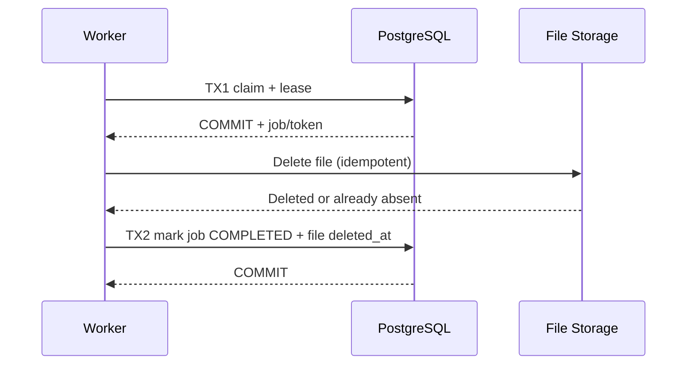

### Crash Between the Side Effect and Acknowledgment

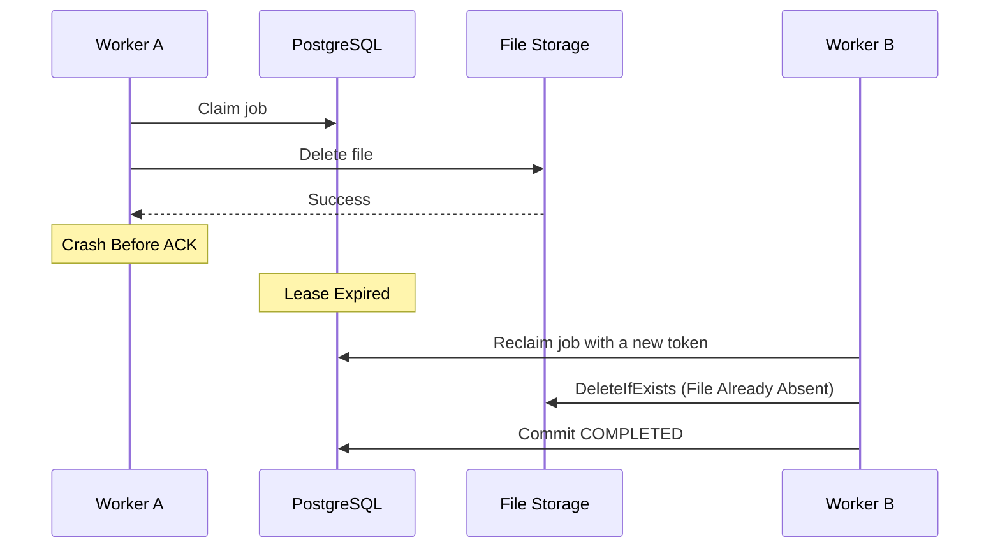

## 9.2 Transactional Outbox Pattern

**Problem:** An HTTP handler creates an order, saves it in the DB, then publishes an event to a broker. If the DB commit succeeds but publishing fails, the event is lost. If publishing occurs first and the DB rolls back, the event refers to an order that was never committed.

**Outbox:** In the **same database transaction**, write both the business record and an `outbox_event`. A separate worker reads unpublished events and publishes them with retries and acknowledgments. Consumers still need deduplication, because the publisher may crash after publishing but before marking delivery complete.

```mermaid
sequenceDiagram
    participant HTTP as Request Handler
    participant DB as PostgreSQL
    participant P as Outbox Publisher
    participant MQ as Broker
    HTTP->>DB: BEGIN; INSERT order + outbox_event
    DB-->>HTTP: COMMIT
    P->>DB: Claim pending outbox event
    P->>MQ: Publish event
    MQ-->>P: Ack
    P->>DB: Mark delivered
    Note over P,MQ: Crash After Publish Can Cause Duplicates
```

An outbox is a **design pattern**, not a way to turn network operations into ACID transactions. For file cleanup, the `cleanup_job` table serves a similar role as a durable work record (it need not literally be called an outbox).

## 9.3 State Transitions and Stale Workers

Suppose worker A owns token `aaa`, its lease expires, and worker B receives token `bbb`. Worker A finishes late. The acknowledgment SQL must include:

```sql
UPDATE cleanup_job
SET status = 'COMPLETED'
WHERE id = :job_id
  AND owner_token = :owner_token
  AND status = 'RUNNING'
  AND lease_until > :now;
```

With old token `aaa`, the number of updated rows is zero. Do not use `UPDATE cleanup_job SET status='COMPLETED' WHERE id=?`, because that lets a stale worker overwrite the current owner's decision.

> **Mental model 9:** Transactions protect the *database boundary*. Outbox/durable jobs protect the *intent to perform work*. Leases/tokens protect *acknowledgment ownership*. Idempotency protects *repeated external effects*. Do not confuse these four responsibilities.

**Misconceptions:** `@Transactional` does not roll back S3/HTTP/filesystem actions; keeping a `FOR UPDATE` lock through slow external work is unnecessary and can cause bottlenecks.

**Knowledge check:** (1) If email is sent and then the DB rolls back, can the email be recalled? — No. (2) Does the outbox eliminate duplicate events completely? — No; consumers still need idempotency.

# 10. Architecture and Technology Comparison

## 10.1 Decision Matrix

| Approach | Survives restart? | Multi-instance? | Complexity | When to choose |
|---|---|---|---|---|
| Single-instance `@Scheduled` | No durability by itself | Duplicate runs possible with replicas | Very low | Simple housekeeping; reproducible jobs |
| In-process `@Async` / executor | No, if RAM-only | Each JVM is independent | Low | Short tasks where crash loss is acceptable |
| PostgreSQL job table | Yes, after commit | Yes, with atomic claims and leases | Medium | Already use PostgreSQL; moderate workload |
| Broker + workers | Depends on broker durability/configuration | Yes | Medium–high | High throughput or decoupling many services |
| Dedicated worker application | Depends on job store/broker | Yes | Medium–high | Background load affects HTTP app; independent scaling |
| Distributed worker system | Depends on cluster mechanisms | Yes | High | Many machines, large scale, demanding SLAs |

There is **no rule that a professional project must use Kafka**. PostgreSQL can serve as an effective job store for many small and medium systems.

## 10.2 Technology Selection

- **Java Executors:** JVM-local concurrency and queues; no built-in persistence.
- **Spring Scheduling:** Cron and fixed-rate/fixed-delay schedules.
- **Quartz:** Rich scheduling, persistent triggers, and clustering with an appropriately configured JDBC JobStore; more features than `@Scheduled`, at greater complexity.
- **RabbitMQ:** Broker for command/task queues and routing; acknowledgments, prefetch, and durable queues require proper configuration.
- **Redis-based queues:** Fast and accessible when Redis is already used, but **durability, claim, ack, and timeout semantics** depend on the library and architecture. A simple Redis `LIST` is not a complete job-recovery system.
- **Kafka:** Stream/event log with partitions and consumer groups, powerful for replay and throughput; not the default choice for “delete ten files per minute.”
- **PostgreSQL:** Job table + SQL transactions + `SKIP LOCKED`, especially effective when jobs relate to data in the same database.

## 10.3 Decision Tree

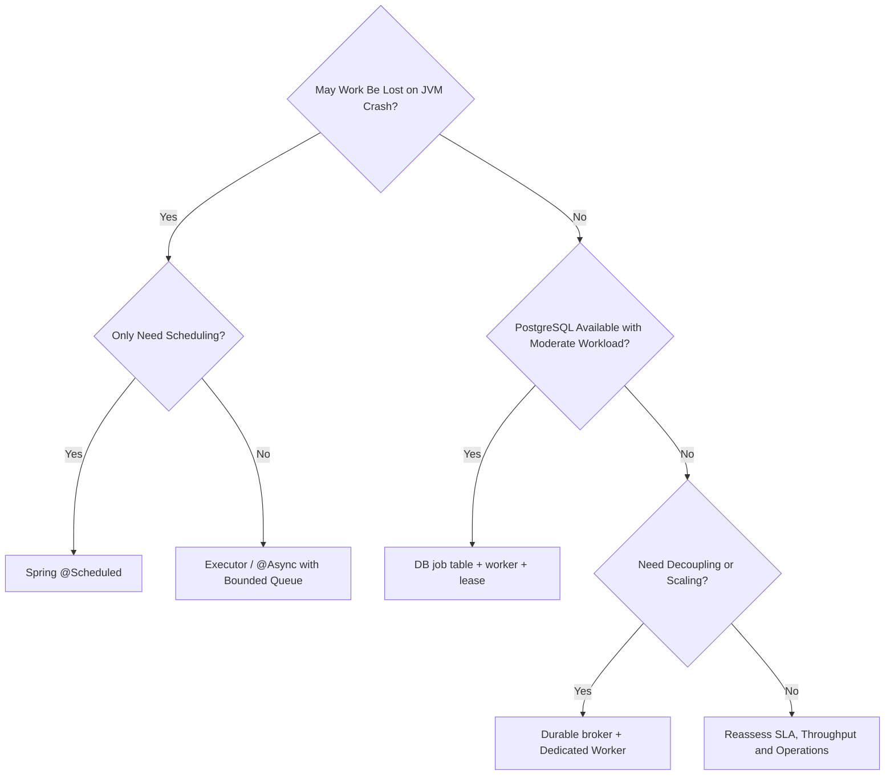

> **Mental model 10:** Choose the **smallest mechanism that satisfies durability, concurrency, and SLA requirements**. Do not introduce a broker, clustered scheduler, and orchestration system just to perform a periodic `DELETE`.

**Misconceptions:** Quartz schedules work; it does not execute business operations by itself. Committing a Kafka offset does not make external side effects exactly-once. Redis cannot guarantee “no lost jobs” under every configuration.

**Knowledge check:** (1) You already use PostgreSQL and need moderately sized durable work: what should you try first? — Database-backed workers. (2) CPU-heavy work should be isolated from HTTP: what can you consider? — Dedicated workers and resource isolation.

# 11. Complete Project: Temporary File Cleanup Service

## 11.1 Problem, Design, and Scope Limitations

**Problem:** A client uploads a small file with a lifetime (`ttlSeconds`). The backend stores its bytes in a private directory, inserts metadata into PostgreSQL, and returns `201 Created`. A `@Scheduled` component periodically finds expired files and records durable cleanup obligations in `cleanup_job`. A worker claims one job at a time, deletes the file, and marks the work complete. If deletion fails, the job waits for retry; if a worker dies mid-operation, the lease enables recovery.

This learning implementation has **no** authentication/authorization, virus protection, download UI, shared storage, or multi-host deployment. It is **a runnable educational application for exploring failure mechanics**, not a production upload service. On multiple machines, **each machine has its own local filesystem**; use shared/object storage or colocate workers with the bytes, and add authorization.

### Use Cases

1. `POST /api/temporary-files` (`multipart/form-data`, parts `file` and `ttlSeconds`) → return ID and expiration time.
2. `GET /api/temporary-files/{id}` → return database-backed status.
3. Every five seconds, the scheduler scans expired files and creates **durable** jobs.
4. A worker uses an atomic claim and `deleteIfExists` to process each job.
5. After a crash or failed DB acknowledgment, the job is retried using leases, tokens, and retry policies.

### Component Diagram

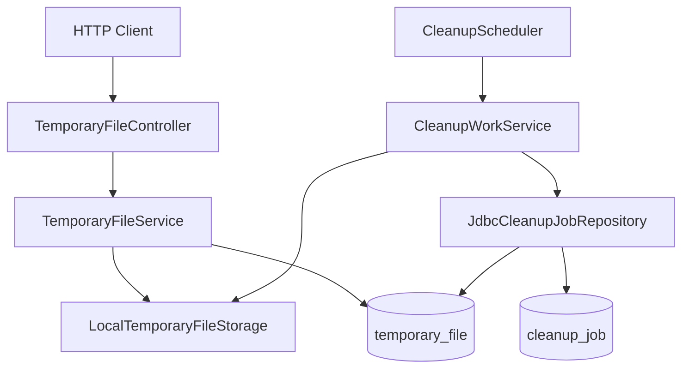

### Guarantees and Limitations

| What the design provides | What it does not promise |
|---|---|
| Jobs recorded in PostgreSQL | Absolutely exactly-once execution |
| Atomic claiming with `SKIP LOCKED` | A single ACID transaction spanning the filesystem |
| Lease-based crash recovery | Proof that an old worker died when its lease expires |
| Idempotent deletion by UUID | Prevention of every network-filesystem race |
| 1 MiB upload and 50-item batch limits | Protection from every malicious file or user-security issue |
| Failure simulation with Clock/database tests | Perfect reproduction of OS/hardware crashes |

### Essential Idempotency Rule

Each `temporary_file.id` is newly generated and **never reused**; its file path is `<UUID>.bin`. Repeated deletion of a path therefore refers to the **same file identity**. Never overwrite the bytes associated with an old UUID.

## 11.2 Project Directory Structure

```text
background-jobs-demo/
├── pom.xml
├── src/
│   ├── main/
│   │   ├── java/com/example/backgroundjobs/
│   │   │   ├── BackgroundJobsApplication.java
│   │   │   ├── config/TimeConfiguration.java
│   │   │   ├── config/SchedulerConfiguration.java
│   │   │   ├── domain/TemporaryFileRecord.java
│   │   │   ├── domain/TemporaryFileView.java
│   │   │   ├── domain/ClaimedCleanupJob.java
│   │   │   ├── application/TemporaryFileRepository.java
│   │   │   ├── application/CleanupJobRepository.java
│   │   │   ├── application/TemporaryFileStorage.java
│   │   │   ├── application/TemporaryFileService.java
│   │   │   ├── application/RetryPolicy.java
│   │   │   ├── application/CleanupWorkService.java
│   │   │   ├── infrastructure/JdbcTemporaryFileRepository.java
│   │   │   ├── infrastructure/JdbcCleanupJobRepository.java
│   │   │   ├── infrastructure/LocalTemporaryFileStorage.java
│   │   │   ├── infrastructure/FileTooLargeException.java
│   │   │   ├── web/TemporaryFileController.java
│   │   │   ├── web/ApiErrorHandler.java
│   │   │   └── worker/CleanupScheduler.java
│   │   └── resources/
│   │       ├── application.yml
│   │       └── db/migration/V1__create_temporary_file_and_jobs.sql
│   └── test/java/com/example/backgroundjobs/
│       ├── application/RetryPolicyTest.java
│       ├── application/CleanupWorkServiceTest.java
│       ├── application/TemporaryFileServiceTest.java
│       ├── worker/CleanupSchedulerTest.java
│       ├── infrastructure/LocalTemporaryFileStorageTest.java
│       └── integration/CleanupDatabaseIntegrationTest.java
```

The `domain`, `application`, `infrastructure`, `web`, and `worker` packages simply clarify responsibilities; no elaborate multi-module architecture framework is required.

## 11.3 Maven — `pom.xml`

Spring Boot 4 uses specialized starters such as `spring-boot-starter-webmvc`, `-jdbc`, and `-flyway`. PostgreSQL also needs the corresponding Flyway module. Testcontainers 2.x uses the `testcontainers-postgresql` and `testcontainers-junit-jupiter` artifacts.

```xml
<?xml version="1.0" encoding="UTF-8"?>
<project xmlns="http://maven.apache.org/POM/4.0.0"
         xmlns:xsi="http://www.w3.org/2001/XMLSchema-instance"
         xsi:schemaLocation="http://maven.apache.org/POM/4.0.0 https://maven.apache.org/xsd/maven-4.0.0.xsd">
    <modelVersion>4.0.0</modelVersion>
    <parent>
        <groupId>org.springframework.boot</groupId>
        <artifactId>spring-boot-starter-parent</artifactId>
        <version>4.0.9</version>
        <relativePath/>
    </parent>
    <groupId>com.example</groupId>
    <artifactId>background-jobs-demo</artifactId>
    <version>0.0.1-SNAPSHOT</version>
    <properties>
        <java.version>21</java.version>
    </properties>
    <dependencies>
        <dependency>
            <groupId>org.springframework.boot</groupId>
            <artifactId>spring-boot-starter-webmvc</artifactId>
        </dependency>
        <dependency>
            <groupId>org.springframework.boot</groupId>
            <artifactId>spring-boot-starter-jdbc</artifactId>
        </dependency>
        <dependency>
            <groupId>org.springframework.boot</groupId>
            <artifactId>spring-boot-starter-flyway</artifactId>
        </dependency>
        <dependency>
            <groupId>org.flywaydb</groupId>
            <artifactId>flyway-database-postgresql</artifactId>
        </dependency>
        <dependency>
            <groupId>org.postgresql</groupId>
            <artifactId>postgresql</artifactId>
            <scope>runtime</scope>
        </dependency>
        <dependency>
            <groupId>org.springframework.boot</groupId>
            <artifactId>spring-boot-starter-test</artifactId>
            <scope>test</scope>
        </dependency>
        <dependency>
            <groupId>org.testcontainers</groupId>
            <artifactId>testcontainers-postgresql</artifactId>
            <version>2.0.5</version>
            <scope>test</scope>
        </dependency>
        <dependency>
            <groupId>org.testcontainers</groupId>
            <artifactId>testcontainers-junit-jupiter</artifactId>
            <version>2.0.5</version>
            <scope>test</scope>
        </dependency>
    </dependencies>
    <build>
        <plugins>
            <plugin>
                <groupId>org.springframework.boot</groupId>
                <artifactId>spring-boot-maven-plugin</artifactId>
            </plugin>
        </plugins>
    </build>
</project>
```

Spring Boot's parent manages versions for Spring, Flyway, and PostgreSQL dependencies, so they do not need individual versions here. For a different Boot version, inspect its BOM and matching starters rather than mixing dependency versions arbitrarily.

## 11.4 Configuration — `src/main/resources/application.yml`

```yaml
server:
  port: 8080

spring:
  datasource:
    url: ${DB_URL:jdbc:postgresql://localhost:5544/background_jobs}
    username: ${DB_USER:jobs}
    password: ${DB_PASSWORD:local_only_password}
    hikari:
      maximum-pool-size: 8
  servlet:
    multipart:
      max-file-size: 1MB
      max-request-size: 2MB

app:
  storage:
    root: ${APP_STORAGE_ROOT:./data/tempfiles}
  cleanup:
    enabled: ${CLEANUP_ENABLED:true}
    poll-delay: ${CLEANUP_POLL_DELAY:PT5S}
    lease: PT1M
    batch-size: 50
    max-attempts: 5
```

This password is **only for local Docker development**, not real servers. `max-file-size` enforces a limit at the HTTP boundary; `LocalTemporaryFileStorage` also counts bytes actually read for defense in depth.

## 11.5 Flyway — `V1__create_temporary_file_and_jobs.sql`

```sql
CREATE TABLE temporary_file (
    id UUID PRIMARY KEY,
    stored_name TEXT NOT NULL UNIQUE,
    created_at TIMESTAMPTZ NOT NULL,
    expires_at TIMESTAMPTZ NOT NULL,
    deleted_at TIMESTAMPTZ,
    CONSTRAINT temporary_file_valid_ttl CHECK (expires_at > created_at)
);

CREATE INDEX temporary_file_due_idx
    ON temporary_file (expires_at)
    WHERE deleted_at IS NULL;

CREATE TABLE cleanup_job (
    id UUID PRIMARY KEY,
    temporary_file_id UUID NOT NULL UNIQUE
        REFERENCES temporary_file(id),
    status TEXT NOT NULL
        CHECK (status IN ('PENDING', 'RUNNING', 'COMPLETED', 'DEAD')),
    attempts INTEGER NOT NULL DEFAULT 0 CHECK (attempts >= 0),
    next_attempt_at TIMESTAMPTZ NOT NULL,
    owner_token UUID,
    lease_until TIMESTAMPTZ,
    last_error TEXT,
    created_at TIMESTAMPTZ NOT NULL,
    updated_at TIMESTAMPTZ NOT NULL,
    CONSTRAINT cleanup_job_lease_consistency CHECK (
        (status = 'RUNNING' AND owner_token IS NOT NULL AND lease_until IS NOT NULL)
        OR (status <> 'RUNNING' AND owner_token IS NULL AND lease_until IS NULL)
    )
);

CREATE INDEX cleanup_job_pending_idx
    ON cleanup_job (next_attempt_at, created_at)
    WHERE status = 'PENDING';

CREATE INDEX cleanup_job_lease_idx
    ON cleanup_job (lease_until)
    WHERE status = 'RUNNING';
```

**Why two tables?** `temporary_file` describes stored resources; `cleanup_job` describes obligations to clean them up. `UNIQUE(temporary_file_id)` prevents multiple independent jobs for the same file in this example. `lease_until` is meaningful for RUNNING jobs.

### Data Types

- `UUID`: Identifier independent of a client-supplied filename.
- `TIMESTAMPTZ`: PostgreSQL stores an absolute timestamp; Java uses `Instant`/`Clock.systemUTC()`.
- `attempts`: **Number of successful claims**, including an attempt in which a worker crashed.
- `next_attempt_at`: Earliest time a PENDING job is eligible to run.
- `owner_token`: Fresh random token for each claim; separate from `job.id`.

## 11.6 Application Startup and Clock Configuration

**`src/main/java/com/example/backgroundjobs/BackgroundJobsApplication.java`**

```java
package com.example.backgroundjobs;

import org.springframework.boot.SpringApplication;
import org.springframework.boot.autoconfigure.SpringBootApplication;
import org.springframework.scheduling.annotation.EnableScheduling;

@SpringBootApplication
@EnableScheduling
public class BackgroundJobsApplication {
    public static void main(String[] args) {
        SpringApplication.run(BackgroundJobsApplication.class, args);
    }
}
```

**`config/TimeConfiguration.java`**

```java
package com.example.backgroundjobs.config;

import java.time.Clock;
import org.springframework.context.annotation.Bean;
import org.springframework.context.annotation.Configuration;

@Configuration
public class TimeConfiguration {
    @Bean
    Clock clock() {
        return Clock.systemUTC();
    }
}
```

An injected `Clock` makes it possible to substitute `Clock.fixed(...)` during unit tests, avoiding `Thread.sleep(...)`.

**`config/SchedulerConfiguration.java`**

```java
package com.example.backgroundjobs.config;

import org.springframework.context.annotation.Bean;
import org.springframework.context.annotation.Configuration;
import org.springframework.scheduling.concurrent.ThreadPoolTaskScheduler;

@Configuration
public class SchedulerConfiguration {
    @Bean("taskScheduler")
    ThreadPoolTaskScheduler taskScheduler() {
        ThreadPoolTaskScheduler scheduler = new ThreadPoolTaskScheduler();
        scheduler.setPoolSize(1);
        scheduler.setThreadNamePrefix("cleanup-timer-");
        scheduler.setWaitForTasksToCompleteOnShutdown(true);
        scheduler.setAwaitTerminationSeconds(15);
        return scheduler;
    }
}
```

A single-threaded pool is a **deliberate choice for this tiny example**. This scheduler invokes the worker synchronously; with multiple instances, database claiming protects against concurrent claims while the transaction holds its row lock.

## 11.7 Domain Models — Data Only

**`domain/TemporaryFileRecord.java`**

```java
package com.example.backgroundjobs.domain;

import java.time.Instant;
import java.util.UUID;

public record TemporaryFileRecord(
        UUID id,
        String storedName,
        Instant createdAt,
        Instant expiresAt) { }
```

**`domain/TemporaryFileView.java`**

```java
package com.example.backgroundjobs.domain;

import java.time.Instant;
import java.util.UUID;

public record TemporaryFileView(
        UUID id,
        Instant expiresAt,
        String cleanupStatus) { }
```

**`domain/ClaimedCleanupJob.java`**

```java
package com.example.backgroundjobs.domain;

import java.util.UUID;

public record ClaimedCleanupJob(
        UUID jobId,
        UUID temporaryFileId,
        int attempts,
        UUID ownerToken) { }
```

`ClaimedCleanupJob` is the record returned by the database after a successful claim; it carries the ownership token for this specific execution attempt.

## 11.8 Application Ports — Responsibility Contracts

**`application/TemporaryFileRepository.java`**

```java
package com.example.backgroundjobs.application;

import com.example.backgroundjobs.domain.TemporaryFileRecord;
import com.example.backgroundjobs.domain.TemporaryFileView;
import java.util.Optional;
import java.util.UUID;

public interface TemporaryFileRepository {
    void insert(TemporaryFileRecord record);
    Optional<TemporaryFileView> findView(UUID id);
}
```

**`application/TemporaryFileStorage.java`**

```java
package com.example.backgroundjobs.application;

import java.io.IOException;
import java.io.InputStream;
import java.util.UUID;

public interface TemporaryFileStorage {
    void store(UUID fileId, InputStream source, long maximumBytes)
            throws IOException;
    boolean deleteIfExists(UUID fileId) throws IOException;
    boolean exists(UUID fileId);
}
```

**`application/CleanupJobRepository.java`**

```java
package com.example.backgroundjobs.application;

import com.example.backgroundjobs.domain.ClaimedCleanupJob;
import java.time.Duration;
import java.time.Instant;
import java.util.Optional;

public interface CleanupJobRepository {
    int scheduleExpired(Instant now, int maximumJobs);
    int markExhaustedLeases(Instant now, int maximumAttempts);
    Optional<ClaimedCleanupJob> claimOne(
            Instant now, Duration leaseDuration, int maximumAttempts);
    boolean complete(ClaimedCleanupJob job, Instant now);
    boolean fail(ClaimedCleanupJob job, Instant now,
                 String errorCode, Duration retryDelay, int maximumAttempts);
}
```

Interfaces allow `CleanupWorkService` to remain unaware of SQL details or how the local filesystem stores bytes. This is straightforward separation of responsibilities, not a requirement for multiple architecture modules.

## 11.9 Infrastructure — Local File Storage with Byte Limits

**`infrastructure/FileTooLargeException.java`**

```java
package com.example.backgroundjobs.infrastructure;

import java.io.IOException;

public class FileTooLargeException extends IOException {
    public FileTooLargeException(String message) {
        super(message);
    }
}
```

**`infrastructure/LocalTemporaryFileStorage.java`**

```java
package com.example.backgroundjobs.infrastructure;

import com.example.backgroundjobs.application.TemporaryFileStorage;
import java.io.IOException;
import java.io.InputStream;
import java.io.OutputStream;
import java.nio.file.Files;
import java.nio.file.Path;
import java.nio.file.StandardOpenOption;
import java.util.UUID;
import org.springframework.beans.factory.annotation.Value;
import org.springframework.stereotype.Component;

@Component
public class LocalTemporaryFileStorage implements TemporaryFileStorage {
    private final Path rootDirectory;

    public LocalTemporaryFileStorage(
            @Value("${app.storage.root}") String rootDirectory)
            throws IOException {
        this.rootDirectory = Path.of(rootDirectory)
                .toAbsolutePath().normalize();
        Files.createDirectories(this.rootDirectory);
    }

    private Path pathFor(UUID fileId) {
        // Never use the client-provided original filename.
        return rootDirectory.resolve(fileId + ".bin");
    }

    @Override
    public void store(UUID fileId, InputStream source, long maximumBytes)
            throws IOException {
        Path targetPath = pathFor(fileId);
        try (OutputStream target = Files.newOutputStream(
                targetPath,
                StandardOpenOption.CREATE_NEW,
                StandardOpenOption.WRITE)) {
            byte[] buffer = new byte[8192];
            long copied = 0;
            int bytesRead;
            while ((bytesRead = source.read(buffer)) != -1) {
                copied += bytesRead;
                if (copied > maximumBytes) {
                    throw new FileTooLargeException(
                            "Uploaded file exceeds the byte limit");
                }
                target.write(buffer, 0, bytesRead);
            }
            if (copied == 0) {
                throw new IllegalArgumentException("Empty file");
            }
        } catch (IOException | RuntimeException failure) {
            try {
                Files.deleteIfExists(targetPath);
            } catch (IOException cleanupFailure) {
                failure.addSuppressed(cleanupFailure);
            }
            throw failure;
        }
    }

    @Override
    public boolean deleteIfExists(UUID fileId) throws IOException {
        return Files.deleteIfExists(pathFor(fileId));
    }

    @Override
    public boolean exists(UUID fileId) {
        return Files.isRegularFile(pathFor(fileId));
    }
}
```

**Explanation:** `CREATE_NEW` prevents overwriting an existing ID; the path comes from a server-generated UUID; a loop explicitly bounds total bytes; and the `catch` block removes partially written files. Production needs private-directory ownership and permissions, protection against symlink/race attacks by actors that can modify the directory, disk quotas, and orphan-file reconciliation after crashes. Do not create this directory under publicly served web paths.

## 11.10 Spring JDBC Repository for Files

**`infrastructure/JdbcTemporaryFileRepository.java`**

```java
package com.example.backgroundjobs.infrastructure;

import com.example.backgroundjobs.application.TemporaryFileRepository;
import com.example.backgroundjobs.domain.TemporaryFileRecord;
import com.example.backgroundjobs.domain.TemporaryFileView;
import java.sql.Timestamp;
import java.util.Map;
import java.util.Optional;
import java.util.UUID;
import org.springframework.jdbc.core.namedparam.NamedParameterJdbcTemplate;
import org.springframework.jdbc.core.namedparam.MapSqlParameterSource;
import org.springframework.stereotype.Repository;

@Repository
public class JdbcTemporaryFileRepository implements TemporaryFileRepository {
    private final NamedParameterJdbcTemplate jdbc;

    public JdbcTemporaryFileRepository(NamedParameterJdbcTemplate jdbc) {
        this.jdbc = jdbc;
    }

    @Override
    public void insert(TemporaryFileRecord record) {
        jdbc.update("""
                INSERT INTO temporary_file
                    (id, stored_name, created_at, expires_at)
                VALUES (:id, :name, :created, :expires)
                """, new MapSqlParameterSource()
                .addValue("id", record.id())
                .addValue("name", record.storedName())
                .addValue("created", Timestamp.from(record.createdAt()))
                .addValue("expires", Timestamp.from(record.expiresAt())));
    }

    @Override
    public Optional<TemporaryFileView> findView(UUID id) {
        var rows = jdbc.query("""
                SELECT f.id, f.expires_at,
                       CASE WHEN f.deleted_at IS NOT NULL THEN 'COMPLETED'
                            ELSE COALESCE(j.status, 'AVAILABLE') END
                            AS cleanup_status
                FROM temporary_file f
                LEFT JOIN cleanup_job j ON j.temporary_file_id = f.id
                WHERE f.id = :id
                """, Map.of("id", id), (rs, rowNum) ->
                new TemporaryFileView(
                        rs.getObject("id", UUID.class),
                        rs.getTimestamp("expires_at").toInstant(),
                        rs.getString("cleanup_status")));
        return rows.stream().findFirst();
    }
}
```

`NamedParameterJdbcTemplate` binds parameters instead of concatenating SQL strings. `Timestamp.from(Instant)` supplies a JDBC type supported by the PostgreSQL driver; application-level timestamps are compared as `Instant` values.

## 11.11 PostgreSQL Job Repository: Claim, Lease, and Acknowledgment

**`infrastructure/JdbcCleanupJobRepository.java`**

```java
package com.example.backgroundjobs.infrastructure;

import com.example.backgroundjobs.application.CleanupJobRepository;
import com.example.backgroundjobs.domain.ClaimedCleanupJob;
import java.sql.Timestamp;
import java.time.Duration;
import java.time.Instant;
import java.util.Map;
import java.util.Optional;
import java.util.UUID;
import org.springframework.jdbc.core.namedparam.MapSqlParameterSource;
import org.springframework.jdbc.core.namedparam.NamedParameterJdbcTemplate;
import org.springframework.stereotype.Repository;
import org.springframework.transaction.annotation.Transactional;

@Repository
public class JdbcCleanupJobRepository implements CleanupJobRepository {
    private final NamedParameterJdbcTemplate jdbc;

    public JdbcCleanupJobRepository(NamedParameterJdbcTemplate jdbc) {
        this.jdbc = jdbc;
    }

    @Override
    @Transactional
    public int scheduleExpired(Instant now, int maximumJobs) {
        return jdbc.update("""
                INSERT INTO cleanup_job (
                    id, temporary_file_id, status, attempts,
                    next_attempt_at, created_at, updated_at)
                SELECT gen_random_uuid(), f.id, 'PENDING', 0,
                       :now, :now, :now
                FROM temporary_file f
                WHERE f.deleted_at IS NULL
                  AND f.expires_at <= :now
                  AND NOT EXISTS (
                      SELECT 1 FROM cleanup_job j
                      WHERE j.temporary_file_id = f.id
                  )
                ORDER BY f.expires_at
                LIMIT :limit
                ON CONFLICT (temporary_file_id) DO NOTHING
                """, new MapSqlParameterSource()
                .addValue("now", Timestamp.from(now))
                .addValue("limit", maximumJobs));
    }

    @Override
    @Transactional
    public int markExhaustedLeases(Instant now, int maximumAttempts) {
        return jdbc.update("""
                UPDATE cleanup_job
                SET status = 'DEAD',
                    owner_token = NULL,
                    lease_until = NULL,
                    last_error = 'LEASE_EXPIRED_AFTER_LAST_ATTEMPT',
                    updated_at = :now
                WHERE status = 'RUNNING'
                  AND lease_until <= :now
                  AND attempts >= :maximumAttempts
                """, new MapSqlParameterSource()
                .addValue("now", Timestamp.from(now))
                .addValue("maximumAttempts", maximumAttempts));
    }

    @Override
    @Transactional
    public Optional<ClaimedCleanupJob> claimOne(
            Instant now, Duration leaseDuration, int maximumAttempts) {
        UUID token = UUID.randomUUID();
        var rows = jdbc.query("""
                WITH candidate AS (
                    SELECT id
                    FROM cleanup_job
                    WHERE attempts < :maximumAttempts
                      AND (
                           (status = 'PENDING' AND next_attempt_at <= :now)
                        OR (status = 'RUNNING' AND lease_until <= :now)
                      )
                    ORDER BY next_attempt_at, created_at
                    LIMIT 1
                    FOR UPDATE SKIP LOCKED
                )
                UPDATE cleanup_job j
                SET status = 'RUNNING',
                    attempts = j.attempts + 1,
                    owner_token = :token,
                    lease_until = :leaseUntil,
                    updated_at = :now
                FROM candidate
                WHERE j.id = candidate.id
                RETURNING j.id, j.temporary_file_id,
                          j.attempts, j.owner_token
                """, new MapSqlParameterSource()
                .addValue("maximumAttempts", maximumAttempts)
                .addValue("now", Timestamp.from(now))
                .addValue("token", token)
                .addValue("leaseUntil", Timestamp.from(now.plus(leaseDuration))),
                (rs, rowNum) -> new ClaimedCleanupJob(
                        rs.getObject("id", UUID.class),
                        rs.getObject("temporary_file_id", UUID.class),
                        rs.getInt("attempts"),
                        rs.getObject("owner_token", UUID.class)));
        return rows.stream().findFirst();
    }

    @Override
    @Transactional
    public boolean complete(ClaimedCleanupJob job, Instant now) {
        var params = new MapSqlParameterSource()
                .addValue("jobId", job.jobId())
                .addValue("fileId", job.temporaryFileId())
                .addValue("token", job.ownerToken())
                .addValue("now", Timestamp.from(now));

        int updatedJobs = jdbc.update("""
                UPDATE cleanup_job
                SET status = 'COMPLETED',
                    owner_token = NULL, lease_until = NULL,
                    last_error = NULL, updated_at = :now
                WHERE id = :jobId AND owner_token = :token
                  AND status = 'RUNNING' AND lease_until > :now
                """, params);

        if (updatedJobs == 0) {
            return false;  // The lease expired or the token was replaced.
        }

        int updatedFiles = jdbc.update("""
                UPDATE temporary_file
                SET deleted_at = :now
                WHERE id = :fileId AND deleted_at IS NULL
                """, params);
        if (updatedFiles != 1) {
            throw new IllegalStateException(
                    "Inconsistent temporary-file cleanup record");
        }
        return true; // Both UPDATEs commit in the same @Transactional boundary.
    }

    @Override
    @Transactional
    public boolean fail(ClaimedCleanupJob job, Instant now,
                        String errorCode, Duration retryDelay,
                        int maximumAttempts) {
        boolean exhausted = job.attempts() >= maximumAttempts;
        int updated = jdbc.update("""
                UPDATE cleanup_job
                SET status = :newStatus,
                    owner_token = NULL, lease_until = NULL,
                    next_attempt_at = :nextAttempt,
                    last_error = :errorCode,
                    updated_at = :now
                WHERE id = :jobId AND owner_token = :token
                  AND status = 'RUNNING' AND lease_until > :now
                """, new MapSqlParameterSource()
                .addValue("newStatus", exhausted ? "DEAD" : "PENDING")
                .addValue("nextAttempt", Timestamp.from(now.plus(retryDelay)))
                .addValue("errorCode", errorCode)
                .addValue("now", Timestamp.from(now))
                .addValue("jobId", job.jobId())
                .addValue("token", job.ownerToken()));
        return updated == 1;
    }
}
```

### Analyzing the SQL Statements

1. `scheduleExpired()` is **idempotent** through `UNIQUE` and `ON CONFLICT DO NOTHING`. Two schedulers on different instances can discover the same expired file without creating duplicate jobs.
2. `claimOne()` uses a CTE + UPDATE + RETURNING in a **short transaction**; it does not delete any files inside the transaction.
3. `attempts` increments on a **successful claim**, even if the worker crashes afterward.
4. `lease_until` enables another worker to resume processing after a crash.
5. `complete()` marks both the job and file in **one DB transaction**; only the current unexpired ownership token can acknowledge completion.
6. `fail()` returns the job to PENDING with a future `next_attempt_at`, or sets DEAD after the retry limit.
7. `markExhaustedLeases()` handles crashes **during the final attempt**, preventing jobs from remaining RUNNING forever.

**Deliberate limitation:** There is no lease renewal (heartbeat) for long-running operations. This exercise assumes local deletion takes less than one minute. If real work can outlast the lease, introduce heartbeats, deadlines, and/or suitable fencing; `DEAD` jobs still require operator investigation.

## 11.12 Application Service: Upload

**`application/TemporaryFileService.java`**

```java
package com.example.backgroundjobs.application;

import com.example.backgroundjobs.domain.TemporaryFileRecord;
import com.example.backgroundjobs.domain.TemporaryFileView;
import java.io.IOException;
import java.io.InputStream;
import java.time.Clock;
import java.time.Instant;
import java.util.Optional;
import java.util.UUID;
import org.springframework.stereotype.Service;

@Service
public class TemporaryFileService {
    public static final long MAX_UPLOAD_BYTES = 1024L * 1024L;
    private static final long MAX_TTL_SECONDS = 24L * 60 * 60;

    private final TemporaryFileStorage storage;
    private final TemporaryFileRepository repository;
    private final Clock clock;

    public TemporaryFileService(TemporaryFileStorage storage,
                                TemporaryFileRepository repository,
                                Clock clock) {
        this.storage = storage;
        this.repository = repository;
        this.clock = clock;
    }

    public TemporaryFileView create(InputStream input, long ttlSeconds)
            throws IOException {
        if (ttlSeconds <= 0 || ttlSeconds > MAX_TTL_SECONDS) {
            throw new IllegalArgumentException(
                    "ttlSeconds must be between 1 and 86400");
        }

        UUID id = UUID.randomUUID();
        Instant now = clock.instant();
        Instant expiresAt = now.plusSeconds(ttlSeconds);
        TemporaryFileRecord record = new TemporaryFileRecord(
                id, id + ".bin", now, expiresAt);

        // Do not open a DB transaction around filesystem writes.
        try {
            storage.store(id, input, MAX_UPLOAD_BYTES);
            repository.insert(record);
            return new TemporaryFileView(id, expiresAt, "AVAILABLE");
        } catch (IOException | RuntimeException failure) {
            // Best-effort compensation if the DB write fails.
            try {
                storage.deleteIfExists(id);
            } catch (IOException cleanupFailure) {
                failure.addSuppressed(cleanupFailure);
            }
            throw failure;
        }
    }

    public Optional<TemporaryFileView> find(UUID id) {
        return repository.findView(id);
    }
}
```

**Upload crash window:** If the JVM dies after `storage.store` but before `repository.insert`, it may leave an **orphan file** without a database row. Compensation in `catch` cannot run during power loss. Production operations need an orphan reconciliation/scanning job with explicit age/quarantine rules. Do not pretend this code completely handles that failure mode.

## 11.13 Retry Policy and Worker Service

**`application/RetryPolicy.java`**

```java
package com.example.backgroundjobs.application;

import java.time.Duration;
import org.springframework.stereotype.Component;

@Component
public class RetryPolicy {
    public Duration delayAfterAttempt(int attempts) {
        if (attempts <= 0) {
            throw new IllegalArgumentException("attempts must be positive");
        }
        long seconds = Math.min(300L,
                5L << Math.min(attempts - 1, 6));
        return Duration.ofSeconds(seconds);
    }
}
```

Example delays: attempt 1 → 5s, 2 → 10s, 3 → 20s, 4 → 40s, 5 → 80s. A 300s cap prevents unbounded delay growth. With project `maxAttempts=5`, the fifth failure becomes DEAD instead of waiting another 80 seconds.

**`application/CleanupWorkService.java`**

```java
package com.example.backgroundjobs.application;

import com.example.backgroundjobs.domain.ClaimedCleanupJob;
import java.io.IOException;
import java.time.Clock;
import java.time.Duration;
import java.util.Optional;
import org.slf4j.Logger;
import org.slf4j.LoggerFactory;
import org.springframework.beans.factory.annotation.Value;
import org.springframework.stereotype.Service;

@Service
public class CleanupWorkService {
    private static final Logger logger =
            LoggerFactory.getLogger(CleanupWorkService.class);

    private final CleanupJobRepository cleanupJobRepository;
    private final TemporaryFileStorage temporaryFileStorage;
    private final RetryPolicy retryPolicy;
    private final Clock clock;
    private final Duration leaseDuration;
    private final int batchSize;
    private final int maximumAttempts;

    public CleanupWorkService(
            CleanupJobRepository cleanupJobRepository,
            TemporaryFileStorage temporaryFileStorage,
            RetryPolicy retryPolicy,
            Clock clock,
            @Value("${app.cleanup.lease:PT1M}") Duration leaseDuration,
            @Value("${app.cleanup.batch-size:50}") int batchSize,
            @Value("${app.cleanup.max-attempts:5}") int maximumAttempts) {
        this.cleanupJobRepository = cleanupJobRepository;
        this.temporaryFileStorage = temporaryFileStorage;
        this.retryPolicy = retryPolicy;
        this.clock = clock;
        if (leaseDuration.isNegative() || leaseDuration.isZero()
                || batchSize <= 0 || maximumAttempts <= 0) {
            throw new IllegalArgumentException("Invalid cleanup configuration");
        }
        this.leaseDuration = leaseDuration;
        this.batchSize = batchSize;
        this.maximumAttempts = maximumAttempts;
    }

    public int runBatch() {
        var now = clock.instant();
        int scheduled = cleanupJobRepository.scheduleExpired(now, batchSize);
        int dead = cleanupJobRepository.markExhaustedLeases(
                now, maximumAttempts);
        logger.debug("New cleanup jobs: {}, exhausted leases: {}", scheduled, dead);

        int attempted = 0;
        for (int i = 0; i < batchSize; i++) {
            Optional<ClaimedCleanupJob> next = cleanupJobRepository.claimOne(
                    clock.instant(), leaseDuration, maximumAttempts);
            if (next.isEmpty()) {
                break;
            }
            ClaimedCleanupJob job = next.orElseThrow();
            attempted++;
            processOne(job);
        }
        return attempted;
    }

    private void processOne(ClaimedCleanupJob job) {
        try {
            // If a previous attempt deleted the file, treat it as success.
            temporaryFileStorage.deleteIfExists(job.temporaryFileId());

            boolean completed = cleanupJobRepository.complete(
                    job, clock.instant());
            if (completed) {
                logger.info("Cleanup completed job={} file={}",
                        job.jobId(), job.temporaryFileId());
            } else {
                logger.warn("Stale cleanup acknowledgment job={}", job.jobId());
            }
        } catch (IOException | RuntimeException failure) {
            logger.warn("Cleanup attempt failed job={} type={}",
                    job.jobId(), failure.getClass().getSimpleName());
            try {
                boolean recorded = cleanupJobRepository.fail(
                        job, clock.instant(),
                        failure.getClass().getSimpleName(),
                        retryPolicy.delayAfterAttempt(job.attempts()),
                        maximumAttempts);
                if (!recorded) {
                    logger.warn("Could not record failure: lease lost job={}",
                            job.jobId());
                }
            } catch (RuntimeException recordingFailure) {
                // The DB may be unavailable; the lease enables later recovery.
                logger.error("Failed to record job outcome job={}",
                        job.jobId(), recordingFailure);
            }
        }
    }
}
```

There is **no `@Transactional` on `runBatch()`**. Putting a transaction around the worker and deleting the file inside it would hold a database connection and lock during I/O. The separate repository methods own the **claim/complete/fail** transactions through Spring bean proxies.

**Subtle point:** If `deleteIfExists` succeeds but `complete` fails because of a DB error, the `catch` may requeue the job as PENDING. On retry, the worker deletes an already missing file; idempotency makes the final outcome correct.

## 11.14 Scheduler and REST Controller

**`worker/CleanupScheduler.java`**

```java
package com.example.backgroundjobs.worker;

import com.example.backgroundjobs.application.CleanupWorkService;
import org.slf4j.Logger;
import org.slf4j.LoggerFactory;
import org.springframework.boot.autoconfigure.condition.ConditionalOnProperty;
import org.springframework.scheduling.annotation.Scheduled;
import org.springframework.stereotype.Component;

@Component
@ConditionalOnProperty(
        prefix = "app.cleanup", name = "enabled",
        havingValue = "true", matchIfMissing = true)
public class CleanupScheduler {
    private static final Logger logger =
            LoggerFactory.getLogger(CleanupScheduler.class);
    private final CleanupWorkService workService;

    public CleanupScheduler(CleanupWorkService workService) {
        this.workService = workService;
    }

    @Scheduled(fixedDelayString = "${app.cleanup.poll-delay:PT5S}")
    public void tick() {
        try {
            workService.runBatch();
        } catch (RuntimeException exception) {
            logger.error("Cleanup scheduler tick failed", exception);
        }
    }
}
```

**`web/TemporaryFileController.java`**

```java
package com.example.backgroundjobs.web;

import com.example.backgroundjobs.application.TemporaryFileService;
import com.example.backgroundjobs.domain.TemporaryFileView;
import java.io.IOException;
import java.io.InputStream;
import java.net.URI;
import java.util.UUID;
import org.springframework.http.ResponseEntity;
import org.springframework.web.bind.annotation.GetMapping;
import org.springframework.web.bind.annotation.PathVariable;
import org.springframework.web.bind.annotation.PostMapping;
import org.springframework.web.bind.annotation.RequestMapping;
import org.springframework.web.bind.annotation.RequestParam;
import org.springframework.web.bind.annotation.RestController;
import org.springframework.web.multipart.MultipartFile;
import org.springframework.web.server.ResponseStatusException;
import org.springframework.http.HttpStatus;

@RestController
@RequestMapping("/api/temporary-files")
public class TemporaryFileController {
    private final TemporaryFileService service;

    public TemporaryFileController(TemporaryFileService service) {
        this.service = service;
    }

    @PostMapping(consumes = "multipart/form-data")
    public ResponseEntity<TemporaryFileView> create(
            @RequestParam("file") MultipartFile file,
            @RequestParam("ttlSeconds") long ttlSeconds)
            throws IOException {
        try (InputStream input = file.getInputStream()) {
            TemporaryFileView created = service.create(input, ttlSeconds);
            return ResponseEntity.created(URI.create(
                    "/api/temporary-files/" + created.id())).body(created);
        }
    }

    @GetMapping("/{id}")
    public TemporaryFileView get(@PathVariable UUID id) {
        return service.find(id).orElseThrow(() ->
                new ResponseStatusException(
                        HttpStatus.NOT_FOUND, "Temporary file not found"));
    }
}
```

**`web/ApiErrorHandler.java`**

```java
package com.example.backgroundjobs.web;

import com.example.backgroundjobs.infrastructure.FileTooLargeException;
import java.io.IOException;
import java.util.Map;
import org.springframework.http.HttpStatus;
import org.springframework.http.ResponseEntity;
import org.springframework.web.bind.annotation.ExceptionHandler;
import org.springframework.web.bind.annotation.RestControllerAdvice;
import org.springframework.web.multipart.MaxUploadSizeExceededException;

@RestControllerAdvice
public class ApiErrorHandler {
    @ExceptionHandler(IllegalArgumentException.class)
    ResponseEntity<Map<String, String>> badRequest(IllegalArgumentException ex) {
        return ResponseEntity.badRequest().body(
                Map.of("code", "BAD_REQUEST", "message",
                        ex.getMessage() == null ? "Invalid request" : ex.getMessage()));
    }

    @ExceptionHandler({FileTooLargeException.class,
                       MaxUploadSizeExceededException.class})
    ResponseEntity<Map<String, String>> tooLarge(Exception ex) {
        return ResponseEntity.status(HttpStatus.CONTENT_TOO_LARGE)
                .body(Map.of("code", "FILE_TOO_LARGE"));
    }

    @ExceptionHandler(IOException.class)
    ResponseEntity<Map<String, String>> ioError(IOException ex) {
        return ResponseEntity.status(HttpStatus.INTERNAL_SERVER_ERROR)
                .body(Map.of("code", "STORAGE_UNAVAILABLE"));
    }
}
```

> **Security:** The demo API has no login. Never expose this code as an unrestricted production file-upload service. Add identity/authorization, per-user quotas, content-type validation, auditing, malware scanning where necessary, and a separate download policy. `cleanupStatus=AVAILABLE` does not distinguish an expired file from a still-active file before its job is created; clients must also inspect `expiresAt` to understand eligibility.

## 11.15 Running on Windows 11 + Docker Desktop + PowerShell

**Prerequisites:** Java 21 (`java -version`), Maven (`mvn -version`), and Docker Desktop running. Execute commands from the `background-jobs-demo` root containing `pom.xml`.

### Start Local PostgreSQL

```powershell
# Run once to create the container:
docker run --name background-jobs-postgres `
  -e POSTGRES_DB=background_jobs `
  -e POSTGRES_USER=jobs `
  -e POSTGRES_PASSWORD=local_only_password `
  -p 5544:5432 `
  -d postgres:17-alpine

# On later runs, if the container already exists but is stopped:
# docker start background-jobs-postgres

# Check readiness:
docker exec background-jobs-postgres `
  pg_isready -U jobs -d background_jobs
```

`local_only_password` is for a development computer only; never use a real deployment credential in public project files. `-p 5544:5432` avoids colliding with an existing localhost PostgreSQL on port 5432.

### Backend Configuration and Startup

```powershell
$env:DB_URL = 'jdbc:postgresql://localhost:5544/background_jobs'
$env:DB_USER = 'jobs'
$env:DB_PASSWORD = 'local_only_password'
$env:APP_STORAGE_ROOT = (Join-Path (Get-Location) 'data\tempfiles')
$env:CLEANUP_ENABLED = 'true'
$env:CLEANUP_POLL_DELAY = 'PT5S'

mvn clean spring-boot:run
```

Flyway discovers `src/main/resources/db/migration/V1__create_temporary_file_and_jobs.sql` and creates tables in the configured database. **Do not delete production volumes/databases merely to rerun a migration.**

### File Upload from PowerShell

```powershell
Set-Content -Path '.\sample.txt' -Value 'Hello, background worker!' -Encoding utf8

# curl.exe is the actual curl executable, not a PowerShell alias.
$response = curl.exe -sS -X POST `
  -F 'file=@sample.txt' `
  -F 'ttlSeconds=20' `
  'http://localhost:8080/api/temporary-files'

$response
$id = ($response | ConvertFrom-Json).id

curl.exe -sS "http://localhost:8080/api/temporary-files/$id"
```

**Illustrative** response (not an observed test result):

```json
{
  "id": "511d660d-c0bf-4e3f-a470-7b1e34f2e8c4",
  "expiresAt": "2026-11-17T05:00:20Z",
  "cleanupStatus": "AVAILABLE"
}
```

After TTL expires, a later scheduler tick may move status through `PENDING`, `RUNNING`, and then `COMPLETED`. **Cleanup is not guaranteed at the exact instant of expiration**; polling delay, load, and errors can delay it.

### Database Queries for Observation

```powershell
docker exec -it background-jobs-postgres `
  psql -U jobs -d background_jobs -c `
  'SELECT id, expires_at, deleted_at FROM temporary_file ORDER BY created_at DESC LIMIT 10;'

docker exec -it background-jobs-postgres `
  psql -U jobs -d background_jobs -c `
  'SELECT id, temporary_file_id, status, attempts, lease_until, next_attempt_at FROM cleanup_job ORDER BY created_at DESC LIMIT 10;'
```

If you want to **simulate deletion failure** to test retries, do it in an isolated **local environment**, not by changing permissions or locking production files. Chapter 12 demonstrates deterministic failure tests with Mockito.

## 11.16 End-to-End Job Execution Flow

1. The HTTP controller receives `file` and `ttlSeconds` parts and opens the input stream.
2. The service checks TTL, generates a UUID, writes at most 1 MiB to a local `<id>.bin` file.
3. The repository INSERTs `temporary_file` metadata; HTTP returns 201.
4. Once `expires_at <= now`, the scheduler calls `runBatch()`.
5. `scheduleExpired()` creates a PENDING job if absent, in a transaction.
6. `claimOne()` atomically selects the job, increments attempts, and sets token/lease; it **COMMITS before deletion**.
7. The worker calls `deleteIfExists(fileId)`; this may return false if a previous attempt already deleted the file.
8. `complete()` checks token/lease and updates the job to COMPLETED plus the file's `deleted_at` in one DB transaction.
9. On failure, `fail()` schedules PENDING + delay or marks DEAD; on a crash, the expired lease enables later reclaiming.

### Failure Scenario: DB Update Fails After File Deletion

```text
Attempt 1:
  claim -> file delete OK -> DB complete ERROR -> best-effort fail
Attempt 2:
  claim -> deleteIfExists returns false (already absent)
        -> DB complete OK
Outcome:
  file absent; cleanup_job=COMPLETED; temporary_file.deleted_at != NULL
```

### Intentionally Retained Scope Limitations

- No **priority-based claiming**, clustered scheduling, or heartbeats.
- No authentication/authorization; the application must not be public on the Internet.
- No automatic recovery for **orphan uploads** (crash before DB insert) or **DLQ dashboard**.
- No file versioning, audit retention, shared multi-node filesystem, checksum, or virus scanning.
- No testing of *filesystem crash consistency* or *OS power loss*; ID-based retries remain important.
- No lease extension for slow operations; if work may last over 60 seconds, redesign accordingly.

> **Mental model 11:** HTTP *receives files*; the scheduler *finds due work*; PostgreSQL *stores obligations and claim ownership*; the worker *performs side effects*; and DB acknowledgment *records the outcome*.

**Knowledge check:** (1) Why not put `@Transactional` around `deleteIfExists`? — It would hold a DB transaction/connection during I/O yet still could not roll back the deletion. (2) If the JVM dies after file deletion, can the job eventually finish? — Yes, through reclaiming and idempotent deletion.

---

# 12. Testing Background Processing

## 12.1 Deterministic Testing Principles

Do not make tests wait five real seconds for a scheduler tick. Better approaches:

1. **Unit tests:** Call `runBatch()` directly using mock repositories/storage.
2. **Inject `Clock`:** Use `Clock.fixed(...)` to precisely check expiration and retry times.
3. **Integration tests:** Use actual PostgreSQL through Testcontainers to verify SQL locks, transactions, and migrations.
4. **Concurrent tests:** Use `CountDownLatch` to coordinate two threads claiming simultaneously, without depending on `Thread.sleep()`.
5. **Crash simulation:** Claim a job, deliberately omit ACK, then claim again after a simulated lease-expiration time.
6. **Rollback tests:** Throw an exception inside `TransactionTemplate` and verify the database rolls back.
7. **External dependency failures:** Mock `deleteIfExists` to throw `IOException`, and verify that `fail(...)` is recorded correctly.

These tests demonstrate **simulated or observed behavior**; they do not prove perfect recovery from actual power loss.

## 12.2 Unit Test for Retry Policy

**`src/test/java/com/example/backgroundjobs/application/RetryPolicyTest.java`**

```java
package com.example.backgroundjobs.application;

import static org.junit.jupiter.api.Assertions.*;
import java.time.Duration;
import org.junit.jupiter.api.Test;

class RetryPolicyTest {
    private final RetryPolicy policy = new RetryPolicy();

    @Test
    void backoffDoublesAndIsCapped() {
        assertEquals(Duration.ofSeconds(5), policy.delayAfterAttempt(1));
        assertEquals(Duration.ofSeconds(10), policy.delayAfterAttempt(2));
        assertEquals(Duration.ofSeconds(20), policy.delayAfterAttempt(3));
        assertEquals(Duration.ofSeconds(300), policy.delayAfterAttempt(20));
    }

    @Test
    void rejectsNonPositiveAttempts() {
        assertThrows(IllegalArgumentException.class,
                () -> policy.delayAfterAttempt(0));
    }
}
```

> This test does not wait in real time: it verifies **the formula used to calculate delays**.

## 12.3 Worker Unit Tests — Deletion Failure and Idempotency

**`src/test/java/com/example/backgroundjobs/application/CleanupWorkServiceTest.java`**

```java
package com.example.backgroundjobs.application;

import static org.junit.jupiter.api.Assertions.*;
import static org.mockito.ArgumentMatchers.*;
import static org.mockito.Mockito.*;

import com.example.backgroundjobs.domain.ClaimedCleanupJob;
import java.io.IOException;
import java.time.Clock;
import java.time.Duration;
import java.time.Instant;
import java.time.ZoneOffset;
import java.util.Optional;
import java.util.UUID;
import org.junit.jupiter.api.Test;

class CleanupWorkServiceTest {
    private static final Instant NOW = Instant.parse("2026-01-01T10:00:00Z");
    private final CleanupJobRepository cleanupJobRepository =
            mock(CleanupJobRepository.class);
    private final TemporaryFileStorage temporaryFileStorage =
            mock(TemporaryFileStorage.class);

    private CleanupWorkService service() {
        return new CleanupWorkService(
                cleanupJobRepository, temporaryFileStorage,
                new RetryPolicy(), Clock.fixed(NOW, ZoneOffset.UTC),
                Duration.ofMinutes(1), 5, 3);
    }

    @Test
    void successfulDeleteAcknowledgesJob() throws IOException {
        ClaimedCleanupJob job = new ClaimedCleanupJob(
                UUID.randomUUID(), UUID.randomUUID(), 1, UUID.randomUUID());
        when(cleanupJobRepository.claimOne(any(), any(), eq(3)))
                .thenReturn(Optional.of(job), Optional.empty());
        // File is already absent: deleteIfExists returns false.
        when(temporaryFileStorage.deleteIfExists(job.temporaryFileId()))
                .thenReturn(false);
        when(cleanupJobRepository.complete(job, NOW)).thenReturn(true);

        assertEquals(1, service().runBatch());
        verify(cleanupJobRepository).complete(job, NOW);
        verify(cleanupJobRepository, never()).fail(
                any(), any(), anyString(), any(), anyInt());
    }

    @Test
    void fileDeletionFailureSchedulesRetry() throws IOException {
        ClaimedCleanupJob job = new ClaimedCleanupJob(
                UUID.randomUUID(), UUID.randomUUID(), 1, UUID.randomUUID());
        when(cleanupJobRepository.claimOne(any(), any(), eq(3)))
                .thenReturn(Optional.of(job), Optional.empty());
        when(temporaryFileStorage.deleteIfExists(job.temporaryFileId()))
                .thenThrow(new IOException("Simulated disk failure"));
        when(cleanupJobRepository.fail(any(), any(), anyString(), any(), anyInt()))
                .thenReturn(true);

        assertEquals(1, service().runBatch());
        verify(cleanupJobRepository).fail(
                eq(job), eq(NOW), eq("IOException"),
                eq(Duration.ofSeconds(5)), eq(3));
        verify(cleanupJobRepository, never()).complete(any(), any());
    }
}
```

Unit tests do not interact with an actual database. They verify orchestration and how the service reacts to failure, **not** whether the SQL `SKIP LOCKED` mechanism works.

## 12.3a Upload Unit Test: Compensation After a Failed Database Write

**`src/test/java/com/example/backgroundjobs/application/TemporaryFileServiceTest.java`**

```java
package com.example.backgroundjobs.application;

import static org.junit.jupiter.api.Assertions.*;
import static org.mockito.ArgumentMatchers.any;
import static org.mockito.ArgumentMatchers.eq;
import static org.mockito.Mockito.*;

import java.io.ByteArrayInputStream;
import java.io.IOException;
import java.nio.charset.StandardCharsets;
import java.time.Clock;
import java.time.Instant;
import java.time.ZoneOffset;
import java.util.UUID;
import org.junit.jupiter.api.Test;

class TemporaryFileServiceTest {
    private final TemporaryFileStorage storage = mock(TemporaryFileStorage.class);
    private final TemporaryFileRepository repository = mock(TemporaryFileRepository.class);
    private final Clock clock = Clock.fixed(
            Instant.parse("2026-01-01T00:00:00Z"), ZoneOffset.UTC);
    private final TemporaryFileService service =
            new TemporaryFileService(storage, repository, clock);

    @Test
    void compensatesWhenDatabaseInsertFails() throws IOException {
        doThrow(new IllegalStateException("Database unavailable"))
                .when(repository).insert(any());
        assertThrows(IllegalStateException.class, () ->
                service.create(new ByteArrayInputStream(
                        "sample".getBytes(StandardCharsets.UTF_8)), 60));
        verify(storage).store(any(UUID.class), any(), eq(1024L * 1024L));
        verify(storage).deleteIfExists(any(UUID.class));
    }

    @Test
    void refusesInvalidTtlBeforeWritingAnything() throws IOException {
        assertThrows(IllegalArgumentException.class, () ->
                service.create(new ByteArrayInputStream(new byte[]{1}), 0));
        verifyNoInteractions(storage, repository);
    }
}
```

This test proves **best-effort compensation when Java throws an exception**; it cannot make `finally` run after a power outage. Orphan reconciliation is still needed when production requirements demand it.

## 12.3b Filesystem Unit Test: Byte Limits and Idempotent Deletion

**`src/test/java/com/example/backgroundjobs/infrastructure/LocalTemporaryFileStorageTest.java`**

```java
package com.example.backgroundjobs.infrastructure;

import static org.junit.jupiter.api.Assertions.*;
import java.io.ByteArrayInputStream;
import java.io.IOException;
import java.nio.file.Path;
import java.util.UUID;
import org.junit.jupiter.api.Test;
import org.junit.jupiter.api.io.TempDir;

class LocalTemporaryFileStorageTest {
    @TempDir Path temporaryDirectory;

    @Test
    void rejectsExcessBytesAndRemovesPartialFile() throws IOException {
        LocalTemporaryFileStorage storage =
                new LocalTemporaryFileStorage(temporaryDirectory.toString());
        UUID id = UUID.randomUUID();
        assertThrows(FileTooLargeException.class, () ->
                storage.store(id,
                        new ByteArrayInputStream(new byte[]{1, 2, 3, 4, 5}),
                        4));
        assertFalse(storage.exists(id));
    }

    @Test
    void deleteIsIdempotentForImmutableFileIdentity() throws IOException {
        LocalTemporaryFileStorage storage =
                new LocalTemporaryFileStorage(temporaryDirectory.toString());
        UUID id = UUID.randomUUID();
        storage.store(id, new ByteArrayInputStream(new byte[]{1, 2, 3}), 10);
        assertTrue(storage.deleteIfExists(id));
        assertFalse(storage.deleteIfExists(id));
        assertFalse(storage.exists(id));
    }
}
```

`@TempDir` creates a private directory for the test. No Docker is necessary because this test only uses the runner's local filesystem.

## 12.4 PostgreSQL Testcontainers Integration Test

Testcontainers 2.x uses `org.testcontainers.postgresql.PostgreSQLContainer`. The newer class **does not declare a generic type parameter**, so use `PostgreSQLContainer`, not `PostgreSQLContainer<?>`. Docker Desktop must be running.

**`src/test/java/com/example/backgroundjobs/integration/CleanupDatabaseIntegrationTest.java`**

```java
package com.example.backgroundjobs.integration;

import static org.junit.jupiter.api.Assertions.*;

import com.example.backgroundjobs.application.CleanupJobRepository;
import com.example.backgroundjobs.application.CleanupWorkService;
import com.example.backgroundjobs.application.TemporaryFileService;
import com.example.backgroundjobs.application.TemporaryFileStorage;
import com.example.backgroundjobs.domain.ClaimedCleanupJob;
import com.example.backgroundjobs.domain.TemporaryFileView;
import java.io.ByteArrayInputStream;
import java.nio.charset.StandardCharsets;
import java.nio.file.Path;
import java.sql.Timestamp;
import java.time.Duration;
import java.time.Instant;
import java.util.Optional;
import java.util.UUID;
import java.util.concurrent.Callable;
import java.util.concurrent.CountDownLatch;
import java.util.concurrent.Executors;
import java.util.concurrent.Future;
import org.junit.jupiter.api.BeforeEach;
import org.junit.jupiter.api.Test;
import org.springframework.beans.factory.annotation.Autowired;
import org.springframework.boot.test.context.SpringBootTest;
import org.springframework.jdbc.core.namedparam.MapSqlParameterSource;
import org.springframework.jdbc.core.namedparam.NamedParameterJdbcTemplate;
import org.springframework.test.context.DynamicPropertyRegistry;
import org.springframework.test.context.DynamicPropertySource;
import org.springframework.transaction.PlatformTransactionManager;
import org.springframework.transaction.support.TransactionTemplate;
import org.testcontainers.junit.jupiter.Container;
import org.testcontainers.junit.jupiter.Testcontainers;
import org.testcontainers.postgresql.PostgreSQLContainer;

@Testcontainers
@SpringBootTest(properties = "app.cleanup.enabled=false")
class CleanupDatabaseIntegrationTest {
    @Container
    static final PostgreSQLContainer POSTGRES =
            new PostgreSQLContainer("postgres:17-alpine")
                    .withDatabaseName("jobs_tests")
                    .withUsername("test")
                    .withPassword("test");

    @DynamicPropertySource
    static void configure(DynamicPropertyRegistry properties) {
        properties.add("spring.datasource.url", POSTGRES::getJdbcUrl);
        properties.add("spring.datasource.username", POSTGRES::getUsername);
        properties.add("spring.datasource.password", POSTGRES::getPassword);
        properties.add("app.storage.root", () -> Path.of(
                "target", "cleanup-it-data").toAbsolutePath().toString());
    }

    @Autowired TemporaryFileService temporaryFileService;
    @Autowired TemporaryFileStorage storage;
    @Autowired CleanupJobRepository cleanupJobRepository;
    @Autowired CleanupWorkService cleanupWorkService;
    @Autowired NamedParameterJdbcTemplate jdbc;
    @Autowired PlatformTransactionManager transactionManager;

    @BeforeEach
    void resetTables() {
        jdbc.getJdbcTemplate().execute(
                "TRUNCATE TABLE cleanup_job, temporary_file CASCADE");
    }

    private TemporaryFileView createFile(long ttl) throws Exception {
        return temporaryFileService.create(
                new ByteArrayInputStream("sample".getBytes(StandardCharsets.UTF_8)),
                ttl);
    }

    private void forceExpire(UUID fileId) {
        Instant pastCreated = Instant.now().minus(Duration.ofHours(3));
        Instant pastExpires = Instant.now().minus(Duration.ofHours(2));
        jdbc.update("""
                UPDATE temporary_file
                SET created_at = :created, expires_at = :expires
                WHERE id = :id
                """, new MapSqlParameterSource()
                .addValue("created", Timestamp.from(pastCreated))
                .addValue("expires", Timestamp.from(pastExpires))
                .addValue("id", fileId));
    }

    @Test
    void expiredFileGetsDeletedAndJobCompleted() throws Exception {
        TemporaryFileView file = createFile(3600);
        assertTrue(storage.exists(file.id()));
        forceExpire(file.id());

        assertEquals(1, cleanupWorkService.runBatch());
        assertFalse(storage.exists(file.id()));
        assertEquals("COMPLETED", temporaryFileService
                .find(file.id()).orElseThrow().cleanupStatus());
    }

    @Test
    void expirationBoundaryIsInclusiveAndDoesNotCreateDuplicateJobs()
            throws Exception {
        TemporaryFileView file = createFile(3600);
        Instant exactExpiry = Instant.parse("2030-01-01T12:00:00Z");
        jdbc.update("""
                UPDATE temporary_file SET created_at = :created,
                    expires_at = :expires WHERE id = :id
                """, new MapSqlParameterSource()
                .addValue("created", Timestamp.from(exactExpiry.minusSeconds(1)))
                .addValue("expires", Timestamp.from(exactExpiry))
                .addValue("id", file.id()));

        assertEquals(0, cleanupJobRepository.scheduleExpired(
                exactExpiry.minusNanos(1), 10));
        assertEquals(1, cleanupJobRepository.scheduleExpired(exactExpiry, 10));
        assertEquals(0, cleanupJobRepository.scheduleExpired(exactExpiry, 10));
        storage.deleteIfExists(file.id()); // clean up test data
    }

    @Test
    void twoWorkersCannotClaimTheSameJobAtTheSameTime()
            throws Exception {
        TemporaryFileView file = createFile(3600);
        forceExpire(file.id());
        Instant now = Instant.now();
        assertEquals(1, cleanupJobRepository.scheduleExpired(now, 10));

        CountDownLatch startGate = new CountDownLatch(1);
        Callable<Optional<ClaimedCleanupJob>> claim = () -> {
            startGate.await();
            return cleanupJobRepository.claimOne(
                    Instant.now(), Duration.ofMinutes(1), 5);
        };
        try (var pool = Executors.newFixedThreadPool(2)) {
            Future<Optional<ClaimedCleanupJob>> first = pool.submit(claim);
            Future<Optional<ClaimedCleanupJob>> second = pool.submit(claim);
            startGate.countDown();

            int claimed = (first.get().isPresent() ? 1 : 0)
                        + (second.get().isPresent() ? 1 : 0);
            assertEquals(1, claimed);
        }
        storage.deleteIfExists(file.id());
    }

    @Test
    void leaseExpiryAllowsRecoveryButRejectsOldToken() throws Exception {
        TemporaryFileView file = createFile(3600);
        Instant t0 = Instant.parse("2030-01-01T00:00:00Z");
        assertEquals(1, cleanupJobRepository.scheduleExpired(t0, 10));
        ClaimedCleanupJob first = cleanupJobRepository
                .claimOne(t0, Duration.ofMinutes(1), 5).orElseThrow();

        ClaimedCleanupJob recovered = cleanupJobRepository.claimOne(
                t0.plusSeconds(61), Duration.ofMinutes(1), 5)
                .orElseThrow();
        assertEquals(first.jobId(), recovered.jobId());
        assertNotEquals(first.ownerToken(), recovered.ownerToken());
        assertEquals(2, recovered.attempts());

        // An old worker must not acknowledge using an old token.
        assertFalse(cleanupJobRepository.complete(first, t0.plusSeconds(61)));
        storage.deleteIfExists(file.id());
        assertTrue(cleanupJobRepository.complete(recovered, t0.plusSeconds(62)));
        assertEquals("COMPLETED", temporaryFileService
                .find(file.id()).orElseThrow().cleanupStatus());
    }

    @Test
    void failedAttemptMustWaitUntilRetryTime() throws Exception {
        TemporaryFileView file = createFile(3600);
        Instant t0 = Instant.parse("2030-01-01T00:00:00Z");
        cleanupJobRepository.scheduleExpired(t0, 10);
        ClaimedCleanupJob first = cleanupJobRepository
                .claimOne(t0, Duration.ofMinutes(1), 5).orElseThrow();
        assertTrue(cleanupJobRepository.fail(
                first, t0.plusSeconds(1), "SIMULATED_FAILURE",
                Duration.ofSeconds(5), 5));

        assertTrue(cleanupJobRepository.claimOne(
                t0.plusSeconds(5), Duration.ofMinutes(1), 5).isEmpty());
        ClaimedCleanupJob retried = cleanupJobRepository.claimOne(
                t0.plusSeconds(6), Duration.ofMinutes(1), 5)
                .orElseThrow();
        assertEquals(2, retried.attempts());
        storage.deleteIfExists(file.id());
    }

    @Test
    void databaseTransactionRollsBackOnException() throws Exception {
        TemporaryFileView file = createFile(3600);
        TransactionTemplate transaction = new TransactionTemplate(transactionManager);

        assertThrows(IllegalStateException.class, () ->
            transaction.execute(status -> {
                jdbc.update("""
                    INSERT INTO cleanup_job
                        (id, temporary_file_id, status, attempts,
                         next_attempt_at, created_at, updated_at)
                    VALUES (:id, :fileId, 'PENDING', 0,
                            :at, :at, :at)
                    """, new MapSqlParameterSource()
                    .addValue("id", UUID.randomUUID())
                    .addValue("fileId", file.id())
                    .addValue("at", Timestamp.from(Instant.now())));
                throw new IllegalStateException("Force rollback");
            }));

        Integer count = jdbc.queryForObject("""
                SELECT count(*) FROM cleanup_job
                WHERE temporary_file_id = :fileId
                """, new MapSqlParameterSource()
                .addValue("fileId", file.id()), Integer.class);
        assertEquals(0, count);
        storage.deleteIfExists(file.id());
    }

    @Test
    void finalLeaseExpiryMovesJobToDead() throws Exception {
        TemporaryFileView file = createFile(3600);
        Instant t0 = Instant.parse("2030-01-01T00:00:00Z");
        cleanupJobRepository.scheduleExpired(t0, 10);
        ClaimedCleanupJob job = cleanupJobRepository.claimOne(
                t0, Duration.ofMinutes(1), 1).orElseThrow();
        assertEquals(1, job.attempts());
        assertEquals(1, cleanupJobRepository.markExhaustedLeases(
                t0.plusSeconds(61), 1));
        assertEquals("DEAD", temporaryFileService
                .find(file.id()).orElseThrow().cleanupStatus());
        storage.deleteIfExists(file.id());
    }
}
```

### Test Coverage and Limitations

| Test | Evidence provided | What it does not prove |
|---|---|---|
| `expiredFile...` | End-to-end service, database, and local storage | Perfect production filesystem safety |
| `expirationBoundary...` | `<=` condition and unique job | All time-zone and business-calendar requirements |
| `twoWorkers...` | Concurrent transactional claims in PostgreSQL | Every multi-region/distributed failure case |
| `leaseExpiry...` | Reclaim and rejection of stale tokens | That process A actually died |
| `failedAttempt...` | Retries do not run early | That an external API always recovers |
| `databaseTransactionRollsBack...` | Database rollback inside a transaction | Rollback of file/S3/email side effects |
| `finalLeaseExpiry...` | Jobs are not left RUNNING after attempt exhaustion | Automatic resolution of the cause of DEAD jobs |

**Test-fixture note:** Tables are truncated between tests to isolate SQL behavior. Some tests deliberately omit acknowledgments and delete files directly; the application is not required to leave each test fixture file with a matching database row after the suite. CI can add final test-directory cleanup. Docker Desktop may need time to download the container image the first time, but the tests do not use `sleep` to measure job delays.

## 12.5 Testing the Scheduler Without Waiting for a Real Tick

When `@Scheduled` calls `CleanupWorkService.runBatch()`, a unit test can simply construct `CleanupScheduler` with a mock service and invoke `tick()`. Verifying Spring actually registers the annotation belongs in a configuration/integration smoke test; **you do not need to wait five seconds to prove worker behavior**.

**`src/test/java/com/example/backgroundjobs/worker/CleanupSchedulerTest.java`**

```java
package com.example.backgroundjobs.worker;

import static org.mockito.Mockito.*;
import com.example.backgroundjobs.application.CleanupWorkService;
import org.junit.jupiter.api.Test;

class CleanupSchedulerTest {
    @Test
    void delegatesOneTickToWorker() {
        CleanupWorkService service = mock(CleanupWorkService.class);
        CleanupScheduler scheduler = new CleanupScheduler(service);
        scheduler.tick();
        verify(service).runBatch();
    }
}
```

This test confirms **tick wiring/delegation**. A Spring integration smoke test could verify that the bean registers a schedule; business logic remains testable deterministically by invoking `runBatch()`.

## 12.6 Failure-Matrix Testing Checklist

| Scenario | How to trigger it in a test | Expected outcome |
|---|---|---|
| Disk deletion throws `IOException` | Mock `deleteIfExists` to throw | `fail` with a retry delay |
| Database completion fails | Stub repository to throw | Next attempt performs idempotent retry |
| Lease expires | Advance injected Clock/time argument | Job can be reclaimed |
| Two simultaneous claims | Barrier + PostgreSQL container | Only one effective claim for a given job |
| Crash after deletion, before ACK | Do not call `complete` | Retry deletion of missing file, then ACK |
| Expiration deadline passes | Set `expires_at` in the past | PENDING job becomes executable |
| Transaction throws | Throw inside `TransactionTemplate` | Database row is rolled back |
| Crash on final attempt | RUNNING with expired lease and max attempts | DEAD |
| Graceful shutdown | Send SIGTERM in integration environment | No new claims; recovery after restart |
| External HTTP timeout | Fake HTTP server with delayed response | Timeout, retry policy, no duplicate effect if receiver deduplicates |

The final two rows are **additional advanced scenarios to implement yourself**, not tests contained in the code listings above.

> **Mental model 12:** Unit-test logic with fake clocks/mocks; integration-test concurrency against real PostgreSQL; smoke-test scheduler wiring; and chaos-test actual crashes. Do not substitute long `Thread.sleep()` calls for controllable test designs.

**Knowledge check:** (1) Why is SQLite/H2 a poor substitute for verifying PostgreSQL `SKIP LOCKED`? — Database semantics differ. (2) Must a retry test really wait five seconds? — No, use synthetic `Instant`/Clock values.

# 13. Production Operations

## 13.1 Worker Pool Sizing and Throughput

**Throughput** is the number of jobs completed per unit of time. A rough estimate without resource contention is:

\[
\text{throughput} \approx \frac{\text{concurrent workers}}{\text{average duration per job}}
\]

For example, with four workers and an average of two seconds per job, theoretical throughput is about two jobs per second. Actual throughput is constrained by DB pools, disks, API rate limits, locks, serialization, and unusually slow jobs.

- **CPU-bound:** Begin with concurrency close to available CPU cores, then benchmark.
- **I/O-bound:** Higher concurrency may help if downstream systems allow it.
- **DB connection pool:** Allocate capacity across HTTP, scheduler, and workers; avoid starvation.
- **Bounded queue:** Reject/apply backpressure at capacity; never grow RAM use indefinitely.
- **Batch size:** Small enough for short transactions, large enough to reduce per-batch overhead.
- **Retry storms:** When an API recovers, thousands of simultaneous retries can cause another outage; use backoff, jitter, and a global concurrency limit.

## 13.2 Required Metrics

| Metric | Why it matters | Example alert |
|---|---|---|
| `pending_jobs` | Backlog size | Growing continuously for 15 minutes |
| `oldest_pending_age` | Jobs waiting too long | Exceeds SLA |
| `running_expired_lease` | Stuck/crashed work | Persistently above zero |
| `dead_jobs` | Failures needing intervention | Positive or rapidly increasing |
| `job_attempts_total` | Retry load | Unusual spike |
| `completion_latency` | Time to completion | p95 exceeds deadline |
| `executor_active_threads` | Saturation | Continuously at maximum |
| `executor_queue_depth` | Backpressure | Near capacity |
| `db_pool_pending` | Connection contention | Persistently above zero |
| `temporary_storage_bytes` | Temp-file disk use | Exceeds quota |
| `cleanup_overdue` | Cleanup missed deadline | Beyond retention/deletion deadline |

Micrometer/Actuator can provide metrics, but fully enabling them is not required in the learning project. Avoid logging file contents, bearer tokens, secrets, or private filesystem paths.

### SQL Status Queries

```sql
SELECT status, COUNT(*) AS job_count
FROM cleanup_job
GROUP BY status
ORDER BY status;

SELECT COUNT(*) AS stale_running
FROM cleanup_job
WHERE status = 'RUNNING'
  AND lease_until <= CURRENT_TIMESTAMP;

SELECT MIN(next_attempt_at) AS oldest_due_job
FROM cleanup_job
WHERE status = 'PENDING'
  AND next_attempt_at <= CURRENT_TIMESTAMP;

SELECT COUNT(*) AS overdue_files
FROM temporary_file
WHERE deleted_at IS NULL
  AND expires_at < CURRENT_TIMESTAMP - INTERVAL '10 minutes';
```

Do not execute full-table `SELECT count(*)` queries too frequently on enormous datasets; consider sampling, indexes, and metrics appropriate to real load.

## 13.3 Production Readiness Checklist

- [ ] Upload limits at HTTP gateway, servlet layer, and actual byte-copy path; do not rely only on `Content-Length`.
- [ ] Authentication, authorization, and per-user quotas.
- [ ] Private storage; do not serve temporary files publicly by default.
- [ ] Immutable identities and server-generated paths/keys.
- [ ] Explicit retention policy, expiration, and deletion deadlines.
- [ ] Durable job table or broker; migrations and indexes reviewed.
- [ ] Atomic claims; multi-replica safety verified with real DB.
- [ ] Short transactions; no locks held across slow network calls or file deletion.
- [ ] Appropriate lease durations; heartbeat if jobs may run long.
- [ ] Idempotency and conditional ACK guards for stale tokens.
- [ ] Bounded retries, exponential backoff, jitter, and error classification.
- [ ] DEAD/DLQ review and controlled re-drive.
- [ ] Timeouts for network calls and external tools; bounded concurrency.
- [ ] Crash/error cleanup: temporary/orphan reconciliation, disk quota, and runbooks.
- [ ] Metrics, job-ID-context logs, dashboards, and alerts.
- [ ] Graceful shutdown and crash recovery exercised in test environments.
- [ ] Database and file backup/restore plan, when files must be retained until expiration.
- [ ] Multi-replica rollout includes **shared storage** or object storage, not silent reliance on separate local filesystems.
- [ ] Security review: symlinks, path traversal, malicious files, secrets, permissions.

## 13.4 Operational Runbooks: What to Do When Things Fail

### Runbook A — PENDING Job Backlog Keeps Growing

1. Verify that worker instances are running and the scheduler is enabled.
2. Check DB connections, claim-query latency, timeouts, and disk I/O.
3. Determine whether `next_attempt_at` remains in the future because of retry backoff.
4. After a long outage, increase batch size/worker concurrency **gradually**, measuring database and CPU load.
5. Never directly mark all jobs COMPLETED.

### Runbook B — RUNNING Jobs Exceed Their Lease

1. Confirm `lease_until <= now` and check attempt counts.
2. Determine whether the old worker might still be performing external operations.
3. Inspect reclaim/token behavior and whether the external side effect is idempotent.
4. For exhausted attempts, transition to DEAD through the intended code; investigate instead of retrying forever.

### Runbook C — Orphan Files

1. List files in the private temp root with no corresponding database record.
2. Ensure files have passed a **quarantine age**; an upload may currently be between writing bytes and inserting its DB row.
3. Do not delete freshly created files. Use bounded scans, audit logs, and dry runs.
4. Delete only after confirming orphan status and no in-flight upload.

### Runbook D — Many DEAD Jobs

1. Group `last_error` values by failure category.
2. Repair dependencies, permissions, or storage before re-driving.
3. Re-drive in a controlled way, adjusting attempts/`next_attempt_at` according to policy; do not edit production rows arbitrarily.
4. Track successful completions after re-drive and the risk of duplicated side effects.

## 13.5 Multi-Replica Deployment: Local Filesystem Pitfalls

If two backends run in separate containers, both may share PostgreSQL while **not sharing local disk**. Worker B could claim a job for a file uploaded to backend A and fail to find it on B's filesystem. `deleteIfExists` returns false, and the job may be marked COMPLETED **while the file still exists on A's disk**. This is a serious scaling bug.

**Solutions:** Use object storage (S3-compatible/private bucket), shared storage with a clear consistency contract, or a routing model that assigns cleanup to the node holding the file. With object storage, replace `LocalTemporaryFileStorage` with an adapter using immutable object keys, authentication, and idempotency; you still need permission checks, timeouts, and consistency handling. **Do not run this local-storage example across multiple replicas without redesigning storage.**

> **Mental model 13:** Reliability is more than correct source code. SLAs, storage topology, alerts, capacity, recovery, and runbooks determine how the system behaves during incidents.

**Misconceptions:** Two instances sharing a database do not necessarily both see `D:\uploads\...`. A completed `CompletableFuture` does not mean all external side effects have been acknowledged in the DB.

**Knowledge check:** (1) If backlog keeps growing, should you add unlimited threads? — No; measure bottlenecks first. (2) If two nodes use separate disks, does `deleteIfExists(false)` on B prove the file disappeared from A? — No.

---

# 14. Practice Exercises and Answers

**How to study:** Attempt each problem first. Read Section 14.2 only after writing your answer.

## 14.1 Exercises

### Beginner

**B1.** Using the restaurant analogy, distinguish request, job, queue, worker, scheduler, and cleanup. Must a worker be a separate server?

**B2.** Write a `Runnable` that prints its thread name and execute it using an `ExecutorService` with `newFixedThreadPool(2)`. What happens if you submit but never call `Future.get()`?

**B3.** Suppose `@Scheduled(fixedDelay = 5000)` takes 12 seconds to execute. How long between the **end** of one execution and the next trigger? Why should schedule tests avoid `Thread.sleep`?

**B4.** A file expires at 09:00, but the cleanup scheduler polls every five minutes. Is deletion guaranteed exactly at 09:00? How is expiration different from a deletion deadline?

### Intermediate

**I1.** Workers A and B attempt to claim `J1` concurrently. Write SQL with `FOR UPDATE SKIP LOCKED` and explain which worker waits and which skips.

**I2.** Describe a job transitioning `PENDING → RUNNING → PENDING → RUNNING → COMPLETED`. Explain attempt increments, retry delay, `owner_token`, and `lease_until`.

**I3.** Give a safer ordering for deleting a file and updating the database. How can recovery work if the file is gone but the database commit fails?

**I4.** Propose a unit test for `RetryPolicy.delayAfterAttempt`, and an integration test that simulates lease expiration without waiting 60 real seconds.

**I5.** Explain why calling an `@Async` method from another method in the same bean using `this.send()` may not behave as expected.

### Advanced

**A1.** Design a transactional outbox for a REST endpoint that creates an order and must publish `OrderCreated`. Specify what belongs to one database transaction and where duplicate publishing can occur.

**A2.** Worker A claims with token A; after 60 seconds its lease expires and worker B claims with token B. Worker A then sends a late ACK. Write acknowledgment SQL validating token/lease and explain why external idempotency is still required.

**A3.** Two backend replicas share PostgreSQL but use separate local disks. Identify the bug when worker B tries to delete a file stored on A; propose a safe fix.

**A4.** Sketch monitoring with at least five metrics, three alerts, and a runbook for numerous DEAD cleanup jobs.

**A5.** An external service times out during email delivery but might already have received the request. Why can you not retry indefinitely while promising “exactly one email”? Propose message-ID deduplication or another design and state its limitations.

## 14.2 Answers and Explanations

**B1.** Request = customer order; job = recorded order ticket; queue = tickets waiting; worker = chef; scheduler = coordinating clock; cleanup = cleaning staff. A worker can be a bean executing on a JVM thread.

**B2.** `Runnable work = () -> System.out.println(Thread.currentThread().getName());` followed by `try (ExecutorService pool = Executors.newFixedThreadPool(2)) { pool.submit(work); }`. `submit()` does not wait for completion. Closing the executor coordinates shutdown according to its contract; `Future.get()` waits for a result/completion and exposes task exceptions.

**B3.** The five-second fixed delay is measured after **completion**. Tests should call the worker directly or use a fake Clock, rather than make correctness depend on real scheduling and machine speed.

**B4.** No. A later tick must first discover the job, after which it must be claimed and processed. `expiresAt` defines eligibility; the deadline is the latest allowed completion time under SLA/retention rules.

**I1.** Execute `SELECT id FROM cleanup_job WHERE status='PENDING' ORDER BY created_at LIMIT 1 FOR UPDATE SKIP LOCKED;` inside a transaction. Worker A locks J1; B skips J1 and finds J2 or nothing, **without waiting** for J1's row lock.

**I2.** Each claim increments attempts; after a failure, `next_attempt_at` is set to a future time. Every new claim has a fresh token, while the lease defines its ownership window. Completion may only be acknowledged by a valid current token.

**I3.** Delete bytes first, then commit DB completion. If a crash occurs in between, reclaim the job; `deleteIfExists` returns false, then acknowledge. Do not claim that filesystem deletion and a PostgreSQL transaction are atomic.

**I4.** Assert delays of 5/10/20 seconds. Simulate expiration by passing `Instant t0` to the first claim and `t0+61s` to a second claim, rather than sleeping 61 seconds.

**I5.** By default, `@Async` is implemented through a Spring proxy. Self-invocation bypasses that proxy, so work runs on the caller thread. Extract a separate bean or use a suitable alternate invocation mechanism.

**A1.** In TX1, INSERT the order plus outbox row and COMMIT. A worker claims the event → publishes to broker → ACKs the event. A crash after publish but before ACK can cause republishing. Consumers deduplicate by event ID or handle the effect idempotently.

**A2.**

```sql
UPDATE cleanup_job
SET status='COMPLETED', owner_token=NULL,
    lease_until=NULL, updated_at=:now
WHERE id=:jobId AND status='RUNNING'
  AND owner_token=:token AND lease_until > :now;
```

Token A is no longer valid after B claims. However, A might already have performed an external delete/email before attempting ACK. A database guard cannot undo an external side effect; the external resource still needs idempotency or fencing.

**A3.** B inspects its own local path while the file remains on A. Use shared/object storage or node ownership with appropriate recovery; do not treat `deleteIfExists(false)` on B as proof of deletion on A.

**A4.** Metrics: pending count, age of oldest pending, dead count, stale leases, retry rate, disk bytes. Alerts: backlog over 15 minutes, rapid growth in DEAD jobs, overdue cleanup. Runbook: inspect error codes, check DB/storage/permissions, fix the cause, re-drive in bounded batches, and monitor results.

**A5.** Timeout means the caller did not receive confirmation, not that the recipient did nothing. Retrying may send duplicates. Use a stable message ID and provider/consumer-side deduplication when available; if the recipient cannot deduplicate, do not promise exactly-once external delivery.

---

# 15. Cheat Sheet, Decision Tree, and Learning Roadmap

## 15.1 Concept Relationship Map

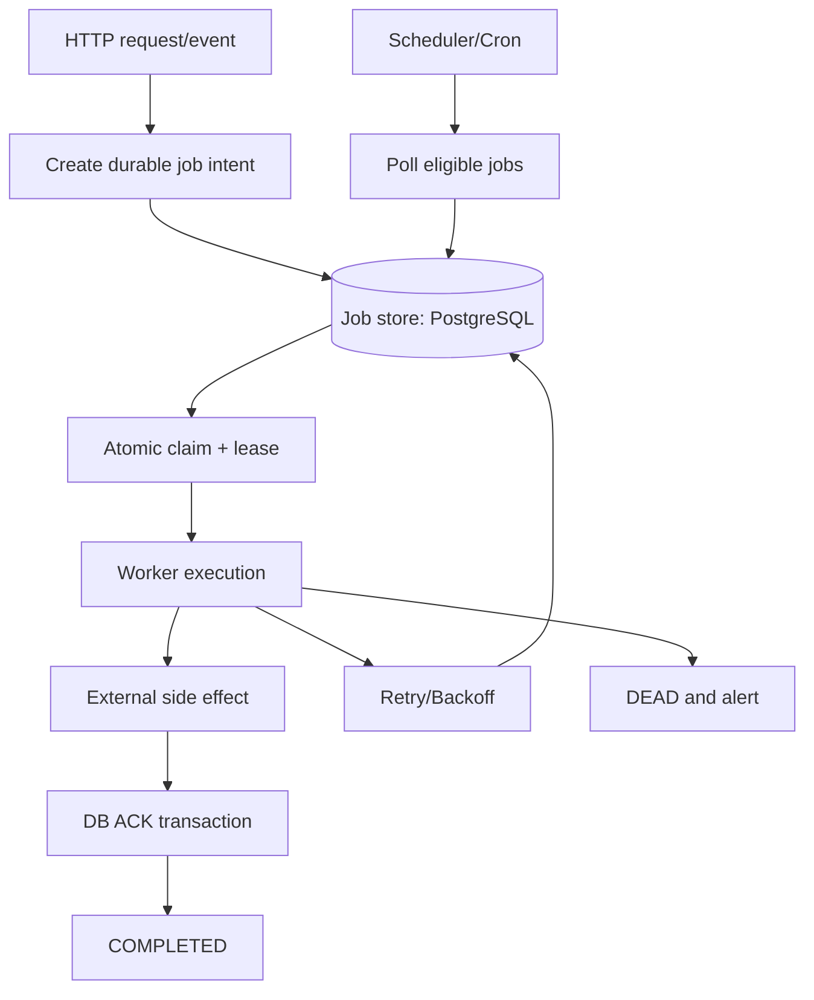

## 15.2 Quick Lookup

| Goal | Concept / API to remember |
|---|---|
| Run short work outside a request | `ExecutorService`, `@Async`, bounded queue |
| Run periodic work | `@Scheduled`, `TaskScheduler`, cron |
| Preserve jobs across crashes | Database-backed job / durable broker |
| Prevent multiple workers claiming the same job | `FOR UPDATE SKIP LOCKED` + transaction |
| Recover from worker crashes | Lease + reclaim |
| Prevent late acknowledgments | Owner token + conditional UPDATE |
| Prevent duplicate external effects | Idempotency key/operation |
| Reduce retry storms | Exponential backoff + jitter |
| Handle permanently failing jobs | DEAD/DLQ + monitoring + re-drive |
| Coordinate database change with event publishing | Transactional Outbox |
| Delete files after expiration | Cleanup job + idempotent deletion |
| Test time-dependent behavior | `Clock.fixed`, explicit `Instant` |
| Test PostgreSQL locking | PostgreSQL Testcontainers |
| Test multiple workers | Barrier + multithreaded SQL integration test |

## 15.3 Common Mistakes

1. Treating `@Scheduled` as a durable queue.
2. Returning `202` before committing durable work intent while promising jobs cannot be lost.
3. Calling `@Async` through `this.` and assuming the proxy intercepted it.
4. Leaving queues, pools, or payloads unbounded.
5. Holding PostgreSQL transactions during external calls or slow deletion.
6. Separately `SELECT`ing PENDING and `UPDATE`ing without an atomic claim.
7. Using leases but not validating ownership tokens at ACK.
8. Assuming an expired lease means the old worker certainly died.
9. Retrying non-idempotent side effects and expecting no duplicates.
10. Failing to handle RUNNING jobs whose final-attempt lease expired.
11. Deleting metadata before deleting bytes and assuming automatic consistency.
12. Running multiple replicas with separate local storage without changing the architecture.
13. Testing scheduling with lengthy `Thread.sleep()` rather than controlled Clocks/repositories.
14. Having no alerts/runbook for DEAD or overdue jobs.
15. Treating successful HTTP responses or DB commits as proof that every external side effect is complete.

## 15.4 Suggested Learning Roadmap

| Stage | Goal | Exercise |
|---|---|---|
| 1 | Task/job/worker/queue/scheduler | Draw and explain the restaurant diagram |
| 2 | Java threads and executors | Run two tasks using a two-thread pool |
| 3 | Spring `@Scheduled` / `@Async` | Build a simple timer and async service |
| 4 | Database transactions and locks | Practice `FOR UPDATE` and `SKIP LOCKED` in PostgreSQL |
| 5 | Durable jobs and leases | Implement Chapter 11 file by file |
| 6 | Retries, idempotency, and crashes | Write unit/integration tests from Chapter 12 |
| 7 | Operations | Design your own dashboard, alerts, and runbook |
| 8 | Advanced topics when genuinely needed | Compare RabbitMQ, Quartz, Kafka, and outbox |

## 15.5 Self-Assessment Checklist

- [ ] I can explain why a job is not a thread and a scheduler is not a worker.
- [ ] I can distinguish `fixedRate`, `fixedDelay`, cron, and event-triggered jobs.
- [ ] I understand `@Async` proxies/self-invocation and exception handling.
- [ ] I know why a RAM queue cannot recover after a hard crash.
- [ ] I can write claim SQL with `FOR UPDATE SKIP LOCKED`.
- [ ] I can explain row locks vs. leases vs. owner tokens.
- [ ] I can describe job states after a crash at every stage.
- [ ] I know why DB transactions cannot roll back file deletions or HTTP calls.
- [ ] I can implement bounded retries and Clock-based tests.
- [ ] I can reason about storage topology in a multi-replica system.
- [ ] I can distinguish evidence from unit tests, DB integration tests, and chaos tests.
- [ ] I can choose the simplest option meeting reliability requirements.

### Final Mental Model

> A **scheduler** determines *when to look for work* → a **queue/job store** determines *what must be done* → a **worker** performs *work* on a **thread/process** → **transactions/leases** coordinate instances → **idempotency/retries** handle repeated execution → **cleanup/monitoring** preserve system health and correct data lifecycles.
>
> Start simple; add complexity (brokers, dedicated workers, distributed coordination) only when a concrete requirement cannot be met by the existing solution.

# 16. Official References

The following links can be used to verify API versions while learning or upgrading. Source code above is pinned to the technology baseline stated at the beginning; do not casually mix APIs from different versions without checking compatibility.

1. [Spring Boot 4 — Build Systems & Starters](https://docs.spring.io/spring-boot/4.0/reference/using/build-systems.html) — starter names and BOM/dependency management.
2. [Spring Boot — Database Initialization (Flyway)](https://docs.spring.io/spring-boot/how-to/data-initialization.html) — migration locations and PostgreSQL database module.
3. [Spring Framework — Scheduling / Asynchronous Execution](https://docs.spring.io/spring-framework/reference/integration/scheduling.html) — `@Scheduled`, `@Async`, proxies, schedulers/executors.
4. [Spring `@Scheduled` API](https://docs.spring.io/spring-framework/docs/current/javadoc-api/org/springframework/scheduling/annotation/Scheduled.html) — fixedRate/fixedDelay/cron.
5. [Java 21 — ExecutorService](https://docs.oracle.com/en/java/javase/21/docs/api/java.base/java/util/concurrent/ExecutorService.html) — thread pools and close/shutdown.
6. [Java 21 — ScheduledExecutorService](https://docs.oracle.com/en/java/javase/21/docs/api/java.base/java/util/concurrent/ScheduledExecutorService.html) — periodic scheduling.
7. [PostgreSQL — Explicit Locking](https://www.postgresql.org/docs/current/explicit-locking.html) — row-level locks.
8. [PostgreSQL — SELECT (`SKIP LOCKED`)](https://www.postgresql.org/docs/current/sql-select.html) — locking and skip semantics.
9. [PostgreSQL — Transactions](https://www.postgresql.org/docs/current/tutorial-transactions.html) — commit/rollback.
10. [Testcontainers for Java — PostgreSQL Module](https://java.testcontainers.org/modules/databases/postgres/) — versioned artifact and container.
11. [Testcontainers — JUnit Jupiter](https://java.testcontainers.org/test_framework_integration/junit_5/) — test lifecycle.
12. [Spring Boot — Testing](https://docs.spring.io/spring-boot/reference/testing/index.html) — JUnit, mocks, integration testing.

---

**End of textbook.** When reviewing, return to the diagram in §15.1 and describe what happens if a crash occurs at each stage of a job: *before claiming, after claiming, before the side effect, after the side effect, before ACK, and after ACK*. If you can explain recovery at all six points, you understand the essential mindset of reliable background processing.
