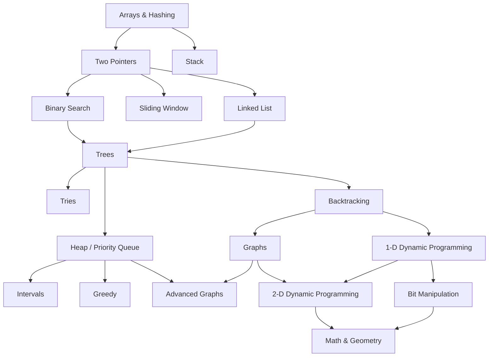

# Java DSA Interview Roadmap

An evidence-based, self-paced roadmap for Java 21 software engineering and backend internship interviews.

**Learning loop:** Understand → Implement → Practice → Explain → Review → Validate.

## Table of Contents

- [1. Purpose and Starting Point](#1-purpose-and-starting-point)
- [2. Progress Dashboard](#2-progress-dashboard)
- [3. Learning and Validation Strategy](#3-learning-and-validation-strategy)
- [4. Roadmap Overview and Dependencies](#4-roadmap-overview-and-dependencies)
- [Phase 0: Foundations](#phase-0-foundations)
- [Phase 1: Array Reasoning and Linear Patterns](#phase-1-array-reasoning-and-linear-patterns)
  - [1. Arrays & Hashing](#1-arrays--hashing)
  - [2. Two Pointers](#2-two-pointers)
  - [3. Stack](#3-stack)
- [Phase 2: Search, Windows, and Pointer Structures](#phase-2-search-windows-and-pointer-structures)
  - [4. Binary Search](#4-binary-search)
  - [5. Sliding Window](#5-sliding-window)
  - [6. Linked List](#6-linked-list)
- [Phase 3: Hierarchies and Search Spaces](#phase-3-hierarchies-and-search-spaces)
  - [7. Trees](#7-trees)
  - [8. Tries](#8-tries)
  - [9. Heap / Priority Queue](#9-heap--priority-queue)
  - [10. Backtracking](#10-backtracking)
- [Phase 4: Connectivity, Choices, and Reused States](#phase-4-connectivity-choices-and-reused-states)
  - [11. Intervals](#11-intervals)
  - [12. Greedy](#12-greedy)
  - [13. Graphs](#13-graphs)
  - [14. 1-D Dynamic Programming](#14-1-d-dynamic-programming)
- [Phase 5: Weighted Graphs and Richer States](#phase-5-weighted-graphs-and-richer-states)
  - [15. Advanced Graphs](#15-advanced-graphs)
  - [16. 2-D Dynamic Programming](#16-2-d-dynamic-programming)
  - [17. Bit Manipulation](#17-bit-manipulation)
- [Phase 6: Numerical and Spatial Reasoning](#phase-6-numerical-and-spatial-reasoning)
  - [18. Math & Geometry](#18-math--geometry)
- [Phase 7: Mixed Practice and Interview Preparation](#phase-7-mixed-practice-and-interview-preparation)
- [Revision and Spaced Repetition](#revision-and-spaced-repetition)
- [Learning Resources and Verification](#learning-resources-and-verification)
- [Final Completion Checklist](#final-completion-checklist)

## 1. Purpose and Starting Point

Use this document to decide what to learn next, what to implement yourself, which problems to attempt, and what evidence would justify interview readiness. The goal is to derive solutions to unfamiliar problems, explain why they work, and implement them correctly in Java 21.

The primary organizational reference is the [official NeetCode Roadmap](https://neetcode.io/roadmap). All 18 categories are preserved; foundations and the interview capstone are supplementary. This is a curated route through NeetCode 150, not a requirement to finish all 150 problems. The phase grouping, exercise selection, pattern explanations, and readiness criteria are specific to this guide.

Your stated background suggests prior exposure to Arrays & Hashing, Binary Search, Core Java, collections, and Big O. **Prior exposure is an invitation to take a diagnostic, not proof of mastery.** Every checkbox starts unchecked and every category starts `Not Started` because this roadmap has not yet recorded assessed evidence.

### Existing material: reuse and gaps

The six existing Markdown references were inspected. They provide substantial theory and examples, but their existence does not establish that you can reproduce or transfer the techniques.

| Existing reference | Coverage to reuse | Practical evidence still needed |
| --- | --- | --- |
| [Complexity Analysis and Foundations](./Complexity/Complexity_Analysis_and_Foundations.md) | Growth rates, independent input sizes, loop/recursive analysis, auxiliary space, amortization, collection/library costs, constraints, worked exercises | Analyze new code without its explanation; account for call stacks, copied strings, output, and hidden library work |
| [Java Arrays](./Java_Array.md) | Indexes, copies/aliasing, matrices, traversal, reversal/rotation, sorting/search APIs, links to common patterns | Derive an invariant and choose between hashing, sorting, two pointers, and prefix techniques |
| [Java Strings](./Java_String.md) | Immutability, equality, UTF-16 indexing, substring costs, parsing, `char[]`, `StringBuilder`, counting examples | Maintain window/count invariants and build outputs without unintended copying |
| [Lists](./Java_List_ArrayList_LinkedList.md) | Mutability, indexed operations, overloads, iteration, shallow copies, `ArrayList` versus `LinkedList`, deque endpoints | Manipulate custom interview nodes; traverse without accidental quadratic indexed access |
| [Maps](./Java_Map_HashMap_TreeMap_LinkedHashMap.md) | Hash/equality contracts, frequency/index/grouping patterns, sorted navigation, access-order `LinkedHashMap` | Choose a useful state/key; derive hash-based algorithms and an explicit node-based LRU cache |
| [Sets](./Java_Set_HashSet_TreeSet_LinkedHashSet.md) | Membership, uniqueness, visited sets, set algebra, sorted neighbors, custom-key pitfalls | Choose a set versus counts, prove visit/sequence bounds, and handle duplicate semantics |

The complexity reference already introduces recursion costs, heaps, and deques; the array/string/map/set references mention many later patterns. Those mentions are not complete algorithm training. Supplement them with executable recursion exercises, loop invariants, sorting implementation, queue/heap use, custom nodes, graph representations, greedy proofs, and DP state design in the phases below.

`DSA_Interview_Guide.md` is absent from the working tree, so this roadmap does not link to or depend on it. The repository also contains `.docx` materials; this coverage assessment concerns the available Markdown references, not an assessment of those Word documents.

## 2. Progress Dashboard

**Overall roadmap status:** Not Started. Update this label when you begin; use `Learning`, `Practicing`, or `Reviewing` during study and `Interview Ready` only after the capstone rubric is met.

### Four independent progress gates

| Gate | What a checked gate demonstrates | What it does not demonstrate |
| --- | --- | --- |
| T — Theory | Read the relevant material and explain the essential concepts and Java choices without notes | Correct implementation or problem-solving ability |
| I — Implementation | Complete the core implementation drills from a blank editor, test them, and explain their invariants/costs | Independent selection of the technique in an interview |
| P — Practice | Independently solve or cold re-solve the Essential problems and explain/test the results | Transfer to unfamiliar problems; memorized code is insufficient |
| R — Readiness | Pass the common readiness rubric and the category-specific demonstration on unfamiliar variants | Permanent readiness without revision |

In the table, manually change `[ ]` to `[x]` when a gate is earned. Table cells are text markers, not interactive GitHub task-list widgets; the lists in the topic sections use actual Markdown task checkboxes. Do not mark any gate from documentation ownership alone.

### All 18 categories

| Phase | Category and detailed evidence | T | I | P | R | Overall status |
| --- | --- | --- | --- | --- | --- | --- |
| 1 | [Arrays & Hashing](#1-arrays--hashing) | [ ] | [ ] | [ ] | [ ] | Not Started |
| 1 | [Two Pointers](#2-two-pointers) | [ ] | [ ] | [ ] | [ ] | Not Started |
| 1 | [Stack](#3-stack) | [ ] | [ ] | [ ] | [ ] | Not Started |
| 2 | [Binary Search](#4-binary-search) | [ ] | [ ] | [ ] | [ ] | Not Started |
| 2 | [Sliding Window](#5-sliding-window) | [ ] | [ ] | [ ] | [ ] | Not Started |
| 2 | [Linked List](#6-linked-list) | [ ] | [ ] | [ ] | [ ] | Not Started |
| 3 | [Trees](#7-trees) | [ ] | [ ] | [ ] | [ ] | Not Started |
| 3 | [Tries](#8-tries) | [ ] | [ ] | [ ] | [ ] | Not Started |
| 3 | [Heap / Priority Queue](#9-heap--priority-queue) | [ ] | [ ] | [ ] | [ ] | Not Started |
| 3 | [Backtracking](#10-backtracking) | [ ] | [ ] | [ ] | [ ] | Not Started |
| 4 | [Intervals](#11-intervals) | [ ] | [ ] | [ ] | [ ] | Not Started |
| 4 | [Greedy](#12-greedy) | [ ] | [ ] | [ ] | [ ] | Not Started |
| 4 | [Graphs](#13-graphs) | [ ] | [ ] | [ ] | [ ] | Not Started |
| 4 | [1-D Dynamic Programming](#14-1-d-dynamic-programming) | [ ] | [ ] | [ ] | [ ] | Not Started |
| 5 | [Advanced Graphs](#15-advanced-graphs) | [ ] | [ ] | [ ] | [ ] | Not Started |
| 5 | [2-D Dynamic Programming](#16-2-d-dynamic-programming) | [ ] | [ ] | [ ] | [ ] | Not Started |
| 5 | [Bit Manipulation](#17-bit-manipulation) | [ ] | [ ] | [ ] | [ ] | Not Started |
| 6 | [Math & Geometry](#18-math--geometry) | [ ] | [ ] | [ ] | [ ] | Not Started |

### Status definitions and maintenance

| Status | Meaning | Next action |
| --- | --- | --- |
| Not Started | No assessed work recorded here | Attempt the prerequisite diagnostic |
| Learning | Reading, explaining, or implementing the foundations | Close a specific concept or drill gap |
| Practicing | Implementations work; problem selection/solution transfer is still developing | Attempt Essential problems without solution access |
| Reviewing | A cold re-solve or mock exposed a gap, or retention is uncertain | Re-solve the relevant pattern and retest the gap |
| Interview Ready | T, I, P, and R are earned with current evidence | Maintain through spaced review and mixed practice |

Keep detailed concept/drill checkboxes and problem attempts in their topic sections. The dashboard stores only aggregate gates, updated when a gate is earned or invalidated; it does not duplicate problem counts. Record the date and unfamiliar-problem evidence next to the category's readiness paragraph when R is assessed. Use the phase completion rules below instead of maintaining a second set of phase counters. No percentages or values recalculate automatically in static Markdown.

## 3. Learning and Validation Strategy

### A repeatable study session

1. **Understand:** choose one unchecked concept; read the linked reference and explain it in your own words, including the precondition.
2. **Implement:** write the corresponding small drill from a blank editor; manually trace at least a normal case and a boundary case.
3. **Practice:** attempt an Essential problem without the topic notes open. Write a brute-force solution or precise pseudocode before optimizing.
4. **Explain:** state the invariant or recurrence, why the algorithm terminates, why it is correct, and time/auxiliary-space costs.
5. **Review:** compare with feedback only after making a concrete attempt; identify the missing reasoning step rather than copying code.
6. **Validate:** close all references, solve again after a gap, then try an unfamiliar variant or mixed mock.

Prefer one new pattern at a time. Move to a dependent topic when its required concepts and implementation skills are reliable and you can independently solve a representative prerequisite problem. You do not need every optional Hard problem or an R gate for every ancestor before exploring the next branch. Return to a prerequisite if you cannot explain why its technique works.

### Problem tracking: one record per problem

Each problem row below is a task checkbox followed by a compact attempt record. Check the box after completing an attempt, testing it, and writing a postmortem; **a checked problem alone does not mean independent success**. Put the latest result and next review date in its `Log` field:

| Result | Meaning | Follow-up |
| --- | --- | --- |
| I | Solved independently without hints, with correct Java, explanation, and edge-case checks | Review later; establish transfer with a different unseen problem |
| H | Needed a conceptual hint | Write what the hint unlocked; retry cold soon |
| S | Needed substantial solution/editorial/code review, or could not finish | Rebuild the prerequisite and derive the solution before a cold retry |
| — | No attempt recorded | Attempt when prerequisites are ready |

Example log format: `2026-10-22 H → 2026-10-25 I; due 2026-11-01; missed duplicate counts`. This is a format example, not recorded progress. A date in the past means a review is due. Search this file for `H`, `S`, or `due` to find work to revisit; search the exact date strings when planning a session. Keep history on the existing row rather than copying problems into another tracker.

**E = Essential:** core pattern coverage. **A = Additional:** targeted breadth after E or when a gap appears. **C = Optional advanced challenge:** useful extension; does not block ordinary internship readiness. These tiers are this guide's choices, not NeetCode labels. All practice-list problems belong to NeetCode 150 under the category where they appear; cross-topic solutions and deferred prerequisites are called out. Introductory implementation drills are separate from these platform problems. Concepts explicitly labelled optional do not block a gate; core concepts still need a demonstration even when their named platform problem is Additional.

### Common readiness rubric: required for every category

Use this rubric together with the topic-specific readiness paragraph. Record evidence once at that paragraph; the dashboard R gate is its summary.

| Dimension | Demonstration required |
| --- | --- |
| Concepts | Explain the structure, invariant/recurrence, and correctness argument without notes |
| Recognition | Select the pattern from an unfamiliar statement with tags hidden; explain why another plausible approach fails or costs more |
| Java implementation | Write a correct solution from scratch; use suitable Java 21 APIs, types, and mutation rules |
| Complexity | Define input variables; derive time and auxiliary space, including sort, hashing assumptions, recursion, copied data, and output costs where relevant |
| Edge cases | Propose and trace ordinary, minimal, duplicate/tie, impossible, and overflow cases as applicable |
| Independence | Demonstrate repeatable success on unfamiliar variants across separate sessions; a remembered curated answer does not count |
| Communication | In a mock, clarify assumptions, start with brute force, justify improvement, narrate key decisions, test, and discuss tradeoffs |

For pacing diagnostics, try roughly 15–25 minutes for a straightforward Easy, 30–45 minutes for a typical Medium, and 45–60+ minutes for a Hard investigation. These are flexible practice windows, not deadlines or guarantees. During learning, allow more time; in mocks, use the actual interview format. A hint changes the result to H regardless of speed. Hard completion is optional unless a target role explicitly calls for it.

## 4. Roadmap Overview and Dependencies

There are **eight learning phases, numbered 0–7**, including supplementary foundations and the interview capstone.

| Phase | Topics | Practical milestone / phase progress rule |
| --- | --- | --- |
| 0 | Supplementary foundations | Pass the diagnostic and core drills; use its checklist as the phase record |
| 1 | Arrays & Hashing; Two Pointers; Stack | Explain linear-scan invariants and independently implement the core patterns |
| 2 | Binary Search; Sliding Window; Linked List | Maintain search/window/link invariants and solve representative Essential problems |
| 3 | Trees; Tries; Heap / Priority Queue; Backtracking | Traverse hierarchies, manage priorities, and enumerate choices with correct state ownership |
| 4 | Intervals; Greedy; Graphs; 1-D Dynamic Programming | Distinguish sorting/greedy, connectivity, and repeated-state reasoning |
| 5 | Advanced Graphs; 2-D Dynamic Programming; Bit Manipulation | Select weighted-graph algorithms, derive richer states, and reason about fixed-width bits |
| 6 | Math & Geometry | Derive numerical/spatial transformations and implement them safely |
| 7 | Supplementary mixed practice and mock interviews | Pass the capstone evidence rubric; retain separate category R assessments |

For phases 1–6, learning is complete when the included topics' T, I, and P gates are earned and the phase milestone is demonstrated. Interview validation is complete when their R gates are earned. Check the dashboard to see which part remains; phase labels do not require a separate progress entry.

### Official recommended edges

The following diagram reproduces the **dependency relationships**, not the visual layout, of the [official roadmap](https://neetcode.io/roadmap). Arrows represent NeetCode's recommended learning order, not mathematical requirements for every problem.

If Mermaid is unavailable in your Markdown viewer, the edges mean: Arrays → Two Pointers and Stack; Two Pointers → Binary Search, Sliding Window, and Linked List; Binary Search + Linked List → Trees; Trees → Tries, Heap, and Backtracking; Backtracking → Graphs and 1-D DP; Heap → Intervals and Greedy; Heap + Graphs → Advanced Graphs; Graphs + 1-D DP → 2-D DP; 1-D DP → Bits; 2-D DP + Bits → Math & Geometry.

After prerequisites, branches may proceed independently. For example, Stack need not wait for Binary Search; Tries, Heap, and Backtracking need not wait for each other; Intervals/Greedy do not need Graphs/DP; Advanced Graphs does not need 2-D DP. Within a phase, follow the topic prerequisites rather than treating its row as a rigid sequence. Cross-topic challenges can wait until the named prerequisite is learned.

Supplementary foundations add recursion before Trees/Backtracking, queues before BFS, sorting before interval/greedy work, and elementary arithmetic before numerical exercises. Basic digit and matrix drills can be tried early; the complete Math & Geometry category stays at the official downstream position.

## Phase 0: Foundations

**Objectives:** turn existing Java and complexity knowledge into reliable coding and reasoning tools. **Prerequisites:** Core Java and OOP. **Topics:** complexity, arrays/strings/collections, invariants, recursion, sorting/searching, and elementary mathematics. These are supplementary foundations, not additional NeetCode categories.

### Diagnostic and essential foundations

- [ ] Analyze unfamiliar sequential, dependent-nested, two-pointer, and halving loops; keep independent `n` and `m` variables distinct.
- [ ] Analyze a linear recursive chain and a branching recursion tree; distinguish total calls from maximum stack depth.
- [ ] Explain expected versus worst-case hashing and amortized versus single-operation costs using a concrete example.
- [ ] Derive auxiliary space separately from input and returned output; include copies, queues, maps, and recursive frames.
- [ ] Use input constraints to reject an infeasible brute force without treating rough operation budgets as guarantees.
- [ ] Traverse/copy arrays and rectangular matrices; explain aliasing, shallow copies, and inclusive/exclusive bounds.
- [ ] Choose `int[]`, `ArrayList`, map, set, deque, or heap from the required operations and their costs.
- [ ] Compare strings by contents; explain `char` as a UTF-16 code unit and when a 26-slot frequency array is valid.
- [ ] Explain a loop invariant, initialization, preservation, and termination using an array scan.
- [ ] Trace recursion with parameters, a base case, progress toward termination, returned values, and local versus shared mutable state.
- [ ] Explain insertion sort, merge sort, and quicksort partitioning; compare stability, extra memory, and quicksort's quadratic worst case.
- [ ] Distinguish linear search from sorted binary search; explain that sorting may destroy original positions or cost more than one scan.
- [ ] Apply integer division, remainder, powers/logarithms, simple summations, and the multiplication/addition principles for counting choices.
- [ ] Check numeric ranges before summation, multiplication, subtraction, or absolute value; promote operands to `long` before arithmetic when required.

Use the [complexity reference](./Complexity/Complexity_Analysis_and_Foundations.md), especially sections 7–19 and 21, plus the [array](./Java_Array.md), [string](./Java_String.md), [list](./Java_List_ArrayList_LinkedList.md), [map](./Java_Map_HashMap_TreeMap_LinkedHashMap.md), and [set](./Java_Set_HashSet_TreeSet_LinkedHashSet.md) references. Read a section to close a demonstrated gap rather than rereading every page first.

### Java 21 interview toolkit

| Need | API / habit | Pitfall to demonstrate |
| --- | --- | --- |
| Bounds and size | `a.length`, `s.length()`, `list.size()` | Empty inputs and inclusive/exclusive ends |
| Copies/equality | `Arrays.copyOf`, `Arrays.equals`, `new ArrayList<>(path)` | Nested arrays and object elements remain shared after shallow copies |
| Counts/grouping | `getOrDefault`, `merge`, `computeIfAbsent`, `entrySet` | `getOrDefault` does not insert; raw arrays do not have content-based key equality |
| Ordered queries | `TreeMap` / `TreeSet` neighbor operations | Comparator equality determines uniqueness; check absent neighbors before unboxing |
| Stack / queue | `Deque<Integer> d = new ArrayDeque<>()`; stack `push/pop/peek`, queue `offer/poll/peek` | `ArrayDeque` rejects null; `pop` throws when empty; `poll`/`peek` return null |
| Priority | `PriorityQueue<Integer>`; `new PriorityQueue<>(Comparator.reverseOrder())` | Only the head is ordered; arbitrary removal/contains are linear |
| Sorting | `Arrays.sort`, `list.sort`, `Comparator.comparingInt`, `Integer.compare` | Subtraction comparators can overflow; primitive `int[]` has no comparator overload |
| Output text | `StringBuilder.append`, `toString` | Repeated growing-string concatenation and substring copies can dominate runtime |
| Numeric safety | `long total`, `(long) a * b`, `Integer.compare(a, b)` | Casting an already-overflowed `int` expression is too late |

Deque endpoint operations are amortized constant time; heap offer/poll have logarithmic heap work, with occasional backing-array growth on insertion. Prefer `ArrayDeque` for interview stack/queue use. Contracts are supported by the Java 21 [ArrayDeque](https://docs.oracle.com/en/java/javase/21/docs/api/java.base/java/util/ArrayDeque.html) and [PriorityQueue](https://docs.oracle.com/en/java/javase/21/docs/api/java.base/java/util/PriorityQueue.html) documentation.

### Core implementation drills

These are small local exercises, not LeetCode assignments. Use a Java 21 scratch environment without adding project dependencies.

- [ ] Write an array scan, in-place reversal, frequency map, and prefix-sum/range-query routine; test empty/singleton inputs where allowed and duplicate/negative values.
- [ ] Write iterative linear and binary search; explain the candidate interval before and after each iteration.
- [ ] Implement insertion sort and merge sort on a small `int[]`; trace a quicksort partition without requiring a production sorting library implementation.
- [ ] Write recursive array sum and a small branching choice enumerator; draw the calls and explain stack depth versus total work.
- [ ] Exercise stack and FIFO queue operations using `ArrayDeque`; predict results before running, including empty behavior.
- [ ] Analyze fresh snippets from the complexity reference before opening their solutions; explain one linear, logarithmic, quadratic, and recursive example aloud.

**Expected outcomes:** select containers by operations, explain costs independently, and write safe Java loops/recursion. **Milestone:** from a blank editor, complete the drills and defend one invariant and one recursive cost analysis. **Completion:** the core checklist/drills are demonstrated without copied code; revisit uncertain items in later topics. No hand-built hash table, balanced tree, or full collections library is required.

## Phase 1: Array Reasoning and Linear Patterns

**Objectives:** replace repeated work with stored state or monotone scans. **Prerequisites:** Phase 0 scans, costs, hashing, bounds, and deque operations. **Topics:** Arrays & Hashing, Two Pointers, Stack. **Expected outcomes:** identify a useful invariant and choose the correct linear structure. **Milestone:** derive a frequency/grouping solution, a sorted-pair scan, and a monotonic-stack solution. **Completion:** T/I/P for these topics, with no unresolved prerequisite gap; validate R separately.

### 1. Arrays & Hashing

**Overview and prerequisites:** arrays expose positions; hashing associates values or signatures with reusable information. Use them for lookup, duplicates, counting, grouping, and range aggregation. This is a common first optimization over nested scans. Know Phase 0 array/string traversal, equality, and expected hashing costs. Reuse [Arrays](./Java_Array.md), [Maps](./Java_Map_HashMap_TreeMap_LinkedHashMap.md), and [Sets](./Java_Set_HashSet_TreeSet_LinkedHashSet.md).

**Essential knowledge**

- [ ] Traverse and transform an array while preserving an explicit processed-prefix invariant.
- [ ] Choose a set for membership, a map for counts/indices, or a frequency array for a bounded domain.
- [ ] Derive complement lookup; decide whether to query before inserting to avoid reusing an index.
- [ ] Construct an unambiguous grouping signature; explain hash collisions versus equal keys.
- [ ] Build prefix sums and prefix/suffix products; answer range sums with consistent boundaries.
- [ ] Explain why starting a consecutive-sequence scan only at sequence heads avoids quadratic work.
- [ ] Compare sorting, hashing, and bucket counting by time, extra memory, order, and domain assumptions.

**Java 21:** use `HashMap`, `HashSet`, `getOrDefault`, `computeIfAbsent`, `entrySet`, `Arrays.fill`, and `long[]` prefix sums when ranges demand it. An `int[]` key uses identity equality; use an immutable content signature instead. Include string-signature construction/hash costs in analysis; do not promise unconditional O(1) hashing.

**Reusable patterns**

| Pattern | Recognition and main idea | Expected cost | Representative |
| --- | --- | --- | --- |
| Seen values / complements | Need a prior value or duplicate; store the processed prefix | Expected O(n) time, O(n) space | Two Sum |
| Canonical grouping | Items are equivalent after reordering; map a stable signature to a group | O(L+N) for fixed-alphabet counts, or O(N + sum k log(k+1)) for sorted words; O(L+N) output/storage | Group Anagrams |
| Prefix/suffix aggregation | Recompute almost the same range/product many times; reuse partial results | O(n) time; O(1) auxiliary excluding output for two-pass products | Product of Array Except Self |
| Sequence-head expansion | Need maximal consecutive runs in unordered data; expand only from missing-predecessor values | Expected O(n) time, O(n) space | Longest Consecutive Sequence |

Here `N` is the number of words, `L` is total input characters, and `k` is an individual word's length. The N term includes empty words and per-word signatures. A standalone prefix-sum index needs O(n) preprocessing/storage and O(1) per range query.

**Implementation drills**

- [ ] Build integer/string frequency counters with both a map and a justified fixed alphabet; explain when the latter is invalid.
- [ ] Implement prefix range sums and two-pass products without division; trace zero, two zeros, negatives, and overflow assumptions.

**Practice, in order**

- [ ] **E** [Contains Duplicate](https://leetcode.com/problems/contains-duplicate/) — Easy; seen-value set. Log: —
- [ ] **E** [Valid Anagram](https://leetcode.com/problems/valid-anagram/) — Easy; frequency equality. Log: —
- [ ] **E** [Two Sum](https://leetcode.com/problems/two-sum/) — Easy; complement lookup. Log: —
- [ ] **E** [Group Anagrams](https://leetcode.com/problems/group-anagrams/) — Medium; canonical signatures. Log: —
- [ ] **E** [Product of Array Except Self](https://leetcode.com/problems/product-of-array-except-self/) — Medium; prefix/suffix aggregation. Log: —
- [ ] **A** [Longest Consecutive Sequence](https://leetcode.com/problems/longest-consecutive-sequence/) — Medium; sequence-head expansion. Log: —
- [ ] **A** [Top K Frequent Elements](https://leetcode.com/problems/top-k-frequent-elements/) — Medium; frequencies plus buckets; compare heaps after Phase 3. Log: —

**Interview Ready evidence:** apply the common rubric to an unseen lookup/grouping or prefix variant. Defend the stored key/state and expected linear bound, address duplicate indices and zero/overflow cases, and explain when sorting is preferable. Assessment date / evidence: —

### 2. Two Pointers

**Overview and prerequisites:** move two positions using an ordering or partition invariant to avoid examining every pair. Typical problems involve sorted pairs, palindromes, compaction, or area boundaries. Know Arrays & Hashing, sorted order, and array/string bounds. Reuse [Arrays](./Java_Array.md) and [Strings](./Java_String.md).

**Essential knowledge**

- [ ] Distinguish opposite-end pointers, read/write pointers, and coordinated scans across two sequences.
- [ ] Prove why one pointer can move without discarding a valid or better answer.
- [ ] Explain when sorting enables the method and what it does to original positions.
- [ ] Skip duplicates at the correct level in pair/triple enumeration.
- [ ] Separate in-place modification from logical output length and from returned-output allocation.

**Java 21:** use index-based access on arrays/strings; `char[]` if mutation is required. `Character.isLetterOrDigit` and `toLowerCase` support filtering but still require a stated character model. Sum three `int` values in `long` if constraints need it; include the library sort's memory when claiming total auxiliary space.

| Pattern | Recognition and main idea | Expected cost | Representative |
| --- | --- | --- | --- |
| Converging sorted search | Sorted pair target; move the boundary that can change the sum in the needed direction | O(n) time, O(1) space after sorting | Two Sum II - Input Array Is Sorted |
| Filtered opposite-end scan | Compare only meaningful symbols; skip ignored characters at both ends | O(n) time, O(1) extra space | Valid Palindrome |
| Fixed anchor + pair scan | Need triples; fix one sorted value and scan the remaining interval | O(n²) time plus sort/output costs | 3Sum |
| Dominated-boundary elimination | A boundary limits quality; move the limiting side | O(n) time, O(1) space | Container With Most Water |

**Implementation drills**

- [ ] Implement sorted pair search and stable in-place removal of a chosen value; state what each pointer represents.
- [ ] Implement palindrome checking without allocating a cleaned copy; test empty-after-filtering, single characters, and mixed case.

**Practice, in order**

- [ ] **E** [Valid Palindrome](https://leetcode.com/problems/valid-palindrome/) — Easy; filtered opposite-end scan. Log: —
- [ ] **E** [Two Sum II - Input Array Is Sorted](https://leetcode.com/problems/two-sum-ii-input-array-is-sorted/) — Medium; sorted pair invariant. Log: —
- [ ] **E** [3Sum](https://leetcode.com/problems/3sum/) — Medium; fixed anchor, pairs, duplicate suppression. Log: —
- [ ] **A** [Container With Most Water](https://leetcode.com/problems/container-with-most-water/) — Medium; discard the limiting boundary. Log: —
- [ ] **C** [Trapping Rain Water](https://leetcode.com/problems/trapping-rain-water/) — Hard; two boundary maxima. Log: —

**Interview Ready evidence:** justify every pointer move on an unfamiliar sorted/filtered variant; handle duplicate results, crossing bounds, and output order. Explain why pointer motion is linear even inside a loop and why unsorted inputs may invalidate it. Assessment date / evidence: —

### 3. Stack

**Overview and prerequisites:** a stack resolves nested or deferred work in last-in-first-out order. It supports bracket validation, expression evaluation, reversible state, and next-greater/smaller queries. Know array scans, invariants, and deque operations; this branch can run alongside Two Pointers.

**Essential knowledge**

- [ ] Explain LIFO and distinguish explicit stacks from the recursive call stack.
- [ ] Validate matching delimiters, including early closing and leftover opening symbols.
- [ ] Evaluate postfix expressions with correct operand order.
- [ ] Maintain an auxiliary minimum invariant for constant-time minimum queries.
- [ ] Store indices versus values deliberately in a monotonic stack; explain equality handling.
- [ ] Prove amortized linear work by counting each element's pushes and pops.

**Java 21:** prefer `Deque<Integer> stack = new ArrayDeque<>()` and `push/pop/peek`. Guard emptiness before unboxing `peek`; `ArrayDeque` cannot store null. `Integer.parseInt` handles numeric tokens; subtraction/division must use the second popped operand as the left operand. Reuse the deque/stack cost discussion in [Complexity](./Complexity/Complexity_Analysis_and_Foundations.md).

| Pattern | Recognition and main idea | Expected cost | Representative |
| --- | --- | --- | --- |
| Matching / reduction | Latest unresolved opening or operand must be used first | O(n) time, O(n) space | Valid Parentheses; Evaluate Reverse Polish Notation |
| Augmented state | Need a running aggregate after undoing operations; store per-depth metadata | O(1) per operation, O(n) space | Min Stack |
| Monotonic unresolved indices | Need the next larger/smaller value; resolve dominated pending entries | O(n) time, O(n) space | Daily Temperatures |

**Implementation drills**

- [ ] Trace and code a bracket validator and small postfix evaluator; include invalid-bracket order and noncommutative operations.
- [ ] Implement next-greater indices using a monotonic stack; compare all-equal, increasing, and decreasing arrays against a nested scan.

**Practice, in order**

- [ ] **E** [Valid Parentheses](https://leetcode.com/problems/valid-parentheses/) — Easy; matching delimiters. Log: —
- [ ] **E** [Min Stack](https://leetcode.com/problems/min-stack/) — Medium; augmented stack. Log: —
- [ ] **A** [Evaluate Reverse Polish Notation](https://leetcode.com/problems/evaluate-reverse-polish-notation/) — Medium; operand stack. Log: —
- [ ] **E** [Daily Temperatures](https://leetcode.com/problems/daily-temperatures/) — Medium; monotonic indices. Log: —
- [ ] **C** [Largest Rectangle in Histogram](https://leetcode.com/problems/largest-rectangle-in-histogram/) — Hard; monotonic boundaries. Log: —

**Interview Ready evidence:** on an unseen deferred-work problem, explain the stack invariant, choose indices or values, and prove total push/pop work. Test empty state, ties, unresolved suffixes, and correct operand order in a mock explanation. Assessment date / evidence: —

## Phase 2: Search, Windows, and Pointer Structures

**Objectives:** maintain a shrinking candidate region, a changing contiguous window, and safe node links. **Prerequisites:** Two Pointers plus Phase 0 search, hashing, and reference semantics; Stack supports the optional deque window challenge. **Topics:** Binary Search, Sliding Window, Linked List. **Expected outcomes:** derive boundary updates instead of recalling templates blindly. **Milestone:** explain a lower-bound search, a window invariant, and an in-place list reversal. **Completion:** T/I/P for the three topics and the milestone; their branches may be studied independently.

### 4. Binary Search

**Overview and prerequisites:** eliminate half a candidate range when a sorted order or monotone predicate justifies the elimination. It solves exact search, boundaries, rotated arrays, and minimum feasible answers. Know Two Pointers, sorted arrays, integer bounds, and invariants. Prior practice should be checked with a fresh boundary-search diagnostic. Reuse [Arrays](./Java_Array.md) and [Complexity](./Complexity/Complexity_Analysis_and_Foundations.md).

**Essential knowledge**

- [ ] Derive both exact search and first-true/lower-bound search; choose and consistently maintain one interval convention.
- [ ] Prove progress for empty, singleton, two-element, and all-duplicate ranges.
- [ ] Find first/last occurrences by boundary search rather than assuming any library hit is the first.
- [ ] Identify a sorted half of a rotated array and justify the selected half.
- [ ] Construct a monotone feasibility predicate and valid answer bounds for search-on-answer problems.
- [ ] Include feasibility-check work in the total bound; binary search is not always O(log n) overall.

**Java 21:** use `left + (right - left) / 2` for ordinary nonnegative index bounds; wider answer domains may require `long`. `Arrays.binarySearch` requires matching sorted order and returns a negative insertion-point encoding on failure; it is not a lower-bound API. Use long accumulators for Koko's hours and overflow-safe ceiling division for the stated domain.

| Pattern | Recognition and main idea | Expected cost | Representative |
| --- | --- | --- | --- |
| Exact / boundary search | Sorted values or false→true condition; retain the possible answer interval | O(log n) time, O(1) iterative space | Binary Search; Time Based Key-Value Store |
| Rotated sorted search | One side is ordered; test whether the target lies in it | O(log n) time for the distinct-value version, O(1) space | Search in Rotated Sorted Array |
| Search on answer | Feasibility improves monotonically with a candidate answer; locate the first feasible one | O(n log R) time, O(1) auxiliary for scanning predicate | Koko Eating Bananas |

`R` is the searched answer-range size. Duplicate-heavy rotated variants can require linear work; do not transfer the distinct-input bound blindly.

**Implementation drills**

- [ ] Write exact search, lower bound, and upper bound from scratch; trace empty arrays and targets before/after/equal to every element.
- [ ] Write a first-feasible integer search with a separate predicate; explain its monotonicity and count predicate work.

**Practice, in order**

- [ ] **E** [Binary Search](https://leetcode.com/problems/binary-search/) — Easy; candidate interval. Log: —
- [ ] **A** [Search a 2D Matrix](https://leetcode.com/problems/search-a-2d-matrix/) — Medium; flattened sorted order. Log: —
- [ ] **E** [Search in Rotated Sorted Array](https://leetcode.com/problems/search-in-rotated-sorted-array/) — Medium; sorted-half reasoning. Log: —
- [ ] **E** [Koko Eating Bananas](https://leetcode.com/problems/koko-eating-bananas/) — Medium; monotone answer search. Log: —
- [ ] **A** [Time Based Key-Value Store](https://leetcode.com/problems/time-based-key-value-store/) — Medium; predecessor timestamp. Log: —
- [ ] **C** [Median of Two Sorted Arrays](https://leetcode.com/problems/median-of-two-sorted-arrays/) — Hard; partition feasibility. Log: —

**Interview Ready evidence:** derive an unfamiliar boundary or answer search without a memorized update rule; prove monotonicity, termination, and bounds. Handle missing targets, duplicates, and overflow, and include predicate cost in the explanation. Assessment date / evidence: —

### 5. Sliding Window

**Overview and prerequisites:** maintain information about a contiguous interval as its endpoints move. It solves fixed-length aggregation and longest/shortest substrings satisfying a condition. Know Two Pointers, counting maps, and amortized scans; monotonic-deque maximums also use Stack's reasoning.

**Essential knowledge**

- [ ] Distinguish fixed-size windows from variable-size validity windows.
- [ ] State whether to shrink until valid, or record a valid answer before shrinking toward minimality.
- [ ] Update outgoing as well as incoming counts; distinguish kinds of characters from total occurrences.
- [ ] Explain why each pointer advances at most n times even with an inner `while`.
- [ ] Recognize when a window's monotonicity fails, such as exact sums with arbitrary negative values; consider prefix sums/maps instead.
- [ ] For optional window maximums, maintain ordered candidates and discard expired indices.

**Java 21:** use `int[]` counts only for a verified alphabet, otherwise `HashMap<Character,Integer>` or code-point-aware state as required. Remove zero counts if `map.size()` denotes distinct elements. Use `ArrayDeque<Integer>` for candidate indices; do not repeatedly copy `substring` inside the scan. Reuse [Strings](./Java_String.md) and [Maps](./Java_Map_HashMap_TreeMap_LinkedHashMap.md).

| Pattern | Recognition and main idea | Expected cost | Representative |
| --- | --- | --- | --- |
| Fixed-size counts | Need a permutation/anagram-length match; add right, remove left | O(n + m) time, O(alphabet) state | Permutation in String |
| Longest valid window | Constraint can be restored by removing a prefix; shrink on violations | Expected O(n) time, O(distinct characters) space | Longest Substring Without Repeating Characters |
| Shortest covering window | Need all required counts; grow to cover, shrink while coverage holds | Expected O(n + m) time, O(distinct characters) space | Minimum Window Substring |
| Monotonic deque | Repeated maximums over fixed-length windows; retain unexpired dominant candidates | O(n) time, O(k) space | Sliding Window Maximum |

**Implementation drills**

- [ ] Implement fixed-length rolling sum and distinct-character windows; print left/right/count state while manually tracing.
- [ ] Give a negative-number counterexample to an unjustified sum window and explain a prefix-map alternative.

**Practice, in order**

- [ ] **E** [Best Time to Buy and Sell Stock](https://leetcode.com/problems/best-time-to-buy-and-sell-stock/) — Easy; earlier minimum / two-position scan. Log: —
- [ ] **E** [Longest Substring Without Repeating Characters](https://leetcode.com/problems/longest-substring-without-repeating-characters/) — Medium; variable valid window. Log: —
- [ ] **E** [Permutation in String](https://leetcode.com/problems/permutation-in-string/) — Medium; fixed-size frequency window. Log: —
- [ ] **A** [Longest Repeating Character Replacement](https://leetcode.com/problems/longest-repeating-character-replacement/) — Medium; replacement-budget window. Log: —
- [ ] **C** [Minimum Window Substring](https://leetcode.com/problems/minimum-window-substring/) — Hard; smallest covering window. Log: —
- [ ] **C** [Sliding Window Maximum](https://leetcode.com/problems/sliding-window-maximum/) — Hard; monotonic deque; revisit after Stack. Log: —

**Interview Ready evidence:** derive validity and update rules for an unseen substring variant; explain linear endpoint movement and when shrinking is sound. Test duplicate requirements, impossible coverage, and minimal windows; identify inputs where sliding window is the wrong technique. Assessment date / evidence: —

### 6. Linked List

**Overview and prerequisites:** interview linked lists expose nodes and links directly, making reference reasoning central. Typical tasks reverse, merge, remove, detect cycles, or combine constant-time node movement with hashing. Know Two Pointers, references, null handling, and invariants. The [Lists reference](./Java_List_ArrayList_LinkedList.md) explains library behavior; using `java.util.LinkedList` does not replace custom-node practice.

**Essential knowledge**

- [ ] Define a singly linked `ListNode` with value and next reference; distinguish node identity from equal values.
- [ ] Use a dummy/sentinel node to simplify head deletion and merging.
- [ ] Save the next reference before rewiring; maintain reversed and unprocessed portions explicitly.
- [ ] Use fast/slow pointers for midpoint and cycle detection, explaining the meeting argument.
- [ ] Maintain a fixed gap to locate a node relative to the tail.
- [ ] Compose midpoint, reversal, and merge without losing nodes or creating cycles.
- [ ] For LRU design, combine a map and doubly linked list; distinguish knowing a node from searching for it.

**Java 21:** create ordinary custom node classes matching the judge's signature. Mutating `node.next` changes a shared object; assigning a local head variable alone does not change a caller's variable. `LinkedList.get(i)` is linear. `HashMap<Node,Node>` for cloning must preserve the intended node-identity semantics. A library `LinkedHashMap` demonstrates access order, but explicitly implement nodes when the interview asks for the underlying LRU mechanism.

| Pattern | Recognition and main idea | Expected cost | Representative |
| --- | --- | --- | --- |
| Rewire + sentinel | Need reversal/removal/merge; preserve the next node and simplify boundaries | O(n) time, O(1) auxiliary for iterative rewiring | Reverse Linked List; Merge Two Sorted Lists |
| Fast/slow or fixed gap | Need a midpoint, cycle, or tail-relative position without indexing | O(n) time, O(1) space | Linked List Cycle; Remove Nth Node From End of List |
| Map + movable nodes | Need expected O(1) lookup and recency updates | Expected O(1) per operation, O(capacity) space | LRU Cache |

**Implementation drills**

- [ ] Build a short custom-node chain; implement iterative reversal, dummy-head deletion, and sorted merging; draw links before each mutation.
- [ ] Detect a deliberately created cycle; verify empty, singleton, two-node, head-removal, and whole-list reversal cases without hanging the printer.

**Practice, in order**

- [ ] **E** [Reverse Linked List](https://leetcode.com/problems/reverse-linked-list/) — Easy; three-reference reversal. Log: —
- [ ] **E** [Merge Two Sorted Lists](https://leetcode.com/problems/merge-two-sorted-lists/) — Easy; dummy head and merge. Log: —
- [ ] **E** [Linked List Cycle](https://leetcode.com/problems/linked-list-cycle/) — Easy; fast/slow pointers. Log: —
- [ ] **E** [Remove Nth Node From End of List](https://leetcode.com/problems/remove-nth-node-from-end-of-list/) — Medium; fixed gap and sentinel. Log: —
- [ ] **A** [Reorder List](https://leetcode.com/problems/reorder-list/) — Medium; split, reverse, weave. Log: —
- [ ] **A** [Copy List with Random Pointer](https://leetcode.com/problems/copy-list-with-random-pointer/) — Medium; old-to-new node mapping. Log: —
- [ ] **A** [LRU Cache](https://leetcode.com/problems/lru-cache/) — Medium; map plus doubly linked list. Log: —
- [ ] **C** [Merge k Sorted Lists](https://leetcode.com/problems/merge-k-sorted-lists/) — Hard; heap merge; defer until Heap / Priority Queue. Log: —

**Interview Ready evidence:** solve an unseen deletion/reversal/composition variant with a link diagram and invariant. Demonstrate head/tail/null handling, preservation of every node, no accidental cycles, and O(1) auxiliary rewiring where applicable. Assessment date / evidence: —

## Phase 3: Hierarchies and Search Spaces

**Objectives:** reason recursively about hierarchical data, priorities, and choices. **Prerequisites:** Linked List and Binary Search before Trees; recursion and deque basics from Phase 0. **Topics:** Trees, Tries, Heap / Priority Queue, Backtracking. **Expected outcomes:** define recursive contracts, distinguish returned state from shared state, and manage a frontier or candidate set. **Milestone:** implement DFS/BFS, trie operations, a bounded heap, and choose/explore/undo enumeration. **Completion:** T/I/P for the four topics and correct space analysis; Tries, Heap, and Backtracking are independent branches after Trees.

### 7. Trees

**Overview and prerequisites:** trees organize hierarchical relationships; binary trees and BSTs support traversal, structural queries, and ordered lookup. Interviews test recursive reasoning and combining child results. Know node references, Binary Search's order reasoning, recursion, and queues.

**Essential knowledge**

- [ ] Distinguish arbitrary binary trees, BSTs, balanced trees, complete trees, height, and depth.
- [ ] Implement preorder, inorder, and postorder DFS; explain why BST inorder is sorted.
- [ ] Implement BFS by levels and iterative DFS; account for height versus frontier width.
- [ ] Define precisely what each recursive call returns; combine subtree height, size, balance, or path information.
- [ ] Validate a BST using ancestor bounds rather than only parent-child comparisons.
- [ ] Distinguish a path that can be returned to a parent from a path that ends within a subtree.
- [ ] Reconstruct from traversals using disjoint ranges and a value-to-index map when uniqueness is guaranteed.

**Java 21:** define a `TreeNode` with `int val`, `left`, and `right`. Use `ArrayDeque<TreeNode>` for non-null nodes; never enqueue null placeholders into it. Use `long` bounds or explicit nullable bounds to avoid rejecting valid extreme `int` values in BST checks. Reset any per-solution mutable fields between calls; deep recursive chains can overflow the call stack, so know the iterative alternative.

| Pattern | Recognition and main idea | Expected cost | Representative |
| --- | --- | --- | --- |
| Postorder aggregation | Answer depends on child answers; compute once per node | O(n) time, O(h) recursion space | Maximum Depth of Binary Tree; Diameter of Binary Tree |
| BFS layers | Need nearest depth, levels, or side views; process one frontier at a time | O(n) time, O(w) queue space, excluding output | Binary Tree Level Order Traversal |
| Inherited bounds / state | Validity depends on ancestors; pass constraints downward | O(n) time, O(h) stack space | Validate Binary Search Tree |
| Indexed traversal reconstruction | Two traversal orders identify roots and subtree ranges | Expected O(n) time, O(n) index map plus O(h) stack | Construct Binary Tree from Preorder and Inorder Traversal |

`n` is nodes, `h` is height, and `w` is maximum width. Do not assume h = O(log n) for an arbitrary tree.

**Implementation drills**

- [ ] Build a small custom tree; implement recursive DFS orders, iterative inorder, and level-order BFS; compare outputs by hand.
- [ ] Compute height and diameter in one postorder pass; test empty, chain, balanced, and all-negative-value trees where relevant.

**Practice, in order**

- [ ] **E** [Maximum Depth of Binary Tree](https://leetcode.com/problems/maximum-depth-of-binary-tree/) — Easy; recursive contract. Log: —
- [ ] **E** [Invert Binary Tree](https://leetcode.com/problems/invert-binary-tree/) — Easy; structural recursion. Log: —
- [ ] **E** [Diameter of Binary Tree](https://leetcode.com/problems/diameter-of-binary-tree/) — Easy; postorder aggregation. Log: —
- [ ] **E** [Binary Tree Level Order Traversal](https://leetcode.com/problems/binary-tree-level-order-traversal/) — Medium; BFS layers. Log: —
- [ ] **E** [Validate Binary Search Tree](https://leetcode.com/problems/validate-binary-search-tree/) — Medium; ancestor bounds. Log: —
- [ ] **A** [Kth Smallest Element in a BST](https://leetcode.com/problems/kth-smallest-element-in-a-bst/) — Medium; inorder rank. Log: —
- [ ] **A** [Construct Binary Tree from Preorder and Inorder Traversal](https://leetcode.com/problems/construct-binary-tree-from-preorder-and-inorder-traversal/) — Medium; indexed reconstruction. Log: —
- [ ] **C** [Binary Tree Maximum Path Sum](https://leetcode.com/problems/binary-tree-maximum-path-sum/) — Hard; local path versus returned branch. Log: —

**Interview Ready evidence:** derive a recursive return contract and iterative traversal for an unfamiliar structural query. Explain ancestor constraints, skewed-tree stack costs, empty trees, and a case where repeated subtree scans would be quadratic. Assessment date / evidence: —

### 8. Tries

**Overview and prerequisites:** a trie shares prefixes across strings, enabling incremental prefix lookup and constrained character search. Choose it when partial prefixes matter, rather than exact membership alone. Know Trees, strings, arrays/maps, and recursion; grid-word challenges additionally require Backtracking.

**Essential knowledge**

- [ ] Represent edges as characters, nodes as prefixes, and terminal flags as complete-word markers.
- [ ] Implement insert, exact search, and prefix search; distinguish a stored prefix from a complete stored word.
- [ ] Compare fixed-alphabet child arrays with sparse child maps by memory and character constraints.
- [ ] Branch only at wildcard positions and analyze the resulting search space.
- [ ] Explain why ordinary exact-word membership may be simpler with a hash set.

**Java 21:** a node can hold `TrieNode[] children = new TrieNode[26]` only for a stated lowercase English alphabet; use a map for a broader domain. Child slots begin null. Store `boolean isWord`; avoid repeatedly creating suffix substrings during recursion. Use character positions and restore mutable buffers after exploratory calls.

| Pattern | Recognition and main idea | Expected cost | Representative |
| --- | --- | --- | --- |
| Shared-prefix index | Repeated word/prefix queries; follow one character edge at a time | O(L) per insert/exact/prefix query; O(S) nodes across stored characters | Implement Trie (Prefix Tree) |
| Wildcard prefix search | A wildcard may match multiple edges; DFS through matching children | Worst O(min(S+1, b^L)) visited nodes for b ≥ 2, plus path handling; O(L) stack | Design Add and Search Words Data Structure |
| Trie-guided board search | Explore only board paths that remain a stored prefix | Conservative O(S + R·C·4^L) time; trie + visited/stack storage | Word Search II |

`L` is query/max-word length as appropriate, `S` total inserted characters, `b` alphabet size, and `R×C` board size. The wildcard bound is a search-space bound, not an O(L) guarantee.

**Implementation drills**

- [ ] Implement insert/search/startsWith; test `app` and `apple`, a missing word, duplicate insertion, and the chosen empty-word policy.
- [ ] Extend search to one-character wildcards; trace both successful and unsuccessful branching cases.

**Practice, in order**

- [ ] **E** [Implement Trie (Prefix Tree)](https://leetcode.com/problems/implement-trie-prefix-tree/) — Medium; prefix structure. Log: —
- [ ] **E** [Design Add and Search Words Data Structure](https://leetcode.com/problems/design-add-and-search-words-data-structure/) — Medium; wildcard DFS. Log: —
- [ ] **C** [Word Search II](https://leetcode.com/problems/word-search-ii/) — Hard; trie pruning plus Backtracking; defer until both are comfortable. Log: —

**Interview Ready evidence:** implement prefix operations on an unfamiliar dictionary variant, defend array/map child selection, and distinguish exact/prefix/wildcard complexity. Test shared prefixes and terminal flags; explain why wildcard branching can defeat a linear query bound. Assessment date / evidence: —

### 9. Heap / Priority Queue

**Overview and prerequisites:** heaps repeatedly expose an extreme element without keeping everything fully sorted. They solve top-k selection, event scheduling, stream order statistics, and merging frontiers. Know Trees' complete-tree shape, array indexing, ordering, and comparator costs; BST ordering is a different invariant.

**Essential knowledge**

- [ ] Explain complete-tree shape, heap order, parent/child array indices, and why a heap is not a sorted array or BST.
- [ ] Trace sift-up and sift-down; explain O(log n) heap operations and O(n) bottom-up heap construction.
- [ ] Choose a min-heap versus max-heap from the element that must be removed next.
- [ ] Maintain only k candidates and explain why the root represents the current rejection threshold.
- [ ] Merge ordered streams by keeping one frontier item from each stream.
- [ ] For optional median maintenance, partition values across two heaps with size/order invariants.

**Java 21:** `PriorityQueue` is a min-heap by natural order; `Comparator.reverseOrder()` gives a max-heap. Use `offer`, `poll`, and `peek`; iteration is not priority order. Use `Comparator.comparingLong` or `Integer.compare` rather than subtraction. Do not mutate a queued item's priority and expect reordering. `remove(Object)`/`contains` are O(n); remove-by-value is not a decrease-key operation. See the [Java 21 contract](https://docs.oracle.com/en/java/javase/21/docs/api/java.base/java/util/PriorityQueue.html).

| Pattern | Recognition and main idea | Expected cost | Representative |
| --- | --- | --- | --- |
| Bounded selection heap | Need k largest/smallest values; discard beyond the current k | O(n log(k+1)) time, O(k) space | K Closest Points to Origin |
| Streaming kth largest | Values arrive online; retain the largest k in a min-heap | O(log(k+1)) per update, O(k) space | Kth Largest Element in a Stream |
| Repeated-priority simulation | Each step acts on the current extreme; pop/update/reinsert | O(n log n) for at most O(n) heap events | Last Stone Weight |
| Two balanced heaps | Need online median; retain lower and upper halves | O(log n) insertion, O(1) median, O(n) space | Find Median from Data Stream |

**Implementation drills**

- [ ] Trace a small binary heap in an array and hand-execute one sift-up/down; a complete custom heap library is unnecessary.
- [ ] Implement a size-k selection routine with `PriorityQueue`; test ties, k = 1, and k = n, and compare to sorting.

**Practice, in order**

- [ ] **E** [Kth Largest Element in a Stream](https://leetcode.com/problems/kth-largest-element-in-a-stream/) — Easy; bounded min-heap. Log: —
- [ ] **E** [Last Stone Weight](https://leetcode.com/problems/last-stone-weight/) — Easy; max-heap simulation. Log: —
- [ ] **E** [K Closest Points to Origin](https://leetcode.com/problems/k-closest-points-to-origin/) — Medium; bounded selection and squared distance. Log: —
- [ ] **A** [Kth Largest Element in an Array](https://leetcode.com/problems/kth-largest-element-in-an-array/) — Medium; heap selection; quickselect is an optional comparison. Log: —
- [ ] **A** [Task Scheduler](https://leetcode.com/problems/task-scheduler/) — Medium; heap plus cooldown queue or a proved counting approach; analyze idle time too. Log: —
- [ ] **C** [Find Median from Data Stream](https://leetcode.com/problems/find-median-from-data-stream/) — Hard; two-heap invariants. Log: —

**Interview Ready evidence:** choose the heap direction for an unseen top-k/stream task, prove the retained-set invariant, and handle equal priorities and numeric distance ranges. Derive O(n log k) versus sorting costs and explain why heap iteration is unsuitable for sorted output. Assessment date / evidence: —

### 10. Backtracking

**Overview and prerequisites:** explore a decision tree, reject invalid partial choices, and restore state before exploring siblings. It solves subsets, permutations, combinations, and constrained board paths. Know Trees/DFS, recursion contracts, mutable-state ownership, and sorting for duplicate handling.

**Essential knowledge**

- [ ] Define state, choices, validity, base case, and output for a recursive search.
- [ ] Implement choose → explore → undo; separate path state from global output.
- [ ] Distinguish combinations from permutations and reusable choices from single-use choices.
- [ ] Eliminate duplicate answers by controlling choices at the same recursion depth.
- [ ] Prune only when a condition proves no completion is possible; positive-target pruning may fail with negative candidates.
- [ ] Distinguish path-local visited marks from global visitation, especially on boards.
- [ ] Include copying each output in complexity; separate exponential enumeration from recursion depth.

**Java 21:** collect a completed path with `new ArrayList<>(path)`; adding the same mutable list repeatedly aliases results. Undo with `path.remove(path.size() - 1)`; an integer argument is an index, not an Integer value. For string paths, restore a `StringBuilder`'s previous length. Restore board cells/visited marks on every path that continues sibling exploration. Reuse [Lists](./Java_List_ArrayList_LinkedList.md) and [Strings](./Java_String.md).

| Pattern | Recognition and main idea | Expected cost | Representative |
| --- | --- | --- | --- |
| Include/exclude subsets | Each input has a binary decision; enumerate paths | O(n·2^n) with copied outputs; O(n) auxiliary plus output | Subsets |
| Used-choice permutations | Position order matters; choose each unused item | O(n·n!) with output copies; O(n) auxiliary plus output | Permutations |
| Start-index combinations | Order does not matter; recurse from a controlled next candidate | Search-tree-dependent; if depth d and branching ≤ b, conservative O(b^d·(d+1)) including path copies for b ≥ 2 | Combination Sum |
| Constrained board DFS | A candidate path must match symbols and cannot reuse cells | Conservative O(R·C·4^L) time, O(L) stack with in-place marks | Word Search |

For Combination Sum with positive candidates, d is at most target/minimum candidate; do not label every backtracking problem O(2^n). For board DFS with a separate visited matrix, add O(R·C) auxiliary space.

**Implementation drills**

- [ ] Enumerate subsets and permutations of three values from scratch; verify expected outputs and absence of shared-path aliasing.
- [ ] Implement a small board-path matcher and a duplicate-aware combination enumerator; trace restoration and sibling-choice skipping.

**Practice, in order**

- [ ] **E** [Subsets](https://leetcode.com/problems/subsets/) — Medium; include/exclude choices. Log: —
- [ ] **E** [Combination Sum](https://leetcode.com/problems/combination-sum/) — Medium; reusable candidates and start index. Log: —
- [ ] **E** [Permutations](https://leetcode.com/problems/permutations/) — Medium; used choices. Log: —
- [ ] **A** [Subsets II](https://leetcode.com/problems/subsets-ii/) — Medium; duplicate-aware sibling choices. Log: —
- [ ] **E** [Word Search](https://leetcode.com/problems/word-search/) — Medium; board DFS and restoration. Log: —
- [ ] **A** [Palindrome Partitioning](https://leetcode.com/problems/palindrome-partitioning/) — Medium; partition choices and pruning. Log: —
- [ ] **C** [N-Queens](https://leetcode.com/problems/n-queens/) — Hard; row/column/diagonal constraints. Log: —

**Interview Ready evidence:** formulate an unseen enumerator's state and prove both coverage and absence of invalid/duplicate outputs. Show correct restoration, state copying, termination, and a search-tree bound that includes output work. Assessment date / evidence: —

## Phase 4: Connectivity, Choices, and Reused States

**Objectives:** distinguish local safe choices, connectivity exploration, and repeated subproblems. **Prerequisites:** Heap before Intervals/Greedy; Backtracking before Graphs/1-D DP, following the official graph; sorting, queues, and recursion from Phase 0. **Topics:** Intervals, Greedy, Graphs, 1-D DP. **Expected outcomes:** prove an ordering choice, traverse each state deliberately, and derive a recurrence. **Milestone:** merge intervals, justify a greedy choice, implement graph BFS/topological sorting, and derive memoized/tabulated DP. **Completion:** T/I/P and these demonstrations; the heap branch and backtracking branch can proceed separately.

### 11. Intervals

**Overview and prerequisites:** interval problems describe ranges on a line, such as bookings or active periods. Sorting exposes overlap structure; some query/scheduling variants need heaps. Know sorting, endpoint conventions, and Heap / Priority Queue; basic merge can be learned as soon as sorting is reliable.

**Essential knowledge**

- [ ] Define whether endpoints are closed or half-open and whether touching intervals overlap for the given problem.
- [ ] Sort by start for merging; maintain the last merged interval's covered range.
- [ ] Insert into an already sorted disjoint list using before/overlap/after regions.
- [ ] Use earliest-finish selection to minimize removals; explain why that ordering is safe.
- [ ] Model active intervals with a sweep or heap; choose tie ordering based on endpoint semantics.

**Java 21:** `int[][]` rows can be sorted by `Comparator.comparingInt(a -> a[0])`; these rows are reference elements, unlike primitive elements in `int[]`. Copy rows before mutating if input preservation is required; copying only the outer array shares row contents. Use `List<int[]>` for variable-size results, then convert if needed. Avoid endpoint subtraction in comparators.

| Pattern | Recognition and main idea | Expected cost | Representative |
| --- | --- | --- | --- |
| Sort + merge frontier | Need union of overlapping ranges; extend the last output interval | O(n log n) time; O(n) output plus sort storage | Merge Intervals |
| Three-region insertion | Input is sorted/disjoint; emit before, combine overlaps, emit after | O(n) time and O(n) output | Insert Interval |
| Earliest-finish selection | Keep as many nonoverlapping intervals as possible | O(n log n) time plus sort storage | Non-overlapping Intervals |
| Active-end heap | Need concurrent resources; release finished ranges and retain active ends | O(n log n) time, O(n) space | Meeting Rooms II |

**Implementation drills**

- [ ] Implement merging with a written overlap predicate; test nested, equal-start, disjoint, touching, and single-point intervals.
- [ ] Given half-open bookings, calculate maximum simultaneous bookings using sorted events or a min-heap; test end/start ties.

**Practice, in order**

- [ ] **E** [Merge Intervals](https://leetcode.com/problems/merge-intervals/) — Medium; sorted merging. Log: —
- [ ] **E** [Insert Interval](https://leetcode.com/problems/insert-interval/) — Medium; three-region scan. Log: —
- [ ] **E** [Non-overlapping Intervals](https://leetcode.com/problems/non-overlapping-intervals/) — Medium; earliest-finish greedy. Log: —
- [ ] **A** [Meeting Rooms](https://leetcode.com/problems/meeting-rooms/) — Easy; adjacent sorted overlaps; LeetCode Premium. Log: —
- [ ] **A** [Meeting Rooms II](https://leetcode.com/problems/meeting-rooms-ii/) — Medium; concurrent active ends; LeetCode Premium. Log: —
- [ ] **C** [Minimum Interval to Include Each Query](https://leetcode.com/problems/minimum-interval-to-include-each-query/) — Hard; offline sorted queries plus heap. Log: —

The booking drill covers concurrency mechanics without requiring a Premium subscription; paid Additional problems do not block progress.

**Interview Ready evidence:** derive overlap and tie rules from an unfamiliar scheduling statement, choose merge versus selection versus active-count logic, and explain sorting costs and input mutation. Include a touching-endpoint case where changing the interval convention changes the answer. Assessment date / evidence: —

### 12. Greedy

**Overview and prerequisites:** make a local choice that can be proved compatible with an optimal completion. Greedy reasoning appears in reachability, scheduling, partitions, and best contiguous sums. Know sorted scans, heaps, and invariants. A convincing-looking local rule is only a hypothesis until justified.

**Essential knowledge**

- [ ] State the optimization objective and propose a local choice with a precise maintained invariant.
- [ ] Justify choices using an exchange argument, staying-ahead argument, or a dominance/reachability proof.
- [ ] Construct a small counterexample to an invalid greedy rule rather than trusting examples.
- [ ] Maintain farthest reachable positions and layer boundaries for jump problems.
- [ ] Derive Kadane's best-ending-here recurrence and explain its greedy/DP interpretations.
- [ ] Use total feasibility and prefix-deficit elimination when choosing a circular starting point.
- [ ] Recognize when choices depend on future state and require DP or exhaustive search instead.

**Java 21:** use `long` totals when sums can exceed `int`; initialize best values from a valid element for all-negative inputs. Use sorting/maps/heaps only when required by the proof. If using `TreeMap` for ordered counts, delete exhausted counts rather than assuming it is a multiset. Reuse [Maps](./Java_Map_HashMap_TreeMap_LinkedHashMap.md) for operation costs.

| Pattern | Recognition and main idea | Expected cost | Representative |
| --- | --- | --- | --- |
| Best ending at current index | Need maximum contiguous sum; extend only when a prior prefix helps | O(n) time, O(1) space | Maximum Subarray |
| Reachability frontier | Only the farthest reachable position matters; extend it while scanning reachable indices | O(n) time, O(1) space | Jump Game; Jump Game II |
| Prefix-deficit elimination | Failed prefix rules out a range of starts; restart after failure and check total balance | O(n) time, O(1) space | Gas Station |
| Last-occurrence partition | A segment can close only after all its characters' final occurrences | O(n) time, O(alphabet) space | Partition Labels |

**Implementation drills**

- [ ] Implement a reachability scan and Kadane's algorithm; compare their answers with brute-force solutions on tiny hand-built inputs.
- [ ] Write an exchange/dominance proof for an interval or jump choice; produce a counterexample for a different tempting rule.

**Practice, in order**

- [ ] **E** [Maximum Subarray](https://leetcode.com/problems/maximum-subarray/) — Medium; best-ending-here state. Log: —
- [ ] **E** [Jump Game](https://leetcode.com/problems/jump-game/) — Medium; reachable frontier. Log: —
- [ ] **A** [Jump Game II](https://leetcode.com/problems/jump-game-ii/) — Medium; frontier layers and minimum jumps. Log: —
- [ ] **E** [Gas Station](https://leetcode.com/problems/gas-station/) — Medium; deficit elimination. Log: —
- [ ] **A** [Partition Labels](https://leetcode.com/problems/partition-labels/) — Medium; final-occurrence boundary. Log: —
- [ ] **A** [Valid Parenthesis String](https://leetcode.com/problems/valid-parenthesis-string/) — Medium; range of feasible open counts. Log: —

**Interview Ready evidence:** propose and defend a greedy invariant on an unseen variant; give a counterexample to a plausible competing rule. Explain feasibility separately from optimality, handle all-negative/unreachable cases, and identify when the proof fails and DP is needed. Assessment date / evidence: —

### 13. Graphs

**Overview and prerequisites:** graphs model arbitrary relationships, reachability, dependencies, and grid movement. Problems include components, shortest unweighted paths, cloning, and prerequisite ordering. Know Backtracking/DFS, queues, hashing, and adjacency representations; visited-state rules differ from path-local backtracking.

**Essential knowledge**

- [ ] Represent directed/undirected, cyclic/acyclic, connected/disconnected graphs; add both directions only when appropriate.
- [ ] Compare adjacency lists O(V+E) storage with adjacency matrices O(V²); include isolated vertices.
- [ ] Implement DFS and BFS with visited state; mark BFS nodes on enqueue to avoid repeated frontier entries.
- [ ] Treat a rectangular grid as an implicit graph with explicit bounds and neighbor rules.
- [ ] Find all components by starting traversal from every still-unvisited vertex.
- [ ] Explain why BFS gives shortest edge-count paths only for equal-weight edges; implement multi-source BFS.
- [ ] Detect directed cycles using active/completed states or indegrees; distinguish undirected parent edges.
- [ ] Implement topological order with Kahn's algorithm and detect cycles from incomplete processing.
- [ ] Implement disjoint-set union (DSU) with path compression and union by size/rank for undirected connectivity.

**Java 21:** use `List<List<Integer>>`, initialized with one list per vertex, or `Map<Integer,List<Integer>>` for sparse labels. Use `boolean[]`, `int[]` colors/indegrees, and `ArrayDeque<Integer>`. For grid queues, use coordinate records or `int[]` pairs with a clear representation. Avoid global visited marks for path-local searches, and avoid recursive DFS on very deep graphs when an iterative traversal is safer. Custom graph-node equality must match identity requirements when cloning.

| Pattern | Recognition and main idea | Expected cost | Representative |
| --- | --- | --- | --- |
| Component flood fill | Count/measure reachable regions; visit each node and edge once | O(V+E), or O(R·C) for four-neighbor grids; O(V) traversal state | Number of Islands |
| Multi-source BFS | Several starts spread at the same speed; enqueue them all at distance zero | O(V+E) time, O(V) space | Rotting Oranges |
| Topological dependencies | Process tasks only after prerequisites; remove indegrees or use DFS states | O(V+E) time, O(V+E) adjacency/state space | Course Schedule; Course Schedule II |
| Clone with identity map | Cycles/shared neighbors must refer to the same clone; create a mapping before recursion | Expected O(V+E) time, O(V) mapping plus O(V+E) output | Clone Graph |
| DSU connectivity | Edges accumulate; union components and detect an already-connected pair | O((V+E)·α(V)) amortized including initialization, O(V) space | Redundant Connection |

`V` and `E` denote vertices and edges; `α` is the inverse Ackermann function. Grid visited/queue storage can reach O(R·C); recursive DFS stack also counts.

**Implementation drills**

- [ ] Build a graph with an isolated vertex, a cycle, and two components; implement iterative DFS/BFS and component counting.
- [ ] Implement multi-source grid BFS, Kahn topological sorting, and a small DSU; test unreachable cells, cycles, and redundant unions.

**Practice, in order**

- [ ] **E** [Number of Islands](https://leetcode.com/problems/number-of-islands/) — Medium; component flood fill. Log: —
- [ ] **E** [Clone Graph](https://leetcode.com/problems/clone-graph/) — Medium; identity map and traversal. Log: —
- [ ] **E** [Rotting Oranges](https://leetcode.com/problems/rotting-oranges/) — Medium; multi-source BFS. Log: —
- [ ] **E** [Course Schedule](https://leetcode.com/problems/course-schedule/) — Medium; directed cycle / topological feasibility. Log: —
- [ ] **A** [Course Schedule II](https://leetcode.com/problems/course-schedule-ii/) — Medium; topological ordering. Log: —
- [ ] **A** [Pacific Atlantic Water Flow](https://leetcode.com/problems/pacific-atlantic-water-flow/) — Medium; reverse reachability from boundaries. Log: —
- [ ] **A** [Redundant Connection](https://leetcode.com/problems/redundant-connection/) — Medium; DSU cycle detection. Log: —
- [ ] **C** [Word Ladder](https://leetcode.com/problems/word-ladder/) — Hard; implicit unweighted shortest path; include neighbor-generation costs. Log: —

**Interview Ready evidence:** model an unfamiliar relation/grid task, choose DFS/BFS/topological/DSU correctly, and explain visited timing. Handle disconnected vertices, cycles, unreachable targets, and directed versus undirected semantics; derive costs including representation and neighbor generation. Assessment date / evidence: —

### 14. 1-D Dynamic Programming

**Overview and prerequisites:** cache answers to repeated subproblems, often indexed by one position, amount, or prefix. It solves counting, min/max cost, take/skip decisions, and sequences. Know Backtracking, recursion trees, base cases, and arrays/maps. DP begins with a state definition, not a memorized loop.

**Essential knowledge**

- [ ] Define a state in one sentence, what it returns, and which smaller states determine it.
- [ ] Derive brute-force recursion, identify overlap, memoize, then determine a valid bottom-up order.
- [ ] Choose base cases and unreachable sentinels for counting, minimization, and maximization.
- [ ] Distinguish min-count, number-of-ways, existence, and optimal-value recurrences.
- [ ] Maintain multiple values when one is insufficient, such as min/max products under sign changes.
- [ ] Optimize space only after explaining which earlier states remain necessary.
- [ ] Recognize subsequence versus substring; understand the O(n²) LIS recurrence before optional binary-search optimization.
- [ ] Derive 0/1 subset feasibility and explain why descending amount iteration prevents item reuse.

**Java 21:** primitive arrays default to zero, which cannot always mean both uncomputed and a valid result. Use a separate visited array, a safe sentinel, or boxed nullable memo values. Never add to an unreachable maximum sentinel without guarding. Count `substring` construction and dictionary-key work in Word Break. Use appropriate integer widths according to the problem's guaranteed result range.

| Pattern | Recognition and main idea | Expected cost | Representative |
| --- | --- | --- | --- |
| Rolling prefix choices | Only a few earlier states influence the next; derive then retain those states | O(n) time, O(1) optimized space | Climbing Stairs; House Robber |
| Unbounded minimum cost | Amount can be built from reusable choices; minimize over valid predecessors | O(amount·coins) time, O(amount) space | Coin Change |
| Best subsequence ending here | Need order-preserving growth; compare earlier compatible endpoints | O(n²) time, O(n) space | Longest Increasing Subsequence |
| 0/1 capacity feasibility | Each item is usable once; update capacities downward | O(n·target) time, O(target) space | Partition Equal Subset Sum |
| Signed product state | A negative value swaps the usefulness of previous min/max | O(n) time, O(1) space | Maximum Product Subarray |

Capacity-based DP is pseudo-polynomial in a numeric target; counting state dimensions alone does not establish efficiency. NeetCode's category labels reflect its learning organization: subset problems may have conceptual item-and-capacity states even when implemented with one array.

**Implementation drills**

- [ ] Derive one take/skip recurrence and one minimum-cost recurrence; implement both memoized and tabulated versions and trace a tiny table.
- [ ] Reduce a correct table to rolling storage; explain iteration order and test unreachable states, zero amount, and input-dependent base cases.

**Practice, in order**

- [ ] **E** [Climbing Stairs](https://leetcode.com/problems/climbing-stairs/) — Easy; rolling recurrence. Log: —
- [ ] **A** [Min Cost Climbing Stairs](https://leetcode.com/problems/min-cost-climbing-stairs/) — Easy; minimum-cost prefix. Log: —
- [ ] **E** [House Robber](https://leetcode.com/problems/house-robber/) — Medium; take/skip. Log: —
- [ ] **E** [Coin Change](https://leetcode.com/problems/coin-change/) — Medium; unbounded minimum count. Log: —
- [ ] **E** [Longest Increasing Subsequence](https://leetcode.com/problems/longest-increasing-subsequence/) — Medium; endpoint DP; optimized tails search is Additional depth. Log: —
- [ ] **A** [Decode Ways](https://leetcode.com/problems/decode-ways/) — Medium; valid one/two-symbol transitions. Log: —
- [ ] **A** [Word Break](https://leetcode.com/problems/word-break/) — Medium; feasible prefix segmentation. Log: —
- [ ] **A** [Maximum Product Subarray](https://leetcode.com/problems/maximum-product-subarray/) — Medium; paired min/max state. Log: —
- [ ] **A** [Partition Equal Subset Sum](https://leetcode.com/problems/partition-equal-subset-sum/) — Medium; 0/1 subset feasibility. Log: —

**Interview Ready evidence:** derive an unfamiliar recurrence, base cases, and evaluation order before coding; explain memoization versus tabulation and why any space reduction is valid. Handle impossible states and zero values; derive states × transitions cost, including numeric targets and nonconstant string work. Assessment date / evidence: —

## Phase 5: Weighted Graphs and Richer States

**Objectives:** choose algorithms from edge/state constraints and reason about multiple dimensions or fixed-width representations. **Prerequisites:** Heap + Graphs before Advanced Graphs; Graphs + 1-D DP before 2-D DP; 1-D DP before Bit Manipulation in the official sequence. **Topics:** Advanced Graphs, 2-D DP, Bits. **Expected outcomes:** distinguish shortest paths from spanning trees, derive multidimensional transitions, and explain bit-level invariants. **Milestone:** implement Dijkstra, an MST algorithm, a two-index recurrence, and explicit bit operations. **Completion:** T/I/P plus these demonstrations; the three branches need not wait for one another once their own prerequisites are satisfied.

### 15. Advanced Graphs

**Overview and prerequisites:** weighted graphs require more than ordinary BFS; some problems constrain paths or ask for a minimum-cost connecting network. Know graph representations, BFS/DFS, DSU, heaps, and relaxation. Distinguish shortest-path distance from the cost of connecting all vertices.

**Essential knowledge**

- [ ] Define relaxation and explain why nonnegative edge weights enable Dijkstra's finalized-distance reasoning.
- [ ] Implement heap-based Dijkstra with stale-entry checks and unreachable handling.
- [ ] Explain why BFS fails for arbitrary weights and why Dijkstra can fail with negative edges.
- [ ] Define a minimum spanning tree and compare Prim's growing frontier with Kruskal's sorted edges plus DSU.
- [ ] For complete geometric graphs, compare O(V²) array-based Prim with materializing O(V²) edges.
- [ ] Use layered/edge-budget relaxation for bounded-stop paths; keep each round's previous distances separate.
- [ ] Explain that full Bellman–Ford uses up to V−1 rounds and an extra relaxation check for reachable negative cycles; bounded rounds solve a different constraint.

**Java 21:** use adjacency lists of weighted edge records and a `PriorityQueue` of immutable `(node, distance)` states. Use `long` distances and safe comparisons. Java's `PriorityQueue` has no public decrease-key operation: insert an improved state and skip stale pops. Copy the previous distance array for a bounded-flight round so one round cannot consume extra edges accidentally. Track extra state such as edge budget when the problem requires it.

| Pattern | Recognition and main idea | Expected cost | Representative |
| --- | --- | --- | --- |
| Nonnegative shortest path | Need cheapest distance from one source; pop and relax the smallest known state | Lazy-heap O((V+E) log(V+E)) time, O(V+E) storage; often written O((V+E) log V) for simple graphs | Network Delay Time |
| Minimum spanning tree | Need connect every vertex at minimum total edge cost; choose safe crossing edges | Dense Prim O(V²) time, O(V) auxiliary without explicit all-pairs edges; Kruskal O(E log E) plus DSU | Min Cost to Connect All Points |
| Edge-budget relaxation | Cheapest route may have a limited number of edges; relax from the previous layer only | O((K+1)·(V+E)) time with copied arrays, O(V) space | Cheapest Flights Within K Stops |
| Optional minimax path | Path cost is its maximum edge/cell threshold; relax with `max` rather than addition | Grid heap approach O(R·C log(R·C)) time, O(R·C) space | Swim in Rising Water |

`K` stops permits at most K+1 flight edges. For an O(VE) Bellman–Ford estimate, include initialization and any layer-copy work when those terms matter, especially in sparse/disconnected graphs.

**Implementation drills**

- [ ] Implement Dijkstra and dense Prim on tiny weighted graphs; compare a hand-computed shortest-path tree with an MST to show they solve different objectives.
- [ ] Implement bounded-edge relaxation using an old/new array pair; use a case where an in-place update incorrectly uses too many edges.

**Practice, in order**

- [ ] **E** [Network Delay Time](https://leetcode.com/problems/network-delay-time/) — Medium; Dijkstra and unreachable vertices. Log: —
- [ ] **E** [Min Cost to Connect All Points](https://leetcode.com/problems/min-cost-to-connect-all-points/) — Medium; dense Prim or Kruskal. Log: —
- [ ] **E** [Cheapest Flights Within K Stops](https://leetcode.com/problems/cheapest-flights-within-k-stops/) — Medium; bounded relaxation. Log: —
- [ ] **C** [Swim in Rising Water](https://leetcode.com/problems/swim-in-rising-water/) — Hard; minimax priority traversal. Log: —

Optional later breadth: Eulerian traversal and lexicographic route construction; these are not prerequisites for the core weighted-graph gate and are not assigned here.

**Interview Ready evidence:** select BFS, Dijkstra, bounded relaxation, or MST reasoning from an unseen specification and defend its weight/objective assumptions. Implement stale checks or edge layers correctly, handle disconnected graphs and overflow, and derive heap/edge-storage costs. Assessment date / evidence: —

### 16. 2-D Dynamic Programming

**Overview and prerequisites:** states depend on two positions, an item plus capacity, or another combination of independent choices. It solves grid paths, sequence alignment, combination counting, and constrained decisions. Know Graphs' state/dependency view and 1-D DP's recurrence/base-case discipline.

**Essential knowledge**

- [ ] Write a meaning for every state dimension and estimate state count before allocating a table.
- [ ] Derive transitions from smaller prefixes/suffixes or neighboring states; establish an acyclic evaluation order.
- [ ] Initialize empty prefixes and grid boundaries according to the meaning of the state.
- [ ] Distinguish subsequence alignment from contiguous substring matching.
- [ ] Distinguish 0/1 item use from unlimited reuse, and combinations from ordered sequences; prove loop ordering.
- [ ] Compress rows only when old and current dependencies remain available in the chosen direction.
- [ ] Include an explicit mode dimension for choices such as holding a stock or being in cooldown.
- [ ] For optional interval DP, derive the last action inside a range before iterating over split points.

**Java 21:** use `int[][]`, `long[][]`, or memo arrays sized from the actual state domain; account for all rows. Empty string prefixes often require an extra row/column. A `boolean[][]` cannot distinguish uncomputed from false without extra state. Avoid recursive substring copies: index the original strings. Guard sentinel arithmetic and calculate the memory cost before choosing a dense table.

| Pattern | Recognition and main idea | Expected cost | Representative |
| --- | --- | --- | --- |
| Grid-state accumulation | Paths depend on reachable predecessor cells | O(R·C) time; O(R·C) table or O(C) compressed space | Unique Paths |
| Two-sequence alignment | Decisions consume one/both sequence positions | O(nm) time; O(nm) table or O(min(n,m)) rows when valid | Longest Common Subsequence; Edit Distance |
| Item × amount counting | Need combinations using denominations; process coin types in a fixed order | O(coins·amount) time, O(amount) compressed space | Coin Change II |
| Position × mode decisions | Future choices depend on a mode, not only position | O(n) time with constant modes; O(n) memo or O(1) rolling space | Best Time to Buy and Sell Stock with Cooldown |
| Optional interval split | Last action divides the remaining interval into independent ranges | O(n³) time, O(n²) space | Burst Balloons |

Some NeetCode 2-D problems can use one-dimensional storage. Category membership does not require that the final code allocate a 2-D array.

**Implementation drills**

- [ ] Derive and fill a tiny LCS/edit-distance table by hand; implement memoization then tabulation with explicit empty-prefix bases.
- [ ] Implement combination counting and 0/1 subset feasibility; deliberately reverse each update order and explain the changed semantics before compressing a grid/sequence table.

**Practice, in order**

- [ ] **E** [Unique Paths](https://leetcode.com/problems/unique-paths/) — Medium; grid-state recurrence. Log: —
- [ ] **E** [Longest Common Subsequence](https://leetcode.com/problems/longest-common-subsequence/) — Medium; two-prefix alignment. Log: —
- [ ] **E** [Coin Change II](https://leetcode.com/problems/coin-change-ii/) — Medium; unbounded combination counting. Log: —
- [ ] **A** [Target Sum](https://leetcode.com/problems/target-sum/) — Medium; index plus running sum / subset counting. Log: —
- [ ] **E** [Edit Distance](https://leetcode.com/problems/edit-distance/) — Medium; insert/delete/replace transitions. Log: —
- [ ] **A** [Interleaving String](https://leetcode.com/problems/interleaving-string/) — Medium; two-prefix feasibility. Log: —
- [ ] **A** [Best Time to Buy and Sell Stock with Cooldown](https://leetcode.com/problems/best-time-to-buy-and-sell-stock-with-cooldown/) — Medium; position and mode. Log: —
- [ ] **C** [Longest Increasing Path in a Matrix](https://leetcode.com/problems/longest-increasing-path-in-a-matrix/) — Hard; memoized DFS on increasing dependencies. Log: —
- [ ] **C** [Burst Balloons](https://leetcode.com/problems/burst-balloons/) — Hard; interval DP. Log: —

**Interview Ready evidence:** derive an unseen two-state recurrence and explain each base and transition with a tiny table. Identify state count, transition cost, evaluation order, and safe memory reduction; distinguish combinations from permutations and test empty/impossible inputs. Assessment date / evidence: —

### 17. Bit Manipulation

**Overview and prerequisites:** bitwise operations act on fixed-width integer representations and compact boolean state. They solve parity/cancellation, population counts, missing values, and mask operations. Know binary representation and integer ranges; 1-D DP precedes this category in the official roadmap, although basic bit operators can be learned earlier.

**Essential knowledge**

- [ ] Trace AND, OR, XOR, NOT, left shift, signed right shift, and unsigned right shift on small examples.
- [ ] Test/set/clear/toggle a bit with masks; state the valid bit-index range.
- [ ] Derive XOR cancellation and explain the input multiplicity assumptions required for it.
- [ ] Prove that `x & (x - 1)` clears the lowest set bit for nonzero x.
- [ ] Derive `bits[i] = bits[i >>> 1] + (i & 1)` and compare recurrence versus per-number counting.
- [ ] Distinguish O(w) bit work from O(1) for a fixed Java word; avoid transferring fixed-width claims to arbitrary precision.
- [ ] Optional: trace carry-without-carry addition using XOR plus shifted AND; explain Java's wraparound representation.

**Java 21:** `int` is signed 32-bit and `long` signed 64-bit. `>>` propagates the sign; `>>>` shifts in zeros. Shift distances are masked to 5 bits for int and 6 for long, so `1 << 32` does not create a new int bit. Use `1L << bit` for a long mask. An unsigned-shift loop can terminate for negative int inputs; repeated signed right shifts may not. Verify `Integer.bitCount` and `Integer.toUnsignedLong` with the [Java 21 Integer API](https://docs.oracle.com/en/java/javase/21/docs/api/java.base/java/lang/Integer.html) and [shift specification](https://docs.oracle.com/javase/specs/jls/se21/html/jls-15.html#jls-15.19).

| Pattern | Recognition and main idea | Expected cost | Representative |
| --- | --- | --- | --- |
| XOR cancellation | All paired contributions cancel; XOR retains the unmatched contribution | O(n) time, O(1) space | Single Number; Missing Number |
| Clear-lowest-set-bit | Need population count; remove one set bit per iteration | O(number of set bits) ≤ O(w), O(1) space | Number of 1 Bits |
| Reuse smaller bit states | Need counts for every value through n; reuse shifted state | O(n) time, O(n) output, O(1) auxiliary beyond output | Counting Bits |
| Fixed-width reconstruction | Need reverse bit positions; consume and append one bit at a time | O(w) time, O(1) space | Reverse Bits |

**Implementation drills**

- [ ] Implement bit test/set/clear/toggle and population count without built-ins; compare with `Integer.bitCount` for zero, negative values, and the sign bit.
- [ ] Derive XOR missing-value detection and the counting-bits recurrence; explain why using XOR blindly on different multiplicities fails.

**Practice, in order**

- [ ] **E** [Single Number](https://leetcode.com/problems/single-number/) — Easy; XOR cancellation. Log: —
- [ ] **E** [Number of 1 Bits](https://leetcode.com/problems/number-of-1-bits/) — Easy; clear lowest set bit. Log: —
- [ ] **E** [Counting Bits](https://leetcode.com/problems/counting-bits/) — Easy; bit-state recurrence. Log: —
- [ ] **A** [Missing Number](https://leetcode.com/problems/missing-number/) — Easy; XOR or numeric invariant. Log: —
- [ ] **A** [Reverse Bits](https://leetcode.com/problems/reverse-bits/) — Easy; unsigned shift and reconstruction. Log: —
- [ ] **A** [Sum of Two Integers](https://leetcode.com/problems/sum-of-two-integers/) — Medium; carry propagation; optional advanced bit reasoning. Log: —

**Interview Ready evidence:** derive a bit invariant on an unfamiliar cancellation/count/mask variant without a built-in shortcut. Explain signedness, shift limits, zero/sign-bit cases, and fixed-width complexity; state why the algorithm's multiplicity assumptions matter. Assessment date / evidence: —

## Phase 6: Numerical and Spatial Reasoning

**Objectives:** derive algorithms from arithmetic and coordinate invariants. **Prerequisites:** 2-D DP + Bit Manipulation in NeetCode's recommended order; arrays, matrices, cycles, hashing, and elementary mathematics supply the direct implementation skills. **Topic:** Math & Geometry. **Expected outcomes:** transform coordinates and digits without unexplained formulas. **Milestone:** implement a matrix transformation and exponentiation with safe range handling. **Completion:** the topic's T/I/P gates and milestone; optional geometric counting does not block progression to mocks.

### 18. Math & Geometry

**Overview and prerequisites:** reason about digit representations, matrix coordinates, repeated numerical states, and geometric relations. Common tasks rotate/scan grids, propagate carries, detect digit cycles, or compute powers efficiently. Know Phase 0 arithmetic, arrays, hash sets, and cycle reasoning; the full category follows 2-D DP and Bits in the official graph.

**Essential knowledge**

- [ ] Derive row/column transforms for transpose, reflection, and 90-degree square-matrix rotation.
- [ ] Maintain shrinking top/bottom/left/right boundaries during spiral traversal without duplicating a row or column.
- [ ] Propagate carry through a digit array and handle a new leading digit.
- [ ] Use repeated-state/cycle reasoning for deterministic digit transformations.
- [ ] Derive exponentiation by squaring, including odd/even exponents and negative exponents.
- [ ] Separate discovery from mutation when rows/columns must later be zeroed; prove marker reuse is safe.
- [ ] Compare exact integer arithmetic with floating-point calculations; choose equality and range rules deliberately.
- [ ] Optional: count axis-aligned squares using point multiplicities, preserving duplicate points rather than storing only membership.

**Java 21:** use matrix row/column lengths deliberately; rotation assumes a square matrix while spiral/zeroing tasks may be rectangular. Promote before products, squared distances, or negation when required. For `Pow(x, n)`, copy n into a `long` before negating `Integer.MIN_VALUE`. `Math.abs(Integer.MIN_VALUE)` remains negative. `%` may yield a negative remainder; use `Math.floorMod` when the algorithm needs a nonnegative modular index. See [Math](https://docs.oracle.com/en/java/javase/21/docs/api/java.base/java/lang/Math.html) and reuse [Arrays](./Java_Array.md).

| Pattern | Recognition and main idea | Expected cost | Representative |
| --- | --- | --- | --- |
| Coordinate transformation | Need in-place square rotation; transpose then reflect | O(n²) time, O(1) auxiliary | Rotate Image |
| Boundary simulation | Need spiral order; emit one boundary and shrink it | O(R·C) time, O(1) auxiliary excluding output | Spiral Matrix |
| Carry / digit processing | Numeric value is represented as digits; propagate local carry | O(d) time, O(1) auxiliary beyond a possibly new output array | Plus One |
| Fast exponentiation | Exponent can be halved by squaring the base | O(log(abs(p)+2)) time, O(1) iterative space | Pow(x, n) |
| Repeated-state cycle | Deterministic digit transform either reaches a goal or repeats | If s states visited and ≤ d digits/state: O(s·d) time, O(s) hash-set space | Happy Number |

For Set Matrix Zeroes, a first-row/first-column marker implementation takes O(R·C) time and O(1) auxiliary space, but requires separate flags for those two boundaries. Optional square counting should use a count map and explain the number of points scanned per query.

**Implementation drills**

- [ ] Derive then code transpose/reflection and spiral traversal; test 1×1, one-row, one-column, and rectangular inputs where the operation allows them.
- [ ] Implement digit carry and iterative exponentiation; trace all-9 digits, exponent zero, a negative exponent, and `Integer.MIN_VALUE` promotion.

**Practice, in order**

- [ ] **E** [Plus One](https://leetcode.com/problems/plus-one/) — Easy; carry propagation. Log: —
- [ ] **A** [Happy Number](https://leetcode.com/problems/happy-number/) — Easy; repeated digit states / cycle detection. Log: —
- [ ] **E** [Rotate Image](https://leetcode.com/problems/rotate-image/) — Medium; transpose plus reflection. Log: —
- [ ] **E** [Spiral Matrix](https://leetcode.com/problems/spiral-matrix/) — Medium; shrinking boundaries. Log: —
- [ ] **A** [Set Matrix Zeroes](https://leetcode.com/problems/set-matrix-zeroes/) — Medium; delayed mutation and marker reuse. Log: —
- [ ] **E** [Pow(x, n)](https://leetcode.com/problems/powx-n/) — Medium; exponentiation by squaring. Log: —
- [ ] **A** [Multiply Strings](https://leetcode.com/problems/multiply-strings/) — Medium; positional digit accumulation. Log: —
- [ ] **A** [Detect Squares](https://leetcode.com/problems/detect-squares/) — Medium; coordinate counts; optional geometric depth. Log: —

**Interview Ready evidence:** derive a new matrix/digit transformation from coordinates or positional value, rather than recalling code. Test narrow grids, carry overflow, zero/negative exponents, and relevant integer extremes; explain time/space and floating-point tradeoffs. Assessment date / evidence: —

## Phase 7: Mixed Practice and Interview Preparation

**Objectives:** independently select and communicate algorithms when categories are hidden. **Prerequisites:** usable core implementations and meaningful independent practice across the earlier branches; begin short mixed sessions before every category is R. **Topics:** supplementary transfer, timed interviews, communication, and targeted repair. **Expected outcomes:** solve unfamiliar tasks with sound reasoning and recover when an approach fails. **Milestone:** repeated mixed mocks showing the full process below. **Completion:** the capstone evidence rubric and final checklist; this is not an additional NeetCode category.

### Transition from categories to mixed problems

1. Alternate a current learning session with a cold review from an earlier branch. Gradually replace category-labelled practice with mixed selection.
2. Ask a peer/mock interviewer to select unfamiliar problems from the [official practice collection](https://neetcode.io/practice), or shuffle saved links and keep topic tags/solutions closed. Do not count a problem as unfamiliar if you recognize its solution.
3. Read the statement first. Extract constraints, operations, required output, and what can change; write candidate patterns only after a concrete brute-force approach.
4. Compare plausible methods: hashing versus sorting; window versus prefix counts; DFS versus BFS; heap versus full sorting; greedy versus DP. State the invariant or proof obligation that decides between them.
5. Use mixed practice to expose gaps, not to create another large problem quota. Reopen the relevant topic checklist and update its status to `Reviewing` when needed.

An unfamiliar problem may combine categories: top-k frequencies uses hashing and selection; list merging uses nodes and heaps; dictionary grid search uses tries and backtracking; weighted grid paths use graph states and priority queues. Explain each component's role rather than forcing one category label.

### Interview solution protocol

| Step | What to do aloud | Concrete output |
| --- | --- | --- |
| Clarify | Confirm bounds, duplicates, order, mutation, invalid input policy, and expected output | A precise contract and a small example |
| Start simply | Describe brute force and its bottleneck; implement it if it already fits constraints | A correct baseline and complexity |
| Improve | Identify repeated work, usable order, state, or dominance; justify the change | An invariant, recurrence, or exchange argument |
| Implement | State the plan, select Java structures, then code in coherent steps | Correct types, boundaries, and state ownership |
| Analyze | Define n/m/V/E/target as needed and include library/stack/output costs | Defensible time and auxiliary-space bounds |
| Test | Trace a normal case and risk-focused edge cases, then fix concrete defects | Evidence for correctness beyond supplied examples |
| Discuss | Compare time/memory and alternatives; explain changed assumptions | A reasoned tradeoff rather than an unsupported optimality claim |

When stuck, state what is known, show a counterexample to the current approach, and refine the state/invariant. During a learning session, use a minimal hint after a serious attempt and log H; during an independence mock, preserve the no-hints condition or mark the outcome honestly.

### Timed mocks and general interview readiness

Practice both a single Medium in roughly 35–45 minutes and a two-problem session in a format matching the target interview. These are adjustable simulations, not mandatory study deadlines. Include clarification, explanation, coding, testing, and interviewer questions in the session; do not measure only time until code is typed. Optional Hard exercises are investigations unless the target interview expects them.

General interview readiness requires **repeatable performance across separate mixed sessions**, covering several branches rather than a run of near-identical problems:

- Select a suitable pattern on unfamiliar Easy/Medium tasks without seeing their category or receiving conceptual hints.
- Produce correct Java 21 implementations, explain correctness and costs, and catch meaningful edge cases within the chosen interview format.
- Explain why at least one plausible alternative is slower, uses more memory, or has invalid assumptions.
- Retain representative earlier skills on cold review, including traversal, hashing, search/window logic, and recurrence design.
- Recover constructively from a bug or failed hypothesis without silently switching to a remembered solution.
- Identify remaining weak categories accurately and either repair them or record the role-specific scope of readiness.

**Capstone evidence record:** `date | unseen problem/link | proposed patterns | result I/H/S | time including explanation | correctness/complexity/communication gap | next action`. Add one short line per actual mock here; do not copy the full practice checklist. Evidence: —

Use `Interview Ready` for the **complete roadmap** only when all category R gates and the capstone criteria are met. For applications before then, report readiness for the demonstrated scope and keep working on the open branches. Completion of all optional challenges is not required.

## Revision and Spaced Repetition

Treat review intervals as adjustable memory aids, not deadlines. A useful starting suggestion is **about 1, 3, 7, and 14 days after the learning attempt**, then longer gaps if retention holds. Move a review earlier after a failure or hint; move it later after repeated cold success. Missing a review date does not require restarting the roadmap.

### How to review effectively

1. Open the problem statement only. Hide notes, previous code, pattern tables, and solutions.
2. Reconstruct the brute force, optimization, invariant/recurrence, and complexity from scratch.
3. Implement in Java 21, test a risk-focused boundary case, and explain the reasoning aloud.
4. Compare with the earlier attempt only after finishing. Identify whether the difficulty was recognition, state definition, proof, implementation, edge handling, or complexity.
5. Update that problem's existing Log with the new I/H/S result and next due date; retain the useful mistake note.
6. If the exact solution feels memorized, select a related unseen variant before treating the skill as retained or earning R.

### Choosing the next review

| Priority | Evidence | Review action |
| --- | --- | --- |
| First | S, repeated H, a failed mock, or an invalidated prerequisite | Rebuild one missing concept, redo its small drill, then cold solve |
| Next | Overdue independent re-solve, fragile edge handling, or incomplete complexity explanation | Re-solve without notes and repair the specific explanation |
| Then | Comfortable familiar problems | Increase the gap and test transfer with an unfamiliar mixed variant |

Keep familiar practice and unfamiliar assessment distinct: a clean cold re-solve can establish P, while R requires transfer. If a cold review shows a conceptual failure, set the category to `Reviewing` and clear the affected dashboard gate(s), especially R. A minor isolated syntax mistake that you independently fix does not erase all earlier evidence; judge whether the skill itself remains reliable.

There is intentionally no second revision ledger: the per-problem Log is the review queue, and capstone records capture unfamiliar interview performance. Avoid updating parallel copies of dates, assistance status, or problem counts.

## Learning Resources and Verification

### Repository references

- [Complexity Analysis and Foundations](./Complexity/Complexity_Analysis_and_Foundations.md): analysis process, Java operation costs, exercises, and worked solutions; its Java 17+ baseline is reused only where compatible with Java 21.
- [Java Arrays](./Java_Array.md): indexed data, copies, matrices, array utilities, and basic transformations.
- [Java Strings](./Java_String.md): content equality, indexing, mutable construction, and hidden text costs.
- [List, ArrayList, and LinkedList](./Java_List_ArrayList_LinkedList.md): mutability, iteration, endpoint operations, and reference semantics.
- [Map, HashMap, TreeMap, and LinkedHashMap](./Java_Map_HashMap_TreeMap_LinkedHashMap.md): lookup/count/grouping, ordering, and access-order behavior.
- [Set, HashSet, TreeSet, and LinkedHashSet](./Java_Set_HashSet_TreeSet_LinkedHashSet.md): membership, uniqueness, visited state, and sorted neighbors.

### Official curriculum and problem metadata

- [NeetCode Roadmap](https://neetcode.io/roadmap): primary category/dependency reference; choose NeetCode 150 if another list is selected.
- [NeetCode Practice](https://neetcode.io/practice): broader official practice and explanations; attempt before opening a solution.
- [NeetCode's official problem catalog](https://github.com/neetcode-gh/leetcode/blob/main/.problemSiteData.json): verified NeetCode 150 membership and category assignment for every listed problem.
- [LeetCode Problems](https://leetcode.com/problemset/): statements, submissions, and additional unfamiliar practice.
- [LeetCode's public problem catalog](https://leetcode.com/api/problems/all/): canonical titles, URL slugs, difficulties, and premium flags used for the problem-link cross-check.

**Verification date: 22 October 2026.** The official roadmap's client data was inspected for all 18 categories and parent-child relationships because the initial HTML is rendered dynamically. NeetCode's catalog entries were cross-checked with LeetCode's current catalog; curated titles, difficulty labels, URL slugs, membership, and category placement are supported by those sources. Direct problem URLs are constructed from the verified LeetCode slugs; catalog verification is not a claim that every problem page was individually loaded. Premium entries are labelled, and no paid problem is Essential. Titles, access rules, and lists can change; recheck the linked official page if a discrepancy appears. No unverified problem links are intentionally included.

### Java 21 primary references

Java guidance was checked using Context7's Oracle Java SE 21 API documentation and the linked primary references. These explain exact contracts; the learning tasks above remain original exercises.

- [Java SE 21 API](https://docs.oracle.com/en/java/javase/21/docs/api/): version-specific API reference.
- [Arrays](https://docs.oracle.com/en/java/javase/21/docs/api/java.base/java/util/Arrays.html), [String](https://docs.oracle.com/en/java/javase/21/docs/api/java.base/java/lang/String.html), and [StringBuilder](https://docs.oracle.com/en/java/javase/21/docs/api/java.base/java/lang/StringBuilder.html): indexing, copies, sorting, and text operations.
- [ArrayDeque](https://docs.oracle.com/en/java/javase/21/docs/api/java.base/java/util/ArrayDeque.html) and [PriorityQueue](https://docs.oracle.com/en/java/javase/21/docs/api/java.base/java/util/PriorityQueue.html): stack/queue semantics, null behavior, ordering, and operation costs.
- [HashMap](https://docs.oracle.com/en/java/javase/21/docs/api/java.base/java/util/HashMap.html), [TreeMap](https://docs.oracle.com/en/java/javase/21/docs/api/java.base/java/util/TreeMap.html), and [Comparator](https://docs.oracle.com/en/java/javase/21/docs/api/java.base/java/util/Comparator.html): lookup assumptions and ordering contracts.
- [Integer](https://docs.oracle.com/en/java/javase/21/docs/api/java.base/java/lang/Integer.html), [Math](https://docs.oracle.com/en/java/javase/21/docs/api/java.base/java/lang/Math.html), and [Java 21 shift semantics](https://docs.oracle.com/javase/specs/jls/se21/html/jls-15.html#jls-15.19): numeric and bit behavior.

## Final Completion Checklist

These are overall synthesis milestones, not another per-problem tracker. Check them after demonstrating the skill in mixed practice.

- [ ] I can use the dashboard to identify my next unmet prerequisite and select a specific concept, drill, or problem to work on.
- [ ] I have assessed all 18 categories and earned their T/I/P/R gates with evidence rather than document ownership or solution memory.
- [ ] I can independently derive unfamiliar algorithms' time and auxiliary-space costs, including Java library work, recursion, and output.
- [ ] I can choose between data structures/patterns and defend why their assumptions hold for the input.
- [ ] I can write correct Java 21 solutions, test relevant edge cases, and communicate correctness and tradeoffs in a mock interview.
- [ ] I have repeated independent success on unfamiliar mixed Easy/Medium tasks across separate sessions and can explain any remaining role-specific limitations.
- [ ] My difficult-problem review logs reflect recent evidence, and I have a sustainable cold-review routine.

**Begin now:** attempt Phase 0's complexity and implementation diagnostic. Reuse the existing references only for gaps it exposes. Then try Arrays & Hashing's Essential problems from a blank editor, record honest I/H/S outcomes, and update dashboard gates only when their evidence is earned. Use the verified Binary Search familiarity later to accelerate that branch through assessment, not by checking it off in advance.
