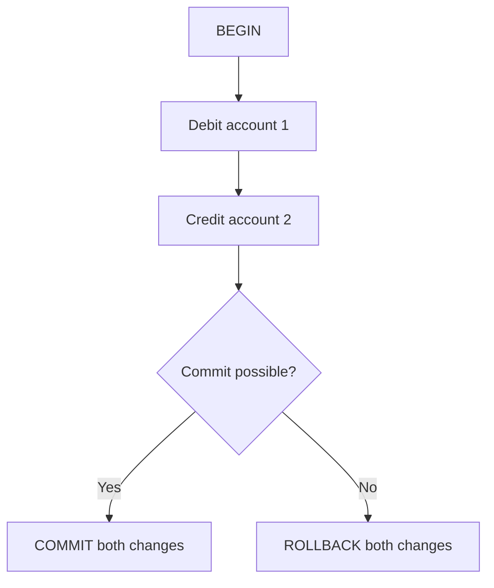
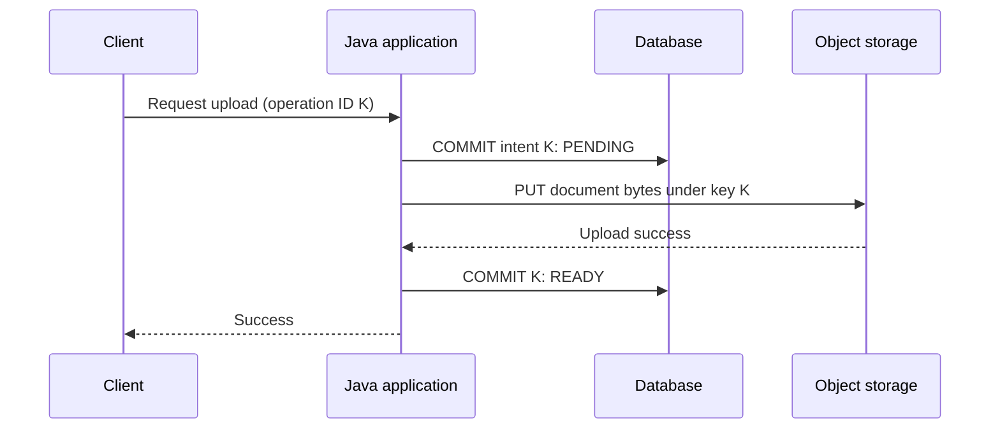
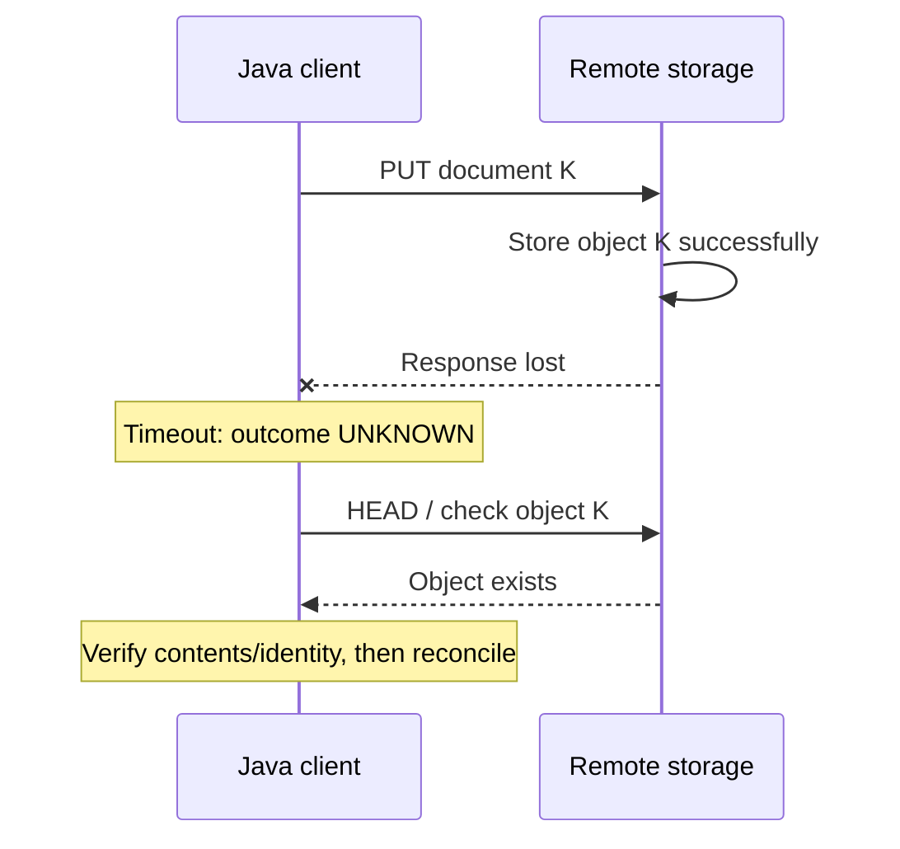
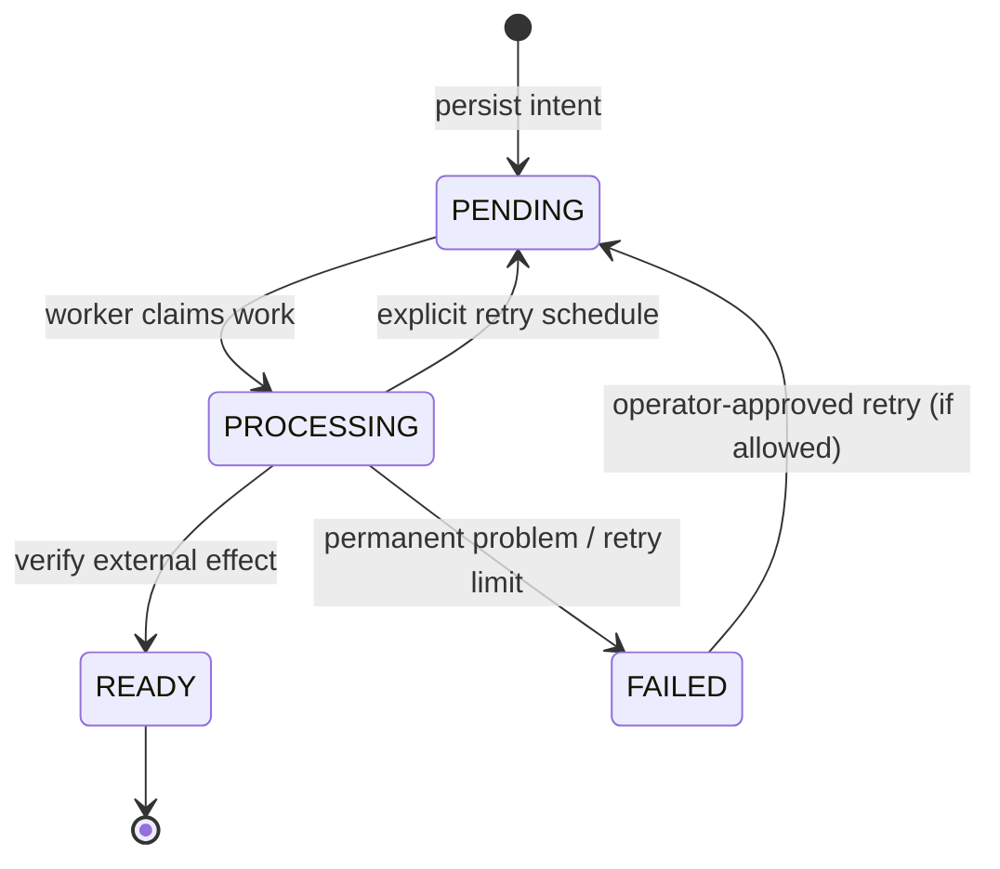
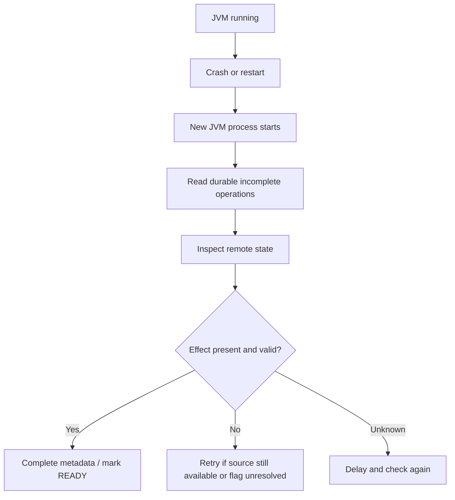

# Distributed Consistency and Crash Recovery — Essential Concepts

**Audience:** Java 21 learners familiar with SQL, ACID, basic Spring Boot, REST, and introductory concurrency.  
**Scope:** Concepts, small examples, failure timelines, and practical decision-making; no real distributed application is required.  
**Learning objective:** Explain precisely what happened, what might have happened, and what to do next when a workflow crosses more than one independent system.

> **The central insight:** A successful local transaction does not make a database update and an external storage/HTTP operation one atomic operation. Reliable workflows explicitly record progress, tolerate ambiguity, and reconcile incomplete effects.

## Contents

1. [Local transactions: what they actually guarantee](#1-local-transactions-what-they-actually-guarantee)
2. [Where partial success and uncertainty come from](#2-where-partial-success-and-uncertainty-come-from)
3. [Consistency models and business invariants](#3-consistency-models-and-business-invariants)
4. [Durable intent and state machines](#4-durable-intent-and-state-machines)
5. [Idempotency and safe retries](#5-idempotency-and-safe-retries)
6. [Crash recovery and reconciliation](#6-crash-recovery-and-reconciliation)
7. [Related design patterns](#7-related-design-patterns)
8. [Connections to Java and Spring Boot](#8-connections-to-java-and-spring-boot)
9. [Review checklist and glossary](#9-review-checklist-and-glossary)
10. [Further reading](#10-further-reading)

---

# 1. Local transactions: what they actually guarantee

## 1.1 What, why, and how

A **transaction** groups operations so that a database treats them as one unit. The application starts a transaction, performs work, then **commits** to keep the changes or **rolls back** to discard uncommitted changes.

A familiar example is moving money between two database accounts. You must not debit one account without crediting the other.

```sql
BEGIN;

UPDATE account SET balance = balance - 50 WHERE id = 1;
UPDATE account SET balance = balance + 50 WHERE id = 2;

COMMIT;
```

If a check fails, issue `ROLLBACK` instead of `COMMIT`. Real money-transfer code would also verify row existence, sufficient funds, concurrency constraints, and account-specific business rules; the SQL here illustrates the boundary only.



| Term | Simple meaning | Common mistake |
|---|---|---|
| Atomicity | Either the participating transaction's changes commit together, or they do not | Thinking that every external operation in the Java method participates |
| Consistency (ACID) | Database rules and constraints remain enforced as transactions execute | Assuming it automatically enforces every cross-system business rule |
| Isolation | Concurrent transactions interact according to an isolation level | Assuming every read or multi-step decision is race-free |
| Durability | Committed data is preserved by the database's durability guarantees | Confusing a successful application response with a committed database transaction |
| Commit | Finalizes participating changes | Believing the client will certainly receive the commit response |
| Rollback | Undoes uncommitted participating work | Believing it also reverses an already completed HTTP call |

The **transaction boundary** is the region of work that the transaction manager controls. In Spring, this is commonly a proxied `@Transactional` method or a callback passed to `TransactionTemplate`. A transaction only protects resources that actually participate in it; a remote server does not enlist itself just because its HTTP call happens inside the Java method.

## 1.2 The counterexample: a database and a remote service

```java
// ILLUSTRATIVE PSEUDOCODE — not a standalone executable class.
@Transactional
public void createRecordAndNotify() {
    repository.insertRecord();  // Participating DB operation
    externalApi.sendNotice();    // Independent HTTP side effect
}
```

Suppose the remote service successfully receives and processes the notice, but the method later throws an unchecked exception. Spring can roll back the database work, but cannot automatically undo the notice that was already delivered.

Likewise, moving `externalApi.sendNotice()` outside `@Transactional` does not guarantee both actions succeed: a process crash can still fall between the steps. **Rearranging a dual write changes the failure cases; it does not remove the dual-write problem.**

By default, Spring transaction management normally rolls back when an unchecked `RuntimeException` or `Error` escapes; checked exceptions generally require explicit rollback rules. `@Transactional` also needs to be used through the appropriate Spring transaction interception mechanism (ordinary self-invocation can bypass proxy-based interception).

## 1.3 A useful classification

- **Database operation:** `INSERT`, `UPDATE`, and `DELETE` within one PostgreSQL transaction can commit or roll back together.
- **External object storage:** Uploading or deleting an object through its API usually has an independent result.
- **External HTTP service:** Another application's order, payment, or notification endpoint has its own state and transaction boundaries.
- **Local file:** Writing to an operating-system file is not automatically enlisted in a PostgreSQL transaction.

### Mental Model — Part 1

A transaction is a protective fence around its **participating resources**, not a magical rollback button for every line of Java code inside a method. Always draw the boundary before reasoning about failures.

---

# 2. Where partial success and uncertainty come from

## 2.1 A distributed workflow, without complicated infrastructure

A **distributed workflow** is an operation involving at least two independently managed resources, even when a single Java application coordinates them. It does not require microservices, multiple JVMs, or a message broker.

Our generic example uploads a document:

1. Insert an **upload intent** record in PostgreSQL.
2. Upload the document bytes to an external object store.
3. Mark the database operation `READY`.

The database holds a reference and the operation state; the storage service holds the document bytes.



**Important:** Each database change commits locally; the storage call is separate. The sequence is not one global transaction.

## 2.2 Three outcomes that must not be confused

| Outcome | What you know | Safe next action |
|---|---|---|
| **Succeeded** | You have reliable evidence the requested effect occurred | Return/replay the result; do not duplicate |
| **Failed** | You have reliable evidence it did not occur, or you verified no effect remains | Report/retry according to policy |
| **Unknown** | A timeout, crash, or lost response prevents you from knowing whether it occurred | Inspect durable state or the remote system; **do not assume failure** |

An HTTP timeout means **you stopped waiting**, not necessarily that the remote system stopped working. A server can complete a `PUT` while the response is lost. Conversely, a network failure could prevent the request from ever arriving.



The `HEAD` check may itself fail, and existence alone might not prove the object is the **correct** document. A robust workflow uses an expected size or checksum/identity and repeats reconciliation when information remains insufficient.

## 2.3 Explicit crash-point matrix

Assume the system has a durable database row and an independently durable object store. The table describes **observed state after recovery inspection** for a typical successful/failed local operation; where an operation was in flight, the true state may be unknown.

| Crash point | Database row | Remote object | What recovery can conclude |
|---|---|---|---|
| Before intent is committed | No committed intent | Absent | Nothing to resume from this workflow |
| After intent commit, before upload | `PENDING` | Absent | Retry upload if the original bytes remain available; otherwise await client retry or fail safely |
| During upload request | `PENDING`/`PROCESSING` | **Unknown** | Check storage; a timeout is not proof of absence |
| After storage succeeds, before `READY` commit | `PENDING`/`PROCESSING` | Present | Verify object matches intent, then finalize |
| During `READY` database commit | `PROCESSING` **or** `READY` | Present | Re-read committed DB state before acting |
| After `READY` commits, before HTTP response arrives | `READY` | Present | Replay success for the same logical request |
| After HTTP response | `READY` | Present | Normal completed operation |

At each step, distinguish: **what the system actually did**, **what the application received as a response**, and **what persisted evidence exists later**. They can be different.

## 2.4 Order changes the failure surface

**Object first, DB second:** A failed DB commit leaves a potentially **orphaned object** (bytes without a DB reference). **DB `READY` first, object second:** A failed upload leaves a **broken reference** (record points to missing bytes). **Intent first, upload second, `READY` last:** The intermediate state gives recovery a durable clue, but still needs verification and cleanup.

A similar issue arises with database + remote HTTP service:

```text
DB inserts request PENDING -> remote API creates external record -> DB sets READY
```

If the remote API completes but its response is lost, retries must not create a second external record. Prefer remote idempotency support where available; otherwise use remote lookup/reconciliation rules and carefully document any unavoidable ambiguity.

### Mental Model — Part 2

**Partial success** means one system changed while another did not. **Unknown outcome** means your coordinator lacks proof either way. Design for both, not merely for exceptions.

---

# 3. Consistency models and business invariants

## 3.1 Local versus cross-system consistency

**Local consistency** concerns one resource within its own guarantees—for instance, PostgreSQL preserving an `image_id` primary key or preventing duplicate operation IDs with `UNIQUE`. **Cross-system consistency** concerns relationships such as “every `READY` record points to a valid stored document.” A local database constraint cannot by itself check whether an object exists on an external storage service.

A **business invariant** is a condition your system must preserve. For a document workflow, useful invariants include:

- `READY` implies a document with the expected identity/content has been verified in storage at finalization time.
- A given operation ID cannot be used for two different request payloads.
- A newer accepted document version must not be overwritten by a stale earlier attempt.

These are application-level guarantees. A later out-of-band deletion can still break the first one, so monitoring and access controls matter too.

## 3.2 Strong and eventual consistency

**Strong consistency**, informally, means consumers of a specific operation see the latest committed state under the defined consistency rules. **Eventual consistency** means temporary disagreement is permitted but the system is designed to converge if updates and recovery processing settle.

Do not conflate an individual storage service's consistency guarantees with a **workflow** spanning PostgreSQL plus that service. Both components may offer strong consistency for their own operations while the **combined workflow** still has an intermediate `PROCESSING` state.

```text
10:00:00 DB: PROCESSING | Storage: missing
10:00:01 DB: PROCESSING | Storage: present   <- temporary disagreement
10:00:02 DB: READY      | Storage: present   <- reconciled result
```

Temporary inconsistency is acceptable only if the product can tolerate it: a document preview can often remain “processing,” while an operation authorizing irreversible action may require stricter sequencing.

| Requirement | Practical implication |
|---|---|
| Never show missing document as available | Only expose verified `READY` records |
| A user can wait briefly for processing | Allow `PENDING`/`PROCESSING`, retries and recovery |
| Do not duplicate a billable external operation | Require reliable operation ID and downstream idempotency/lookup |
| Concurrent updates must not lose one another | Use version checks and conditional updates |

## 3.3 Sequence side effects according to invariants

If bytes must exist before they become visible, validate/store first and **then** commit `READY`. If an external effect is irreversible or expensive, first commit an intent and a stable operation ID. If temporary work is created but never referenced, plan deletion only after confirming it is abandoned.

**Common mistake:** saying “eventual consistency” as an excuse for an indefinite stuck record. Eventual convergence requires an actual mechanism: retry worker, reconciliation job, alerting, or human intervention.

### Mental Model — Part 3

First write the invariant in ordinary language. Next decide which temporary states are acceptable. Finally choose an order and recovery procedure that make the invariant provable when the operation becomes visible.

---

# 4. Durable intent and state machines

## 4.1 Intent means recording the plan before acting

A **durable intent record** stores the operation's identity, expected input/reference, and status in a store that survives the application process restarting. It is not merely a Java variable. The row might include:

| Column | Purpose |
|---|---|
| `operation_id` | Stable logical identifier across retries |
| `object_key` | Deterministic or generated external destination |
| `request_fingerprint` | Detect same key with different input |
| `status` | `PENDING`, `PROCESSING`, `READY`, `FAILED` |
| `attempt_count` | Track retries and limits |
| `updated_at` | Find likely abandoned work |
| `last_error` | Diagnose or decide whether to retry |

Why persist intent first? If the Java process disappears after uploading bytes, the next process can still discover which operation it intended to finish and what object key to examine.

## 4.2 State-machine basics

A **state machine** is a small set of valid states and rules for moving between them.



- `PENDING`: Known work exists but is not yet complete.
- `PROCESSING`: A worker is attempting the work; this state is **not** proof that the worker is still alive.
- `READY`: The outcome has been verified and published.
- `FAILED`: The workflow cannot proceed under the current policy; it may be terminal or eligible for explicit remediation.

**Terminal** means no more automatic transitions are allowed; **recoverable** means an allowed retry/remediation path exists. These are **policy decisions**, not intrinsic properties of a label called `FAILED`.

Invalid examples: `READY -> PROCESSING` on a finalized immutable operation without a new version; `FAILED -> READY` without any verification; a stale worker overwriting `READY` with `PROCESSING`.

## 4.3 PostgreSQL constraints and conditional transitions

Here is an illustrative schema—not a complete application schema:

```sql
CREATE TABLE upload_operation (
    operation_id UUID PRIMARY KEY,
    object_key TEXT NOT NULL UNIQUE,
    request_fingerprint TEXT NOT NULL,
    status TEXT NOT NULL CHECK (
        status IN ('PENDING', 'PROCESSING', 'READY', 'FAILED')
    ),
    version BIGINT NOT NULL DEFAULT 0,
    updated_at TIMESTAMPTZ NOT NULL DEFAULT now()
);
```

A `CHECK` ensures that the value belongs to the **allowed set of states**, but it does **not** enforce which state transitions are legal. Use conditional SQL and affected-row checking:

```sql
UPDATE upload_operation
SET status = 'READY', version = version + 1, updated_at = now()
WHERE operation_id = :id
  AND status = 'PROCESSING'
  AND version = :expectedVersion;
```

An update count of `1` means the expected state/version matched. A count of `0` means it did not; the caller must re-read state rather than assume success. This also prevents some stale-worker races.

## 4.4 Finding unfinished work

A background job might query operations whose status is not `READY` and whose `updated_at` is old enough to warrant investigation. The age threshold alone cannot prove failure: a large upload may legitimately still be in progress.

In a real implementation, use appropriate worker ownership/lease rules, retry limits, timestamps and idempotent reconciliation. The point of the state machine is not to add many enum values; it is to make incomplete work **visible and actionable**.

### Mental Model — Part 4

**Intent is the durable bookmark; status is the current chapter; a transition rule prevents jumping to an invalid ending.** Recovery uses the bookmark to resume or reconcile after a crash.

---
# 5. Idempotency and safe retries

## 5.1 What is idempotency?

An operation is **idempotent** when repeating the **same logical operation** does not add new unintended effects. `SET status = READY` can be idempotent in a suitable design; `counter = counter + 1` is not idempotent if repeated without safeguards.

Network calls are often retried because a timeout obscures the outcome. The dangerous case is:

```text
Client calls remote service with document X
Remote service stores document X
Response disappears
Client retries
Remote service stores a second independent document X   <- duplicate
```

The solution usually involves a stable **idempotency key**: a client- or server-generated identifier representing one intended operation. Two attempts with the **same logical operation** reuse the key; a genuinely new operation gets a new key.

### Same key versus new key

| Request | Expected behavior |
|---|---|
| First request, key `K1`, document `A` | Perform operation once; persist outcome |
| Retry, key `K1`, same document `A` | Return previously recorded outcome or continue unfinished work |
| Reuse `K1` with different document `B` | Reject as conflicting input |
| New operation, key `K2`, document `A` | May legitimately create a separate result |

A **request fingerprint** is a stable digest or canonical representation of the relevant input. It prevents a key from being reused for a materially different request. For actual binary data, `SHA-256` over the approved/canonical bytes is one possible content fingerprint; if your API allows other input fields, they must also be incorporated into the logical request fingerprint consistently.

## 5.2 A small PostgreSQL design

```sql
CREATE TABLE operation_request (
    operation_id UUID PRIMARY KEY,
    request_fingerprint CHAR(64) NOT NULL,
    status TEXT NOT NULL CHECK (status IN ('PENDING', 'READY', 'FAILED')),
    result_reference TEXT
);

-- Illustrative duplicate-safe intent creation:
INSERT INTO operation_request (operation_id, request_fingerprint, status)
VALUES (:id, :fingerprint, 'PENDING')
ON CONFLICT (operation_id) DO NOTHING;
```

The subsequent code must **read the existing row and compare the fingerprint**. `ON CONFLICT DO NOTHING` alone is not a full idempotency protocol. It also does not answer what to do while the first attempt is still `PENDING`.

A typical decision is:

```text
Key absent -> create intent and begin work
Key present + different fingerprint -> reject conflict
Key present + READY + same fingerprint -> replay recorded result
Key present + PENDING + same fingerprint -> resume, or report still processing
```

The operation's **scope** also matters: applications often constrain keys per authenticated account or endpoint, rather than assuming a single global namespace.

## 5.3 Safe retries after unknown outcomes

A retry strategy needs two safeguards:

1. **Stable identity:** Reuse the same operation ID and destination key. A retry must not generate a fresh independent object key every time.
2. **Reconciliation:** Check whether the remote effect already happened, ideally verifying expected content or using a remote idempotency facility.

For example, after a remote `PUT` timeout: do not declare success or failure merely from the exception. Query the intended object key, compare its checksum/size when reliable, then either finalize or retry appropriately. A response to `HEAD` can establish current existence; it cannot automatically prove that every required business validation passed.

### A compact Java idea

```java
// ILLUSTRATIVE PSEUDOCODE — collaborators are application-specific.
void retryUpload(UploadIntent intent, byte[] documentBytes) {
    if (remoteStorage.existsWithExpectedDigest(intent.key(), intent.digest())) {
        database.markReadyIfExpectedState(intent.id());
        return;
    }

    remoteStorage.put(intent.key(), documentBytes);
    database.markReadyIfExpectedState(intent.id());
}
```

If the `put` outcome is uncertain, this method must be safe to run again. In a real concurrent application, also consider conditional remote writes, immutable keys, verification of committed state, and protection against a later writer replacing the object.

## 5.4 Why “exactly once” is difficult

You can often achieve an **effectively once** business result with deduplication, conditional writes, stable operation identities, and idempotent handlers. That is different from proving a piece of code or remote request literally ran exactly once.

A message might be delivered twice; a worker might run the same operation twice after losing its acknowledgment; a network response can be lost after completion. It is often better to plan for **at-least-once attempts with idempotent effects** than to assume exactly-once execution across independent systems.

**Common mistakes:** generating a new idempotency key for a retry; storing a key only in JVM memory; assuming `POST` cannot be made idempotent; or treating “same content” as equivalent to “same business request” in every domain.

### Mental Model — Part 5

A retry repeats an **attempt**, not a new business intention. Keep the intention's ID stable and arrange for repeated attempts to converge on one accepted result.

---

# 6. Crash recovery and reconciliation

## 6.1 What actually survives a crash?

A process crash ends the JVM's execution. Its in-memory local variables, pending tasks, and ordinary `Map` contents are gone unless they were persisted elsewhere. Data that **was committed** to a correctly configured durable database or object storage service can remain available to a restarted process.

The recovered Java application does not resume execution at the exact Java instruction where it crashed. Instead, it typically **reconstructs work from durable records**.



## 6.2 Recovery workers and stale operations

A **recovery worker** is code invoked on startup, periodically, or by an operator to inspect incomplete operations. It can be a simple scheduled job; it does not require a special distributed framework.

A **stale operation** is one whose progress timestamp or lease is old enough that it might be abandoned. Stale does not prove the effect failed. Before retrying, check whether another worker still owns the work and inspect remote state. In a multi-worker setup, lease expiration, optimistic versioning, conditional updates, or appropriate row locks may be needed to avoid conflicting recoveries.

Conceptual reconciliation:

```java
// PSEUDOCODE: the actual repository and remote client are not implemented here.
void reconcileOnce() {
    for (Operation op : operations.findIncompleteOlderThan(cutoff)) {
        RemoteObservation observation = storage.inspect(op.key());
        switch (observation) {
            case VERIFIED_PRESENT -> operations.markReadyConditionally(op.id());
            case VERIFIED_ABSENT  -> operations.scheduleRetryOrManualReview(op.id());
            case UNKNOWN          -> operations.recordRetryLater(op.id());
        }
    }
}
```

A recovery routine must be **repeatable**: if it crashes while running and starts again, it should not create a second harmful effect. Use the operation ID and conditional state updates to make each step safe to repeat.

## 6.3 Failure matrix: system state and recovery action

Assume the operation starts with a committed intent, uses one intended object key, and becomes `READY` only after external verification.

| Point of failure | Committed DB state | Storage after inspection | Correct reaction |
|---|---|---|---|
| Before intent commits | No row | None expected | Client may start the operation afresh |
| After intent but before request | `PENDING` | Absent | Resume if durable source bytes exist, else ask for retry |
| While remote request in flight | `PROCESSING` | Unknown | Probe/verify; don't treat timeout as certain failure |
| After remote success, before final DB update | `PROCESSING` | Valid object present | Conditional transition to `READY` |
| Remote object present but wrong digest | `PROCESSING` | Present but mismatched | Do **not** mark `READY`; investigate or quarantine |
| After DB marks ready but response lost | `READY` | Valid object present | Replay result when the same key is retried |
| Cleanup request times out | `FAILED`/old-version state | Unknown | Recheck ownership and existence before retrying delete |

A **compensating action** is a new operation intended to counteract an earlier completed action—for example, deleting an uploaded staging object if the business operation has permanently failed. It is **not** a rollback of the external API. Compensation can itself fail and must be retried carefully.

## 6.4 Safe cleanup

Deleting an already absent staging object should normally be treated as a successful cleanup outcome (subject to the storage API's semantics). But a cleanup worker must **never** delete an object solely because it appears old without checking whether it has become referenced by a committed record or another in-progress operation.

Useful rules:

- Delete only from a staging area or a key that the operation owns.
- Verify that the object is not referenced by the current committed version.
- Retry cleanup after transient errors; use bounded attempts and observability.
- Record terminal manual-review conditions when automatic resolution is unsafe.
- If a DB commit outcome is unknown, re-read the DB before deleting storage bytes.

## 6.5 Distinguish crash, timeout, and business rejection

**Crash:** The coordinator process stops and loses volatile state. **Timeout:** An observer did not receive a result in time; remote execution may continue or may already have succeeded. **Business rejection:** The operation was evaluated and definitively rejected (e.g., invalid input); do not retry unchanged invalid input indefinitely.

### Mental Model — Part 6

Recovery is not “rewind the program.” It is “start a new program, read durable evidence, verify external reality, and move incomplete work to a safe state.”

---

# 7. Related design patterns

These patterns are tools, not mandatory ingredients. Choose the simplest one that addresses a real failure mode.

## 7.1 Saga

**Problem:** A workflow consists of multiple independently committed steps, and failure in a later step requires handling earlier successes.  
**How:** Execute a series of local operations; define compensations where reversal is feasible. Coordination can be explicit (orchestration) or driven by events (choreography).  
**Example:** Reserve a resource, charge a fee, then confirm; if confirmation fails, release the reservation and attempt a refund.  
**Use when:** Several independently committed business operations require structured failure handling.  
**Skip when:** A single local DB transaction or simple retryable storage upload suffices.  
**Limit:** A refund is a *new transaction*, not proof the charge never happened; some effects, such as an email being read, cannot truly be undone.

## 7.2 Compensating transaction/action

**Problem:** A previously successful external step should not remain active after a workflow is abandoned.  
**How:** Execute a new action to counter the old effect.  
**Example:** Delete an unreferenced staging document, or issue a refund.  
**Use when:** A side effect is reversible enough and its cleanup can be verified.  
**Skip when:** Nothing external was changed or the action cannot be reversed meaningfully.  
**Limit:** Compensation itself can time out; make it repeatable and monitor it.

## 7.3 Transactional Outbox

**Problem:** Updating a database row and publishing an event to a separate system is a **dual write**.  
**How:** In the *same DB transaction*, write both the business change and an outbox event row. A later dispatcher reads committed outbox rows and sends events, retrying safely.  
**Example:** Store a completed document record and an `DOCUMENT_READY` event record in one transaction; publish after commit.  
**Use when:** Reliable event/message publication must follow DB changes.  
**Skip when:** No cross-system notification is needed or a simpler periodic scanner suffices.  
**Limit:** Delivery may be duplicated; consumers still need idempotency. Outbox does **not** make the event broker and database participate in a global transaction.

Illustrative SQL:

```sql
BEGIN;
UPDATE document_job SET status = 'READY' WHERE id = :id;
INSERT INTO outbox_event (event_id, event_type, aggregate_id)
VALUES (:eventId, 'DOCUMENT_READY', :id);
COMMIT;

-- A separate worker dispatches committed events later.
```

The tables and columns are illustrative, not a ready-to-run standalone schema.

## 7.4 Retry with exponential backoff and jitter

**Problem:** Immediate repeated retries can overload an already struggling dependency.  
**How:** Wait progressively longer between retries, typically with randomness (**jitter**) so many clients do not retry at the same instant. Cap delays and attempts.  
**Example:** Wait around 1 s, 2 s, 4 s, then cap at a configured maximum (actual delays randomized).  
**Use when:** Failures are plausibly transient: network interruption, rate limiting, temporary server unavailability.  
**Skip when:** Input is permanently invalid or the operation is non-idempotent and its outcome is unknown without a lookup strategy.  
**Limit:** Backoff reduces pressure; it does not by itself prevent duplicate effects.

## 7.5 Idempotent Consumer

**Problem:** An event or task can be delivered more than once.  
**How:** Record a unique message/operation ID and apply the effect at most once per accepted identity, often using a DB constraint and transaction.  
**Example:** On `DOCUMENT_READY` event `E1`, insert a processing marker with unique `event_id`; replayed `E1` does not repeat the business update.  
**Use when:** Queue/webhook/event deliveries can be repeated.  
**Skip when:** A single direct local function call has no retry/delivery ambiguity.  
**Limit:** Deduplicating one consumer's DB write does not automatically deduplicate a downstream remote call; define boundaries carefully.

## 7.6 Reconciliation job

**Problem:** Two systems temporarily disagree, and immediate retries alone cannot prove the final outcome.  
**How:** Periodically compare committed operation records to external observations, then finalize, retry, clean up, or flag an issue.  
**Example:** Find `PROCESSING` upload operations older than a threshold, check each expected object, then mark verified objects `READY`.  
**Use when:** Partial failures, timeouts, or crashes can leave durable incomplete work.  
**Skip when:** The entire task is local, atomic, and completed without external side effects.  
**Limit:** Reconciliation must be safe under concurrent updates and ambiguous observations.

### Pattern selection at a glance

| Real problem | Usually consider first | Avoid jumping directly to |
|---|---|---|
| Simple document upload with rare partial failure | Durable intent + reconciliation | Full Saga framework |
| Database write must reliably trigger event | Transactional Outbox | Best-effort “save then publish” |
| API timeout after possible successful remote call | Idempotency + remote lookup | Blind retry with a new ID |
| Transient overload of external API | Backoff/jitter + retry limits | Tight retry loop |
| Duplicate event delivery | Idempotent consumer | Exactly-once execution assumption |
| Complex multi-step external business workflow | Saga and compensations | One giant `@Transactional` method |

### Mental Model — Part 7

Saga organizes cross-system steps and compensations. Outbox makes **DB change + intent to publish** atomic locally. Retries repeat attempts. Idempotency prevents repeated effects. Reconciliation establishes what actually happened.

---

# 8. Connections to Java and Spring Boot

> These are **small illustrative snippets**. The repositories and clients are hypothetical; this part is not a ready-to-run Spring Boot project. The independent, executable Java exercise is in the companion document.

## 8.1 Spring-managed transaction boundaries

Declarative style:

```java
// Imports for the annotation and representative class form:
import org.springframework.transaction.annotation.Transactional;

class ExampleApplicationService {
    private final OperationRepository repository;

    ExampleApplicationService(OperationRepository repository) {
        this.repository = repository;
    }

    @Transactional
    public void recordIntent(String operationId) {
        repository.insertPending(operationId);
    }
}

// OperationRepository is intentionally a conceptual collaborator.
```

In an actual Spring app, the class must be managed by Spring and the method called through the configured transaction interception mechanism; adding the annotation to an arbitrary `new` object does not start a Spring transaction.

Programmatic style:

```java
import org.springframework.transaction.support.TransactionTemplate;

// Assume `template` is correctly configured and `repository` is a real collaborator.
transactionTemplate.executeWithoutResult(status -> {
    repository.insertPending(operationId);
});
```

`TransactionTemplate` scopes the database work passed into the callback. Neither the callback nor `@Transactional` makes an unrelated object-storage API transactional.

## 8.2 External I/O and exception behavior

```java
// PSEUDOCODE: avoid treating this as atomic across both systems.
@Transactional
void unsafeAssumption(String key, byte[] bytes) {
    repository.insertPending(key);
    storageClient.put(key, bytes);   // External side effect
    repository.markReady(key);
}
```

If `markReady()` fails, the database can roll back while the remote object remains. Holding a DB transaction open during slow network I/O also increases lock/connection usage. There can be legitimate trade-offs, but it does not solve distributed atomicity.

A conceptual safer sequence is:

```text
Commit intent PENDING (short local transaction)
-> upload/verify remote object (external step)
-> conditionally commit READY (short local transaction)
-> recovery periodically reconciles incomplete work
```

The processing boundary is explicit, and failure between steps is represented by a recoverable status.

## 8.3 Exceptions and status codes

A Java `IOException` from a remote client or an HTTP timeout is not always proof the remote operation failed. Distinguish *definitive rejection* from *unknown result* and use a status such as `PENDING` while reconciling. Do not assume a `false` return value automatically causes a Spring transaction to roll back; it normally does not.

For the HTTP client, a server might respond `202 Accepted` for work still processing, `200 OK` or `201 Created` for a completed result, or a conflict status for a repeated key with changed input. These are design choices: do not claim one response code is mandatory for every workflow.

## 8.4 A scheduled reconciliation job

```java
import org.springframework.scheduling.annotation.Scheduled;

class ExampleRecoveryScheduler {
    private final RecoveryService recovery;

    ExampleRecoveryScheduler(RecoveryService recovery) {
        this.recovery = recovery;
    }

    @Scheduled(fixedDelayString = "PT30S")
    void reconcile() {
        recovery.reconcileOnce();
    }
}

// RecoveryService is a conceptual collaborator; scheduling must be enabled
// and the class registered as a managed bean in a real Spring application.
```

The scheduled method should not hold a single long database transaction across remote calls. Multiple instances may run the job simultaneously; in that case, conditional claims, version checks, leases, or row locks may be necessary.

## 8.5 Optimistic and pessimistic concurrency

**Optimistic concurrency:** Include a version or expected status in the SQL update, then check the affected row count.

```sql
UPDATE document_job
SET status = 'READY', version = version + 1
WHERE id = :id AND version = :version AND status = 'PROCESSING';
```

**Pessimistic concurrency:** Lock a row during a short transaction when making competing DB updates, such as `SELECT ... FOR UPDATE`. Locks protect participating database rows, not the external storage service. Do not hold locks during slow uploads unless you have a compelling, measured reason.

## 8.6 How to test failure recovery

Build small fake repository and fake remote storage collaborators to inject failures at every boundary:

| Test | Inject failure | What to verify |
|---|---|---|
| Happy path | None | Intent, object and `READY` agree |
| Storage throws before writing | Storage failure | No false `READY`; recoverable/persisted intent |
| Storage writes then throws | Lost acknowledgment | Treat result as unknown; verify stored object before retry |
| DB finalize fails after upload | DB failure | Object remains; reconciler can safely finish or clean up |
| Client loses response after commit | Client timeout | Same idempotency key replays result |
| Duplicate request, same key but new input | Request conflict | No overwrite or second accepted effect |
| Two workers finish same operation | Concurrent retry | Conditional version/status transition prevents conflicting outcomes |
| Worker restarts halfway | Simulated restart | Durable intent is still discoverable |

Unit tests with in-memory fakes prove business decision logic **only**. Tests against real PostgreSQL and a real external emulator/service provide broader evidence, but still cannot prove all possible network and crash behaviors. Observability, alerts, data repair procedures, and realistic failure drills remain important when reliability matters.

### Mental Model — Part 8

Spring controls a local DB transaction. A durable operation record tracks the broader workflow. A separate step interacts with external systems. Conditional transitions and reconciliation tie the two back together after failures.

---

# 9. Review checklist and glossary

## 9.1 Questions to ask before designing any multi-system workflow

- [ ] Which exact systems can commit or reject independently?
- [ ] What operation ID identifies retries of one logical intention?
- [ ] What must remain true before the result becomes publicly visible?
- [ ] At which precise steps could the process stop?
- [ ] Could a remote operation succeed even if its response never arrives?
- [ ] Which information survives a JVM crash?
- [ ] How will a new process find incomplete records?
- [ ] What evidence is required before declaring success or failure?
- [ ] Can retries and cleanup run more than once without harm?
- [ ] How will conflicting workers or changed input be rejected?
- [ ] When should automatic retries stop and manual review begin?

## 9.2 Short glossary

| Term | Meaning |
|---|---|
| Atomicity | Participating DB changes commit together or not at all |
| Dual write | Coordinating changes to two independently managed systems |
| Partial failure | One step completes and another does not |
| Unknown outcome | The observer cannot determine whether a remote effect occurred |
| Durable intent | Persisted record describing an incomplete logical operation |
| State machine | Allowed states and transitions of a workflow |
| Invariant | Business condition that must remain true at defined boundaries |
| Idempotency key | Stable identifier for repeat attempts of one operation |
| Request fingerprint | Representation/digest used to detect conflicting input under one key |
| Compensation | New action intended to counter an earlier side effect |
| Reconciliation | Checking actual external state against durable records |
| Outbox | DB-persisted notification intent dispatched later |
| Backoff | Increasing delay between retries |
| Stale worker | Worker whose claim/progress may no longer be current |
| Conditional update | Update that succeeds only if expected state/version matches |

## 9.3 Four-sentence final mental model

1. A database transaction is atomic only for the resources that participate in it.
2. A timeout can mean **unknown**, not necessarily **failed**.
3. Durable operation IDs and statuses tell a future process what remains to be resolved.
4. Idempotent retries and reconciliation make independent systems converge without assuming one magical cross-system commit.

---

# 10. Further reading

- [PostgreSQL — Transactions](https://www.postgresql.org/docs/current/tutorial-transactions.html): `BEGIN`, `COMMIT`, and `ROLLBACK`.
- [Spring Framework — Rolling Back a Declarative Transaction](https://docs.spring.io/spring-framework/reference/data-access/transaction/declarative/rolling-back.html): default rollback rules and customization.
- [AWS Prescriptive Guidance — Transactional Outbox Pattern](https://docs.aws.amazon.com/prescriptive-guidance/latest/cloud-design-patterns/transactional-outbox.html): the dual-write problem and duplicate-delivery caveat.
- [AWS Prescriptive Guidance — Saga Orchestration Pattern](https://docs.aws.amazon.com/prescriptive-guidance/latest/cloud-design-patterns/saga-orchestration.html): conceptual compensation and multi-step coordination.

These links are for further study; no external service, database, or cloud account is required for the companion exercise.
