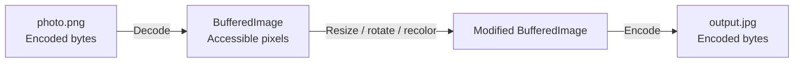
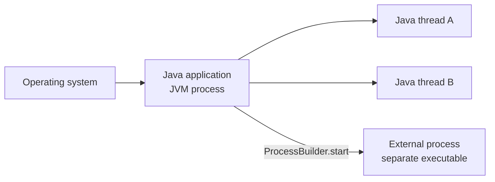
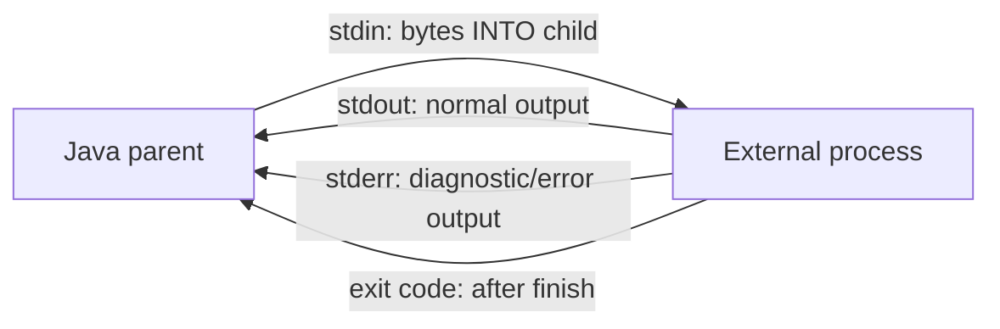
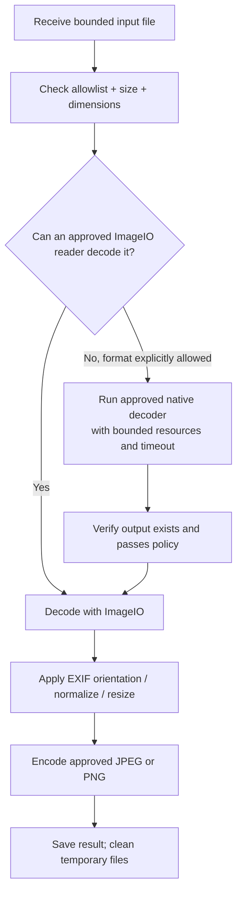

# Java Image Processing and Native Processes — Theory

**Audience:** Java 21 learner who knows basic Java, I/O, and image vocabulary.  
**Scope:** Standard-library `ImageIO` and `BufferedImage` first; operating-system processes and `ProcessBuilder` second; image-tool integration last.  
**Required tools:** Java 21 only for the runnable examples. Optional native-image tools are *discussed*, not required.

## Learning objectives

By the end, you should be able to:

1. Explain why a 200 KB PNG might occupy several megabytes after decoding.
2. Read, inspect, transform, and write ordinary images using Java's standard libraries.
3. Explain why a codec/provider and an `ImageReader` are sometimes needed beyond `ImageIO.read()`.
4. Distinguish an OS **process** from a Java **thread** and understand its standard streams.
5. Launch a known executable safely with `ProcessBuilder`, check its result, set a timeout, and release resources.
6. Sketch a cautious image workflow that optionally delegates unsupported formats to a native decoder.

> **Safety boundary:** Code here teaches APIs; it is not a hardened service for arbitrary user uploads. In a real application, validate inputs and set resource limits *before* full decoding or launching tools.

## Contents

- [Part 1 — How Java represents an image](#part-1--how-java-represents-an-image)
- [Part 2 — Java ImageIO](#part-2--java-imageio)
- [Part 3 — Basic image processing](#part-3--basic-image-processing)
- [Part 4 — Operating-system processes](#part-4--operating-system-processes)
- [Part 5 — Java ProcessBuilder](#part-5--java-processbuilder)
- [Part 6 — ImageIO and external image tools](#part-6--imageio-and-external-image-tools)
- [Part 7 — Quick references and next steps](#part-7--quick-references-and-next-steps)
- [Official references](#official-references)

---

# Part 1 — How Java represents an image

## 1.1 From file bytes to pixels

A JPEG or PNG **file** is an encoded package: bytes representing the image *plus* format structure and possibly metadata. A decoded image exposes a grid of color samples, usually called **pixels**.



Both the file and the pixels consist of binary data, but they serve different purposes:

| Question | Encoded file (`byte[]`, `InputStream`) | Decoded image (`BufferedImage`) |
|---|---|---|
| How is it organized? | PNG/JPEG format headers, compressed pixel information, optional metadata | Image width, height, color model, raster data |
| Good for? | Disk storage, transport, HTTP upload/download | Reading colors, editing pixels, resizing |
| Is the image data compressed? | Usually yes | Not compressed in the JPEG/PNG file-format sense |
| Can I read pixel (5, 7) immediately? | No, first decode | Yes, `getRGB(5, 7)` |

**Example:** You upload `sample.png` through HTTP. Your program may copy its bytes straight to storage if all it needs is storage. To draw a smaller version, it typically decodes the PNG into a `BufferedImage` first.

**Common mistake:** Calling a PNG's compressed bytes “the pixel array.” They are related, not interchangeable.

## 1.2 RGB, ARGB, and numeric pixels

For a familiar 8-bit-per-channel RGB sample:

- Red: 0–255
- Green: 0–255
- Blue: 0–255
- Alpha (if present): 0 is transparent, 255 is opaque

`ARGB` means **Alpha, Red, Green, Blue**. `BufferedImage.getRGB(x, y)` returns an `int` in default sRGB color space with channels packed as `0xAARRGGBB`, even when the internal image layout is different.

```java
int argb = image.getRGB(0, 0);
int alpha = (argb >>> 24) & 0xFF;
int red   = (argb >>> 16) & 0xFF;
int green = (argb >>>  8) & 0xFF;
int blue  =  argb         & 0xFF;
```

`>>>` shifts bits right without sign extension; `& 0xFF` keeps the lowest eight bits. `image.setRGB(x, y, argb)` sets a pixel (the raster's color model may convert it internally).

**When useful:** Determine the color of a pixel, draw a test image, or change an individual pixel. **Mistake:** Assuming every `BufferedImage` stores four consecutive bytes in ARGB order; that is *one possible representation*, not the universal internal layout.

## 1.3 Dimensions, raw pixel memory, and file size

Let `width = 1200` and `height = 800`:

- Pixel count: `1200 × 800 = 960,000` pixels.
- Tightly packed 8-bit RGB pixel payload: `960,000 × 3 = 2,880,000` bytes (about **2.88 MB decimal**).
- Tightly packed 8-bit RGBA payload: `960,000 × 4 = 3,840,000` bytes (about **3.84 MB decimal**).

These are *pixel-data estimates*, not exact Java heap measurements. A `BufferedImage` may use an `int[]` (4 bytes per pixel), `byte[]` raster, padding, and Java object overhead. The underlying color model also matters. A PNG of these dimensions might be 200 KB, 2 MB, or much larger depending on its content. **File size is not a safe proxy for decoded memory.**

```text
Small encoded file (highly compressible) → decoded into millions of pixels
                180 KB              →       perhaps several MB RAM
```

A maliciously crafted or extremely compressible image may create memory pressure during decoding (“decompression bomb”). Check **encoded byte count**, **width**, **height**, **width × height (using `long`)**, and—where appropriate—resource budgets before full decode. Even these checks alone are not a complete security boundary.

## 1.4 What exactly is `BufferedImage`?

`java.awt.image.BufferedImage` is a Java object holding an image's accessible raster data and a `ColorModel`. It can answer `getWidth()` and `getHeight()`, expose pixel values via `getRGB()`, and be drawn into with `Graphics2D`.

Common constructors/types:

| Type | Simplified meaning | Common use |
|---|---|---|
| `TYPE_INT_RGB` | RGB stored using packed `int` pixels; no alpha | Target JPEGs, opaque images |
| `TYPE_INT_ARGB` | 8-bit alpha + 8-bit RGB in packed `int` | Transparent drawings and PNGs |
| `TYPE_3BYTE_BGR` | Blue/green/red stored in 3-byte samples | Some image decoding/interoperability cases |
| `TYPE_4BYTE_ABGR` | Alpha/blue/green/red stored in byte samples | Images needing alpha in that layout |
| `TYPE_BYTE_GRAY` | Grayscale sample data | Grayscale experiments |
| `TYPE_CUSTOM` | Not one of the predefined layouts | Special reader/provider output |

A 24-bit RGB-looking image might still consume about **four bytes per pixel** if stored as `TYPE_INT_RGB`; the `int` has room for more than 24 used color bits.

```java
BufferedImage image = new BufferedImage(
        200, 100, BufferedImage.TYPE_INT_ARGB);
image.setRGB(0, 0, 0x80FF0000); // translucent red
```

`BufferedImage` itself is an in-memory image, not a saved PNG or JPEG. To create a file, invoke a compatible encoder.

**Mental model — Part 1:** A file is a *packed instruction/data package* for reconstructing an image. `BufferedImage` is a working canvas of accessible pixel data. File-byte count and decoded-memory size measure different things.

---

# Part 2 — Java ImageIO

## 2.1 What is ImageIO and why does it exist?

`javax.imageio.ImageIO` is a standard Java API for discovering image codecs (often called **providers** or **plug-ins**) and for encoding/decoding image formats. It resides in the JDK's `java.desktop` module.

- **Decode**: encoded PNG/JPEG/etc. → `BufferedImage`.
- **Encode**: `BufferedImage` → PNG/JPEG/etc.
- **Reader**: understands how to parse a particular image format.
- **Writer**: understands how to produce a particular image format.

Java SE commonly includes readers/writers for JPEG, PNG, GIF, BMP, and some other formats. Actual installed plug-ins determine what is available. **Do not assume that stock Java 21 supports HEIC/HEIF**; that often requires a third-party provider or native tool.

You can inspect the running JVM's registered writers:

```java
System.out.println(Arrays.toString(ImageIO.getWriterFormatNames()));
```

(Imports: `java.util.Arrays`, `javax.imageio.ImageIO`.) This list tells you what the installed provider registry advertises, not which untrusted inputs are safe.

## 2.2 The convenience methods `read()` and `write()`

`ImageIO.read(...)` chooses an available reader and decodes the image. If no registered reader recognizes the input, it **can return `null`**. It may also throw `IOException` if reading/decoding fails.

`ImageIO.write(image, "png", file)` chooses a writer and emits an encoded file. Its **boolean return** is `false` if no suitable writer was found; writing can also throw `IOException`.

### Complete self-contained demonstration: PNG round-trip

This program creates its own sample rather than requiring an external image. Save as `BasicImageIoDemo.java`:

```java
import java.awt.Color;
import java.awt.Graphics2D;
import java.awt.image.BufferedImage;
import java.io.IOException;
import java.nio.file.Files;
import java.nio.file.Path;
import javax.imageio.ImageIO;

public class BasicImageIoDemo {
    public static void main(String[] args) throws IOException {
        Path folder = Path.of("output");
        Files.createDirectories(folder);
        Path png = folder.resolve("test.png");

        BufferedImage source = new BufferedImage(
                160, 80, BufferedImage.TYPE_INT_ARGB);
        Graphics2D g = source.createGraphics();
        try {
            g.setColor(new Color(25, 118, 210));
            g.fillRect(0, 0, 160, 80);
            g.setColor(Color.YELLOW);
            g.fillOval(55, 15, 50, 50);
        } finally {
            g.dispose();
        }

        if (!ImageIO.write(source, "png", png.toFile())) {
            throw new IOException("PNG writer unavailable");
        }
        BufferedImage restored = ImageIO.read(png.toFile());
        if (restored == null) {
            throw new IOException("PNG reader unavailable or unknown image");
        }
        System.out.printf("Read %d x %d from %s%n",
                restored.getWidth(), restored.getHeight(), png);
    }
}
```

Run (PowerShell):

```powershell
javac BasicImageIoDemo.java
java BasicImageIoDemo
```

**Execution order:** (1) create an ARGB raster, (2) draw pixels into it, (3) encode them into a file named `output/test.png`, (4) decode the file back into a *different* `BufferedImage`, (5) print dimensions. `Graphics2D.dispose()` releases graphics resources. Here `ImageIO` owns the internally opened file resources used by the convenience `File` overloads.

**Common mistakes:** A writer returning `false` is not success; a reader returning `null` is not a blank image; making a `BufferedImage` does not automatically create a file.

## 2.3 Why do `ImageReader` and `ImageWriter` also exist?

The convenience functions are enough for simple tasks. More control is needed if you want to:

- Read image **width/height before decoding all pixels**.
- Select a codec/provider deliberately.
- Read particular pages/frames in multi-image formats.
- Configure reading parameters and metadata behavior.
- Configure **JPEG compression quality** through `ImageWriteParam`.

`ImageReader` parses image input; `ImageWriter` produces output. Each is stateful and should be **disposed** using `.dispose()` when finished.

### Complete example: inspect dimensions before full decode

Save as `ImageDimensionInspector.java`; pass a path to an existing supported image:

```java
import java.io.IOException;
import java.nio.file.Files;
import java.nio.file.Path;
import java.util.Iterator;
import javax.imageio.ImageIO;
import javax.imageio.ImageReader;
import javax.imageio.stream.ImageInputStream;

public class ImageDimensionInspector {
    public static void main(String[] args) throws IOException {
        if (args.length != 1) {
            throw new IllegalArgumentException("Provide an image path");
        }
        Path input = Path.of(args[0]);
        long maxBytes = 10L * 1024 * 1024;
        long maxPixels = 12_000_000L;
        if (Files.size(input) > maxBytes) {
            throw new IOException("Encoded file is too large");
        }

        try (ImageInputStream stream =
                     ImageIO.createImageInputStream(input.toFile())) {
            if (stream == null) {
                throw new IOException("Cannot create image input stream");
            }
            Iterator<ImageReader> candidates = ImageIO.getImageReaders(stream);
            if (!candidates.hasNext()) {
                throw new IOException("No supported image reader found");
            }
            ImageReader reader = candidates.next();
            try {
                reader.setInput(stream);
                int width = reader.getWidth(0);
                int height = reader.getHeight(0);
                long pixels = (long) width * height;
                if (width <= 0 || height <= 0 || pixels > maxPixels) {
                    throw new IOException("Image dimensions exceed policy");
                }
                System.out.printf("%d x %d = %d pixels%n",
                        width, height, pixels);
            } finally {
                reader.dispose();
            }
        }
    }
}
```

Read the code as follows:

1. `Files.size(...)` checks the **encoded** file's byte count (before decoding).
2. `ImageIO.createImageInputStream(...)` creates an image-aware stream; `try` closes it.
3. `getImageReaders(stream)` finds readers claiming to understand those bytes.
4. `reader.setInput(stream)` connects the selected reader to the file.
5. `getWidth(0)` and `getHeight(0)` inspect the first image's dimensions without creating a full pixel buffer.
6. Multiplying with `long` avoids 32-bit overflow when checking pixel count.
7. `.dispose()` releases the reader's resources; closing the stream releases its resources.

This is a **bounded inspection example**, not a guarantee of safe decoding. File signatures, permitted formats, maximum per-dimension limits, memory budget, decoder behavior, and concurrency also matter. Some readers may still parse nontrivial portions of input while inspecting metadata.

## 2.4 Image input/output streams and resource ownership

`ImageInputStream` and `ImageOutputStream` add useful image-reading/writing operations such as seeking. Do not confuse them with `InputStream` and `OutputStream`, which are general byte-stream APIs.

| API | Owns/closes the caller's stream? | Your responsibility |
|---|---|---|
| `ImageIO.read(File)` | Manages its internally opened stream | Supply a valid file; handle `null` and errors |
| `ImageIO.read(InputStream)` | **Does not close** the supplied `InputStream` | Close it using try-with-resources |
| `ImageIO.read(ImageInputStream)` | Has special close behavior; avoid relying on it in new designs | Explicitly close your `ImageInputStream` in try-with-resources |
| `ImageIO.write(..., OutputStream)` | **Does not close** supplied stream | Close/flush it yourself |
| `ImageReader` / `ImageWriter` | Explicit codec objects | Call `dispose()`; close any streams you own |

Example of correct stream ownership:

```java
try (var in = Files.newInputStream(Path.of("input.png"))) {
    BufferedImage image = ImageIO.read(in);
    if (image == null) throw new IOException("Unsupported image");
    // Use 'image' while 'in' is scoped here.
}
```

`ImageIO` may use memory or temporary disk caching for image-aware streams, depending on its configuration. Do not assume every image operation fits in RAM just because you gave it a stream.

## 2.5 Format names, metadata, and errors

Supported formats come from installed codec providers; compare the runtime's `ImageIO.getReaderFormatNames()` and `getWriterFormatNames()` rather than guessing. `getImageMetadata(index)` on an `ImageReader` may expose codec-specific metadata, but there is **no simple universal EXIF-orientation guarantee** in the basic convenience API.

A healthy error strategy distinguishes:

- `null` from `ImageIO.read`: no reader recognized the input.
- `false` from `ImageIO.write`: no suitable writer.
- `IOException`: malformed input, I/O failure, decoder problems, or writer problems.
- `IllegalArgumentException`: invalid arguments or a violated precondition.
- `OutOfMemoryError`: *not* a normal validation path; avoid reaching it using limits.

**Mental model — Part 2:** `ImageIO` is the friendly front door; `ImageReader` and `ImageWriter` provide finer control over codecs, dimensions, metadata, and quality. You still own validation and resource policy.

---

# Part 3 — Basic image processing

## 3.1 Read and change individual pixels

Coordinates start at the **top-left** of a `BufferedImage`: `(0, 0)` is the first pixel; x increases right, y increases downward.

```java
int old = image.getRGB(10, 20);
image.setRGB(10, 20, 0xFFFF0000); // fully opaque red
```

Calling `getRGB(10,20)` outside the image bounds throws an exception. For a 100 × 50 image, valid x values are 0–99 and y values are 0–49. Iterating over all pixels is easy for a learning example but can be slow if using `getRGB`/`setRGB` millions of times; specialized raster access can be more efficient.

## 3.2 Resize and preserve the aspect ratio

**Resizing** changes width and height; **cropping** discards some of the picture. To avoid stretching, apply the same scale factor in each direction.

Example: `4000 × 3000` → new width `1000`:

```text
scale = 1000 / 4000 = 0.25
height = round(3000 × 0.25) = 750
result = 1000 × 750 (still 4:3)
```

A `Graphics2D` instance can draw a source into a smaller target rectangle. **Interpolation** is the rule used to estimate new pixel values; bilinear interpolation usually gives smoother results than nearest-neighbor sampling.

### Complete, reusable transforms demo (standard Java)

The following `ImageTransforms.java` demonstrates proportional resize, rotation, mirror, and flattening transparency. It is a utilities example; the small exercise later only requires resizing and RGB conversion.

```java
import java.awt.Color;
import java.awt.Graphics2D;
import java.awt.RenderingHints;
import java.awt.image.BufferedImage;

public final class ImageTransforms {
    private ImageTransforms() { }

    public static BufferedImage fitWidth(BufferedImage source, int maxWidth) {
        if (maxWidth <= 0) throw new IllegalArgumentException("maxWidth <= 0");
        if (source.getWidth() <= maxWidth) return source; // do not upscale

        double scale = (double) maxWidth / source.getWidth();
        int newHeight = Math.max(1,
                (int) Math.round(source.getHeight() * scale));
        int type = source.getColorModel().hasAlpha()
                ? BufferedImage.TYPE_INT_ARGB
                : BufferedImage.TYPE_INT_RGB;
        BufferedImage result = new BufferedImage(maxWidth, newHeight, type);
        Graphics2D g = result.createGraphics();
        try {
            g.setRenderingHint(RenderingHints.KEY_INTERPOLATION,
                    RenderingHints.VALUE_INTERPOLATION_BILINEAR);
            g.drawImage(source, 0, 0, maxWidth, newHeight, null);
        } finally {
            g.dispose();
        }
        return result;
    }

    public static BufferedImage rotate90Clockwise(BufferedImage source) {
        BufferedImage result = new BufferedImage(
                source.getHeight(), source.getWidth(),
                BufferedImage.TYPE_INT_ARGB);
        Graphics2D g = result.createGraphics();
        try {
            g.translate(source.getHeight(), 0);
            g.rotate(Math.PI / 2);
            g.drawImage(source, 0, 0, null);
        } finally {
            g.dispose();
        }
        return result;
    }

    public static BufferedImage mirrorHorizontally(BufferedImage source) {
        BufferedImage result = new BufferedImage(
                source.getWidth(), source.getHeight(),
                BufferedImage.TYPE_INT_ARGB);
        Graphics2D g = result.createGraphics();
        try {
            g.drawImage(source, source.getWidth(), 0,
                    -source.getWidth(), source.getHeight(), null);
        } finally {
            g.dispose();
        }
        return result;
    }

    public static BufferedImage flattenOnWhite(BufferedImage source) {
        BufferedImage rgb = new BufferedImage(
                source.getWidth(), source.getHeight(),
                BufferedImage.TYPE_INT_RGB);
        Graphics2D g = rgb.createGraphics();
        try {
            g.setColor(Color.WHITE);
            g.fillRect(0, 0, rgb.getWidth(), rgb.getHeight());
            g.drawImage(source, 0, 0, null);
        } finally {
            g.dispose();
        }
        return rgb;
    }
}
```

**Read `fitWidth` in steps:** validate width → do nothing if already small enough → calculate scale → derive height with one scale factor → select RGB/ARGB based on alpha → create a target → draw the source at target dimensions → dispose graphics → return the new pixel buffer.

**Read `rotate90Clockwise`:** swap output width and height → translate the coordinate origin → rotate drawing by 90° clockwise in screen coordinates → render pixels. `mirrorHorizontally` uses a negative destination width to flip the drawn source. These operations do *not* automatically read EXIF tags.

**Read `flattenOnWhite`:** a JPEG cannot preserve transparency, so fill an opaque RGB canvas white and composite the source on top before saving it as JPEG. Without flattening, transparent pixels may turn into an unintended solid color or produce writer-dependent results.

**Common mistakes:** Stretching a 4:3 photo to 1:1, upscaling and expecting new detail, forgetting `g.dispose()`, or assuming the returned `BufferedImage` is already a saved file.

## 3.3 RGB vs. ARGB and encoding results

An alpha value of 0 is fully transparent, 255 is fully opaque (at 8-bit alpha). A PNG may store transparency, but ordinary JPEG cannot. Convert an ARGB image onto a chosen background before encoding JPEG.

```java
BufferedImage rgb = ImageTransforms.flattenOnWhite(source);
boolean saved = ImageIO.write(rgb, "jpeg", Path.of("out.jpg").toFile());
if (!saved) throw new IOException("JPEG writer unavailable");
```

Imports for this snippet: `java.awt.image.BufferedImage`, `java.io.IOException`, `java.nio.file.Path`, `javax.imageio.ImageIO`.

Even if an image has no alpha, `BufferedImage.getRGB()` still provides an ARGB `int`; it will generally report an alpha of 255 for opaque pixels. **Do not confuse this return API with the buffer's internal memory layout.**

## 3.4 JPEG compression quality requires an `ImageWriter`

Unlike `ImageIO.write(image, "jpeg", ...)`, an `ImageWriter` lets you configure an explicit quality (for a writer that supports it). Quality is a 0.0–1.0 setting, not a promise of a specific final byte count.

Complete example, `JpegQualityExample.java` (requires an existing `input.png` or JPEG image specified as argument):

```java
import java.awt.Color;
import java.awt.Graphics2D;
import java.awt.image.BufferedImage;
import java.io.IOException;
import java.nio.file.Path;
import java.util.Iterator;
import javax.imageio.IIOImage;
import javax.imageio.ImageIO;
import javax.imageio.ImageWriteParam;
import javax.imageio.ImageWriter;
import javax.imageio.stream.ImageOutputStream;

public class JpegQualityExample {
    public static void main(String[] args) throws IOException {
        if (args.length != 2) {
            throw new IllegalArgumentException("Usage: inputImage output.jpg");
        }
        BufferedImage source = ImageIO.read(Path.of(args[0]).toFile());
        if (source == null) throw new IOException("Unsupported input");

        // JPEG has no alpha: make an opaque RGB canvas.
        BufferedImage rgb = new BufferedImage(source.getWidth(),
                source.getHeight(), BufferedImage.TYPE_INT_RGB);
        Graphics2D g = rgb.createGraphics();
        try {
            g.setColor(Color.WHITE);
            g.fillRect(0, 0, rgb.getWidth(), rgb.getHeight());
            g.drawImage(source, 0, 0, null);
        } finally {
            g.dispose();
        }

        Iterator<ImageWriter> providers = ImageIO.getImageWritersByFormatName("jpeg");
        if (!providers.hasNext()) throw new IOException("No JPEG writer");
        ImageWriter writer = providers.next();
        try (ImageOutputStream out =
                     ImageIO.createImageOutputStream(Path.of(args[1]).toFile())) {
            if (out == null) throw new IOException("Cannot open image output");
            try {
                writer.setOutput(out);
                ImageWriteParam params = writer.getDefaultWriteParam();
                if (!params.canWriteCompressed()) {
                    throw new IOException("Writer lacks compression control");
                }
                params.setCompressionMode(ImageWriteParam.MODE_EXPLICIT);
                params.setCompressionQuality(0.85f);
                writer.write(null, new IIOImage(rgb, null, null), params);
            } finally {
                writer.dispose();
            }
        }
        System.out.println("Saved JPEG at requested quality 0.85");
    }
}
```

`IIOImage` wraps the rendered image and optional metadata/thumbnail information. `MODE_EXPLICIT` enables manual compression choices, then `0.85f` requests a typical visually good quality for the selected writer. Codec interpretation is provider-specific. Here `ImageWriteParam` configures **encoding**, not the in-memory RGB canvas.

## 3.5 Metadata, EXIF orientation, and privacy

**Metadata** describes an image rather than its visible pixel grid. EXIF may include camera model, capture time, GPS, and **orientation**. A camera may store pixels sideways but tag the image “rotate 90° when displaying.”

```text
Encoded JPEG + orientation tag (e.g., 6)
        ↓ read orientation correctly
Rotate/mirror decoded pixels as required
        ↓
Normalize output orientation (usually 1), then strip unneeded metadata
        ↓
Encode output for display
```

Eight EXIF orientation values cover rotations and mirroring. **Ordinary `ImageIO.read()`/`write()` does not promise to read and apply those tags automatically.** A dedicated, trustworthy metadata reader or image processor may be required; do not remove orientation metadata *before* applying it to pixels. Avoid retaining or exposing GPS/device information without an explicit reason.

Another concern is **color space**: numeric RGB values depend on how they are interpreted. Some images use sRGB, others may use wide-gamut profiles; converting representations without handling profiles thoughtfully can shift colors. The sample transforms above focus on geometry, not a complete color-management policy.

## 3.6 Image normalization and safe limits

**Normalization** means producing predictable results for a consumer: upright orientation, deliberate color space, chosen alpha policy, dimension bounds, allowed encoded format, and minimal necessary metadata. It differs from specialized machine-learning preprocessing (tensor shape, numeric normalization, channel order).

A conceptual cautious image workflow:

1. Limit the bytes received; allow only expected formats.
2. Inspect signature/provider claims, then parse header dimensions with a bounded reader.
3. Reject nonpositive dimensions, excessive width/height, or too many pixels; estimate memory needs including concurrent operations.
4. Decode with a maintained decoder in a resource-controlled environment.
5. Correct orientation; resize, transform color, and handle alpha intentionally.
6. Re-encode to an allowed format, retaining only necessary metadata.
7. Clean up streams and temporary files; report safe errors.

**Example policy (illustrative only):** encoded file ≤ 10 MiB, each dimension ≤ 4096, and width × height ≤ 12 million pixels. Do not copy these numbers into production without evaluating requirements and RAM limits.

**Mental model — Part 3:** Geometry changes pixels. Encoding changes how pixels are packaged. Metadata changes how a file is described or should be displayed. Security is not achieved merely because a decoder returned an image.

---

# Part 4 — Operating-system processes

## 4.1 Process versus thread versus JVM

A **process** is a running program managed by the operating system, with its own resources and memory address space. A **thread** is an execution path within a process. A running Java program normally executes in a **JVM process** with potentially many threads.



Think of a process as a workshop and its threads as workers sharing the workshop's equipment. `ProcessBuilder` opens **another workshop** with its own resources, rather than adding one more worker inside Java.

| Property | Java thread | External OS process |
|---|---|---|
| Address space | Shares its JVM process memory | Normally separate address space |
| Launch method | `new Thread(...)`, executor, etc. | `ProcessBuilder.start()` |
| Can crash independently? | A thread exception can be isolated, though serious JVM failures are not | External process may exit or crash without necessarily killing JVM |
| Data exchange | Java shared objects/queues | Pipes, files, sockets, exit codes |
| Example | Compute pixel statistics | Execute `java -version` or an installed image converter |

## 4.2 Why run an external program?

Sometimes an external program already knows how to perform something Java's installed libraries do not: decode a less common image format, inspect a media container, or use specialized native codecs. Java launches it, supplies arguments/input, receives output, and checks success.

**Native executable** here means a program that the OS can launch as a separate process (`.exe` on Windows, or another executable appropriate to the platform). A **command-line tool** is a program whose behavior is controlled by command-line arguments and input/output streams. The external program need not be written in C/C++; it simply runs **outside your current JVM**.

## 4.3 Standard input, output, and error

A subprocess ordinarily exposes three standard channels:



- `stdin`: data supplied **to** the child, usually via `process.getOutputStream()` from Java's perspective.
- `stdout`: ordinary output **from** the child, read via `process.getInputStream()`.
- `stderr`: error/diagnostic output **from** the child, read via `process.getErrorStream()`.
- **Exit code**: integer available after termination; by convention `0` means success, nonzero indicates failure, but the tool defines its own meanings.

The names on Java's `Process` streams can feel backwards: Java writes *to the child's stdin* using an **OutputStream**, and reads *the child's stdout* using an **InputStream**.

**Common mistake:** Assume all commands print to stdout; Java's `-version` commonly writes to **stderr**, which is why capturing only stdout can appear empty.

## 4.4 Working directory, environment, and temporary files

**Working directory** is the directory used to resolve relative paths by the child. `ProcessBuilder.directory(new File("..."))` sets it (the default is normally the Java process's working directory). Absolute paths are often less ambiguous.

**Environment variables** are key/value settings supplied to a child, such as a `PATH` containing executable locations. `builder.environment().put("SAMPLE_MODE", "demo")` changes the child environment; it does not globally change Windows or the current Java process's environment.

**Temporary files** can be a simple bridge to external tools: Java writes a bounded image to a private temporary location, the converter produces a new file, and Java reads it back. You own the cleanup, even on failures or timeouts. Never write untrusted content into a publicly served directory by default.

## 4.5 Lifetime and cleanup

A subprocess can finish normally, fail with a nonzero status, wait for input forever, become blocked on a full output pipe, or outlive your request. `Process` exposes `.isAlive()`, `.waitFor(...)`, `.destroy()`, and `.destroyForcibly()`.

- `destroy()` requests termination; behavior varies by OS.
- `destroyForcibly()` requests forceful termination; it may **not** complete instantly.
- `waitFor(timeout, unit)` returns `true` if the child finished and `false` on timeout; it does **not** automatically kill the process.
- `InterruptedException` means the waiting Java thread was interrupted; restore its interrupted status and arrange cleanup.
- Killing a direct child process does **not necessarily kill every subprocess it may have launched**. A full process-tree strategy is an advanced concern.

**Mental model — Part 4:** Java and the child are two separate programs. They communicate through byte streams, files, and an exit code; starting one creates an explicit lifecycle/cleanup responsibility.

---

# Part 5 — Java ProcessBuilder

## 5.1 What `ProcessBuilder` configures

`java.lang.ProcessBuilder` describes a command to launch:

```java
ProcessBuilder builder = new ProcessBuilder("java", "-version");
Process process = builder.start();
```

- The first argument is a command/executable name (or executable path).
- Later arguments are individual **argument tokens** passed to that program.
- `start()` asks the OS to start a child process and returns a `Process` object.

`new ProcessBuilder("tool", "--input", filePath)` is preferable to concatenating a command into a shell string. **It prevents shell metacharacters in the argument from being interpreted by a shell**, because a shell is not involved by default. It does not automatically make an untrusted file path, executable, or dangerous tool option safe: validate inputs and choose trusted executables.

Do not manually include shell quoting around individual arguments. Each Java string already represents one argument.

## 5.2 The important configuration methods

| Method | Purpose |
|---|---|
| `new ProcessBuilder(exe, arg1, ...)` | Define executable and argument list |
| `directory(File)` | Set child working directory |
| `environment().put(name, value)` | Add or override a child environment variable |
| `redirectErrorStream(true)` | Merge stderr into stdout channel |
| `redirectOutput(File)` | Write child output directly to a file; avoids unconsumed stdout pipes |
| `redirectError(File)` | Write stderr to file separately |
| `redirectInput(File)` | Use a file as child's stdin |
| `start()` | Launch process; may throw `IOException` |

If you choose to keep stdout and stderr as pipes, **both must be drained concurrently** for a child capable of producing substantial output. Reading one stream to completion while ignoring the other may block indefinitely if the other's OS pipe fills.

## 5.3 Complete Java 21 example: execute the installed Java runtime

This approach keeps the process example reliable **without** a potentially blocked pipe. It captures the merged output in a short-lived temporary file and reads it *after* the child exits. Save as `JavaVersionProcessExample.java`:

```java
import java.io.IOException;
import java.nio.charset.StandardCharsets;
import java.nio.file.Files;
import java.nio.file.Path;
import java.util.concurrent.TimeUnit;

public class JavaVersionProcessExample {
    public static void main(String[] args) throws Exception {
        String javaHome = System.getProperty("java.home");
        boolean windows = System.getProperty("os.name")
                .toLowerCase(java.util.Locale.ROOT).contains("win");
        Path executable = Path.of(javaHome, "bin", windows ? "java.exe" : "java");
        Path output = Files.createTempFile("java-version-", ".txt");
        Process process = null;

        try {
            ProcessBuilder builder = new ProcessBuilder(
                    executable.toString(), "-version");
            builder.redirectErrorStream(true);
            builder.redirectOutput(output.toFile());
            process = builder.start();
            process.getOutputStream().close(); // no child stdin input

            if (!process.waitFor(5, TimeUnit.SECONDS)) {
                process.destroyForcibly();
                process.waitFor(); // wait until termination before cleanup
                throw new IOException("java -version timed out");
            }
            String message = Files.readString(output, StandardCharsets.UTF_8);
            System.out.print(message);
            int code = process.exitValue();
            System.out.println("Exit code: " + code);
            if (code != 0) throw new IOException("Child failed: " + code);
        } catch (InterruptedException interrupted) {
            Thread.currentThread().interrupt();
            throw interrupted;
        } finally {
            if (process != null && process.isAlive()) {
                process.destroyForcibly();
            }
            Files.deleteIfExists(output);
        }
    }
}
```

**How this works:**

1. `java.home` points to the JDK/runtime executing this Java program. `bin/java.exe` on Windows is more reliable than relying on `PATH` resolution for the demonstration.
2. `new ProcessBuilder(executable, "-version")` sets two argument tokens.
3. `redirectErrorStream(true)` merges standard error into standard output. `java -version` usually prints to stderr.
4. `redirectOutput(output.toFile())` writes merged output to disk; it avoids pipe-buffer deadlocks and permits waiting with a timeout.
5. `.getOutputStream().close()` signals that no stdin bytes will be provided.
6. `.waitFor(5, TimeUnit.SECONDS)` bounds how long the parent waits for normal completion.
7. `.exitValue()` is checked **only after** `waitFor` confirmed process completion.
8. The `finally` block requests forceful termination if still alive and removes the temporary file. More rigorous applications also confirm termination and handle cleanup errors.

The output depends on the runtime vendor and build. The essential observations are: Java's version details appear in your console and the exit code is usually 0. `IOException` can mean the executable cannot start or output cannot be read. Nonzero exit code is *not itself a Java exception*; your code decides whether it is an error. `InterruptedException` needs special handling.

## 5.4 What about capturing pipes instead of redirecting to files?

For tiny, known output, the following illustrates a **merged pipe**:

```java
Process p = new ProcessBuilder("java", "-version")
        .redirectErrorStream(true)
        .start();
String output;
try (var stream = p.getInputStream()) {
    output = new String(stream.readAllBytes(), java.nio.charset.StandardCharsets.UTF_8);
}
int status = p.waitFor();
```

This example deliberately omits a timeout and is **not** suitable for unknown or potentially unbounded output: `readAllBytes()` can run forever or exhaust memory. It also relies on an executable being discoverable as `java`. For reliable bounded subprocesses, prefer explicit output handling such as the complete example above, or concurrently drain bounded pipes.

## 5.5 Timeouts, interruption, and killing a child

A timeout is not a kill switch by itself. Typical logic:

```java
boolean finished = p.waitFor(5, TimeUnit.SECONDS);
if (!finished) {
    p.destroy();
    if (!p.waitFor(1, TimeUnit.SECONDS)) {
        p.destroyForcibly();
        p.waitFor();
    }
}
```

This is a small conceptual snippet. A production caller should also consider interruptions during cleanup, children of the process, bounded outputs, and the possibility that forceful termination is not instantaneous.

`destroy()` requests a normal shutdown where supported; `destroyForcibly()` requests a more forceful stop. If a waiting Java thread is interrupted, ordinarily re-set its interrupt flag with `Thread.currentThread().interrupt()` after catching `InterruptedException`, and arrange to stop the child.

## 5.6 A few practical mistakes

- **One combined command string:** `new ProcessBuilder("java -version")` tries to find an executable literally named that phrase; use `new ProcessBuilder("java", "-version")`.
- **Untrusted shell invocation:** Building `"cmd.exe", "/c", untrustedText` invites shell interpretation. Prefer direct argument arrays to trusted programs.
- **Not reading stderr:** Failure messages disappear or an output pipe fills.
- **Assuming `waitFor(5, SECONDS)` stops the process:** It only returns `false` on timeout.
- **Reading an unlimited stream with `readAllBytes()`:** Can use unbounded memory or block forever.
- **Not closing output resources or temporary files:** Leads to leaks.
- **Treating nonzero exit codes as success:** Each command's exit-code contract matters.
- **Relying on a relative executable/path:** Child may run in a different working directory or with a different `PATH`.

**Mental model — Part 5:** `ProcessBuilder` defines a command, environment, working directory, and I/O arrangement; `Process` represents the running child. You control its lifecycle and must handle both its output and termination.

---

# Part 6 — ImageIO and external image tools

## 6.1 Why combine them?

A Java program may support PNG/JPEG through installed ImageIO codecs but not HEIC/HEIF. If you deliberately install a maintained native converter with the required codecs, Java can call it and then decode its **output** as PNG or JPEG.

This is not the only solution: a trustworthy third-party Java ImageIO plug-in may also work. Choose according to codec support, maintenance, licensing, platform portability, and security needs.

### Roles of the libheif example tools

- **`heif-info`**: displays information about the structure/content of an HEIF/HEIC/AVIF container. It helps with diagnosis; it is not a security validator.
- **`heif-dec`**: decodes images from an HEIF/HEIC/AVIF file into a supported output such as PNG or JPEG (depending on its build and codecs).

They are **not part of the JDK**. Executable availability, flags, supported codecs, and output naming depend on the installed libheif build. For details, consult the installed `heif-dec --help` and upstream documentation; the exercise **does not require** these tools.

## 6.2 Conceptual end-to-end pipeline



For an optional HEIC workflow, the conceptual command might look like:

```text
heif-dec input.heic output.png
```

This is a *tool-specific illustration*, not a Java-standard operation or a promise that those binaries are on your computer. Some HEIF inputs contain more than one image; check output naming and the number of produced files for your chosen tool/build.

## 6.3 Mapping the workflow to Java APIs

| Stage | Typical Java/tool concept | Responsibility |
|---|---|---|
| Receive | `InputStream`, `Files.copy` with limits | Limit incoming byte count |
| Inspect | `ImageReader.getWidth/getHeight`, file-type checks | Bound dimensions/pixels before expensive decode |
| Optional conversion | `ProcessBuilder(exe, inputPath, outputPath)` | Run trusted converter with fixed options |
| Wait and capture | `waitFor(timeout, ...)`, redirected stdout/stderr | Detect timeout, failures, diagnostics |
| Verify result | `Files.exists/size`, `ImageReader`, decode | Treat native output as data needing validation |
| Transform | `Graphics2D`, `BufferedImage` | Orientation, resize, color/alpha policy |
| Encode | `ImageIO.write` or `ImageWriter` | Create supported output file |
| Cleanup | `try/finally`, `Files.deleteIfExists` | Avoid leaked temporary files |

**Key point:** Merely seeing exit code `0` from a native decoder is *not* proof that the output is safe, fits your pixel budget, or even matches the expected file format.

## 6.4 What must be bounded in a real system?

Consider these limits before operating on untrusted images:

1. **Input bytes:** Reject giant compressed files early.
2. **Width and height:** Keep individual dimensions within policy.
3. **Pixel count:** Use `(long) width * height` to avoid integer overflow.
4. **Decoded memory:** Estimate bytes per pixel plus additional copies, image buffers, and overhead.
5. **Number of simultaneous decodes:** Even one safe image multiplied by many parallel requests can exhaust memory.
6. **Subprocess time:** Enforce a timeout and terminate stuck processes.
7. **Subprocess output:** Redirect to bounded files or drain pipes safely; do not read unlimited diagnostics into memory.
8. **Temporary space:** Use per-operation private directories, safe paths and permissions, size limits, and cleanup on all outcomes.
9. **Executable and arguments:** Use a trusted executable path and direct argument tokens; never feed user input through a command shell.
10. **Decoder security:** Keep codecs updated; isolate native processes according to your threat model, with OS-level resource limits and reduced privileges when warranted.

In particular, `ProcessBuilder` does not provide built-in CPU or memory quotas for the subprocess; those generally require OS/container controls. A Java timeout limits waiting, but an overloaded or misbehaving child may need additional supervision.

## 6.5 What's deliberately outside this course?

This material **does not** provide a hardened native decoding sandbox, a production service, multithreaded work queue, process-tree supervisor, or a complete EXIF/color-management implementation. Those are later topics. Your immediate goal is to understand the APIs and the responsibilities at each boundary.

**Mental model — Part 6:** Try an approved ImageIO codec first for formats it supports. When a format truly requires an external tool, Java can supervise a separate executable, then treat its output as untrusted data to verify before normal Java image processing.

---

# Part 7 — Quick references and next steps

## 7.1 Which API should I reach for?

| Goal | Starting API |
|---|---|
| Create pixels | `new BufferedImage(w, h, type)` |
| Draw or resize | `Graphics2D`, `drawImage(...)` |
| Inspect a pixel | `getRGB(x, y)` |
| Decode an ordinary supported image | `ImageIO.read(...)` |
| Get dimensions before full decode | `ImageReader.getWidth(0)` / `getHeight(0)` |
| Save PNG/JPEG | `ImageIO.write(...)` |
| Control JPEG quality | `ImageWriter` + `ImageWriteParam` |
| Read/write encoded bytes | `InputStream`, `OutputStream`, `Files` |
| Start external executable | `ProcessBuilder.start()` |
| Capture child diagnostics | `redirectErrorStream` + output file/pipes |
| Wait with timeout | `Process.waitFor(timeout, TimeUnit.SECONDS)` |
| Stop stuck child | `destroy()` / `destroyForcibly()` |

## 7.2 Frequently confused concepts

| Confusion | Correct distinction |
|---|---|
| File size vs. decoded size | Compression and buffer representation differ |
| RGB vs. ARGB | ARGB adds alpha; internal Java layout may differ from packed return value |
| `ImageIO.read` vs. `ImageIO.write` | Decode from file bytes vs. encode to file bytes |
| `ImageReader.getWidth` vs. `BufferedImage.getWidth` | Inspect before complete decoding vs. query already decoded image |
| Resize vs. crop | Scale dimensions vs. discard image region |
| PNG vs. JPEG | Lossless option with alpha vs. photographic lossy encoding with no alpha |
| Java thread vs. OS process | Shared JVM execution path vs. independent running program |
| stdout vs. stderr | Normal output vs. diagnostics/error output |
| Timeout vs. termination | `waitFor(timeout)` does not itself kill child |
| Native tool success vs. valid image | Exit code 0 still requires checking generated content |

## 7.3 Suggested study path

1. Run the basic PNG round-trip and learn `BufferedImage` coordinates.
2. Generate a small PNG, read it back, proportionally resize, flatten to RGB, save JPEG (Exercise A).
3. Learn OS process/stdin/stdout/stderr, then run the installed Java executable through `ProcessBuilder` with a timeout (Exercise B).
4. Only afterward study how a trusted optional HEIC decoder can be integrated—and why such integration needs additional limits and cleanup.

## Final mental model

> **ImageIO** manages the boundary between encoded image files and decoded Java pixels. **Graphics2D** transforms those pixels. **ProcessBuilder** manages the boundary between Java and a separate operating-system program. Each boundary has its own input, output, errors, resource ownership, and security implications.

---

# Official references

These references are for API verification and optional further reading; the guide and both exercises work offline once Java 21 is installed.

- [Java SE 21: `ImageIO`](https://docs.oracle.com/en/java/javase/21/docs/api/java.desktop/javax/imageio/ImageIO.html)
- [Java SE 21: `ImageReader`](https://docs.oracle.com/en/java/javase/21/docs/api/java.desktop/javax/imageio/ImageReader.html)
- [Java SE 21: `ImageWriter`](https://docs.oracle.com/en/java/javase/21/docs/api/java.desktop/javax/imageio/ImageWriter.html)
- [Java SE 21: `ImageWriteParam`](https://docs.oracle.com/en/java/javase/21/docs/api/java.desktop/javax/imageio/ImageWriteParam.html)
- [Java SE 21: `BufferedImage`](https://docs.oracle.com/en/java/javase/21/docs/api/java.desktop/java/awt/image/BufferedImage.html)
- [Java SE 21: `ProcessBuilder`](https://docs.oracle.com/en/java/javase/21/docs/api/java.base/java/lang/ProcessBuilder.html)
- [Java SE 21: `Process`](https://docs.oracle.com/en/java/javase/21/docs/api/java.base/java/lang/Process.html)
- [Java SE 21: `ProcessHandle`](https://docs.oracle.com/en/java/javase/21/docs/api/java.base/java/lang/ProcessHandle.html)
- [libheif project and `heif-info`/`heif-dec` examples](https://github.com/strukturag/libheif)
